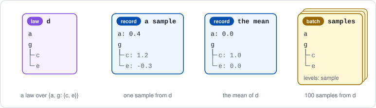
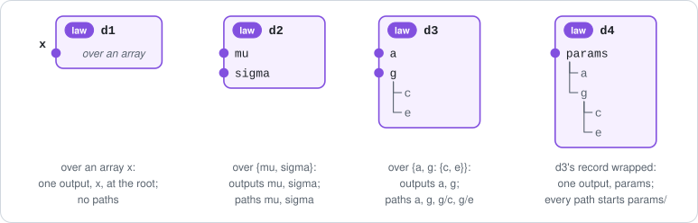
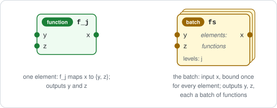
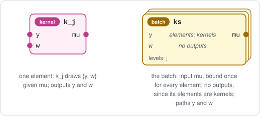
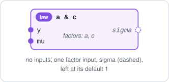
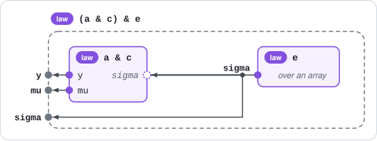

# Inputs, outputs, paths, and merge

A ProbPipe workflow is built from values, laws, kernels, functions, and batches of these.
This document defines four things about them:
1. **Names:** how the entries of a record are named, so that a law, samples from it, and its summaries share one set of names.
2. **Inputs and outputs:** what each object receives, and the names through which other objects receive from it.
3. **Selecting:** how a part of any object is picked out, removed, or renamed.
4. **Merging:** how two objects combine into one by matching names, as a likelihood and a prior combine into a joint model.

As a result, one path names one quantity everywhere: for a law `d`, the path `g/b` names the same quantity in `d`, in each sample from it, in its mean, in a batch of its samples, and in its type.
A merge matches objects by these same names.
Together these rules remove the mismatches between a law, its samples, and its mean that Appendix C.4 lists.

Part I states the ideas without code; the design can be judged from it alone.
Part II gives the code, class by class.
The appendices hold the open questions, the implementation plan, the differences from today's code, the relation to earlier plans, the alternatives weighed, and the status.
Citations such as II.6 and D1 name sections and principles of [`design/`](../design/README.md).

## Contents

**[Part I: The conceptual model](#part-i-the-conceptual-model)**

- [The structure every object has](#the-structure-every-object-has)

1. [Objects, values, and paths](#1-objects-values-and-paths)
   1. [Objects and their kinds](#11-objects-and-their-kinds)
   2. [Records, paths, nodes, fields, and groups](#12-records-paths-nodes-fields-and-groups)
2. [Types, value types, and paths](#2-types-value-types-and-paths)
   1. [Types, and when one conforms to another](#21-types-and-when-one-conforms-to-another)
   2. [The value type of an object](#22-the-value-type-of-an-object)
   3. [The paths of every object](#23-the-paths-of-every-object)
   4. [Equality](#24-equality)
3. [Inputs and outputs](#3-inputs-and-outputs)
   1. [Inputs](#31-inputs)
   2. [Outputs](#32-outputs)
   3. [Outputs by example, and signatures](#33-outputs-by-example-and-signatures)
   4. [Value types, outputs, and paths, side by side](#34-value-types-outputs-and-paths-side-by-side)
   5. [Describing an object's inputs and outputs](#35-describing-an-objects-inputs-and-outputs)
   6. [How a figure shows an object](#36-how-a-figure-shows-an-object)
   7. [Inputs and outputs compared](#37-inputs-and-outputs-compared)
4. [Selecting, removing, and renaming parts](#4-selecting-removing-and-renaming-parts)
   1. [Selecting one part](#41-selecting-one-part)
   2. [Selecting several parts](#42-selecting-several-parts)
   3. [Removing parts](#43-removing-parts)
   4. [Selecting from a type](#44-selecting-from-a-type)
   5. [Renaming and moving parts](#45-renaming-and-moving-parts)
   6. [The object at an output](#46-the-object-at-an-output)
   7. [Conditioning a law](#47-conditioning-a-law)
5. [Merging objects by name](#5-merging-objects-by-name)
   1. [Why merge](#51-why-merge)
   2. [Factors, and the inputs they still take](#52-factors-and-the-inputs-they-still-take)
   3. [Merge: outputs side by side, inputs fed from the right](#53-merge-outputs-side-by-side-inputs-fed-from-the-right)
   4. [Optional inputs](#54-optional-inputs)
   5. [The value of a merge](#55-the-value-of-a-merge)
   6. [Refused merges](#56-refused-merges)
   7. [What merge preserves](#57-what-merge-preserves)
   8. [What merge is not](#58-what-merge-is-not)
   9. [Order](#59-order)
6. [The kinds, one by one](#6-the-kinds-one-by-one)
   1. [Base values and records](#61-base-values-and-records)
   2. [Laws](#62-laws)
   3. [Kernels](#63-kernels)
   4. [Functions](#64-functions)
   5. [Batches](#65-batches)
7. [Invariants](#7-invariants)
   1. [The invariants](#71-the-invariants)
   2. [Cases the invariants do not cover, and why](#72-cases-the-invariants-do-not-cover-and-why)

**[Part II: The design in code](#part-ii-the-design-in-code)**

8. [Objects as tracked terms, and the code's names](#8-objects-as-tracked-terms-and-the-codes-names)
9. [Term specs](#9-term-specs)
10. [`InputSpec`](#10-inputspec)
11. [`OutputSpec`](#11-outputspec)
12. [Indexing in code: `[]`, `in`, `without`, and `rename`](#12-indexing-in-code--in-without-and-rename)
13. [Merging in code: `&`](#13-merging-in-code-)
14. [Records: `Record` and `RecordSpec`](#14-records-record-and-recordspec)
15. [Laws: `Distribution` and `MarginalView`](#15-laws-distribution-and-marginalview)
16. [Kernels: `ConditionalDistribution`](#16-kernels-conditionaldistribution)
17. [Functions: `Function`](#17-functions-function)
18. [Batches: `Batch` and `BatchSpec`](#18-batches-batch-and-batchspec)
19. [Errors and their messages](#19-errors-and-their-messages)
20. [Symbolic dimensions in code](#20-symbolic-dimensions-in-code)

**Appendices**

- [A. Open questions and issues](#a-open-questions-and-issues)
- [B. Implementation plan and sequencing](#b-implementation-plan-and-sequencing)
- [C. Differences from today's code](#c-differences-from-todays-code)
- [D. Relation to previous plans](#d-relation-to-previous-plans)
- [E. Alternatives considered](#e-alternatives-considered)
- [F. Status and history](#f-status-and-history)

---

# Part I: The conceptual model

Part I uses no code.
Records are written `{a: 1.0, g: {b: 2.0}}`, and laws by their distribution family, as `mu ~ Normal(0, 1)`; other notation is defined where it first appears.
In figures, data flows from right to left, as in $p(y \mid \mu)$: inputs enter an object's right edge and outputs leave its left edge; § 3.6 gives the legend.

## The structure every object has

1. **The value type** (§ 2.2). An object's type determines its *value type*: for a law or a kernel, its event type, the type of the objects it is a distribution over; for a function, its return type, when its type states one; for a batch, its element type; for a record or a base value, its own type. Paths and outputs are both defined from it.
2. **Paths and parts** (§ 1.2, § 2.3, § 4.1). A *path*, such as `g/c`, is the sequence of names from the root of a record to one of its entries. Only record types have named entries, so an object's paths are those of the record types its value type contains. For a law over `{a, g: {c, e}}`, `g/c` is a path of the law, of each sample from it, of its mean, and of a batch of its samples; a law over a single array has no paths. Selecting an object at a path gives a *part*, as `d[g/c]` is the part of the law `d` at `g/c`. A batch can also be selected by position along its levels, as `samples[3]`; this gives an element or a smaller batch, not a part.
3. **Outputs** (§ 3.2). An object's *outputs* are the names through which other objects receive from it: when two objects are combined, an input of one receives what the other gives at the output of the same name. A record value type gives one output per child. A base value type gives one output, whose name the object states, as the law `x ~ Normal(0, 1)` states `x`. A law or kernel value type gives none, since the separate laws of a law's parts do not determine it; so a function that returns a law has no outputs. A law over `{a, g: {c, e}}` therefore has the outputs `a` and `g`; `g/c` is a path of that law but not an output, since it names a node below a child.


*Figure: a law `d` over `{a, g: {c, e}}`. Its value type is `{a, g: {c, e}}`, and the figure shows one sample, a record of that type. The tree in its box shows its paths `a`, `g`, `g/c`, and `g/e`, which are also the sample's paths; its parts are its selections at these paths, as `d[g/c]`. Its outputs are `a` and `g`, the ports on its left edge.*

## 1. Objects, values, and paths

### 1.1 Objects and their kinds

> [!IMPORTANT]
> **Definition (object, kind).** An *object* is anything a workflow is built from, such as a particular law or a particular record.
> Its *kind* is one of six:
> 1. **base value:** an array, or an *opaque value*, which is any other value ProbPipe does not look inside, such as a string;
> 2. **record:** a tree of named entries (§ 1.2);
> 3. **law:** a probability distribution;
> 4. **kernel:** a map from the objects it conditions on to laws;
> 5. **function:** a map from its arguments to its result;
> 6. **batch:** many objects of one type (§ 2.1), called its *elements*, stacked along named axes, called its *levels*; a *position* is an index on some or all of the levels.
>
> Base values and records are *values*.

> [!IMPORTANT]
> **Definition (label).** An object's *label* is a display name; no operation reads it.

So relabeling an object never changes the result of an operation.

The array `2.5` and the string `"abc"` are base values; `mu ~ Normal(0, 1)` is a law; the map that gives the law `y ~ Normal(mu, 1)` at each value of `mu` is a kernel; a map from `x` to `{y, z}` is a function; and 100 samples from a law, over the level `sample`, form a batch.

### 1.2 Records, paths, nodes, fields, and groups

A workflow refers to the quantities inside its objects by name, such as the `mu` of a model or the group `g` of its parameters.
Records are the only values whose entries have names, so these names are always the names of record entries; § 2.3 shows how objects of other kinds take their names from the records their types describe.

> [!IMPORTANT]
> **Definition (name, record, node, path, field, group).**
> 1. A *name* is a non-empty string without `/`.
> 2. A *record* is a tree of named entries. Each entry has a name, unique among its siblings, and holds either another record or any other object, such as an array or a law.
> 3. A *node* of a record is either the record itself, called its *root*, or an entry at any depth below it.
> 4. The *path* of a node is the names from the root down to it, joined by `/`, as `g/b`; the root has no path.
> 5. A *child* of a node is an entry directly under it.
> 6. The *canonical order* of a record's nodes is depth first, each node before its children, and siblings in insertion order.
> 7. A *field* is an entry that is not a record; a *group* is an entry that is a record.
> 8. A *leaf path* is a path that no other path extends, that is, no other path begins with it followed by `/`. Since paths continue into the objects that fields hold (§ 2.3), a field holding a law over a record type is not at a leaf path.
> 9. A *top-level name* is the name of a child of the root; a path of more than one name is *nested*.


*Figure: the record `{a: 1.0, g: {b: 2.0, c: 3.0}}` has the paths `a`, `g`, `g/b`, `g/c`, the fields `a`, `g/b`, `g/c`, and the group `g`.*

> [!NOTE]
> **Consequence** (of the definition).
> 1. Sibling names are distinct, so a path names at most one node; children of two different groups may share a name, as `g1/theta` and `g2/theta` do.
> 2. A base value has no paths, since it has no named entries; an array's entries are indexed by integers, not by names.

A field may hold a law or any other object; § 2.3 extends paths into the object a field holds.

## 2. Types, value types, and paths

### 2.1 Types, and when one conforms to another

Types decide three questions before anything is computed: whether an object may be supplied to an input (§ 3.1), what an object's value type is (§ 2.2), and which paths an object has (§ 2.3).

> [!IMPORTANT]
> **Definition (type).** A *type* is a description of an object's structure; the table lists what each type holds.
> Every type belongs to exactly one kind (§ 1.1), and an object's kind is the kind of its type.
>
> | Type | Kind | What it holds |
> | --- | --- | --- |
> | *array type* | base value | a shape, whose sizes are integers or dimension names, and optionally a dtype and a *support*, the set its entries lie in, such as the positive reals, which describes the entries and is not checked; it is written by its shape, as `(3,)` or `(n, m)`, with its dtype after it when set |
> | *opaque type* | base value | optionally, a Python type and metadata |
> | *record type* | record | a tree of names, as a record has, with a type at each field |
> | *law type* | law | the law's *event type*, the type of the objects the law is a distribution over; every law has one |
> | *kernel type* | kernel | for each variable the kernel conditions on, a name, a type, and whether it may be omitted; and the kernel's event type |
> | *function type* | function | for each argument, a name, a type, and whether it may be omitted; and the function's *return type*, the type of its result; the arguments or the return type may be unknown |
> | *batch type* | batch | the batch's levels, and its *element type*, the type of one element |
>
> Array and opaque types are *base types*. A *law over* `T` is a law whose event type is `T`, as a law over `{mu, sigma}`; a *kernel over* `T` is a kernel whose event type is `T`.

> [!IMPORTANT]
> **Definition (dimension name, dimension scope).** A *dimension name*, such as `n`, stands for an array size not yet given as a number.
> A *dimension scope* is a set of types whose dimension names are compared with one another: the types at the fields of one record type, or all the types that one conformance check or one merge (§ 5) compares.
> Within one scope, a dimension name stands for one size:
> 1. the first time the name is compared with a size, it is *bound* to that size;
> 2. a later comparison with a different size is refused;
> 3. two different unbound names compared at the same axis are refused, since nothing says whether their sizes are equal (II.1).

> [!IMPORTANT]
> **Definition (conforms, unify).**
> 1. An object *conforms to* a type when it has the structure the type describes.
> 2. A type `A` *conforms to* a type `B`, within one dimension scope, when every object that conforms to `A` also conforms to `B`. The rules by kind below implement this inclusion, except in two cases, which they decide: two different unbound dimension names at one axis never conform (the scope rule), and a type that sets no dtype or support conforms to every type of its shape (consequence 6).
> 3. Two types `A` and `B` *unify* when the rules by kind below give a type `U`, their *unification*, that conforms to both. Unification is needed where one object must satisfy two declared types at once, as an input shared by two merged objects must (§ 5.3). Where `U` exists, a type conforms to `U` exactly when it conforms to both `A` and `B` (consequence 2), so `U` is the most general type that conforms to both.
>
> The technical notes below state both relations and unification by kind, and are normative.

> [!TIP]
> For dtypes, conformance follows NumPy's same-kind casting, and unification takes the narrower dtype: `int32` and `float32` unify to `int32`, since every `int32` casts into `float32` but not every `float32` casts into `int32`.

| `A` | `B` | `A` conforms to `B` | Unification |
| --- | --- | --- | --- |
| `(3,) float32` | `(n,)` | yes, binding `n` to 3 | `(3,) float32` |
| `() int32` | `() float32` | yes | `() int32` |
| `() float32` | `() float64` | yes | `() float32` |
| `(4,)` | `(3,)` | no | none |
| `(m,)` | `(n,)` | no: two unbound names | none |
| `{x, y}` | `{y, x}` | no: a different order | none |

> [!NOTE]
> **Consequence** (of the definitions and the rules by kind).
> 1. **Kernel and function types conform contravariantly in the types of what they condition on or take as arguments, and covariantly in their event or return types,** as inclusion gives: a kernel that conforms to `A` accepts every object of the types `A` gives what it conditions on, so it accepts every object of `B`'s types when `B`'s conform to `A`'s; and its laws are over objects of `A`'s event type, which conform to `B`'s event type when `A`'s does. Functions are alike, with arguments and return types.
> 2. Where the unification of `A` and `B` exists, a type conforms to it exactly when it conforms to both, unless two unbound dimension names meet at one axis among the three types.
> 3. For array types over the standard NumPy dtypes, the converse also holds: if some type conforms to both `A` and `B`, their unification exists; § 5.7 uses this fact.
> 4. Kernel and function types can lack a unification although a type conforms to both, since their unification requires equal types for what they condition on or take as arguments, while their conformance is contravariant there.
> 5. Unification is symmetric, and associative where it exists.
> 6. By rule 1 of the second technical note below, a type given by sizes alone sets no dtype or support, so it conforms to and unifies with any type of its shape; this is the departure from inclusion that item 2 of the definition names.

<details>
<summary>Technical note: when an object conforms to a type, by kind</summary>

1. **arrays:** an array conforms to an array type when its shape matches the type's, binding the type's dimension names, and its dtype casts into the type's by NumPy's same-kind rule; a support only describes, and is not checked;
2. **opaque values:** an opaque value conforms to an opaque type when it is an instance of the type's Python type, or the type sets none;
3. **records:** a record conforms to a record type when it has the same tree, with the same child names in the same order at each node, and each field conforms to the type at the matching field; so a record that conforms flattens in the declared order;
4. **raw mappings:** a *raw mapping*, a mapping of names to values that is not yet a record, such as one a function returns or one given for an input, is first laid out in the declared order at each node and then checked as a record, so its key order never matters;
5. **laws:** a law conforms to a law type when every object it is a distribution over conforms to the type's event type;
6. **kernels:** a kernel conforms to a kernel type when it conditions on the variables the type names, accepts for each every object that conforms to the type the kernel type gives it, lets each be omitted that the kernel type lets be omitted, and gives at each accepted choice a law over objects that conform to the event type;
7. **functions:** a function conforms to a function type when it has the type's argument names, accepts at each argument every object that conforms to the type the function type gives that argument, lets each argument be omitted that the function type lets be omitted, and returns at each accepted choice an object that conforms to the return type;
8. **batches:** a batch conforms to a batch type when it has the same levels and each element conforms to the element type.

For laws, kernels, functions, and batches, the check reads the object's own type: the object conforms when its type conforms to the given type, by the next note.

</details>

<details>
<summary>Technical note: when a type conforms to another, by kind</summary>

`A` conforms to `B`, in one dimension scope, when:
1. **arrays:** the ranks are equal, each axis agrees by the scope rule, and when both set a dtype, `A`'s casts into `B`'s by NumPy's same-kind rule; supports are not compared (III.5);
2. **opaque values:** `B`'s Python type is unset or a superclass of `A`'s, and `B`'s metadata is unset or equal to `A`'s (III.2);
3. **records:** the same child names in the same order (§ 5.9), each child of `A` conforming to `B`'s;
4. **laws:** `A`'s event type conforms to `B`'s;
5. **kernels and functions:** the same names of conditioning variables or arguments; each of `B`'s types for these conforms to `A`'s type of the same name, and one that may be omitted in `B` may be omitted in `A`; `A`'s event or return type conforms to `B`'s; for function types, when `B` leaves its arguments or its return type unknown, `A` conforms in that respect whatever it states, and when only `A` leaves one unknown, `A` does not conform;
6. **batches:** the same levels, and `A`'s element type conforms to `B`'s.

</details>

<details>
<summary>Technical note: the rules of unification, by kind</summary>

1. **arrays:** equal ranks, each axis agreeing; a dtype only one sets, or, when both set one, the dtype of the type that conforms to the other, the narrower by NumPy's safe cast when each conforms to the other, and no unification when neither conforms; a support only when both set the same one, and none otherwise;
2. **opaque values:** equal Python types, or one unset, and likewise the metadata; the unification takes the known type and the set metadata (III.2);
3. **records:** the same child names in the same order, and the unification child by child, in that order;
4. **laws:** the unification of the event types;
5. **kernels and functions:** the same names, with equal types, and the same ones that may be omitted; and the unification of the event or return types; for function types, when one leaves its arguments or its return type unknown, the unification takes the other's;
6. **batches:** the same levels, and the unification of the element types.

Any other pair, such as an array type with a record type, does not unify.

</details>

### 2.2 The value type of an object

The paths that select a quantity (§ 2.3) and the outputs through which other objects receive it (§ 3.2) must agree across a law, its samples, its mean, and batches of its samples.
Both are therefore defined from one type per object, its value type: the type of the objects a law is a distribution over, a function returns, or a batch has as elements.

> [!IMPORTANT]
> **Definition (value type).** An object's *value type* is the type, read from the object's type (§ 2.1), from which its paths and outputs are defined: a law's or kernel's event type; a function's return type; a batch's element type; a record's or base value's own type.
> A function whose type leaves its return type unknown has no value type.
> A value type may be of any kind, such as a law type for a function that returns a law, so the objects of an object's value type are values (§ 1.1) only when it is a base type or a record type.

Since the value type is read from the type without computing anything, a law has a value type whether or not it can be sampled, and a function has one before it is called.
A law over `{mu, sigma}` has the value type `{mu, sigma}`, and so does a batch of 100 samples from it; a function from `x` to `{y, z}` has the value type `{y, z}`.
For a function whose return type is unknown, § 3.5 and § 6.4 state what is known of its outputs and paths.

### 2.3 The paths of every object

**Why paths must agree across objects.**
From one law `d` over `{a, g: {c, e}}`, a workflow obtains samples from `d`, batches of samples, the mean of `d`, and the marginal laws of `d`, and it passes each of these to other objects.
For these objects to work together, a path such as `g/c` must identify the same quantity in all of them.
Selecting at `g/c` (§ 4.1) then gives the corresponding quantity in each object:
1. for the law, `d[g/c]` is the *marginal law* of the quantity at `g/c`;
2. for a sample `x` from `d`, `x[g/c]` is the value of that quantity in `x`;
3. for the mean of `d`, written `mean(d)`, `mean(d)[g/c]` is the mean of that quantity;
4. for a batch `b` of samples from `d`, `b[g/c]` is the batch of that quantity's values, one for each sample.

A sample, the mean, and each element of a batch of samples are records of the type `{a, g: {c, e}}`, which is `d`'s event type.
So the paths of all these objects agree if the paths of a law are the paths of its event type, and the paths of a batch the paths of its element type.

> [!IMPORTANT]
> **Definition (paths).** The *paths* of a type are:
> 1. for a record type: for each child, its name `c`, and `c/q` for each path `q` of that child's type;
> 2. for a law type or a kernel type: the paths of its event type;
> 3. for a function type: the paths of its return type;
> 4. for a batch type: the paths of its element type;
> 5. for a base type: none.
>
> The *paths of an object* are the paths of its type.

For a record, these are the paths of its tree (§ 1.2), continued into the objects its fields hold.
For a law `d`, write `sample(d)` for a sample from `d`.
Because `d`'s paths are those of its event type, every path `p` of `d` is also a path of each sample.
Once § 4.1 defines `d[p]` as the marginal law at `p`, it follows that `sample(d[p])` is distributed as `sample(d)[p]`, and that selecting commutes with field-by-field summaries such as the mean (§ 6.2); neither is a further rule.

> [!NOTE]
> **Consequence** (of the definitions of paths and of value type).
> 1. **Only record types introduce names.** Each name in a path is the name of a child in a record type, so an object whose type holds no record type at any depth, such as a law over an array or a batch of arrays, has no paths.
> 2. **An object's paths are the paths of its value type,** for every kind: a law's, kernel's, function's, and batch's by rules 2 to 4, and a record's or base value's since its value type is its own type.
> 3. **A batch has paths exactly when its element type does.**
> 4. **Paths continue through held objects:** a record whose field `g` holds a law over `{mu}` has the path `g/mu`, where `mu` is a child of the law's event type. The path is the record's, but the record's fields are only its own entries, so `g/mu` is not a field.
> 5. A function whose return type is unknown has no paths known before it is called.
> 6. The other names a type holds are not paths: the names of what a kernel conditions on and of a function's arguments (§ 2.1), and the names of a batch's levels.
> 7. A position is not a path: it selects from a batch along its levels, not by name, and gives no part (§ 4.1).

| Kind | Its paths are those of | An example with no paths | Selected by position |
| --- | --- | --- | --- |
| base value | nothing | every base value | no |
| record | its own tree, continuing into the objects its fields hold | a record with no entries | no |
| law, kernel | its event type | a law over an array | no |
| function | its return type | a function returning an array, or whose return type is unknown | no |
| batch | its element type | a batch of arrays | yes: a position along its levels selects an element or a smaller batch, as `samples[3]` |


*Figure: a law `d`, a sample from it, its mean, and a batch of its samples have one set of paths, those of `d`'s event type `{a, g: {c, e}}`.*


*Figure: for a law `d` over `{mu, sigma}`, the record `{x: 3.0, g: d}` has the paths `x`, `g`, `g/mu`, `g/sigma`; its fields are `x` and `g`.*

### 2.4 Equality

> [!IMPORTANT]
> **Definition (equal).** Two base values are *equal* when they have the same type and equal contents; two records are equal when they have the same type and equal entries.
> Two laws, kernels, or functions are equal when they have equal types and the same distribution or map.
> Two batches are equal when they have the same levels, in the same order, equal element types, and equal elements.

A type holds no name for an output at the root, the name that § 3.2 lets a law over an array, a function returning an array, or a batch of arrays state.
So the equality of batches does not compare that name, although a merge reads it, and two equal batches can merge differently (§ 6.5).
Whether two laws, kernels, or functions that differ only in that name are equal is left open (Appendix A.2, item 27).

## 3. Inputs and outputs

An object receives what it depends on at its inputs, and other objects receive from it at its outputs.
An output of one object can supply the input of the same name of another (§ 5).

### 3.1 Inputs

Some objects depend on objects they do not hold: a kernel on the variables it conditions on, a function on its arguments.

> [!IMPORTANT]
> **Definition (input).** The *inputs* of a kernel are the variables it conditions on, and the inputs of a function are its arguments. Each input receives one object when the kernel or function is used, and has:
> 1. a *name*, which is a Python identifier;
> 2. a *type* (§ 2.1), to which every object supplied there must conform;
> 3. whether it may be omitted: an *optional* input may be, and then takes its *default*, which the kernel or function holds; a *required* input may not.

> [!IMPORTANT]
> **Definition (binding).** *Binding* supplies objects to some of an object's inputs, by name; each optional input left out takes its default.
> Binding a kernel gives a law once no required input remains, and otherwise a kernel of the inputs that remain.

> [!NOTE]
> **Consequence** (of the definitions and § 1.1).
> 1. A kernel has at least one input, by the rule of § 6.3, and a function has its arguments, which may be none; a batch of either has its elements' inputs, and one binding supplies them to every element.
> 2. Base values, records, and laws have none, so an object with no inputs is a value, a law, a function with no arguments, or a batch of these. A record whose field holds a kernel has no inputs, since the kernel is the field's value.
> 3. An input of record type is one input, supplied with one whole record, except that a binding may supply it node by node (technical note below).

Take the kernel that gives the law `y ~ Normal(mu, sigma)` at each value of `mu` and `sigma`, with `sigma` optional and default 1.
Binding `mu = 0.3` gives the law `Normal(0.3, 1)`; binding also `sigma = 2` gives `Normal(0.3, 2)`.
The objects a binding supplies are written as a record, `{mu: 0.3, sigma: 2.0}`.

<details>
<summary>Technical note: binding a node of a record input</summary>

A binding may supply a node of a record input by its path: for an input `g` of type `{b, c}`, it may supply `g/b` alone.
The kernel then has an input `g` of type `{c}`, now required, since a default is a whole value (III.9).

</details>

### 3.2 Outputs

**What outputs are for.**
Outputs are the names through which other objects receive from an object.
Take a law `prior` over `{mu, sigma}` and a kernel `lik` that gives a law of `y` at each value of an input `mu`.
When the two are built into a model, by merging them (§ 5), `lik`'s input `mu` is connected to `prior`'s output `mu` by name, so `lik` receives what `prior` gives at `mu`.

**Outputs come from the value type.**
`prior` is a law over `{mu, sigma}`, so its value type is the record type `{mu, sigma}` (§ 2.2).
The children of that type already have names, and these names serve as `prior`'s outputs: `prior` has the outputs `mu` and `sigma`.
A law over a single array, such as `x ~ Normal(0, 1)`, has a base value type, which has no named children, so the law states a name for its one output, here `x`.

To state what a law gives at its outputs, regard the law as the distribution of a random variable whose outcomes are objects of its event type, called the law's *random variable*; a sample is one outcome of it.
A kernel has such a random variable at each value of its inputs.

> [!IMPORTANT]
> **Definition (output, output value).** An *output* of an object is a name under which other objects can receive one thing from it, its *output value*.
> An object has either one output for its value type as a whole, or one output for each child of its value type; Definition (outputs) below says which, and Definition (output values by kind) gives each output value.
> An output value can be any object, such as a value, a law's random variable, a function, or a batch, so the name "output value" does not imply that it is a value in the sense of § 1.1.

**Requirements on outputs.**

1. **An output is one name for one whole object, as an input is.**
   An input is identified by a single name, not a path.
   When objects are combined (§ 5), an input receives one whole object; only a binding may supply part of a record input (§ 3.1).
   For an output to supply an input, the output must likewise be a single name for one whole object.
   So an output is a single name, never a nested path: a law over `{a, g: {c, e}}` can have the outputs `a` and `g`, but `g/c` cannot be an output.

2. **Together, the output values determine the object.**
   When objects are combined (§ 5), one object receives from another only through its outputs.
   If the output values did not determine the object, a combination could not use the rest of it.
   For example, if the output values of a law over `{mu, sigma}` were the separate laws of `mu` and of `sigma`, the dependence between `mu` and `sigma` would be lost; instead, the output values of `mu` and `sigma` are the two children of the law's one random variable, so together they keep the joint law.

3. **Only a base value may have a name attached from outside.**
   As § 1.2 describes, a record has named children, and these names can serve as output names.
   A base value (an array or an opaque value) has no children, so a name for it must be attached from outside it.
   The name is stated by the object whose value type is that base type: a law over an array, as `x ~ Normal(0, 1)` states `x`; a function returning an array; or a batch of arrays, through its element name (below).
   Moreover, we require that only a base value may have a name attached from outside.
   If a record type also had a name attached from outside, each child would have two names: in a law over `{mu, sigma}` that was also named `params`, the child `mu` would be called `mu` in a sample but `params/mu` in the law, and a selection or a combination by one name would miss the other.
   Whether a name may be attached depends on kind alone: a base value may have one, while a record, a law, a kernel, a function, or a batch may not, even one with no named children.
   In `x ~ Normal(0, 1)` the name `x` is attached to the arrays the law is a distribution over, not to the law; so when a law is itself the result of a function, nothing attaches a name to it, even when it is a law over a single array.

> [!IMPORTANT]
> **Definition (outputs).** The *outputs* of a type are given by five cases; each output has a type, and a name, which in case 2 the object states:
>
> | Case | The type | Its outputs | Why |
> | --- | --- | --- | --- |
> | 1 | a record type | one per child, under the child's name, typed by the child's type | each child is one name for one whole object (1), the children determine the record (2), and they already have names, so none is attached from outside (3) |
> | 2 | a base type | one, typed by the base type, whose name is stated by the object whose value type it is (3); this output is *at the root* | a base value has no children to supply names, so its one name is attached from outside, which (3) allows for base values only |
> | 3 | a function type | the outputs of its return type, read pointwise | a function whose result is a record is determined by the functions that give each child (2) |
> | 4 | a batch type | the outputs of its element type, read element by element | a batch of records is determined by the batch of each child (2) |
> | 5 | a law type or a kernel type, as the value type of a function that returns a law or of a batch of laws; a law's own value type is its event type, which the other cases read | none | a law is not a base value, so no name is attached to it from outside (3); and the laws of its parts do not determine it, so its parts cannot serve as its outputs (2). To give one a name, put it in a record under that name (Definition (wrap), below) |
>
> An object's *outputs* are the outputs of its value type, with two exceptions:
> 1. a base value standing alone has no outputs: no object states a name for it, and a label is not such a name;
> 2. a batch's outputs take their names from its element type, but each is typed by the type of its output value: the batch type over the batch's levels whose element type is the type the element type gives that output. For a batch over `sample` of records `{mu, sigma}`, the output `mu` has the batch type over `sample` of `mu`'s type.

> [!IMPORTANT]
> **Definition (element name).** A batch whose element type is a base type states the name of its one output, its *element name* (requirement 3).
> The operation that builds the batch gives the name; a batch built directly from base values has the element name `element`.
> Merges, outputs, and renames read it, and § 3.5 says where it is kept.
> Where a batch type of base elements is the value type of another object, as a function's return type, that object's output at the root takes its name from the element name too.

<details>
<summary>Technical note: reading outputs pointwise and element by element</summary>

Case 3 reads each output `c` of the return type pointwise: it gives the output `c` of the function type, typed by the function type with the same inputs whose return type is the type of `c`.
Case 4 reads each output `c` of the element type element by element: it gives the output `c` of the batch type, typed by the batch type over the same levels whose element type is the type of `c`.
So the element type of a batch of functions from `x` to `{y, z}` has the outputs `y` and `z`, each typed by a function type from `x`; the batch's own outputs `y` and `z` are typed by batch types over its levels whose element types are those function types.

</details>

> [!IMPORTANT]
> **Definition (output values by kind).** The output value of an object `x` at its output `c` is:
> 1. for a record, the child `c`;
> 2. for a law, the random variable whose outcome, at each outcome `v` of the law's random variable, is the output value of `v` at `c`; when the event type is a record type, this is the child `c` of the law's random variable, and its law is the marginal law `d[c]` (§ 4.1). For a kernel, the same at each value of its inputs;
> 3. for a function, the function, with the same inputs, that maps each argument `w` to the output value at `c` of its result at `w`;
> 4. for a batch, the batch, over the same levels, of each element's output value at `c`.
>
> At an output at the root, the output value is the whole object: the law's random variable, the kernel's random variable at each value of its inputs, the function, or the batch.

For a law over `{mu, sigma}`, the outputs are `mu` and `sigma` (case 1), and their output values are the children of the law's random variable; a law over an array has one output at the root (case 2), whose output value is its whole random variable.
For a function from `x` to `{y, z}`, the outputs are `y` and `z` (case 1), and the output value of `y` maps each `x` to the `y` of the result.

> [!NOTE]
> **Consequence (paths go through a law type, outputs stop at one).** A record whose field `g` holds a law over `{mu, sigma}` has the paths `g/mu` and `g/sigma` (§ 2.3), and its output `g` names the whole law.
> A function that returns a law, or a batch of laws, has no outputs (case 5), because the marginals of a law do not determine it.

> [!IMPORTANT]
> **Definition (wrap).** To *wrap* an object under a name `n` is to replace its value type `T` with the record type `{n: T}`: a record `r` becomes `{n: r}`, a law over `T` becomes a law over `{n: T}`, and a function returning `T` becomes one returning `{n: T}`. The wrapped object has the one output `n`.

> [!NOTE]
> **Consequence** (of the definitions; 3 and 4 are proved in the external formal model described at the end of Appendix D.1).
> 1. **Output values determine the object,** wherever there are outputs: a record is rebuilt from its children, an object with an output at the root is determined by its one output value, a function or a batch is rebuilt from its output values, and the output values of a law are the children of its one random variable, so their joint law is the law.
> 2. **A node below a child is named by a path (§ 2.3), not by an output:** a law over `{a, g: {c, e}}` has the outputs `a` and `g`, while `g/c` and `g/e` are paths only.
> 3. **An object with an output at the root has no paths.** An object has one output at the root, or one output per child of a record type, or no outputs; never an output at the root together with paths below it.
> 4. **No name is both the name of an output at the root and a path.** An object with an output at the root has no paths, since its value type has none; every other output's name is the path of a child. So every output name other than a root name is a path of the object and of its samples, and a root name never collides with a path.
> 5. **Outputs are not chosen.** They are determined by the object's value type, through the five cases; the one exception is the name of an output at the root, which the object states.

<details>
<summary>Technical note: why a function's return value can give outputs and a law cannot</summary>

A function `f` whose return value is the record `{y, z}` is determined by its output values, since `f(x)` is `{y: f_y(x), z: f_z(x)}`, and a batch of records is determined by the batch of each child.
A law over `{mu, sigma}` is not determined by its marginals, since many joint laws share them.
If a law returned by a function had its marginals as outputs, a later step could receive `mu` and `sigma` as separate laws and lose their dependence (D1); so a function returning a law has no outputs, and neither does a batch of laws.

</details>

<details>
<summary>Technical note: names of outputs and of inputs</summary>

An output's name is any name (§ 1.2), since a merge makes it the name of a field (§ 5.5); an input's name must also be a Python identifier, since it is matched to an argument.
An output named `"n-obs"` therefore supplies no input.

</details>

### 3.3 Outputs by example, and signatures


*Figure: a base value type gives one output, named outside the box (case 2); a record type gives one output per child (case 1); a wrap gives the record one output.*

| Object | Its value type | Outputs | Output values | Case |
| --- | --- | --- | --- | --- |
| a kernel over an array, whose output it names `y` | an array type | `y`, at the root | the kernel's random variable, at each value of its inputs | 2 |
| a law `d` over `{mu, sigma}` | `{mu, sigma}` | `mu`, `sigma` | the children of its random variable | 1 |
| a law over `{params: {mu, sigma}}` | `{params: {mu, sigma}}` | `params`; the law and its samples have the path `params/mu` | the child `params` of its random variable | 1 |
| a function `f` from `x` to `{y, z}` | `{y, z}` | `y`, `z` | the output value of `y` maps `x` to `f(x)`'s `y` | 1 |
| a function `h` returning a law | a law type | none; to name the law, `h` returns `{params: law}` | — | 5 |
| 100 samples from `d` | `{mu, sigma}` | `mu`, `sigma` | each a batch of 100 values | 1 |
| 4 samples from a law over an array named `x` | an array type | `x`, at the root | the whole batch | 2 |
| a batch of laws | a law type | none | — | 5 |

> [!IMPORTANT]
> **Definition (signature).** The *signature* `a(outputs | inputs)` of an object that the text names `a` lists its outputs and then its inputs, as `a(y | mu, sigma)`; an object with no inputs is written `a(outputs)`, as `d(mu, sigma)`. Signatures name objects compactly in the text and the figures; `a` is the text's name for the object, not its label.

### 3.4 Value types, outputs, and paths, side by side

For each of the four laws below, the value type is its event type, and its paths and its outputs are both defined from that type.
When that type is a record type, the outputs are the names of its children (§ 3.2, case 1), while the paths also include the paths below the children, such as `g/c` in `{a, g: {c, e}}` (§ 2.3); so the outputs and the paths coincide only when no child's type has paths.
When that type is a base type, the law has one output at the root and no paths.


*Figure: four laws and their outputs. A port marks an output; a muted name under an output is a nested path, not an output.*

| Law | A sample (a value of its value type) | Value type | Paths | Outputs |
| --- | --- | --- | --- | --- |
| `d1`, over an array named `x` | `0.7` | an array type, as `()` | none | `x`, at the root; `x` is the name of an output, not a path |
| `d2`, over `{mu, sigma}` | `{mu: 0.1, sigma: 1.3}` | the record type `{mu, sigma}` | `mu`, `sigma` | `mu`, `sigma` |
| `d3`, over `{a, g: {c, e}}` | `{a: 0.4, g: {c: 1.2, e: -0.3}}` | the record type `{a, g: {c, e}}` | `a`, `g`, `g/c`, `g/e` | `a`, `g` |
| `d4`, over `{params: {a, g: {c, e}}}` | `{params: {a: 0.4, g: {c: 1.2, e: -0.3}}}` | the record type `{params: {a, g: {c, e}}}` | `params`, `params/a`, `params/g`, `params/g/c`, `params/g/e` | `params` |

Paths and outputs serve different operations: § 4 selects a part at any path, while § 5 combines objects through their outputs only.
Each law also shares its paths with its mean and with a batch of its samples: a batch of 100 samples from `d3` has the value type `{a, g: {c, e}}`, the paths `a`, `g`, `g/c`, `g/e`, and the outputs `a` and `g`, each output value a batch of 100 values.

> [!NOTE]
> **Consequence** (of the definitions of output and wrap).
> 1. **Outputs are not chosen** (§ 3.2, consequence 5): `d1` states the name `x` of its output at the root, while `d3` cannot give its whole record one name attached from outside (requirement 3), and its nested paths `g/c` and `g/e` cannot be outputs (requirement 1).
> 2. **A wrap gives a record one name, and changes the value type.** `d4` is a different law from `d3`, since it is a law over `{params: {a, g: {c, e}}}`, not over `{a, g: {c, e}}`; every path of `d4` starts with `params`.
> 3. **Only outputs connect.** Another object's input `g` can receive the group `g` from `d3`, while an input `c` cannot receive the node at `g/c`, which is not an output; renaming `g/c` to `c` first makes it one (§ 4.5).

### 3.5 Describing an object's inputs and outputs

A check made before anything is computed, such as the check that two objects can be combined (§ 5), needs only the names and types of an object's inputs and outputs.
An object's type (§ 2.1) holds no name for an output at the root, so outputs are described by the value type together with that name.

> [!IMPORTANT]
> **Definition (description of inputs, description of outputs).**
> 1. An object's inputs are described by listing them in order, each with its name, its type, and whether it may be omitted. The description holds no defaults. Two such descriptions are equal when they list the same inputs, with the same types and the same optional inputs, in any order.
> 2. An object's outputs are described by its value type and the name of each output at the root that it has: for a base value type, the name of the object's one output; for a batch type of base elements, the element name its elements carry (§ 3.2). Each output's name follows from these, and so does its type, except for a batch, whose outputs are typed by batch types over its levels (§ 3.2). An object whose value type is the empty record type has no outputs and no description of them.
> 3. The description of an output at the root may leave its type unspecified until the type is known, as a function's can before its first call. The type is completed then, under the rules of the technical note below.
> 4. The name of an output at the root belongs to the description of the outputs, not to the object's type: conformance and unification of types (§ 2.1) ignore it, and so does the equality of batches (§ 2.4).

> [!NOTE]
> **Consequence** (of the definitions of the description of outputs and of outputs). The value type decides whether an object has an output at the root, and where that type is unspecified the stated name does; so the description records nothing else about it.

The kernel `a(y | mu)` has the value type `()` and the output name `y`.
A law over `{mu, sigma}` has the value type `{mu, sigma}` and no name.
A function that returns an array under the name `m` can describe its output before its first call, with the name `m` and the type unspecified; its first call determines the type.
A batch of 4 arrays of shape `()` named `x` has the value type `()` and the name `x`, its element name.

<details>
<summary>Technical note: equality and order</summary>

Output order is the field order of the record that holds the output values, each under its output's name; it fixes the order of a numeric record's entries when the record is laid out as one array, so two descriptions listing the same outputs in two orders are unequal, as are record types listing the same children in two orders; neither conforms to nor unifies with the other (§ 2.1).
A description naming a base value `n` and one whose value type is `{n: …}` have the same output and are unequal, since one describes objects of a base type and the other objects of a record type.
Two descriptions of the outputs of batch types whose elements have different names have different outputs and are unequal, although the two batch types are equal (§ 3.2).

</details>

<details>
<summary>Technical note: conformance and unification of outputs</summary>

The outputs described by `A` conform to those described by `B` when they state the same name for an output at the root of a base value type, if any, and `A`'s value type conforms to `B`'s; the element name of a batch type is not compared (§ 3.2).
When `B`'s type is unspecified, `A` conforms to `B` only when `A`'s type is one that could complete it: a base type, or a batch type whose elements are base values.
Two descriptions of outputs unify likewise; when the type of one is unspecified, the unification takes the other's type if that type could complete it, and otherwise they do not unify.

</details>

<details>
<summary>Technical note: an output whose type is unspecified</summary>

1. **Completing it.** The type is completed once the result is known. A base type completes it, and the output keeps its name. A batch type whose elements are base values carrying only the default element name `element` (§ 3.2) completes it, and the batch's elements take the output's name. Any other type is refused, with a message asking for a record type to be stated instead.
2. **Reading it as inputs.** Outputs can be read as inputs, one required input per output, typed by the output's type, so that a kernel's inputs can be declared from the outputs of the object that will supply them (§ 5.3, technical note). An output whose type is unspecified gives no type, so it is refused there.
3. **Merging it.** A merge refuses an operand whose value type is unspecified (§ 5.3, condition 2), and the merge of descriptions of outputs refuses such a description.

</details>

### 3.6 How a figure shows an object

In figures, data flows from right to left, as in a density $p(y \mid \mu)$, which is a density of `y` given `mu`: inputs are ports on the right edge, and outputs on the left.


*Figure: how a figure shows an object.*


*Figure: the kernel `k(y | mu, sigma)`; it is a kernel over an array, its output is `y`, and `sigma` is optional.*


*Figure: the record `{a: 1.0, g: {b: 2.0, c: 3.0}}` has its children `a` and `g` as outputs.*

### 3.7 Inputs and outputs compared

| | Inputs | Outputs | Why |
| --- | --- | --- | --- |
| Naming | every input is named | only a base value has a name attached from outside it | objects are supplied to inputs by name; a record value type has named children, whose names are its output names |
| Names allowed | identifiers | any name | an input matches an argument; a merge makes an output a field's name |
| Structure | one name each; a binding may still supply one node of a record input by its path | one output at the root, or the names of the children of a record value type, with nested paths below them | an input receives one whole object; an output names the value type as a whole or one of its children |
| Presence | may be optional | always present | every output has an output value |
| Type unspecified | an input's type, never; a function's whole list of inputs may be unknown (§ 2.1) | only for an output at the root, until the type is known (§ 3.5) | a binding is checked against the input's type |
| Equality of descriptions | ignores the order of inputs | depends on the order of outputs | binding is by name; output order determines the layout |
| Empty | an object may take no inputs | an object whose value type is the empty record type, a law type, or a kernel type has no outputs | an empty record names nothing |
| Batches | the elements' inputs | the outputs of the element type, each typed by a batch type over the levels (§ 3.2); none when the elements are laws or kernels | one binding supplies every element |

A batch's outputs are the outputs of its element type (§ 3.2): a batch of functions has the outputs of its elements' function type (case 3), each output value the batch of the elements' output values, while a batch of kernels has none (case 5).
A single kernel has outputs, since its value type is its event type; a batch of kernels has none, since its value type is a kernel type, just as a function that returns a law has none.


*Figure: a batch `fs` of functions over the level `j`, each from `x` to `{y, z}`. Its input `x` is its elements' input, bound once for every element; its outputs are `y` and `z`, and the output value of `y` is the batch of the functions that give each element's `y`.*


*Figure: a batch `ks` of kernels over the level `j`, each a kernel over `{y, w}` given `mu`. Its input `mu` is its elements' input, bound once for every element. It has no outputs (§ 3.2, case 5), but its paths `y` and `w` come from its elements' event type: selecting `ks` at `y` (§ 4.1) gives the batch of the kernels of each element's `y`.*

## 4. Selecting, removing, and renaming parts

### 4.1 Selecting one part

> [!IMPORTANT]
> **Definition (selection).** For an object `x` and a path `p` of `x`, the *selection* `x[p]` is defined by kind:
> 1. for a record, the node at `p` when `p` is a path of its tree; when `p` passes through a field `q` holding an object `y`, so that `p` is `q/rest`, the selection `y[rest]`;
> 2. for a law `d`, the *marginal law* at `p`: the law of `X[p]`, where `X` is `d`'s random variable (§ 3.2) and `X[p]` selects at `p` in each outcome of `X`, by the item of this definition for that outcome's kind;
> 3. for a kernel `k`, the kernel with the same inputs whose law at each value `w` of its inputs is the marginal law at `p` of the law `k` gives at `w`;
> 4. for a function `f`, the function with the same inputs given by `f[p](w) = f(w)[p]`;
> 5. for a batch `b`, the batch over the same levels of each element's selection at `p`, called the *column* of `b` at `p`.
>
> A batch is also selected by a position, a second way of selecting, which gives an element or a smaller batch.

> [!IMPORTANT]
> **Definition (part).** A *part* of an object `x` is `x[p]` for a path `p` of `x`. A selection by position is not a part, since a position names no quantity of the value type and so has no counterpart in a sample or in the mean.

> [!NOTE]
> **Consequence** (of Definitions (selection) and (part)).
> 1. A record's part at a path of its tree is the node there; at a path through a field holding an object, it is that object's part, as `{x: 3.0, g: d}[g/mu]` is `d[mu]`.
> 2. A law's parts are its marginal laws, a kernel's and a function's are kernels and functions with the same inputs, and a batch's are its columns.
> 3. An object with no paths has no parts, as a base value, a law over an array, or a batch of arrays; a batch of arrays is still selected by position.

> [!NOTE]
> **Consequence** (of Definition (selection)).
> 1. **Selecting commutes with sampling and with evaluation:** `d[p]` is the law of `X[p]` for `d`'s random variable `X`, at every path, including paths through fields that hold objects; `f[p](w)` is `f(w)[p]`. So, for a law that can be sampled, `sample(d[p])` is distributed as `sample(d)[p]`.
> 2. **A batch's output value at `c` is its column at `c`** (§ 3.2), for an output `c` that is a path.
> 3. **Paths chain:** `x[p][q]` is `x[p/q]`.
> 4. **Inputs are kept:** a kernel's or function's selection has the same inputs.
> 5. **Positions and paths commute** on a batch: the element at position `j` of `b[p]` is the element at `j` of `b`, at `p`.

![Four laws: d over {a, g: {b, c}}; d[g], with the outputs b and c; d[[g]], with the output g; d[g/b], with the output b at the root.](figures/select-one.svg)
*Figure: a law `d` over `{a, g: {b, c}}`, its selections `d[g]` and `d[g/b]`, and its selection `d[[g]]` at a list of one path (§ 4.2).*

For a function `f` from `x` to `{y, z}`, `f[y]` maps `x` to the field `y` of `f(x)`.
For a law `d` over `{mu, sigma}` and the record `r = {x: 3.0, g: d}`, `r[g/mu]` is `d[mu]`, the marginal law of `mu`.

![The function f from x to {y, z}, and f[y], from x to an array y.](figures/function-outputs.svg)
*Figure: selecting a function selects in its return value; the input is unchanged.*

### 4.2 Selecting several parts

> [!IMPORTANT]
> **Definition (selection at a list of paths).** `x[[p, q, …]]` is the record of the chosen nodes, each at its own path, in `x`'s canonical order; for a law, a kernel, a function, or a batch, it is defined by kind as for one path (§ 4.1), with that record of nodes in place of the node at `p`.
> An empty list, a repeated path, and a path inside another are refused. An object selected at a list is labelled by its paths, as `(a, g/b)`.

> [!NOTE]
> **Consequence** (of the definition).
> 1. One path gives the node; a list of one path gives a record that holds it: for a law `d` over `{a, g: {b, c}}`, `d[g/b]` is a law over an array, while `d[[g/b]]` is a law over `{g: {b}}`.
> 2. Same-named nodes in two groups are both kept: for a law `d` over `{g1: {theta}, g2: {theta}}`, `d[[g1/theta, g2/theta]]` is the law over `{g1: {theta}, g2: {theta}}`.
> 3. The order is the canonical order of `x`, whatever the order of the list: for `d` over `{a, g: {b, c}}`, `d[[g/c, a, g/b]]` is over `{a, g: {b, c}}`.

One path gives the quantity at that path on its own; a list keeps each chosen node at its full path, so the result can be merged with objects that use those paths.

<details>
<summary>Technical note: a list through a field that holds an object</summary>

A path in a list that enters a field holding a law, a function, or a batch cuts that object down to the rest of the path, in its own kind.
For `r = {x: 3.0, g: d}`, `r[[x, g/mu]]` is the record `{x, g}` whose `g` holds `d[[mu]]`.

</details>

<details>
<summary>Technical note: the name of the output at the root in a list</summary>

A list may hold the name of the output at the root (§ 3.2) as an entry of its own, never as the start of a nested path, and then gives the record `{n: …}`, or the object of the same kind whose value type is the record type `{n: …}`: for a law `d` over an array named `x`, `d[[x]]` is the law over `{x}`; for a batch of base values named `x`, the batch of records `{x}`.
The name alone is not a path, so `d[x]` is refused: `[]` keeps one meaning, a path, and paths chain with no exception (Appendix E, item 19). The object at that output is `d` itself (§ 4.6).

</details>

### 4.3 Removing parts

> [!IMPORTANT]
> **Definition (removal).** For an object `x` and paths `p, q, …` of `x`, `x without p, q, …` is the object of the same kind with the nodes at those paths removed and every other node kept at its path. Further:
> 1. a group, or a field holding an object, whose leaf paths are all removed is removed too;
> 2. a record stays a record, however few nodes remain;
> 3. removing every node is refused;
> 4. inputs are unchanged.
>
> Removal is defined on records, laws, kernels, functions, batches of records and of laws, and types (on types as selection is, § 4.4); it is not defined on batches of functions or of kernels (Appendix A.2, item 4).

> [!NOTE]
> **Consequence** (of Definitions (removal) and (selection at a list)). On a record, a type, a batch of records, or a law, selection and removal partition the leaf paths: each leaf path of `x` is in exactly one of `x[[ps]]` and `x without ps`.

For a law `d` over `{a, g: {b, c}}`: `d without g/c` is over `{a, g: {b}}`, so it is the same law as `d[[a, g/b]]` and the complement of `d[[g/c]]`; and `d without g/b, g/c` is over `{a}`.

### 4.4 Selecting from a type

A check made before anything is computed needs the type of every selection of `x`, and with it the outputs of that selection.
Both are read from the type of `x`.

> [!IMPORTANT]
> **Definition (selection from a type).** For a type `T` and a path `p` of `T`, the type `T[p]` is:
> 1. for a record type, the type of the node at `p` of its tree; when `p` passes through a field `q` whose type `U` is a law, kernel, function, or batch type, so that `p` is `q/rest`, the type `U[rest]`;
> 2. for a law type, the law type whose event type is the event type selected at `p`; for a kernel type, the kernel type with the same inputs whose event type is the event type selected at `p`;
> 3. for a function type, the function type with the same inputs whose return type is the return type selected at `p`;
> 4. for a batch type, the batch type over the same levels whose element type is the element type selected at `p`.
>
> At a list of paths, `T[[p, q, …]]` is the record type of the chosen nodes at their paths, through held types as the technical note below states, and, for a law, kernel, function, or batch type, the type of the same kind whose event, return, or element type is that record type. A list that names the output at the root `n` of a base type `B` gives `{n: B}`.
> The name of the output at the root alone is not a path, and is refused.

> [!NOTE]
> **Consequence** (of Definitions (selection) and (selection from a type)).
> 1. The type of `x[s]` is `T[s]` for the type `T` of `x`. So for a law, kernel, function, or batch `x`, the value type of `x[s]` is the value type of `x` selected at `s`, and the outputs of `x[s]` are those that § 3.2 gives that value type: at a path to a node of base type, a *base node*, one output at the root, named by the path's last name; at a node of record type, one output per child of that node; at a node of law or kernel type, none. For a record, the type at `s` is the type of the node there: for `{x: 3.0, g: d}`, the type at `g` is `d`'s law type, not `d`'s value type.
> 2. `T[s]` holds no name that `T` does not hold, apart from the root name a list states.
> 3. Dimension names are kept, in the scope of `T`; binding a size commutes with selecting.
> 4. Removal from a type follows removal from objects (§ 4.3).

For a law `d` over `{a, g: {b, c}}`, whose value type is `T = {a, g: {b, c}}`: `T[g/b]` is an array type, and `d[g/b]` has one output at the root, `b`; `T[g]` is the record type `{b, c}`, so `d[g]` has the outputs `b` and `c`; `T[[g]]` is the record type `{g: {b, c}}`.

<details>
<summary>Technical note: lists through held types</summary>

For a list `ps`, a child of a record type is kept whole when a path in `ps` names it, and is cut down to the remaining paths when paths in `ps` pass through it; at a field whose type is a law, kernel, function, or batch type, the cut applies to that type's event, return, or element type.
A path through a field holding a law over an array named `x`, such as `g/x`, is not a path: `x` names that law's output at the root.

</details>

> [!IMPORTANT]
> **Definition (selecting and removing inputs).** The inputs of an object, as described in § 3.5, can be cut to some of their names (selection) or have some names removed (removal), keeping their order and whether each may be omitted.
> A path into a record input, such as `g/b`, keeps or removes only that node of the input, and the input becomes required, since its default is one whole record (§ 3.1).
> Removal may leave no inputs.
> These operations declare a kernel's inputs from part of another object's outputs (§ 3.5, technical note).

### 4.5 Renaming and moving parts

> [!IMPORTANT]
> **Definition (rename).** A *rename* is a map from old names to new names, applied all at once by II.6's rules; a collision is refused.
> Its old names, its *keys*, may be paths of the object, the name of its output at the root, and, on an object with inputs, its input names.
> A path key gives the node there a new path, which moves the node when the new path is in another group; an input is renamed, never moved.

> [!NOTE]
> **Consequence** (of the definition and § 3.2).
> 1. **No key is both the name of an output at the root and a path,** since an object with an output at the root has no paths, and every other output's name is a path.
> 2. The name of an output at the root cannot become a nested path, since a base value has no record to hold it.
> 3. On a batch of base values, renaming the element name renames the batch's one output.
> 4. On a function with an input and an output of the same name `x`, the key `x` names both, and the rename renames both, as a function's inputs and outputs are renamed alike (§ 17.1; Appendix A.2, item 46).

For a law over `{a, g: {b, c}}`, the rename `g/b → g/z` renames in place and `g/b → b` moves `b` to a child of the root; for a law over an array named `x`, `x → y` renames the output, while `x → g/y` is refused.

<details>
<summary>Technical note: how renames apply</summary>

II.6 states the rules: every key is resolved against the original tree, so swaps are well defined; a group a move empties dissolves; a collision, a move into the moved node's own subtree, and two targets of which one is a prefix of the other are refused; an in-place rename keeps the node's position, and a moved node is appended to its new parent.

</details>

### 4.6 The object at an output

> [!IMPORTANT]
> **Definition (object at an output).** The *object at* an output `c` of `x` is `x[c]` when `c` is a path, and `x` itself when `c` is at the root; its type gives the type of the output (consequence 1).

> [!NOTE]
> **Consequence** (of the definition, § 3.2, and § 4.4).
> 1. The type of output `c` is the value type of the object at `c`, except for a record or a batch, where it is that object's own type, the type of the output value: for `{x: 3.0, g: d}`, the output `g` has `d`'s law type, while `d`'s value type is its event type; for a batch, the object at `c` is its column, and the output has the column's batch type.
> 2. An object whose value type is a law or kernel type, such as a function returning a law or a batch of laws or of kernels, has no outputs (§ 3.2, case 5), and so no object at an output.

For a law `d` over an array named `x`, the object at `x` is `d`; for a law `e` over `{a, g: {b, c}}`, the object at `g` is `e[g]`; for a batch of 4 samples from `d`, the object at `x` is the batch.

### 4.7 Conditioning a law

> [!IMPORTANT]
> **Definition (conditioning).** *Conditioning* a law `d` on values at some of its paths `ps` gives the conditional law of `d`'s random variable without the nodes at `ps`, given the values there.
> Its event type is `d`'s event type without `ps`.

So conditioning `d` on a sample from `d[[ps]]` fixes exactly the nodes at `ps` (I8).
For `d` over `{mu, sigma}`, conditioning on `mu = 0.1` gives a law over `{sigma}`.
Conditioning removes the paths it fixes, and with them any output all of whose paths it fixes, while binding (§ 3.1) removes inputs.

## 5. Merging objects by name

### 5.1 Why merge

A model is often a product of densities joined by shared names:

$$p(y, \mu, \tau) = p(y \mid \mu)\, p(\mu, \tau)$$

where $\mu$ and $\tau$ stand for the names `mu` and `tau`.
The kernel `lik(y | mu)` gives the law `y ~ Normal(mu, 1)` at each value of `mu`, and the law `prior(mu, tau)` is the law under which `mu ~ Normal(0, 5)` and `tau ~ Normal(1, 1)`.
The merge `lik & prior` is the joint law over `{y, mu, tau}`, built by matching the name `mu`; `lik` and `prior` are its operands.
Merge also applies to records, functions, and batches, and to types and descriptions of inputs and outputs, so that a merge can be checked before anything is computed (§ 5.3).
It reads right to left, as the density does: in `a & b`, `b` may supply inputs of `a`, never the reverse.

### 5.2 Factors, and the inputs they still take

Merging must not depend on grouping: `(a & c) & e` and `a & (c & e)` should give the same law.
Take a kernel `a(y | mu, sigma)` with `sigma` optional (default 1), a law `c(mu)`, and a law `e(sigma)`.
In `a & (c & e)`, `e` supplies `sigma` to `a`.
The law `a & c` takes no inputs, so in `(a & c) & e`, `e` can supply `sigma` only if `a & c` still records that its part `a` takes it.
A law built by merging therefore keeps the laws and kernels it was built from, its *factors*, and a later merge reads them.

> [!IMPORTANT]
> **Definition (factor).** The *factors* of a law or kernel are the laws and kernels it is built from:
> 1. `a & b` has `a`'s factors, then `b`'s;
> 2. a rename has the factors of the law or kernel it renames, each renamed, except that the factors whose outputs it gathers under one new group become one factor, a *grouped sub-joint* (IV.1);
> 3. every other law or kernel, including a selection, a marginal law, or the result of conditioning or of any other operation that computes a new law or kernel, is its own one factor.

> [!IMPORTANT]
> **Definition (factor inputs).** The *factor inputs* of a law or kernel are the inputs, required or optional, that its factors take and that no other factor of it supplies, in order of first appearance:
> 1. for a kernel that is its own factor, its inputs;
> 2. for a law that is its own factor, none: the optional inputs of what it was computed from are fixed at their defaults;
> 3. for a law or kernel built by merging or renaming, the inputs its factors take that no factor supplies: for a kernel, its inputs; for a law, the optional inputs its factors left at their defaults;
> 4. for a grouped sub-joint, its own inputs when it is a kernel, and none when it is a law.
>
> For a record, a function, or a type, the factor inputs are its inputs; for a batch, they are those of its element type, on which § 5.5 checks the conditions of a merge.

> [!NOTE]
> **Consequence** (of the definitions).
> 1. A law takes no inputs, yet it can have factor inputs: a binding cannot supply them, but a later merge can (§ 5.3). A law's factor inputs also enter the conditions of a merge: condition 4 refuses `a & b` when `a` outputs a factor input of `b`.
> 2. **Factor inputs depend on which operation produced a law, not on how it was computed.** Only a merge or a rename gives a law factor inputs beyond its inputs; every other operation gives a result whose factor inputs are its inputs, none for a law. A result never depends on the algorithm that computed it (C3).
> 3. **A selection and the marginal law computed apart from the law merge the same way,** since each is one factor: they are one law (I7).
> 4. **Equal laws built by different merges can merge differently**, since a merge reads factors (§ 5.7).


*Figure: for the kernel `a(y | mu, sigma)` with `sigma` optional (default 1) and a law `c(mu)`, the law `a & c` has no inputs and one factor input, `sigma`, shown dashed.*

A later merge supplies such an input as it supplies any other: merging `a & c` with a law `e(sigma)`, where `sigma ~ Normal(100, 0.001)`, gives `y` a scale near 100, the same law as `a & (c & e)` (figure in § 5.4).
The marginal law of `a & c` at `[[y, mu]]`, by contrast, is one factor with `sigma` fixed at 1, so merging it with `e` leaves `y`'s scale at 1, as merging the selection does (§ 5.7 lists each operation).

### 5.3 Merge: outputs side by side, inputs fed from the right

Write `outputs(a)` for the set of `a`'s output names and `factor_inputs(a)` for the set of the names of its factor inputs.

> [!IMPORTANT]
> **Definition (merge category).** Two objects are of one *merge category* when they are two records; two laws or kernels, in any mix; two functions; or two batches over equal levels (the same level names, order, and sizes).
> Two types are of one merge category when they are two record types, two law or kernel types, two function types, or two batch types over equal levels; so are two descriptions of inputs, and two descriptions of outputs (§ 3.5).

> [!IMPORTANT]
> **Definition (feeds, shared).** In `a & b`, an output `c` of `b` *feeds* the factor input `c` of `a`: `a`'s factors receive at `c` the output value of `c` in `b`.
> A factor input of both `a` and `b` that `b` does not feed is *shared*.

> [!IMPORTANT]
> **Definition (merge).** The *merge* `a & b` of two objects of one merge category has:
> 1. **outputs:** `a`'s outputs, then `b`'s;
> 2. **factor inputs:** `a`'s factor inputs that `b` does not feed, then `b`'s that are not shared; a shared one is one factor input, typed by the unification of its two types (§ 2.1), and optional only if optional in both;
> 3. **factors:** for laws and kernels, `a`'s factors, then `b`'s; the result keeps the dimension sizes the merge bound;
> 4. **kind and inputs:** records give a record; laws and kernels give a kernel whose inputs are the factor inputs when a required one remains, and otherwise a law, which has no inputs; functions give a function whose inputs are the factor inputs; batches give a batch over the same levels;
> 5. **value:** for two laws or kernels, the law of the record of both operands' output values, where `b`'s random variable is distributed by `b` at its factor inputs, and `a`'s, given `b`'s, by `a` at its factor inputs and what `b` feeds (§ 5.5); for two functions, the function returning one record of both results' output values; for two records, the record of both records' children; for two batches, the batch of the merges of their elements at each position. In each case the fields are the output values of both operands, each under its output's name, `a`'s first.

> [!IMPORTANT]
> **Definition (valid merge).** `a & b` is refused unless:
> 1. **one merge category:** `a` and `b` are of one merge category;
> 2. **base or record value types:** each operand that is not a batch has a value type that is a known base type or record type; for each batch, the value type of its elements (for a batch of laws, their event type) is a known base type or record type; and each function operand has known inputs;
> 3. **one source per output:** `outputs(a) ∩ outputs(b) = ∅`;
> 4. **order:** `factor_inputs(b) ∩ outputs(a) = ∅`, optional factor inputs included;
> 5. **inputs and outputs disjoint:** within each operand, no name is both a factor input and an output;
> 6. **fed types conform:** each feeding output's type conforms to its factor input's type (§ 2.1);
> 7. **shared types unify:** the two types of each shared factor input unify;
> 8. **one dimension scope:** all types of both operands, together with the dimension sizes that earlier merges bound in each operand (§ 5.7, technical note), form one dimension scope (§ 2.1).


*Figure: how a figure shows a merge.*


*Figure: `a(u, v | x, w) & b(x, z | w, q)`. `x` is fed, and stays an output; `w` is shared; the result is the kernel `(u, v, x, z | w, q)`.*


*Figure: `lik & prior`. `mu` is fed, no factor input remains, so the result is a law; `lik`'s root output `y` becomes the field `y` of the joint law's event type.*


*Figure: `a(x | theta) & b(y | theta)`. `theta` is shared; types `(n,)` and `(3,)` would unify to `(3,)`.*

<details>
<summary>Technical note: merging types</summary>

- **Outputs:** the record type of the first operand's outputs followed by the second operand's outputs; a root output `n` becomes the child `n`, and every other path keeps its type. Conditions 2, 3, and 8 apply.
- **Inputs:** inputs in order of first appearance; a shared input is unified, and optional only if optional in both; dimension bindings are applied and not kept. Conditions 7 and 8 apply.
- **Record types:** the first operand's children, then the second's; a shared top-level name is refused.
- **Law, kernel, function, and batch types:** the type of the merged object. A type states no factor inputs beyond its inputs, so a type merge can be valid where the object merge is refused (§ 5.7).

A description of inputs does not merge with a description of outputs. Outputs can be read as inputs, one required input per output, typed by the output's type, which declares a kernel's inputs from the outputs of the object that will feed it.

</details>

<details>
<summary>Technical note: objects of two merge categories</summary>

A record could be read as a law giving itself with probability one, and a function as a kernel of point masses. A law with a point-mass factor has no joint density, and a joint's factors are laws and kernels (IV.1), so objects of two merge categories are refused.

</details>

### 5.4 Optional inputs

An optional factor input of `a` that `b` feeds is fed like any other.
Every other optional factor input stays a factor input of the result, optional unless the other operand takes it as a required input, in which case the shared input is required (§ 5.3, item 2).


*Figure: `a(y | mu, sigma) & b(mu | theta)`. `sigma` is not fed, so it stays an optional input of the kernel result.*


*Figure: `a(y | mu, sigma) & b(mu, sigma)`. `b` feeds the optional `sigma` too; no factor input remains, so the result is a law.*


*Figure: `(a & c) & e` feeds the factor input `sigma` of `a & c` (§ 5.2); `y`'s scale then follows `e`.*

For laws and kernels, the kind follows the required factor inputs that remain, so a merge that leaves only optional ones is a law, whose optional factor inputs take their defaults.
A kernel standing alone stays a kernel even when all its inputs are optional (IV.2); the optional factor inputs a merge leaves are not inputs of the result (§ 5.2). Appendix A.1, item 1 records the alternative under which the two would agree.
A merge of functions keeps every input that remains, optional ones included (§ 5.5).

<details>
<summary>Technical note: a shared optional input that a binding omits</summary>

Each factor then takes its own default, since defaults belong to objects and the description of inputs holds none (§ 3.5); so the merged law can differ from the law obtained by binding the shared input to any single value.

</details>

### 5.5 The value of a merge

**Laws and kernels.**
For `u` supplied to the result's factor inputs, let `u_a` be what `a` takes and `b` does not feed, and `u_b` what `b` takes.

> [!IMPORTANT]
> **Definition (law of a merge).** At `u`, the random variable of `a & b` is the random variable `z` built as follows: `z_b` is a random variable distributed by `b` at `u_b`; given `z_b`, `z_a` is a random variable distributed by `a` at `u_a` and what `z_b` feeds; and `z` is the record whose fields are `a`'s output values in `z_a`, then `b`'s in `z_b`, each under its output's name. A child keeps its name, and a base value is placed under the name of its single output.

So, for laws that can be sampled, sampling `a & b` samples `b` first, then samples `a` given what `b`'s sample feeds.
Its density, where `z_fed` is what `z_b` feeds to `a`, is:

$$p_{a \& b}(z \mid u) = p_a(z_a \mid u_a, z_{\mathrm{fed}})\; p_b(z_b \mid u_b)$$

For `lik & prior`, this is the product of § 5.1.

**Records.** Records have no inputs, so nothing is fed: `a & b` is `a`'s children followed by `b`'s children.

> [!NOTE]
> **Consequence** (of condition 3). Records merge by top-level name: two records that both have a group `g` are refused, whatever the groups hold.


*Figure: `{a: 1.0} & {b: 2.0, g: {c: 3.0}}` is `{a, b, g: {c}}`.*

> [!TIP]
> To merge two records `x` and `y` that share `g`, merge the groups first: `(x without g) & (y without g) & {g: x[g] & y[g]}`.

**Functions.** The merge of two functions is the function that returns both results, each output of `b` feeding `a`'s argument of the same name.

> [!IMPORTANT]
> **Definition (function of a merge).** For functions `a` and `b`, let `y_b` be `b`'s result at `u_b`, and `y_a` be `a`'s result at `u_a` and what `y_b` feeds. Then `(a & b)(u)` is the record whose fields are the output values of `y_a`, then those of `y_b`, each under its output's name.
> Its inputs are the factor inputs of § 5.3, optional ones included.

For `a(mu | data)` returning the mean and `b(sigma | data)` the standard deviation, `a & b` takes `data` once and returns `{mu, sigma}`.

> [!TIP]
> A function is like a kernel whose laws are point masses, and its merge mirrors the law of a merge. The likeness motivates the rule and is not exact: a merged law has no inputs, so it can only record the optional inputs its factors leave at their defaults, while a merged function keeps them as inputs, since a function's inputs are its arguments and no inputless form of a function hides them.

**Batches.** Two batches over equal levels merge element by element; a base element is placed in a record under its output's name, so a batch of 3 values named `x` and a batch of 3 values named `y` merge into a batch of 3 records `{x, y}`.

<details>
<summary>Technical note: batches merge element by element</summary>

Each element is one operand, typed by the elements' type, and the conditions are checked once on that type, so condition 6 compares element-level types; an element that is a law is one factor, so its factors' factor inputs are not fed.

</details>

<details>
<summary>Technical note: binding and conditioning in closed form</summary>

Binding or conditioning a merged law in closed form must follow this definition, using what later operands feed.
Whatever the algorithm, the result is one factor, with any optional input that remains fixed at its default (§ 5.2).

</details>

### 5.6 Refused merges

| Condition | Why |
| --- | --- |
| 1. One merge category | each category has its own value of a merge (§ 5.5) |
| 2. Base or record value types | each operand is rebuilt from fields of the result |
| 3. One source per output | one name cannot hold two values |
| 4. Order | no name of the result is both a factor input and an output, and each operand is fed only by operands to its right |
| 5. Inputs and outputs disjoint | a name that is both a factor input and an output of one operand would leave unclear whether the other operand's output of that name feeds it or is fed by it |
| 6. Fed types conform | every value fed to an input must conform to its type |
| 7. Shared types unify | one value supplies both inputs |
| 8. One dimension scope | a dimension name is one size (II.1) |


*Figure: refused by condition 3: `x` is an output of both `a` and `b`.*


*Figure: refused by condition 4: `b` takes `x`, which `a` outputs; written `b & a`, it is valid.*


*Figure: refused by condition 6: the output `x` of type `(4,)` does not conform to the input of type `(3,)`.*


*Figure: refused by condition 7: the shared `theta` has types `(2,)` and `(3,)`, which do not unify.*


*Figure: refused by condition 2: `b` returns a law, which a record cannot hold unnamed; to supply `a`'s input `params`, `b` returns `{params: law}`.*

> [!WARNING]
> **Two selections of one law merge as independent laws.** For a law `d` over `{g1: {theta}, g2: {theta}}`, `d[[g1]] & d[[g2]]` is the product of the two marginals, since a selection is one factor and a merge cannot tell it from an independent law; the joint law of both groups is `d[[g1, g2]]`.
> `d[g1] & d[g2]` is refused by condition 3, both having the output `theta`, and its message points to `d[[g1, g2]]`.

<details>
<summary>Technical note: why outputs feed only from right to left</summary>

If a factor of `b` took an input that `a` outputs, nothing would feed it, so the result would have the name as both a factor input and an output.
With the order rule, in `a & b & c` each operand is fed only from its right, as each density in the product is conditioned on factors to its right.
Associativity does not depend on the rule, and the rule does not let every acyclic graph be built one module at a time: for kernels `c(z | y)`, `a(y | x)` and a law `b(x)`, both `a & (c & b)` and `(c & b) & a` are refused, while `c & a & b` is valid.

</details>

<details>
<summary>Technical note: a merge never lifts</summary>

*Lifting* applies an object to the random variable of a law supplied where a value is required, giving the law of its results. An output feeds an input only when its type conforms, so a merge never lifts: lifting the receiving object over a law fed in place of a value would ignore that law's dependence on the receiving object's other inputs.

</details>

### 5.7 What merge preserves

> [!NOTE]
> **Property** (of Definitions (merge) and (law of a merge); the proposal cited in Appendix D.5 proves them in its Appendix A, and the formal model of Appendix D.1 proves property 2 and the fact behind property 7).
> 1. **Inputs and outputs disjoint:** no name is both a factor input and an output of `a & b`.
> 2. **Paths kept:** every path of an operand is a path of `a & b`, and the value type at it is the same, once dimension names are bound; a root output `n` becomes the path `n`.
> 3. **Types, inputs, and outputs:** the outputs of `a & b` are the merge of the operands' outputs, and its factor inputs are the merge of `a`'s factor inputs, without the fed ones, with `b`'s factor inputs, after binding dimension names; the type of `a & b` is the merge of the operands' types when no operand's factors take a factor input that its inputs do not list.
> 4. **Associative when both groupings are valid**, for laws, kernels, records, record types, objects' outputs, and batches of records or base values.
> 5. **Commutative up to order:** when neither operand feeds the other, `a & b` and `b & a` are valid together and have the same law or value, with outputs in another order, and the same inputs once a shared input carries the unification.
> 6. **Sampling commutes** for laws over record types that do not feed each other, when `a & b` is valid: a sample from `a & b` is distributed as a sample from `a` merged with a sample from `b`.
> 7. **Renaming commutes** under the conditions below.
> 8. **Labels are not read;** the result's label joins the operands' labels with `·`.

<details>
<summary>Technical note: when two groupings differ in validity</summary>

`(a & b) & c` and `a & (b & c)` check different pairs: a name that both `a` and `b` take and `c` outputs, whose types in `a` and `b` do not unify while `c`'s conforms to each; or two unbound dimension names at one axis that one grouping binds first.
The first case needs two types with a type that conforms to both and no unification (§ 2.1). Array types give none over the standard NumPy dtypes, since when neither of two dtypes casts to the other no dtype casts to both (fact 38 of the inputs and outputs proposal, D.5). Opaque types and kernel- or function-typed inputs can: two opaque types unify only when equal or one is unset, while conformance accepts a subclass, and two kernel or function types unify only with equal input types, while conformance is contravariant in inputs.
Merged inputs and functions keep no dimension sizes, so for the inputs `J1 = {x: (n,)}`, `J2 = {x: (3,), y: (n,)}`, and `J3 = {z: (n,)}`, `(J1 & J2) & J3` leaves `z: (n,)` and `J1 & (J2 & J3)` gives `z: (3,)`.
Batches of laws can fail associativity, since each element is one factor.

</details>

<details>
<summary>Technical note: when renaming commutes</summary>

For a one-to-one rename `m` of the names of `a` and `b`, applied to inputs and outputs alike, renaming `a & b` by `m` equals merging `a` and `b` each renamed by the entries of `m` that name it, for laws, kernels, records, and functions, provided `m` renames no factor input of a law: a law's rename does not rename its factors' inputs, while the merged kernel's rename may.
A rename that moves a node into a group does not commute.

</details>

<details>
<summary>Technical note: factor inputs across merges</summary>

For `M = a & c`, with `a(y | mu, sigma)`, `sigma` optional with default 1, and a law `c(mu)`:
1. `M & e` feeds `sigma` for a law `e(sigma)`, and equals `a & (c & e)`.
2. For a kernel `k(w | sigma)`, `M & k` shares `sigma`, now required; condition 7 checks a type that neither `M`'s type nor its inputs show.
3. For an unrelated kernel `k(w | v)`, `M & k` is a kernel that gains the optional input `sigma`.
4. `M` and `a1 & c`, for a kernel `a1(y | mu)` equal to `a` at `sigma = 1`, are equal laws that merge differently with `e`.
5. Only a merge or a rename keeps `a` as a factor, and so `sigma` (§ 5.2); the algorithm that computes a result does not matter:

   | Law built from `a` | Keeps `a` as a factor | Merged with `e`, `y`'s scale follows |
   | --- | --- | --- |
   | `M & t`, for a law `t(tau)` | yes: a merge | `e` |
   | `M` with `y` renamed to `w/y` | yes: a rename | `e` |
   | the selection `M[[y, mu]]` | no: one factor | the default 1 |
   | the marginal law of `M` at `[[y, mu]]`, by any algorithm | no: one factor | the default 1 |
   | `a & c & t` conditioned on `tau`, in closed form or not | no: one factor | the default 1 |
   | `M` conditioned on observed `y` | no: one factor | — |
   | `a & t2`, for a law `t2(z)`, with `mu` bound | no: one factor | the default 1 |
   | a law regrouped so that `a` is inside a grouped sub-joint | no: the sub-joint is one factor | the default 1 |

6. The merge of types can be valid where the merge of objects is refused: `e`'s type and `M`'s type merge, while `e & M` breaks condition 4.

</details>

<details>
<summary>Technical note: dimension scopes across merges</summary>

A merged law or kernel keeps the sizes its merge bound; merged types, inputs, outputs, and functions apply them and keep nothing.
A kept size can refuse a merge over a name no type shows: if `m1` bound `n = 3` and `m2` bound `n = 4`, `m1 & m2` breaks condition 8 although neither value type contains `n`, while a sample from `m1` merges with a sample from `m2`.

</details>

### 5.8 What merge is not

1. **Not composition:** `f ∘ g` passes `g`'s result to `f` by position and returns `f`'s result; a merge matches names and returns both operands' outputs.
2. **Not binding or conditioning:** binding `lik`'s input `mu = 0.5` removes the input `mu`, and conditioning `lik & prior` on `mu = 0.5` removes the output `mu`; in `lik & prior`, `mu` is fed and stays an output.
3. **Not renaming:** rename an operand first (§ 4.5), then merge.

### 5.9 Order

> [!IMPORTANT]
> **Principle (order).** A type's field order is part of the type. Matching by name never depends on order, and always produces its result in a defined order.

| Where | Order | Why |
| --- | --- | --- |
| equality and hashing of record types and of descriptions of outputs (§ 2.4, § 3.5) | counts | it fixes the order of a numeric record's entries when the record is laid out as one array |
| conformance and unification of record types (§ 2.1) | counts | otherwise a record that conforms could flatten in an order other than its type's, and unification would need an arbitrary tiebreak |
| checking a raw mapping against a record type, such as one a function returns or one given for an input (§ 2.1) | laid out in the declared order, then checked | construction at the boundary, so the key order of a user's mapping never matters |
| checking a record already built in another order | refused, naming both orders | the record has its own type, which does not conform |
| descriptions of inputs (§ 3.5) | does not count | inputs bind by name and have no layout, so an object's inputs do not form a record type |
| selection at a list of paths (§ 4.2) | the object's own order, whatever the list's | the result is a part of the object, so it keeps the object's layout |
| merge (§ 5.3) | the left operand's outputs, then the right's | the expression fixes it |
| rename (§ 4.5) | each node keeps its position; a moved node is appended to its new parent | a rename changes names, not the layout |
| the levels of a batch (§ 2.4, § 5.3) | count | they are axes |

## 6. The kinds, one by one

### 6.1 Base values and records

> [!NOTE]
> **Consequence** (of §§ 1 to 5, for values).
> 1. **Value type:** its own type.
> 2. **Paths:** a record's tree, continuing into objects its fields hold (§ 2.3); its **parts** are the nodes at the paths of its tree and, below a field holding an object, that object's parts (§ 4.1); a base value has neither.
> 3. **Inputs:** none.
> 4. **Outputs:** a record's outputs are its children; a base value standing alone has none (§ 3.2).
> 5. **Merge:** two records merge side by side, by top-level name (§ 5.5); base values do not merge.


*Figure: the record `{a: 1.0, g: {b: 2.0, c: 3.0}}` has the outputs `a` and `g`.*

For `r = {a: 1.0, g: {b: 2.0, c: 3.0}}`: `r[g]` is the record `{b, c}`, `r[[a, g/b]]` is `{a, g: {b}}`, and `r & {x: 0.5}` is `{a, g: {b, c}, x}`.

### 6.2 Laws

> [!IMPORTANT]
> **Definition (summary).** A *summary* of a law is its mean, variance, standard deviation, or a quantile.

> [!NOTE]
> **Consequence** (of §§ 2 to 5, for laws).
> 1. **Value type:** its event type, the type of its random variable's outcomes; its **paths** and **outputs** are those of its event type (§ 2.3, § 3.2), and its **parts** are its marginal laws (§ 4.1); **inputs:** none; **factor inputs:** as § 5.2 gives.
> 2. **Selecting commutes with sampling** for every law that can be sampled, since `d[p]` is the marginal law at `p` (§ 4.1); so the mean of `d` at `p` and the mean of `d[p]` are the mean of one quantity, equal when computed in closed form.
> 3. **Summaries:** a summary with one value per field has the law's paths (§ 2.3); for a law over a record type it is a record with the law's outputs, and for a law over a base type it is a base value standing alone, which has no outputs (§ 3.2).
> 4. **A law over laws** has no outputs (§ 3.2, case 5); **a law over functions or batches** has their outputs (cases 3 and 4). None of these can be an operand of a merge (condition 2); to merge one, wrap the objects it is over under a name, making it a law over `{params: …}`.
> 5. **Merge:** laws and kernels merge, and a merge reads their factors (§ 5.2).


*Figure: a law over laws has no outputs; wrapped, it is a law over `{params: law}` and has the output `params`.*

For `d` over `{mu, sigma}` with `mu ~ Normal(0, 1)` and `sigma ~ Normal(1, 1)`: conditioning on `mu = 0.1` gives a law over `{sigma}`; the mean of `d` is the record `{mu, sigma}` of means; `d[mu]` is the marginal law of `mu`.

<details>
<summary>Technical note: conditioning at nested paths and on records</summary>

Given values are a mapping from paths to values, or a record read by its paths.
Conditioning a law over `{a, g: {b, c}}` at `g/b` is conditioning at a nested path.
To condition on the whole group `g`, name it: give `{g: v}`, where `v` is a value of the group, or a value of `d[[g]]`'s event type; a bare `{b, c}` would be read as the top-level names `b` and `c`, which are not paths of `d`.
An inference algorithm that cannot condition at a nested path refuses, with a message naming the algorithm rather than the path.

</details>

<details>
<summary>Technical note: the type of a summary</summary>

A summary's type is derived from the event type: a mean is floating, its support the smallest interval holding the event's support, so a mean of a law over integers is refused where an integer value is required.
A result that is not one value per field, such as a covariance, is one base value, labelled by the operation.

</details>

### 6.3 Kernels

> [!IMPORTANT]
> **Rule (kernels).** A kernel has at least one input, and no name is both an input and an output of a kernel (III.9).
> A kernel whose inputs are all optional is still a kernel. A rename of a kernel applies to its inputs and outputs alike.

> [!NOTE]
> **Consequence** (of §§ 2 to 5, for kernels).
> 1. **Value type:** its event type; at each value of its inputs, its random variable is distributed by the law it gives there; its **paths** and **outputs** are those of its event type, and its **parts** are the kernels `k[p]`, with its inputs (§ 4.1).
> 2. **Binding** its last required input gives a law, with optional inputs at their defaults (§ 3.1).
> 3. **Selecting** `k[p]` keeps its inputs (§ 4.1).
> 4. **Merge:** with laws and kernels; it feeds and is fed (§ 5.3).


*Figure: the kernel `k(y | mu, sigma)`.*

For `k(y | mu, sigma)`, giving `y ~ Normal(mu, sigma)` with `sigma` optional and default 1: `k` has the output `y` at the root; binding `mu = 0.3` gives `Normal(0.3, 1)`; for a law `c(mu)`, `k & c` is a law over `{y, mu}` with the factor input `sigma`.

<details>
<summary>Technical note: a kernel and the function that returns its laws</summary>

A kernel and the function returning the law at each choice of its inputs are one map from objects to laws, but their value types differ: the kernel's is its event type, while the function's is a law type.
So the kernel has the outputs of its event type, and the function has none (§ 3.2, case 5).

</details>

### 6.4 Functions

> [!NOTE]
> **Consequence** (of §§ 2 to 5, for functions).
> 1. **Value type:** its return type; its **outputs** are those of its return type, each output value a function (§ 3.2).
> 2. **Inputs:** its arguments, in their order; an argument with a default is optional.
> 3. **A function whose result is a record** is determined by its output values, which are functions, so it can be rebuilt from them.
> 4. **A function that returns a law** has no outputs; to give the law a name, it returns `{params: law}`.
> 5. **A function that returns a function** has that function's outputs.
> 6. **Selecting** `f[p]` maps `w` to `f(w)` at `p`, with the same inputs.
> 7. **Merge:** two functions merge into the function returning both results, `b`'s outputs feeding `a`'s inputs and every remaining input kept, optional ones included; both must state their inputs and return type (§ 5.3, § 5.5).

![The function f from x to {y, z}, with the outputs y and z, and f[y].](figures/function-outputs.svg)
*Figure: a function whose return value is a record has outputs whose output values are functions.*

For `f` from `x` to `{y, z}`: its outputs are `y` and `z`, and `f[y]` maps `x` to `f(x)`'s `y`.
For `h` from `data` to a law over `{mu, sigma}`: it has no outputs, `h[mu]` maps `data` to the law's marginal at `mu`, and `h` cannot be merged (§ 5.6).

Applying a function to a law where the function expects a base value or a record is *lifting* (§ 5.6, technical note): it gives the law of the function's results.
When the results are base values or records, that law's event type is the function's return type.
When they are laws, kernels, functions, or batches, a law over them could not be merged (§ 5.3, condition 2), so the lifted law wraps each result under the function's *name*, making it a law over `{f: result}` for a function named `f`.
A function's name is distinct from its label, and operations read it; Part II takes it from the callable (§ 17.2).
A function's own result is never wrapped, since its type states its outputs.

<details>
<summary>Technical note: a function whose return type is unknown</summary>

When the function's type states no return type and its outputs name no output at the root, it has no paths known before it is called, so `f[p]` is checked when the selected function is called, against what the call returns.
When its outputs name an output at the root whose type is unspecified (§ 3.5), only a type with no paths can complete it, so a check of `f[p]` at the call fails; Appendix A.2, item 3 records whether `f[p]` is refused at once instead.

</details>

### 6.5 Batches

A batch whose elements are base values has an element name (§ 3.2), kept in the description of its outputs and not in its type (§ 3.5).

> [!NOTE]
> **Consequence** (of §§ 2 to 5, for batches).
> 1. **Value type:** its element type; its **paths** are its element type's paths, and its **parts** are its columns (§ 2.3, § 4.1).
> 2. **Equal batches can merge differently:** two batches of the same 4 arrays, one naming them `x` and one `y`, are equal, yet merged with a batch of 4 values named `z` they give the records `{x, z}` and `{y, z}`.
> 3. **Positions** along its levels select an element or a smaller batch, a second way of selecting that gives no part; positions and paths commute (§ 4.1).
> 4. **Inputs:** its elements' inputs, supplied to every element by one binding.
> 5. **Outputs:** the names of its element type's outputs, each output value a column (§ 4.1) and typed by the column's batch type (§ 3.2): a batch of records has its elements' children, a batch of functions its elements' outputs, each output value a batch of functions, a batch of base values one output at the root, and a batch of laws or of kernels none.
> 6. **Merge:** two batches over equal levels merge element by element (§ 5.5).

![A batch b of samples from a law over {mu, sigma}, and its column b[mu], whose output mu is at the root.](figures/batch-columns.svg)
*Figure: a batch of 100 samples from a law over `{mu, sigma}`, and its column at `mu`.*

For a batch `b` of 4 samples from a law over an array named `x`: `b` has the output `x` at the root, `b[x]` is refused, the object at `x` is `b`, and `b[[x]]` is a batch of records `{x}`.

## 7. Invariants

### 7.1 The invariants

`d` is a law, `k` a kernel, `f` a function, `b` a batch, `x` any object with parts; `s` is a path or a list of paths; equality is that of § 2.4.

| # | Invariant | Follows from, or chosen |
| --- | --- | --- |
| I1 | **One set of paths:** a path or list valid on `d` is valid on samples from it, on each element of a batch of its samples, on its mean, and on its event type, the list form at the root excepted (§ 7.2) | § 2.3; proved (D.1) |
| I2 | **Selecting commutes with sampling:** `sample(d[s])` is distributed as `sample(d)[s]`, at every path | § 4.1; proved (D.1) |
| I3 | **Selecting commutes with summaries:** the mean of `d` at `s` and the mean of `d[s]` estimate one quantity, equal when computed in closed form; likewise variance, standard deviation, and quantiles | I2, § 6.2 |
| I4 | **Positions and paths commute** on a batch | § 2.3, § 4.1; proved (D.1) |
| I5 | **Paths chain:** `x[p][q]` is `x[p/q]`, through fields that hold objects | § 2.3, § 4.1; proved (D.1) |
| I6 | **Types agree:** the type of `x[s]` is `x`'s type at `s`; so for a law, kernel, function, or batch, the value type and outputs of `x[s]` are those of `x`'s value type at `s` | § 4.4; proved for one path (D.1) |
| I7 | **A selection and the marginal law are one law**, and each is one factor in a merge | chosen (VI.8); § 5.2 |
| I8 | **Conditioning on a sample of a selection fixes exactly that selection:** conditioning `d` on a sample from `d[[ps]]` fixes the nodes at `ps` and nothing else | chosen (§ 4.7) |
| I9 | **One path gives the node, a list a record holding it** | chosen (§ 4.2); proved for one path (D.1) |
| I10 | **A list and removal partition** the leaf paths of a record, a type, a batch of records, or a law, and an object's inputs | § 4.3, § 4.4 (selecting and removing inputs); proved (D.1) |
| I11 | **Conditioning removes what it fixes**, by any algorithm; a kernel's bound inputs, and the bound nodes of a record input, leave its inputs | chosen (§ 4.7) |
| I12 | **The object at an output:** output `c`'s type is the value type of the object at `c`, or, for a record or a batch, that object's own type, the type of the output value, so a batch's output has its column's batch type; an object whose value type is a law or kernel type, such as a batch of laws or kernels, has no output | § 3.2, § 4.6; proved for one path (D.1) |
| I13 | **Selecting commutes with evaluation:** `f[s](w)` is `f(w)` at `s`; `k[s]` at `w` is the marginal law at `s` of the law `k` gives at `w` | § 4.1; proved for one path (D.1) |
| I14 | **Selecting keeps inputs** | § 4.1; proved (D.1) |
| I15 | **Inputs and outputs are disjoint:** no name is both a factor input and an output of a kernel, a law, or a merge | chosen for kernels (§ 6.3); conditions 4 and 5 for merges |
| I16 | **The types, inputs, and outputs of a merge:** the outputs of `a & b` are the merge of the operands' outputs, and its factor inputs are `a`'s factor inputs, without the fed ones, merged with `b`'s factor inputs, after binding dimension names; the type of `a & b` is the merge of the types when no operand's factors take a factor input that its inputs do not list | § 5.3 |
| I17 | **A merge keeps paths**; an output at the root moves to the path of its name | § 5.3; proved (D.1) |
| I18 | **Paths agree with selection:** a string `p` is a path of `x` exactly when `x[p]` is defined; the keys of a rename are those paths, the root name, and input names | chosen (§ 4.5); proved (D.1) |
| I19 | **Merge is associative when both groupings are valid**, under § 5.7's conditions | § 5.3, verified (Appendix D.5) |
| I20 | **Sampling commutes with merge** for laws over record types that do not feed each other, when `a & b` is valid | § 5.5 |
| I21 | **Renaming commutes with merge**, under § 5.7's conditions | § 5.3, verified (Appendix D.5) |
| I22 | **Merge reads no label** | § 5.3 |

<details>
<summary>Technical note: what the proofs rest on</summary>

I2, I4, I5, I6, and I13 hold by construction, since they restate a definition; their tests check the implementation against it.
I2, I5, I6, and I9 hold with no exception at fields that hold objects, since no selection wraps.
An external formal model (Appendix D.1) proves I1 for laws, samples, and batches; I2, I4, I5, and I10 for every kind it models; I6, I9, I12, I13 for one path, I14, I17, and I18; the consequences of the definition of outputs (§ 3.2); and the fact behind I21. It does not model dimension names or optional inputs, so I19's conditions are this design's.

</details>

### 7.2 Cases the invariants do not cover, and why

> [!NOTE]
> **Consequence** (of §§ 3 to 6). The invariants do not cover four kinds of case:
> 1. summaries computed by sampling, and results that are not one value per field;
> 2. labels, which no operation reads;
> 3. a list that names the output at the root, as `d[[x]]` (§ 4.2), which is defined although `x` is not a path;
> 4. merges reading factors, kept dimension sizes, and batch element names, so equal laws built by different merges can merge differently, equal batches can merge differently, and some groupings differ in validity or result.

<details>
<summary>Technical note: the cases outside the invariants</summary>

| Case | What happens | Why |
| --- | --- | --- |
| Covariance | the covariance of `d` is one base value, so it has no paths | it is not one value per field; the block for `s` is the covariance of `d[s]` |
| Monte Carlo summaries | the mean of `d` at `s` and the mean of `d[s]` differ | each uses its own samples |
| Summaries and conditioning at a field holding a law | the mean of a law over laws is undefined, and conditioning cannot fix a node whose value is a law | I1, I3, and I8 cover paths that end at values |
| Labels | a sample from `d[[a, g/b]]` and a sample from `d` selected at `[a, g/b]` differ in label | no operation reads a label |
| Groups and fields | `g` is a path of `{a, g: {b, c}}` but not a field | selection names groups; the fields are the record's non-record entries |
| The list form at the root | `d[[x]]` is defined although `x` is not a path, and `x` cannot be removed | an extra rule for the name of the output at the root (§ 4.2) |
| A shared optional input omitted | each factor takes its own default | defaults belong to objects (§ 5.4) |
| A kernel whose inputs are all optional | merged with a law, it gives a law at the defaults, while on its own it is a kernel | the kind follows the required factor inputs left (§ 5.4) |
| Two selections of one law | `d[[g1]] & d[[g2]]` is the product of the marginals | a selection is one factor (§ 5.6) |
| Factor inputs | a later merge can feed or share them; equal laws built by different merges can merge differently | merge reads factors, which only merge and rename keep (§ 5.2, § 5.7) |
| Batch element names | equal batches of base values named `x` and `y` merge into records `{x, …}` and `{y, …}` | the name belongs to the description of the outputs, not to the batch type (§ 3.5) |
| Merges of types and of objects (I16) | a type merge can be valid where the object merge is refused | a type states no factor inputs beyond its inputs (§ 5.7) |
| Associativity of validity (I19) | one grouping can be refused and the other valid | they check different pairs (§ 5.7) |
| Batches of laws (I19) | the two groupings of three batches can give different laws | each element is one factor (§ 5.5) |
| Inputs and functions (I19) | two valid groupings can differ in a dimension size | they keep no dimension sizes (§ 5.7) |
| Kept dimension sizes | a merge can be refused over a name no type shows | merged laws keep their sizes (§ 5.7) |

</details>

---

# Part II: The design in code

## 8. Objects as tracked terms, and the code's names

> [!IMPORTANT]
> **Definition (tracked term, term spec).** A *tracked term* is the code form of an object: an instance of a subclass of `TrackedTerm`, such as `Record` or `Distribution`, which ProbPipe tracks through every operation.
> A *term spec* is the code form of a type: an instance of a subclass of `TermSpec`.
> A tracked term's type is given by its `spec`. Where the spec also holds the name of an output at the root, in a law's or kernel's `event_spec`, a function's `output_spec`, or a batch's `element_spec`, that name belongs to Part I's description of outputs, not to the type (§ 3.5).
> Its kind is the Part I kind of that spec's class, as the table lists, so `NumericArraySpec` and `OpaqueSpec` are both base types (`design/glossary.md`, *kind*).

| Part I | Tracked term | Term spec |
| --- | --- | --- |
| base value | `NumericArray`, `Opaque` | `NumericArraySpec`, `OpaqueSpec` |
| record | `Record`; `NumericRecord` when every field is numeric | `RecordSpec`; `NumericRecordSpec` likewise |
| law | `Distribution`; a merge gives a `FactoredDistribution` | `DistributionSpec` |
| kernel | `ConditionalDistribution`; a merge gives a `FactoredConditionalDistribution` | `ConditionalDistributionSpec` |
| function | `Function` | `FunctionSpec` |
| batch | a subclass of `Batch`: `NumericArrayBatch`, `RecordBatch`, `DistributionBatch`, … | `BatchSpec` |

`Record` and `RecordSpec` share the tree class `NamedTree` (II.6). A `NumericArrayBatch` is a batch, not a `NumericArray`.

The code represents Part I's kinds, types, descriptions of inputs, and descriptions of outputs by *specs*:

| Part I | Code |
| --- | --- |
| a kind (§ 2.1) | a subclass of `TermSpec`, as the table above lists |
| a type | an instance of that subclass |
| an object's inputs, each with its name, type, and whether it is optional (§ 3.5) | an `InputSpec`, called an *input spec*: a function's `input_spec`, a kernel's `given_spec`, named for what the kernel is conditioned on (III.9) |
| the description of an object's outputs: its value type and the name of an output at the root (§ 3.5) | an `OutputSpec`, called an *output spec*, whose `term_spec` is the value type; an output spec over a base type is in the *keyword form*, `OutputSpec(y=...)`, and any other is in the *positional form*, `OutputSpec(T)` |
| a law's or kernel's event type and outputs | `event_spec`, the law's or kernel's *event spec* |
| a function's return type and outputs | `output_spec` |
| a batch's element type, its outputs' names and element-level types, and its element name (§ 3.2) | `element_spec`, the batch's *element spec*; the outputs typed by their columns are those of `OutputSpec(b.spec)` |
| `x[p]`, `x[[p, q]]` | `x["p"]`; `x["p", "q"]` or `x[["p", "q"]]` |
| `x without p` | `x.without("p")` |
| rename | `x.rename({"old": "new"})` |
| `a & b` | `a & b` |
| the object at output `c` | `x.output("c")` |
| binding a kernel; conditioning a law | `condition_on(k, {input: value})`; `condition_on(d, {path: value})` |

The value type (§ 2.2) is a concept, with no attribute of its own: it is reached through existing attributes, as `d.event_spec.term_spec` for a law or kernel, `f.output_spec.term_spec` for a function, `b.element_spec.term_spec` for a batch, and the object's own `spec` for a record or a base value.
No public attribute such as `value_spec` is added; B.0 lets the library keep one private helper that returns it.

This document writes the final names: S0 writes them in `design/`, and S2a gives them to the code, both before the workshop (B.2); the accessor `x.output(c)` arrives with G3, after it.

Each API block shows the docstrings as the code states them, written for users (B.0); the technical note after the block states the contract they implement, in Part I's terms.
Examples import from `probpipe` and use generic names; each builds what it uses.


*Figure: the legend of every figure, for reference.*

## 9. Term specs

```python
class TermSpec(ABC):
    """Base class of every spec: the type of a tracked term.

    A spec checks values and may hold dimension names, sizes given by a name
    such as ``"n"`` in ``NumericArraySpec(("n",))``.
    """

    def is_valid(self, value: Any) -> bool:
        """Whether *value* fits this spec: its kind, its shape, and its dtype."""
    @property
    def free_dims(self) -> frozenset[str]:
        """The dimension names not yet bound to a size."""
    def with_dim_sizes(self, **sizes: int) -> Self:
        """This spec with dimension names bound to sizes, as ``with_dim_sizes(n=3)``."""
    def with_dim_names(self, **names: str) -> Self:
        """This spec with dimension names renamed, ``old="new"``, all at once."""

class NumericArraySpec(TermSpec):
    """The spec of a numeric array: its shape, and optionally its dtype and support.

    Parameters
    ----------
    shape : tuple of int or str
        The sizes; a string is a dimension name, as ``("n", 3)``.
    dtype : dtype, optional
        The dtype values must cast to; any dtype when omitted.
    support : Constraint, optional
        The set the values lie in; it describes the values and is not checked.

    Examples
    --------
    >>> NumericArraySpec(("n", 3)).with_dim_sizes(n=2)
    NumericArraySpec((2, 3))
    """

class OpaqueSpec(TermSpec):
    """The spec of an opaque value, one ProbPipe stores without looking inside, such as a string.

    Parameters
    ----------
    type : type, optional
        The Python type values must be instances of; any type when omitted.
    meta : object, optional
        Metadata that describes the values.
    """

class DistributionSpec(TermSpec):
    """The spec of a distribution.

    Attributes
    ----------
    event_spec : OutputSpec
        Describes the values the distribution is over: their spec and their outputs.
    """
    event_spec: OutputSpec

class ConditionalDistributionSpec(TermSpec):
    """The spec of a conditional distribution: its inputs, and the values it is over.

    Attributes
    ----------
    given_spec : InputSpec
        The inputs it is conditioned on.
    event_spec : OutputSpec
        Describes the values it is over at one value of the inputs.
    """
    given_spec: InputSpec
    event_spec: OutputSpec

class FunctionSpec(TermSpec):
    """The spec of a function: its inputs and what it returns.

    Attributes
    ----------
    input_spec : InputSpec or None
        The function's inputs; None when not declared.
    output_spec : OutputSpec or None
        What the function returns; None when not declared.
    """
    input_spec: InputSpec | None
    output_spec: OutputSpec | None
```

These classes, with `RecordSpec` (§ 14) and `BatchSpec` (§ 18), are the types of § 2.1: `is_valid` tests whether a value conforms, with the same-kind cast of dtypes, a support that is not checked, and a record laid out in the declared order (§ 5.9); `free_dims`, `with_dim_sizes`, and `with_dim_names` act on dimension names, each bound within one dimension scope.
The `meta` of an `OpaqueSpec` takes part in conformance and unification (§ 2.1, technical notes).
A `DistributionSpec` represents a law type: its `event_spec.term_spec` is the event type of § 2.1, and its `event_spec` also holds the name of an output at the root, which Part I places in the description of the law's outputs (§ 3.5), not in its type; whether `DistributionSpec.__eq__` compares that name is open (Appendix A.2, item 27).
A `ConditionalDistributionSpec` represents a kernel type, holding the kernel's input spec and event spec; a `FunctionSpec` represents a function type, whose input spec or output spec may be unknown.

A term spec of a law, kernel, function, or batch has no `[]` of its own: select from the output spec it holds, as `d.spec.event_spec["mu"]`; the type `T[p]` of § 4.4 is the `spec` of `x[p]`.
Conformance and unification (§ 2.1) are internal: the private `_unify_specs` in `core/_spec_base.py` checks them, and merges and bindings call it.

> [!NOTE]
> **Property (checking a record against a `RecordSpec`, § 5.9).** Wherever a value meets a `RecordSpec` (a function's return, a call's argument, a kernel's conditioning value, `Record(..., event_template=...)`), a raw mapping is laid out in the declared order at each node and then checked: a function declared to return `RecordSpec(x=(), y=())` that returns `{"y": 0.0, "x": 1.0}` returns the record `{x, y}`, and its body, given `{"y": 0.0, "x": 1.0}` for an input of that type, receives `{"x": 1.0, "y": 0.0}`. A `Record` already built in another order is refused with `ValueError`, as is a `RecordSpec` in another order where one must conform: "fields ['y', 'x'] are not in the declared order ['x', 'y']; pass a plain mapping, which is laid out in the declared order, or build the record in that order".

> [!NOTE]
> **Property (the size shorthand).** Wherever an input, a `RecordSpec` field, or the keyword form of `OutputSpec` (§ 11) takes a type, a tuple of sizes is the `NumericArraySpec` of that shape, with no dtype or support: `InputSpec(x=())`, `RecordSpec(x=("n",))`, `OutputSpec(y=(3,))`. A bare int, as `x=3`, is refused.

## 10. `InputSpec`

### 10.1 API

```python
class InputSpec(Mapping[str, TermSpec]):
    """The inputs of a function or conditional distribution: each input's name and spec, in order.

    An input is a named argument that receives one value. An input may be
    optional; an InputSpec records which inputs are, while their defaults belong
    to the function. Two InputSpecs are equal when they have the same inputs,
    specs, and optional inputs, in any order.

    Parameters
    ----------
    inputs : InputSpec, mapping, RecordSpec, or OutputSpec, optional
        Where to read the inputs from: a mapping gives one input per entry, a
        RecordSpec one per top-level name, and an OutputSpec one per output, with
        that output's spec, so ``InputSpec(d.event_spec)`` declares the inputs
        that ``d``'s outputs can supply. An InputSpec is taken as it is. Every input read
        from a mapping, a RecordSpec, or an OutputSpec is required; mark optional
        inputs with ``with_optional``.
    **inputs_by_name : TermSpec or tuple
        Inputs by keyword, instead of *inputs*. A tuple of sizes is the
        NumericArraySpec of that shape, as ``InputSpec(x=())``.

    Raises
    ------
    ValueError
        If an input name is not a Python identifier.
    TypeError
        If *inputs* is of another class, or is an OutputSpec whose spec is None,
        which means the type is not known yet, or if both *inputs* and keywords
        are given.

    Examples
    --------
    >>> InputSpec(mu=(), sigma=()).with_optional("sigma")
    InputSpec(mu=NumericArraySpec(()), sigma=NumericArraySpec(())).with_optional("sigma")
    >>> d = Normal("mu", 0.0, 1.0) & Normal("sigma", 1.0, 1.0)
    >>> list(InputSpec(d.event_spec))
    ['mu', 'sigma']
    """

    @property
    def required(self) -> tuple[str, ...]:
        """The names of the required inputs, in order."""
    @property
    def optional(self) -> frozenset[str]:
        """The names of the optional inputs."""
    def with_optional(self, *names: str) -> InputSpec:
        """This spec with the inputs *names* marked optional."""

    def __getitem__(self, names: str | Sequence[str], /) -> TermSpec | InputSpec:
        """The spec of one input, or the InputSpec of several.

        Parameters
        ----------
        names : str or list of str
            An input name, or a list of them. A path such as ``"g/b"`` reaches the
            field ``b`` of an input ``g`` whose spec is a RecordSpec.

        Returns
        -------
        TermSpec or InputSpec
            For one name or path, the spec there. For a list, the InputSpec of
            those inputs in this spec's order, optional ones still optional; a path
            in the list keeps its input with only the named fields, and that input
            is then required.

        Raises
        ------
        KeyError
            If a name is not an input.
        ValueError
            If the list is empty, repeats a name, or holds a path inside another.
        """

    def __contains__(self, name: object, /) -> bool:
        """Whether *name* is a string naming an input or a path into one; False for a list."""

    def get(self, name: str, default: TermSpec | None = None, /) -> TermSpec | None:
        """``self[name]`` if *name* is in this spec, else *default*."""

    def without(self, *names: str) -> InputSpec:
        """This spec without some inputs.

        Parameters
        ----------
        *names : str
            The inputs to remove. A path such as ``"g/b"`` removes the field ``b``
            of the input ``g``, which is then required.

        Returns
        -------
        InputSpec
            The other inputs, optional ones still optional; it may have none.

        Raises
        ------
        KeyError
            If a name is not an input.
        """

    def __and__(self, other: InputSpec, /) -> InputSpec:
        """Combine the inputs of two specs.

        Parameters
        ----------
        other : InputSpec
            The inputs to add.

        Returns
        -------
        InputSpec
            This spec's inputs, then those of *other* not already here. An input in
            both gets the most general spec that fits both, as ``(3,)`` for
            ``("n",)`` and ``(3,)``, and is optional only if optional in both.

        Raises
        ------
        TypeError
            If *other* is not an InputSpec.
        ValueError
            If an input's two specs cannot fit one value, or a dimension name would
            take two sizes.
        """

    def rename(self, renames: Mapping[str, str] | None = None, /,
               **keyword_renames: str) -> InputSpec:
        """This spec with inputs renamed, ``old="new"``, all at once, in the same order."""
```

<details>
<summary>Technical note: the contract of <code>InputSpec</code></summary>

`InputSpec` describes an object's inputs (§ 3.5): it holds no defaults, and its equality ignores order (§ 5.9).
1. **Sources.** A `RecordSpec` and an `OutputSpec` are recognized before a plain mapping. An `OutputSpec` gives one required input per output, typed by the output's type (§ 3.2): the inputs those outputs would feed. So `InputSpec(R) == InputSpec(OutputSpec(R))`, `InputSpec(RecordSpec())` is `InputSpec()`, and an `OutputSpec` whose type is unspecified raises `TypeError` (§ 3.5).
2. **Selection and removal** follow § 4.4: by input names, keeping order and optional flags; a path into a record input cuts that input, which becomes required, since a default is a whole value (§ 3.1, technical note). The path reader's other refusals are those of § 12.1.
3. **`&`** is the merge of input specs (§ 5.3, technical note): inputs in order of first appearance; a shared input takes the unification of its two types (§ 2.1) and is optional only if optional in both; dimension bindings are applied and not kept.
4. **`rename`** follows II.6's rules, restricted to names.

</details>

### 10.2 Constructors that read inputs through `InputSpec`

`conditional_distribution(fn, given_spec=...)`, `ConditionalDistributionSpec(given_spec, ...)`, and `Function(fn, input_spec=...)` read their argument through the `InputSpec` constructor.
`conditional_distribution` and `Function` then mark optional each input whose parameter has a default, and refuse an optional input whose parameter has none.

### 10.3 Examples

```python
from probpipe import InputSpec, Normal, OutputSpec, RecordSpec

InputSpec(mu=(), sigma=()).with_optional("sigma")   # mu required, sigma optional
d = Normal("mu", 0.0, 1.0) & Normal("sigma", 1.0, 1.0)
InputSpec(d.event_spec)                             # InputSpec(mu=..., sigma=...)
InputSpec(RecordSpec(g=RecordSpec(a=(), b=()), x=()))   # two inputs: g, a record, and x
InputSpec(OutputSpec(d.spec))                       # InputSpec(): an OutputSpec over a distribution's spec has no outputs

i = InputSpec(x=(), y=(), z=())
i[["x", "z"]]                                       # InputSpec(x=..., z=...)
i.without("y")                                      # InputSpec(x=..., z=...)
i.without("w")                                      # KeyError
InputSpec(theta=("n",), x=()) & InputSpec(theta=(3,), y=())
# InputSpec(theta=NumericArraySpec((3,)), x=..., y=...): theta unifies to (3,); n = 3 is applied, not stored
```

<details>
<summary>Technical note: the messages for common mistakes</summary>

The recommended idiom is `given_spec=d.event_spec`, cut down with `[...]`, `without`, and `&`.
1. **An input the function does not take**, for `conditional_distribution(fn, given_spec=d.event_spec)` where `fn` takes `mu`: "given_spec declares sigma, but fn takes only mu. Pass event_spec.without('sigma') or event_spec[['mu']]".
2. **A group's parts where the function takes the group**, for `given_spec=d.event_spec["g"]` and `fn(g)`: "given_spec declares the fields a and b of the group g, but fn takes g itself. Pass event_spec[['g']]".
3. **A law or its type as the source:** "given_spec cannot be a Distribution. Pass its event_spec to declare the inputs its outputs supply", with "DistributionSpec" for a law's type.
4. **An input spec merged with an output spec:** "cannot merge an InputSpec with an OutputSpec. Convert the output spec first, as InputSpec(output_spec)".

</details>

## 11. `OutputSpec`

### 11.1 API

```python
class OutputSpec:
    """The outputs of a function's return value, of the values a distribution is over, or of a batch's elements.

    An output is a name under which a value can be read and passed on to an
    input of the same name. An OutputSpec holds a spec, ``term_spec``, and its
    outputs follow from it:

    - a RecordSpec has one output per top-level name, a field or a group: ``mu`` and ``sigma`` for
      ``RecordSpec(mu=(), sigma=())``;
    - a single array or opaque value has one output, named by the OutputSpec:
      ``OutputSpec(y=())`` has the output ``y``;
    - a FunctionSpec has the outputs of what the function returns, and a
      BatchSpec those of its elements;
    - a DistributionSpec or ConditionalDistributionSpec, as for a function that
      returns a distribution, has no outputs; to pass the distribution on by
      name, put it in a record, ``OutputSpec(RecordSpec(params=d.spec))``.

    An OutputSpec is indexed by path, as ``O["g/b"]``. It is not a mapping and
    not iterable; ``outputs`` lists the outputs.

    Parameters
    ----------
    term_spec : TermSpec, optional
        The positional form, for any spec other than a single array or opaque
        value.
    **named_output : TermSpec, tuple, or None
        The keyword form: one keyword, the output's name, over the spec of a
        single array or opaque value. A tuple of sizes is the NumericArraySpec of
        that shape. None means the type is not known yet; ``with_term_spec``
        gives it later.

    Raises
    ------
    TypeError
        If the positional form is given a single array or opaque spec, which
        needs a name; or if the keyword form is given any other spec, as for
        OutputSpec(params=RecordSpec(mu=(), sigma=())): "cannot use the keyword
        params for a RecordSpec: a keyword of OutputSpec must name a single array
        or opaque value. Write OutputSpec(RecordSpec(mu=..., sigma=...)) for the
        outputs mu and sigma, or OutputSpec(RecordSpec(params=RecordSpec(mu=...,
        sigma=...))) for one output params", and likewise for a distribution.
    ValueError
        If the positional form is given an empty RecordSpec.

    Examples
    --------
    >>> O = OutputSpec(RecordSpec(a=(), g=RecordSpec(b=(), c=())))
    >>> list(O.outputs)
    ['a', 'g']
    >>> O["g/b"]
    OutputSpec(b=NumericArraySpec(()))
    """

    @property
    def term_spec(self) -> TermSpec | None:
        """The spec of the values described. None means the type is not known yet."""

    @property
    def outputs(self) -> Mapping[str, TermSpec | None]:
        """Each output's name and spec, in order."""

    def __getitem__(self, paths: str | Sequence[str], /) -> OutputSpec:
        """The OutputSpec at a path, or of a list of paths.

        Parameters
        ----------
        paths : str or list of str
            A path, such as ``"g/b"``, or a list of paths.

        Returns
        -------
        OutputSpec
            For one path, the OutputSpec of the value there: a single value has one
            output named by the path's last name, as ``O["g/b"]`` is
            ``OutputSpec(b=...)``, and a record has its top-level names as outputs. For a
            list, the record of the chosen values, each at its own path, in this
            spec's order, as ``O[["g/b"]]`` is
            ``OutputSpec(RecordSpec(g=RecordSpec(b=...)))``.

        Raises
        ------
        KeyError
            If a path does not exist. The name of a single-value output is not a
            path: ``OutputSpec(x=())["x"]`` raises, while ``OutputSpec(x=())[["x"]]``
            is ``OutputSpec(RecordSpec(x=...))``.
        ValueError
            If the list is empty, repeats a path, or holds a path inside another.
        """

    def __contains__(self, path: object, /) -> bool:
        """Whether *path* is a string and ``self[path]`` succeeds."""

    def __iter__(self) -> NoReturn:
        """Not supported: raises TypeError, "cannot iterate over an OutputSpec.
        Iterate over its outputs instead, as list(spec.outputs)"."""

    def without(self, *paths: str) -> OutputSpec:
        """This OutputSpec without the values at some paths.

        Parameters
        ----------
        *paths : str
            The paths to remove; a group left empty goes too.

        Returns
        -------
        OutputSpec
            The rest, each value at its own path.

        Raises
        ------
        KeyError
            If a path does not exist.
        ValueError
            If nothing would remain.
        """

    def __and__(self, other: OutputSpec, /) -> OutputSpec:
        """Merge two OutputSpecs: the outputs of both, this one's first.

        Parameters
        ----------
        other : OutputSpec
            The outputs to add after this spec's.

        Returns
        -------
        OutputSpec
            The record of both specs' outputs; a single-value output ``y`` becomes
            the field ``y``.

        Raises
        ------
        TypeError
            If *other* is not an OutputSpec, or if either spec is not a record or a
            single value with a known spec.
        ValueError
            If an output name is in both, or a dimension name would take two sizes.
        """

    def with_term_spec(self, term_spec: TermSpec, /) -> OutputSpec:
        """This OutputSpec with its spec completed from *term_spec*.

        Parameters
        ----------
        term_spec : TermSpec
            The spec of the actual values. Where this OutputSpec's spec is None,
            which means the type is not known yet, it becomes *term_spec*;
            otherwise the declared spec is kept, and the details it leaves unset
            are taken from *term_spec*.

        Returns
        -------
        OutputSpec
            The completed OutputSpec.

        Raises
        ------
        TypeError
            If a spec that is None is completed with anything but a single array
            or opaque value, or a batch of them; declare a RecordSpec instead.
        """

    def rename(self, renames: Mapping[str, str] | None = None, /,
               **keyword_renames: str) -> OutputSpec:
        """This OutputSpec with values renamed or moved by path, ``{"g/b": "b"}``, or
        its single output renamed, ``{"x": "y"}``."""

    @classmethod
    def default(cls, term_spec: TermSpec, *, output_name: str) -> OutputSpec:
        """The OutputSpec ProbPipe uses for values of *term_spec* when none is declared.

        Parameters
        ----------
        term_spec : TermSpec
            The spec of the values.
        output_name : str
            The name of the output when *term_spec* is a single array or opaque
            value, or a batch of them whose elements have the default name
            ``"element"``.

        Returns
        -------
        OutputSpec
            ``OutputSpec(**{output_name: term_spec})`` for a single value; for such a
            batch, the batch with its elements named *output_name*; otherwise
            ``OutputSpec(term_spec)``.
        """
```

<details>
<summary>Technical note: the contract of <code>OutputSpec</code></summary>

`OutputSpec` describes an object's outputs (§ 3.5): its value type, `term_spec`, and, when that type is a base type, the name of the output at the root, which the keyword form holds; the type alone decides the form.
1. **`outputs`** are the outputs of § 3.2 for that type, each with its type (§ 3.2, technical note).
2. **`[]`** is selection from an output spec (§ 4.4); a list may name the output at the root, giving `{n: type}` (§ 4.2, technical note); the path reader's other refusals are those of § 12.1.
3. **`without`** is removal (§ 4.3).
4. **`&`** is the merge of output specs (§ 5.3, technical note), under conditions 2, 3, and 8; "a record or a single value with a known spec" is condition 2.
5. **`with_term_spec`** *completes* the type: an unspecified type becomes the given one (§ 11.2), and a stated type is completed with the type of the actual values, keeping its dtype and support (II.2).
6. **`rename`** follows § 4.5.
7. **`default`** is used where no output spec is given: for a function's return value under the callable's name (§ 17.2), and for every event a distribution family does not name itself.

</details>

Two `OutputSpec`s are equal when they have the same type, field order included, and, for an output at the root, the same name; an `OutputSpec` equals only another `OutputSpec`, and the hash agrees with equality.
`OutputSpec` keeps `is_concrete`, `with_dim_sizes`, and `with_dim_names`; its free dimension names are `term_spec.free_dims`.
A law's `event_spec=` argument is read by III.7's rule: a bare `RecordSpec` is the positional form, and an event over a base type needs its name, in the keyword form.
Code outside `core/_specs.py` reads the form through one private helper, `_root_output_name(O)`, which returns the name of the output at the root, or `None`.

### 11.2 An output whose type is not known yet

The keyword form alone may leave its type unspecified (§ 3.5): `OutputSpec(mean=None)` names the output `mean`, as a function does before its first call.
`with_term_spec` completes the type once the return value is known:
1. with a base type, the output stays named `mean`;
2. with a batch type whose elements carry only the default name `element`, it names the elements `mean`;
3. with any other type, it raises `TypeError`, asking for a declared record.

Until then, in conformance and unification only a type that could complete it conforms to it: a base type, or a batch type of base elements (§ 3.5). `InputSpec` refuses it as a source (§ 10), and `&` refuses it (§ 13).

### 11.3 Examples

```python
from probpipe import Normal, NumericArraySpec, OutputSpec, RecordSpec

d = Normal("mu", 0.0, 1.0) & Normal("sigma", 1.0, 1.0)
O = d.event_spec                 # OutputSpec(RecordSpec(mu=..., sigma=...))
list(O.outputs)                  # ["mu", "sigma"]
O.outputs["sigma"]               # NumericArraySpec(()): the output's type
O["sigma"]                       # OutputSpec(sigma=NumericArraySpec(())): the output spec at a path
"sigma" in O                     # True
O.term_spec                      # RecordSpec(mu=..., sigma=...)

P = OutputSpec(RecordSpec(a=(), g=RecordSpec(b=(), c=())))
P["g/b"]                         # OutputSpec(b=...)
P["g"]                           # OutputSpec(RecordSpec(b=..., c=...)): outputs b and c
P[["g"]]                         # OutputSpec(RecordSpec(g=RecordSpec(b=..., c=...)))
P.without("g/c")                 # OutputSpec(RecordSpec(a=..., g=RecordSpec(b=...)))
OutputSpec(x=()) & P             # OutputSpec(RecordSpec(x=..., a=..., g=...))
OutputSpec(x=())["x"]            # KeyError: x names the value at the root
OutputSpec(x=())[["x"]]          # OutputSpec(RecordSpec(x=...))
OutputSpec(params=RecordSpec(mu=()))   # TypeError: cannot use the keyword params for a RecordSpec: ...
OutputSpec(mean=None).with_term_spec(NumericArraySpec(()))   # OutputSpec(mean=...)
```

## 12. Indexing in code: `[]`, `in`, `without`, and `rename`

### 12.1 The path reader

One reader parses what `[]` is given, for every class:
1. a `str` is one path (a `str` subclass is converted);
2. a list or tuple of `str` is a list of paths, so `x["a", "g/b"]` and `x[["a", "g/b"]]` agree;
3. an `int`, anything with `__index__`, a `slice`, or a tuple of these is a position, on batches only.

`bool`, `None`, and `...` raise `TypeError`.
Every argument that takes one path, such as `without(*paths)` or `Record.at_path(*segments)` (§ 14), is checked by the same reader, so `at_path(("g", "b"))` raises `TypeError`: "at_path takes each segment as a separate argument, got a tuple. Write at_path(*segments)".

| Argument | Error | Message or reason |
| --- | --- | --- |
| `x[""]`, `x["g//b"]`, `x["/a"]` | `ValueError` | an empty path or segment |
| `x[[]]`, `x[()]` | `ValueError` | no paths, on a batch too |
| `x["a", "a"]` | `ValueError` | the same path twice |
| `x["g", "g/b"]` | `ValueError` | "cannot select both 'g' and 'g/b', since 'g/b' is inside 'g'. Keep one of them" |
| `x["a", 0]` | `TypeError` | "cannot mix a path and a position in one [], got ('a', 0). Index the position and the path separately, as b[0]['a']" |
| `b[[0, 2]]`, `b[np.array([0, 2])]` | `TypeError` | "cannot index a batch by a list of positions, got [0, 2]. Index one position or a slice" |
| `x[{"a"}]`, `x[iter(["a"])]` | `TypeError` | a set has no order, an iterator is read once |
| `x["z"]` | `KeyError` | "unknown path 'z' in 'x'; available paths: [...]" |

When a missing path comes from a tuple whose `/`-joined form is a path, the message adds "To select the nested path, write 'g/b'".

### 12.2 `[]` and `in` on each class

| Class | `x[s]` |
| --- | --- |
| `Record` | the node itself; for a list, the record of the chosen nodes |
| `Distribution` | a `MarginalView` (§ 15) |
| `ConditionalDistribution` | the kernel whose law at each value of its inputs is the marginal there |
| `Function` | the function `w ↦ x(w)[s]` |
| batches | by position, an element or a sub-batch; by path, the batch of the elements' nodes |
| `RecordSpec` | a type; for a list, a `RecordSpec` (§ 14) |
| `OutputSpec` | an `OutputSpec` (§ 11) |
| `InputSpec` | a type; for a list, an `InputSpec` (§ 10) |
| `NumericArray` | NumPy's indexing of its entries |
| `Opaque` | none |

`p in x` is true exactly when `p` is a `str` and `x[p]` succeeds, on every class but `NumericArray`, which keeps NumPy's `in`.
A record's and an input spec's `keys()` list fields and inputs only.
On a batch, `in` tests paths, never elements.

### 12.3 Operations that take paths

| Argument | Takes |
| --- | --- |
| `x[...]`, `marginal(d, ...)`, `O[...]` | one path or a list; a list may name the output at the root |
| `without(*paths)`, `select(*paths)`, `at_path(*segments)`, `is_field(path)` | one path per argument |
| keys of `rename` | paths, the name of the output at the root, and input names (kernels, functions, input specs) |
| keys of `condition_on(d, given)` | paths of `d`'s event; for a kernel, input names, each optionally followed by a path into a record input |

Inputs are names, and a path reaches only into a record input, so `InputSpec[...]` gives a type; paths lead into a value type, so `OutputSpec[path]` gives the output spec there.
`select` (§ 14), `at_path`, and `is_field` (whether a path names a field) are record methods; `marginal` and `condition_on` are in § 15.
`rename` exists on `NamedTree` and its subclasses, `OutputSpec`, `InputSpec`, `Distribution`, `ConditionalDistribution`, `Function`, and batches; `with_level_names` and `with_dim_names` keep their names.

## 13. Merging in code: `&`

| Merge category | Classes | Result |
| --- | --- | --- |
| records | `Record`, `NumericRecord`, `NamedTree` | the same class |
| record types | `RecordSpec` | `RecordSpec` |
| laws and kernels | `Distribution`, `ConditionalDistribution` | `FactoredDistribution`, or `FactoredConditionalDistribution` when a required input remains |
| functions | `Function` | `Function` |
| batches | two batches over equal levels | a batch over the same levels |
| input specs | `InputSpec` | `InputSpec` |
| output specs | `OutputSpec` | `OutputSpec` |
| types | `DistributionSpec`, `ConditionalDistributionSpec`, `FunctionSpec`, `BatchSpec` | the type of the merged object |

`&` returns `NotImplemented` for an operand of another merge category, so Python raises `TypeError`; on two `NumericArray`s it is NumPy's elementwise `&`, not a merge.
The result's label joins the operands' labels with `·`.

| Condition (§ 5.3) | Error | Message |
| --- | --- | --- |
| 1. one merge category | `TypeError`; `ValueError` for unequal levels | for `InputSpec & OutputSpec`, message 4 of § 10 |
| 2. base or record value types | `TypeError` | names the spec that is missing or whose type is not known yet, or says to wrap the output under a name |
| 3. one source per output | `ValueError` | names the output and both operands; for two selections of one law, adds "Both are views of one distribution, which a merge treats as independent. For their joint distribution, index once, as d['g1', 'g2']" |
| 4. order | `ValueError` | for `p & k`: "cannot merge p & k: k takes mu, which p outputs. Write k & p" |
| 5. inputs and outputs disjoint | `ValueError` | says to rename one |
| 6. fed types conform | `ValueError` | names both types |
| 7. shared types unify | `ValueError` | names both types |
| 8. one dimension scope | `ValueError` | names the dimension and both sizes; when a type shows the name, suggests renaming one apart with `with_dim_names`; when only a kept size holds it, names that operand and suggests merging its operands in another order |

## 14. Records: `Record` and `RecordSpec`

A record is represented by the tracked term `Record`, and a record type by the term spec `RecordSpec` (§ 8).
Both share the tree interface of `NamedTree` (II.6); only members this design defines or changes are shown.

### 14.1 API

```python
class RecordSpec(NamedTree[TermSpec], TermSpec):
    """The spec of a record: a tree of named fields and groups, each field with its own spec.

    A mapping is a group of fields, and a tuple of sizes is the NumericArraySpec
    of that shape. A RecordSpec is indexed by path, as ``s["g/b"]``. Field order
    is part of the spec: ``RecordSpec(x=(), y=())`` and ``RecordSpec(y=(), x=())``
    differ, and a plain mapping checked against a RecordSpec is put in its order.

    Parameters
    ----------
    field_specs : mapping, optional
        Names, or paths such as ``"g/b"``, to specs, mappings, or tuples of sizes.
    **fields : TermSpec, mapping, or tuple
        Top-level fields by keyword.

    Raises
    ------
    TypeError
        If a field is None; write OpaqueSpec() for an opaque field.

    Examples
    --------
    >>> s = RecordSpec(a=(), g=RecordSpec(b=(), c=()))
    >>> s["g/b"]
    NumericArraySpec(())
    >>> s["a", "g/b"]
    RecordSpec(a=NumericArraySpec(()), g=RecordSpec(b=NumericArraySpec(())))
    """

    def __getitem__(self, paths: str | Sequence[str], /) -> TermSpec:
        """The spec at a path, or the RecordSpec of a list of paths.

        Parameters
        ----------
        paths : str or list of str
            A path, such as ``"g"`` or ``"g/b"``, or a list of paths.

        Returns
        -------
        TermSpec
            For one path, the spec there, a group's being a RecordSpec. For a
            list, the RecordSpec of the chosen fields and groups, each at its own
            path, in this spec's order.

        Raises
        ------
        KeyError
            If a path does not exist.
        ValueError
            If the list is empty, repeats a path, or holds a path inside another.
        """

    def __contains__(self, path: object, /) -> bool:
        """Whether *path* is a string and ``self[path]`` succeeds, groups included."""

    def keys(self) -> tuple[str, ...]:
        """The paths of the fields, in order; groups are not listed."""

    def without(self, *paths: str) -> RecordSpec:
        """This spec without the fields or groups at some paths; a group left empty goes too.

        Parameters
        ----------
        *paths : str
            The paths to remove.

        Returns
        -------
        RecordSpec
            The rest, each field at its own path.

        Raises
        ------
        KeyError
            If a path does not exist.
        ValueError
            If nothing would remain, a path repeats, or one path is inside another.
        """

    def rename(self, renames: Mapping[str, str] | None = None, /,
               **keyword_renames: str) -> RecordSpec:
        """This spec with fields or groups renamed, or moved to another group, by path."""

    def __and__(self, other: RecordSpec, /) -> RecordSpec:
        """Merge two RecordSpecs: this one's top-level fields and groups, then *other*'s.

        Parameters
        ----------
        other : RecordSpec
            The fields and groups to add.

        Returns
        -------
        RecordSpec
            Both specs' fields and groups side by side.

        Raises
        ------
        TypeError
            If *other* is not a RecordSpec.
        ValueError
            If a top-level name is in both, or a dimension name would take two sizes.
        """


class Record(NamedTree[Any], TrackedTerm):
    """A tree of named values, such as one sample from a distribution over several variables.

    A nested mapping is a group. A field may hold any tracked term, such as a
    distribution, and paths continue into it: for ``r = Record({"x": 3.0, "g": d})``,
    ``r["g/mu"]`` is ``d["mu"]``. A record's outputs are its top-level names, fields and groups alike.

    Parameters
    ----------
    fields : mapping
        Names to values; a nested mapping is a group.
    label : str, optional
        A display name.

    Examples
    --------
    >>> r = Record({"a": 1.0, "g": {"b": 2.0, "c": 3.0}})
    >>> r["g"]
    Record {b: 2.0, c: 3.0}
    >>> r["a", "g/b"]
    Record {a: 1.0, g: {b: 2.0}}
    >>> r.keys()
    ('a', 'g/b', 'g/c')
    """

    @property
    def spec(self) -> RecordSpec:
        """The record's spec, with every dimension name bound to its size."""

    def __getitem__(self, paths: str | Sequence[str], /) -> Any:
        """The value at a path, or the record of a list of paths.

        Parameters
        ----------
        paths : str or list of str
            A path, such as ``"g"`` or ``"g/b"``, or a list of paths. A path
            continues into a tracked term a field holds, so ``r["g/mu"]`` is
            ``r["g"]["mu"]``.

        Returns
        -------
        Any
            For one path, the value there: a field's value, a group as a Record, or
            the selection of a held term. For a list, the record of the chosen
            values, each at its own path, in this record's order, labelled by the
            paths, as ``"(a, g/b)"``.

        Raises
        ------
        KeyError
            If a path does not exist; the message lists the record's paths.
        ValueError
            If the list is empty, repeats a path, or holds a path inside another.
        """

    def __contains__(self, path: object, /) -> bool:
        """Whether *path* is a string and ``self[path]`` succeeds, groups included."""

    def keys(self) -> tuple[str, ...]:
        """The paths of the fields, in order; groups are not listed."""

    def at_path(self, *segments: str) -> Any:
        """``self["/".join(segments)]``; prefer ``[]``."""

    def output(self, output_name: str, /) -> Any:
        """The top-level field or group *output_name*.

        Parameters
        ----------
        output_name : str
            One of the record's outputs, its top-level names.

        Returns
        -------
        Any
            ``self[output_name]``.

        Raises
        ------
        KeyError
            If *output_name* is not a top-level name.
        """

    def without(self, *paths: str) -> Record:
        """This record without the values at some paths.

        Parameters
        ----------
        *paths : str
            The paths to remove. A group left empty goes too, and so does a held
            tracked term from which every path is removed.

        Returns
        -------
        Record
            The rest, each value at its own path.

        Raises
        ------
        KeyError
            If a path does not exist.
        ValueError
            If nothing would remain, a path repeats, or one path is inside another.
        """

    def rename(self, renames: Mapping[str, str] | None = None, /,
               **keyword_renames: str) -> Record:
        """This record with fields or groups renamed, or moved to another group, by path."""

    def select(self, *paths: str, **remap: str) -> dict[str, Any]:
        """The values at some paths as keyword arguments, keyed by their last names.

        Parameters
        ----------
        *paths : str
            Paths, each keyed by its last name: ``select("g/b")`` is ``{"b": ...}``.
        **remap : str
            Paths keyed by the keyword instead: ``select(x="g/b")`` is ``{"x": ...}``.

        Returns
        -------
        dict
            The keyword arguments.

        Raises
        ------
        ValueError
            If two paths share a last name; name one with a keyword.
        """

    def __and__(self, other: Record, /) -> Record:
        """Merge two records: this one's top-level fields and groups, then *other*'s.

        Parameters
        ----------
        other : Record
            The fields and groups to add.

        Returns
        -------
        Record
            Both records' fields and groups side by side.

        Raises
        ------
        TypeError
            If *other* is not a Record.
        ValueError
            If a top-level name is in both, a group included; merge the groups first.
        """
```

<details>
<summary>Technical note: the contract of <code>RecordSpec</code> and <code>Record</code></summary>

1. **Paths** are those of § 1.2 and § 2.3: a `RecordSpec`'s are those of the records it types, and a `Record`'s continue into the objects its fields hold. `[]` is selection (§ 4.1, § 4.2), and on a `RecordSpec` it gives the type of the records' parts at a path; the path reader's refusals are those of § 12.1.
2. **Order.** Record types conform and unify only in the same field order (§ 2.1); a raw mapping is laid out in the declared order and then checked, and a record already built in another order is refused (§ 5.9).
3. **Outputs.** A record's value type is its own type, so its outputs are its children (§ 3.2, case 1); its output spec, `OutputSpec(record.spec)`, is derived, and an empty record has none (§ 3.5).
4. **`output`** returns the object at an output (§ 4.6); **`without`** is removal (§ 4.3); **`rename`** follows II.6's rules (§ 4.5); **`&`** is the merge of records and of record types (§ 5.3, § 5.5), by top-level name.

</details>

### 14.2 Examples

**Parts.** Paths name every node; `keys()` lists only fields.

```python
from probpipe import Record

r = Record({"a": 1.0, "g": {"b": 2.0, "c": 3.0}}, label="r")
r.keys()          # ("a", "g/b", "g/c")
r["g"]            # Record {b: 2.0, c: 3.0}
r["g/b"]          # NumericArray 2.0, labelled "g/b"
r["g"]["b"]       # the same node
"g" in r          # True
```

**Outputs and spec.**

```python
from probpipe import OutputSpec, Record

r = Record({"a": 1.0, "g": {"b": 2.0, "c": 3.0}})
r.spec                        # RecordSpec(a=NumericArraySpec(()), g=RecordSpec(b=..., c=...))
OutputSpec(r.spec).outputs    # {a: NumericArraySpec(()), g: RecordSpec(b=..., c=...)}
r.output("g")                 # r["g"]
```


*Figure: the record `r` has its children `a` and `g` as outputs.*

**Several paths, and removal.**

```python
from probpipe import Record

r = Record({"a": 1.0, "g": {"b": 2.0, "c": 3.0}})
r["a", "g/b"]           # Record {a, g: {b}}, labelled "(a, g/b)"
r["g/c", "a"]           # Record {a, g: {c}}: the record's order
r[["g"]]                # Record {g: {b, c}}
r.without("g/c")        # Record {a, g: {b}}: equal to r["a", "g/b"] and complementary to r[["g/c"]]
r.without("g/b", "g/c") # Record {a}
```

**A record type.**

```python
from probpipe import RecordSpec

s = RecordSpec(a=(), g=RecordSpec(b=(), c=()))
s["g/b"]              # NumericArraySpec(())
s[["a", "g/b"]]       # RecordSpec(a=..., g=RecordSpec(b=...))
s.without("g/b", "g/c")   # RecordSpec(a=...)
```

**A field holding a law.**

```python
from probpipe import Normal, Record

d = Normal("mu", 0.0, 1.0) & Normal("sigma", 1.0, 1.0)   # a law over {mu, sigma}
r = Record({"x": 3.0, "g": d})
r.keys()          # ("x", "g")
r["g/mu"]         # d["mu"], the law of mu
r["x", "g/mu"]    # Record {x, g}, whose g holds d[["mu"]]
```

**Renaming.**

```python
from probpipe import Record

r = Record({"a": 1.0, "g": {"b": 2.0, "c": 3.0}})
r.rename({"g/b": "g/z"})   # Record {a, g: {z, c}}
r.rename({"g/b": "b"})     # Record {a, g: {c}, b}: moved, appended last
```

**Merging.**

```python
from probpipe import Record

x = Record({"a": 1.0})
y = Record({"b": 2.0, "g": {"c": 3.0}})
x & y        # Record {a, b, g: {c}}
y & x        # Record {b, g: {c}, a}

Record({"g": {"b": 1.0}}) & Record({"g": {"c": 2.0}})
# ValueError: cannot merge the records: both have g. Rename one, or merge the groups first
```


*Figure: two records merge side by side.*

**Keyword arguments.**

```python
from probpipe import Record

r = Record({"g1": {"theta": 0.1}, "g2": {"theta": 0.2}, "a": 1.0})
r.select("a", "g1/theta")      # {"a": ..., "theta": ...}
r.select(t2="g2/theta")        # {"t2": ...}
r.select("g1/theta", "g2/theta")
# ValueError: cannot select g1/theta and g2/theta together, since both would be named theta. Name one with a keyword, as select(t2='g2/theta')
```

`RecordBatch.select` keys each path by its last name the same way; each entry it returns is a batch with one column.

<details>
<summary>Technical note: the errors of records</summary>

For `r = Record({"a": 1.0, "g": {"b": 2.0, "c": 3.0}}, label="r")`:

| Call | Error |
| --- | --- |
| `r["z"]` | `KeyError`: "unknown path 'z' in 'r'; available paths: ['a', 'g', 'g/b', 'g/c']" |
| `r["g", "g/b"]` | `ValueError`: "cannot select both 'g' and 'g/b', since 'g/b' is inside 'g'. Keep one of them" |
| `r["a", "a"]`, `r[[]]` | `ValueError` |
| `r["a", 0]` | `TypeError`: "cannot mix a path and a position in one [], got ('a', 0). Index the position and the path separately, as b[0]['a']" |
| `r.without(("a", "g/c"))` | `TypeError`: pass the paths as separate arguments |
| `r.without("a", "g")` | `ValueError`: nothing would remain |
| `r.rename({"a": "g"})` | `ValueError`: collision (II.6) |
| `r & {"z": 2.0}` | `TypeError`: not a record |

</details>

## 15. Laws: `Distribution` and `MarginalView`

### 15.1 API

```python
class Distribution(TrackedTerm):
    """A probability distribution.

    ``event_spec`` describes the values the distribution is over, and the
    distribution's outputs are theirs: a distribution over ``{mu, sigma}`` has the
    outputs ``mu`` and ``sigma``, and ``Normal("x", 0.0, 1.0)`` has the one output
    ``x``. Indexing by their paths gives a marginal distribution, as ``d["mu"]`` or
    ``d["a", "g/b"]``, and ``&`` merges distributions and conditional
    distributions by name.

    Examples
    --------
    >>> d = Normal("mu", 0.0, 1.0) & Normal("sigma", 1.0, 1.0)
    >>> list(d.event_spec.outputs)
    ['mu', 'sigma']
    >>> d["mu"]          # the marginal distribution of mu
    """

    @property
    def event_spec(self) -> OutputSpec:
        """Describes the values the distribution is over: their spec and their outputs, which are the distribution's."""

    def __getitem__(self, paths: str | Sequence[str], /) -> MarginalView:
        """The marginal distribution at a path, or at a list of paths.

        Parameters
        ----------
        paths : str or list of str
            A path, such as ``"g"`` or ``"g/b"``, or a list of paths.

        Returns
        -------
        MarginalView
            The marginal distribution of the values at *paths*; its ``event_spec`` is
            ``self.event_spec[paths]``.

        Raises
        ------
        KeyError
            If a path does not exist. The name of a single-value output is not a
            path: ``Normal("x", 0.0, 1.0)["x"]`` raises; use ``output("x")``.
        """

    def output(self, output_name: str, /) -> Distribution:
        """The distribution of one output.

        Parameters
        ----------
        output_name : str
            One of the distribution's outputs.

        Returns
        -------
        Distribution
            ``self[output_name]``, or this distribution itself when it is over a
            single value named *output_name*.

        Raises
        ------
        KeyError
            If *output_name* is not an output.
        """

    def without(self, *paths: str) -> MarginalView:
        """The marginal distribution of every value except those at *paths*."""

    def rename(self, renames: Mapping[str, str] | None = None, /,
               **keyword_renames: str) -> Distribution:
        """The same distribution with values renamed or moved by path, or its single output renamed."""

    def __and__(self, other: Distribution | ConditionalDistribution, /
                ) -> Distribution | ConditionalDistribution:
        """Merge with a distribution or conditional distribution, matching names.

        In ``a & b``, each output of *b* supplies the input of the same name that
        *a* still takes, including an optional input left at its default when *a*
        was built by ``&``; an input both take stays one input.

        Parameters
        ----------
        other : Distribution or ConditionalDistribution
            The right operand, whose outputs may supply this one's inputs.

        Returns
        -------
        Distribution or ConditionalDistribution
            The merged distribution, with this operand's outputs, then *other*'s:
            a conditional distribution when a required input remains, otherwise a
            distribution.

        Raises
        ------
        ValueError
            If an output name is in both; if *other* takes an input this operand
            outputs (write ``other & self``); if a name is both an input and an
            output of one operand; if an output's spec does not fit the input it
            supplies; or if the two specs of an input both operands take do not
            fit one value.
        TypeError
            If an operand is over distributions, functions, or batches; put
            them in a record under a name to merge.

        Examples
        --------
        >>> lik = conditional_distribution(lambda mu: Normal("y", mu, 1.0), given_spec={"mu": ()})
        >>> model = lik & Normal("mu", 0.0, 5.0)    # a distribution over {y, mu}
        """

    def __mul__(self, other: object, /):
        """Refuse ``*`` between distributions; ``&`` merges them.

        Raises
        ------
        TypeError
            If *other* is a distribution or a conditional distribution.
        """

    def __bool__(self) -> NoReturn:
        """Refuse a truth value, so ``a and b`` raises instead of returning *b*.

        Raises
        ------
        TypeError
            Always; to merge distributions, write ``a & b``.
        """


class MarginalView(Distribution):
    """A marginal distribution of a parent distribution, as ``d["g"]`` returns.

    It equals ``marginal(d, "g")``, and keeps a reference to *d*: it computes from
    the parent, displays as the parent's marginal, and conditions and scores
    through it. Merged with ``&``, two views of one distribution act as
    independent distributions; for their joint distribution, index once, as
    ``d["g1", "g2"]``.
    """

    @property
    def parent(self) -> Distribution:
        """The distribution this view is a marginal of."""
    @property
    def path(self) -> str | tuple[str, ...]:
        """The path, or the tuple of paths, this view selects."""


def marginal(d: Distribution, paths: str | Sequence[str]) -> Distribution:
    """The marginal distribution of *d* at a path or a list of paths, with no link to *d*.

    Parameters
    ----------
    d : Distribution
        The distribution.
    paths : str or list of str
        What ``d[...]`` takes.

    Returns
    -------
    Distribution
        The same distribution as ``d[paths]``, without the reference to *d*.
    """
```

<details>
<summary>Technical note: the contract of <code>Distribution</code>, <code>MarginalView</code>, and <code>marginal</code></summary>

1. A `Distribution` is a law (§ 6.2): its `spec` is a `DistributionSpec`, it takes no inputs, and its outputs and paths are its event type's (§ 3.2, § 2.3).
2. **`[]`** is the marginal law (§ 4.1, § 4.2); the view's event spec is `self.event_spec[paths]` (I6). **`output`** returns the object at an output (§ 4.6). **`without`** is removal (§ 4.3); **`rename`** follows § 4.5 and keeps factors (§ 5.2).
3. **`&`** is the merge of § 5.3, read over both operands' factors (§ 5.2): "an input `a` still takes" is a factor input of `a`. It returns `NotImplemented` for an operand that is neither a law nor a kernel, so Python raises `TypeError`. "An operand over distributions, functions, or batches" breaks condition 2.
4. A view and `marginal(d, paths)` are one law (I7), and each is one factor in a merge, however it is computed (§ 5.2); two views of one law merge as independent laws (§ 5.6, warning).
5. **`*`** with an operand that is a law or a kernel raises `TypeError: cannot multiply distributions with *. To merge them, write lik & prior`, and returns `NotImplemented` for any other operand, so a scalar keeps Python's own handling. **`bool()`** raises `TypeError: a distribution has no truth value. To merge distributions, write a & b`, as NumPy arrays and pandas frames refuse it, so `lik and prior` raises instead of returning `prior`; a record keeps its length-based truth. Both refusals are permanent contracts, not aliases: neither ever succeeds, and the refusal of `*` reserves it, so a later arithmetic meaning cannot give old code a new one silently (decided 2026-10-20).

</details>

A distribution family takes the name of its output at the root first, as `Normal("mu", 0.0, 1.0)`; a family over laws, functions, or batches wraps each value it is over in a record under that name, so a random measure, a law over laws, constructed under `params` is a law over `{params: law}`.

### 15.2 Examples

**Outputs, views, and marginals.**

```python
from probpipe import Normal, marginal

d = (Normal("a", 0.0, 1.0) & Normal("b", 0.0, 1.0) & Normal("c", 0.0, 1.0)).rename(
    {"b": "g/b", "c": "g/c"})                      # a law over {a, g: {b, c}}
list(d.event_spec.outputs)       # ["a", "g"]
d["g"]                           # a MarginalView with outputs b and c; over {b, c}
d[["g"]]                         # output g; over {g: {b, c}}
d["g/b"]                         # output b at the root; over an array
d["g"]["b"]                      # the same law as d["g/b"]
d["a", "g/b"]                    # outputs a and g; over {a, g: {b}}
marginal(d, ["a", "g/b"])        # the same law, detached
d.without("g/c")                 # the same law as d["a", "g/b"]

x = Normal("x", 0.0, 1.0)
x.output("x")                    # x itself: its output x is at the root
x["x"]                           # KeyError: x names the output at the root, not a path
x[["x"]]                         # the law over {x}
```

**A law over laws.**

```python
from probpipe import Normal, OutputSpec, RecordSpec, distribution

law = Normal("mu", 0.0, 1.0)
unnamed = distribution(sample=lambda key: Normal("mu", 0.0, 1.0),
                       event_spec=OutputSpec(law.spec))      # no outputs
named = distribution(sample=lambda key: {"params": Normal("mu", 0.0, 1.0)},
                     event_spec=OutputSpec(RecordSpec(params=law.spec)))
list(named.event_spec.outputs)   # ["params"]
named["params"]                  # a law over laws, with no outputs
unnamed & Normal("x", 0.0, 1.0)  # TypeError: the left operand is a distribution over distributions; wrap them under a name
```

**Conditioning, scoring, and summaries.**

```python
from probpipe import Normal, condition_on, log_prob, mean, sample

d = Normal("mu", 0.0, 1.0) & Normal("sigma", 1.0, 1.0)
condition_on(d, {"mu": 0.1})      # a law over {sigma}
m = mean(d)                       # Record {mu, sigma}: the means, at the law's paths
m["mu"]                           # the mean of mu
log_prob(d, m)                    # the score at the mean
condition_on(d, sample(d[["mu"]]))   # fixes mu and nothing else (I8)
```

For a law `e` over `{a, g: {b, c}}`, conditioning at a nested path takes the path, as `condition_on(e, {"g/b": 0.5})`; to condition on the whole group, name it, as `condition_on(e, {"g": value})`.
A summary's spec is derived from the event's, so the floating mean of a law over integers is refused where its integer event is required; its label names the operation, as `𝔼[…]`.
`log_prob` reads its value by paths, so a law whose output is at the root takes the array itself, as `log_prob(Normal("x", 0.0, 1.0), 0.3)`.
The result of `expectation(d, f)` has the paths of `f`'s return value.

## 16. Kernels: `ConditionalDistribution`

### 16.1 API

```python
class ConditionalDistribution(TrackedTerm):
    """A distribution for each value of its inputs, such as a likelihood p(y | mu).

    ``given_spec`` lists the inputs, at least one, and ``event_spec`` describes the
    values it is over at one value of them; its outputs are theirs. Supplying every
    required input, with ``condition_on``, gives a distribution. Indexing by the
    paths of those values gives a conditional distribution with the same inputs, and
    ``&`` merges it with distributions and conditional distributions by name.

    Examples
    --------
    >>> k = conditional_distribution(lambda mu: Normal("y", mu, 1.0), given_spec={"mu": ()})
    >>> list(k.given_spec), list(k.event_spec.outputs)
    (['mu'], ['y'])
    >>> condition_on(k, {"mu": 0.3})     # Normal("y", 0.3, 1.0)
    """

    @property
    def given_spec(self) -> InputSpec:
        """The inputs this distribution is conditioned on."""

    @property
    def event_spec(self) -> OutputSpec:
        """Describes the values it is over at one value of the inputs: their spec and their outputs."""

    def __getitem__(self, paths: str | Sequence[str], /) -> ConditionalDistribution:
        """The conditional distribution whose distribution at each input value is the
        marginal there at *paths*; it has the same inputs."""

    def output(self, output_name: str, /) -> ConditionalDistribution:
        """``self[output_name]``, or this conditional distribution itself when it is
        over a single value named *output_name*."""
    def without(self, *paths: str) -> ConditionalDistribution:
        """The conditional distribution of every value except those at *paths*."""
    def rename(self, renames=None, /, **keyword_renames) -> ConditionalDistribution:
        """The same conditional distribution with inputs and outputs renamed alike."""
    def __and__(self, other, /) -> Distribution | ConditionalDistribution:
        """Merge with a distribution or conditional distribution, matching names, as
        ``Distribution.__and__`` does."""
    def __mul__(self, other: object, /):
        """Refuse ``*`` between distributions, as ``Distribution.__mul__`` does."""
    def __bool__(self) -> NoReturn:
        """Refuse a truth value, as ``Distribution.__bool__`` does."""


def conditional_distribution(fn: Callable[..., Distribution], /, *, given_spec,
                             event_spec=None, label=None) -> ConditionalDistribution:
    """Build a conditional distribution from a function that returns a distribution.

    Parameters
    ----------
    fn : callable
        Takes the inputs by name and returns the distribution at those values. A
        parameter with a default is an optional input.
    given_spec : InputSpec, mapping, RecordSpec, or OutputSpec
        The inputs, read as ``InputSpec(given_spec)`` reads them. To declare the
        inputs another distribution supplies, pass its ``event_spec``, cut down
        with ``[...]``, ``without``, and ``&``.
    event_spec : OutputSpec, optional
        Describes the values it is over; read from *fn*'s distribution when omitted.
    label : str, optional
        A display name.

    Returns
    -------
    ConditionalDistribution
        The conditional distribution whose distribution at each input value is
        ``fn``'s return value.

    Raises
    ------
    TypeError
        If *given_spec* declares an input *fn* does not take, or a group's fields
        where *fn* takes the group; the message names the fix.
    ValueError
        If an input is marked optional and its parameter has no default.
    """
```

<details>
<summary>Technical note: the contract of <code>ConditionalDistribution</code> and <code>conditional_distribution</code></summary>

1. A `ConditionalDistribution` is a kernel (§ 6.3): its `spec` is a `ConditionalDistributionSpec`, it has at least one input, and no name is both an input and an output (III.9); the constructor refuses one.
2. **`given_spec`** is its input spec, named for what it is conditioned on (III.9). **`[]`** is selection (§ 4.1), which keeps the inputs (I14); **`output`** returns the object at an output (§ 4.6); **`without`** is removal (§ 4.3); **`rename`** renames inputs and outputs alike (III.9). **`&`** is the merge of § 5.3, read over both operands' factors.
3. `conditional_distribution` reads `given_spec` through the `InputSpec` constructor (§ 10) and marks optional each input whose parameter has a default (O9); `event_spec` is read as III.9 states. Its two `TypeError` messages are messages 1 and 2 of § 10.3.

</details>


### 16.2 Examples

```python
from probpipe import Normal, conditional_distribution, condition_on

def law_of_y(mu, sigma=1.0):
    return Normal("y", mu, sigma)

k = conditional_distribution(law_of_y, given_spec={"mu": (), "sigma": ()})
k.given_spec                      # InputSpec(mu=..., sigma=...).with_optional("sigma")
k.event_spec                      # OutputSpec(y=NumericArraySpec(())): y at the root
k.output("y")                     # k itself
condition_on(k, {"mu": 0.3})      # Normal("y", 0.3, 1.0): sigma at its default
```

**Declaring inputs from output specs.**
A kernel's inputs are read from the outputs of the objects that will feed it:

```python
from probpipe import Normal, conditional_distribution

d = Normal("mu", 0.0, 1.0) & Normal("sigma", 1.0, 1.0) & Normal("tau", 1.0, 1.0)
e = conditional_distribution(lambda tau: Normal("z", 0.0, tau), given_spec=d.event_spec["tau"])

def law_of_y(mu, sigma, z):
    return Normal("y", mu + z, sigma)

k = conditional_distribution(law_of_y, given_spec=d.event_spec.without("tau") & e.event_spec)
list(k.given_spec)                # ["mu", "sigma", "z"]
model = k & e & d                 # a law: z, then mu, sigma, and tau are fed
list(model.event_spec.outputs)    # ["y", "z", "mu", "sigma", "tau"]
e & k                             # ValueError: k takes z, which e outputs; write k & e
```

## 17. Functions: `Function`

### 17.1 API

```python
class Function(TrackedTerm):
    """A callable that ProbPipe tracks, with declared inputs and outputs.

    Its inputs are its parameters, and its outputs are those of what it
    returns: a function that returns ``{"y": ..., "z": ...}`` has the outputs
    ``y`` and ``z``. Indexing by a path of the return value gives the function
    that returns the value there, as ``f["y"]``.

    Parameters
    ----------
    fn : callable
        The function to track.
    input_spec : InputSpec, mapping, RecordSpec, or OutputSpec, optional
        The inputs, read as ``InputSpec(input_spec)`` reads them. A parameter
        with a default is an optional input.
    output_spec : OutputSpec or TermSpec, optional
        What *fn* returns. A bare spec is read as
        ``OutputSpec.default(spec, output_name=fn.__name__)``, so a single array
        returned is the output named after the function. A lambda's name is
        ``"<lambda>"``, so give a lambda's *output_spec* in the keyword form when
        it returns a single array.
    **rest
        The other options, such as *label*.

    Raises
    ------
    ValueError
        If an input is marked optional and its parameter has no default.

    Examples
    --------
    >>> f = Function(lambda x: {"y": 2 * x, "z": x + 1}, input_spec={"x": ()},
    ...              output_spec=OutputSpec(RecordSpec(y=(), z=())))
    >>> list(f.output_spec.outputs)
    ['y', 'z']
    >>> f["y"](1.0)      # f(1.0)["y"], the array 2.0
    """

    @property
    def input_spec(self) -> InputSpec | None:
        """The function's inputs; None when not declared."""
    @property
    def output_spec(self) -> OutputSpec | None:
        """What the function returns; None when not declared."""

    def __getitem__(self, paths: str | Sequence[str], /) -> Function:
        """The function ``w -> self(w)[paths]``, with the same inputs. Without an
        ``output_spec``, the paths are checked when that function is called."""

    def output(self, output_name: str, /) -> Function:
        """``self[output_name]``, or this function itself when it returns a single
        value named *output_name*."""

    def without(self, *paths: str) -> Function:
        """The function ``w -> self(w).without(*paths)``, with the same inputs."""

    def rename(self, renames=None, /, **keyword_renames) -> Function:
        """The same function with inputs and outputs renamed alike."""

    def __and__(self, other: Function, /) -> Function:
        """Merge two functions: one function that returns both results.

        In ``f & g``, each output of *g* supplies the input of *f* with the same
        name; every input left over, optional ones included, is an input of the
        result, and an input both take is one input.

        Parameters
        ----------
        other : Function
            The right operand, whose outputs may supply this function's inputs.

        Returns
        -------
        Function
            The function returning this function's outputs, then *other*'s.

        Raises
        ------
        TypeError
            If either function has no ``input_spec`` or no ``output_spec``, or an
            ``output_spec`` whose type is None, which means not known yet.
        """
```

<details>
<summary>Technical note: the contract of <code>Function</code></summary>

1. A `Function` is a function (§ 6.4): its `spec` is a `FunctionSpec`, its inputs are its arguments, and its outputs are its return value's, each output value a function (§ 3.2, case 3).
2. `input_spec` is read through the `InputSpec` constructor (§ 10), with O9's rule; a bare `TermSpec` as `output_spec` reads as `OutputSpec.default(term_spec, output_name=` the callable's name `)` (§ 17.2), never its label.
3. **`[]`** is selection (§ 4.1), with the same inputs (I14); with an unknown return type it is checked at the call (§ 6.4, technical note). **`output`** returns the object at an output (§ 4.6); **`without`** is removal (§ 4.3; A.2 item 18); **`rename`** renames inputs and outputs alike (§ 4.5; A.2 item 17).
4. **`&`** is the merge of § 5.5: the function returning both results, `b`'s outputs feeding `a`'s inputs and every remaining input kept, optional ones included; condition 2 requires stated inputs and a return type that is specified.

</details>

### 17.2 Defaults by kind

A function's return value is described by `OutputSpec.default` when no output spec is given, with the callable's name as the default output name (never its label):

| Return type | Output spec |
| --- | --- |
| a base type | the keyword form under the callable's name |
| a record type | positional: the record's children |
| a batch whose elements carry only the default name `element` | positional, its elements named by the callable |
| a law, a kernel, a function, or another batch | positional: a law or kernel has no outputs, a function or batch has its outputs |

A bare `output_spec` reads the same way.
The body builds any record itself: ProbPipe never wraps the value a call returns, and a body that returns the law alone where `{params: law}` is declared fails the output spec's check.
**Lifting.** Applying a function to a distribution where it expects a value gives the distribution of its results, which ProbPipe, not the function's body, builds.
When the function returns a base value or a record, that distribution's event spec is the function's output spec.
When it returns a distribution, a conditional distribution, a function, or a batch, ProbPipe wraps each result under the callable's name, giving a distribution over records `{name: result}`.
With `include_inputs=True`, the record also holds each lifted argument, under its parameter's name.

### 17.3 Examples

```python
from probpipe import Function, Normal, OutputSpec, RecordSpec

f = Function(lambda x: {"y": 2 * x, "z": x + 1},
             input_spec={"x": ()}, output_spec=OutputSpec(RecordSpec(y=(), z=())))
list(f.output_spec.outputs)       # ["y", "z"]
f["y"]                            # the function x -> f(x)["y"]
f["y"](1.0) == f(1.0)["y"]        # I13

d = Normal("mu", 0.0, 1.0) & Normal("sigma", 1.0, 1.0)
h = Function(lambda data: d, input_spec={"data": ("n",)}, output_spec=d.spec)   # returns a law
h.output_spec.outputs             # {}: a returned law has no outputs
h["mu"]                           # the function data -> h(data)["mu"]
h_named = Function(lambda data: {"params": d}, input_spec={"data": ("n",)},
                   output_spec=OutputSpec(RecordSpec(params=d.spec)))
h_named.output_spec["params"]     # OutputSpec(d.spec)

f2 = Function(lambda data: f, output_spec=OutputSpec(f.spec))   # returns a function
list(f2.output_spec.outputs)      # ["y", "z"]: the returned function's outputs

def law_of_y(x):
    return Normal("y", x, 1.0)
Function(law_of_y)(Normal("x", 0.0, 1.0)).event_spec
# OutputSpec(RecordSpec(law_of_y=DistributionSpec(...))): a law over {law_of_y: law}
```

**Merging functions.**

```python
import jax.numpy as jnp
from probpipe import Function, Normal, OutputSpec

m = Function(lambda data: jnp.mean(data), input_spec={"data": ("n",)}, output_spec=OutputSpec(mu=()))
s = Function(lambda data: jnp.std(data), input_spec={"data": ("n",)}, output_spec=OutputSpec(sigma=()))
z = Function(lambda data, mu, sigma: (data - mu) / sigma,
             input_spec={"data": ("n",), "mu": (), "sigma": ()}, output_spec=OutputSpec(z=("n",)))
(m & s)(data=jnp.arange(5.0))     # Record {mu, sigma}: data is shared
(z & (m & s))(data=jnp.arange(5.0))   # Record {z, mu, sigma}: mu and sigma are fed
d = Normal("mu", 0.0, 1.0) & Normal("sigma", 1.0, 1.0)
h = Function(lambda data: d, input_spec={"data": ("n",)}, output_spec=d.spec)
h & m                             # TypeError: h returns a distribution; return {"params": law} to merge it
```

## 18. Batches: `Batch` and `BatchSpec`

### 18.1 API

```python
class BatchSpec(TermSpec):
    """The spec of a batch: the spec of its elements, and its levels.

    ``element_spec`` describes one element. When the elements are single arrays
    or opaque values, it also gives their name, which is the batch's one output;
    two BatchSpecs that differ only in that name are unequal, while two batches
    that differ only in it compare equal, so that JAX and caching treat them as
    one structure.

    Parameters
    ----------
    element : TermSpec or OutputSpec
        The elements' spec, or an OutputSpec that names single-value elements,
        as ``OutputSpec(x=())``, or describes any other element. A bare spec of a
        single array or opaque value names the elements ``"element"``.
    levels : mapping of str to int, optional
        Level names to sizes.
    **level_shapes : int
        The same by keyword, as ``BatchSpec(spec, sample=100)``.

    Examples
    --------
    >>> BatchSpec(OutputSpec(x=()), sample=4).element_spec
    OutputSpec(x=NumericArraySpec(()))
    """

    @property
    def element_spec(self) -> OutputSpec:
        """Describes one element: its spec, ``element_spec.term_spec``, and its outputs."""


class Batch(TrackedTerm):
    """Many values or objects of one kind, stacked along named levels.

    A batch is indexed by position along its levels, as ``b[3]``, or by the paths
    of its elements, as ``b["mu"]``, which gives the batch of the elements'
    values there. Its outputs are its elements' outputs: a batch of samples from a
    distribution over ``{mu, sigma}`` has the outputs ``mu`` and ``sigma``, each
    a batch of values, and a batch of distributions has none.

    Examples
    --------
    >>> b = sample(Normal("mu", 0.0, 1.0) & Normal("sigma", 1.0, 1.0), sample_shape=100)
    >>> b["mu"]          # the 100 values of mu
    >>> b[3]["mu"]       # the same as b["mu"][3]
    """

    @property
    def element_spec(self) -> OutputSpec:
        """``self.spec.element_spec``: describes one element."""

    def __getitem__(self, key):
        """A position gives an element or a smaller batch; a path or a list of paths
        gives the batch, over the same levels, of the elements' values there."""

    def output(self, output_name: str, /) -> Batch:
        """The batch of the elements' values at one output.

        Parameters
        ----------
        output_name : str
            One of the batch's outputs.

        Returns
        -------
        Batch
            ``self[output_name]``, or this batch itself when its elements are single
            values named *output_name*.

        Raises
        ------
        KeyError
            If *output_name* is not an output; a batch of distributions or of
            conditional distributions has none.
        """

    def __and__(self, other: Batch, /) -> Batch:
        """Merge two batches element by element.

        Parameters
        ----------
        other : Batch
            A batch over the same levels.

        Returns
        -------
        Batch
            The batch of the merges of the elements at each position; two batches
            of single values give a batch of records.

        Raises
        ------
        ValueError
            If the levels differ.
        TypeError
            If the two batches' elements cannot be merged with each other.
        """

    def without(self, *paths: str) -> Batch:
        """The batch of each element without the values at *paths*; for batches of
        records and of distributions."""
```

<details>
<summary>Technical note: the contract of <code>BatchSpec</code> and <code>Batch</code></summary>

1. A `BatchSpec` represents a batch type (§ 2.1) and also carries the batch's element spec (§ 8), which holds the element name (§ 3.2, § 3.5): the keyword form under a base element's name, the positional form over any other element's type; its `term_spec` is the element type. The base-element name is not part of the type: conformance and unification ignore it, and so do a batch's equality, hashing, fingerprint, and JAX pytree (§ 18.3), while `BatchSpec`'s own `==` compares it (O3; A.2 item 23).
2. `Batch` is a batch (§ 6.5). **`[]`** by position selects along the levels; by path it gives columns (§ 2.3, § 4.1). **`output`** returns the object at an output (§ 4.6); a batch of laws or of kernels has none (§ 3.2, case 5). **`&`** is the merge of batches, element by element over equal levels (§ 5.5); "cannot be merged with each other" is condition 1 for the elements. **`without`** is removal (§ 4.3).

</details>

A batch's value type is its element type (§ 2.2), so its `element_spec` fixes its outputs' names and their element-level types: its elements' children for records, their outputs for functions, one output at the root for base elements, and nothing for laws or kernels.
Each output is typed by its column's `BatchSpec`, the batch's levels over the element-level type, as `OutputSpec(b.spec).outputs` gives it (§ 3.2, case 4; § 4.6); `OutputSpec(b.spec)` also describes a value that is such a batch, such as a function's return value.
A `DistributionBatch`'s and a `ConditionalDistributionBatch`'s `event_spec` is `element_spec.term_spec.event_spec`.

### 18.2 Where `element_spec` comes from

1. A batch an operation produces stores its maker's output spec of one element: a law's event spec for samples, a function's output spec for a sweep, which evaluates a function over a grid of inputs.
2. A batch built from bare values gets the default: records and other objects positional, base elements named `element`.
3. A column of a batch of records follows § 4.4: `b["a"]` stores `OutputSpec(a=...)`, and the column of a group stores the record type of that group.

### 18.3 Names out of equality, hashing, and JAX

A batch's element name belongs to its element spec, not to its type (§ 3.5).
So it stays out of the conformance and unification of batch types (`_unify_specs`), and out of a batch's equality, its hash, its fingerprint (the content hash caching uses), and the static data of its JAX pytree; merges, `OutputSpec(b.spec).outputs`, and `rename` read it from `element_spec`.
`BatchSpec` carries the element spec, so it keeps the name and its own `==` compares it (O3; Appendix A.2, item 23); every place listed above uses a name-free canonical form of the spec instead, recursively through records, laws, and functions that hold a batch.

<details>
<summary>Technical note: why, and what it costs</summary>

JAX compares a pytree's static data to decide whether two values share a structure, which decides whether `jit` reuses a compiled program and whether the branches of `lax.cond` may return the batch.
With the name in the static data, batches of samples named `x` and `y` would be different structures: `jax.tree_util.tree_map(jnp.subtract, x, y)` would raise, and `jit` would recompile for each name.
A name kept in static data that compares without it would be worse, since JAX rebuilds a cached program's output from the first call's static data, so a later call under another name would come back with the first name.

The cost is that a base element's name does not survive a raw JAX transform: `jax.jit(lambda b: b)(x)` returns a batch whose output is `element`.
A record element's names are stored in its `RecordSpec`, so they survive.
ProbPipe's own operations restore names at their results.

A second reason requires every place listed above to agree: if a batch's equality ignored the name while its hash or fingerprint read it, or the reverse, equal batches would act as different cache keys.
The execution plan keys its probe results and its program store by ProbPipe's canonical, name-free flatten, so a name never causes a recompile.
Only `BatchSpec`'s own `==` compares the name (O3), and none of these keys uses it.

</details>

### 18.4 Examples

```python
import jax, jax.numpy as jnp
from probpipe import Normal, NumericArrayBatch, sample

x = sample(Normal("x", 0.0, 1.0), sample_shape=4)
x.element_spec                   # OutputSpec(x=NumericArraySpec(...))
x.element_spec.term_spec         # NumericArraySpec(...)
x.output("x")                    # x itself
x["x"]                           # KeyError: 'x' is the name of this batch's elements, not a path
                                 # inside them. Use x.output('x') for the batch, or x.raw for
                                 # its array
x[["x"]]                         # a batch of records {x}
x.rename(x="y").element_spec     # OutputSpec(y=...)
NumericArrayBatch(jnp.arange(4.0), "sample", label="b").element_spec   # OutputSpec(element=...)

d = (Normal("a", 0.0, 1.0) & Normal("b", 0.0, 1.0)).rename({"b": "g/b"})
b = sample(d, sample_shape=100)   # a RecordBatch over the level sample
b["g/b"]                          # the column: a batch of arrays
b[3]["g"] == b["g"][3]            # I4
y = sample(Normal("y", 0.0, 1.0), sample_shape=4)
x & y                             # a batch of 4 records {x, y}
jax.tree_util.tree_map(jnp.subtract, x, y)   # works: names are not static data
```

## 19. Errors and their messages

Every message follows `STYLE_GUIDE.md` §9.3 and names the fix.

| Operation | Error | Section |
| --- | --- | --- |
| a malformed path or position | `ValueError` or `TypeError`, by the reader's table | § 12.1 |
| a path that does not exist | `KeyError` listing the paths | § 12.1 |
| the name of the output at the root given to `[]` | `KeyError` pointing to `output` | §§ 11, 15, 18 |
| an `InputSpec` source of another class, or an `OutputSpec` whose type is unspecified | `TypeError` | § 10 |
| an input name that is not an identifier | `ValueError` | § 10 |
| a declared input the function does not take, or a group's parts where it takes the group | `TypeError` naming the fix | § 10.3 |
| the keyword form of `OutputSpec` over a type that is not a base type | `TypeError` naming the wrap | § 11 |
| iterating an `OutputSpec` | `TypeError` pointing to `.outputs` | § 11 |
| removing everything | `ValueError` | §§ 11, 14 |
| a path or input given to `without` that is not present | `KeyError` | §§ 10, 11, 14 |
| a merge that breaks a condition | by condition | § 13 |
| `select` with two paths of one last name | `ValueError` | § 14 |
| completing an unspecified output type with a type that is not a base type | `TypeError` | § 11.2 |
| a built `Record` or a `RecordSpec` whose fields are in another order than the declared one | `ValueError` naming both orders | § 9 |
| `*` between two laws or kernels | `TypeError` naming `&` | §§ 15, 16 |
| the truth value of a law or kernel, as in `a and b` | `TypeError` naming `&` | §§ 15, 16 |

<details>
<summary>Technical note: behaviours of the code outside the invariants</summary>

| Case | What happens | Why |
| --- | --- | --- |
| `&` on arrays | two samples from `Normal("x", ...)` and `Normal("y", ...)` combine by NumPy's `&`, which refuses floats and combines integers or booleans bitwise, while the laws merge into a law over `{x, y}` | a base value carries no name, and NumPy keeps its `&` |
| `&` on records and arrays | records merge by name, `NumericArray`s combine elementwise | a record is a tree of named values |
| a batch of arrays through raw JAX | comes back with the output `element` | names stay out of the pytree (§ 18.3) |
| the list form at the root | `Normal("x", ...)[["x"]]` succeeds, while a sample from it is an array that NumPy indexes | an extra rule for the name of the output at the root (§ 4.2) |
| Python's mapping rule | `"g" in r` is true while `"g"` is not in `r.keys()` | `keys()` lists fields, and `in` follows `[]` |
| `InputSpec` as a `Mapping` | `"g/b" in i` is true while `"g/b"` is not among `i`'s keys | `in` follows `[]`, and keys are input names |

</details>

## 20. Symbolic dimensions in code

Selection and removal keep dimension names, in the scope of the object they came from; binding a size commutes with selecting.

```python
from probpipe import OutputSpec, RecordSpec

O = OutputSpec(RecordSpec(x=("n", "m"), w=("m",)))
O["w"]                            # OutputSpec(w=NumericArraySpec(("m",)))
O["w"].term_spec.free_dims        # frozenset({"m"})
O.with_dim_sizes(m=3)["w"] == O["w"].with_dim_sizes(m=3)   # True
O["x"] & O["w"]                   # one dimension m again
```

A merged law or kernel keeps the sizes its merge bound, and a later merge starts from both operands' kept sizes; merged input specs, output specs, record specs, and functions apply the sizes and keep nothing (§ 5.7, technical note).
`with_dim_names` renames dimension names in types, not the sizes a merged law keeps from its merges, so a merge refused over a kept size is fixed by merging the operands in another order.
On a view, `with_dim_sizes` and `with_dim_names` build a new parent with the change and return the view of it at the same paths; the original parent is unchanged.

---

## A. Open questions and issues

### A.1 Open questions

**The word for the relation of § 5.3.**
The text says that in `a & b` an output of `b` *feeds* the input of `a` with the same name.
The alternative is "binds to".
"Bind" already means supplying a value to an input in a call or in `condition_on` (§ 3.1), so the text commits to "feeds" until the maintainer decides.

**The name "factor inputs".**
§ 5.2 calls the inputs a law's or kernel's factors take and no factor supplies its *factor inputs*, kept apart from "inputs" since a law still has no inputs.
Alternatives are "open inputs" and "pending inputs"; the text commits to "factor inputs" until the maintainer decides.

**Questions deferred to after the workshop.**
Each has a rule for the time before it, stated in Appendix B.
1. **Visible optional inputs** (Q4(b), option 3). A merge of laws and kernels that leaves optional inputs would give an object that states them: a kernel all of whose inputs are optional, sampled and scored at their defaults. Factor inputs would disappear, every input an object takes would be in its input spec, and the point-mass reading of functions (§ 5.5) would become exact, since merged laws and merged functions would both keep optional inputs as inputs. *Costs:* every model with an optional parameter changes kind, from a law to a kernel; conditioning, sampling, and inference must accept a kernel whose inputs are all optional. *Recommendation:* decide after the workshop. Until then § 5.2 holds: only merge and rename keep factors.
2. **The type of a shared input** (Q4(d)): the target is decided, the unification of the two types (§ 5.3); only its timing is deferred (T29).
3. **Dimension scopes of merge results** (Q6): store a scope on every merge result, input specs and functions included, or substitute and forget everywhere, laws and kernels included. The decision leans to storing, with `with_dim_names` renaming stored names too. Until then laws and kernels store their scope and the other kinds forget theirs (§ 5.7).
4. **The unification of kernel and function types as a true meet.** § 2.1 unifies two kernel or function types only when their input types are equal, so two types that one type conforms to can lack a unification (§ 2.1, consequence 4). A true meet would take, for each input, the widest type both inputs accept, that is, the narrowest type to which both input types conform, since conformance is contravariant in inputs; and for the event or return type, the unification. It needs a join of types, which § 2.1 does not define. *Recommendation:* decide after the workshop. Until then unification requires equal input types.

**Pending items of [`decisions.md`](decisions.md) that concern this design.**

| Item | Question |
| --- | --- |
| N29 | How evaluation points run when a callable returns a law, a function, or a batch; the order of S4b and E5 |
| N31 | Whether G1a makes the library's laws in an interim whole form over a record positional or wrapped |

### A.2 Open questions and issues found while writing

1. **When the library stops building the named-whole form.** Source § 6.8 says once G1b merges; T19, § 5.5 of the source, and the probe allowance let selections at fields holding objects build it until G3, and the source marks T19 "Inconsistent". *Reading:* until G3.
2. **"Has parts" without parts.** The source calls every law and batch an object "with parts", including a law over one array and a batch of arrays, which have no paths. *Reading:* a part is a selection at a path (§ 4.1), so an object without paths has no parts, and § 3.2 requires that only a base value has a name attached from outside it; where the source's steps say "a type with parts", Appendix B says "a type that is not a base type", which is what the keyword-form rules test; behaviour is unchanged.
3. **Paths of a function whose return type is unknown.** `f[p]` is accepted and checked at the call (§ 6.4), while its type has no paths (§ 2.3), and I18 ties paths to selection. *Reading:* none; both rules are stated, and the question is which governs I18. A second case, found in the final review of 2026-10-20: a function whose outputs name an output at the root but leave its type unspecified (§ 3.5; in code `OutputSpec(name=None)`) can be completed only by a type with no paths, so a deferred check of `f[p]` can never succeed. *Options:* (a) check `f[p]` at the call, as for a function with no stated return type, where it always fails; (b) refuse `f[p]` at once. *Reading:* § 6.4 states the case without choosing.
4. **Removal on batches of functions or kernels** is not defined (source § 4.5), though such batches are selected by path. *Reading:* not defined.
5. **Paths of an opaque value.** I18 covers "every object other than an array", while an opaque value has no selection. *Reading:* no string is a path of an opaque value.
6. **A record node inside a law that a field holds.** The source defines a field as "named through records only" and gives a group no such clause. *Reading:* such a node is neither a field nor a group of the outer record; removal drops a field holding an object when all its leaf paths are removed (§ 4.3).
7. **The word for IV.2's "unmet".** The source has S0 write "unfed" into `design/`; this text says "factor inputs" (A.1). *Reading:* Appendix B keeps the source's instruction, pending this question.
8. **Whether a law type and a kernel type merge.** Source § 2.16 says "two of one of these". *Reading:* they merge, as laws and kernels do (§ 5.3).
9. **Renaming a law's output onto an input its factors still take.** A law's rename does not rename its factor inputs (§ 5.7), so renaming an output of `a & c` to `sigma` would make `sigma` both a factor input and an output, against I15; the source does not say what happens. *Reading:* refused, since I15 keeps inputs and outputs disjoint.
10. **Unifying kernel and function types.** Unification requires their input types to be equal (§ 2.1, technical note), while a shared input elsewhere takes the unification of its types; the source gives no reason for the difference. *Reading:* equal, as stated; A.1 item 4 asks whether to replace it with a true meet after the workshop.
11. **Variadic parameters.** The source reads a function's inputs from its parameters, and its optional inputs from their defaults, but does not say how `*args` and `**kwargs` count. *Reading:* only named parameters are inputs.
12. **The path of a view built by removal.** `MarginalView.path` records a view's paths, and `d.without(...)` returns a view, but the source does not say what path it records. *Reading:* the paths of the nodes it keeps, so it equals the view at that list.
13. **The paths `params_prior["beta"]` takes today.** The source says in one place that a merge moved `params_prior["beta"]` to `joint["params/beta"]`, and in another that `params_prior["beta"]` raises `KeyError` today. Appendix D.1 states the change about the paths of samples instead, which both places agree on.
14. **The exception class of two `InputSpec` messages.** The source gives the texts of messages 1 and 2 of § 10 but no exception class. *Reading:* `TypeError`, as today's code raises (§ 19).
15. **What the formal model covers.** Source § 1.1 says the Rocq development "models specs, output specs, and paths", while source § 3 says it "does not model specs, dimension names, or optional inputs". *Reading:* it models output specs and paths but not term specs' dimension names or optional inputs (§ 7.1, technical note).
16. **Two selections of one law merge silently.** A value that is a law has no outputs because its marginals would lose their dependence (§ 3.2), yet `d[[g1]] & d[[g2]]` merges two selections of one law into the product of the marginals with no refusal or warning (§ 5.6); `deferred.md` records refusing it as a possible later rule. *Reading:* the product of the marginals.
17. **`Function.rename`.** The source's API sketch gives `Function` no `rename`, while the renaming property (I21) covers functions after the workshop and a kernel's rename covers inputs. *Reading:* `Function` gains `rename` with `InputSpec.rename`, after the workshop (§ 17.1).
18. **Removal on a function.** Source § 4.5 lists `without` on kernels and functions, but no API sketch gives `Function.without`. *Reading:* `f.without(*paths)` maps `w` to `f(w)` without those paths (§ 17.1).
19. **The outputs of a batch of kernels.** The maintainer's review asked for a figure of a batch of kernels whose outputs are those of its elements' event type, element by element, while cases 4 and 5 of § 3.2 give a batch of laws or of kernels no outputs; its paths still reach its elements' event type (§ 3.7). *Reading:* no outputs, as the cases state, and the figure of § 3.7 shows it so; giving it those outputs would change case 5 for the elements of a batch.
20. **What a part is.** The source and the first rewrite define a part of a record as a node below its root, and an object's parts as the nodes at its paths, which leaves a law's parts unclear. The maintainer's review defines a part of `x` as the selection `x[p]` at a path `p` of `x` (§ 4.1): a law's parts are its marginal laws, a batch's are its columns, and positions along a batch's levels select without giving parts. *Reading:* the review's definition; no rule changes, since each rule that said "part" reads a path, a node, or a child, and now says so.

The items below were found while applying the maintainer's decisions of 2026-10-19.

21. **Field order in record conformance and unification.** *Settled 2026-10-19 by the maintainer:* order-sensitive, matching equality. A record type conforms to and unifies with another only when they have the same child names in the same order; a record built in another order is refused, while a raw mapping is laid out in the declared order and then checked, so a record that conforms flattens in the declared order (§ 2.1, § 5.9). Today's code compares the names as sets (`RecordSpec._bind_dims_from_spec` and `_bind_dims_from_value`), while `__eq__` and `__hash__` keep order; S2b-in changes it (T33; C.3).
22. **A rename that regroups.** The rule of § 5.2 says a rename keeps factors, while a rename that gathers outputs of several factors under one group makes them one grouped sub-joint, whose factor inputs are none for a law, as G1a's done-condition requires. *Reading:* both hold: a rename keeps each factor it does not gather, and the gathered factors become one factor, as IV.1 keeps a grouped sub-joint one factor.
23. **`BatchSpec`'s own equality.** The element name is not part of a batch's type (§ 2.1, § 6.5), yet `BatchSpec`, the code form of that type, carries the element spec, and O3 has its `==` compare the name, so that static data never holds a name that compares equal without it (§ 18.3). *Reading:* O3 stands: the type of Part I is `BatchSpec`'s name-free canonical form, which conformance, unification, a batch's equality, hashing, fingerprints, and pytrees use; output specs over batches whose elements carry different names are unequal, since they have different outputs (§ 3.5). The alternative, a `BatchSpec.__eq__` that ignores the name, is O3's rejected option.
24. **Which types conform to an unspecified output type.** Only a type that could complete an output spec whose type is unspecified conforms to it: a base type or a batch of raw values. Conformance does not compare a batch's element name, while completing the type with a batch requires its elements to carry only the default name `element` (§ 11.2, O2). *Reading:* in conformance and unification any batch type of base elements conforms to an unspecified type; completing it then refuses a batch whose elements a maker named.
25. **"No factor inputs" for a kernel.** The decision says that every operation other than merge and rename gives a result with no factor inputs. A kernel that is its own factor has its inputs as factor inputs (§ 5.2, rule 1), and a selection keeps them (I14). *Reading:* such a result has no factor inputs beyond its inputs: none for a law, its inputs for a kernel.
26. **The step that delivers the rule of § 5.2.** S3 is mechanical apart from its two refusals, and B.5 rule 4 lets a mechanical step change only names; G4 already rewrites every route of `condition_on` and adds `law.without`, so it takes the rule, with the marginal's product of factors in `operations/_marginal.py` (T32). *Reading:* G4; the maintainer may move it.
27. **A law's root name and equality.** The name of an output at the root belongs to the description of the outputs, in code the `OutputSpec` the object holds, not to the object's type; conformance and unification of types ignore it, as they ignore a batch's element name (§ 2.1, § 3.5). This settles where the name lives; it leaves open whether two laws, kernels, or functions that differ only in that name are equal, such as `Normal("x", 0, 1)` and `Normal("y", 0, 1)`. *Options:* (a) equal, as two batches that differ only in their element name are (§ 2.4), so that the type of Part I is the name-free form of a `DistributionSpec`, as of a `BatchSpec` (item 23); (b) unequal, since the name decides how a merge places the law's values, so that equality compares the description of the outputs too. With either, whether `DistributionSpec.__eq__` compares the name is open (§ 9). *Reading:* § 2.4 states no rule and leaves the question here; the maintainer has not decided.
28. **A value that is a law over a base value.** *Settled 2026-10-19.* An earlier wording of requirement 3 of § 3.2 ("a name may stand outside a value only when the value has no paths") would have let a name stand outside a value that is a law over an array, such as a function's return value, against case 5. Requirement 3 now says that only a base value may have a name attached from outside it, decided by kind alone, as grammar B (not B′) decided on 2026-10-17; case 5 follows from it. No rule changed.

The items below were found during the pass over §§ 1 to 3 on 2026-10-20.

29. **What the five cases of outputs apply to.** The cases of § 3.2 apply to types, and an object's outputs are the outputs of its value type. Earlier wordings applied them to an object or to what it yields, and cited cases 3 and 1 for a function from `x` to `{y, z}`. *Reading:* that function takes case 1 directly, since its value type is its return type; case 3 applies where a value type is itself a function type, as for a batch of functions, and case 4 where it is a batch type, as for a function returning a batch. Every example and citation of the cases gives the same outputs as before; no rule changed.
30. **The paths of an object.** § 2.3 defines the paths of a type recursively, from the children of record types and through event, return, and element types, and an object's paths as the paths of its type; that these are also the paths of its value type is a consequence. Earlier wordings defined them as the paths of a record type's tree, continued below each field that holds a law, kernel, function, or batch type, which gives the same paths. *Reading:* the recursive definition; no rule changed.

The items below were found while rewriting the motivation of § 2.2 and the vocabulary of sampling on 2026-10-20.

31. **What other objects receive from a law.** The earlier motivation of § 2.2 said that another object receives from a law only a sampled value or a child of one, never a property of the law; objects do receive properties of a law, such as its mean. *Reading:* § 2.3 motivates paths by their agreement across a law, samples from it, its mean, its marginal laws, and batches of samples, and outputs are defined from the value type (§ 3.2); no rule changed.
32. **The vocabulary of sampling.** The text now says "a law over `T`" for a law's structure, "a sample" for a value sampled from a law, and "the law's random variable", taking values of its event type, for laws and kernels only (§ 3.2). Two readings follow, neither changing a rule: the cases of § 3.2 read a law's or kernel's value type, its event type, as a record type or a base type; and I8 is named "Conditioning on a sample of a selection fixes exactly that selection", with its content unchanged.

The items below were found while removing the terms "type hole", "record of outputs", and, from Part I, "event spec" on 2026-10-20.

33. **The exception to "outputs are not chosen" for batches.** Outputs are a function of the value type, apart from the name of an output at the root, which the object whose value type is that base type states (§ 3.2, consequence 5). A batch of base values has one output at the root whose name, its element name, belongs to the description of its outputs, not to its type (§ 3.2, § 3.5). *Reading:* the exception covers that name too, stated by the batch's maker; no rule changed.
34. **The glossary's entry "type hole".** `design/glossary.md` defines *type hole*. *Decided 2026-10-20 by the maintainer:* S0 removes the entry, states the rule for an output spec whose type is unspecified in II.2, and rewords the other passages of `design/` that use the term (B.3, C.2). This text does not use the term: it states where the type of an output may be unspecified, how it is completed, and how it behaves in conformance, unification, input reading, and merge (§ 3.5, § 11.2).
35. **"Event spec" in Part I.** Part I defines no *event spec*; it says a law's event type and outputs, and Part II names their code form the event spec where it introduces `event_spec` (§ 8). The item "a batch type's element spec holds the elements' name" is in § 6.5, and "in the order of its arguments" in § 6.4. No rule changed.

The items below were found while restructuring types, value types, paths, and outputs on 2026-10-20, with the maintainer's decisions of that day.

36. **Kind and type.** § 2.1 states that every type belongs to exactly one kind and that an object's kind is the kind of its type, as `design/glossary.md` has it (a kind is identified by the class of its term spec). *Reading:* Part I's six kinds group the glossary's finer kinds, so `NumericArray` and `Opaque` are both base values; no rule changed.
37. **"Spec" in Part I.** Part I uses no "spec": it speaks of types, of an object's inputs, and of its outputs, described by its value type and a base value's one name (§ 3.5); § 8 maps each to `TermSpec`, `InputSpec`, `OutputSpec`, `event_spec`, `output_spec`, and `element_spec`. Selection and removal on output specs are restated on types (§ 4.3, § 4.4), and the merge of input specs and of output specs as the merge of objects' inputs and of objects' outputs (§ 5.3). *Reading:* removal "on types" covers the record types and output specs that the earlier list named, and a law, kernel, function, or batch type is reached in code through an `OutputSpec` over it, as before; no rule changed.
38. **A batch's value type, and the type of its outputs.** A batch's value type is its element type, while the earlier text read a batch through its own batch type. Paths and output names are unchanged, since a batch type has its element type's paths and outputs. The type of a batch's output is kept: it is the type of its output value, the column (§ 3.2 states this as the one exception to reading output types from the value type), so the column's batch type, over the batch's levels with the element-level output type as element type (§ 3.2, § 4.6, I12), as `OutputSpec(b.spec).outputs` gives it and S4b's done-condition requires; `element_spec.outputs` gives the element-level types. *Reading:* the element type fixes the names and element-level types, and the column fixes each output's type; no rule changed.
39. **The types of outputs read pointwise and element by element.** The earlier § 3.5 said that an output of a function type has a function type and an output of a batch type a batch type; the technical note after the cases of § 3.2 now states this. A function object's outputs are typed by its return type's outputs, as before (§ 4.6). No rule changed.
40. **Cases cited for a function's outputs.** A function from `x` to `{y, z}` takes case 1, since its value type is its return type, where the earlier text cited cases 3 and 1 (§ 3.3, item 29). Case 3 now applies to a value type that is itself a function type, such as a batch of functions (§ 3.7). The outputs are the same.
41. **Merge's value and condition 2, by kind.** Item 5 of Definition (merge) states the value for two laws or kernels, two functions, two records, and two batches, and condition 2 reads each operand's value type, or, for batches, each element's value type, as the earlier wording read each element. No rule changed.
42. **The type of an output of a record.** § 4.6 gives the type of output `c` as the value type of the object at `c`, except for a record, where it is the child's type: a field `g` holding a law `d` gives the output `g` the law type of `d`, not `d`'s value type, as before.
43. **Selection by kind.** § 4.1 defines selection on laws, kernels, functions, and batches case by case: the marginal law, the kernel of marginal laws, `f[p](w) = f(w)[p]`, and the column. Each gives the same result as before. The property once named after the earlier term is now "Selecting commutes with sampling and with evaluation" (§ 4.1), and I13 is "Selecting commutes with evaluation". No rule changed.
44. **The glossary's word for the value type.** S0's glossary additions named the concept that the value type replaces; S0 now adds *value type*, described as reached through `event_spec`, `output_spec`, `element_spec`, or the term's own `spec` (B.3), and the code gains no name for it (§ 8, B.0). *Reading:* this replacement, which the maintainer may drop.

The item below was found while replacing "admits" with "conforms" on 2026-10-20.

45. **Conformance by inclusion, and the rules by kind.** § 2.1 now uses one word for both relations: an object conforms to a type when it has the structure the type describes, and a type `A` conforms to a type `B` when every object that conforms to `A` conforms to `B`, within one dimension scope; the contravariance of kernel and function types in their inputs follows from it. The rules by kind stay normative, and they decide the cases that inclusion leaves open or reads otherwise: two unbound dimension names at one axis do not conform (the scope rule); a type that sets no dtype conforms to a type of its shape that sets one, although not every object of the first conforms to the second; any side conforms to a side `B` leaves unknown; and a law, kernel, function, or batch is checked through its own type. The unification is, as before, a type that conforms to both types. *Reading:* the rules by kind decide, and inclusion is the concept they implement; no rule changed.

The items below were found while applying the final review of 2026-10-20.

46. **A function whose input and output share a name.** A kernel cannot have an input and an output of one name (§ 6.3), but nothing forbids a function with an input `x` that has an output `x`; C.3 shows one building, and only a merge refuses it (condition 5). A rename key `x` then names both, so the claim that no key is ambiguous holds only for keys that name outputs. *Options:* (a) the rename renames both, as a function's inputs and outputs are renamed alike (§ 17.1); (b) the rename is refused, naming both. *Reading:* (a), stated in § 4.5, consequence 4; E.14 and I18 are read with this case.
47. **A shared optional input.** The earlier first sentence of § 5.4 said that an optional factor input the other operand does not feed stays optional, which disagreed with § 5.3, item 2, and with § 5.7's example `M & k`, where the shared input is required. *Reading:* § 5.3, item 2 states the settled rule (R2 of D.2, `decisions.md`): a shared input is optional only if optional in both operands; § 5.4 now says so. No rule changed.
48. **The word "value".** A *value* is a base value or a record (§ 1.1). Earlier wordings also called a law's samples, a function's result, a batch's elements, and an output value "values", and defined the value type as "the type of an object's values". *Reading:* the value type is defined by kind (§ 2.2), and an output value can be any object (§ 3.2); the compound names "value type" and "output value" stay, and each definition says that the objects they cover need not be values. No rule changed.
49. **The term "view" in Part I.** Part I defined a *view* as the marginal law `d[p]`, computed from `d`, with no use beyond restating I7. *Reading:* Part I says "selection" and "marginal law", and Part II introduces `MarginalView` as the code form of a selection of a law, which keeps a reference to its parent (§ 15). No rule changed.
50. **Where a batch's output types are stated.** § 3.2 states that each output of a batch is typed by a batch type over its levels without the word "column", which § 4.1 defines; § 4.6 relates the two. No rule changed.

## B. Implementation plan and sequencing

**Key.** Step codes S0, S1, S2a, S2b-out, S2b-in, S3, S4a, S4b, and G1a to G5 are this design's steps, and E0 to E6, P0b, PV, and PL the execution plan's, listed in [`README.md`](README.md) § Steps; T1 to T33 are the transition rules of B.4, without T25 and T26, which held until a rename after the workshop and went when the rename moved into S2a; N1 to N32 are the queued questions of [`decisions.md`](decisions.md), pending or settled; O1 to O16, R1 to R6, and Q1 to Q6 are the decision records of Appendix D.2; "fact N" is fact N of the inputs and outputs proposal's Appendix E (D.5).

Each step is one PR into `dev/overhaul`.
[`README.md`](README.md) § Steps owns the order of the steps, their dependencies, their branches, and the cut; this appendix owns what each step delivers and its done-condition.

The *keyword form* `OutputSpec(n=T)` names an output at the root; the *positional form* `OutputSpec(T)` names none.
An *interim whole form* is the keyword form over a type `T` that is not a base type, which today's code accepts and § 3.2 forbids; it stays legal until G2.

### B.0 Implementation principles

**One source of truth.**
Each concept this design defines has one implementation in the code: paths and the path reader; selection and removal; outputs (§ 3.2); merge and its conditions; conformance and unification.
Each is written once, generically, against the structure the kinds share (the value type, its tree of names, and the inputs), and reused wherever a kind needs it.
The value type (§ 2.2) has no public attribute; the library may keep one private helper that returns it, from `event_spec`, `output_spec`, or `element_spec`, or from the object's own `spec`, so that the rule of § 2.2 is implemented once.
How the code shares it, through protocols, a core set of helpers, or both, is an implementation choice.
No kind reimplements a generic rule: two implementations of one rule drift apart, and an invariant of § 7.1 then holds for one kind and fails for another.

**Docstrings are written for users.**
A docstring says what the object is, how to index it, what each call returns, and which errors it raises, with an example.
It does not use this document's conceptual vocabulary: no "value type", "factor inputs", "output value" as a model term, or "naming rule", unless the word is part of the public API, as `outputs`, `output_name`, `event_spec`, and `element_spec` are.
The conceptual model belongs in a later advanced page of the documentation, "How ProbPipe works".
Part II's API blocks show docstrings in this style, and the technical note after each block keeps the contract in this document's terms.

### B.1 The steps at a glance

| Step | Delivers | Depends on | When |
| --- | --- | --- | --- |
| S0 | The design text of this design in `design/`, in its final words | PL | before; never cut |
| S1 | One path reader; `[]` returns groups; lists of paths keep their paths; `in`; `marginal(d, paths)`; `select` | S0 | before; never cut |
| S2a | **Announced, mechanical.** `term_spec` and `with_term_spec`; `exposes_record` goes; the rename to "input", "output", and the "spec" words, `outputs`, and `output_name=` | S0 | before; never cut |
| S2b-out | `OutputSpec[]`, `in`, `without`, `&`; `__iter__`'s refusal; an output spec over a law or kernel type has no outputs; the joint's event through `&`; shallow record merge | S1, S2a | before; never cut |
| S2b-in | One reading of inputs from four sources; the size shorthand; `InputSpec &`; the strict `without`; list indexing, `__contains__`, and `get`; O9; record order (§ 5.9); the docs page and the User Guide idioms | S2b-out | before; never cut |
| S3 | **Announced, mechanical.** `&` replaces `*` and `merge`; `rename`; `MarginalView` | S2b-out | before; never cut |
| S4a | **Announced, mechanical.** `element_spec` becomes an output spec, its old value `element_spec.term_spec` | S2a | before; never cut |
| S4b | Every batch stores its element's names; column typing; the name-free spec in equality, hashing, fingerprints, and pytrees | S4a, S2b-out, E3b | before; cut sixth |
| G1a | Outputs of views and marginals of groups, the library's laws over records, and grouped sub-joints; the interim-form probe | S2b-out, S4b | before; cut fifth |
| G1b | Outputs of functions returning laws or functions, lifted laws, one `OutputSpec.default`, a bare `output_spec` | G1a, E5 | before; cut third |
| G2 | The remaining families wrap the values they are over; then the interim whole form is refused | G1b, G3 | after |
| G3 | Paths through every kind; `Function[]`; the accessor of the object at an output; `[]` stops reading the root name | G1a | after |
| G4 | `condition_on` removes what it fixes; `law.without`; paths into a record input; only merge and rename keep factors | G1a | after |
| G5 | `[]` on kernels and on batches of laws and of functions | G3 | after |

The off-ramps of the whole push are cut in this order: E8, E7, G1b, E5, G1a, S4b.
Cutting E5 also cuts G1b, and cutting S4b also cuts G1a.
S4a is never cut: it changes no behaviour, and it gives `element_spec` its final meaning before the workshop, so the attribute does not change on users after it, as the rename in S2a does for the words.
A clean cut keeps today's behaviour with no bridging code (README directive 8); the step's branch is kept, `deferred.md` gains the step, and its work resumes after the workshop.

The declarations chain on the critical path is: S0 → S1 and S2a → S2b-out → S3, and S2b-out with E3b → S4b → G1a; S4a follows S2a, and S2b-in follows S2b-out, beside the chain.
S2a gates the execution step E3b, and S2b-out gates E4 and S4b.
[`README.md`](README.md) § Steps gives each dependency its kind, "builds on" or "merges after".
G2 follows G3, since until G3 a view at a held field is built in the interim whole form, which G2 refuses (O16).
G1b follows E5, which rewrites the same lifting code in `functions/_broadcast.py`; G1a edits no such module (R5).

<details>
<summary>Technical note: dates and the before-and-after split</summary>

The workshop is on 2026-10-27; the code freezes at the end of 2026-10-25, when `dev/overhaul` is tagged; checkpoints on 2026-10-20 and 2026-10-22, the second deciding any cut.
The split was decided on 2026-10-17: the outputs of § 3.2 for the kinds the workshop uses merge before the workshop, in G1a and G1b; random measures, random functions and Gaussian processes, bootstrap laws, empirical laws of laws, and minibatched targets follow in G2, which ends by refusing the interim whole form.
These families declare their events in that form today, so refusing it before they move would break them, and a special case exempting them would be bridging code.
G1a is an off-ramp because no workshop notebook views a group or conditions on a law declared whole over a record (decided 2026-10-18).

</details>

### B.2 The final words, from S0 and S2a

S0 writes this design's words in `design/` and the glossary, and S2a gives them to the code, its docstrings and messages, the User Guide, and the docs page, before the workshop (decided 2026-10-20), so the workshop teaches the final words and no name changes on users right after it.
C.2 lists each word and name with the step that changes it.
Every step after S0 writes the final words in design text, and every step after S2a writes them in code, docstrings, and messages; G3 adds the accessor `t.output(c)` directly.
The classes `InputSpec` and `OutputSpec` and the attributes `input_spec`, `output_spec`, `given_spec`, and `event_spec` keep their names, and S4a gives `element_spec` its meaning.

<details>
<summary>Technical note: two words that keep a second sense</summary>

- *Component* names the component laws of a `MixtureDistribution`, which its constructor takes as `components=`. A mixture is a law, so `mix.output("x")` reads its event's output `x`, not a component law; the accessor refuses an integer with a message pointing to the mixture's laws (O14). After S2a, "component" keeps only this sense.
- *Element* names an item of a batch and the default output name `element` of a raw batch; `element_spec` describes one element, so the senses agree.

</details>

### B.3 The text each step changes

**`design/`.**
II.6 becomes the one statement of paths and of how `[]` reads them, and II.2 the one statement of input specs, output specs, and the definition of outputs; other sections cite them.
S0 writes every row below in this design's words; the steps that deliver the code remove the conformance tests' `_PENDING` entries.

| Section | Today | After S0 |
| --- | --- | --- |
| II.1 Term specs | the size shorthand is a `RecordSpec` field's alone; "binding by unification" | the shorthand once, for every place an input or the keyword form takes a type; "conforms" for the directional check |
| II.2 Declarations | the keyword form names any type; `spec`, `components`, `exposes_record`, `with_spec`; "packaging"; "map-like kind"; a whole object's paths start with its name; a function returning a law shown as `OutputSpec(posterior=DistributionSpec(...))`; a law's outputs typed by one sample; "Type holes" | §§ 2 and 3 of this design: the value type, inputs and input specs, outputs and output specs in two forms, the interim whole form until G2, output specs whose type is unspecified, stated without the term "type hole"; the definition of outputs; `OutputSpec[]`, `term_spec`, `with_term_spec`, `outputs`, `in`, `without`, `rename`, `&`; a law or kernel type has no outputs; the four sources of inputs; `InputSpec[]` with a list of names, `&`, `without`, `rename`; one `OutputSpec.default`; a returned law is positional or wrapped; "completes" for II.2's completion |
| II.4 Labels and views | positions are a "selection" | the label `(a, g/b)` of a value picked by several paths; "positions" |
| II.5 `Batch` | a tuple is one path; `()` is the whole batch; a raw batch keeps a bare element type; a name returns a whole element's batch; `Batch.components` | indexed by its elements' paths; always holds `element_spec`, an output spec whose `term_spec` is the element's type; outputs are columns, none for a batch of laws or kernels; raw defaults; the element name belongs to `element_spec`, not the type, so conformance and unification ignore it; `BatchSpec` compares names while equality, hashing, fingerprints, and pytrees use the name-free spec; `()` and lists of positions raise; `in` tests paths; `t.output(c)` reads the output at the root; no `Batch.components` |
| II.6 `NamedTree` | a path may be a tuple; `[]` raises on a group; `in` tests fields; a key is a field's path; `without(path)` | § 1.2's definitions, how `[]` reads paths, `in`; `[]` returns groups; paths continue into a held object; a list keeps its paths in the tree's order; `without(*paths)`; `rename`; `&` is shallow |
| III.3 `Function` | output names default to the callable's name for any non-record; no `[]` | `OutputSpec.default` by kind and the reading of a bare `output_spec`; `input_spec` takes the four sources, with O9's rule; `f[s]` |
| III.5 `Record` | `select` names entries by full path; `merge` is deep | `[]` names groups and held objects; `select` flattens to last names; `&`, shallow |
| III.6 `RecordBatch` | a tuple is one path | cites II.6; a list of paths gives a `RecordBatch`; `select` as on a record; `&` element by element |
| III.7 `Distribution` | `d[c]` returns `d` for a whole object; one default for a whole event; a view of a group is a whole object; several paths flatten; `OutputSpec(parameters=RecordSpec(...))` has "the output slot `parameters` and the event path `parameters/beta`"; the leaf check "unifies" | a view's event spec is `event_spec[s]`; the root name read by `output`, not `[]`, from G3 (T18); a view of a group has its children as outputs; several paths keep their paths; a view at a held field is positional, with no wrap; `MarginalView`; "conforms" |
| III.8 View capabilities | derivations use component-rooted paths | derivations use the object's paths |
| III.9 Kernels | no `[]`; `given_spec` sources stated locally | points to II.2; states the `[]` exception and `k[s]` as the target |
| III.10 Batches of laws | silent on `[]` | `laws[s]` is the batch of views; `event_spec` is `element_spec.term_spec.event_spec` |
| IV.1 Joints | a "packaged sub-joint" declares a group as one whole object | a grouped sub-joint wraps its group, its samples carry the group's level, and it stays one factor; the joint's event uses `&` |
| IV.2, retitled "Merging distributions" | `*`; "produced slots"; "Packing the joint"; "unmet"; associativity "rests on" the order rule; "matched specs that do not unify" | `&` with § 5.3's definition, conditions, result, and value; flattening kept, with its consequences; conformance for a fed input, unification for a shared one; "unfed" for "unmet"; "The joint's event"; the rationale of § 5.6; `*` scales and `&` merges; "merge" for `&` throughout |
| IV.4 Laws from functions | `given_spec` sources stated locally; "unifies" | points to II.2; "conforms" |
| V.5, V.6 Lifting and planning | atoms and outputs named whole; any non-record bare type read whole; "unifies" | defaults by kind: a lifted law of laws wraps the laws it is over under the callable's output name, a sweep's batch is positional through its element spec; the bare-type reading; "conforms" |
| VI.0 The operation model | "selection commutes with a coordinatewise summary"; the slot "unifies" | "indexing commutes with a coordinatewise summary"; "conforms" |
| VI.6 `condition_on` | givens named by "keys of the event schema"; the result's event spec depends on the route; "unmet givens" | givens named by paths, nested ones included; the event spec `d.event_spec.without(*fixed)` (I11); "unfed" |
| VI.8 `marginal` | `marginal(d, field)`; one or several paths decided by count; a group's marginal is the factor holding it; fields in the order of the paths | `marginal(d, paths)`, decided by form; a group's marginal has its children as outputs, as the factor's marginal at the group; the tree's order |
| VI.9 | "unmet givens" | "unfed" |
| VI.11 Batch lifting | the operands of `*` are exempt | two batches merge element by element over equal levels; aligning other levels by name stays after the workshop |
| VII.2, VII.5, VII.6 Families | laws of laws, functions, or batches name their event whole; "unifies" | the values they are over are wrapped under the name the constructor takes; "completes" |

S0 also gives each relation between types one word, rewording these passages (line numbers at `6f8859fc`):

| Sense | Passages | S0 writes |
| --- | --- | --- |
| a directional check that a value or type conforms, binding dimension names | II.1 (`02-shared-abstractions.md:23`, `:39`, `:40`); III.7 (`03-term-kinds.md:461`); IV.4 (`04-distributions.md:162`, `:179`); V.6 (`05-functions.md:14`, `:42`, `:149`, `:204`); VI.0 (`06-operations.md:160`); VI.6 (`:286`) | "conforms"; for several at once "conform in one dimension scope" |
| the symmetric type of the values that conform to both | IV.2 (`04-distributions.md:86`, `:87`); III.2 (`03-term-kinds.md:64`, "Two opaque specs unify") | "unify" |
| both in one sentence | IV.2 (`04-distributions.md:83`) | "an output that does not conform to the input it feeds, or shared inputs that do not unify" |
| completing a declared type with the type of the actual values, keeping its dtype and support | II.2 (`02-shared-abstractions.md:87`, `:113`); III.2 (`03-term-kinds.md:64`); VII.2 (`07-distribution-catalog.md:60`) | "completes", with "conforms" for its check |
| an input of a joint's factors that no factor feeds | IV.2 (`04-distributions.md:18`, `:66`, `:70`, `:73`, `:76`, `:78`, `:81`, `:85`); VI.6, VI.9 (`06-operations.md:294`, `:368`) | "unfed"; IV.2's variable `unmet` becomes `unfed` |
| today's code names | `package-structure.md:29`, `:34`, `:142` | unchanged; `_unify_specs` keeps its name |

**The glossary.**
- **S0 adds** base spec, non-base spec, node, group, column, value type (the type from which an object's paths and outputs are defined, reached through `event_spec`, `output_spec`, `element_spec`, or the term's own `spec`), feeds, merge, conforms, unify, and *unfed* (replacing IV.2's "unmet"); turns *slot* into *input* and *component* into *output*, keeping *component* only for a mixture's laws.
- **S0 redefines** *field* and *path* (§ 1.2), *name* (names of inputs, outputs, fields, levels), *marginal* ("a path or a list of paths"), *view* (`MarginalView`), and *signature* ("a law's outputs, a kernel's outputs with `|` and its inputs, or a function's parameters").
- **S0 narrows** *key* to the random key and a mapping's keys, and **removes** *packaging*, *key* as a field's path, *selection* except *selection order* (II.7), and *type hole*. II.2 states the rule for an output spec whose type is unspecified, `None` until a producer completes it with `with_term_spec`, and the other passages that use the term say "an output spec whose type is unspecified" and "completes" (line numbers at `dea1a7ed`: `02-shared-abstractions.md:76`, `:125`; `03-term-kinds.md:202`, `:397`; `06-operations.md:27`; `07-distribution-catalog.md:60`, `:206`).
- **S0 does not add** producer, consumer, exposes, whole declaration, exposed declaration, address, component spec, leaf path, wrap, position, list of paths, merge category, or interim whole form.
- **S0 points** *declaration*'s sentences to *input spec* and *output spec*, says "event spec" in *conversion* and *event*, and keeps the occurrence path (V.8).
- **S0's canonical-names table:** "a path within a tree: `path`, and `paths` for several" and "the name assigned to a field: `field_name`" replace the row on `field_name` or `key`; the family's root name reads `output_name`; `event_spec` is "a distribution's event spec"; the `element_spec` row says it is the output spec of one element, whose `term_spec` is the element's type.
- The execution plan owns its own terms ([`execution-layer.md`](execution-layer.md) § 13); its "automatic selection" points to *selection order*.

**`STYLE_GUIDE.md`** describes the code as it stands, so it changes with the code, not with S0 (R4): §1.10 with S1 (a path is a `str`, a tuple is a list of paths, `[]` and `in` name groups, `keys()` stays leaf-keyed) and with S3 (`rename`); §1.11 with G5 (a batch of laws is indexed by path).

**`docs/`.**
- S2a renames the page `docs/api/declarations.md` to `docs/api/input_and_output_specs.md`, and S2b-in opens it with the definitions of an input, an output, and the two forms of an output spec.
- **One idiom.** After S2b-in five spellings declare the same inputs: `x.event_spec`, `x.event_spec.outputs`, `x.event_spec.term_spec`, `InputSpec(x.event_spec)`, and a dict comprehension. The docs page and the docstrings of `conditional_distribution` and `Function` teach `given_spec=x.event_spec` cut down with `[...]`, `without`, and `&`, and list the others only as accepted. `at_path(p)` stays a synonym of `[p]`, and its docstring recommends `[]` (S1).
- Each step updates the User Guide notebooks it breaks, mechanically. `docs/tutorials/` is out of scope (README directive 6).

### B.4 Transition rules

A transition rule states what holds before a named step merges; each ends at one step, after which the design's rule holds alone.
README directive 8 asks that deferred work keep today's behaviour, with no shim and no bridging code, so these rules are not exceptions of the design (§ 7.2).
In the tables, **From** names the step that introduces the operation a rule qualifies ("—" means today's behaviour), and examples write `&` and `rename`, which are `*` and `with_path_names` before S3 (T3).

#### The interim whole form

Today random measures, random functions and Gaussian processes, bootstrap laws, empirical laws of laws, minibatched targets, and the grouped sub-joint factor of a regrouped law declare their events in an interim whole form.
The grouped sub-joint's form ends with G1a (T7); the families' form ends with G2, which moves them to wraps and then refuses the form (T12 to T16).
Until then the form keeps today's reading.
For `O = OutputSpec(n=T)`, with `T` not a base type:
1. **Outputs:** one output `n` at the root, of type `T`.
2. **Paths:** `n`, and `n/q` for each path `q` of `T`. In a type that holds `O`, such as a law's type, the path `n` gives that type itself, and `n/q` gives the type whose output spec is `O["n/q"]`, built privately, so T10's refusals do not apply.
3. **Selection:** `O[n]` is `O`, after G3 as before; `O["n/q"]` is the output spec of `T`'s part at `q`; a list of these paths selects from `OutputSpec(RecordSpec(n=T))` (§ 4.4), and a type that holds `O` gives the type holding the selection.
4. **Removal:** `O.without(n)` raises `ValueError`, since nothing would remain; removing paths `n/q` gives `OutputSpec(n=…)` over `T` without them, so the name stays.
5. **In a merge:** a value `v` of type `T` is placed in the merged record as the field `n`, so a merge stores that value whole (T15).
6. **Paths and a root name together:** the form has an output at the root and paths below it, which § 3.2 forbids (T16).

```python
P = OutputSpec(params=RecordSpec(mu=(), sigma=()))   # an interim whole form (T12)
P["params"] is P; P["params/mu"]                     # P itself; OutputSpec(mu=...)

# x: a law declared OutputSpec(params=RecordSpec(mu=..., sigma=...)), as today
x["params/mu"]       # the view of mu, while its samples {mu, sigma} are indexed by mu
x["mu"]              # KeyError: "'mu' is not an event path of 'x'; its fields: ['params']"
x.rename({"params/mu": "params/m"})   # renames inside the whole object

# w: a law over laws, declared OutputSpec(G=Normal("mu", 0.0, 1.0).spec) (T19)
joint = w & Normal("z", 0.0, 1.0)    # its event is {G: law, z}
joint["G"].event_spec                 # OutputSpec(G=DistributionSpec(...)): an interim whole form

rm.event_spec["G"]   # rm.event_spec itself, for a random measure rm before G2 (T14)
m["G"]               # m, for a law m declared OutputSpec(G=law_spec), after G3 as before
m["G/mu"]            # the view at mu of the law that m is over
m["G"]["mu"]         # KeyError: paths do not chain at the name (T16)
```

#### Rules that end at S2b-out and S2b-in

| # | Until | Applies to | From | Why |
| --- | --- | --- | --- | --- |
| T1 | S2b-out: an output spec over a law or kernel type has the fields of one sample as outputs, typed by one sample's values: `OutputSpec(law_spec).outputs` is `{mu: NumericArraySpec(()), tau: ...}`. A merge accepts such an operand: for a law `ll` over laws, declared positionally, `ll & Normal("z", 0.0, 1.0)` builds, and sampling it raises `ResultSchemaError` | output specs positional over a law or kernel type; merges of laws and kernels | — | today's reading (fact 11); S2b-out gives an output spec over a law or kernel type no outputs, and condition 2 of § 5.3 refuses it |
| T2 | S2b-out: `merge` on records is deep: `Record({"g": {"b": 1.0}}).merge(Record({"g": {"c": 2.0}}))` is `{g: {b, c}}` | `NamedTree`, `Record`, `RecordSpec`, `RecordBatch` | — | today's rule (fact 5); S2b-out makes it shallow, so S3's `&` is a rename |
| T33 | S2b-in: record conformance and unification, and the check of a record against a record type, ignore field order: `RecordSpec(y=(), x=())` conforms to `RecordSpec(x=(), y=())`, although the two types are unequal; a `Record` built as `{y, x}` conforms to it and keeps its own order; a raw mapping `{"y": 0.0, "x": 1.0}` is laid out as `{x, y}` when a function returns it, but reaches a function's body or a kernel in the caller's order when given for an input | `RecordSpec._bind_dims_from_spec`, `_bind_dims_from_value`, and their callers; call-time inputs (`functions/_contract.py`) and conditioning values (`operations/_given.py`) | — | today's rule (A.2 item 21); S2b-in applies § 5.9 |

#### Rules that end at S3

| # | Until S3 | Applies to | From | Why |
| --- | --- | --- | --- | --- |
| T3 | `*` merges laws and kernels; `merge` merges records (shallow from S2b-out); `with_path_names` renames; a view is a `FieldView`. Steps before S3 write these names in code, messages, and done-conditions, and S4b, if first, adds the renaming of a base element's name to `with_path_names` | laws, kernels, `NamedTree`, `Record`, `RecordSpec`, `RecordBatch`, `OutputSpec`, batches | — | S3 renames them all in one announced mechanical PR |

#### Rules that end at S4b

| # | Until S4b | Applies to | From | Why |
| --- | --- | --- | --- | --- |
| T4 | A batch stores only its element's type, so no base element's name: for samples from `Normal("mu", 0.0, 1.0)`, `samples[["mu"]]` raises `KeyError`, and the name cannot be renamed. A batch of records has its columns as outputs, typed by the element's fields, not by the columns' `BatchSpec`s | every batch; `OutputSpec(bt.spec)` | — | today's `BatchSpec` (fact 11) |

#### Rules that end at G1a

For a law `d` over `{a, g: {b, c}}` whose group `g` is one factor:

| # | Until G1a | Applies to | From | Why |
| --- | --- | --- | --- | --- |
| T5 | A view or marginal at one path to a group is an interim whole form named by the group: `d["g"].event_spec` is `OutputSpec(g=RecordSpec(b=..., c=...))`, so the view is indexed by `g/b` while its samples are indexed by `b`; `d["g"]["b"]` raises `KeyError`; `marginal(d, "g")` is the factor holding `g`. I2, I5, I6, and I7 fail for groups. From S2b-out, `d.event_spec["g"]` has the outputs `b` and `c` while `d["g"]` has the output `g`, since S2b-out's switch of `_view_declaration` to `O[s]` leaves out one path to a group | views and marginals of laws at a group; `_view_declaration` | — (S2b-out for `O[s]`) | today's behaviour; G1a changes a view's outputs, which users see |
| T6 | A group's column and the law's view of the group disagree: `sample(d, sample_shape=4)["g"].element_spec` has the outputs `b` and `c`, while `d["g"].event_spec` has the output `g` | a batch of samples and its law | S4b | S4b and G1a are separate on purpose |
| T7 | A grouped sub-joint's event is an interim whole form: `d`'s factor `F` declares `OutputSpec(g=NumericRecordSpec(b=..., c=...))` (fact 23), and `factor(d, "g")` is a law over `{b, c}`. `_flattened` keeps it one factor by testing that its event has an output at the root (`distributions/_factored.py:300`; written with `_root_output_name` from S2a). I17 and § 5.7's paths-kept property fail: in `Normal("z", 0.0, 1.0) & F`, `F.event_spec["g"]` is `F.event_spec`, while the merge's `["g"]` is the group | the factor of a law that holds a group | — | G1a wraps the group and keeps it one factor by a structural test |
| T8 | The library's laws declared in an interim whole form over a record keep it: an approximate posterior's undeclared event (`_posterior_declaration`, `make_posterior` in `inference/_approximate_distribution.py`) and `_marginal` in `distributions/_empirical.py` | those sites | — | G1a makes them positional or wrapped (pending N31) |
| T9 | Two views of one parent merge as whole objects named after their groups: for `h` over `{g1: {theta}, g2: {theta}, mu}`, `h["g1"] & h["g2"]` builds, with the outputs `g1` and `g2`, and condition 3 has no message for views of one parent | merges of two views of one law | — | once G1a gives both the output `theta`, condition 3 refuses it, pointing to `h["g1", "g2"]` |

#### Rules that end at G1b

| # | Until G1b | Applies to | From | Why |
| --- | --- | --- | --- | --- |
| T10 | The positional form refuses a `FunctionSpec` and a `BatchSpec` of base elements with `TypeError` (`core/_specs.py:355`): `OutputSpec(FunctionSpec(...))` raises (fact 12), and so does `OutputSpec(BatchSpec(NumericArraySpec(()), sample=3))`, so a batch of base values has no output spec | the positional form; `OutputSpec(bt.spec)` for a batch of base values | — | accepting them needs § 3.2's uniform cases, and a batch of arrays needs S4a's element spec; ends at G1b |
| T11 | Outputs keep today's default. `OutputSpec.default` gives the keyword form under the default name for a batch, law, kernel, or function; a bare `output_spec` other than a record reads in the keyword form under the callable's name, so `Function(fit, output_spec=law_spec).output_spec` is `OutputSpec(fit=DistributionSpec(...))`; a lifted function returning a law names its event whole: for `def f(x): return Normal("y", x, 1.0)`, `Function(f)(Normal("x", 0.0, 1.0)).event_spec` is `OutputSpec(f=DistributionSpec(...))`. `_complete_output_spec`, `_output_atoms`, and `_lift_result` build these forms; if G1b is cut, until it merges after the workshop | `OutputSpec.default`; a function's output spec; a lifted call's event | — | G1b changes the output default once |

#### Rules that end at G2

| # | Until G2 | Applies to | From | Why |
| --- | --- | --- | --- | --- |
| T12 | The keyword form accepts a type that is not a base type and builds an interim whole form: `OutputSpec(params=RecordSpec(mu=(), sigma=()))` and `OutputSpec(f=FunctionSpec(...))` build, and users and tests can still write them | `OutputSpec(n=T)` for `T` not a base type | — | the G2 families use the form, so refusing it first would break them, and exempting them would be bridging code; G2 refuses it last |
| T13 | An unspecified output type may be completed with any type: completing it with a type that is not a base type, other than a batch whose element has only the default name (O2), gives an interim whole form instead of raising `TypeError` | `with_term_spec` on `OutputSpec(n=None)` | — | this refusal is the refusal of the form, so it comes with G2 |
| T14 | The G2 families declare their events in an interim whole form through the private event default (`_whole_term_event`, the event reading of `distribution`, `_agreed_event_spec`, `_event_repr_parts`), which keeps today's rule: the keyword form under the default name for a law, function, or batch. A user-built empirical law of laws keeps it too, so `rm.event_spec["G"]` is `rm.event_spec` | the G2 families; the private event default | — | G2 moves each family to a wrap under its constructor's name, then the default goes, so it changes once |
| T15 | A merge accepts an interim whole form and stores its value whole as the field of its name: condition 2 passes it, and so does `O & P` on output specs. `Normal("z", 0.0, 1.0) & gp`, for a Gaussian process `gp`, and `m & Normal("x", 0.0, 1.0)`, for `m` declared `OutputSpec(G=law_spec)`, merge as today (fact 27) | merges of laws, kernels, and output specs | — | it keeps today's merges of the G2 families working |
| T16 | The guarantee that only a base value has a name attached from outside (§ 3.2, requirement 3), I17, and § 5.7's paths-kept property fail for an interim whole form, and I5 fails at its name, after G3 as before: `m["G"]` is `m`, so `m["G"]["mu"]` raises `KeyError` while `m["G/mu"]` is the view at `mu` | every interim whole form (T5, T7, T8, T11 to T14, T19) | — | today's reading; ends at G2, and at G1a for the grouped sub-joint |
| T17 | Code outside `core/_specs.py` reads an output spec's form through the private `_root_output_name`, which reads the stored form, since an interim whole form can still be built; the replacement of `exposes_record` reads it too | `_root_output_name` and its callers | S2a | after G2 the helper reduces to "keyword form exactly when the type is a base type" |

#### Rules that end at G3

| # | Until G3 | Applies to | From | Why |
| --- | --- | --- | --- | --- |
| T18 | `[]` reads the name of the output at the root in the keyword form over a base type: `Normal("x", 0.0, 1.0)["x"]` is the law and `OutputSpec(x=NumericArraySpec(()))["x"]` the spec itself, so `t[...]`, `marginal(d, ...)`, and `O[...]` accept the name; `"x" in Normal("x", 0.0, 1.0)` is true; no accessor exists | laws; output specs | S1 for `in` on laws; S2b-out for `O[n]` | `O[n]` mirrors `Distribution.__getitem__` (`distributions/_distribution.py:1015`), so I6 holds for laws at every step; G3 removes both readings with the accessor that replaces them, and moves library code to it, so it is not bridging code |
| T19 | A view at or below a field that holds a law, kernel, function, or batch keeps today's interim whole form named by the field: `d[p].event_spec == OutputSpec(**{last: d.event_spec[p].term_spec})`, `last` being `p`'s last name, so I2, I5, I6, and I9 have an exception there. S2b-out's switch to `O[s]` leaves out one path to such a field, and G1a's rule applies to groups only | views of laws at held fields; `_view_declaration` | — | G2's refusal would refuse these views, so G2 follows G3 (O16). The source text names two ending steps; A.2 records the reading |
| T20 | `samples["mu"]` raises `KeyError` while `samples.spec.element_spec["mu"]` is that output spec, by T18, so I6 fails for a batch's output at the root | batches of base values | S4b | the output spec's reading mirrors laws (T18), and a batch's `[]` refuses the name today |
| T21 | Paths stop at a held field: for `r = Record({"n": 3.0, "G": p})`, `r["G/mu"]` raises `KeyError` and `"G/mu" in r` is false; a function has no `[]`, so `f["mean"]` raises `TypeError` | objects with held fields; functions | — | G3 delivers paths through every kind and `Function[]` |

#### Rules that end at G4

| # | Until G4 | Applies to | From | Why |
| --- | --- | --- | --- | --- |
| T22 | A record input receives one value whole: no binding fills a node of it, and `InputSpec[]`, `in`, and `without` take input names only. For a kernel `kg(y \| g)` whose input `g` takes `{b, c}`, `kg.given_spec["g/b"]` raises `KeyError` and `"g/b" in kg.given_spec` is false | record inputs; `InputSpec` | — | partial binding of a record input (III.9) and paths into it come together |
| T23 | A law has no `without`: `p.without("tau")` raises `AttributeError`. `condition_on` keeps today's result: its event spec depends on the route, as `condition_on(p, {"mu": 0.1})` gives `OutputSpec(tau=...)` on the exact Gaussian route, and a nested path raises `ResolutionError`. I8, I10 on laws, and I11 do not hold | laws; `condition_on` | — | today's behaviour |
| T32 | Which results keep factors depends on the route. A marginal over the whole events of several factors is the product of those factors (`_marginal_expression` in `operations/_marginal.py`), and the slice route of `condition_on` returns the `FactoredDistribution` of the factors it keeps (`_slice` in `operations/_condition.py`), so each keeps its factors' optional inputs and a later merge can feed them; a view is one factor, and other routes give one factor. For `M = a & c` with `a(y \| mu, sigma)`, `sigma` optional, and a law `e(sigma)`: `marginal(M, ["y", "mu"]) & e` gives `y` a spread near `e`'s, while `M[["y", "mu"]] & e` keeps it near 1 (fact 41) | marginals and conditioning of merged laws | — | G4 rewrites every conditioning route; until then today's results stand |

#### Rules that end at G5

| # | Until G5 | Applies to | From | Why |
| --- | --- | --- | --- | --- |
| T24 | A kernel has no `[]` and no accessor: `k["y"]` raises `TypeError`, and so does a path through a field holding a kernel; the design states the exception. A batch of laws or of functions has no `[]` by path: `laws["mu"]` raises `TypeError`, with the false message that the elements have no named fields | kernels; batches of laws and functions | — | kernel views come in G5 |

#### Rules that end after the workshop

| # | Until after the workshop | Applies to | From | Why |
| --- | --- | --- | --- | --- |
| T27 | `&` exists only on records, laws and kernels, `RecordBatch`, and input, output, and record specs. Two functions do not merge; two batches of arrays raise `TypeError` (fact 44); the types of laws, kernels, functions, and batches have no `&`, so `(a & b).spec == a.spec & b.spec` holds only for records | functions; other batches; those types | — | `deferred.md` |
| T28 | `InputSpec` has no `rename`, while a kernel's own `rename` renames its inputs (III.9), so § 5.7's renaming property and I21 do not cover functions | `InputSpec`; functions | — | it belongs with spec merges for model builders; `OutputSpec` already renames |
| T29 | A shared input carries the first operand's type, not the unification, in `InputSpec &` and so in the joint, whose inputs S2b-in builds through it; no joint's behaviour changes | `InputSpec &`; the `given_spec` of merged laws and kernels | S2b-in | today's joint keeps the first type (`distributions/_factored.py:424`; fact 8); validity is unaffected (fact 39); the switch changes one test (fact 35) |
| T30 | No `without` on functions, kernels, or batches of laws, nor `Record.without` at a path through a held object, so I10 does not apply to them | those kinds | — | `deferred.md` |
| T31 | An executor need not restore the names a transform drops: a body an executor runs receives raw values only | executors and requesters | — | O4; the execution plan's § 6.7; ends once the rest of #506 lets a body ask for tracked terms |

<details>
<summary>Technical note: T29 and commuting merges</summary>

§ 5.7 states that `a & b` and `b & a`, when neither feeds the other, have equal input specs once a shared input carries the unification.
While T29 holds, the shared input carries the first operand's type, so the two input specs can differ in that input's type, though not in validity, since each factor checks the value bound to it.

</details>

### B.5 Rules for every step

1. **Words.** Steps write this design's words: in design text from S0, and in code, docstrings, and messages from S2a (B.2); before S3, `*`, `merge`, `with_path_names`, and `FieldView` (T3).
2. **Invariant tests.** S1 creates `tests/test_paths_and_specs_invariants.py`, at the top of `tests/` since the invariants span `core/`, `distributions/`, and `functions/`, with one test per invariant I1 to I22 (§ 7.1). A test, or a piece of one, that a later step delivers is marked `pytest.mark.pending(reason="<step>: <what it awaits>", raises=<today's exception>)`, the repository's strict expected failure (`tests/conftest.py`). Each later step removes the marks of the invariants it delivers, splitting a test where steps deliver parts of it.
3. **The User Guide and the CHANGELOG.** Each step updates the User Guide notebooks it breaks, mechanically, and records its breaking changes in the CHANGELOG (C.5), with a before-and-after line for each silent change.
4. **Mechanical steps** change names and call sites only; they are done when the full suite passes with no test changed beyond the renamed names.
5. **The tutorials.** No step edits `docs/tutorials/`. Searches over `docs/` leave out `docs/tutorials/` and the CHANGELOG, and a PR that breaks a tutorial says so, since the advisory tutorials job may fail.
6. **Demonstration.** Each step's PR body shows a short snippet run on the branch, with its output.
7. **Transition rules.** Each step block names the rules it starts and ends; a done-condition names a transitional behaviour only by its rule.

| Invariant | Delivered by |
| --- | --- |
| I1 One set of paths | S1 for records and batches; S2b-out for output specs; G2 for the G2 families' samples; G3 across kinds; G5 on batches of laws |
| I2 Selecting commutes with sampling | S1 for lists; G1a for groups; G3 at held fields |
| I3 Selecting commutes with summaries | #576, with S1 |
| I4 Positions and paths commute | S1 |
| I5 Paths chain | S1 for records and batches; G1a for laws; G3 across kinds |
| I6 Types agree | S2b-out for the paths S1 supports; G1a for groups; G3 at held fields; S4b for batches; G3 for a batch's output at the root; G5 for kernels |
| I7 A selection and the marginal law are one law | S1 for lists; G1a for groups; G4 for merging as one factor (T32) |
| I8 Conditioning on a sample of a selection fixes exactly that selection | G4 |
| I9 One path gives the node, a list a record holding it | S1; S4b for a batch's output at the root; G3 at held fields |
| I10 A list and removal partition | S1 for records, record specs, and batches; S2b-out for output specs and S2b-in for input specs; G4 for laws; after the workshop at paths through a held object |
| I11 Conditioning removes what it fixes | G4 |
| I12 The object at an output | G3; G5 for kernels; S4b stores what it reads for batches |
| I13 Selecting commutes with evaluation | G3 for functions; G5 for kernels |
| I14 Selecting keeps inputs | G3; G5 |
| I15 Inputs and outputs are disjoint | today for kernels; S3 for merges |
| I16 The types, inputs, and outputs of a merge | S2b-out for the specs' outputs and S2b-in for their inputs, through `_factor_graph`; S3 for the operator; spec merges of laws after the workshop |
| I17 A merge keeps paths | S2b-out for specs; S3 for laws; G1a and G2, which end the interim whole forms (T7, T16) |
| I18 Paths agree with selection | S1 for objects and record specs; S2b-out for output specs and S2b-in for input specs; S3 for `rename`; G3 through held objects |
| I19 Merge is associative when both groupings are valid | today for `*`, apart from shared-input types; S3 |
| I20 Sampling commutes with merge | S3, with S2b-out's shallow rule |
| I21 Renaming commutes with merge | S3; functions after the workshop |
| I22 Merge reads no label | today |

<details>
<summary>Technical note: the interim-form probe</summary>

G1a adds the opt-in pytest plugin `tests/_interim_form_probe.py`, registered in `tests/conftest.py` through `pytest_plugins` and enabled by `--interim-form-probe`.
CI does not run it; each step that changes its allowance runs `uv run pytest -n 3 --interim-form-probe` once and states the result in its PR body.
Enabled, it wraps the keyword branch of `OutputSpec.__init__` and `with_term_spec`, and records for each interim whole form the first stack frame outside `core/_specs.py`:
- a frame in `tests/` is a hand-built form, which T12 keeps legal, so it is ignored;
- a frame in `probpipe/` is checked, by function and by the kind of the type (law, function, batch, or record), against the allowance, so a group view that regresses is caught while a view at a held field is allowed.

Under `pytest-xdist` each worker writes its findings to a file in pytest's temporary directory; at the end the controller prints each library-built form outside the allowance, with its frame and kind, and fails the session.
The allowance is a table in the plugin, one row per library site with the step that ends it; at any time it is the rows whose step has not merged, and each step deletes its own rows:

| Library sites that may still build the form | Until |
| --- | --- |
| `_complete_output_spec`, `_output_atoms`, `_lift_result` (T11) | G1b |
| a view at a held field (`_view_declaration`; T19) | G3 |
| the G2 families and the private event default: `_whole_term_event`, the event reading of `distribution`, `_agreed_event_spec` (T14) | G2 |

No other library site may build the form once G1a merges. G2 deletes the plugin with its last rows.

</details>

### B.6 The steps

The done-conditions use these objects, written with `&` (`*` before S3):

| Name | Object |
| --- | --- |
| `p` | `Normal("mu", 0.0, 5.0) & Normal("tau", 1.0, 1.0)`, a law over `{mu, tau}`; `law_spec` is the type of a posterior over `{mu, tau}` |
| `d` | `(Normal("a", 0.0, 1.0) & Normal("b", 0.0, 1.0) & Normal("c", 0.0, 1.0)).rename({"b": "g/b", "c": "g/c"})`, a law over `{a, g: {b, c}}` whose group is one factor |
| `h` | `(Normal("t1", 0.0, 1.0) & Normal("t2", 0.0, 1.0) & Normal("mu", 0.0, 1.0)).rename({"t1": "g1/theta", "t2": "g2/theta"})` |
| `k` | the kernel `k(y \| mu)` giving `Normal("y", mu, 1.0)` |
| `r` | `Record({"n": 3.0, "G": p})` |

#### S0: the design text

*Delivers:* the text of B.3 in `design/`, the rewording of its relations table, and S0's glossary changes, in this design's words (B.2).
II.2 states input specs, output specs, the definition of outputs, and the rule for an output spec whose type is unspecified, which replaces the glossary's *type hole*, and II.6 the paths and how `[]` reads them; with II.5, III.3, III.5, III.7, IV.2, IV.4, and VI.11 they state this design's rules.
IV.2 takes the rationale of § 5.6 and is retitled "Merging distributions"; "merge" replaces "composition" for `&` throughout, and the operations table of `design/README.md` splits "merge" (`p(x | y) · p(y)`) from "composition" (`f ∘ g`, `A B`).
V.6 and III.3 state the reading of a bare `output_spec`. `STYLE_GUIDE.md` does not change.
*Files:* `design/02-shared-abstractions.md`, `03-term-kinds.md`, `04-distributions.md`, `05-functions.md`, `06-operations.md`, `07-distribution-catalog.md`, `design/README.md`, `glossary.md`; the `_PENDING` tables of the four `test_design_conformance.py` files.
*Demonstration:* II.2's definition of outputs and II.6's statement of how `[]` reads a path and a list of paths.
*Done when:*
- `tests/docs/` and the four `test_design_conformance.py` files pass. They check the code blocks of III.3, III.7–III.10, IV.1–IV.4, V.1–V.12, VI.0, and VII.1–VII.9 against the code through `scripts/design/design_blocks.py`; each signature S0 changes ahead of the code gets a `_PENDING` entry naming the step that delivers it, which marks the test a strict expected failure.
- For II.2, II.5, II.6, III.5, and III.6, which no conformance test covers, the PR body gives `uv run python scripts/design/design_blocks.py check II.2 II.5 II.6 III.5 III.6` on the base and on the branch, and names the delivering step of each added line. `check` exits 1 on any difference, as it already does on the base for II.2, II.5, II.6, and III.5, so the condition is on the report; an added line no step delivers is a defect. VI.6, VI.8, and VI.11 have no code blocks.
- `design/` contains none of "packaging" (apart from Python packaging in `package-structure.md`), "packaged", "produced slot", "output slot", "input slot", "map-like kind", "unmet", "whole declaration", "exposed declaration", "type hole", `exposes_record`, and `.project(`, and none of "slot", "component", "input declaration", "output declaration", and "event declaration" in the senses C.2 maps, apart from a mixture's component laws.
- Each candidate of `scripts/design/prose.py` is resolved under `STYLE_GUIDE.md` §10.

#### S1: one path reader

*Delivers:*
- the path reader of § 12, with its errors and messages, and one `_PATH_SEP`;
- `[]` returning groups on `Record` and `RecordSpec`;
- § 18's indexing apart from batches of laws and the list form at a batch's root, including `()` raising and the message for `samples["mu"]`;
- lists of paths on records, batches, and laws keeping their paths in the tree's order, with `_view_declaration`'s list branch;
- `in` on objects and record specs, laws included, apart from paths through held objects;
- `marginal(d, paths)`, the reader's errors in `without`, and `select` flattening to last names;
- docstrings: `at_path` recommends `[]`, and `[]` says "a tuple is a list of paths; a nested path is written with /"; `STYLE_GUIDE.md` §1.10 for paths;
- the module of invariant tests.

*Transition rules:* starts T18 for `in` on laws. `Normal("x", 0.0, 1.0)[["x"]]` is the law over `{x}` (§ 4.4), as today's tuple form gives it (O6).
*Invariants:* I4, I9, I5 on records and batches, I10 on records, record specs, and batches, I2 and I7 for lists, I1 for records and batches, I18 for objects and record specs, I3 with #576.
*Files:* `core/_shapes.py` (the reader, beside `_as_names`); `core/named_tree.py` (`_PATH_SEP`, `__getitem__`, `__contains__`, `at_path`, `is_field`, `without`, the keys of `with_path_names`); `core/record.py`, `core/_record_spec.py`, `core/_record_batch.py`; `core/_batch.py`; `distributions/_views.py`, `distributions/_distribution.py`; `operations/_marginal.py`; the eight modules with their own `_PATH_SEP` (`operations/_marginal.py`, `operations/_condition.py`, `functions/_descendants.py`, `distributions/_empirical.py`, `distributions/_views.py`, `distributions/_factored.py`, `distributions/_conditional.py`, `families/_resampling.py`); about 20 literal `"/"` separators in about 14 modules, such as `families/_mixture.py`, `functions/_broadcast.py`, `inference/_bayesflow_common.py`, `validation/_calibration.py`, `diagnostics/_loo.py`; `STYLE_GUIDE.md`; `tests/test_paths_and_specs_invariants.py`, new.
*Demonstration:* for `x = sample(d)`, `x["g"]`, `x["a", "g/b"]`, `"g" in x`; and `h["g1/theta", "g2/theta"]`.
*Done when:*
- tests cover every row of the reader's error table on records, record specs, batches, and laws, and each message, the tuple hint included;
- `h["g1/theta", "g2/theta"]` and `marginal(d, paths=["a", "g/b"])` give the laws of § 4.2;
- `samples[3]["g"] == samples["g"][3]` for `samples = sample(d, sample_shape=4)`, and `mean(d)["g"]` is the record of means;
- `"g" in sample(d)`, `"a" in d`, and `"a" in sample(d, sample_shape=4)` are true, and `1.0 in sample(Normal("x", 0.0, 1.0), sample_shape=3)` is false;
- `sample(Normal("mu", 0.0, 1.0), sample_shape=4)["mu"]` raises `KeyError` with § 18's message;
- `sample(d).select("a", "g/b")` is `{"a": ..., "b": ...}`, and `sample(h).select("g1/theta", "g2/theta")` raises `ValueError`;
- `Normal("x", 0.0, 1.0)[["x"]]` keeps today's result;
- only `named_tree.py` defines `_PATH_SEP`, and each literal `"/"` that splits or joins a path uses it and the reader; any other, such as a DataTree group path, is named in the PR as unrelated;
- the invariant module exists, S1's invariants pass, and every other test in it is marked `pending` with its step.

#### S2a: `term_spec` and the final words (announced, mechanical)

*Delivers:*
- `spec` becomes `term_spec` and `with_spec` becomes `with_term_spec` on `OutputSpec`, and `exposes_record` goes;
- one private helper, `_root_output_name(output_spec) -> str | None` in `core/_specs.py`, returns the root name or `None`, replacing `_whole_term_component` (20 lines of 4 modules of `distributions/`) and every read of `_component_name` outside `core/_specs.py`; the 7 callers of `_components_record` use `RecordSpec(O.outputs)`, and the helper goes;
- the words and names C.2 marks S2a, in the code, its docstrings and messages, the User Guide, the docs page, and any text of `design/` that a step merged after S0 wrote in the old words: "slot" becomes "input", "component" becomes "output", and "input declaration", "output declaration", and "event declaration" become "input spec", "output spec", and "event spec"; `components` becomes `outputs`, `component=` becomes `output_name=`, `factor`'s `component_name` becomes `output_name`, the private names become `_exposed_outputs`, `_output_name`, `_outputs_of`, `_callable_output_name`, and `_ByOutput`, and `docs/api/declarations.md` becomes `docs/api/input_and_output_specs.md`; "component" keeps only a mixture's component laws (B.2);
- a CHANGELOG entry that maps each renamed name to its new name.

A script renames the code names. The words in prose are judged by sense, since "component" and "slot" have other senses, such as a mixture's component laws and `__slots__`. At `6f8859fc` the rename covers `.components` on 151 lines of `probpipe/` and 347 of `tests/`, `component=` in 493 uses in 81 files, "component" on 1,653 lines and "slot" on 806 lines of `probpipe/`, and 5 User Guide notebooks; with the renames of `spec` and `exposes_record` it changes most modules of `probpipe/`, hence announced.
*Transition rules:* starts T17.
*Files:* `core/_specs.py`, `core/_fingerprint.py`, and every reader of the renamed names in `probpipe/`, `tests/`, and `docs/` apart from `docs/tutorials/` (at `6f8859fc`: `.event_spec.spec` on 99 lines of `probpipe/` and 199 of `tests/`; `.output_spec.spec` on 4 and 24; `exposes_record` on 33 and 31; `._component_name` on 19 lines of 6 modules); `_whole_term_component` in `distributions/_distribution.py`, `_factored.py`, `_views.py`, `_empirical.py`; `operations/_moments.py` (`_ByComponent`); the User Guide notebooks; `docs/api/declarations.md`, renamed.
*Demonstration:* `p.event_spec.term_spec` is the `RecordSpec` of a sample, `p.event_spec.outputs` holds `mu` and `tau`, and `p.event_spec.spec` and `p.event_spec.components` raise `AttributeError`.
*Done when:*
- `probpipe/`, `tests/`, and `docs/` contain no `._component_name` outside `core/_specs.py`, no `_whole_term_component`, no `_components_record`, no `exposes_record`, no `.spec` or `with_spec` on an `OutputSpec`, no `.components` on an `OutputSpec` or a batch, and no `component=` or `component_name`;
- no "slot", "component", "input declaration", "output declaration", or "event declaration" remains in the senses C.2 maps, in those trees or in `design/`, and the PR lists each remaining occurrence by sense;
- docstrings and messages saying "packaging", "packaged", or "map-like kind", such as `InputSpec`'s, are updated;
- the User Guide notebooks run, and the full suite passes.

#### S2b-out: the operations on output specs

S2b is split by output and input specs (decided 2026-10-20, N5): S3, S4b, and E4 need only the operations on output specs and the shallow record merge, so S2b-out delivers those and S2b-in the reading of inputs. Both are never cut.

*Delivers:* § 11, selection and removal on output specs (§ 4.4, § 4.3), `in`, `&`, equality and hashing, and `OutputSpec.__iter__`'s refusal; an output spec over a law or kernel type has no outputs; the joint's event through `&`; the shallow record merge.

| Item | Files | Call sites and tests |
| --- | --- | --- |
| `OutputSpec.__getitem__`, `__contains__`, `without`, `__and__`, `__iter__`'s refusal | `core/_specs.py`, `distributions/_views.py` | `_view_declaration`'s 2 call sites (`distributions/_views.py:1057`, `:1063`) move to `O[s]`, apart from one path to a group (T5) and one to a held field (T19) |
| the joint's event through `&` | `distributions/_factored.py` | `_factor_graph` |
| an output spec over a law or kernel type has no outputs | `core/_specs.py` (`_exposed_outputs`, 3 call sites) | 3 tests change (fact 21) |
| shallow record merge | `core/named_tree.py`, `core/record.py`, `core/_record_batch.py` | 3 library call sites; 2 tests and 1 message test change (fact 5) |

With S2b-out's two new behaviours, the empty outputs and the shallow merge, patched in, every User Guide and Get Started notebook that runs here passed, and neither behaviour was exercised (fact 45).
The column typing of a batch's outputs waits for S4b, the `condition_on` bug of § 5.5 (technical note) and C.3 for `deferred.md`, and functions' merges for after the workshop.
*Transition rules:* ends T1 and T2; starts T18 for `O[n]`, and the gaps of `O[s]` in T5 and T19.
*Invariants:* I6 for the paths S1 supports, I10, I1, and I18 for output specs, I16 and I17 for the specs' outputs.
*Demonstration:* for a law `x` over `{a, b, c, sigma}` and a kernel `ke(e | sigma)`, `x.event_spec["a"]`, `x.event_spec.without("sigma") & ke.event_spec`, and the refusal of a shallow record merge on a shared top-level name.
*Done when:*
- `d.event_spec["g/b"] == OutputSpec(b=...)`, `d.event_spec[["g"]]` has the one output `g`, `"g/b" in d.event_spec`, and `d.event_spec.without("g/c")` keeps `{a, g: {b}}`;
- `list(p.event_spec)` raises `TypeError` with § 11's message;
- `d[s].event_spec == d.event_spec[s]`, and `(u * v).event_spec == u.event_spec & v.event_spec` for operands `u` and `v` among the objects above, for the paths S1 supports, none through a held object, leaving out one path to a group (T5) and one to a held field (T19);
- `OutputSpec(law_spec).outputs == {}`, and a function whose output spec wraps a law under `params` has `output_spec["params"] == OutputSpec(law_spec)`;
- a law `ll` whose event is positional over a law builds, with `ll.event_spec.outputs == {}`; `ll * Normal("z", 0.0, 1.0)` raises `TypeError` whose message says to wrap the laws it is over under a name; `ll` with them wrapped merges;
- `Normal("z", 0.0, 1.0) * gp` still merges, as T15 states;
- `Record({"g": {"b": 1.0}}).merge(Record({"g": {"c": 2.0}}))` raises `ValueError`, as do `RecordSpec.merge` and `RecordBatch.merge` on a shared top-level name;
- tests cover each error of selection, removal, and merge on output specs (§ 19), and check I6 and I16 for outputs;
- the User Guide notebooks run, and the full suite passes.

#### S2b-in: the reading of inputs

*Delivers:* § 10 and the size shorthand (§ 9), with § 10's four messages; `InputSpec &`, the strict `without`, `InputSpec[]` with a list of names, `__contains__`, and `get`; O9; the joint's inputs through `InputSpec &`; order-sensitive conformance and unification of records, and the check of records by § 5.9 (§ 9's note); the docs of B.3; the User Guide's `given_spec` idioms.

| Item | Files | Call sites and tests |
| --- | --- | --- |
| `InputSpec`'s four sources, the shorthand, `&` (keeping the first type of a shared input, T29), strict `without`, O9, the four messages | `core/_specs.py`, `values/_function_base.py`, `distributions/_conditional.py` | 4 readers (`_slots_of`, `_complete_given_spec`, `ConditionalDistributionSpec.__init__`'s `given_spec`, `Function._initialize`); 3 callers of `InputSpec.without` (`_bound_factor` in `distributions/_factored.py`, the `_condition_on` of a view and of a kernel), each checked to pass only inputs; `tests/core/test_specs.py:366` and `:1151` change |
| `InputSpec[]` with a list of names, `__contains__`, `get` | `core/_specs.py` | none |
| the joint's inputs through `InputSpec &` | `distributions/_factored.py` | `_factor_graph` |
| order-sensitive record conformance; a built record in another order refused, with a message naming both orders; a raw mapping given for an input laid out in the declared order | `core/_record_spec.py` (`_bind_dims_from_spec`, `_bind_dims_from_value`, `_field_mismatch`), `functions/_contract.py`, `operations/_given.py` | the callers that pass a built record or record spec in another order, each reordered and listed in the PR |
| `docs/api/input_and_output_specs.md` with the one idiom | the page | — |
| the User Guide's `given_spec` idioms: `given_spec=<law>.event_spec.outputs` becomes `given_spec=<law>.event_spec`, and `{"<name>": <law>.event_spec.outputs["<name>"]}` becomes `<law>.event_spec["<name>"]`, wherever the output is unchanged; one-token changes, so mechanical | User Guide 04, 06, 07, 08, 09 | — |

*Transition rules:* ends T33; starts T29.
*Invariants:* I10 and I18 for input specs, I16 for the specs' inputs.
*Demonstration:* for a law `x` over `{a, b, c, sigma}` and a kernel `ke(e | sigma)`, a kernel declared with `given_spec=x.event_spec.without("sigma") & ke.event_spec`, and its `given_spec`.
*Done when:*
- the four sources and the shorthand work: `InputSpec(a=())`, `given_spec={"a": ()}`, and `OutputSpec(a=())` build, and `InputSpec(a=3)` raises; `InputSpec(a=NumericArraySpec(())).without("zzz")` raises `KeyError`; a kernel's `given_spec[["a", "b"]]` is an `InputSpec`; an `OutputSpec` source with a non-identifier output name, or whose type is unspecified (`OutputSpec(a=None)`), raises; an optional input whose parameter has no default raises `ValueError`, for kernels and functions (O9);
- `["mu"] in k.given_spec` and `("mu",) in k.given_spec` are `False`, and `k.given_spec.get(["mu"])` is `None`;
- a nested `RecordSpec` and an `OutputSpec` each declare a kernel's inputs, through `conditional_distribution` and through `ConditionalDistributionSpec(RecordSpec(...), ...)` and `ConditionalDistributionSpec(OutputSpec(...), ...)`; for a law `x` over `{g: {a, b}, c, sigma}` and a function `fn(g, c)`, `conditional_distribution(fn, given_spec=x.event_spec.without("sigma"))` builds a kernel with inputs `g` and `c`;
- each of § 10's four messages has a test;
- `RecordSpec(x=(), y=())` and `RecordSpec(y=(), x=())` neither conform nor unify, at the top level and in a nested record, and `RecordSpec(x=(), y=())` refuses `Record({"y": 0.0, "x": 1.0})`, as a function's return and as an argument; each raises `ValueError` with § 9's message;
- the raw mapping `{"y": 0.0, "x": 1.0}`, at the top level and nested, is laid out as `{x, y}` when a function declared to return `RecordSpec(x=(), y=())` returns it, when given for an input of that type, where the body receives it in the declared order, and when given as a kernel's conditioning value;
- tests cover each error of selection, removal, and merge on input specs (§ 19), and check I16 for inputs;
- the five User Guide notebooks run with the new idioms, `uv run mkdocs build --strict` passes, and the full suite passes.

#### S3: `&`, `rename`, and `MarginalView` (announced, mechanical)

*Delivers:*
- `&` replaces `*` for merging laws and kernels: `Distribution.__mul__`, `ConditionalDistribution.__mul__`, and the merge branch of `GaussianRandomFunction.__mul__`, whose scaling branch stays;
- "merge" replaces "composition" in the code of `&`: `distributions/_composition.py` becomes `_merge.py`, `tests/distributions/test_composition.py` becomes `test_merge.py`, the `joint` operation's route `"compose"` becomes `"merge"` with `_can_compose`, `_compose`, and `_composed_expression`, and their docstrings; composition of linear operators and functions keeps its name;
- `&` replaces `merge` on `NamedTree`, `Record`, `RecordSpec`, and `RecordBatch`, with S2b-out's shallow rule;
- `with_path_names` becomes `rename` on every kind, and `STYLE_GUIDE.md` §1.10 says `rename`; `FieldView` becomes `MarginalView`;
- merge and rename messages say "merge", "&", and "rename";
- `Distribution.__mul__` and `ConditionalDistribution.__mul__` stay as permanent refusals: with an operand that is a law or a kernel they raise `TypeError: cannot multiply distributions with *. To merge them, write lik & prior`, and with a scalar or any other operand they return `NotImplemented`; `Distribution.__bool__` and `ConditionalDistribution.__bool__` raise `TypeError: a distribution has no truth value. To merge distributions, write a & b`, while records keep their length-based truth (§ 15.1, technical note, item 5; decided 2026-10-20).

The two refusals are the step's only new behaviour: they are written by hand in their own commit, beside the scripted renames, so B.5 rule 4 holds for the script.
*Transition rules:* ends T3.
*Invariants:* I16 for the operator, I17 for laws, I18 for `rename`; I15, I19, I20, and I21 hold for what it delivers.
*Files:* `distributions/_distribution.py`, `_conditional.py`, `_composition.py`, `_views.py`; `operations/_joint.py`; `families/_gaussian.py`; `core/named_tree.py`, `record.py`, `_record_batch.py`, `_specs.py`; every caller: about 400 lines name `with_path_names` and about 260 `FieldView` across `probpipe/`, `tests/`, `docs/`, and `design/`.
*Demonstration:* `k & p`, and the messages of `p & k`, `k * p`, and `k and p`.
*Done when:*
- no `__mul__` merges laws: `k * p` raises `TypeError: cannot multiply distributions with *. To merge them, write lik & prior`, and `p * 2.0` gets `NotImplemented` from `__mul__`, so Python raises its own `TypeError`;
- `bool(p)`, `bool(k)`, and `k and p` raise `TypeError: a distribution has no truth value. To merge distributions, write a & b`, and `bool(Record({}))` is false;
- no code name, docstring, or comment calls `&` or a joint's construction a composition;
- `probpipe/`, `tests/`, `docs/`, and `design/` contain no `with_path_names`, no `FieldView`, no `.merge(` on a `NamedTree`, `Record`, `RecordSpec`, or `RecordBatch`, and no `*` between two laws or kernels;
- no message calls a merge a product or a composition, or suggests `*` or `with_path_names`; the order message (condition 4) reads, for `p & k`: "cannot merge p & k: k takes mu, which p outputs. Write k & p";
- the User Guide notebooks run, and the full suite passes.

#### S4a: `element_spec` becomes an output spec (announced, mechanical)

*Delivers:*
- `BatchSpec.element_spec` and `Batch.element_spec` become the output spec of one element as an object, whose `term_spec` is the element's type that `element_spec` held before, and every use of the old meaning becomes `element_spec.term_spec` in the same PR (directive 7);
- `BatchSpec`'s first parameter becomes `element`, taking an `OutputSpec` or a type, a bare type taking the raw default (O8);
- a base element is named `element`, the raw default, which the repr hides, and any other element is in the positional form, apart from an element type that the positional form refuses until G1b (T10), which keeps the keyword form under `element`, an interim whole form (T12).

No behaviour changes: every batch of base values names its elements `element`, so equality, hashing, fingerprints, and pytrees are unchanged; a maker's name arrives with S4b (T4).
It rewrites every reader of `element_spec`, hence announced.
*Transition rules:* T4 continues until S4b.
*Files:* `core/_batch.py`; `core/_specs.py`; `distributions/_batches.py`; every other reader of `element_spec`: 364 lines in 28 files of `probpipe/`, 517 of `tests/`, 11 of `design/` (at `9bf48ae0`).
*Demonstration:* `sample(Normal("mu", 0.0, 1.0), sample_shape=4).spec.element_spec` and its `term_spec`.
*Done when:*
- `NumericArrayBatch(values, "sample", label="samples").spec.element_spec` has the output `element`, its `term_spec` is the `NumericArraySpec` that `element_spec` held before, and the repr does not show the name;
- a `DistributionBatch`'s `event_spec == spec.element_spec.term_spec.event_spec`, and its `spec.element_spec.term_spec` is the `DistributionSpec` that `spec.element_spec` held before;
- `probpipe/`, `tests/`, `docs/`, and `design/` contain no use of `element_spec` that expects a type;
- the full suite passes with no test changed beyond the rewritten reads (B.5, rule 4).

#### S4b: every batch stores its element's names

*Delivers:*
- samples (VI.3), sweeps (V.6), and the batches `functions/_result.py` stacks store their maker's name for a base element; a column of a batch of records stores the view's element spec;
- a batch of records has its columns as outputs, each typed by its column's `BatchSpec` (`_exposed_outputs`);
- the list form at a batch's root, `samples[["x"]]`, and renaming a base element's name;
- the name-free spec of § 18 in a batch's equality, hashing, fingerprints, and every pytree flatten (O3).

*Pending N29:* how evaluation points run for callables returning laws, functions, or batches, and the order of S4b and E5, which both rewrite `functions/_sweep.py` and `functions/_result.py`.
*Transition rules:* ends T4; starts T6 and T20.
*Invariants:* I6 for batches apart from the output at the root (T20); I9 for a batch's output at the root; it stores what I12 reads for batches.
*Files:* `core/_batch.py`; `core/_specs.py`; the pytree registrations of every batch class and of every kind whose static data can hold a `BatchSpec` (`core/_numeric_array_batch.py`, `_record_batch.py`, `_numeric_record_batch.py`, `record.py`); `distributions/_batches.py`; `core/_fingerprint.py`; `functions/_sweep.py`, `_result.py`; `operations/_sample.py`.
*Demonstration:* `sample(Normal("mu", 0.0, 1.0), sample_shape=4).element_spec`, and `jax.tree_util.tree_map(jnp.subtract, x, y)` on batches of samples from `Normal("x", 0.0, 1.0)` and `Normal("y", 0.0, 1.0)`.
*Done when:*
- `sample(Normal("mu", 0.0, 1.0), sample_shape=4).spec.element_spec == OutputSpec(mu=...)`;
- for `dd = sample(d, sample_shape=4)`, `dd["a"].spec.element_spec == OutputSpec(a=...)` and `dd["g"]`'s is `OutputSpec(RecordSpec(b=..., c=...))`, while `d["g"]` is as T6 states;
- `OutputSpec(dd.spec).outputs["a"]` is the `BatchSpec` of the column `a`;
- `sample(Normal("x", 0.0, 1.0), sample_shape=4)[["x"]]` is a `RecordBatch` of `{x}`;
- for `x` a batch of samples from `Normal("x", 0.0, 1.0)`, `x.rename(x="y").element_spec == OutputSpec(y=...)`, with an unchanged fingerprint;
- `x.spec != y.spec` for batches of samples from `Normal("x", 0.0, 1.0)` and `Normal("y", 0.0, 1.0)`, while `x == y` holds for equal values;
- `tree_map(jnp.subtract, x, y)` works, a jitted function compiles once for both, and a jitted call with `y` after one with `x` returns a batch with the output `element`, never `x`; the same holds for a record whose field holds such a batch.

#### G1a: outputs of groups

*Delivers:*
1. a view or marginal of a group has its children as outputs, and a group's marginal is the factor's marginal at the group;
2. the library's laws in an interim whole form over a record become positional or wrapped (pending N31; its recommendation adds "`make_posterior` of a target declared `OutputSpec(params=RecordSpec(...))` returns a posterior whose event is `OutputSpec(RecordSpec(...))`");
3. a grouped sub-joint wraps its group, so its event is positional over its record, and stays one factor;
4. condition 3's message for two views of one parent;
5. the interim-form probe (B.5).

For item 3, `_flattened` today keeps a grouped sub-joint one factor because its event has a root output (T7); once that event is positional, G1a replaces the test with a structural one: a factored joint is flattened exactly when its event's output names are its factors' output names.

```python
set(d.event_spec.outputs) == {name for f in graph.factors for name in f.event_spec.outputs}
```

A grouped sub-joint's outputs, `{g}`, differ from its factors', `{b, c}`, so it stays one factor; an ordinary joint's outputs are its factors' (§ 5.3), whatever its dimension scope binds, so it is flattened as today.
*Transition rules:* ends T5, T6, T7, T8, T9, and T16 for the grouped sub-joint; T19 continues until G3.
*Invariants:* I2, I5, I6, I7 for groups; I17 for the grouped sub-joint.
*Files:* `_view_declaration` and `_regrouped` in `distributions/_views.py`; `operations/_marginal.py`; `_joint_declaration`, `_flattened`, and condition 3's message in `distributions/_factored.py`; `_posterior_declaration` and `make_posterior` in `inference/_approximate_distribution.py`; `_marginal` in `distributions/_empirical.py`; `tests/_interim_form_probe.py`, new; `tests/conftest.py`.
*Demonstration:* `d["g"].event_spec` and `sample(d["g"])`, which agree on the paths `b` and `c`.
*Done when:*
- `d["g"]["b"]` is the view of `g/b`, and `d["g"].event_spec == d.event_spec["g"] == marginal(d, "g").event_spec`, with the outputs `b` and `c`;
- `factor(d, "g")` is a law over `{g: {b, c}}`, its event is positional over its record, and it stays one factor of `d` and of `d & Normal("z", 0.0, 1.0)`, while `d`'s event is unchanged;
- for the kernel `a(y | mu, sigma)` with `sigma` optional at 1, a law regrouped so that `a` is inside a grouped sub-joint (fact 43), merged with `Normal("sigma", 100.0, 0.001)`, keeps `y`'s spread near 1;
- `h["g1"] & h["g2"]` raises condition 3 with the message for views of one parent;
- the probe passes.

#### G1b: outputs of functions and lifted laws

*Delivers:*
1. a `FunctionSpec`, and a `BatchSpec` of base elements, are accepted positionally (§ 3.2);
2. a function returning a law declares a positional output with no outputs, and one returning a function has that function's outputs (§ 6.4);
3. `OutputSpec.default` follows its rule by kind, and `_complete_output_spec` reads a bare `output_spec` by it (§ 17);
4. `_lift_result` wraps a returned law, kernel, function, or batch under the callable's output name (§ 17).

*Transition rules:* ends T10 and T11; T14 continues until G2.
*Invariants:* none directly; outputs are now the names inside their values, which I12 reads in G3.
*Files:* `core/_specs.py` (`_exposed_kind`, `default`); `values/_function_base.py` (`_complete_output_spec`); `_output_atoms` and `_lift_result` in `functions/_broadcast.py`; the probe's allowance.
*Demonstration:* `Function(fit, output_spec=law_spec).output_spec`, and a sample from `def f(x): return Normal("y", x, 1.0)` lifted over `Normal("x", 0.0, 1.0)`.
*Done when:*
- `Function(fit, output_spec=law_spec).output_spec == OutputSpec(law_spec)`, with no outputs, and a function returning a function whose return value is `{mean, var}` has the outputs `mean` and `var`;
- lifting `f` over a law gives a law over `{f: law}`, and with `include_inputs=True` a law over `{x, f: law}`;
- `OutputSpec.default(BatchSpec(NumericArraySpec(()), sample=3), output_name="f")` has the output `f`;
- G1b's rows are gone from the probe's allowance, and the probe passes.

#### G2: the remaining families, then the refusal

*Delivers:* each G2 family wraps the values it is over under its constructor's name, so its event is positional over `RecordSpec(<name>=...)`; then the keyword form, and the completion of an unspecified type, refuse a type that is not a base type, with a message naming its kind, and the private event default goes: `_whole_term_event`'s rule, the event reading of `distribution`, `_agreed_event_spec`, and `_event_repr_parts` move to `OutputSpec.default` or the families' wraps.
*Transition rules:* ends T12 to T17, and with them the interim whole form.
*Invariants:* I1 for those families' samples; I17 for their forms; the guarantee that only a base value has a name attached from outside.
*Files:* `_whole_term_event`, `_event_repr_parts` (`distributions/_distribution.py`); `distribution` (`distributions/_from_functions.py`); `_agreed_event_spec` (`distributions/_conditional.py`); `families/_random_functions.py`, `_gaussian.py`, `_resampling.py`; `distributions/_empirical.py`; `inference/_minibatch.py`; `core/_specs.py`; `tests/_interim_form_probe.py`, removed.
*Done when:*
- `rm.event_spec == OutputSpec(RecordSpec(G=law_spec))` for a random measure `rm` constructed under the name `G`, and `sample(rm)` is `{G: law}`;
- a Gaussian process is a law over `{f: function}`; `BootstrapReplicateDistribution("b", ...)` is a law over `{b: batch}`; an empirical law of laws and a minibatched target are laws over records under their constructors' names;
- `OutputSpec(params=RecordSpec(mu=(), sigma=()))` raises `TypeError`, and `OutputSpec(G=law_spec)` raises with the message for a law: "cannot use the keyword G for a distribution's spec: a keyword of OutputSpec must name a single array or opaque value. Write OutputSpec(RecordSpec(G=law_spec)) to pass the distribution on under G";
- `OutputSpec(x=None).with_term_spec(RecordSpec(a=()))` raises;
- no `_whole_term_event` remains, and the probe is removed.

#### G3: paths through every kind

*Delivers:* paths through every kind (§ 2.3) and `Function[]` (§ 17); the accessor `t.output(c)` on records, laws, functions, and batches (§ 4.6); `[]` and `OutputSpec[]` stop reading the root name in the keyword form over a base type, while an interim whole form keeps its reading (T16); a view at or below a held field is positional, with no wrap, and `_view_declaration` goes, since `O[s]` serves every path.
*Transition rules:* ends T18, T19, T20, T21.
*Invariants:* I1 and I5 across kinds; I2, I6, I9 at held fields; I12; I13 and I14 for functions; I18 through held objects.
*Files:* `core/named_tree.py`, `record.py`, `_batch.py`, `_specs.py`, `tracked.py`; `values/_function_base.py`; `distributions/_views.py`, `_distribution.py`; the probe's allowance.
*Done when:*
- the property tests of I1, I5, I12, and I13 pass; I12's test checks `output_spec(t).outputs[name]` against `t.output(name).spec` for a record or batch, including `r`, whose `outputs["G"]` is `p.spec`, against `t.output(name).event_spec.term_spec` for a law, and `t.output(name).output_spec.term_spec` for a function;
- for a law `L` declared `OutputSpec(RecordSpec(G=law_spec))`, built in the test from a sampler so as not to depend on G2, `L["G"].event_spec == OutputSpec(law_spec)`, `sample(L["G"])` is a law, and `L["G"]["mu"] == L["G/mu"]`;
- `r["G/mu"]` is the view `p["mu"]`, `r["n", "G/mu"]` is the record `{n, G}` whose `G` is `p[["mu"]]`, and `"G/mu" in r`;
- `Normal("x", 0.0, 1.0)["x"]` raises `KeyError`, `Normal("x", 0.0, 1.0).output("x")` is the law, and `samples.output("mu") is samples` for samples from `Normal("mu", 0.0, 1.0)`;
- rule 3 of the interim whole form still holds for a law declared `OutputSpec(G=law_spec)` (T16);
- no `_view_declaration` remains, and the probe passes with G3's rows gone.

#### G4: conditioning and removal on laws

*Delivers:* `condition_on` gives the event spec `d.event_spec.without(*fixed)` on every route, with nested paths route by route (§ 15); `law.without` (§ 4.3); paths into a record input in `InputSpec.__getitem__`, `__contains__`, and `without` (§ 10); the rule of § 5.2 that only merge and rename keep factors, so a marginal and every route of `condition_on` give one factor, with any optional input that remains fixed at its default.
*Transition rules:* ends T22, T23, T32. *Invariants:* I8, I10 on laws, I11; I7 for merging.
*Files:* `operations/_condition.py` (`_slice` among the routes), the families' conditioning routes, `operations/_marginal.py` (`_marginal_expression`), `distributions/_views.py`, `core/_specs.py`.
*Done when:* the property tests of I8, I10, and I11 pass, the Gaussian route included; for `kg(y | g)` with `g` of type `{b, c}`, `kg.given_spec["g/b"]` is `NumericArraySpec(())`, and `kg.given_spec.without("g/b")` leaves `g` holding `{c}`, required; for `M = a & c` and `e` as in T32, `marginal(M, ["y", "mu"]) & e`, `M[["y", "mu"]] & e`, and `condition_on(a & c & t, {"tau": 1.0}) & e`, for a law `t(tau)`, each keep `y`'s spread near 1, on every route; and `M.rename({"y": "w/y"}) & e` still gives a spread near `e`'s.
The `condition_on` bug of C.3 (fact 34) is a separate item of `deferred.md`: there a merge feeds the optional input inside the law, so it does not remain, and the rule of § 5.2 does not apply to it.

#### G5: kernels and batches of laws

*Delivers:* `[]` on batches of laws and of functions, and `[]` and the accessor on kernels (§ 16, § 18); `STYLE_GUIDE.md` §1.11.
*Transition rules:* ends T24. *Invariants:* I12, I13, I14, and I6 for kernels; I1 on batches of laws.
*Files:* `distributions/_batches.py`, `distributions/_conditional.py`, `core/_function_batch.py`.
*Done when:* `laws["mu"]` is the batch of the views `law["mu"]`, and a batch of functions indexed by a path is the batch of each function indexed there; the law of `k[s]` at `w` is the marginal law at `s` of `k(w)`, and `k[s].given_spec == k.given_spec`; `k.output("y")` is `k`.

#### The work after the workshop

These pieces of the design merge after the workshop (`deferred.md`), and end T27 to T30; T31 ends when the rest of #506 merges.
1. **`&` on functions:** the function returning both results, `b`'s outputs feeding `a`'s inputs and every remaining input kept, with complete specs (§ 5.5, § 17).
2. **`&` on batches other than `RecordBatch`:** element by element over equal levels, two batches of arrays giving a batch of records; aligning other levels by name, with broadcasting, comes later still.
3. **`&` on the types of laws, kernels, functions, and batches, with `InputSpec.rename`:** a function that builds a model declares its output before it runs. The model is wrapped, since a merge refuses an operand whose value type is a law type and the keyword form refuses one:

   ```python
   s = ky.spec & kx.spec        # kernels ky(y | x) and kx(x | x_prev, theta): y and x, given x_prev and theta
   renames = lambda t: {"x": f"x{t}", "y": f"y{t}", "x_prev": f"x{t - 1}"}
   chain = functools.reduce(operator.and_, [s.rename(renames(t)) for t in (3, 2, 1)])
   build = Function(make_chain, output_spec=OutputSpec(RecordSpec(model=chain & x0.spec & pt.spec)))
   ```

4. **Merges of two merge categories**, read as point masses (§ 5.3), and a lifting rule inside a merge, so an input expecting a value can be fed a law- or function-valued output (§ 5.6).
5. **The long-term rules** for optional inputs across merges, the type of a shared input, and dimension scopes of merge results (A.1).
6. `without` on the other kinds, and the items of `deferred.md` from the inputs and outputs proposal, in `values/_function_base.py`, `core/_batch.py`, and `core/_specs.py`; done when the examples of § 17 and of item 3 run.

Before G1a, G1b, and G2 are final, jhuggins's Rocq model should be extended to renames by path and to paths inside inputs (`deferred.md`).

### B.7 The acceptance, and the cost of the definition of outputs

**The acceptance.**
The maintainer accepted this design on 2026-10-20 (N12), with every item of the inputs and outputs merge, so S0 starts from it and waits only on PL; no item moves after the workshop, and the tag `plans-before-io` keeps the original plan for the record.

**The sweep.**
The addressing plan ran the full suite and every notebook at `638f56bc` with a probe on `OutputSpec`, counting every interim whole form.

*Form only.* A batch type is not a base type, so samples from `Normal("x", 0.0, 1.0)` and `quantile(...)`, declared today as batches in the keyword form, become positional batches; the element spec has the output `x`, so names and values do not change. This covers most of the 367 tests and 39 notebook cells counted as batches of arrays; the bootstrap replicate law's tests and cells, such as User Guide 08 cell 38 and tour cell 191, are visible changes.

*Visible changes:*

| Change | Where | Step |
| --- | --- | --- |
| A view or marginal of a group has its children as outputs | `_view_declaration`, `marginal`; `tests/distributions/test_views.py` (79 tests), the empirical and path-rename marginal tests | G1a |
| A grouped sub-joint is wrapped, so its samples gain the group's level, and stays one factor; a group's marginal is then the factor's marginal at the group | `_factored.py` (`_flattened`, `:300`), `_regrouped`, `test_regrouping_renames.py` (25 tests), the tour's hierarchical example | G1a |
| The library's laws in an interim whole form over a record are positional or wrapped (N31) | `_posterior_declaration`, `make_posterior`, `_marginal` in `_empirical.py`; 233 tests build such a law, most by hand, including `tests/core/test_specs.py` and `test_views.py` | G1a |
| A function returning a law has no outputs; one returning a function has its outputs | `OutputSpec.default` and its callers, `_complete_output_spec`, `_output_atoms` | G1b |
| A lifted law-returning function wraps its results | `_lift_result` (V.5), the tour's `predictive` example | G1b |
| A random function is wrapped: a law over `{f: function}` | `_gaussian.py`, `_random_functions.py`; 260 tests name a function whole, most in `test_gaussian.py` (109) and `test_event_declarations.py` (104) | G2 |
| Random measures, empirical laws of laws, and minibatched targets wrap the laws they are over | `_random_functions.py`, `_empirical.py`, `inference/_minibatch.py`; 181 tests name a law whole | G2 |
| A bootstrap replicate law wraps the batches it is over | `_resampling.py`; User Guide 08 and the tour | G2 |
| The keyword form refuses a type that is not a base type; the private event default goes | `core/_specs.py` | G2, last |

*Totals.* 1,046 tests in 72 files build an interim whole form, 679 in 46 files once the form-only batches are set aside; the counts overlap. The library has about 31 sites, most through `OutputSpec.default` and unspecified output types completed later. No notebook writes the form explicitly: 6 cells produce one through defaults, and 39 more only through form-only batches. About 22 passages of `design/` state or show it: II.2, III.3, III.7, IV.1, V.6, VI.8, VII.2, VII.5, VII.6, and the glossary.

*Prerequisites.* Today a `FunctionSpec` cannot be positional, and a `BatchSpec` only over records or laws; accepting them needs § 3.2's uniform cases (G1b), and a batch of arrays needs every batch to hold an element spec (S4a).

## C. Differences from today's code

Every rename and removal is a clean break: no alias, no deprecation warning, and a `### Changed (breaking)` CHANGELOG entry (decided 2026-10-17).

### C.1 Why `&` replaces `*`

Today `*` merges laws and kernels, as `k * p`.
`*` is also arithmetic: it multiplies two `NumericArray`s, scales a `LinOp` and a Gaussian random function by a number, and III.5 gives a `NumericRecord` scaling by a number, so `d1 * d2` merges two laws while `sample(d1) * sample(d2)` multiplies two samples.
`&` reads as "both", and S3 makes it the one merge operator, with no alias for `*`; `*` keeps its arithmetic meanings, and `GaussianRandomFunction.__mul__` keeps only its scaling branch (decided 2026-10-17).
`&` also replaces `merge` on records, record specs, and record batches, after S2b-out makes that merge shallow.
`*` between laws and kernels stays a permanent refusal, `TypeError: cannot multiply distributions with *. To merge them, write lik & prior`, and a law or kernel refuses `bool()`, so `lik and prior` raises instead of returning `prior` (decided 2026-10-20; § 15.1).
"Merge" names what `&` does for every kind; "composition" keeps its meaning of `f ∘ g` and `A B` (decided 2026-10-18).

### C.2 Renames

| Concept | Today | Target | Step |
| --- | --- | --- | --- |
| merging laws and kernels | `*` | `&` | S3 |
| merging records, record specs, record batches | `merge`, deep | `&`, shallow | S2b-out (shallow), S3 (`&`) |
| renaming nodes | `with_path_names` | `rename` | S3 |
| a view of a law | `FieldView` | `MarginalView` | S3 |
| the code of `&` | `distributions/_composition.py`, route `"compose"`, `_can_compose`, `_compose`, `_composed_expression` | `_merge.py`, route `"merge"` | S3 |
| the type in an output spec | `OutputSpec.spec`, `with_spec` | `term_spec`, `with_term_spec` | S2a |
| whether an output spec's outputs are a record's children | `exposes_record` | removed: the type decides | S2a |
| the root name, privately | `_whole_term_component`, reads of `_component_name` | `_root_output_name` | S2a |
| converting outputs to a record | `_components_record` | `RecordSpec(O.outputs)` | S2a |
| `marginal`'s parameter | `marginal(d, field)` | `marginal(d, paths)` | S1 |
| the outputs of an output spec | `O.components` | `O.outputs` | S2a |
| the name of a family's root output | `component=`, `factor(d, component_name)`, `OutputSpec.default(component=)` | `output_name=` | S2a |
| the object at an output | none; `t.component(c)` was decided on 2026-10-17 and never built | `t.output(c)` | G3 |
| a batch's element | `BatchSpec.element_spec`, a type; `BatchSpec(element_spec, ...)` | `element_spec`, an output spec whose `term_spec` is the old value; `BatchSpec(element, ...)` | S4a |
| private names | `_exposed_components`, `_component_name`, `_components_of`, `_callable_component`, `_root_component_name`, `_ByComponent` (`operations/_moments.py`) | `_exposed_outputs`, `_output_name`, `_outputs_of`, `_callable_output_name`, `_root_output_name`, `_ByOutput` | S2a |
| the docs page | `docs/api/declarations.md` | `docs/api/input_and_output_specs.md` | S2a |
| a place an object receives a value | "input slot", "slot", "given slot", "optional slot" | "input", "a kernel's input", "optional input" | S0; S2a in the code |
| a name by which other objects refer to a value of an object | "component", "produced slot", "output slot" | "output"; "component" keeps only a mixture's laws | S0; S2a in the code |
| the specs | "input declaration", "output declaration", "event declaration" | "input spec", "output spec", "event spec" | S0; S2a in the code |
| sides of a term | "map-like kind", "producer", "consumer" | not terms: "inputs", "value type" | S0, S2a |
| an output spec whose type is not known yet | "type hole" (the glossary, II.2, III.4, III.7, VI.0, VII.2, VII.6) | "an output spec whose type is unspecified", completed by `with_term_spec`; the glossary entry is removed | S0; S2a in the code |
| the two forms | "whole declaration", "exposed declaration", "exposes", "packaging" | keyword form, positional form; "its outputs" | S0, S2a |
| where a name stands | "address" | "the output at the root", "a top-level path" | S0; S2a in the code |
| the type of an output | "component spec" | "the type of an output" | S0; S2a in the code |
| the relation of § 5.3 | "meets", "is matched", "wire", "bound", "connections" | "feeds" | S0; S3 in the code |
| inputs no factor feeds | IV.2's "unmet" | "unfed" in `design/` | S0; S3 in the code |
| relations between types | "unify" in four senses | "conforms", "unify", "completes" | S0 |
| a factor holding a group | "packaged sub-joint", "packaged joint" | "grouped sub-joint"; IV.2's "Packing the joint" becomes "The joint's event" | S0; G1a in the code |
| a node that is a record | "interior node", "subtree", "field group", "group of fields" | "group" | S0; S1 in the code |
| a field's path | "key" | "path"; "a path or a list of paths" | S0; S1 in the code |
| batch positions, several paths | "selection" | "positions", "a list of paths" | S0; S1 in the code |
| what `&` does | "composition" | "merge" | S0; S3 in the code |

`with_level_names` and `with_dim_names` keep their names (O13).

`design/glossary.md` has no entry for "draw", but uses the word throughout for one value sampled from a law, as in its entries *event* and *schema*; this document says "sample" in that sense.

### C.3 Behaviour changes

For a law `d` over `{a, g: {b, c}}` and a sample `x = sample(d)`:

| Concept | Today | Target | Step |
| --- | --- | --- | --- |
| a path | a tuple is one nested path on records and batches; a list is refused; several paths work only on laws | a `str` is one path; a list or tuple is a list of paths, everywhere | S1 |
| a group on a record | `x["g"]` raises "use at_path()" | `x["g"]` is the group | S1 |
| several paths on a law | flattened to last names: `d["a", "g/b"]` is over `{a, b}`; shared last names raise (fact 16) | each node at its own path, in the tree's order: `{a, g: {b}}`; labelled `(a, g/b)` | S1 |
| `in` | a record tests fields; a batch iterates its elements; a law and an output spec raise | `in` agrees with `[]` | S1; S2b-out for output specs, S2b-in for input specs; G3 through held objects |
| `marginal` | parameter `field`; a list refused; flattened; several factors in the order of the paths | `paths`; lists kept; the law's order | S1 |
| `select` | keys are full paths | keys are last names; a shared last name raises | S1 |
| `samples[()]` | the whole batch | raises | S1 |
| `without` | a repeated path, or one inside another, is accepted | raises | S1 |
| `InputSpec.without` | an unknown name is ignored (`core/_specs.py:191`) | `KeyError` | S2b-in |
| output specs | `components` only; no paths; `in` raises | `O[s]`, `in`, `without`, `&`; iteration refused | S2b-out |
| reading inputs | `InputSpec` refuses a `RecordSpec` and an `OutputSpec`; three readers; a record read by its leaf paths; the size shorthand only in `RecordSpec` | four sources, one reading; a record read by its children; the shorthand everywhere | S2b-in |
| optional inputs of a `Function` | read from `input_spec` alone | parameters with defaults are optional (O9) | S2b-in |
| a law or kernel as a value (an output spec over a law or kernel type) | has a sample's fields as outputs, typed by a sample (fact 11); merges, then fails at sampling | has no outputs; a merge refuses it | S2b-out |
| record merge | deep | shallow, by top-level name | S2b-out |
| field order when a record type conforms or unifies, or a built record is checked against one | ignored: `{y, x}` conforms to `{x, y}`, though unequal, and a record that conforms keeps its own order | must match, as equality requires; otherwise `ValueError` | S2b-in |
| a raw mapping given for a record input or as a kernel's conditioning value | checked by its set of names and passed on in the caller's order; a function's returned mapping is already laid out in the declared order | laid out in the declared order, then checked (§ 5.9) | S2b-in |
| a batch's element | a bare type, no base element's name; columns typed by the element; names cannot be renamed | `element_spec` holds the name (`element` for a raw batch); columns typed by their `BatchSpec`; names out of equality, hashing, fingerprints, and pytrees | S4a (`element_spec`, `element`), S4b (makers' names, columns, equality) |
| a view or marginal of a group | a whole object named by the group, indexed by `g/b` while its samples use `b` | has its children as outputs | G1a |
| a factor holding a group | named whole | wrapped, so its samples gain a level; still one factor | G1a |
| a function returning a law | keyword form under the callable's name | positional, with no outputs; a returned function has its outputs | G1b |
| a bare `output_spec` other than a record | keyword form under the callable's name | read by `OutputSpec.default`: a law has no outputs, a function has its outputs, a raw batch is named by the callable | G1b |
| a lifted law-returning function | names its event whole | wraps its results: a law over `{f: law}` | G1b |
| `OutputSpec(FunctionSpec(...))`, a positional batch of base values | `TypeError` | accepted | G1b |
| the keyword form over a type that is not a base type | accepted, an interim whole form | `TypeError`; so is completing an unspecified type with one | G2 |
| random measures, random functions, bootstrap and empirical laws of laws, minibatched targets | name their event whole | wrap the values they are over under the constructor's name | G2 |
| the root name in `[]` | `Normal("x", 0.0, 1.0)["x"]` is the law | raises; `t.output(c)` reads it | G3 |
| paths at a held field | stop; a second `[]` is needed | continue into the held object | G3 |
| a view at a held field | a whole object named by the field | positional, no wrap | G3 |
| `Function[]` | `TypeError` | `f[s]` | G3 |
| `condition_on` | event spec depends on the route; nested paths raise | `d.event_spec.without(*fixed)` on every route; nested paths work | G4 |
| which results keep factors | depends on the route: a marginal over whole factors and `condition_on`'s slice route keep them, so a later merge can feed their optional inputs; a view does not (T32) | only merge and rename keep factors; every other result fixes its factors' optional inputs at their defaults (§ 5.2) | G4 |
| `law.without` | `AttributeError` | a view without those nodes | G4 |
| a kernel's `[]`, a batch of laws' `[]` | `TypeError` | views | G5 |
| a shared input's type in a merge | the first operand's (fact 8) | the unification | after the workshop |
| `&` on two batches of arrays | `TypeError` (fact 44) | a batch of records | after the workshop |
| `&` on functions | none | functions feed | after the workshop |
| disjoint sides of a `Function` | not checked: `Function(lambda x: x, input_spec={"x": ...}, output_spec=OutputSpec(x=None))` builds | a merge refuses such an operand (condition 5) | S3 |
| `condition_on` of a merged law, in closed form | samples `y` with an optional input at its default although a later operand feeds it (fact 34): `condition_on(a & e, {"mu": 0.0})` for `a(y \| mu, sigma)` and a law `e(sigma)` | follows § 5.5: the fed value is used | a bug, recorded in `deferred.md`; S3's rename carries it unchanged, and G4's factor rule does not fix it, since the fed input does not remain |

### C.4 The problems that motivate the design

**Paths.**
A law and its own values disagree on what a path means (run at `a703f15e`, for `p` over `{mu, tau}` and `d` over `{a, g: {b, c}}`):

| Expression | Today | Related expression | Today |
| --- | --- | --- | --- |
| `p["mu", "tau"]` | the joint view | `sample(p)["mu", "tau"]` | `KeyError`: read as the path `mu/tau` |
| `d["g"]` | the view of `g` | `sample(d)["g"]` | `KeyError`: "'g' is a subtree, not a field; use at\_path()" |
| `sample(d, sample_shape=4)["g"]` | the batch of the group's values | `sample(d)["g"]` | `KeyError` |
| `d["g"]["g/b"]` | the view of `b` | `d["g"]["b"]` | `KeyError`: "'b' is not an event path" |
| `sample(d["g"])["b"]` | an array | `sample(d["g"])["g/b"]` | `KeyError` |
| `mean(d)["g/b"]` | the mean of `b`, since #576 | `mean(d)["g"]` | `KeyError` |
| `Normal("x", 0.0, 1.0)["x"]` | the law itself | `sample(Normal("x", 0.0, 1.0))["x"]` | `TypeError`: JAX does not index by string |

The mismatches have four causes: a tuple means two paths on a law and one nested path on a record or batch; `Record[...]` stops at fields; a name can be attached outside a structured value, as `d["g"]` is declared whole under `g`; and summaries renamed their fields, which #576 fixed.

**Inputs.**
Declaring a kernel's inputs from other objects' outputs takes conversions: `RecordSpec(ke.event_spec.components)` for a kernel whose event is named at the root, then `x.event_spec.spec.without("sigma").merge(...)`.
Declaring inputs has four defects, found at `a703f15e`:
1. A record read as inputs is read by its leaf paths: after `x.with_path_names({"a": "g/a", "b": "g/b"})`, `conditional_distribution(fn, given_spec=...)` for `fn(a, b, c)` raises "unknown parameters ['g/a', 'g/b']".
2. `InputSpec(RecordSpec(a=(), b=()))` raises `TypeError`, although `conditional_distribution` accepts the record as `given_spec` (fact 1).
3. `RecordSpec(a=())` accepts the size shorthand while `InputSpec(a=())`, `given_spec={"a": ()}`, and `OutputSpec(a=())` raise (fact 4).
4. `InputSpec.without` ignores a name that is not an input (fact 2).

**Output specs.**
1. Three forms with three APIs: `OutputSpec.components` is a `mappingproxy` with no operations, `InputSpec` a flat `Mapping`, `RecordSpec` a tree whose mapping interface iterates leaf paths.
2. No public attribute says whether an output spec names its object at the root: code reads the private `OutputSpec._component_name`, on 19 lines of 6 modules at `6f8859fc`.
3. Private helpers stand in for missing operations: `_components_record` (7 call sites), `_view_declaration`, and the joint's event assembled inline in `_factor_graph`.
4. `event_spec.spec` reads as a spec of a spec; it occurs on 99 lines of `probpipe/` and 199 of `tests/`.
5. An output spec takes no paths: `"mu" in p.event_spec` raises `TypeError` (fact 13).

**Batches.**
A `BatchSpec` holds the element's type and levels but not the name its maker gave its elements: for samples from `Normal("mu", 0.0, 1.0)`, nothing in `samples.spec` says `mu`, `samples.components` raises `AttributeError`, and `samples["mu"]` raises `TypeError`; a column's name is not stored either.
II.5 already specifies that a batch carries its maker's output spec.

<details>
<summary>Technical note: the tutorial idioms and their replacements</summary>

For a law `x` over `{a, b, c, sigma}` and a kernel `ke(e | sigma)`, with `kept = x.event_spec[["a", "b", "c"]]`:

| Today | Target |
| --- | --- |
| `given_spec=x.event_spec.components` | `given_spec=x.event_spec` |
| `{"sigma": x.event_spec.components["sigma"]}` | `x.event_spec["sigma"]` |
| `{n: x.event_spec.components[n] for n in ["a", "b", "c"]}` | `kept` |
| `{**inputs, "e": ke.event_spec.components["e"]}` | `kept & ke.event_spec`, which raises where `kept` already has the output `e`, where the dict merge replaces it |
| `x.event_spec.spec.without("sigma")` | `x.event_spec.without("sigma")` |
| `list(model.event_spec.components)` | `list(model.event_spec.outputs)` |
| `posterior[tuple(x.event_spec.components)]` | `posterior[tuple(x.event_spec.outputs)]`, a tuple being a list of paths |

The tutorials keep their idioms until their rewrite.

</details>

### C.5 The CHANGELOG list

A change is **silent** when the same call still runs and returns something else.
For each silent row, the PR body and the CHANGELOG entry show the same call before and after; for example, for `x = Record({"g": {"b": 0.7, "c": 0.3}, "b": 2.0})`, `x["g", "b"]` is the nested value `0.7` today and the record `{g: {b, c}, b}` after S1.

| Change | Silent? | Step |
| --- | --- | --- |
| A tuple of `str` is no longer one nested path, on `[]`, `at_path`, `is_field`, `without`, and the keys of `with_path_names` | yes, where each name is also a top-level path | S1 |
| A law indexed by several paths keeps their paths, in the tree's order | yes | S1 |
| A value picked by several paths is labelled by its paths, `(a, g/b)` instead of `(a, b)` | yes | S1 |
| `marginal`'s parameter `field` becomes `paths`; a marginal of several factors lists them in the law's order | the order: yes | S1 |
| `samples[()]` raises | no | S1 |
| `without` refuses a repeated path and a path inside another | no | S1 |
| `select` flattens to last names, on records and record batches | yes | S1 |
| `in` changes on records, batches, and laws: `"g" in x` is true, `1.0 in samples` false | yes | S1 |
| `OutputSpec.spec` → `term_spec`, `with_spec` → `with_term_spec`; `exposes_record` removed | no | S2a |
| "slot" and "component" become "input" and "output": `components` → `outputs`, `component=` → `output_name=`, `factor(d, component_name)` → `factor(d, output_name)`, and the page `docs/api/declarations.md` → `docs/api/input_and_output_specs.md`; the entry maps each name | no | S2a |
| `OutputSpec[]` takes a path or a list of paths; `in` tests paths | no | S2b-out |
| `InputSpec.without` raises `KeyError` for a name that is not an input | no | S2b-in |
| A `RecordSpec` given as `given_spec` or `input_spec` is read by its children | no: the old reading raises where they differ | S2b-in |
| `Function` marks a parameter with a default optional; an `input_spec` marking optional a parameter without one raises `ValueError` | the optional inputs: yes | S2b-in |
| An output spec over a law or kernel type has no outputs; a merge refuses a law positional over a law, kernel, function, or batch | the empty outputs: yes | S2b-out |
| `merge` on records, record specs, and record batches is shallow | no | S2b-out |
| `&` replaces `*` for laws and kernels, and `merge` on `NamedTree`, `Record`, `RecordSpec`, `RecordBatch` | no | S3 |
| The `joint` route `"compose"` becomes `"merge"`, so `provenance.metadata["route"]` changes, and a recipe recorded before S3 names a route that no longer exists | yes | S3 |
| `with_path_names` → `rename`; `FieldView` → `MarginalView` | no | S3 |
| `*` between laws or kernels raises `TypeError` naming `&`; `bool()` on a law or kernel raises, so `a and b` raises instead of returning `b` | no | S3 |
| `BatchSpec`'s first parameter `element_spec` becomes `element`, taking an `OutputSpec` or a type | no | S4a |
| `element_spec` is an output spec whose `term_spec` is the old value, and a batch of base values has the output `element` | no | S4a |
| A batch of samples, a sweep, or a stacked result names its base elements by its maker's name; outputs are typed by columns; batches differing only in a base element's name are equal | the equality: yes | S4b |
| A view or marginal of a group has its children as outputs | yes | G1a |
| A factor holding a group wraps its group, so its samples gain a level | yes | G1a |
| A lifted law-returning function wraps its results under the callable's output name | yes | G1b |
| A function returning a law has no outputs, and one returning a function has its outputs; code receiving it by name needs a wrap | no | G1b |
| A bare law, function, or batch type given as `output_spec` is positional | yes | G1b |
| The G2 families wrap the values they are over under their constructor's name | yes | G2 |
| `OutputSpec(name=T)` raises for `T` not a base type, and so does completing an unspecified type with one | no | G2 |
| `[]` and `OutputSpec[]` no longer accept the root name: `Normal("x", 0.0, 1.0)["x"]` raises; a view at a held field is positional | no | G3 |
| `"x" in Normal("x", 0.0, 1.0)` becomes false | yes | G3 |
| `condition_on` returns a law whose event is a positional record on every route | yes, on routes giving the keyword form today | G4 |

## D. Relation to previous plans

### D.1 Grammars A, B, and B′

The only question the three grammars answer is when a name may be attached from outside a value, as `OutputSpec(name=T)` names an object of type `T`:
- **Grammar A**, today's code, names any type from outside, so a structured object has a name outside and paths inside. It survives only as the interim whole form of B.4, until G2 refuses it.
- **Grammar B**, from jhuggins's [component interface doc](https://claude.ai/artifact/6TusK5RoZokDA1wk5sbdaq), names from outside only a base value. It is this design's definition of outputs (§ 3.2), adopted on 2026-10-16 for the addressing plan and settled against B′ on 2026-10-17.
- **Grammar B′** would also name from outside any type with no paths below its root, such as a batch of arrays, a law over one array, or a random function whose output is one array, keeping a few more names, such as a Gaussian process's `f`. It was rejected on 2026-10-17 because it needs a flag on every output spec: the type would no longer decide the form.

Under grammar A an interim whole form moves under its name in a merge, so every path of its samples changes: a law declared `OutputSpec(params=RecordSpec(mu=..., sigma=...))` has samples indexed by `mu`, and the joint's samples by `params/mu`.
Under grammar B this cannot happen, since only a base value, which has no paths below its root, may have a name attached from outside.

jhuggins's doc models types, output specs, and paths in Rocq.
It proves I1 for laws, samples, and batches; I2, I4, I5, and I10 for every kind it models; I6, I9, I12, I13 for one path, I14, I17, and I18; and the consequences of the definition of outputs (§ 3.2). Its lemmas include `graft_identity` (a merge keeps every path of an operand except the root, behind I17), `dmerge_rename` (`&` commutes with renaming every name at once, behind I21), and `no_ambiguous_key` (a root name never collides with a path).
Some results about values hold in a model where laws are point masses.
It does not model dimension names, optional inputs, renames by path, or paths inside inputs, so I19's conditions are this design's own.

### D.2 The decision records

**The inputs and outputs questions, decided 2026-10-18** with the recommended options, and accepted on 2026-10-20 (N12):

| Question | Options | Decision |
| --- | --- | --- |
| Q1. The words, and when they change | all in S2a; all after the workshop in one PR; keep "slot" and "component" | all in S2a, before the workshop (revised 2026-10-20, N16 and N21), so the workshop teaches the final names and none changes on users right after it; the provisional decision of 2026-10-18 put them after the workshop, to keep about 4,500 lines of judgement off the critical path |
| Q2. (i) The event rule and the view wrap; (ii) the outputs of a law as a value | (i) drop or keep; (ii) none or marginals | (i) drop: a law of laws is legal, views at held fields are positional, I2, I5, I6, I9 hold there; cost: a law of laws is named only by a list or by its maker's wrap. (ii) none: marginals as outputs would let a step receive them separately and lose their dependence (D1); cost: `fit.output("mu")` goes, 3 tests change |
| Q3. (i) `OutputSpec` indexing; (ii) `InputSpec &`'s operands | (i) by paths, a `Mapping` with `project`, or `project` renamed; (ii) two input specs or any source | (i) by paths: `[]` keeps one meaning and `in` agrees with it; (ii) two input specs, so each side's `&` stays on its side |
| Q4. Merge rules | (a) shallow, mixed, or deep; (b) today's factors, IV.2 strictly, or visible optional inputs; (c) functions feed or refuse; (d) unification after the workshop or in S2b | (a) shallow, batches of arrays merging as records; (b) factors kept, refined on 2026-10-19 so that only merge and rename keep them (§ 5.2), visible optional inputs to decide after; (c) feed, since a function's inputs are its parameters (§ 5.5); (d) after, keeping S2b to its content |
| Q5. The output at the root | `[]` takes paths only from G3, with `t.output(c)`; `[]` reads the name forever; no accessor | the first: `[]` keeps one meaning and I5 no exception |
| Q6. Dimension scopes of merge results | store everywhere, or substitute and forget everywhere | after the workshop, leaning to store |

**`element_spec`** (decided 2026-10-18, accepted on 2026-10-20 with the merge, N12): the elements' output spec is named `element_spec`, as `event_spec` describes the values a law is over; today's value becomes `element_spec.term_spec`, and S4a changes every use in one PR.
It replaces the original plan's `element_declaration` and the proposal's `element_output_spec`.

**The original plan's open points, decided 2026-10-18** with the recommended options:

| Item | Decision |
| --- | --- |
| R1 | S2b adds `&` on `InputSpec` and `OutputSpec` as new behaviour, not the mechanical S3; `&` replaces #571's two unbuilt `merge` methods |
| R2 | *Replaced by Q4(a):* S2b makes `merge` shallow on `NamedTree`, `Record`, `RecordSpec`, `RecordBatch`; S3 replaces it with `&`. The library calls the deep merge only internally (`core/record.py:948`, `core/_record_batch.py:792`); 21 test lines call `merge`, 2 assert the deep rule (fact 5) |
| R3 | *Replaced by Q2(i):* no view wraps; from G3 `rm["G/mu"]` is a law over the views `law["mu"]`, and `rm["G"]["mu"] == rm["G/mu"]` |
| R4 | `STYLE_GUIDE.md` changes with the code: §1.10 with S1 and S3, §1.11 with G5 |
| R5 | G1 is split: G1b edits `functions/_broadcast.py`, where E5 works, so depends on E5; G1a depends only on S2b and S4b |
| R6 | S1 makes `select` flatten and adds `in` on laws; G3 makes `[]` stop reading the root name, with the accessor, while `OutputSpec[]`, new in S2b, reads it until then |
| O1 | *Lapsed:* `OutputSpec[]` never wraps, and no view wraps |
| O2 | A function names what has no name of its own: a base value, and a batch whose element has only the default name `element`; a maker's name and a law's own names are kept; an unspecified output type completed with a raw batch names its elements, and completed with any other type that is not a base type raises |
| O3 | `BatchSpec` stores a base element's name and compares it; a batch's equality, hashing, fingerprints, and every pytree flatten use a name-free spec. Rejected: ignoring it in `BatchSpec`'s equality (leaks names through static data, unsafe cache keys); storing it on the batch beside the label (no place in a positional output spec without a flag) |
| O4 | Before the workshop, bodies run by an executor receive raw values only; once #506 lets a body ask for tracked terms, the requester restores names (T31) |
| O5 | *Lapsed:* no view wraps at any held field |
| O6 | The list form accepts the root name and returns the wrap, `OutputSpec(RecordSpec(x=...))`, keeping today's tuple result |
| O7 | `&` keeps both meanings: it merges records, `NumericRecord`s included, by top-level name, and is NumPy's elementwise "and" on arrays; `&` is not among III.5's record operators |
| O8 | `BatchSpec`'s first positional argument takes an `OutputSpec` or a type; a bare type gets the raw default. Rejected: a keyword, which could collide with a level name; a method only |
| O9 | `Function` takes the kernel's rule: parameters with defaults are optional, and an optional input without a default raises |
| O10 | An empty `RecordSpec` is refused in an `OutputSpec`; an `InputSpec` with no inputs stays valid |
| O11 | `held` and `with_held` (a type's output spec, and replacing it) are private; a user tests for a base type with `isinstance(spec, (NumericArraySpec, OpaqueSpec))` |
| O12 | Joint labels keep `·`, the product of densities |
| O13 | `with_level_names` and `with_dim_names` keep their names; `rename_levels` and `rename_dims` go to `deferred.md` |
| O14 | *Settled by Q1:* "component" keeps only a mixture's laws after S2a |
| O15 | *Replaced:* the attribute is `element_spec`, an output spec (above) |
| O16 | G2 follows G3, since a view at a held field keeps the interim whole form until G3 |

### D.3 #571 and jhuggins's reply

This design merged three sources: the body of [#571](https://github.com/TARPS-group/prob-pipe/issues/571), on declarations; jhuggins's reply on #571 (2026-10-15); and the addressing plan for [#573](https://github.com/TARPS-group/prob-pipe/issues/573) (2026-10-16).
Where they disagreed, the addressing plan won, then the reply, then the body (decided 2026-10-17); item D1 of `gaps-and-conflicts.md`, in git history at commit `dac760cf`, records how.

| Topic | #571's body | The reply | This design |
| --- | --- | --- | --- |
| whether an output spec names its value whole | a property `exposes` with four values | a boolean `exposes_parts` | no property: the type decides (§ 3.5) |
| what the keyword form may name | any type | any type | a base type only (§ 3.2) |
| `OutputSpec`'s interface | `components`, `exposes`, `term_spec` | a `Mapping`; `components`, `spec`, `exposes_record` removed | selected by path, with `outputs` and `term_spec`; not a `Mapping` (§ 11) |
| `project` with several paths | each node under its last name, in the order given; a shared last name raises | as the body | `O[ps]`: each node at its path, in the tree's order (§ 4.4) |
| `project` at a group | the group, whole under its name | as the body | `O["g"]` has the group's children as outputs; `O[["g"]]` keeps the name (§ 4.4) |
| paths of a whole declaration | the name, then its paths | as the body | the keyword form has none (§ 3.2) |
| `without` on a whole declaration | removes nodes inside it | as the body | nothing below a base value (§ 4.3) |
| reading a component | five cases by form | a private `_component` per kind | one rule, a public accessor (§ 4.6) |
| outputs of a positional law | a sample's child `c` | the view | none (§ 3.2) |
| `batch["mu"]` for samples of `mu` | the batch | as the body | raises; the accessor returns the batch (§ 6.5) |
| a batch built from raw values | a bare element type, no outputs | as the body | an element spec; a base element is named `element` (§ 18) |
| batches differing only in names | unequal | as the body | equal (§ 18) |
| merging | `OutputSpec.merge`, `InputSpec.merge` | `&` replaces `*` and both | `&`, one definition (§ 5.3) |
| `&` on an operand whose output value is a law or batch | — | raises | raises; wrap to merge (§ 5.6) |
| the column of a group | — | as the body | the positional record (§ 18) |
| a function's output | cannot be positional | positional | positional; a returned function has its outputs (§ 3.2) |
| `with_spec` | open | `with_term_spec` | `with_term_spec` (§ 11) |
| aliases | open | none | none (C) |
| the tutorials | use the new operations | — | out of scope (B.3) |
| `InputSpec.with_path_names` | — | proposed | `InputSpec.rename`, after the workshop (§ 10) |
| `&` on functions, batches, types | — | proposed | after the workshop; functions feed (B.6) |
| IV.2's rationale | — | — | associativity holds with or without the order rule, which keeps the joint well formed (§ 5.6) |

`O[s]` answers #571's open question 2, the output spec of a part.

### D.4 The addressing plan (#573)

| Topic | Addressing plan | This design |
| --- | --- | --- |
| status of grammar B | adopted, B or B′ open | B (2026-10-17) |
| who builds a wrapped output's record | open, leaning to the body | the body returns the record (§ 6.4) |
| an unspecified output type completed with a type that is not a base type | open, leaning to raise | raises, in G2; a raw batch takes the output's name (O2) |
| a view at a held field | wrap, or narrow #571's event rule | neither: positional from G3 (§ 6.2) |
| the accessor | `t.component(name)`, a placeholder | `t.output(c)`, from G3 (§ 4.6) |
| `rename`, `MarginalView` | recommended | S3 |
| batch names out of equality and pytrees | recommended, stored beside the type as a label is | stored in `BatchSpec.element_spec`; a name-free spec serves equality, hashing, fingerprints, and flattening (§ 18, O3) |
| clean break | open | decided (C) |
| `[]` on kernels | open | G5 |
| scope | addressing only | addressing, inputs, outputs, merge, vocabulary, in one text |
| sequence | six steps, tentative | S0 to S4b, G1a, G1b before the workshop; G2 to G5 after (B.1) |
| defaults | one rule by kind | one `OutputSpec.default`, from G1b for outputs and G2 for events (§ 17) |
| the root name in `[]` and `in` | not a path | the same, from G3 (T18) |
| a bare `output_spec` | — | read by `OutputSpec.default` (§ 17) |
| "selection" in the glossary | both senses removed | only *selection order* stays |

The departure: the addressing plan stored a base element's name beside the type, as a label is; this design stores it in `BatchSpec`, since `OutputSpec(BatchSpec(...))` must have it as its output and an output spec cannot hold a name outside its type without a flag.
The four exclusions of the decision of 2026-10-17 (equality, hashing, pytree static data, fingerprint) still hold, through the name-free spec.

### D.5 The inputs and outputs proposal

The inputs and outputs proposal, `inputs-and-outputs.md`, synthesized three independent proposals into one, merged here on 2026-10-18 with its recommended answer to each of its questions Q1 to Q6; it is in git history at commit `dac760cf`.
This design takes from it the type of an object's values, now the value type, inputs and outputs as plain parallel nouns, `OutputSpec[]` by path, the rule that a law as a value has no outputs, the general merge with its conditions, properties, and value, the invariants, and the shallow record merge.
Its Appendix A proves the merge properties of § 5.7, its Appendix D records the alternatives its three sources chose, and its Appendix E records how each "fact N" cited here was checked.

The merge made four calls of its own, covered by the acceptance:
1. `element_spec` is the output spec of one element as an object, so `element_spec.term_spec` equals today's `element_spec` for every element, a batch of laws included; the proposal's `element_output_spec` was each element's own output spec, for a batch of laws the laws' event spec. The proposal was revised to agree.
2. A base element's name belongs to the batch's element spec, not to its type: conformance, unification, equality, hashing, and the JAX pytree ignore it, while merge, outputs, and rename read it from the element spec (as decided 2026-10-17; restated 2026-10-19).
3. The interim-form probe gained a row for G3, a view at a held field.
4. The proposal's proofs, alternatives, and facts are cited, not copied.

### D.6 The original plan, and the decisions reversed

The original plan, which had this file's name until 2026-10-20, is recoverable at the git tag `plans-before-io`, which marks `plans/` before the merge; this design took the name on 2026-10-20 (N32).
The original plan replaced `declarations.md` and `addressing.md` (decided 2026-10-17), which are in git history.
This design reverses these decisions:

| # | Decision reversed | Date and source | This design | Question |
| --- | --- | --- | --- | --- |
| 1 | the words "slot", "component", "input declaration", "output declaration", and the glossary terms producer, consumer, exposes, whole declaration, exposed declaration, address, component spec | the original plan, accepted 2026-10-18 | input, output, input spec, output spec, from S0 in `design/` and S2a in the code; none of the terms | Q1 |
| 2 | the accessor `t.component(c)` | 2026-10-17 | `t.output(c)`, from G3; none on output specs | Q1, Q5 |
| 3 | `BatchSpec.element_declaration` (O15); `Batch.components` (II.5) | 2026-10-18; II.5 | `element_spec`, an output spec; `element_spec.outputs` | Q1; `element_spec` |
| 4 | a law as a value has its event's outputs, typed by views | 2026-10-18 | none | Q2(ii) |
| 5 | the law's event rule: "a law's event is whole or an exposed record" | 2026-10-17 | removed | Q2(i) |
| 6 | "a view at or below a field holding a law or function wraps, keeping the field's name" | 2026-10-17 (R3, O5) | no view wraps | Q2(i) |
| 7 | two defaults, an output default and a private wrapping event default | 2026-10-18 | one `OutputSpec.default`; the event default keeps today's rule until G2, then goes | Q2(i) |
| 8 | `OutputSpec` a `Mapping` with `project`; `components` removed | 2026-10-18 | selected by paths; `outputs` | Q3(i) |
| 9 | either operand of `InputSpec &` may be any source | 2026-10-18 | both are `InputSpec`s | Q3(ii) |
| 10 | `&` on records keeps the deep rule | 2026-10-18 (R2) | shallow | Q4(a) |
| 11 | `&` on records arrives in S3, on batches after the workshop | 2026-10-18 | S2b makes `merge` shallow, S3 renames it | Q4(a) |
| 12 | functions "pair and never wire" | 2026-10-18 | functions feed, after the workshop | Q4(c) |
| 13 | two batches of arrays raise or combine bitwise under `&` | 2026-10-18 | a batch of records, after the workshop | Q4(a) |

**Kept, with a restated reason.**
A lifted law-returning function gives a law over `{f: law}`, under the callable's output name, because the lift builds its own law and names its own record, as `include_inputs=True` already does.
The decision "a function with a wrapped output returns the record itself; ProbPipe never wraps a returned value" (2026-10-17) concerns a function body's return value, and stands.

**Kept unchanged:** O9; a law has no inputs and a kernel at least one, and binding a kernel's last required input gives a law (III.7, III.9, IV.4); dimension names bind in one scope and two names at one axis raise (II.1); a merge reads its operands' factors (IV.2); every other accepted item of `decisions.md` and of D.2, apart from the rows above and the items marked lapsed, settled, or replaced.

**Rules of the original plan dropped:** the law's event rule; the wrap of views at held fields, which that rule had required; `project`, replaced by `O[s]`, the maintainer having found the name poor; "functions pair and never wire", which gave no reason; and its exception row "views at a held field: I2, I5, I9 hold only up to the wrap".

## E. Alternatives considered

1. **Naming from outside any type with no paths below its root** (D.1). It needs a flag on every output spec. Rejected 2026-10-17.
2. **An `exposes` property**, with #571's four values or jhuggins's boolean `exposes_parts`. The type decides the form, so it would only restate it.
3. **Narrowing the law's event rule** to allow positional laws and kernels with two or more outputs. *Superseded:* the rule is removed.
4. **ProbPipe wraps a returned value** under a declared name. It converts values behind the caller's back; the body builds the record (2026-10-17).
5. **Names in a batch's equality and pytree.** Batches of samples named `x` and `y` would be different structures to JAX, so `jit` would recompile per name and `lax.cond` could not return either (2026-10-17).
6. **`components` returns a `RecordSpec`.** It indexes leaf paths, so an output that is a record would raise, and every reader would change.
7. **`RecordSpec` replaces `InputSpec`.** A record has no optional fields and no identifier rule, and its merge raises on a shared name, where inputs unify.
8. **A kernel's input type stays pending until a merge fills it.** `conditional_distribution` evaluates the function at stand-ins of each input's type to read its event spec and claims (IV.4), and III.7 requires a complete event spec.
9. **`given_spec` holds types for more names than the function has parameters.** It removes the need for `without` but accepts a misspelled name silently.
10. **A law's event has the outputs of laws, and each operation keeps them.** *Superseded:* a law as a value has no outputs, and a merge refuses it.
11. **"Produced slot" and "consumed slot".** *Superseded:* "input" and "output" are final.
12. **Keep `*` and give the specs a `merge` method**, or support both operators for a release. `*` is arithmetic, and a release with both contradicts the clean break.
13. **Other names for `with_path_names`:** `with_names` does not say whose names; `with_field_names` is wrong, since it also renames groups and the root output; `relabel` collides with "label".
14. **An error for an ambiguous rename key**, which naming any type from outside required. No key that names an output is ambiguous under the definition of outputs (§ 3.2); on a function whose input and output share a name, the key names both and the rename renames both (§ 4.5; A.2 item 46).
15. **`project` wraps at a held field.** *Superseded:* `OutputSpec[]` replaces it, and nothing wraps.
16. **A base element's name stored beside the type, as a label is.** A positional output spec over a batch would have nowhere to hold it without a flag.
17. **One `OutputSpec.default` for outputs and events.** *Superseded, and adopted* once the event rule went; the private event default goes in G2.
18. **Keep "slot" and "component" permanently** (Q1, option 3).
19. **`[]` reads the root name permanently** (Q5, option 2). It gives I5 an exception and `[]` two meanings.
20. **`OutputSpec` as a `Mapping` of names, with `project`** or a renamed `project` (Q3(i)).
21. **`InputSpec &` takes any of the four sources** (Q3(ii)).
22. **Deep merge on every kind** (Q4(a), option 3). A factor would produce only some nodes of an output, which IV.1 forbids.
23. **One pair, `input_spec` and `output_spec`, on every kind.** It renames `event_spec` on 885 lines and `given_spec` on 210 lines of `probpipe/`, and drops III.9's distinction between conditioning and application.
24. **Merging functions whose output types are unspecified, checked at the first call.** The merged output spec would be a record of pending children, which `RecordSpec` cannot hold (fact 28).
25. **A merge that sorts flattened factors topologically**, so a kernel can be added between two merged operands (fact 29). It changes IV.2's conditional-first rule; `deferred.md` records it.
26. **`element_output_spec` or `BatchSpec.output_spec`** for the elements' output spec. The first is long beside `event_spec`; the second reads as the batch's own output spec.

## F. Status and history

### F.1 Status

- **Design:** the merged plan of 2026-10-18, which the maintainer accepted on 2026-10-20 (N12). This document rewrites it, as it stood at commit `8af5bd11`, with every rule unchanged, and then applies the maintainer's decisions of 2026-10-19 (F.2; [`decisions.md`](decisions.md)).
- **Precedence:** where the inputs and outputs proposal and the original plan disagreed, the proposal won (D.6); every other decision of [`decisions.md`](decisions.md) binds this design. The adversarial review of 2026-10-18 was applied; the items it left are A.1's pending entries.
- **Ownership:** [`README.md`](README.md) § Steps owns the order, dependencies, and cut of the steps; Appendix B owns their content and done-conditions.
- **Evidence:** code references name functions, and `file:line` citations are at `6f8859fc`; "Today" results were run at `a703f15e`, or at `6f8859fc` where the proposal added them; the sweep of B.7 ran at `638f56bc`; the `element_spec` counts are at `9bf48ae0`. "Fact N" is fact N of the proposal's Appendix E. "The tour" is the notebook `review/overhaul_tour.ipynb`.
- **In scope:** the definitions of types, kinds, the value type, inputs, outputs, input and output specs, paths, lists of paths, and positions; the definition of outputs; reading inputs, the size shorthand, and the operations on both specs; `[]`, lists, positions, and `in` on every kind; `marginal`, `condition_on`, `log_prob`, `without`, `select`, and `rename`; what a summary is indexed by; one merge for every kind; a batch's element spec and its place in equality and JAX; the vocabulary, the changes to `design/`, the steps, and the transition rules. PR #576 (summaries keep the law's paths) and PR #575 (`raw` as a property, removing `raw(path)`) have merged.
- **Out of scope:** how and where a computation runs, and per-call state such as `config` blocks and the call token ([`execution-layer.md`](execution-layer.md), #580, its § 6.16); `docs/tutorials/`, rewritten separately.
- **The execution plan relies on this design** twice: an embeddable `Function` needs an output spec whose value a host callback can return (its § 6.2), and claims naming paths into an input use the path reader (§ 12). It uses two words this design does not: an *evaluation point*, one evaluation of a callable, and a *requester*, the code asking for a set of them.

### F.2 History

| Date | Event |
| --- | --- |
| 2026-10-15 | jhuggins replies on #571; the path decisions: a `str` is one path, a list or tuple a list of paths; a list keeps paths in the tree's order; labels `(a, g/b)`; summaries keep the law's paths; `t[()]` raises; `condition_on` removes what it fixes; a list and `without` partition |
| 2026-10-16 | The addressing plan for #573; paths go through held objects |
| 2026-10-17 | `declarations.md` and `addressing.md` become one reconciled plan, `declarations-and-addressing.md` (commit `3bf53d4b`), revised after adversarial reviews (`f030aa1b`, `ac82ccce`); the rule that only a base value is named from outside (D.1), `&`, `rename`, `MarginalView`, the clean break, and the workshop split decided |
| 2026-10-18 | The maintainer accepts the original plan's recommendations, O1 to O16 included; the inputs and outputs proposal is added (`90407f25`, tagged `plans-before-io`) and merged into a copy, `declarations-and-addressing-io.md` (`9bf48ae0`), provisionally; the overnight adversarial review is applied (`63f8bf49`), and its open items are queued in `decisions.md` |
| 2026-10-19 | The plan is reorganized into the maintainer's outline (`8af5bd11`); the maintainer finds it hard to assess, and this rewrite begins from an approved outline, style sample, and figures (`6b738dbb`, `605179b4`), with the design held fixed |
| 2026-10-19 | This rewrite replaces the reorganized text of `declarations-and-addressing-io.md` at `8af5bd11`, with the design unchanged, and keeps the file name until N32 decides it; `declarations-and-addressing.md` and the tag `plans-before-io` stay for recovery |
| 2026-10-19 | Clarity fixes after the maintainer's first review: the type outputs are read from, outputs at one level only, § 3.4's worked comparison of outputs and paths, figures of batches of functions and of kernels, B.0's implementation principle, and a sweep of constructions that read as identities; the design is unchanged, and A.2 item 19 records the one question raised |
| 2026-10-19 | Revised after a colleague's review, with the maintainer's decisions: only merge and rename keep factors (§ 5.2; G4, T32); functions feed on their own justification (§ 5.5); a batch's element name belongs to its element spec, not its type (§ 2.1, § 6.5); unification "where it exists" and a true meet as an open question (A.1); only a type that could complete an unspecified output type conforms to it (§ 3.5); the formal model's wider coverage (D.1); field order in record conformance left open (A.2 item 21); A.2 items 21 to 27 |
| 2026-10-19 | The maintainer settles A.2 item 21: record conformance and unification are order-sensitive, matching equality (§ 2.1); then the ordering principle of § 5.9, under which a raw mapping is laid out in the declared order and a built record in another order is refused; S2b delivers both, with T33 until then |
| 2026-10-20 | The definition of outputs rewritten after the maintainer's review: motivated by example, three requirements, and one definition by kind, absorbing the former § 3.3's rule, with "output value" for "value at an output" and "offers" dropped; § 3.3 now holds the examples and signatures. B.0 adds that docstrings are written for users, and Part II's docstrings are rewritten so, with each contract in a technical note beside its block; the design is unchanged, and A.2 item 28 records the one question raised |
| 2026-10-20 | The motivation of shared paths rewritten (then § 2.2): a path must identify one quantity in a law, samples from it, its mean, its marginal laws, and batches of samples, so all take their paths from the event type; § 4.1 states that selecting a path from a law gives the marginal law, a view; the text says "a law over `T`", "a sample", and "a random variable" for what a law is the distribution of; the figures are regenerated; the design is unchanged, and A.2 items 31 and 32 record the readings |
| 2026-10-20 | The terms "type hole" and "record of outputs" removed, with their rules stated directly (§ 3.5, § 5.3, § 5.5, § 11.2); "event spec" defined in Part II only (§ 8); forward uses of the output at the root removed from §§ 1 and 2; kind-specific items moved from § 3.5's definition box to § 6; the design is unchanged, and A.2 items 33 to 35 record the readings |
| 2026-10-20 | The structure sections restructured with the maintainer's decisions: § 2.1 relates kinds and types; Part I drops "spec", and § 3.5 becomes "Describing an object's inputs and outputs", with § 8's table of code forms; paths are defined recursively on types (§ 2.3); the value type (§ 2.2) replaces the earlier type of what an object yields, and outputs are defined on types and read from the value type (§ 3.2); output values, selection, and merge's value are stated by kind; S0 removes the glossary's *type hole*; the figures `produced-paths` and `produced-outputs-paths` are renamed `shared-paths` and `outputs-and-paths`; the design is unchanged, and A.2 items 36 to 44 record the readings |
| 2026-10-20 | Revised with the maintainer's edits: § 1 is retitled "Objects, values, and paths"; § 2.1 lists the types in a table and uses "conforms" for both relations, of an object to a type and of a type to a type, in place of "admits", with the contravariance of kernel and function types derived; § 3.2 motivates outputs as names other objects refer to, and the text no longer says that an object "makes values available"; announcing and pointing sentences, fragments, and empty asides are removed throughout; the design is unchanged, and A.2 item 45 records the reading |
| 2026-10-20 | `declarations-and-addressing-io.md` takes the name `declarations-and-addressing.md`, replacing the original plan, which the tag `plans-before-io` keeps, so the links in #571 and #573 hold (N32); the superseded plan files are deleted, and git keeps their history |
| 2026-10-20 | The maintainer's decisions of 2026-10-20 applied: the rename to the final words moves into S2a, before the workshop, so S0 writes them in `design/`, G3 adds `t.output(c)` directly, and step R, T25, T26, and the tables of the words before the rename go (N16, N21); S4 splits into the mechanical S4a, never cut, and S4b, which takes S4's off-ramp place (N15); S3 keeps `*` between laws as a permanent refusal and has laws refuse `bool()` (N19, N20) |
| 2026-10-20 | The maintainer's later decisions of 2026-10-20 applied: the merged plan is accepted, so S0 waits only on PL and the provisional wording goes (N12; B.7, D.2, F.1); S2b splits into S2b-out, the operations on output specs and the shallow record merge, on which S3, S4b, and E4 build, and S2b-in, the reading of inputs and record order, both never cut (N5; B.1, B.4, B.5, B.6, C.2, C.3, C.5); [`README.md`](README.md) § Steps gives each dependency its kind (N7) |
