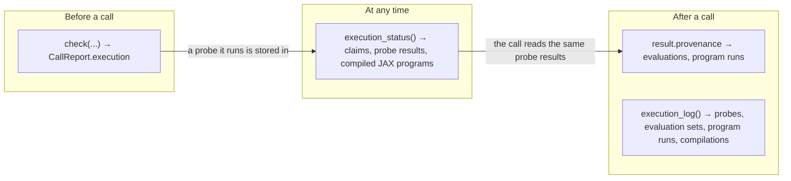

# Seeing how ProbPipe runs a computation

> **Status: deferred; not approved.**
> Written on 2026-10-25 against `dev/overhaul` at `aefbf661`, revised the same day after the maintainer's first review, and moved into `plans/deferred/` on 2026-10-27. Its findings A3, A6, A7, A10, and A11 were checked again against `main` at `97891b7d` on 2026-10-27, and each still holds.
> The work belongs with the execution layer, tracked on #580. Three findings of Appendix A are bugs against rules the design already states, filed on their own as #679, #680, and #681, so they need not wait for this plan.
> Review it, and answer its questions (Appendix D), before implementing anything from it. Before then, check it again against the code: compiled lifting and the inference runners, both deferred, change the fields that report compilation.
> `plans/deferred.md` lists it under "The execution layer".
> Once approved, its decisions move into `design/` (V.1, V.9, V.13) and its steps into the issue its work becomes. Appendix E lists its revisions.

## How to read this document

Section 1 summarizes the problem and the proposal.
Sections 2 and 3 state the conceptual model, without code names.
Section 4 gives the code design, one public object at a time, each with its docstring.
Section 5 works through examples.
Section 6 says where the code goes, in which steps, and with which tests.
Appendix A analyzes the code as it stands, with reproductions.
Appendix B lists the alternatives this design rejects, Appendix C the ambiguities found in the design text with the reading this document adopts, Appendix D the questions for the maintainer, and Appendix E the revision log.

### Design sections cited

| Section | What this document uses from it |
|---|---|
| III.8 | capabilities, the underscore implementations of operations that a class claims |
| V.1 | `check` and `CallReport` |
| V.9 | evaluation points, executors, `ExecutionReport`, the provenance of a call, the program store |
| V.13 | execution claims, the probe and its probe result, the three states, the traceability of a law, the embedded call |
| `plans/execution-layer.md` § 6.6, § 6.10 | what ProbPipe reports, the compiled layer, and `count_compilations` |

---

## 1. Summary

### The problem

A user who calls a `Function` or an operation cannot learn from the public API how ProbPipe will compute the result, or how it did.
Four questions have no answer today:
1. **The plan of a call.** Will this call trace my function with JAX, map it with `jax.vmap`, compile it with `jax.jit`, or run it in Python one evaluation at a time? Which code of my distribution will `sample` or `condition_on` run, and is it compiled?
2. **The probe.** Did `check` trace my function, and is the outcome stored, so that the call will not trace it again?
3. **What is known about an object.** Which execution claims does my function state, at which input structures has ProbPipe probed it, and with what outcome? Can JAX trace my distribution's sampler and its density? Which compiled JAX programs does ProbPipe keep for either?
4. **What a call ran.** Which executors ran which evaluations, how many, and which JAX programs compiled, were reused, or ran uncompiled?

Appendix A gives the evidence.
`check` reports how a lifted call or a sweep runs, but it reports nothing for an operation whose model calls opaque code, and it prints raw JAX error text with tracer object ids.
The probe results are held in a private attribute with no repr, and a distribution's traceability is a private method.
An operation's provenance leaves out the evaluations it ran.
A lifted call is never compiled with `jax.jit`, and no report says so.

### The design in eight statements

1. **Traceability belongs to a piece of code at an input structure.** A function's traceability can differ between input structures, so a claim states it for all of them at once, and otherwise ProbPipe knows it at each input structure it has probed. A capability of a distribution, such as its sampler or its density, has one input structure, fixed by the distribution's specs, so it has one traceability.
2. **A distribution is inspected per capability.** A distribution runs code only when an operation runs one of its capabilities, so its status and its reports are organized by capability, each named by its operation, such as `sample` or `log_prob`.
3. **`check` describes each user callable a call will evaluate by five facts**: its traceability and the source of that traceability, whether it is called from Python or from inside a compiled JAX program, its executor and how that executor was chosen, whether one invocation evaluates many evaluation points, and whether its code is compiled. It also reports the status of each capability of a distribution that the selected route runs.
4. **`check` reports its probe.** Each report holds the probe result the executor choice read and says whether this `check` ran the probe.
5. **`ProbeResult` becomes public.** It states its input structure as specs, and gives a one-line explanation when the callable is not traceable.
6. **`execution_status()`** on a `Function` reports its claims, its own executor, its probe results, and its compiled JAX programs. On a `Distribution` or a `ConditionalDistribution` it reports the same for each capability. Reading a status runs no user code.
7. **Every call's provenance records what it ran**: each set of evaluation points, and each JAX program with whether it compiled, was reused, or ran uncompiled.
8. **`execution_log()`**, a context manager in `probpipe.diagnostics`, collects the probes, sets of evaluation points, runs of JAX programs, and XLA compilations of a block of code, `check` calls included. `describe()` renders each report as text.

### Before and after

```python
import numpy as np
from probpipe import Normal, function

@function
def g(x):
    return np.sin(np.asarray(x))     # NumPy, so JAX cannot trace it

prior = Normal("x", 0.0, 1.0)
report = g.check(prior)
```

Today the user reads `report.execution.evaluations[0].rejected[0].description`, which holds JAX's full error text, a tracer's object id, and a path inside ProbPipe.
Whether the check traced `g` is not reported anywhere.

Proposed:

```pycon
>>> print(report.describe())
g(x ~ prior) takes the route sampling_lift, which is approximate, lifting x.
g: 256 evaluation points, built in Python by sampling_lift
    traceability: host-only, from its probe result at x: float32[]; this check ran the probe
    why not traceable: it converts a traced value to NumPy (TracerArrayConversionError)
    executor: sequential, chosen by automatic selection; jax was rejected because JAX cannot trace 'g'
    vectorized: no    compiled: no
>>> report.execution.evaluation_reports[0].probed_by_this_check
True
>>> g.execution_status().probe_results
(ProbeResult(callable_name='g', lifting_regime='broadcast',
             input_structure={'x': NumericArraySpec(shape=(), dtype=float32)},
             traceability=<Traceability.HOST_ONLY: 0>, traced_with_static_ints=False,
             draws_from_global_generator=False,
             untraceable_reason='it converts a traced value to NumPy (TracerArrayConversionError)',
             route_controls=None),)
```

### What the maintainers need to decide

Appendix D lists seven questions, each with a recommendation.
The two with the widest effect are Q1, whether V.13 derives a traceability for each capability of a distribution in place of one traceability per distribution, and Q2, whether a plain call reports its single evaluation.

---

## 2. Why three reports

A question about how a result is computed is asked at one of three times, and each time concerns a different thing:
1. **Before a call**, the user asks how that call will run. The answer depends on the arguments and the controls, because the input structure decides which probe result applies, and the controls decide the executor.
2. **Between calls**, the user asks what ProbPipe knows about a function or a distribution. The answer depends on no call. It changes over time, because calls and checks store probe results and compile JAX programs.
3. **After a call**, the user asks what the call ran. The answer is fixed once the call ends.

One object cannot answer all three, because each answer is true of a different thing: the plan of one call, the state of one object at one moment, and the history of one call.
This design therefore gives one report for each time: the **execution report** of `check`, the **execution status** of a function or a distribution, and the **provenance** of a call, together with a log that spans a block of code.



---

## 3. The conceptual model

### 3.1 Code, input structures, and traceability

JAX traces a piece of Python code by running it once on abstract values that have shapes and dtypes but no contents.
Whether that succeeds depends on the code and on what it receives: a shape, a dtype, or a static value can send the code down a branch that JAX can trace or down one it cannot.
For example, this function traces for small inputs and calls SciPy for large ones, which JAX cannot trace:

```python
@function
def smooth(x):
    if x.size > 10_000:
        return scipy.ndimage.gaussian_filter1d(np.asarray(x), 2.0)
    return jnp.convolve(x, jnp.ones(5) / 5, mode="same")
```

The question "can JAX trace this function?" therefore has an answer only together with the shapes, dtypes, and static values of the arguments.
ProbPipe runs two kinds of code, and they differ in how much their arguments vary.

> **Definition 1 (code that ProbPipe runs, and its input structure).**
> 1. **A function's callable** is the Python callable that a `Function` wraps. It receives the arguments of a call, so different calls give it different shapes, dtypes, and static values.
> 2. **A capability of a distribution** is the code that implements one operation for a `Distribution` or a `ConditionalDistribution` (III.8), such as its sampler, which implements `sample`, or its density, which implements `log_prob`. A capability is named by its operation. Its arguments are fixed by the distribution's specs: a density receives one value of the event spec, a sampler receives a random key, and a conditional distribution's capability also receives one value of each given input.
> 3. The **input structure** of a piece of code at some arguments is the tree structure of the arguments with the shape and dtype of each array and the value of each static argument (V.13).

> **Definition 2 (traceability).**
> 1. The **traceability** of a piece of code at an input structure is its state in V.13: **traceable** when JAX can trace it there; **embeddable** when JAX cannot, but the code is an opaque `Function` whose output spec describes a value that a host callback can return, so it can run inside a JAX program as an embedded call; **host-only** otherwise.
> 2. The **source** of a traceability is how ProbPipe knows it, one of three:
>    - a **declaration**: a `Function`'s `traceable` claim, or a family's capability, which ProbPipe writes in JAX;
>    - a **derivation from parts**: a capability of a distribution built from other distributions or functions takes the least permissive traceability of its parts, by V.13's table;
>    - a **probe**: a trace made only to learn the traceability, whose outcome ProbPipe stores as a probe result (V.13).

The following consequences follow from Definitions 1 and 2:
1. **A function's traceability varies with its input structure.** A function's callable receives different input structures in different calls, so it can be traceable at one and host-only at another, as `smooth` is.
2. **A claim fixes a function's traceability for every input structure.** `traceable=True` makes the function traceable everywhere. `traceable=False` makes it embeddable everywhere when its output spec describes a value a host callback can return, and host-only everywhere otherwise.
3. **Without a claim, a function's traceability is known only where it was probed.** ProbPipe probes each new input structure once, at the first call or `check` that meets it, and stores the result. At an input structure not yet probed, the traceability is unknown.
4. **A capability of a distribution has one traceability.** Its input structure is fixed by the distribution's specs, so one derivation or one probe decides it for the distribution's lifetime.
5. **A distribution's sampler and its density can differ.** They are different code. A distribution built from a JAX sampler and a NumPy density is traceable for `sample` and host-only for `log_prob`.

<details>
<summary>Technical note: the lifting regime enters a function's probe</summary>

A probe traces the operation that the executor will run, which is not always the body alone (V.13): one draw of a broadcast, mapped as a lifted call maps it; one element of a sweep; or one call with traced arguments inside a JAX program, whose outcome decides whether the `Function` is traced inline or becomes an embedded call.
A body can trace alone and fail under a map, for example when it returns a record that holds a batch.
ProbPipe therefore stores a function's probe results per input structure and per lifting regime, and Definition 2's "input structure" for a function includes the lifting regime.
A nested sweep probes one broadcast at its first element, so its lifting regime is that of a broadcast.
</details>

### 3.2 How a call evaluates one user callable

A user who asks whether a call will be "vmapped" or "jitted" is asking about several choices that ProbPipe makes separately.
Two examples show that the choices vary independently:
1. A traceable function `f` lifted over a distribution is evaluated at 256 draws, mapped over them by `jax.vmap`, and evaluated without a compiled JAX program of its own.
2. An opaque `forward` called by the likelihood of a joint, while the joint is sampled, is evaluated from inside the joint's compiled sampler, through a host callback, one evaluation point at a time on `sequential`.

> **Definition 3 (the execution facts of a user callable in a call).** When a call evaluates a user callable, five facts describe how the evaluations run:
> 1. **Traceability** at the input structure of one evaluation point, with its source (Definition 2).
> 2. **Where it is called from.** Either from Python, where a requester builds a set of evaluation points, as a lift, a sweep, or an inference method's loop does; or from inside a compiled JAX program that the call opens, where the callable is an embedded call and the host side of its callback builds the set of evaluation points. These are the two entries of V.9.
> 3. **Executor.** The executor that runs the evaluation points, and how it was chosen: named for the callable, inherited from an enclosing call, or picked by automatic selection (V.9). Each executor of higher priority that cannot run them is rejected, with the reason.
> 4. **Vectorized.** Whether one invocation of the callable evaluates many evaluation points. This holds when the `jax` executor maps the callable with `jax.vmap`, and when the callable claims `vectorized=True` and its executor passes it whole chunks.
> 5. **Compiled.** Whether the callable's own code runs as part of one XLA program that `jax.jit` compiled and that ProbPipe keeps for reuse by later calls with the same input structure.

The five facts answer the user's words as follows:
1. A callable is **traced by JAX** when its traceability is traceable. A traceable callable is always run by `jax` (V.9, rule 4).
2. A callable is **vmapped** when its executor is `jax`, which maps it with `jax.vmap` (V.9, the built-in executors).
3. A callable is **JIT-compiled** when the fact *compiled* holds. An embedded callable is never compiled, since its code runs on the host as Python. The JAX program around it is compiled, as fact 2 states.
4. A **plain call** on values evaluates the body once, in the calling thread, with no map and no compiled JAX program (V.9). Question Q2 decides whether `check` reports that single evaluation.

<details>
<summary>Technical note: the fact <i>compiled</i> before and after compiled lifting</summary>

The `jax` executor maps a set of evaluation points with an eager `jax.vmap` until compiled lifting (`plans/execution-layer.md` § 6.10, item 1) stores `jax.jit(jax.vmap(f))` in the `Function`'s program store.
Until then *compiled* is false for every set of evaluation points that is called from Python, and an eager `jax.vmap` traces the body again at every call and dispatches its JAX operations one at a time.
After compiled lifting, *compiled* is true for a set that `jax` runs.
The field exists from the start, so its meaning does not change when compiled lifting is delivered.

A traceable `Function` called inside a JAX program that ProbPipe opens, such as a traceable helper inside a kernel, is traced into that JAX program. It has no evaluation points of its own, so no evaluation report names it. The JAX program that contains it is listed by the status of the program's owner (3.3). Question Q6 asks whether to report such callables too.
</details>

### 3.3 What ProbPipe stores about how code runs

The same call, made twice, can do different work.
The first call probes a function that states no claim, and the second reads the stored probe result.
The first run of a JAX program compiles it, and a later run with the same input structure and static settings reuses it.
A user who asks whether a function "has been traced" or "is already compiled" is asking about these two kinds of stored knowledge.

> **Definition 4 (probe results and program entries).**
> 1. A **probe result** (V.13) is stored per piece of code and input structure. It records the traceability the probe found, whether the code traced only with its integer arguments static, whether it drew from a global random generator, and why it is not traceable when it is not.
> 2. A **program entry** is one JAX program that ProbPipe keeps for an owner, a `Function` or a distribution, identified by the owner, the body it runs, the input structure of its arguments, and the static settings it was traced under (V.9). It is in one of three compilation states:
>    - **eager**: tracing the body failed, so ProbPipe runs the body uncompiled at every run;
>    - **traced**: the body was traced and has not yet run, so its first run compiles it;
>    - **compiled**: its JAX program has run at least once, so JAX holds the compiled executable in its in-memory cache, and a later run with the same input structure and static settings neither traces nor compiles while JAX keeps it.

The following consequences follow from Definition 4 and from V.13's probe rules:
1. A `check` stores the probe results it computes (V.13, probe rule 4), so a call after a `check` reads them and probes nothing.
2. The copies that `using` makes share their probe results (V.13, probe rule 3), and each copy keeps its own controls, its executor among them.
3. A program entry belongs to its owner. A copy of an owner with other bound values has a program store of its own (V.9), so it compiles its own JAX programs.
4. Neither kind of stored knowledge changes a result. Each changes only how much work a later call does.

### 3.4 Execution status

> **Definition 5 (execution status).**
> 1. The **execution status** of a `Function` is what ProbPipe knows, when the status is read, about how the function's callable runs: its execution claims, the traceability its claim fixes if it has one, the executor set on it, its stored probe results, and its program entries.
> 2. The execution status of a **capability** of a distribution is its traceability with the source of that traceability, the opaque `Function`s it calls inside a JAX program, its stored probe results, and its program entries.
> 3. The execution status of a **distribution** is the execution status of each of its capabilities, together with the traceability that inference methods read: its density's, or its sampler's when it has no density (V.13).

Reading an execution status runs no user code.
A capability whose traceability needs a probe that has not run reports the traceability as not yet known, until a `check` or a call of an operation that runs the capability derives it.

### 3.5 The three reports and how they agree

> **Definition 6 (the three reports).**
> 1. The **execution report** of a `check` holds one **evaluation report** for each user callable that the call will evaluate, for each of the two places it can be called from. Each evaluation report gives the callable's five execution facts (Definition 3), the requester that asks for its evaluation points, their number when the requester knows it beforehand, the probe result the executor choice read, and whether the `check` ran that probe. The execution report also holds the execution status of each capability of a distribution that the selected route runs, as the `check` finds it.
> 2. The **execution status** of Definition 5.
> 3. The **provenance** of a call records each set of evaluation points the call ran, with whether it was embedded, its executor and options, the number of its evaluation points, and its failed evaluation points; and each JAX program the call ran, with whether the call's runs compiled it, reused it, or ran it uncompiled. An **execution log** collects the same records, together with the probes that ran and the XLA compilations, for every call and `check` made in a block of code.

The reports agree because each reads the same stored knowledge and the same rules:
1. **`check` and the call choose alike.** `check` runs the probe the call would run and stores its outcome (V.13, probe rule 4), and the executor choice reads the probe result and the controls by the same rules in both. For each evaluation report of a `check`, the provenance of the call with the same arguments and controls therefore records sets of evaluation points of the same callable, embedded or not alike, on the same executor, and, for a set called from Python, with the reported number of evaluation points.
2. **What `check` cannot foresee warns.** An inherited executor that fails while the call runs, for example because a chunk does not pickle, falls back with a warning (V.9, rule 7), and the provenance records the executor that ran.
3. **The status explains the report.** The probe result in an evaluation report is one of the probe results that the execution status lists, and a program named in a provenance record is one of the program entries that the status of its owner lists.

---

## 4. The code design

Every class below is a frozen dataclass whose repr follows II.4.
`ExecutionClaims` and `Traceability` already exist in `core/_execution_claims.py` with complete docstrings, and this design exports both from `probpipe`, since the new classes hold them.

### 4.1 Probe results: `ProbeResult`

```python
@dataclass(frozen=True)
class ProbeResult:
    """The stored outcome of one probe: whether JAX can trace a piece of code at one input structure.

    ProbPipe probes a function that does not state whether JAX can trace it
    the first time a call or ``check`` gives it arguments of a new structure,
    and stores the outcome, so later calls with arguments of the same
    structure read it instead of tracing again. It probes a distribution's
    sampler or density once, when no declaration or part decides whether it
    traces. A probe runs the code's Python on abstract values, up to the first
    operation that fails on them. ProbPipe creates probe results; read them
    from ``execution_status()``, from an ``EvaluationReport``, or from an
    ``ExecutionLog``.

    Attributes
    ----------
    callable_name : str
        The label of the probed code: a ``Function``'s label, or a
        distribution's label and the operation the capability implements, as
        ``"model.log_prob"``.
    lifting_regime : {"broadcast", "sweep", "plain_call"} or None
        For a function, the kind of call whose evaluation the probe traced:
        ``"broadcast"`` is one draw of a call lifted over a distribution,
        mapped as the lifted call maps it, which is also how one element of a
        nested sweep is probed; ``"sweep"`` is one element of a call swept over
        a batch, mapped as the sweep maps it; ``"plain_call"`` is one call
        with arguments that JAX is tracing, inside a compiled JAX program,
        whose outcome decides whether the function is traced into that
        program or called back from it on the host. ``None`` for a capability
        of a distribution.
    input_structure : Mapping of str to Any
        The arguments of one evaluation, by parameter name, each in the form
        the probe saw: a ``NumericArraySpec`` with the shape and dtype of a
        numeric argument (for a lifted argument, of one draw or one element);
        a ``NumericRecordSpec`` for a record of numeric arrays; or the value
        itself for an argument the probe held fixed, such as a string or an
        integer used as a loop count.
    traceability : Traceability
        What the probe found: ``TRACEABLE`` when JAX traced the code;
        otherwise ``EMBEDDABLE`` when the code is a ``Function`` whose output
        spec describes a numeric array or a record of them with dtypes and
        bound shapes, so it can be called back from inside a compiled JAX
        program; otherwise ``HOST_ONLY``. An evaluation that traced but failed
        ProbPipe's own check of its inputs or output counts as ``TRACEABLE``,
        since every executor refuses it alike.
    traced_with_static_ints : bool
        Whether the code traced only after its integer arguments were held
        fixed, as for a function that uses an integer as a shape. Its probe
        result then holds only for those integer values.
    draws_from_global_generator : bool
        Whether the code drew from NumPy's or Python's global random number
        generator while it was traced. Such code is never ``TRACEABLE``,
        because JAX would fix its noise into the compiled program.
    untraceable_reason : str or None
        Why JAX cannot trace the code, in one line, such as ``"it converts a
        traced value to NumPy (TracerArrayConversionError)"``; ``None`` when
        it is ``TRACEABLE``.
    route_controls : Mapping of str to Any or None
        For a function realized by routes, such as an operation, the controls
        that select the route the probe traced, since another route is other
        code; ``None`` for a function with a body and for a capability.
    traced_output_shapes : Any
        The shapes and dtypes of the code's output as JAX traced it, a tree of
        ``jax.ShapeDtypeStruct``, or ``None`` when it did not trace. Not shown
        in the repr.
    trace_error : BaseException or None
        The error that tracing raised, without its traceback, for debugging;
        ``None`` when tracing raised nothing. Not shown in the repr.
    """

    callable_name: str
    lifting_regime: Literal["broadcast", "sweep", "plain_call"] | None
    input_structure: Mapping[str, Any]
    traceability: Traceability
    traced_with_static_ints: bool
    draws_from_global_generator: bool
    untraceable_reason: str | None
    route_controls: Mapping[str, Any] | None
    traced_output_shapes: Any = field(repr=False)
    trace_error: BaseException | None = field(repr=False)
```

`untraceable_reason` is chosen by the first case that applies:
1. The code drew from a global generator: `it draws from NumPy's or Python's global random generator`.
2. The code drew workflow randomness without a key: `it draws random numbers without an explicit key`.
3. JAX raised a known tracing error: the phrase that `FalseTraceableClaimError` already uses for it, with the error's class name, such as `it converts a traced value to NumPy (TracerArrayConversionError)`.
4. Any other error: `tracing it raised <class name>: <first line of the message>`.

The reason never holds a tracer's object id or a path inside ProbPipe, and the full error stays in `trace_error`.

<details>
<summary>Technical note: the stored outcome and the public result</summary>

The store keeps a private outcome per cache key, as today, and next to it the description that the cache key cannot give back: the code's label, the lifting regime, the route controls, and the input structure, computed from the probe's arguments when the probe runs.
The public `ProbeResult` is built from both when it is read.
The private marker that records only that a probe with integers as data failed, so that the probe with integers held fixed decides, is never listed.
</details>

### 4.2 Program entries: `ProgramStatus`

```python
@dataclass(frozen=True)
class ProgramStatus:
    """The compilation state of one JAX program that ProbPipe keeps for a function or a distribution.

    ProbPipe compiles code it runs repeatedly, such as a family's sampler or
    the mapping of a joint's conditional factor over draws of its inputs,
    with ``jax.jit``, and keeps the compiled program, so a later run with
    arguments of the same shapes and dtypes and under the same static
    settings reuses it. Each kept program has one ``ProgramStatus``.

    Attributes
    ----------
    owner_label : str
        The label of the function or distribution that keeps the program.
    body_name : str
        What the program computes for its owner, such as ``"sample"``,
        ``"log_prob"``, or ``"mapped factor"`` for a joint's conditional factor
        mapped over draws of its inputs.
    input_structure : Mapping of str to Any
        The program's arguments, by name, in the form ``ProbeResult``
        describes: a ``NumericArraySpec`` with the shape and dtype of each
        numeric argument, or the value of a fixed argument.
    static_settings : Mapping of str to Any
        The settings the program was compiled under, by name, such as
        ``num_samples``: a run under other values compiles another program.
    compilation_state : {"eager", "traced", "compiled"}
        ``"compiled"`` when the program has run at least once, so JAX holds
        its compiled form and a later run with the same arguments' shapes,
        dtypes, and settings neither traces nor compiles while JAX keeps it;
        ``"traced"`` when it was traced and has not yet run, so its first run
        compiles it; ``"eager"`` when tracing failed, so ProbPipe runs the
        code uncompiled every time.
    num_runs : int
        How many times ProbPipe has run it, compiled or uncompiled.
    embedded_function_names : tuple of str
        The labels of the opaque ``Function`` s that the program calls back on
        the host, in the order the trace met them; empty when it calls none.
    """

    owner_label: str
    body_name: str
    input_structure: Mapping[str, Any]
    static_settings: Mapping[str, Any]
    compilation_state: Literal["eager", "traced", "compiled"]
    num_runs: int
    embedded_function_names: tuple[str, ...]
```

A family's capabilities run through module-level `jax.jit` programs with a record per distribution of whether tracing succeeded (`compiled_or_eager`), and a joint's conditional factors run through the factor's program store.
Both gain a run count per entry and the input structure of each entry, so each yields `ProgramStatus` values.
A `Function` has no program entries until compiled lifting stores `jax.jit(jax.vmap(f))` in its program store.

### 4.3 The status of a function: `FunctionExecutionStatus`

```python
@dataclass(frozen=True)
class FunctionExecutionStatus:
    """What ProbPipe knows, at the moment of reading, about how a function's callable runs.

    A function's callable may be traceable by JAX for some arguments and not
    for others, since a shape, a dtype, or a fixed argument can send it down
    a branch JAX cannot trace. A ``traceable`` claim states the answer for
    every argument at once. A function without a claim is probed once for
    each new structure of arguments, at the first call or ``check`` that meets
    it, and ``probe_results`` lists what each probe found. Reading the status
    runs none of the function's code, and the status does not change when
    later calls probe or compile.

    Attributes
    ----------
    function_label : str
        The function's label.
    execution_claims : ExecutionClaims
        The claims the function stated when it was built: ``traceable``,
        ``vectorized``, and ``differentiable``.
    claimed_traceability : Traceability or None
        The traceability that the ``traceable`` claim fixes for every
        argument: ``TRACEABLE`` for ``traceable=True``; for
        ``traceable=False``, ``EMBEDDABLE`` when the output spec describes a
        numeric array or a record of them with dtypes and bound shapes, and
        ``HOST_ONLY`` otherwise. ``None`` when the function states no claim,
        and its traceability at each probed structure of arguments is the
        ``traceability`` of the matching entry of ``probe_results``.
    executor_name : str or None
        The executor set on the function by its decorator or by ``using``, or
        ``None`` when it sets none and so runs on an enclosing call's executor
        or the one automatic selection picks.
    executor_options : Mapping of str to Any
        The options set with ``executor_name``, or the options given without
        an executor for the automatically selected one; empty when none.
    probe_results : tuple of ProbeResult
        The stored outcome of each probe of the function, least recently used
        first. The ``using`` copies of a function share them. At most 256 are
        kept, and the least recently used is dropped beyond that.
    program_entries : tuple of ProgramStatus
        The compiled JAX programs ProbPipe keeps for calls of this function;
        empty while ProbPipe maps a lifted call without keeping a program.
    """

    function_label: str
    execution_claims: ExecutionClaims
    claimed_traceability: Traceability | None
    executor_name: str | None
    executor_options: Mapping[str, Any]
    probe_results: tuple[ProbeResult, ...]
    program_entries: tuple[ProgramStatus, ...]

    def describe(self) -> str:
        """The status as text, one line per claim, executor, probe result, and program."""


class Function:
    def execution_status(self) -> FunctionExecutionStatus:
        """What ProbPipe knows now about how this function's callable runs, read without running it."""
```

An operation is a `Function`, so `condition_on.execution_status()` reports the operation's own claims, executor, and probe results.
`describe()` gives each probe result's line the executor that a set of evaluation points at that input structure runs on when no enclosing call names one, by V.9's rules 4 and 5: `jax` when the result is traceable, otherwise the executor set on the function, otherwise `sequential`:

```text
Function 'g'
    claims: none, so each new input structure is probed once
    executor: none set on it, so it takes an enclosing call's executor or automatic selection
    probe results:
        broadcast at x: float32[]: host-only, because it converts a traced value to NumPy
            (TracerArrayConversionError); a set of its evaluation points runs on sequential
    compiled JAX programs: none
```

### 4.4 Distributions and conditional distributions

#### Why the status is organized by capability

A distribution's code runs only when an operation runs one of the distribution's capabilities: `sample` runs its sampler, `log_prob` its density, and an inference method runs its density, or its unnormalized density, many times.
The capabilities are different code, so each has its own traceability (3.1, consequence 5), its own embedded `Function`s, and its own compiled JAX programs.
For example, this distribution draws with JAX and evaluates its density with NumPy:

```python
from probpipe import NumericArraySpec, distribution

d = distribution(
    sample=lambda key: jax.random.normal(key, (3,)),
    log_prob=lambda x: float(-0.5 * np.sum(np.asarray(x) ** 2)),
    event_spec=NumericArraySpec((3,), "float32"),
    output_name="x",
)
```

`sample(d, 100)` compiles its sampler, and a gradient method cannot condition a model that uses `d`'s density.
One traceability for `d` would describe one of the two and hide the other.
The status of a distribution is therefore a status for each capability, and a report about an operation names the capabilities its route runs.

#### `CapabilityExecutionStatus` and `DistributionExecutionStatus`

```python
@dataclass(frozen=True)
class CapabilityExecutionStatus:
    """What ProbPipe knows about how one capability of a distribution runs, such as its sampler or its density.

    A capability is the code that implements one operation for a
    distribution, and is named by that operation. Its arguments are fixed by
    the distribution: a density receives one value of the event, a sampler a
    random key, and a conditional distribution's capability also one value of
    each given input. So whether JAX can trace it has one answer for the
    distribution's lifetime, which ProbPipe works out from the distribution's
    construction, from its parts, or by one probe.

    Attributes
    ----------
    distribution_label : str
        The label of the distribution or conditional distribution.
    operation_name : str
        The operation the capability implements: ``"sample"``, ``"log_prob"``,
        or ``"unnormalized_log_prob"``.
    traceability : Traceability or None
        Whether JAX can trace the capability: ``TRACEABLE``; ``EMBEDDABLE``
        when JAX cannot trace it as a whole but each piece JAX cannot trace is
        a ``Function`` that can be called back from inside a compiled JAX
        program; or ``HOST_ONLY``. ``None`` when working it out needs a probe
        that has not run; a ``check`` or a call of an operation that runs the
        capability runs it.
    traceability_source : {"declared", "derived_from_parts", "probed"} or None
        How ProbPipe knows ``traceability``: ``"declared"`` for a family,
        whose capabilities ProbPipe writes in JAX; ``"derived_from_parts"``
        for a distribution built from other distributions or from functions,
        such as a joint, a view, a conditional distribution at given values,
        or the conditional distribution of a function; ``"probed"`` when a
        probe of the capability decided it. ``None`` when ``traceability`` is
        ``None``.
    embedded_function_names : tuple of str
        The labels of the opaque ``Function`` s that the capability calls back
        on the host when it runs inside a compiled JAX program, in the order
        the trace met them; empty when it calls none or ``traceability`` is
        ``None``.
    probe_results : tuple of ProbeResult
        The probes of this capability, and of the functions it was built
        from, such as the ``log_prob`` given to ``distribution``; empty when
        none ran.
    program_entries : tuple of ProgramStatus
        The compiled JAX programs ProbPipe keeps to run this capability,
        including those of the parts it runs, such as each conditional factor
        of a joint mapped over draws.
    """

    distribution_label: str
    operation_name: str
    traceability: Traceability | None
    traceability_source: Literal["declared", "derived_from_parts", "probed"] | None
    embedded_function_names: tuple[str, ...]
    probe_results: tuple[ProbeResult, ...]
    program_entries: tuple[ProgramStatus, ...]


@dataclass(frozen=True)
class DistributionExecutionStatus:
    """What ProbPipe knows, at the moment of reading, about how a distribution's code runs.

    A distribution runs code only when an operation runs one of its
    capabilities, so the status describes each capability on its own.
    Reading the status runs none of the distribution's code: a capability
    whose traceability needs a probe that has not run reports ``None``.

    Attributes
    ----------
    distribution_label : str
        The label of the distribution or conditional distribution.
    traceability_for_inference : Traceability or None
        The traceability that inference methods read to decide whether they
        apply: the ``traceability`` of the density, or of the sampler when the
        distribution has no density. ``None`` when that one is ``None``.
    capabilities : Mapping of str to CapabilityExecutionStatus
        The status of each capability the distribution implements among
        ``"sample"``, ``"log_prob"``, and ``"unnormalized_log_prob"``, keyed by
        operation name.
    """

    distribution_label: str
    traceability_for_inference: Traceability | None
    capabilities: Mapping[str, CapabilityExecutionStatus]

    def describe(self) -> str:
        """The status as text, one block per capability."""


class Distribution:
    def execution_status(self) -> DistributionExecutionStatus:
        """What ProbPipe knows now about how this distribution's capabilities run, read without running them."""

class ConditionalDistribution:
    def execution_status(self) -> DistributionExecutionStatus:
        """What ProbPipe knows now about how this conditional distribution's capabilities run at given values."""
```

#### How each capability's traceability is derived

V.13's traceability table, applied to each capability `c` in place of the distribution as a whole:

| Distribution or conditional distribution | The traceability of capability `c` |
|---|---|
| a family | traceable, declared |
| a joint | the least of its factors' `c` |
| a view or a rename | its parent's `c` |
| a distribution built from functions | the probe result of the function given for `c` |
| the conditional distribution of a function | the least of the function's traceability at the given spec and the `c` of the distribution it returns, both read by the construction's abstract evaluation (IV.4) |
| a conditional distribution at given values | its joint's `c` |
| any other | `c` probed once at a stand-in of its arguments, each dimension not yet bound of size one |

While a capability's traceability is derived, the opaque `Function`s whose embedded calls are staged are collected, and kept as its `embedded_function_names`.
A joint's capability keeps the union of its factors', in factor order.
The traceability that inference methods read stays V.13's: the density's, or the sampler's when there is no density, which is now the traceability of one capability.

#### Reading the status runs no user code

A capability's status reads what is stored.
It derives a traceability that declarations and stored results decide, such as a family's or a joint of families', and reports `None` for one that needs a probe that has not run.
A `check` of an operation that runs the capability derives it, probing if needed, as V.13's probe rule 4 lets a `check` do.

### 4.5 What `check` reports

#### `EvaluationReport` and `ExecutionReport`

```python
@dataclass(frozen=True)
class EvaluationReport:
    """How a call will evaluate one of your functions, as ``check`` reports it.

    A call evaluates a function at many points when it lifts the function
    over a distribution, sweeps it over a batch, or runs it inside a model
    that a sampler or an inference method runs. The report says whether JAX
    can trace the function, where it is called from, which executor will run
    its evaluations and why, and whether its code is vectorized or compiled.

    Attributes
    ----------
    callable_name : str
        The function's label.
    requester : str
        What asks for the evaluations: the route of the call, such as
        ``"sampling_lift"`` or ``"elementwise_sweep"``, or, for a function
        called back from inside a compiled program, the capability that
        calls it, such as ``"the log density of 'model'"``.
    embedded : bool
        ``False`` when Python code builds the evaluations and hands them to
        the executor, as a lifted call or a sweep does. ``True`` when the
        function is called with traced arguments inside a compiled JAX
        program, which calls it back on the host with a batch of evaluations,
        as when an inference method's compiled sampler runs a model that
        calls an opaque simulator.
    num_evaluation_points : int or None
        How many evaluations the call will make, such as 256 draws; ``None``
        when the number is decided while the call runs, as for an adaptive
        method or an ``embedded`` function.
    traceability : Traceability
        Whether JAX can trace the function at the structure of one
        evaluation's arguments: ``TRACEABLE``; ``EMBEDDABLE``, which an
        ``embedded`` function always is; or ``HOST_ONLY``.
    traceability_source : {"claimed", "probed"}
        ``"claimed"`` when the function's ``traceable`` claim decides
        ``traceability``, and ``"probed"`` when its probe result does.
    probe_result : ProbeResult or None
        The probe result that decided ``traceability``; ``None`` when a claim
        decided it.
    probed_by_this_check : bool
        Whether this ``check`` ran the probe, which ran the function's Python
        once on abstract values; ``False`` when the probe result was stored
        by an earlier call or check, or when a claim decided.
    chosen_executor : MethodInfo
        The executor that will run the evaluations. It is infeasible, with the
        reason, when the executor named for the function cannot run them, and
        the call then raises ``ResolutionError``.
    executor_chosen_by : {"named_for_callable", "inherited", "automatic_selection"}
        How the executor was chosen: ``"named_for_callable"`` when it is set
        on the function itself, or named on the call whose own function this
        is; ``"inherited"`` when an enclosing call named it; and
        ``"automatic_selection"`` when no call named one, so ProbPipe took the
        first registered executor, by priority, that can run the evaluations.
        A traceable function is always run by ``jax``, which reads
        ``"automatic_selection"``.
    executor_inherited_from : str or None
        The label of the enclosing call whose executor is inherited; ``None``
        unless ``executor_chosen_by`` is ``"inherited"``.
    rejected_executors : tuple of MethodInfo
        Each executor of higher priority than ``chosen_executor`` that cannot
        run the evaluations, with its reason, in the order they were tried.
    vectorized : bool
        Whether one invocation of the function evaluates many points:
        ``True`` when ``jax`` maps it with ``jax.vmap``, or when the function
        claims ``vectorized=True`` and its executor passes it whole chunks.
    compiled : bool
        Whether the function's code runs inside one program compiled with
        ``jax.jit`` that ProbPipe keeps for later calls. ``False`` for an
        ``embedded`` function, whose code runs on the host, although the
        program that calls it is compiled.
    compiled_program : ProgramStatus or None
        When ``compiled``, the kept program, whose ``compilation_state`` says
        whether the call will compile it or reuse it; otherwise ``None``.
    failure_rule : {"raise", "drop"}
        What the call does when an evaluation fails: ``"raise"`` raises
        ``EvaluationError``, naming every failed evaluation.
    """

    callable_name: str
    requester: str
    embedded: bool
    num_evaluation_points: int | None
    traceability: Traceability
    traceability_source: Literal["claimed", "probed"]
    probe_result: ProbeResult | None
    probed_by_this_check: bool
    chosen_executor: MethodInfo
    executor_chosen_by: Literal["named_for_callable", "inherited", "automatic_selection"]
    executor_inherited_from: str | None
    rejected_executors: tuple[MethodInfo, ...]
    vectorized: bool
    compiled: bool
    compiled_program: ProgramStatus | None
    failure_rule: Literal["raise", "drop"]


@dataclass(frozen=True)
class ExecutionReport:
    """How a call will run your functions and the distribution code it uses, as ``check`` reports it.

    Attributes
    ----------
    evaluation_reports : tuple of EvaluationReport
        One report for each of your functions the call will evaluate, once
        for its evaluations built in Python and once for its evaluations
        called back from inside compiled programs, in the order the call asks
        for them. A plain call on values evaluates its function once, and has
        no report here.
    capability_statuses : tuple of CapabilityExecutionStatus
        The status of each capability of a distribution that the selected
        route runs, such as the sampler of the distribution passed to
        ``sample``, as the ``check`` found it: each traceability is known,
        since the ``check`` probes where needed.
    """

    evaluation_reports: tuple[EvaluationReport, ...] = ()
    capability_statuses: tuple[CapabilityExecutionStatus, ...] = ()

    def describe(self) -> str:
        """The report as text, one block per evaluation report and per capability."""
```

The existing fields `traceable`, `executor`, and `rejected` become `traceability`, `chosen_executor`, and `rejected_executors`, and `ExecutionReport.evaluations` becomes `evaluation_reports`.

#### Which capabilities and embedded functions an operation reports

A plain call of a `Function`, a lifted call, and a sweep already report their evaluations built in Python, and this design keeps that.
An operation also reports the capabilities its selected route runs, and the embedded `Function`s of those capabilities, without tracing at `check` time:
1. **A route names the capabilities it runs.** A route that requires a capability, such as `sample`'s `exact` route or `log_prob`'s `closed_form` route, runs that capability of its distribution operand. An inference method runs the density capability of its target, `log_prob` or `unnormalized_log_prob`. `monte_carlo` and a sampling lift over a distribution run its `sample`. A derived route runs the capabilities of the calls its formula makes, as its `check` finds them.
2. **The `check` derives each named capability's traceability** by 4.4's table, probing where it must (V.13, probe rule 4), and puts the capability's status in `capability_statuses`.
3. **Each embedded `Function` of a named capability gets an evaluation report**, with `embedded=True`, `requester` naming the capability, as `"the log density of 'model'"`, and `chosen_executor` the executor that the host side of its callback would choose under the call's controls, by V.9's rules 3 to 7.

#### The text and the notebook display

`ExecutionReport.describe()` renders one block per evaluation report, in the form of Section 1's example, and one block per capability status.
`CallReport.describe()` adds a first line with the route, its exactness, and the lifted parameters, and for a plain call states that the body runs once, in the calling thread, uncompiled.
`CallReport._repr_html_` shows an execution table when the execution report is not empty, with one row per evaluation report and per capability.
The `CallReport` repr keeps its rule: it shows the execution report only when a function is not traceable or runs on an executor other than `jax`.

### 4.6 What a call's provenance records

The provenance of every call that runs a set of evaluation points or a JAX program records them under two metadata entries, operations included:

```python
provenance.metadata["evaluations"]    # one entry per set of evaluation points the call ran
# {"callable": "forward", "embedded": True, "executor": "thread", "executor_options": {},
#  "num_evaluation_points": 20, "failed_point_indices": []}

provenance.metadata["program_runs"]   # one entry per JAX program the call ran
# {"owner_label": "likelihood", "body_name": "mapped factor",
#  "compilation_outcome": "compiled", "num_runs": 1}
```

1. **`evaluations`** keeps today's entries for a lifted call and a sweep, adds the key `"embedded"`, and is recorded by an operation as well. The sets of an embedded call are recorded on the call that owns the call token (V.13, "What an embedded evaluation point may not do", item 1).
2. **`program_runs`** has one entry per program entry the call ran, and its `num_runs` counts the runs during the call. Its `compilation_outcome` is `"compiled"` when this call's first run of the entry compiled it, `"reused"` when the entry was compiled before the call, and `"eager"` when the body ran uncompiled because tracing failed.
3. **Neither entry changes a result.** Replay ignores both, as it ignores the executor (V.9, "Replay").

### 4.7 A log of a block of code: `ExecutionLog`

```python
@dataclass(frozen=True)
class ExecutionLog:
    """What ProbPipe ran while an ``execution_log()`` block was open.

    The log collects what the whole process does during the block, from
    every thread: each probe that runs, each set of evaluations that runs,
    each run of a compiled JAX program that ProbPipe keeps, and each XLA
    compilation that JAX reports. It fills while the block runs and is
    complete when the block ends.

    Attributes
    ----------
    probes_run : tuple of ProbeResult
        The outcome of each probe that ran during the block, in order. A
        probe result read from storage is not a probe, so a call that reads
        one adds nothing here. A probe that runs in a worker process is not
        listed.
    evaluation_sets : tuple of Mapping of str to Any
        Each set of evaluations that ran, in the form of a provenance's
        ``"evaluations"`` entries, with the key ``"call"`` for the label of
        the call that ran it. A set run in a worker process is listed when
        its results return.
    program_runs : tuple of Mapping of str to Any
        Each run of a kept JAX program, in the form of a provenance's
        ``"program_runs"`` entries, with the key ``"call"``.
    num_compilations : int
        How many programs XLA compiled during the block, as JAX reports
        them. A program JAX reuses from its in-memory cache is not counted;
        one it loads from the persistent compilation cache is. An eager
        ``jax.vmap`` compiles some of its operations, and those count too.
    """

    probes_run: tuple[ProbeResult, ...]
    evaluation_sets: tuple[Mapping[str, Any], ...]
    program_runs: tuple[Mapping[str, Any], ...]
    num_compilations: int

    def describe(self) -> str:
        """The log as text, grouped by call."""


def execution_log() -> ContextManager[ExecutionLog]:
    """Collect what ProbPipe runs within the block: probes, evaluations, compiled programs, and compilations."""
```

The log replaces the planned public `count_compilations` (`plans/execution-layer.md` § 6.10, item 9), so the count has one public home (question Q3).

### 4.8 Two messages

A user whose inference method is rejected needs the capability that decided it and the `Function` inside it.
Two messages name them, and both follow STYLE_GUIDE §9.3: each leads with what failed, names the caller's method, distribution, and function, and ends with the fix.
1. **A gradient method rejected because the density is embeddable**:
   `blackjax_nuts needs gradients of the log density of 'model', but it calls 'forward', which JAX cannot trace, so gradients cannot pass through it. Use a method that needs no gradients, such as method='blackjax_rwmh'`.
   After V.11's supplied derivatives are delivered, the message says instead to supply `vjp=` or `jacobian=` on `'forward'`.
2. **A method rejected because the density is host-only**, when a `Function` decides it:
   `blackjax_rwmh cannot compile the log density of 'model', because it calls 'summary', whose output spec sets no dtype. Give 'summary' an output_spec with a dtype, such as NumericArraySpec((40,), "float32")`.
   When no `Function` decides it, the message gives the probe's `untraceable_reason`.

---

## 5. Worked examples

### A traceable function lifted over a distribution

```python
import jax.numpy as jnp
from probpipe import Normal, function, workflow_run
from probpipe.diagnostics import execution_log

@function
def f(x):
    return jnp.sin(x)

prior = Normal("x", 0.0, 1.0)
report = f.check(prior)
```

```pycon
>>> e = report.execution.evaluation_reports[0]
>>> e.chosen_executor.method_name, e.traceability, e.vectorized, e.compiled, e.probed_by_this_check
('jax', <Traceability.TRACEABLE: 2>, True, False, True)
>>> f.check(prior).execution.evaluation_reports[0].probed_by_this_check   # reads the stored result
False
>>> with execution_log() as log, workflow_run(seed=0):
...     a = f(prior)
>>> log.probes_run, log.evaluation_sets[0]["executor"]
((), 'jax')
```

The first `check` probed `f`, the second read the stored result, and the call probed nothing.
`compiled` is false because the `jax` executor maps `f` with an eager `jax.vmap` until compiled lifting.

### A function whose traceability depends on its input structure

```pycon
>>> smooth.check(NumericArrayBatch(jnp.zeros((4, 100)), "i", label="small"))
>>> smooth.check(NumericArrayBatch(jnp.zeros((4, 20_000)), "i", label="large"))
>>> [(r.input_structure["x"].shape, r.traceability) for r in smooth.execution_status().probe_results]
[((100,), <Traceability.TRACEABLE: 2>), ((20000,), <Traceability.HOST_ONLY: 0>)]
>>> smooth.execution_status().claimed_traceability is None
True
```

`smooth` from 3.1 states no claim, so its traceability is known at the two input structures it was probed at, and the status lists both.

### A function that claims to be opaque, swept over a batch on threads

```python
import numpy as np
from probpipe import NumericArrayBatch, function

@function(traceable=False, executor="thread", executor_options={"max_workers": 4})
def h(x):
    return float(np.sin(x))

xs = NumericArrayBatch(np.arange(8.0), "i", label="xs")
```

```pycon
>>> e = h.check(xs).execution.evaluation_reports[0]
>>> e.requester, e.embedded, e.num_evaluation_points, e.chosen_executor.method_name, e.executor_chosen_by
('elementwise_sweep', False, 8, 'thread', 'named_for_callable')
>>> print(h.execution_status().describe())
Function 'h'
    claims: traceable=False, so it is host-only for every input structure and never probed
    executor: thread, set on it, with max_workers=4
    probe results: none
    compiled JAX programs: none
```

### A distribution whose sampler and density differ

```pycon
>>> status = d.execution_status()        # d from 4.4: JAX sampler, NumPy density
>>> status.capabilities["sample"].traceability, status.capabilities["log_prob"].traceability
(None, None)
>>> e = sample.check(d, sample_shape=100).execution.capability_statuses[0]
>>> e.operation_name, e.traceability, e.traceability_source
('sample', <Traceability.TRACEABLE: 2>, 'probed')
>>> log_prob.check(d, jnp.zeros(3)).execution.capability_statuses[0].traceability
<Traceability.HOST_ONLY: 0>
>>> d.execution_status().traceability_for_inference
<Traceability.HOST_ONLY: 0>
```

Reading the status of a new distribution built from functions reports nothing known, since each capability needs a probe.
Each `check` probed the capability its route runs.

### An operation over a model that calls opaque code

```python
import jax.numpy as jnp
import numpy as np
from probpipe import (Normal, NumericArraySpec, condition_on, conditional_distribution,
                      function, sample, workflow_run)

@function(traceable=False, output_spec=NumericArraySpec((5,), "float32"))
def forward(mu):
    return (np.asarray(mu)[..., None] * np.ones(5)).astype(np.float32)

prior = Normal("mu", 0.0, 1.0, label="prior")
likelihood = conditional_distribution(lambda mu: Normal("y", forward(mu), 1.0),
                                      label="likelihood", given_spec=prior.event_spec)
model = (likelihood & prior).with_label("model")
data = {"y": jnp.array([1.2, 0.4, 2.1, 1.5, 0.9], dtype=jnp.float32)}
```

```pycon
>>> report = condition_on.using(executor="thread").check(model, data)
>>> report.method
'blackjax_rwmh'
>>> print(report.execution.describe())
forward: called back on the host from the compiled log density of 'model'
    traceability: embeddable, claimed (traceable=False)
    executor: thread, inherited from condition_on
    evaluation points: decided while blackjax_rwmh runs
    vectorized: no    compiled: no
model.log_prob: embeddable, derived from its parts; calls forward on the host
    compiled JAX programs: likelihood, mapped factor (traced, 0 runs)
>>> with workflow_run(seed=0):
...     draws = sample.using(executor="thread")(model, sample_shape=20)
>>> draws.provenance.metadata["evaluations"]
[{'callable': 'forward', 'embedded': True, 'executor': 'thread', 'executor_options': {},
  'num_evaluation_points': 20, 'failed_point_indices': []}]
```

The capability status explains why `blackjax_nuts` was not selected: the density is embeddable, and a gradient method needs a traceable density.
The evaluation report names the function that will run on threads, and it agrees with what the call records.

---

## 6. Where the code goes, the steps, and the tests

### Where the code goes

| Module | What it gains |
|---|---|
| `core/_execution_claims.py` | the public `ProbeResult`, the private stored outcome, the input structure and the reason computed when a probe runs, and a note of each probe run on the call context |
| `core/_execution_status.py` (new) | `FunctionExecutionStatus`, `CapabilityExecutionStatus`, `DistributionExecutionStatus`, `ProgramStatus`, and their `describe()` |
| `core/_compilation.py` | per program entry and per `compiled_or_eager` record: the run count, the input structure, and the embedded `Function`s its trace staged; a note of each run's outcome on the call context |
| `core/_call_context.py` | the accumulators of probes run and program runs, merged as the evaluation log merges |
| `core/_executors.py` | the revised `EvaluationReport` and `ExecutionReport`, and `ExecutionReport.describe()` |
| `functions/_boundary.py` | a collector, open while a capability's traceability is derived and while a program is traced, to which each staged embedded call adds its `Function` |
| `functions/_function.py` | the revised fields filled in for lifted calls and sweeps, and `Function.execution_status()` |
| `functions/_call.py` | `CallReport.describe()` and the execution table of `_repr_html_` |
| `distributions/`, `families/_backend.py`, `operations/_inference_target.py` | the traceability, source, and embedded `Function`s of each capability, and `execution_status()` |
| `operations/_operation.py`, `inference/` | the capabilities each route names, the embedded reports of an operation's `check`, the provenance entries of an operation, and the two messages of 4.8 |
| `diagnostics/_execution_log.py` (new) | `execution_log()` and `ExecutionLog`, with the compilation listener moved from `tests/_compilation.py` |
| `probpipe/__init__.py` | exports `ProbeResult`, `ProgramStatus`, the three status classes, `ExecutionClaims`, and `Traceability` |

### Steps

Each step is one PR into `main`, and each later step reads the earlier ones:
1. **Probe results.** The public `ProbeResult`, its input structure and reason, the note of each probe run, `EvaluationReport.probe_result` and `probed_by_this_check`, and the renamed fields. The rejected executor's description takes the new reason.
2. **The status of a function.** `Function.execution_status()`, and `ProgramStatus` from program entries and from `compiled_or_eager`'s records.
3. **The rest of the evaluation report.** `requester`, `embedded`, `executor_chosen_by`, `executor_inherited_from`, `vectorized`, `compiled`, `compiled_program`, the two `describe()` methods, and the notebook table.
4. **Capabilities.** The traceability of each capability, the collector of staged `Function`s, `execution_status()` on distributions, the capabilities and embedded reports of an operation's `check`, and the two messages of 4.8.
5. **Provenance and the log.** The `embedded` key and the operation's `evaluations`, the `program_runs` entry, and `execution_log()`.

### Tests

1. **Agreement.** For each lifting regime (broadcast, sweep, nested sweep), for an operation over a model with an embedded `Function`, and under `sequential`, `thread`, and an inherited executor, a `check` and the call with the same arguments agree in function, `embedded`, executor, and number of evaluation points (3.5, item 1).
2. **The probe.** A first `check` of a `Function` without a claim reports `probed_by_this_check=True`, a second reports `False`, and the call after them logs no probe; a claimed `Function` reports `probe_result=None`; a probe that needs fixed integers reports `traced_with_static_ints=True`.
3. **Traceability by input structure.** `smooth` of 3.1 lists a traceable and a host-only probe result after checks at two sizes, and a claim fixes `claimed_traceability`.
4. **Reasons.** For each known tracing error, for a global generator, and for a workflow draw, `untraceable_reason` is the rule's sentence, and no reason holds `"object id"` or a path into `probpipe/`.
5. **Status.** A probe result appears in the status after a `check`; a `using` copy lists the same probe results and its own executor; reading any status runs no user code, which a callable with a side effect detects.
6. **Capabilities.** The distribution `d` of 4.4 reports `None` for both capabilities before any check, a traceable `sample` and a host-only `log_prob` after the checks; a joint reports the least of its factors per capability; a family reports `"declared"`.
7. **Program entries.** A joint's mapped factor moves from `traced` to `compiled` after one run; a second call records `"reused"` and the log counts no compilation; a body that does not trace is `eager`.
8. **The log.** Sets from a `process` executor are logged; a probe in the block is logged; nothing is logged after the block closes.
9. **Messages.** The two messages of 4.8.
10. **Display.** The repr of a `CallReport` of an all-JAX model is unchanged, its notebook display shows the execution table, and each `describe()` matches a stored text.

### Changes to the design text

1. V.1: `CallReport.describe()`.
2. V.9: the revised `EvaluationReport` and `ExecutionReport`; the operation rule of 4.5; the `embedded` key and the `program_runs` entry of provenance; `execution_log()` in place of `count_compilations`.
3. V.13: traceability at an input structure (3.1); `ProbeResult` public with its fields; the traceability of each capability (4.4) in place of one traceability per distribution, the one inference reads kept as the density's or the sampler's; `execution_status()` and its classes.
4. `design/glossary.md`: **execution status**, **execution report**, **program entry**, and **traceability**, revised to "of a piece of code at an input structure".

---

## Appendix A. The code as it stands

Every reproduction below ran on `dev/overhaul` at `aefbf661`, and A3, A6, A7, A10, and A11 ran again on `main` at `97891b7d` with the same outcome.

**A1. `check` reports lifted calls and sweeps, and its report is complete for them.** `f.check(prior)` of a lifted call returns an `ExecutionReport` with one `EvaluationReport`: `callable_name`, `num_evaluation_points=256`, `traceable`, `traceability_source` (`"claimed"` or `"probed"`), `executor` and `rejected` as `MethodInfo`s, and `failure_rule`. A sweep over a `NumericArrayBatch` reports `elementwise_sweep` with its executor. The provenance of both records `evaluations`, and a `check` stores the probe it runs, so the call reads it (`len(f._probe_results)` is 1 after the `check`).

**A2. Whether a `check` probed is not reported.** `traceability_source="probed"` says that a probe result decided, but not whether this `check` produced it or read it. The only other signal is a `logger.info` line, `Function 'g' is not JAX-traceable; its evaluation points run one at a time.`, written once per call and only for a function that does not trace.

**A3. The rejection reason holds JAX's raw error text.** For an opaque `g`, the rejected `jax` executor's description is `JAX cannot trace 'g': tracing it raised TracerArrayConversionError: The numpy.ndarray conversion method __array__() was called on traced array with shape float32[]\nThis BatchTracer with object id 13673168624 was created on line:\n .../probpipe/functions/_function.py:1477:23 (_probe_lifted_point.<locals>.map_point_body)\nSee https://docs.jax.dev/...`. It names a private function and a tracer's object id, which STYLE_GUIDE §9.3 rule 4 forbids in a `Feasibility` description. Filed as #681.

**A4. Probe results are private and have no repr.** `Function._probe_results` is a `ProbeResults` store whose only public method is `__len__`. Its keys are internal tuples, such as `(("body",), ("draws", (consumers, batches)), structure)`, which hold plan objects. The stored `ProbeResult` has the fields `traces`, `ints_static`, `abstract_output_leaves`, `abstract_output_tree`, `error`, `draws_global_random`, and `retry_with_static_ints`. The last field marks the placeholder result of the store's two-step probe with integers.

**A5. A `Function` shows no execution claims.** `repr(h)` for `@function(traceable=False) def h(x)` is `Function('h', parameters=('x',))`. `options` lists the controls, which include `executor`, and lists no claim. `ExecutionClaims` is not exported.

**A6. An operation's `check` reports no execution.** For a joint whose likelihood calls an embeddable `forward`, `condition_on.check(model, data)` selects `blackjax_rwmh` and returns `ExecutionReport(evaluations=())`, and so does `condition_on.using(executor="thread").check(...)`. V.9 states that `check` reports each embedded `Function` of a route that opens a JAX program; that part is not implemented. Filed as #679.

**A7. An operation's provenance leaves out its evaluations.** `sample.using(executor="thread")(model, sample_shape=20)` runs `forward` at 20 evaluation points on three pool threads, and the executor dispatcher records the set in the call's evaluation log, but the result's provenance metadata is `{'func': 'sample', 'route': 'exact', 'exact': True}`. Only `functions/_broadcast.py` and `functions/_sweep.py` write `"evaluations"`. V.9's call-context rule 5 states that a call's provenance reports each set of evaluation points it ran. Filed as #680, together with A8's missing record of compilation.

**A8. No report says whether a JAX program compiled.** The program store records, per body, whether it runs eagerly (`_ProgramStore.runs_eagerly`), and per entry whether its trace staged embedded calls, but nothing counts runs or tells a compiled entry from a traced one. `compiled_or_eager` records the same for a family's capabilities in the distribution's transient memo. Provenance does not record whether a JAX program compiled or fell back, which V.9 states it does. Counting compilations exists only in `tests/_compilation.py`.

**A9. A lifted call is not compiled with `jax.jit`.** The `jax` executor runs `jax.vmap(evaluate_one_point)` eagerly (`core/_executors.py`, `_mapped_outputs`), following decision N27 (b). A warm lifted call therefore traces the body again and dispatches its JAX operations one at a time. Compiled lifting is deferred (`plans/deferred.md`, § 6.10 row).

**A10. A distribution has one traceability, it is private, and the inference message does not name its cause.** `model._traceability()` returns `Traceability.EMBEDDABLE` for the joint above, but the method and the enum are private. The value is the density's, or the sampler's when there is no density, so a distribution whose sampler and density differ reports only one of them. `condition_on.using(method="blackjax_nuts")(model, data)` raises `ResolutionError` ending `inference_methods/blackjax_nuts: the log-density is not JAX-traceable`, which neither names `forward` nor says that the density is embeddable and that gradients are what fail. #645 reports the selection of `blackjax_nuts` for such a model; on `main` at `97891b7d`, automatic selection picks `blackjax_rwmh` for the model above, and the message is unchanged.

**A11. The notebook display leaves out the execution report.** `CallReport._repr_html_` lists routes, lifted parameters, conversions, registry methods, and the result, and never the execution report.

**A12. A plain call reports nothing.** `f.check(1.0)` returns no evaluation report, as decided on 2026-10-22, so a user cannot learn from `check` that the body runs once, eagerly, in the calling thread.

---

## Appendix B. Alternatives this design rejects

1. **One traceability per function.** A function's traceability depends on its input structure (3.1), so one value would be wrong for some calls. The status gives the claimed traceability, which does hold everywhere, and the probe results per input structure otherwise.
2. **One traceability per distribution.** A distribution's sampler and density are different code (3.1, consequence 5). The status is organized by capability, and the traceability inference reads is one capability's.
3. **One status type for functions and distributions.** Revision 1 proposed it, with fields defined differently by kind. A function's status is organized by input structure and a distribution's by capability, so the two types share no organizing field.
4. **The private store with a repr.** The store's keys hold plan objects that a user cannot read, and they do not name parameters. The public `ProbeResult` carries a readable input structure computed when the probe runs.
5. **Tracing an inference method's JAX programs during `check`.** Finding embedded `Function`s by tracing a method's runner needs the method's planning code and its JAX programs, and V.1 allows `check` no numerical work. Deriving a capability's traceability traces it once, so keeping the staged `Function`s there costs nothing more (4.4).
6. **Logging as the inspection channel.** A `logger.info` line cannot be queried or compared, and it says nothing for a traceable function. The log of 4.7 is a structured object.
7. **Compilation counts in provenance only.** A `check` has no provenance, and a question such as "did my second call compile anything" spans several calls. The execution log answers both, and provenance keeps the per-call outcome.
8. **Showing every evaluation report in the `CallReport` repr.** The repr of an all-JAX model would grow for every beginner. The repr keeps its rule (V.9), and `describe()` and the notebook table show everything.

---

## Appendix C. Ambiguities found, and the reading adopted

1. **Is a plain call a set of one evaluation point?** V.9 says a plain call of a body-backed `Function` "is a set of one evaluation point, which the executor the call names runs". The docstring of `ExecutionReport` says a plain call evaluates its function "in no set of evaluation points, and reports none". *Reading:* while the call runs, a plain call is a set of one evaluation point, as V.9 states; `check` reports none, as decided on 2026-10-22, and `CallReport.describe()` states how the body runs (Q2).
2. **How does `check` find embedded `Function`s?** V.9 says `check` "traces that JAX program, as the call does, without running it". An inference method's runner is not in a program store before the deferred inference runners. *Reading:* `check` reports the embedded `Function`s that each capability its route runs keeps with its traceability (4.4, 4.5), which the derivation found by tracing.
3. **What is a distribution's traceability?** V.13 gives a distribution one traceability, its density's or its sampler's. Inference methods read that value, but a user asking about `sample` needs the sampler's. *Reading:* each capability has a traceability, and the one V.13 names is kept as `traceability_for_inference` (Q1).
4. **Which calls record `evaluations`.** V.9's call-context rule 5 covers every call, and the code covers lifted calls and sweeps. *Reading:* every call, as 4.6 states.
5. **What a derived route runs.** A derived route, such as `mean`'s `by_output`, runs other calls. *Reading:* it names the capabilities that the `check`s of those calls name (4.5, rule 1).

---

## Appendix D. Questions for the maintainer

**Q1. Does V.13 derive a traceability for each capability of a distribution?**
*Options.* (a) Yes, by 4.4's table, with the value inference methods read kept as the density's, or the sampler's without a density. (b) Keep one traceability per distribution, and report only that.
*Recommendation.* (a): a distribution's sampler and density are different code, and (b) misreports one of them for a distribution built from functions.

**Q2. Does `check` report a plain call's single evaluation?**
*Options.* (a) Keep the decision of 2026-10-22: no evaluation report for a plain call, and `CallReport.describe()` states that the body runs once, in the calling thread, uncompiled. (b) Report it as a set of one evaluation point called from Python, which shows a non-`jax` executor for every plain call and so makes the repr show the execution report for every plain call.
*Recommendation.* (a), which keeps the beginner's repr and still answers the question in `describe()`.

**Q3. Does `execution_log()` replace the planned public `count_compilations`?**
*Recommendation.* Yes, as `ExecutionLog.num_compilations`, so the count has one public home; `tests/_compilation.py` then imports the listener from `probpipe.diagnostics`.

**Q4. Should a status be able to derive what needs a probe?**
*Options.* (a) No: reading a status runs no user code, and a capability not yet derived reports `None` (4.4). (b) Add `execution_status(probe=True)`, which runs the probes a `check` would run.
*Recommendation.* (a) for the workshop; (b) can be added later without changing (a).

**Q5. Do program outcomes belong in provenance?**
*Options.* (a) Provenance records `program_runs` (4.6), as V.9 already says it records whether each JAX program compiled or fell back, and the log records them too. (b) Only the log records them.
*Recommendation.* (a), since an outcome describes how a result was computed, as the executor does, and replay ignores it.

**Q6. Does `check` report traceable `Function`s traced inline inside a JAX program?**
*Recommendation.* No: they have no evaluation points, and the program entry that contains them is listed by its owner's status. Revisit with compiled lifting, when a lifted call's own program becomes a program entry.

**Q7. Deliver before compiled lifting?**
*Recommendation.* Yes. `compiled` and `compiled_program` are false and `None` until then, and the fields keep their meaning afterwards, so no public API changes when compiled lifting is delivered.

---

## Appendix E. Revision log

**Revision 3, 2026-10-27:** moved from a private draft into `plans/deferred/` with the status above; Appendix A checked again against `main` and its bugs cross-referenced to #679, #680, #681, and #645; the steps target `main`, since `dev/overhaul` merged into it on 2026-10-26.

**Revision 2, 2026-10-25,** after the maintainer's first review:
1. Field names made explicit: `regime` → `lifting_regime`; `reason` → `untraceable_reason`; `entry` → `embedded` (a bool); `rejected` → `rejected_executors`; `executor` → `chosen_executor`; `probe` → `probe_result`; `probe_ran` → `probed_by_this_check`; `program` → `compiled_program`; `runs` → `num_runs`; `owner` → `owner_label`; `body` → `body_name`; `state` → `compilation_state`; `ints_static` → `traced_with_static_ints`; `draws_global_random` → `draws_from_global_generator`; `abstract_output` → `traced_output_shapes`; `error` → `trace_error`; `ExecutionReport.evaluations` → `evaluation_reports`; provenance `programs` → `program_runs` and `outcome` → `compilation_outcome`; log `probes` → `probes_run` and `evaluations` → `evaluation_sets`. New: `executor_chosen_by` and `executor_inherited_from`, which revision 1 described but did not give fields.
2. Full docstrings for every proposed class.
3. Traceability defined at an input structure (3.1), which explains why a function has no single traceability; the status field renamed `claimed_traceability`; `ProbeResult` and `EvaluationReport` hold a `Traceability` in place of a bool, so embeddable and host-only are told apart.
4. Distributions inspected per capability (3.1, 3.4, 4.4): `CapabilityExecutionStatus`, `DistributionExecutionStatus`, and `ExecutionReport.capability_statuses`, which replace revision 1's single status type and its law fields. Reading any status runs no user code, which replaces revision 1's Q4 recommendation.
