# Inputs, outputs, paths, and merge

ProbPipe builds statistical workflows from values, laws, kernels, functions, and batches of these.
This document designs how they fit together:
1. **Names:** how the parts of a value are named, so that a law, its draws, and its summaries share one set of names.
2. **Inputs and outputs:** what each object receives and what it offers.
3. **Selecting:** how a part of any object is picked out, removed, or renamed.
4. **Merging:** how two objects combine into one by matching names, as a likelihood and a prior combine into a joint model.

Part I states the ideas without code; the design can be judged from it alone.
Part II gives the code, class by class.
The appendices hold the open questions, the implementation plan, the differences from today's code, the relation to earlier plans, the alternatives weighed, and the status.
Citations such as II.6 and D1 name sections and principles of [`design/`](../../design/README.md).

## Contents

**[Part I: The conceptual model](#part-i-the-conceptual-model)**

1. [Values and the places inside them](#1-values-and-the-places-inside-them)
   1. [Base values and records](#11-base-values-and-records)
   2. [Paths, nodes, fields, and groups](#12-paths-nodes-fields-and-groups)
   3. [The parts of a value](#13-the-parts-of-a-value)
2. [Objects, kinds, and types](#2-objects-kinds-and-types)
   1. [Objects and their kinds](#21-objects-and-their-kinds)
   2. [What an object produces](#22-what-an-object-produces)
   3. [The type of an object](#23-the-type-of-an-object)
   4. [The paths of every object](#24-the-paths-of-every-object)
   5. [When one type admits another](#25-when-one-type-admits-another)
3. [Inputs and outputs](#3-inputs-and-outputs)
   1. [Inputs](#31-inputs)
   2. [Outputs](#32-outputs)
   3. [How outputs are named](#33-how-outputs-are-named)
   4. [Input specs and output specs](#34-input-specs-and-output-specs)
   5. [Signatures and their figures](#35-signatures-and-their-figures)
   6. [Inputs and outputs compared](#36-inputs-and-outputs-compared)
4. [Selecting, removing, and renaming parts](#4-selecting-removing-and-renaming-parts)
   1. [Selecting one part](#41-selecting-one-part)
   2. [Selecting several parts](#42-selecting-several-parts)
   3. [Removing parts](#43-removing-parts)
   4. [Selecting from a type](#44-selecting-from-a-type)
   5. [Renaming and moving parts](#45-renaming-and-moving-parts)
   6. [The object at an output](#46-the-object-at-an-output)
5. [Merging objects by name](#5-merging-objects-by-name)
   1. [Why merge](#51-why-merge)
   2. [The definition](#52-the-definition)
   3. [Optional inputs](#53-optional-inputs)
   4. [The value of a merge](#54-the-value-of-a-merge)
   5. [Refused merges](#55-refused-merges)
   6. [Properties](#56-properties)
   7. [What merge is not](#57-what-merge-is-not)
6. [The kinds, one by one](#6-the-kinds-one-by-one)
   1. [Base values and records](#61-base-values-and-records)
   2. [Laws](#62-laws)
   3. [Kernels](#63-kernels)
   4. [Functions](#64-functions)
   5. [Batches](#65-batches)
7. [Invariants](#7-invariants)
   1. [The invariants](#71-the-invariants)
   2. [Exceptions on purpose](#72-exceptions-on-purpose)

**[Part II: The design in code](#part-ii-the-design-in-code)**

8. [Reading Part II](#8-reading-part-ii)
9. [Term specs](#9-term-specs)
10. [`InputSpec`](#10-inputspec)
11. [`OutputSpec`](#11-outputspec)
12. [Indexing in code: `[]`, `in`, `without`, and `rename`](#12-indexing-in-code--in-without-and-rename)
13. [Merging in code: `&`](#13-merging-in-code-)
14. [Records: `Record` and `RecordSpec`](#14-records-record-and-recordspec)
15. [Laws: `Distribution` and `MarginalView`](#15-laws-distribution-and-marginalview)
16. [Kernels: `ConditionalDistribution`](#16-kernels-conditionaldistribution)
17. [Functions: `Function`](#17-functions-function)
18. [Batches: `Batch` and `BatchSpec`](#18-batches-batch-and-batchspec)
19. [Errors and their messages](#19-errors-and-their-messages)
20. [Symbolic dimensions in code](#20-symbolic-dimensions-in-code)

**Appendices**

- [A. Open questions and issues](#a-open-questions-and-issues)
- [B. Implementation plan and sequencing](#b-implementation-plan-and-sequencing)
- [C. Differences from today's code](#c-differences-from-todays-code)
- [D. Relation to previous plans](#d-relation-to-previous-plans)
- [E. Alternatives considered](#e-alternatives-considered)
- [F. Status and history](#f-status-and-history)

---

# Part I: The conceptual model

Part I uses no code.
Records are written `{a: 1.0, g: {b: 2.0}}`, laws by their family, as `mu ~ Normal(0, 1)`; other notation is defined where it first appears.

## 1. Values and the places inside them

### 1.1 Base values and records

> [!IMPORTANT]
> **Definition (base value).** A *base value* is an array, or an *opaque value*: any other value ProbPipe does not look inside, such as a string.

> [!IMPORTANT]
> **Definition (name).** A *name* is a non-empty string without `/`.

> [!IMPORTANT]
> **Definition (record).** A *record* is a tree of named values: each entry has a name, unique among its siblings, and holds a value or another record.

`2.5` and `"forest"` are base values; `{a: 1.0, g: {b: 2.0, c: 3.0}}` is a record.

### 1.2 Paths, nodes, fields, and groups

> [!IMPORTANT]
> **Definition (node, root, path).** A *node* is a place in a record; the *root* is the record itself.
> The *path* of a node is the names from the root down to it, joined by `/`, as `g/b`; the root has no path.

> [!IMPORTANT]
> **Definition (child, canonical order).** A *child* of a node is an entry directly under it.
> The *canonical order* visits children depth first, in the order they were inserted.

> [!IMPORTANT]
> **Definition (field, group).** A *field* is a node that is not a record.
> A *group* is a node, other than the root, that is a record.
> A *leaf path* is a path with no path below it.

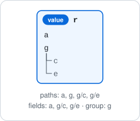
*Figure: the record `{a: 1.0, g: {b: 2.0, c: 3.0}}` has the paths `a`, `g`, `g/b`, `g/c`, the fields `a`, `g/b`, `g/c`, and the group `g`.*

> [!NOTE]
> Sibling names are distinct, so a path names at most one node; two groups may reuse a name, as `g1/theta` and `g2/theta`.

### 1.3 The parts of a value

> [!IMPORTANT]
> **Definition (part).** A *part* of a value is a node below its root.

> [!NOTE]
> A base value has no parts, so it has no paths: an array's entries are indexed by position, which is not a path.

## 2. Objects, kinds, and types

### 2.1 Objects and their kinds

> [!IMPORTANT]
> **Definition (object, kind).** An *object* is anything a workflow is built from: this law, this record.
> Its *kind* is one of six:
> 1. **base value** (§ 1.1);
> 2. **record** (§ 1.1);
> 3. **law:** a probability distribution;
> 4. **kernel:** a law for each value of what it conditions on, $K : S \to P(T)$;
> 5. **function:** a callable whose calls ProbPipe tracks;
> 6. **batch:** many objects of one kind, its *elements*, stacked along named axes, its *levels*; a *position* indexes the levels.
>
> Base values and records are *values*.

> [!IMPORTANT]
> **Definition (label).** An object's *label* is a display name. No operation reads it.

Examples: the law `mu ~ Normal(0, 1)`; the kernel that draws `y ~ Normal(mu, 1)` for each `mu`; a function from `x` to `{y, z}`; a batch of 100 draws of a law, over the level `sample`.

### 2.2 What an object produces

> [!IMPORTANT]
> **Definition (draw, event).** A *draw* is one value sampled from a law; the *event* of a law is what one draw is.

> [!IMPORTANT]
> **Definition (produced object).** What one evaluation of an object yields:
>
> | Kind | Produced object |
> | --- | --- |
> | base value, record | itself |
> | law | a draw |
> | kernel | at each value of what it conditions on, a draw |
> | function | at each value of its parameters, its return value |
> | batch | itself |

> [!NOTE]
> 1. A law's or kernel's produced object is random, so a statement about it is a statement about the law of a draw.
> 2. A law produces a draw, not itself; a joint law is a law over joint draws.

A law over `{mu, sigma}` produces records `{mu, sigma}`; a function from `x` to `{y, z}` produces, at each `x`, a record `{y, z}`.

### 2.3 The type of an object

> [!IMPORTANT]
> **Definition (type).** The *type* of an object states what all objects of that type share:
> 1. an *array type*: a shape, and optionally a dtype and a support;
> 2. an *opaque type*: optionally a Python type;
> 3. a *record type*: the record's tree, with a type at each field;
> 4. a *law type*: the *event type*, the type of one draw;
> 5. a *kernel type*: the types of what it conditions on, and its event type;
> 6. a *function type*: the types of its parameters and of its return value, either of which may be unknown;
> 7. a *batch type*: its element type and its levels.
>
> Array and opaque types are *base types*.

> [!IMPORTANT]
> **Definition (dimension name, dimension scope).** An array size may be a *dimension name*, such as `n`.
> Within one *dimension scope*, a name stands for one size: its first occurrence binds it, a later occurrence that disagrees is refused, and two different unbound names at one axis are refused (II.1).

> [!NOTE]
> Every law has an event type, whether or not it can be sampled; § 2.4 defines its paths from it.

The record type `{x: (n, m), w: (m,)}` is one dimension scope, so `m` is one size in both fields.

### 2.4 The paths of every object

> [!IMPORTANT]
> **Definition (paths of a type).** The *paths* of a type are:
> 1. for a record type, the paths of its tree, continuing below a field of law, kernel, function, or batch type into that type's paths;
> 2. for a law or kernel type, the paths of its event type;
> 3. for a function type, the paths of its return type;
> 4. for a batch type, the paths of its element type;
> 5. for a base type, none.
>
> The paths of an object are the paths of its type.

> [!IMPORTANT]
> **Definition (column).** The node of a batch at a path `p` is its *column* at `p`: the batch, over the same levels, of each element's node at `p`.

> [!NOTE]
> 1. A record's fields are only its own: a path through a field into a law is a path of the record, not a field.
> 2. A law over a single array has no path below its root.
> 3. A function whose return type is unknown has no paths known before it is called.

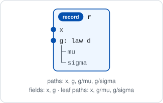
*Figure: for a law `d` over `{mu, sigma}`, the record `{x: 3.0, g: d}` has the paths `x`, `g`, `g/mu`, `g/sigma`; its fields are `x` and `g`.*

### 2.5 When one type admits another

> [!IMPORTANT]
> **Definition (conforms).** A type `A` *conforms* to a type `B` when every value of type `A` is admitted by `B`, within one dimension scope.

> [!IMPORTANT]
> **Definition (unify).** Two types *unify* when some type admits exactly the values both admit, within one dimension scope; that type is their *unification*.

> [!NOTE]
> 1. A type conforms to the unification of `A` and `B` exactly when it conforms to both, provided no two different unbound dimension names meet at one axis among the three.
> 2. Unification is symmetric, and associative where it exists.
> 3. A type given by sizes alone sets no dtype or support, so it conforms to and unifies with any type of its shape.

| `A` | `B` | Conforms | Unification |
| --- | --- | --- | --- |
| `(3,)`, `float32` | `(n,)` | yes, binding `n` to 3 | `(3,)`, `float32` |
| `()`, `int32` | `()`, `float32` | yes, a same-kind cast | `()`, `int32` |
| `()`, `float32` | `()`, `float64` | yes | `()`, `float32` |
| `(4,)` | `(3,)` | no | none |
| `(m,)` | `(n,)` | no: two unbound names | none |

<details>
<summary>Technical note: conformance by kind</summary>

`A` conforms to `B` when, in one dimension scope:
1. **arrays:** the ranks are equal, each axis agrees by the scope rule, and when both set a dtype, `A`'s casts into `B`'s by NumPy's same-kind rule; supports are not compared, since a support is descriptive (III.5);
2. **opaque values:** `B`'s Python type is unset or a superclass of `A`'s, and `B`'s metadata is unset or equal to `A`'s (III.2);
3. **records:** the same child names, each child of `A` conforming to `B`'s;
4. **laws:** `A`'s event type conforms to `B`'s;
5. **kernels and functions:** compared by their inputs and their output specs, which § 3.4 defines; its technical note states the rule;
6. **batches:** the same levels, and `A`'s element type conforms to `B`'s; a base element's name is not compared.

</details>

<details>
<summary>Technical note: unification by kind</summary>

1. **arrays:** equal ranks, each axis agreeing; a dtype only one sets, or, when both set one, the dtype of the type that conforms to the other, and the narrower by NumPy's safe cast when each conforms to the other; a support only when both set the same one;
2. **opaque values:** equal Python types, or one unset, and likewise the metadata (III.2);
3. **records:** the same child names, child by child;
4. **laws:** the unification of the event types;
5. **kernels and functions:** by their inputs and output specs, as the technical note of § 3.4 states;
6. **batches:** the same levels, and the unification of the element types.

Any other pair, such as an array type with a record type, does not unify.

</details>

## 3. Inputs and outputs

An object receives values at its inputs and offers what it produces at its outputs.

### 3.1 Inputs

> [!IMPORTANT]
> **Definition (input).** An *input* is a named place where an object receives one value.
> It has a name, which is a Python identifier; a type (§ 2.3); and a flag, *required* or *optional*.
> An *optional* input has a default, held by the object that owns the input.

> [!IMPORTANT]
> **Definition (binding).** *Binding* supplies values to some of an object's inputs, by name.
> An omitted optional input takes its default.

> [!NOTE]
> 1. Kernels have an input for each value they condition on, and functions one for each parameter. A batch of kernels or functions has its elements' inputs. Base values, records, and laws have none.
> 2. Binding a kernel's last required input gives a law.
> 3. An input of record type is one input, supplied with one record.

The kernel `a(y | mu, sigma)` draws `y ~ Normal(mu, sigma)`, with `sigma` optional and default 1.
Binding `mu = 0.3` gives the law `Normal(0.3, 1)`; binding also `sigma = 2` gives `Normal(0.3, 2)`.
The values of a binding are written as a record, `{mu: 0.3, sigma: 2.0}`.

<details>
<summary>Technical note: binding part of a record input</summary>

A binding may supply part of a record input by a path: for an input `g` of type `{b, c}`, it may supply `g/b` alone.
The input `g` then takes the rest, `{c}`, and becomes required, since a default is a whole value (III.9).

</details>

### 3.2 Outputs

> [!IMPORTANT]
> **Definition (output).** An *output* is a name under which an object offers part or all of what it produces (§ 2.2).
> The *value at an output* is that part, or the whole.

### 3.3 How outputs are named

A value with parts that also had a name outside would have two sets of paths.
If a law whose draws are `{mu, sigma}` were also named `params` from outside, its draws would be indexed by `mu` and the law by `params/mu`.
The naming rule gives each name one place.

> [!IMPORTANT]
> **Definition (naming rule).** A produced object offers:
> 1. **a base value:** itself, whole, under one name, stated by the object that produces it; this output is *at the root*;
> 2. **a record:** its children, under their names;
> 3. **a function:** the outputs of its return value, each as the function that returns the value there;
> 4. **a batch:** the outputs of its elements, each as the batch of the elements' values there;
> 5. **a law or a kernel:** nothing.
>
> An object's outputs are those of its produced object, so only a base value is ever named from outside.

> [!IMPORTANT]
> **Definition (wrap).** To offer a value that is not a base value under one name `n`, the object that produces it *wraps* it: it produces the record `{n: value}` instead.

A law's produced object is a draw, so a law offers its draws' outputs; rule 5 concerns a produced law, such as one a function returns.

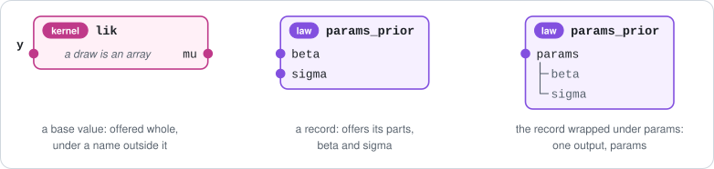
*Figure: a base value is offered whole under an outside name (rule 1); a record offers its children (rule 2); a wrap offers the record under one name.*

| Object | Offers | By rules |
| --- | --- | --- |
| kernel `k(y \| mu)`, whose draw is an array | `y`, at the root | 1 |
| law `d` with draws `{mu, sigma}` | `mu`, `sigma` | 2 |
| law with draws `{params: {mu, sigma}}` | `params`; its draws and the law have the path `params/mu` | 2 |
| function `f` from `x` to `{y, z}` | `y`, `z`; the value at `y` maps `x` to `f(x)`'s `y` | 3, 2 |
| function `h` returning a law | nothing; to offer it, `h` returns `{params: law}` | 3, 5 |
| 100 draws of `d` | `mu`, `sigma`, each a batch of 100 values | 4, 2 |
| 4 draws of a law over an array `x` | `x`, the whole batch | 4, 1 |

> [!NOTE]
> 1. An object offers either one output at the root or outputs that are all one-name paths, never both.
> 2. The name of an output at the root is not a path, since nothing is below it; every other output's name is its own path. So an object's outputs, its parts, and its draws' paths use one set of names.
> 3. A base value that no object produced, such as a lone array, has no outputs: nothing states its name, and a label is not one.

<details>
<summary>Technical note: why a function into records offers outputs and a law over records does not</summary>

A function `f` into `{y, z}` is determined by its output functions, since `f(x)` is `{y: f_y(x), z: f_z(x)}`, and a batch of records by its columns.
A law over `{mu, sigma}` is not determined by its marginals, since many joint laws share them.
Offering the marginals would let a later step receive `mu` and `sigma` as separate laws and lose their dependence (D1), so a produced law offers nothing, and so does a batch of laws.

</details>

<details>
<summary>Technical note: names of outputs and of inputs</summary>

An output's name is any name (§ 1.1), since it becomes a field; an input's name is also a Python identifier.
An output named `"n-obs"` therefore supplies no input.

</details>

### 3.4 Input specs and output specs

> [!IMPORTANT]
> **Definition (input spec).** An object's *input spec* lists its inputs in order: names, types, and which are optional.
> It holds no defaults. Two input specs are equal when they list the same inputs, types, and optional inputs, in any order.

> [!IMPORTANT]
> **Definition (output spec).** An object's *output spec* states the type of its produced object and, when that type is a base type, the name of the output at the root.
> A law's or kernel's output spec is its *event spec*.

> [!IMPORTANT]
> **Definition (type of an output).** The type of the value at that output.

> [!IMPORTANT]
> **Definition (type hole).** An output spec may name the output at the root before its type is known; the pending type is a *type hole*, filled once the object knows it (§ 11).

> [!IMPORTANT]
> **Definition (record of outputs).** A produced base value `v` offered under `n` is read as the record `{n: v}`; a produced record is its own record of outputs.

> [!NOTE]
> 1. The type alone decides whether an output spec names an output at the root, so no flag records it.
> 2. Each output's type is read from the output spec: the produced object's type at the root, the child's type for a record, a function type for a function's output, a batch type for a batch's output.
> 3. A produced base value or record is rebuilt from its record of outputs. A produced function, batch, or law has none.

The kernel `a(y | mu)` has an output spec stating an array type of shape `()` and the name `y`; its draw `0.3` is the record of outputs `{y: 0.3}`.
A law over `{mu, sigma}` has an event spec stating the record type `{mu, sigma}` and no name.

<details>
<summary>Technical note: equality and order</summary>

Output order is the field order of the record of outputs, which fixes a numeric record's flat layout, so output specs listing the same outputs in two orders are unequal.
An output spec naming a base value `n` and one whose type is `{n: …}` offer the same output and are unequal.

</details>

<details>
<summary>Technical note: conformance and unification of output specs, kernels, and functions</summary>

This completes the rules of § 2.5.
- **Output specs:** `A` conforms to `B` when they state the same root name, if any, and `A`'s type conforms to `B`'s; a type hole in `B` admits any type. Two output specs unify likewise, and a type hole takes the other's type.
- **Kernels and functions:** `A` conforms to `B` when they have the same input names; each of `B`'s input types conforms to `A`'s, and an input optional in `B` is optional in `A`; `A`'s output spec conforms to `B`'s; a side that `B` leaves unknown admits any, and a side only `A` leaves unknown does not conform. They unify when they have the same inputs, with equal types and optional flags, and output specs that unify; a side one leaves unknown takes the other's.

</details>

### 3.5 Signatures and their figures

> [!IMPORTANT]
> **Definition (signature).** An object's *signature* is `name(outputs | inputs)`, as `a(y | mu, sigma)`; with no inputs, `name(outputs)`, as `d(mu, sigma)`.

Figures read from right to left, as a density $p(y \mid \mu)$ does: inputs enter on the right edge, outputs leave on the left.


*Figure: how a figure draws an object.*

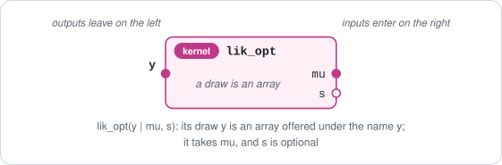
*Figure: the kernel `k(y | mu, sigma)`; its draw is an array offered under `y`, and `sigma` is optional.*

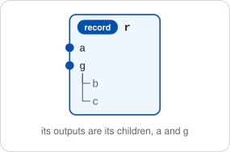
*Figure: the record `{a: 1.0, g: {b: 2.0, c: 3.0}}` offers its children `a` and `g`.*

### 3.6 Inputs and outputs compared

| | Inputs | Outputs | Why |
| --- | --- | --- | --- |
| Naming | every input is named | only a base value is named from outside | values are supplied to inputs by name; a produced value with parts carries its own names |
| Names allowed | identifiers | any name | an input matches a parameter; an output becomes a field |
| Structure | flat | one root output, or top-level paths with paths below | an input receives one value; an output is a place in a produced object |
| Presence | may be optional | always present | a produced object has a value at every output |
| Type unknown | never | type hole | a binding is checked against the input's type |
| Equality | ignores order | keeps order | binding is by name; output order fixes layout |
| None at all | allowed | never an empty record | an empty record describes nothing produced |
| Batches | the elements' inputs | the elements' outputs, as batches | one binding supplies every element |

## 4. Selecting, removing, and renaming parts

### 4.1 Selecting one part

> [!IMPORTANT]
> **Definition (selection).** For an object `x` and a path `p` of `x`, the *selection* `x[p]` is:
> - for a record, the node at `p` itself;
> - for a law, a kernel, a function, or a batch, the object of the same kind whose produced object is the node at `p` of `x`'s produced object.
>
> A batch is also selected by a position, giving an element or a smaller batch.

> [!IMPORTANT]
> **Definition (marginal law).** The selection `d[p]` of a law `d` is its *marginal law* at `p`: the law of a draw's node at `p`.

So a kernel's selection is the kernel whose law at each conditioning value is the law of a draw's node at `p`; a function's is the function mapping each argument `w` to the node at `p` of its return value; a batch's is its column at `p` (§ 2.4).

> [!NOTE]
> 1. **Selecting commutes with producing:** a draw of `d[p]` is distributed as a draw of `d` at `p`, at every path, including paths through fields that hold objects; `f[p](w)` is `f(w)` at `p`.
> 2. **Paths chain:** `x[p][q]` is `x[p/q]`, through a field that holds a law, a function, or a batch.
> 3. **Inputs are kept:** selecting never changes what an object conditions on or takes.
> 4. **Positions and paths commute** on a batch: the element at position `j` of `b[p]` is the element at `j` of `b`, at `p`.
> 5. **A selection at a base node** offers it under the path's last name; **a selection at a node with parts** offers its parts.

![Four laws: d over {a, g: {b, c}}; d[g], offering b and c; d[[g]], offering g; d[g/b], offering b at the root.](../figures/select-one.svg)
*Figure: a law `d` over `{a, g: {b, c}}`, its selections `d[g]` and `d[g/b]`, and its selection `d[[g]]` at a list of one path (§ 4.2).*

For a function `f` from `x` to `{y, z}`, `f[y]` maps `x` to the field `y` of `f(x)`.
For the record `r = {x: 3.0, g: d}`, `r[g/mu]` is `d[mu]`, the marginal law of `mu`.

![The function f from x to {y, z}, and f[y], from x to an array y.](../figures/function-outputs.svg)
*Figure: selecting a function selects in its return value; the input is unchanged.*

### 4.2 Selecting several parts

> [!IMPORTANT]
> **Definition (selection at a list of paths).** `x[[p, q, …]]` is the record of the chosen nodes, each at its own path, in `x`'s canonical order; for a law, a kernel, a function, or a batch, it is the object whose produced object is that record.
> An empty list, a repeated path, and a path inside another are refused.

> [!NOTE]
> 1. One path gives the node; a list of one path gives a record that holds it: `d[g/b]` draws arrays, while `d[[g/b]]` draws `{g: {b}}`.
> 2. Same-named nodes in two groups are both kept: for a law over `{g1: {theta}, g2: {theta}}`, `d[[g1/theta, g2/theta]]` is the law over `{g1: {theta}, g2: {theta}}`.
> 3. The order is `x`'s, whatever the order of the list: `d[[g/c, a, g/b]]` is over `{a, g: {b, c}}`.
> 4. A value selected at a list is labelled by its paths, as `(a, g/b)`.

<details>
<summary>Technical note: a list through a field that holds an object</summary>

A path in a list that enters a field holding a law, a function, or a batch cuts that object down to the rest of the path, in its own kind.
For `r = {x: 3.0, g: d}`, `r[[x, g/mu]]` is the record `{x, g}` whose `g` holds `d[[mu]]`.

</details>

<details>
<summary>Technical note: the name of the output at the root in a list</summary>

A list may name the output at the root (§ 3.3), at the top level only, and then gives the record `{n: …}` or the object producing it: for a law `d` whose draws are arrays named `x`, `d[[x]]` is the law over `{x}`.
The name alone is not a path, so `d[x]` is refused, and § 4.6 reads the object at that output.

</details>

### 4.3 Removing parts

> [!IMPORTANT]
> **Definition (removal).** `x without p, q, …` is `x` in its own kind with the nodes at the given paths removed and every other node at its path.
> A group, or a field holding an object, all of whose leaf paths are removed goes too; a record stays a record however little is left; removing everything is refused; inputs are unchanged.

> [!NOTE]
> Selection and removal partition the leaf paths: each leaf path of `x` is in exactly one of `x[[ps]]` and `x without ps`.

For a law `d` over `{a, g: {b, c}}`: `d without g/c` is over `{a, g: {b}}`, the complement of `d[[a, g/b]]`, and `d without g/b, g/c` is over `{a}`.

### 4.4 Selecting from a type

The output spec of `x` (§ 3.4) determines the output spec of every selection of `x`.

> [!IMPORTANT]
> **Definition (selection from an output spec).** For an output spec `O` and a path or list `s`, `O[s]` is:
> 1. at a path to a base node, that node's type, under the path's last name;
> 2. at a path to a node with parts, that node's type, offering its parts;
> 3. at a path at or below a field holding a law, kernel, function, or batch, the type of an object of that kind whose produced object is the node there;
> 4. at a list of paths, the record type of the chosen nodes at their paths, and at a list that names the output at the root, `{n: type}`.
>
> The name of the output at the root alone is not a path, and is refused.

> [!NOTE]
> 1. The output spec of `x[s]` is `O[s]`; for a record, the type of `x[s]` is the type of `x` at `s`.
> 2. `O[s]` holds no name that `O` does not hold.
> 3. Dimension names are kept, in the scope of `O`; binding a size commutes with selecting.
> 4. Removal from an output spec follows removal from objects (§ 4.3).

For a law over `{a, g: {b, c}}`: `O[g/b]` is an array type named `b`; `O[g]` is the record type `{b, c}`, offering `b` and `c`; `O[[g]]` is the record type `{g: {b, c}}`.

<details>
<summary>Technical note: selecting from a law, kernel, function, or batch type</summary>

For a law type with event spec `E`, the type at a path `p` is the law type whose event spec is `E[p]`; the same holds for a kernel type and a function type, which keep their inputs, and for a batch type, which keeps its levels.
So the type at `p` of a record type whose field `g` holds a law type is, at `g/p`, the law type whose event spec is that law's event spec at `p`.
A list `ps` keeps each child that a path names whole, cuts each child a path enters down to the rest of its paths, and inside a type that a field holds cuts that type's event spec the same way.
A path through a field holding a law whose draws are arrays named `x`, such as `g/x`, is no path: `x` names the draw at the root.

</details>

### 4.5 Renaming and moving parts

> [!IMPORTANT]
> **Definition (rename).** A *rename* gives the node at a path a new path; a new path in another group moves the node there.
> Its keys are the object's paths and the name of its output at the root. All keys apply at once, by II.6's rules, and a collision is refused.

> [!NOTE]
> 1. No key is both a name and a path, since the output at the root has no path below its name and every other output's name is its path.
> 2. The name of an output at the root cannot become a nested path, since a base value has no record to hold it.
> 3. On a batch of base values, renaming the elements' root name renames the batch's output.

For a law over `{a, g: {b, c}}`, the rename `g/b → g/z` renames in place and `g/b → b` moves `b` to the top level; for a law whose draws are arrays named `x`, `x → y` renames the output, while `x → g/y` is refused.

<details>
<summary>Technical note: how renames apply</summary>

II.6 states the rules: every key is resolved against the original tree, so swaps are well defined; a group a move empties dissolves; a collision, a move into the moved node's own subtree, and two targets of which one is a prefix of the other are refused; an in-place rename keeps the node's position, and a moved node is appended to its new parent.

</details>

### 4.6 The object at an output

> [!IMPORTANT]
> **Definition (object at an output).** The *object at* an output `c` of `x` is `x[c]` when `c` is a path, and `x` itself when `c` is at the root.

> [!NOTE]
> 1. The type of output `c` is the type of the produced object of the object at `c`; for a record or a batch, which produce themselves, it is that object's own type, so for `{x: 3.0, g: d}` the output `g` has `d`'s type.
> 2. An object whose produced object is a law offers no outputs, so it has no object at an output.

For a law whose draws are arrays named `x`, the object at `x` is the law; for a law over `{a, g: {b, c}}`, the object at `g` is `d[g]`; for 4 draws of the first law, the object at `x` is the batch.

## 5. Merging objects by name

### 5.1 Why merge

A model is often a product of densities joined by shared names:

$$p(y, \mu, \tau) = p(y \mid \mu)\, p(\mu, \tau)$$

Here the kernel `lik(y | mu)` draws `y ~ Normal(mu, 1)`, and the law `prior(mu, tau)` draws `mu ~ Normal(0, 5)` and `tau ~ Normal(1, 1)`.
The merge `lik & prior` is the joint law over `{y, mu, tau}`, built by matching the name `mu`.
Merge also puts records side by side, combines functions by name, and combines input specs or output specs.
It reads right to left, as the density does: in `a & b`, `b` may supply inputs of `a`, never the reverse.

### 5.2 The definition

> [!IMPORTANT]
> **Definition (family).** Two objects are of one *family* when they are two records; two laws or kernels, in any mix; two functions; or two batches over equal levels (the same level names, order, and sizes).
> Two types are of one family when they are two input specs, two output specs, two record types, two law or kernel types, two function types, or two batch types.

> [!IMPORTANT]
> **Definition (feeds, shared).** In `a & b`, an output `c` of `b` *feeds* the input `c` of `a`: `a` receives at `c` the value `b` offers there.
> An input of both `a` and `b` that `b` does not feed is *shared*.

> [!IMPORTANT]
> **Definition (merge).** The *merge* `a & b` of two objects of one family has:
> 1. **outputs:** `a`'s outputs, then `b`'s;
> 2. **inputs:** `a`'s inputs that `b` does not feed, then `b`'s inputs that are not shared; a shared input is one input, typed by the unification of its two types (§ 2.5), and optional only if optional in both;
> 3. **kind:** records give a record; laws and kernels give a kernel if a required input remains and a law otherwise; functions give a function; batches give a batch over the same levels;
> 4. **produced object:** the record of all outputs, with `b`'s part produced first and `a`'s next, from its inputs and the values `b` feeds (§ 5.4).

> [!IMPORTANT]
> **Definition (valid merge).** `a & b` is refused unless:
> 1. **one family:** `a` and `b` are of one family;
> 2. **recordable produced objects:** each operand produces a base value or a record, of known type;
> 3. **one source per output:** `outputs(a) ∩ outputs(b) = ∅`;
> 4. **order:** `inputs(b) ∩ outputs(a) = ∅`;
> 5. **separate sides:** within each operand, no name is both an input and an output;
> 6. **fed types conform:** each feeding output's type conforms to its input's type (§ 2.5);
> 7. **shared types unify:** the two types of each shared input unify;
> 8. **one dimension scope:** no dimension name stands for two sizes, and no two unbound names meet at one axis (§ 2.3).

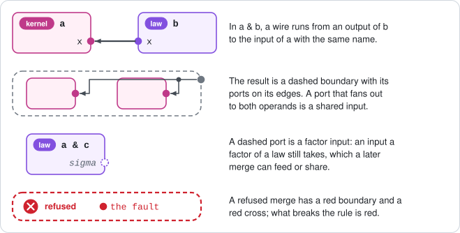
*Figure: how a figure draws a merge.*

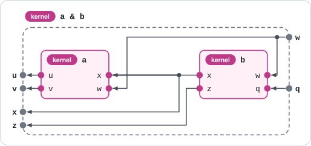
*Figure: `a(u, v | x, w) & b(x, z | w, q)`. `x` is fed, and stays an output; `w` is shared; the result is the kernel `(u, v, x, z | w, q)`.*

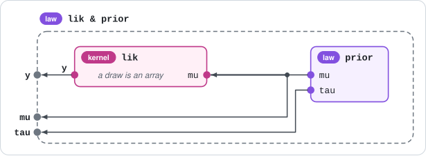
*Figure: `lik & prior`. `mu` is fed, no input remains, so the result is a law; `lik`'s root output `y` becomes the field `y` of the joint draw.*

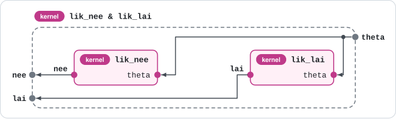
*Figure: `a(x | theta) & b(y | theta)`. `theta` is shared; types `("n",)` and `(3,)` would unify to `(3,)`.*

> [!WARNING]
> A merge reads a law or kernel through its factors, so a law built by merging can still have an optional input fed later (§ 5.3).

<details>
<summary>Technical note: factors, and the inputs a law's factors still take</summary>

> [!IMPORTANT]
> **Definition (factor).** A merge of laws and kernels keeps its operands' factors. A law or kernel built by merging has the factors it kept; any other has itself as its one factor. A *grouped sub-joint*, which a rename creates by gathering outputs of several factors under one group (§ 4.5), is one factor.

> [!IMPORTANT]
> **Definition (remaining inputs of the factors).** The inputs, required or optional, that the factors take and no factor feeds, in order of first appearance: for a kernel, its inputs; for a law of a family such as `Normal`, none; for a law built by merging, the optional inputs its factors left at their defaults; for a grouped sub-joint, its own inputs if it is a kernel, none if a law.

For laws and kernels, "inputs" in the definitions above means these remaining inputs, so condition 4 covers optional ones.
For records, functions, and types, the remaining inputs are the inputs; a type, and an element in a merge of batches, is one factor.

</details>

<details>
<summary>Technical note: merging types</summary>

- **Output specs:** the record type of the first's outputs, then the second's; a root output `n` becomes the child `n`, and every other path keeps its type. Conditions 2, 3, and 8 apply.
- **Input specs:** inputs in order of first appearance; a shared input is unified, and optional only if optional in both; dimension bindings are not kept.
- **Record types:** both sets of children; a shared top-level name is refused.
- **Law, kernel, function, and batch types:** the type of the merged object.

An input spec and an output spec do not merge. The inputs an output spec's outputs would feed form the input spec with one required input per output, of its type.

</details>

<details>
<summary>Technical note: objects of two families</summary>

A record could be read as a law giving itself with probability one, and a function as a kernel of point masses. A law with a point-mass factor has no joint density, and a joint's factors are laws and kernels (IV.1), so objects of two families are refused.

</details>

### 5.3 Optional inputs

An optional input that the other operand does not feed stays an optional input of the result; one that it feeds is fed like any other.

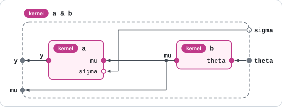
*Figure: `a(y | mu, sigma) & b(mu | theta)`. `sigma` is not fed, so it stays an optional input of the kernel result.*

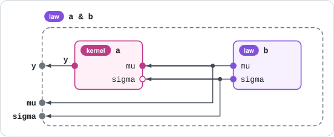
*Figure: `a(y | mu, sigma) & b(mu, sigma)`. `b` feeds the optional `sigma` too; no input remains, so the result is a law.*

> [!WARNING]
> A law built by merging keeps optional inputs its factors left at their defaults, and a later merge can feed them.
> For a law `c(mu)`, `a & c` is a law that takes no inputs, with `sigma` at 1; merging it with a law `e(sigma)`, where `sigma ~ Normal(100, 0.001)`, feeds `sigma`, so `y`'s scale becomes about 100.

<details>
<summary>Technical note: a shared optional input that a binding omits</summary>

Each factor then takes its own default, since defaults belong to objects and an input spec holds none; the law at the defaults need not equal the kernel at any one value of the input.

</details>

<details>
<summary>Technical note: a merge that leaves only optional inputs</summary>

It gives a law, sampled at the defaults, while a kernel whose inputs are all optional stays a kernel (IV.2).

</details>

### 5.4 The value of a merge

**Laws and kernels.**
For values `u` of the result's inputs, let `u_a` be those `a` takes and `b` does not feed, and `u_b` those `b` takes.

> [!IMPORTANT]
> **Definition (law of a merge).** A draw `z` of `a & b` at `u`: draw `z_b` from `b` at `u_b`; draw `z_a` from `a` at `u_a` and the values `z_b` feeds; `z` is `z_a`'s record of outputs followed by `z_b`'s.

With densities, where `z_fed` is the fed values:

$$p_{a \& b}(z \mid u) = p_a(z_a \mid u_a, z_{\mathrm{fed}})\; p_b(z_b \mid u_b)$$

For `lik & prior`, this is the product of § 5.1.

**Records.** No inputs, so nothing is fed: `a & b` is `a`'s children followed by `b`'s.

> [!NOTE]
> Records merge by top-level name: two records that both have a group `g` are refused by condition 3, whatever the groups hold.

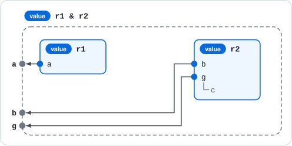
*Figure: `{a: 1.0} & {b: 2.0, g: {c: 3.0}}` is `{a, b, g: {c}}`.*

> [!TIP]
> To merge two records that share `g`, merge the groups first: `(x without g) & (y without g) & {g: x[g] & y[g]}`.

**Functions.** A function is a kernel of point masses, so `(a & b)(u)` is `a`'s record of outputs at `u_a` and the fed values, followed by `b`'s at `u_b`.
For `a(mu | data)` returning the mean and `b(sigma | data)` the standard deviation, `a & b` takes `data` once and returns `{mu, sigma}`.

**Batches.** Over equal levels, element by element; a base element is read as its record of outputs, so 3 draws of `x` and 3 draws of `y` merge into 3 records `{x, y}`.

<details>
<summary>Technical note: batches merge element by element</summary>

Each element is one operand, typed by the elements' type, and the conditions are checked once on that type; an element that is a law is one factor, so its factors' hidden optional inputs are not fed.

</details>

### 5.5 Refused merges

| Condition | Why |
| --- | --- |
| 1. One family | each family has its own produced object (§ 5.4) |
| 2. Recordable produced objects | each operand's produced object is rebuilt from fields of the result |
| 3. One source per output | one name cannot hold two values |
| 4. Order | sides stay separate, and each operand follows those that feed it |
| 5. Separate sides | fed and shared are then decided by names alone |
| 6. Fed types conform | the input must admit every value fed to it |
| 7. Shared types unify | one value supplies both inputs |
| 8. One dimension scope | a dimension name is one size (II.1) |

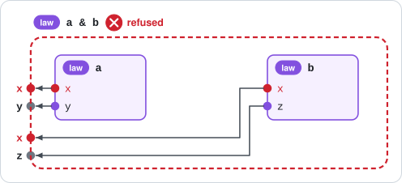
*Figure: refused by condition 3: `x` is an output of both `a` and `b`.*

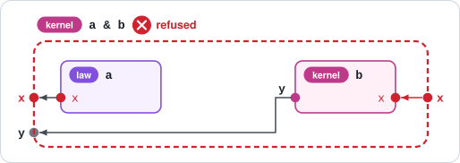
*Figure: refused by condition 4: `b` takes `x`, which `a` outputs; written `b & a`, it is valid.*

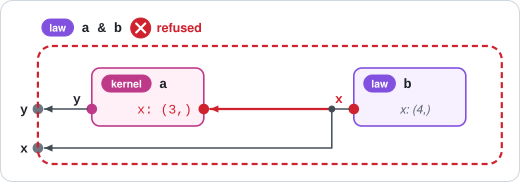
*Figure: refused by condition 6: the output `x` of shape `(4,)` does not conform to the input of shape `(3,)`.*

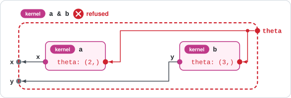
*Figure: refused by condition 7: the shared `theta` has shapes `(2,)` and `(3,)`, which do not unify.*

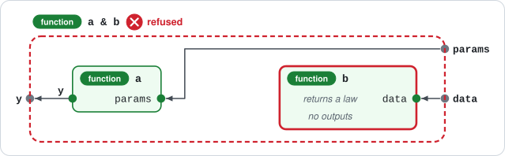
*Figure: refused by condition 2: `b` returns a law, which a record cannot hold unnamed; `b` should return `{params: law}`.*

<details>
<summary>Technical note: why outputs feed only from right to left</summary>

If a factor of `b` took an input that `a` outputs, nothing would feed it, so the result would have the name on both sides.
With the order rule, in `a & b & c` each operand is fed only from its right, and the density reads left to right.
The rule does not make associativity hold, and it does not let every acyclic graph be built one module at a time: for kernels `c(z | y)`, `a(y | x)` and a law `b(x)`, both `a & (c & b)` and `(c & b) & a` are refused, while `c & a & b` is valid.

</details>

<details>
<summary>Technical note: a merge never lifts</summary>

An output feeds an input only when its type conforms. A merge does not apply the receiver to each draw of a law fed in place of a value, which would ignore the law's dependence on the receiver's other inputs.

</details>

<details>
<summary>Technical note: two selections of one law</summary>

For a law `d` over `{g1: {theta}, g2: {theta}}`, `d[[g1]] & d[[g2]]` is the product of the two marginals, since a selection is one factor; the joint is `d[[g1, g2]]`.
`d[g1] & d[g2]` is refused, both offering `theta`, and its message points to `d[[g1, g2]]` (§ 19).

</details>

### 5.6 Properties

> [!NOTE]
> 1. **Separate sides:** no name is both an input and an output of `a & b`.
> 2. **Paths kept:** every path of an operand is a path of `a & b` with the same type, once dimension names are bound; a root output `n` becomes the path `n`.
> 3. **Specs:** the output spec of `a & b` is the merge of the operands' output specs, and its input spec the merge of `a`'s without the fed inputs and `b`'s.
> 4. **Associative when both groupings are valid**, for laws, kernels, records, record types, output specs, and batches of records or base values.
> 5. **Commutative up to order** when neither operand feeds the other: same law or value, outputs in another order.
> 6. **Sampling commutes** for laws that do not feed each other and draw records: a draw of `a & b` is distributed as a draw of `a` merged with a draw of `b`.
> 7. **Renaming commutes** under the conditions below.
> 8. **Labels are not read;** the result's label joins the operands' with `·`.

<details>
<summary>Technical note: when two groupings differ in validity</summary>

`(a & b) & c` and `a & (b & c)` check different pairs: a name `a` and `b` take and `c` outputs, whose types in `a` and `b` do not unify while `c`'s conforms to each; or two unbound dimension names at one axis that one grouping binds first.
Input specs and functions keep no dimension scope, so for inputs `x: ("n",)`, then `x: (3,)` with `y: ("n",)`, then `z: ("n",)`, the left grouping leaves `z: ("n",)` and the right gives `z: (3,)`.
Batches of laws can fail associativity, since each element is one factor.

</details>

<details>
<summary>Technical note: when renaming commutes</summary>

For a one-to-one rename `m` of the names of `a` and `b`, applied to inputs and outputs alike, renaming `a & b` by `m` equals merging `a` and `b` each renamed by its part of `m`, for laws, kernels, records, and functions, provided `m` renames no remaining input of a law's factors.
A rename that moves a node into a group does not commute.

</details>

<details>
<summary>Technical note: optional inputs across merges</summary>

For `M = a & c`, with `a(y | mu, sigma)` and a law `c(mu)`:
1. `M & e` feeds `sigma` for a law `e(sigma)`, and equals `a & (c & e)`.
2. For a kernel `k(w | sigma)`, `M & k` shares `sigma`, now required; condition 7 checks a type no spec of `M` shows.
3. For an unrelated kernel `k(w | v)`, `M & k` gains the optional input `sigma`.
4. `M` and `a1 & c`, for a kernel `a1(y | mu)` equal to `a` at `sigma = 1`, are equal laws that merge differently with `e`.
5. A result keeps `sigma` exactly when it keeps `a` as a factor: a selection of `M` does not, the marginal computed as a merge of factors does, a rename does, conditioning on observed `y` does not.
6. The merge of types can be valid where the merge of objects is refused: `e`'s type and `M`'s type merge, while `e & M` breaks condition 4.

</details>

<details>
<summary>Technical note: dimension scopes across merges</summary>

A merged law or kernel keeps its dimension scope; merged specs and functions apply it and keep nothing.
A kept scope can refuse a merge over a name no type shows: if `m1` bound `n = 3` and `m2` bound `n = 4`, `m1 & m2` breaks condition 8 although neither event spec contains `n`.

</details>

### 5.7 What merge is not

1. **Not composition:** `f ∘ g` passes `g`'s result to `f` by position and returns `f`'s; a merge matches names and returns both operands' outputs.
2. **Not conditioning:** conditioning `lik` on `mu = 0.5` removes `mu`; in `lik & prior`, `mu` is fed and stays an output.
3. **Not renaming:** rename an operand first (§ 4.5), then merge.

## 6. The kinds, one by one

Each kind follows §§ 1 to 5; this section states only what is specific to it.

### 6.1 Base values and records

> [!NOTE]
> 1. **What it is:** a base value is an array or an opaque value; a record is a tree of named values (§ 1.1).
> 2. **Produces:** itself.
> 3. **Parts:** a record's nodes, continuing into objects its fields hold (§ 2.4); a base value has none.
> 4. **Inputs:** none.
> 5. **Outputs:** a record offers its children; a base value standing alone offers nothing (§ 3.3).
> 6. **Merge:** two records merge side by side, by top-level name (§ 5.4); base values do not merge.


*Figure: the record `{a: 1.0, g: {b: 2.0, c: 3.0}}` offers `a` and `g`.*

For `r = {a: 1.0, g: {b: 2.0, c: 3.0}}`: `r[g]` is the record `{b, c}`, `r[[a, g/b]]` is `{a, g: {b}}`, and `r & {x: 0.5}` is `{a, g: {b, c}, x}`.

### 6.2 Laws

> [!IMPORTANT]
> **Definition (conditioning).** *Conditioning* a law on values at some of its paths gives the law of the rest of a draw given those values.

> [!IMPORTANT]
> **Definition (summary).** A *summary* of a law is its mean, variance, standard deviation, or a quantile.

> [!NOTE]
> 1. **Produces** a draw; **parts** and **outputs** are those of its event type (§ 2.4, § 3.3); **inputs:** none.
> 2. **Selecting commutes with sampling** for every law that can be sampled, since its paths come from its event type (§ 4.1).
> 3. **A selection and the marginal law are one law**, whether the selection keeps its link to `d` or the marginal is computed apart.
> 4. **Conditioning removes what it fixes:** the event spec of `d` conditioned at paths `ps` is `d`'s event spec without `ps`, whatever computes it; conditioning `d` on a draw of `d[[ps]]` fixes exactly the nodes at `ps`.
> 5. **A summary keeps the law's paths** when it has one value per field, so the mean of `d` at `p` and the mean of `d[p]` estimate one quantity; a summary is accepted wherever a draw of its type is.
> 6. **A law whose draws are laws, functions, or batches** is allowed and offers nothing (§ 3.3, rule 5); to name its draws, it wraps them, and a family names its own draws under the name it is given.
> 7. **Merge:** laws and kernels merge, read through their factors (§ 5.2).

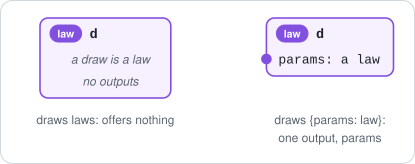
*Figure: a law whose draws are laws offers nothing; wrapped, it draws `{params: law}` and offers `params`.*

For `d` over `{mu, sigma}` with `mu ~ Normal(0, 1)` and `sigma ~ Normal(1, 1)`: conditioning on `mu = 0.1` gives a law over `{sigma}`; the mean of `d` is the record `{mu, sigma}` of means; `d[mu]` is the marginal law of `mu`.

<details>
<summary>Technical note: conditioning at nested paths and on records</summary>

Given values are a mapping from paths to values, or a record read by its paths.
Conditioning a law over `{a, g: {b, c}}` at `g/b` is conditioning at a nested path.
To condition on the whole group `g`, name it: give `{g: v}` for a draw `v` of `d[g]`, or a draw of `d[[g]]`; a bare `{b, c}` would be read at the top level, where `b` and `c` are not paths.
A method that cannot condition at a nested path refuses with a message naming the method, not the path.

</details>

<details>
<summary>Technical note: the type of a summary</summary>

A summary's type is derived from the event type: a mean is floating, with the hull of the event's support, so a mean of a law over integers is refused where an integer value is required.
A result that is not one value per field, such as a covariance, is one base value named by the operation.

</details>

### 6.3 Kernels

> [!NOTE]
> 1. **What it is:** a law for each value of what it conditions on; it has at least one input.
> 2. **Produces** a draw at each value of its inputs; **parts** and **outputs** are its event type's.
> 3. **Inputs:** one per value it conditions on. A kernel whose inputs are all optional is still a kernel; binding its last required input gives a law, with optional inputs at their defaults.
> 4. **Separate sides:** no name is both an input and an output.
> 5. **Selecting** `k[p]` keeps its inputs; renaming a kernel renames inputs and outputs alike (III.9).
> 6. **Merge:** with laws and kernels; it feeds and is fed (§ 5.2).


*Figure: the kernel `k(y | mu, sigma)`.*

<details>
<summary>Technical note: a kernel and the function that returns its laws</summary>

A kernel and the function returning the law at each value are one map $S \to P(T)$, but their produced objects differ: a draw for the kernel, a law for the function.
So the kernel offers its draws' outputs, and the function offers nothing (§ 3.3, rule 5).

</details>

### 6.4 Functions

> [!NOTE]
> 1. **Produces** its return value at each value of its parameters; **parts** and **outputs** are its return value's (§ 3.3, rule 3).
> 2. **Inputs:** its parameters; a parameter with a default is optional.
> 3. **A function into records** is the record of its output functions, so it offers them.
> 4. **A function that returns a law** offers nothing; to name the law, it returns `{params: law}`.
> 5. **A function that returns a function** offers that function's outputs.
> 6. **Selecting** `f[p]` maps `w` to `f(w)` at `p`, with the same inputs.
> 7. **Merge:** functions merge as kernels whose laws are point masses, and must state their inputs and return type (§ 5.2).

For `f` from `x` to `{y, z}`: it offers `y` and `z`; `f[y]` maps `x` to `f(x)`'s `y` (figure in § 4.1).
For `h` from `data` to a law over `{mu, sigma}`: it offers nothing, `h[mu]` maps `data` to the law's marginal at `mu`, and `h` cannot be merged (§ 5.5).

<details>
<summary>Technical note: a function whose return type is unknown</summary>

It has no paths known before it is called, so `f[p]` is checked when the selected function is called, against what the call returns.

</details>

### 6.5 Batches

> [!IMPORTANT]
> **Definition (element type).** A batch's *element type* is the output spec of one element: the element's type and, for a base element, its name.
> A batch built from bare base values names them `element`.

> [!NOTE]
> 1. **Produces** itself; **parts** are its elements' paths, each node a column (§ 2.4); positions index its levels.
> 2. **Inputs:** its elements' inputs, supplied to every element by one binding.
> 3. **Outputs:** its elements' outputs, as columns; a batch of base values offers one output at the root, a batch of laws or kernels nothing.
> 4. **Merge:** two batches over equal levels merge element by element (§ 5.4).
> 5. **Names are not data:** two batches that differ only in a base element's name are equal.

![A batch b of draws over {mu, sigma}, and its column b[mu], which offers mu at the root.](../figures/batch-columns.svg)
*Figure: a batch of 100 draws of a law over `{mu, sigma}`, and its column at `mu`.*

For 4 draws `b` of a law whose draws are arrays named `x`: `b` offers `x` at the root, `b[x]` is refused, the object at `x` is `b`, and `b[[x]]` is a batch of records `{x}`.

<details>
<summary>Technical note: why names stay out of a batch's equality</summary>

A batch's base-element name is a description of the batch, as a label is, not part of its values; keeping it out of equality lets draws of `x` and of `y` be combined entry by entry.
§ 18 states how the name is stored and what this costs.

</details>

## 7. Invariants

### 7.1 The invariants

> [!IMPORTANT]
> **Definition (equal).** Two values are *equal* when they have the same type and equal entries; two laws or functions when they have equal output specs and the same distribution or map.
> Merge reads factors, which equality does not compare.

`d` is a law, `k` a kernel, `f` a function, `b` a batch, `x` any object with parts; `s` is a path or a list of paths.

| # | Invariant | Follows from, or chosen |
| --- | --- | --- |
| I1 | **One set of paths:** a path or list valid on `d` is valid on its draws, on each element of a batch of its draws, on its mean, and on its event spec | § 2.4 |
| I2 | **Selecting commutes with sampling:** a draw of `d[s]` is distributed as a draw of `d` at `s`, at every path | § 4.1 |
| I3 | **Selecting commutes with summaries:** the mean of `d` at `s` and the mean of `d[s]` estimate one quantity, and are equal when computed in closed form; likewise variance, standard deviation, and quantiles | I2, § 6.2 |
| I4 | **Positions and paths commute** on a batch | § 2.4, § 4.1 |
| I5 | **Paths chain:** `x[p][q]` is `x[p/q]`, through fields that hold objects | § 2.4 |
| I6 | **Output specs agree:** the output spec of `x[s]` is `x`'s output spec at `s`; for a record, the type | § 4.4 |
| I7 | **A selection and the marginal law are one law** | chosen (VI.8) |
| I8 | **Draws of a list condition back:** conditioning `d` on a draw of `d[[ps]]` fixes the nodes at `ps` and nothing else | chosen |
| I9 | **One path gives the node, a list a record holding it**, the output at the root included | chosen |
| I10 | **A list and removal partition** the leaf paths of an object, and the inputs of an input spec | § 4.2, § 4.3 |
| I11 | **Conditioning removes what it fixes**, whatever computes it; a kernel's bound inputs leave its input spec | chosen |
| I12 | **The object at an output:** output `c`'s type is the type of the produced object of the object at `c` | § 3.4, § 4.6 |
| I13 | **Selecting commutes with producing:** `f[s](w)` is `f(w)` at `s`; `k[s]` at `w` is the law of a draw's node at `s` | § 4.1 |
| I14 | **Selecting keeps inputs** | § 4.1 |
| I15 | **Sides are separate** for every kernel, law, and merge | chosen for kernels; conditions 4 and 5 for merges |
| I16 | **The specs of a merge are the merges of the specs**, after binding dimension names, when no operand's factors take an input its input spec does not state | § 5.6 |
| I17 | **A merge keeps paths**; an output at the root moves to the path of its name | § 5.6 |
| I18 | **Paths agree with selection:** a string is a path of `x` exactly when `x[s]` is defined, and rename keys are those paths and the root name | chosen |
| I19 | **Merge is associative when both groupings are valid**, under § 5.6's conditions | § 5.6 |
| I20 | **Sampling commutes with merge** for laws that do not feed each other and draw records | § 5.4 |
| I21 | **Renaming commutes with merge**, under § 5.6's conditions | § 5.6 |
| I22 | **Merge reads no label** | § 5.2 |

<details>
<summary>Technical note: what the proofs rest on</summary>

I2, I4, I5, I6, and I13 hold by construction, since they restate a definition; their tests check the implementation against it.
I2, I5, I6, and I9 hold with no exception at fields that hold objects, since no selection wraps.
jhuggins's Rocq model proves I1 for laws, draws, and batches, and I2, I4, I5, and I10 for every kind it models, with the facts behind I17 and I21; it does not model types, dimension names, or optional inputs, so I19's conditions are this design's.

</details>

### 7.2 Exceptions on purpose

<details>
<summary>Technical note: the cases outside the invariants</summary>

| Case | What happens | Why |
| --- | --- | --- |
| Covariance | the covariance of `d` is one base value, so it has no paths | it is not one value per field; the block for `s` is the covariance of `d[s]` |
| Monte Carlo summaries | the mean of `d` at `s` and the mean of `d[s]` differ | each takes its own draws |
| Summaries and conditioning at a field holding a law | a mean of drawn laws is undefined, and conditioning cannot fix a drawn law | I1, I3, and I8 cover paths that end at values |
| Labels | `d[[a, g/b]]`'s draws and `d`'s draws at `[a, g/b]` differ in label | no operation reads a label |
| Groups and fields | `g` is a path of `{a, g: {b, c}}` but not a field | selection names groups, while the fields are the leaves |
| The list form at the root | `d[[x]]` is defined although `x` is not a path, and `x` cannot be removed | an extra rule at the top level (§ 4.2) |
| A shared optional input omitted | each factor takes its own default | defaults belong to objects (§ 5.3) |
| A kernel whose inputs are all optional | merged with a law, it gives a law at the defaults, though it asks for its inputs alone | the kind follows the required inputs left (§ 5.3) |
| Two selections of one law | `d[[g1]] & d[[g2]]` is the product of the marginals | a selection is one factor (§ 5.5) |
| A selection and a marginal of one joint (I7) | they can merge differently when a factor has an optional input left at its default | merge reads factors (§ 5.6) |
| Hidden optional inputs | a later merge can feed or share them; equal laws can merge differently | merge reads factors (§ 5.6) |
| Merges of types and of objects (I16) | a type merge can be valid where the object merge is refused | a type states no inputs of factors (§ 5.6) |
| Associativity of validity (I19) | one grouping can be refused and the other valid | they check different pairs (§ 5.6) |
| Batches of laws (I19) | the two groupings of three batches can give different laws | each element is one factor (§ 5.4) |
| Input specs and functions (I19) | two valid groupings can differ in a dimension size | they keep no dimension scope (§ 5.6) |
| A kept dimension scope | a merge can be refused over a name no type shows | merged laws keep their scope (§ 5.6) |

</details>

---

# Part II: The design in code

## 8. Reading Part II

> [!IMPORTANT]
> **Definition (tracked term, term spec).** A *tracked term* is the code form of an object: an instance of a class such as `Record` or `Distribution`, which ProbPipe tracks through every operation.
> A *term spec* is the code form of a type: an instance of a subclass of `TermSpec`.
> A tracked term's type is its `spec`.

| Part I | Tracked term | Term spec |
| --- | --- | --- |
| base value | `NumericArray`, `Opaque` | `NumericArraySpec`, `OpaqueSpec` |
| record | `Record`, `NumericRecord` | `RecordSpec`, `NumericRecordSpec` |
| law | `Distribution` | `DistributionSpec` |
| kernel | `ConditionalDistribution` | `ConditionalDistributionSpec` |
| function | `Function` | `FunctionSpec` |
| batch | `NumericArrayBatch`, `RecordBatch`, `DistributionBatch`, … | `BatchSpec` |

| Part I | Code |
| --- | --- |
| input spec, output spec | `InputSpec`, `OutputSpec` |
| a law's or kernel's event spec | `event_spec` |
| a function's output spec, input spec | `output_spec`, `input_spec` |
| a kernel's input spec | `given_spec` |
| a batch's element type | `element_spec` |
| `x[p]`, `x[[p, q]]` | `x["p"]`; `x["p", "q"]` or `x[["p", "q"]]` |
| `x without p` | `x.without("p")` |
| rename | `x.rename({"old": "new"})` |
| `a & b` | `a & b` |
| the object at output `c` | `x.output("c")` |

This document writes the final names.
Until one rename after the workshop, the code spells some of them as it does today:

| Final name | Until the rename |
| --- | --- |
| input, optional input, a kernel's input | slot, optional slot, given slot |
| output, the output at the root | component, the component at the root |
| input spec, output spec, event spec (in prose) | input declaration, output declaration, event declaration |
| `O.outputs` | `O.components` |
| `x.output(c)` | `x.component(c)` |
| `output_name=` | `component=` |

The class names `InputSpec` and `OutputSpec` and the attributes `input_spec`, `output_spec`, `given_spec`, `event_spec`, and `element_spec` are final.
Appendix B gives the steps.

Examples import from `probpipe` and use generic names; each builds what it uses.

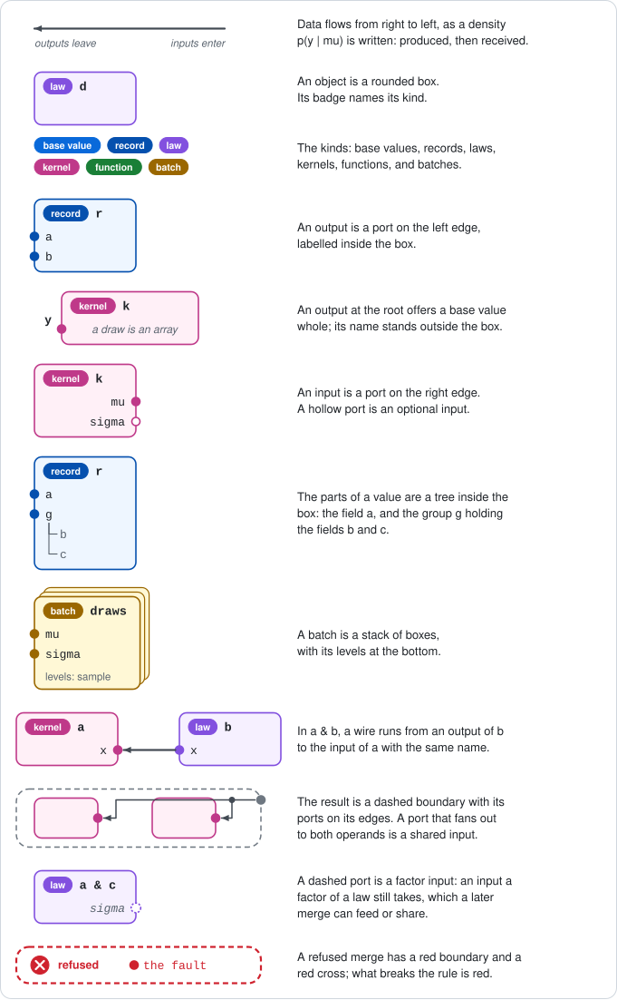
*Figure: the legend of every figure, for reference.*

## 9. Term specs

```python
class TermSpec(ABC):
    """The type of a tracked term (§ 2.3); it validates values and carries dimension names."""

    def is_valid(self, value: Any) -> bool: ...
    @property
    def free_dims(self) -> frozenset[str]: ...      # the unbound dimension names
    def with_dim_sizes(self, **sizes: int) -> Self: ...
    def with_dim_names(self, **names: str) -> Self: ...

class NumericArraySpec(TermSpec):
    """An array type: a shape whose sizes are ints or dimension names, and optionally a dtype and a support."""
    def __init__(self, shape, dtype=None, support=None) -> None: ...

class OpaqueSpec(TermSpec):
    """An opaque type: optionally a Python type and metadata."""
    def __init__(self, type: type | None = None, meta: Any = None) -> None: ...

class DistributionSpec(TermSpec):
    """A law type: the event spec, the output spec of one draw (§ 3.4)."""
    event_spec: OutputSpec

class ConditionalDistributionSpec(TermSpec):
    """A kernel type: its input spec and its event spec."""
    given_spec: InputSpec
    event_spec: OutputSpec

class FunctionSpec(TermSpec):
    """A function type: its input spec and output spec, either of which may be None (unknown)."""
    input_spec: InputSpec | None
    output_spec: OutputSpec | None
```

`RecordSpec` is in § 14 and `BatchSpec` in § 18.
A term spec of a law, kernel, function, or batch has no `[]` of its own: select from the output spec it holds, as `d.spec.event_spec["mu"]`.

> [!NOTE]
> **The size shorthand.** Wherever an input, a `RecordSpec` field, or the keyword form of `OutputSpec` takes a type, a tuple of sizes is the `NumericArraySpec` of that shape, with no dtype or support: `InputSpec(x=())`, `RecordSpec(x=("n",))`, `OutputSpec(y=(3,))`. A bare int, as `x=3`, is refused.

## 10. `InputSpec`

### 10.1 API

```python
class InputSpec(Mapping[str, TermSpec]):
    """An object's inputs: each input's name and type, in order, and which are optional (§ 3.4).

    It holds no defaults. Equality ignores order.
    """

    def __init__(self, inputs: InputSpec | Mapping[str, TermSpec | tuple] | RecordSpec | OutputSpec
                 | None = None, /, **inputs_by_name: TermSpec | tuple) -> None:
        """Read the inputs from one source.

        An InputSpec is taken as it is; a mapping by its entries; a RecordSpec by its
        children; an OutputSpec by its outputs, each typed by its output's type: the
        inputs those outputs would feed. Every input read from a mapping, a RecordSpec,
        or an OutputSpec is required. InputSpec(R) == InputSpec(OutputSpec(R)).

        Raises:
            ValueError: A name is not a Python identifier.
            TypeError: The OutputSpec has a type hole, the source is of another class,
                or both a source and keywords are given.
        """

    @property
    def required(self) -> tuple[str, ...]: ...
    @property
    def optional(self) -> frozenset[str]: ...
    def with_optional(self, *names: str) -> InputSpec: ...

    def __getitem__(self, names: str | Sequence[str], /) -> TermSpec | InputSpec:
        """An input's type, or the InputSpec of a list of inputs.

        A list keeps this spec's order, and optional inputs stay optional. A path into
        a record input, as "g/b", gives the type there; in a list, it gives the input
        holding the cut-down record, which becomes required.

        Raises:
            KeyError: A name is not an input.
            ValueError: The path reader refuses the argument (§ 12).
        """

    def __contains__(self, name: object, /) -> bool:
        """Whether name is a str naming an input, or a path into a record input; False for a list."""

    def get(self, name: str, default: TermSpec | None = None, /) -> TermSpec | None:
        """self[name] when name in self, else default."""

    def without(self, *names: str) -> InputSpec:
        """The other inputs, optional ones staying optional; may leave none.

        A path into a record input leaves the rest of that record, and the input
        becomes required.

        Raises:
            KeyError: A name is not an input.
        """

    def __and__(self, other: InputSpec, /) -> InputSpec:
        """The inputs of both, in order of first appearance (§ 5.2, technical note).

        A shared input has the unification of its types and is optional only if
        optional in both; dimension bindings are not kept.

        Raises:
            TypeError: other is not an InputSpec.
            ValueError: Two types do not unify, or a dimension name binds two sizes.
        """

    def rename(self, renames: Mapping[str, str] | None = None, /,
               **keyword_renames: str) -> InputSpec:
        """Rename inputs, by II.6's rules restricted to names."""
```

### 10.2 Who reads inputs this way

`conditional_distribution(fn, given_spec=...)`, `ConditionalDistributionSpec(given_spec, ...)`, and `Function(fn, input_spec=...)` read their argument through the `InputSpec` constructor.
`conditional_distribution` and `Function` then mark optional each input whose parameter has a default, and refuse an optional input whose parameter has none.

### 10.3 Examples

```python
from probpipe import InputSpec, Normal, OutputSpec, RecordSpec

InputSpec(mu=(), sigma=()).with_optional("sigma")   # mu required, sigma optional
d = Normal("mu", 0.0, 1.0) & Normal("sigma", 1.0, 1.0)
InputSpec(d.event_spec)                             # InputSpec(mu=..., sigma=...)
InputSpec(RecordSpec(g=RecordSpec(a=(), b=()), x=()))   # two inputs: g, a record, and x
InputSpec(OutputSpec(d.spec))                       # InputSpec(): a produced law offers nothing

i = InputSpec(x=(), y=(), z=())
i[["x", "z"]]                                       # InputSpec(x=..., z=...)
i.without("y")                                      # InputSpec(x=..., z=...)
i.without("w")                                      # KeyError
InputSpec(theta=("n",), x=()) & InputSpec(theta=(3,), y=())
# InputSpec(theta=NumericArraySpec((3,)), x=..., y=...): theta unifies, n is bound to 3
```

<details>
<summary>Technical note: the messages for common mistakes</summary>

The recommended idiom is `given_spec=d.event_spec`, cut down with `[...]`, `without`, and `&`.
1. **An input the function does not take**, for `conditional_distribution(fn, given_spec=d.event_spec)` where `fn` takes `mu`: "given_spec of 'fn' declares 'sigma', which the function does not take (it takes mu); leave it out with event_spec.without('sigma'), or pick the inputs with event_spec[['mu']]".
2. **A group's parts where the function takes the group**, for `given_spec=d.event_spec["g"]` and `fn(g)`: "given_spec of 'fn' declares a and b, the parts of the group g; to declare the input g, index with a list: event_spec[['g']]".
3. **A law or its type as the source:** "given_spec takes an InputSpec, a mapping, a RecordSpec, or an OutputSpec, not a Distribution; for the outputs of a law, pass law.event_spec".
4. **An input spec merged with an output spec:** "cannot merge an InputSpec with an OutputSpec; to read an output spec as the inputs it feeds, write InputSpec(output_spec)".

</details>

## 11. `OutputSpec`

### 11.1 API

```python
class OutputSpec:
    """The type of an object's produced object, and the name of its output at the root
    when that type is a base type (§ 3.4). Not a Mapping, and not iterable.
    """

    @overload
    def __init__(self, term_spec: TermSpec, /) -> None:
        """The positional form, for any type that is not a base type.

        Raises:
            TypeError: A base type, which needs a name.
            ValueError: An empty RecordSpec.
        """
    @overload
    def __init__(self, **named_output: TermSpec | tuple | None) -> None:
        """The keyword form: one keyword, the name of the output at the root, over a base
        type, a size tuple, or None for a type hole.

        Raises:
            TypeError: A type that is not a base type: "params would name a record; give
                OutputSpec(RecordSpec(...)) to offer its fields, or wrap it:
                OutputSpec(RecordSpec(params=...))", and likewise for a law.
        """

    @property
    def term_spec(self) -> TermSpec | None:
        """The produced object's type; None only while a type hole is pending."""

    @property
    def outputs(self) -> Mapping[str, TermSpec | None]:
        """Each output's name and type, in order, by the naming rule (§ 3.3)."""

    def __getitem__(self, paths: str | Sequence[str], /) -> OutputSpec:
        """The output spec at a path or a list of paths (§ 4.4).

        Raises:
            KeyError: A str that is not a path, the name of the output at the root included.
            ValueError: The path reader refuses the argument (§ 12).
        """

    def __contains__(self, path: object, /) -> bool:
        """Whether path is a str and self[path] succeeds."""

    def __iter__(self) -> NoReturn:
        """Raises TypeError: "an output spec is indexed by path and is not iterable;
        list its outputs with .outputs"."""

    def without(self, *paths: str) -> OutputSpec:
        """The other nodes, each at its path (§ 4.3).

        Raises:
            KeyError: A path is not a path of self.
            ValueError: Nothing would remain.
        """

    def __and__(self, other: OutputSpec, /) -> OutputSpec:
        """The outputs of both, side by side, self's first (§ 5.2, technical note).

        Raises:
            TypeError: other is not an OutputSpec, or either produces something a
                record cannot hold, or has a type hole.
            ValueError: A name is in both, or a dimension name binds two sizes.
        """

    def with_term_spec(self, term_spec: TermSpec, /) -> OutputSpec:
        """Fill a type hole, or complete the stated type with the produced one (II.2)."""

    def rename(self, renames: Mapping[str, str] | None = None, /,
               **keyword_renames: str) -> OutputSpec:
        """Rename or move nodes by path, or rename the output at the root (§ 4.5)."""

    @classmethod
    def default(cls, term_spec: TermSpec, *, output_name: str) -> OutputSpec:
        """The output spec for a produced object of type term_spec given no output spec:
        the keyword form under output_name for a base type; for a batch whose elements
        carry only the default name element, that batch with its elements named
        output_name; the positional form otherwise (§ 17).
        """
```

Equality: the same type and, for an output at the root, the same name; order-sensitive; an `OutputSpec` equals only another `OutputSpec`, and the hash agrees.
Code outside `core/_specs.py` reads the form through one private helper, `_root_output_name(O)`, which returns the name of the output at the root, or `None`.

### 11.2 Type holes

`OutputSpec(mean=None)` names an output whose type is filled later by `with_term_spec`:
1. filled with a base type, it stays named `mean`;
2. filled with a batch whose elements carry only the default name `element`, it names the elements `mean`;
3. filled with any other type, it raises `TypeError`, asking for a declared record.

### 11.3 Examples

```python
from probpipe import Normal, NumericArraySpec, OutputSpec, RecordSpec

d = Normal("mu", 0.0, 1.0) & Normal("sigma", 1.0, 1.0)
O = d.event_spec                 # OutputSpec(RecordSpec(mu=..., sigma=...))
list(O.outputs)                  # ["mu", "sigma"]
O.outputs["sigma"]               # NumericArraySpec(()): the output's type
O["sigma"]                       # OutputSpec(sigma=NumericArraySpec(())): the output spec at a path
"sigma" in O                     # True
O.term_spec                      # RecordSpec(mu=..., sigma=...)

P = OutputSpec(RecordSpec(a=(), g=RecordSpec(b=(), c=())))
P["g/b"]                         # OutputSpec(b=...)
P["g"]                           # OutputSpec(RecordSpec(b=..., c=...)): offers b and c
P[["g"]]                         # OutputSpec(RecordSpec(g=RecordSpec(b=..., c=...)))
P.without("g/c")                 # OutputSpec(RecordSpec(a=..., g=RecordSpec(b=...)))
OutputSpec(x=()) & P             # OutputSpec(RecordSpec(x=..., a=..., g=...))
OutputSpec(x=())["x"]            # KeyError: x names the value at the root
OutputSpec(x=())[["x"]]          # OutputSpec(RecordSpec(x=...))
OutputSpec(params=RecordSpec(mu=()))   # TypeError: params would name a record; ...
OutputSpec(mean=None).with_term_spec(NumericArraySpec(()))   # OutputSpec(mean=...)
```

## 12. Indexing in code: `[]`, `in`, `without`, and `rename`

### 12.1 The path reader

One reader parses what `[]` is given, for every class:
1. a `str` is one path (a `str` subclass is converted);
2. a list or tuple of `str` is a list of paths, so `x["a", "g/b"]` and `x[["a", "g/b"]]` agree;
3. an `int`, anything with `__index__`, a `slice`, or a tuple of these is a position, on batches only.

`bool`, `None`, and `...` raise `TypeError`.
Every argument that takes one path, such as `without(*paths)` or `at_path(*segments)`, is checked by the same reader.

| Argument | Error | Message or reason |
| --- | --- | --- |
| `x[""]`, `x["g//b"]`, `x["/a"]` | `ValueError` | an empty path or segment |
| `x[[]]`, `x[()]` | `ValueError` | no paths, on a batch too |
| `x["a", "a"]` | `ValueError` | the same path twice |
| `x["g", "g/b"]` | `ValueError` | "'g/b' is inside 'g'; pick one" |
| `x["a", 0]` | `TypeError` | "a path and a position cannot be mixed in one []" |
| `b[[0, 2]]`, `b[np.array([0, 2])]` | `TypeError` | "a list of positions is not supported; index one position or a slice" |
| `x[{"a"}]`, `x[iter(["a"])]` | `TypeError` | a set has no order, an iterator is read once |
| `x["z"]` | `KeyError` | "'z' is not a path of 'x'; its paths: [...]" |

When a missing path comes from a tuple whose `/`-joined form is a path, the message adds "a tuple is a list of paths; for the nested path write 'g/b'".

### 12.2 `[]` and `in` on each class

| Class | `x[s]` |
| --- | --- |
| `Record` | the node itself; for a list, the record of the chosen nodes |
| `Distribution` | a `MarginalView` (§ 15) |
| `ConditionalDistribution` | the kernel whose law at each input is the view there |
| `Function` | the function `w ↦ x(w)[s]` |
| batches | by position, an element or a sub-batch; by path, the batch of the elements' nodes |
| `RecordSpec`, `OutputSpec`, `InputSpec` | a type, an output spec, or a type and an input spec (§§ 10, 11, 14) |
| `NumericArray` | NumPy's indexing of its entries |
| `Opaque` | none |

`p in x` is true exactly when `p` is a `str` and `x[p]` succeeds, on every class but `NumericArray`, which keeps NumPy's `in`.
A record's and an input spec's `keys()` still list fields and inputs only.
On a batch, `in` tests paths, never elements.

### 12.3 Operations that take paths

| Argument | Takes |
| --- | --- |
| `x[...]`, `marginal(d, ...)`, `O[...]` | one path or a list; a list may name the output at the root |
| `without(*paths)`, `select(*paths)`, `at_path(*segments)`, `is_field(path)` | one path per argument |
| keys of `rename` | paths, and the name of the output at the root |
| keys of `condition_on(d, given)` | paths of `d`'s event; for a kernel, input names, each optionally followed by a path into a record input |

`rename` exists on every class that renames, `NamedTree` and its families, `OutputSpec`, `Distribution`, `ConditionalDistribution`, and batches; `with_level_names` and `with_dim_names` keep their names.

## 13. Merging in code: `&`

| Family | Classes | Result |
| --- | --- | --- |
| records | `Record`, `NumericRecord`, `RecordSpec`, `NamedTree` | the same class |
| laws and kernels | `Distribution`, `ConditionalDistribution` | `FactoredDistribution`, or `FactoredConditionalDistribution` when a required input remains |
| functions | `Function` | `Function` |
| batches | two batches over equal levels | a batch over the same levels |
| input specs | `InputSpec` | `InputSpec` |
| output specs | `OutputSpec` | `OutputSpec` |
| types | `DistributionSpec`, `ConditionalDistributionSpec`, `FunctionSpec`, `BatchSpec` | the type of the merged object |

`&` returns `NotImplemented` for an operand of another family, so Python raises `TypeError`; on two `NumericArray`s it is NumPy's elementwise `&`, not a merge.
`*` keeps its arithmetic meanings and does not merge.
The result's label joins the operands' labels with `·`.

| Condition (§ 5.2) | Error | Message |
| --- | --- | --- |
| 1. one family | `TypeError`; `ValueError` for unequal levels | for `InputSpec & OutputSpec`, message 4 of § 10 |
| 2. recordable produced objects | `TypeError` | names the type hole or missing spec, or says to wrap the output under a name |
| 3. one source per output | `ValueError` | names the output and both operands; for two selections of one law, adds "both are views of one law; for their joint law index once, as d['g1', 'g2']" |
| 4. order | `ValueError` | "write b & a: b takes x, which a outputs, and in a & b only b's outputs feed a's inputs" |
| 5. separate sides | `ValueError` | says to rename one |
| 6. fed types conform | `ValueError` | names both types |
| 7. shared types unify | `ValueError` | names both types |
| 8. one dimension scope | `ValueError` | names the dimension and both sizes; suggests `with_dim_names`, or, when only a kept scope holds the name, names that operand |

## 14. Records: `Record` and `RecordSpec`

A record is represented by the tracked term `Record`, and a record type by the term spec `RecordSpec` (§ 8).
Both share the tree interface of `NamedTree` (II.6); only members this design defines or changes are shown.

### 14.1 API

```python
class RecordSpec(NamedTree[TermSpec], TermSpec):
    """The type of a record: a tree of names whose fields hold term specs.

    Its paths are those of the records it types (§ 1.2); indexing it gives the
    type of the same part of those records.
    """

    def __init__(self, field_specs: Mapping[str, TermSpec | Mapping | tuple] | None = None, /,
                 **fields: TermSpec | Mapping | tuple) -> None:
        """Build the type from its children.

        A tuple of sizes is the array type of that shape, with no dtype or support;
        a mapping is a group; the positional mapping also takes paths as keys.

        Raises:
            TypeError: A field is None, a pending type; an opaque field is OpaqueSpec().
        """

    def __getitem__(self, paths: str | Sequence[str], /) -> TermSpec:
        """The type at a path, or the RecordSpec of the nodes at a list of paths.

        A list keeps each node at its own path, in this spec's order.

        Raises:
            KeyError: A path is not a path of this spec.
            ValueError: The path reader refuses the argument (§ 12).
        """

    def __contains__(self, path: object, /) -> bool:
        """Whether path is a str and self[path] succeeds."""

    def keys(self) -> tuple[str, ...]:
        """The field paths in canonical order; groups are not listed."""

    def without(self, *paths: str) -> RecordSpec:
        """This type without the nodes at paths; an emptied group goes too.

        Raises:
            KeyError: A path is not a path of this spec.
            ValueError: Nothing would remain, a path repeats, or one path is inside another.
        """

    def rename(self, renames: Mapping[str, str] | None = None, /,
               **keyword_renames: str) -> RecordSpec:
        """Rename or move nodes by path, by II.6's rules (§ 4.5)."""

    def __and__(self, other: RecordSpec, /) -> RecordSpec:
        """Both types' children, this one's first (§ 5.2).

        Raises:
            TypeError: other is not a RecordSpec.
            ValueError: A top-level name is in both, or a dimension name binds two sizes.
        """


class Record(NamedTree[Any], TrackedTerm):
    """A tree of named values.

    A record is its own produced object, so its outputs are its children; its
    output spec, OutputSpec(record.spec), is derived, and an empty record has none.
    """

    def __init__(self, fields: Mapping[str, Any], /, *, label: str | None = None) -> None:
        """Build a record from a nested mapping, in which a mapping is a group.

        A field may hold any tracked term, such as a law; paths continue into it (§ 2.4).
        """

    @property
    def spec(self) -> RecordSpec:
        """The record's type, with every dimension name bound."""

    def __getitem__(self, paths: str | Sequence[str], /) -> Any:
        """The node at a path, or the record of the nodes at a list of paths.

        One path gives the node: a field's value as a tracked term, a group as a
        Record, or the term a field holds; a path continues into that term, so
        r["g/mu"] is r["g"]["mu"]. A list keeps each node at its own path, in
        this record's order, labelled by its paths, as "(a, g/b)".

        Raises:
            KeyError: A path is not a path of this record; the message lists its paths.
            ValueError: The path reader refuses the argument (§ 12).
        """

    def __contains__(self, path: object, /) -> bool:
        """Whether path is a str and self[path] succeeds, groups included."""

    def keys(self) -> tuple[str, ...]:
        """The field paths in canonical order; groups are not listed."""

    def at_path(self, *segments: str) -> Any:
        """self["/".join(segments)]; [] is preferred."""

    def output(self, output_name: str, /) -> Any:
        """The child output_name (§ 4.6).

        Raises:
            KeyError: output_name is not a child.
        """

    def without(self, *paths: str) -> Record:
        """This record without the nodes at paths; an emptied group, or a held term
        whose every leaf path is removed, goes too.

        Raises:
            KeyError: A path is not a path of this record.
            ValueError: Nothing would remain, a path repeats, or one path is inside another.
        """

    def rename(self, renames: Mapping[str, str] | None = None, /,
               **keyword_renames: str) -> Record:
        """Rename or move nodes by path, by II.6's rules (§ 4.5)."""

    def select(self, *paths: str, **remap: str) -> dict[str, Any]:
        """The nodes at paths, keyed by last name, for keyword arguments; select(x="g/b") is {"x": ...}.

        Raises:
            ValueError: Two paths share a last name.
        """

    def __and__(self, other: Record, /) -> Record:
        """Both records' fields, this one's first (§ 5.4).

        Raises:
            TypeError: other is not a Record.
            ValueError: A top-level name is in both, a group included.
        """
```

### 14.2 Examples

**Parts.** Paths name every node; `keys()` lists only fields.

```python
from probpipe import Record

r = Record({"a": 1.0, "g": {"b": 2.0, "c": 3.0}}, label="r")
r.keys()          # ("a", "g/b", "g/c")
r["g"]            # Record {b: 2.0, c: 3.0}
r["g/b"]          # NumericArray 2.0, labelled "g/b"
r["g"]["b"]       # the same node
"g" in r          # True
```

**Outputs and spec.**

```python
from probpipe import OutputSpec, Record

r = Record({"a": 1.0, "g": {"b": 2.0, "c": 3.0}})
r.spec                        # RecordSpec(a=NumericArraySpec(()), g=RecordSpec(b=..., c=...))
OutputSpec(r.spec).outputs    # {a: NumericArraySpec(()), g: RecordSpec(b=..., c=...)}
r.output("g")                 # r["g"]
```


*Figure: the record `r` offers its children `a` and `g`.*

**Several paths, and removal.**

```python
from probpipe import Record

r = Record({"a": 1.0, "g": {"b": 2.0, "c": 3.0}})
r["a", "g/b"]           # Record {a, g: {b}}, labelled "(a, g/b)"
r["g/c", "a"]           # Record {a, g: {c}}: the record's order
r[["g"]]                # Record {g: {b, c}}
r.without("g/c")        # Record {a, g: {b}}, the complement of r["a", "g/b"]
r.without("g/b", "g/c") # Record {a}
```

**A record type.**

```python
from probpipe import RecordSpec

s = RecordSpec(a=(), g=RecordSpec(b=(), c=()))
s["g/b"]              # NumericArraySpec(())
s[["a", "g/b"]]       # RecordSpec(a=..., g=RecordSpec(b=...))
s.without("g/b", "g/c")   # RecordSpec(a=...)
```

**A field holding a law.**

```python
from probpipe import Normal, Record

d = Normal("mu", 0.0, 1.0) & Normal("sigma", 1.0, 1.0)   # a law over {mu, sigma}
r = Record({"x": 3.0, "g": d})
r.keys()          # ("x", "g")
r["g/mu"]         # d["mu"], the law of mu
r["x", "g/mu"]    # Record {x, g}, whose g holds d[["mu"]]
```

**Renaming.**

```python
from probpipe import Record

r = Record({"a": 1.0, "g": {"b": 2.0, "c": 3.0}})
r.rename({"g/b": "g/z"})   # Record {a, g: {z, c}}
r.rename({"g/b": "b"})     # Record {a, g: {c}, b}: moved, appended last
```

**Merging.**

```python
from probpipe import Record

x = Record({"a": 1.0})
y = Record({"b": 2.0, "g": {"c": 3.0}})
x & y        # Record {a, b, g: {c}}
y & x        # Record {b, g: {c}, a}

Record({"g": {"b": 1.0}}) & Record({"g": {"c": 2.0}})
# ValueError: g is an output of both records; rename one, or merge the groups first
```


*Figure: two records merge side by side.*

**Keyword arguments.**

```python
from probpipe import Record

r = Record({"g1": {"theta": 0.1}, "g2": {"theta": 0.2}, "a": 1.0})
r.select("a", "g1/theta")      # {"a": ..., "theta": ...}
r.select(t2="g2/theta")        # {"t2": ...}
r.select("g1/theta", "g2/theta")
# ValueError: g1/theta and g2/theta share the last name theta; name one with a keyword
```

<details>
<summary>Technical note: the errors of records</summary>

For `r = Record({"a": 1.0, "g": {"b": 2.0, "c": 3.0}}, label="r")`:

| Call | Error |
| --- | --- |
| `r["z"]` | `KeyError`: "'z' is not a path of 'r'; its paths: ['a', 'g', 'g/b', 'g/c']" |
| `r["g", "g/b"]` | `ValueError`: "'g/b' is inside 'g'; pick one" |
| `r["a", "a"]`, `r[[]]` | `ValueError` |
| `r["a", 0]` | `TypeError`: "a path and a position cannot be mixed in one []" |
| `r.without(("a", "g/c"))` | `TypeError`: pass the paths as separate arguments |
| `r.without("a", "g")` | `ValueError`: nothing would remain |
| `r.rename({"a": "g"})` | `ValueError`: collision (II.6) |
| `r & {"z": 2.0}` | `TypeError`: not a record |

</details>

## 15. Laws: `Distribution` and `MarginalView`

### 15.1 API

```python
class Distribution(TrackedTerm):
    """A law (§ 6.2). Its spec is a DistributionSpec, and it takes no inputs."""

    @property
    def event_spec(self) -> OutputSpec:
        """The output spec of one draw; its outputs are the law's outputs."""

    def __getitem__(self, paths: str | Sequence[str], /) -> MarginalView:
        """The view at a path or a list of paths: the marginal law there (§ 4.1, § 4.2),
        whose event_spec is self.event_spec[paths].

        Raises:
            KeyError: A str that is not a path, the name of the output at the root
                included, which output reads.
        """

    def output(self, output_name: str, /) -> Distribution:
        """self[output_name], or self for the output at the root (§ 4.6).

        Raises:
            KeyError: output_name is not an output.
        """

    def without(self, *paths: str) -> MarginalView:
        """The view over every node but those at paths (§ 4.3)."""

    def rename(self, renames: Mapping[str, str] | None = None, /,
               **keyword_renames: str) -> Distribution:
        """The same law, its nodes renamed or moved by path, or its root output renamed (§ 4.5)."""

    def __and__(self, other: Distribution | ConditionalDistribution, /
                ) -> Distribution | ConditionalDistribution:
        """The merge of § 5.2, read over both operands' factors.

        Returns NotImplemented for an operand that is neither a law nor a kernel.
        """


class MarginalView(Distribution):
    """The marginal law of its parent at its paths, which keeps a reference to the parent.

    It equals marginal(parent, paths), which is detached (I7).
    """

    @property
    def parent(self) -> Distribution: ...
    @property
    def path(self) -> str | tuple[str, ...]: ...


def marginal(d: Distribution, paths: str | Sequence[str]) -> Distribution:
    """The marginal law of d at a path or a list of paths, detached from d; it takes what d[...] takes."""
```

A family takes the name of its output at the root first, as `Normal("mu", 0.0, 1.0)`; a family whose draws are laws, functions, or batches wraps each draw in a record under that name, as a random measure constructed under `params` draws `{params: law}`.

### 15.2 Examples

**Outputs, views, and marginals.**

```python
from probpipe import Normal, marginal

d = (Normal("a", 0.0, 1.0) & Normal("b", 0.0, 1.0) & Normal("c", 0.0, 1.0)).rename(
    {"b": "g/b", "c": "g/c"})                      # a law over {a, g: {b, c}}
list(d.event_spec.outputs)       # ["a", "g"]
d["g"]                           # a MarginalView offering b and c; draws {b, c}
d[["g"]]                         # offering g; draws {g: {b, c}}
d["g/b"]                         # offering b at the root; draws arrays
d["g"]["b"]                      # the same law as d["g/b"]
d["a", "g/b"]                    # offering a and g; draws {a, g: {b}}
marginal(d, ["a", "g/b"])        # the same law, detached
d.without("g/c")                 # the same law as d["a", "g/b"]

x = Normal("x", 0.0, 1.0)
x.output("x")                    # x itself: its output x is at the root
x["x"]                           # KeyError: x names the draw at the root, not a path
x[["x"]]                         # the law over {x}
```

**A law whose draws are laws.**

```python
from probpipe import Normal, OutputSpec, RecordSpec, distribution

law = Normal("mu", 0.0, 1.0)
unnamed = distribution(sample=lambda key: Normal("mu", 0.0, 1.0),
                       event_spec=OutputSpec(law.spec))      # offers nothing
named = distribution(sample=lambda key: {"params": Normal("mu", 0.0, 1.0)},
                     event_spec=OutputSpec(RecordSpec(params=law.spec)))
list(named.event_spec.outputs)   # ["params"]
named["params"]                  # a law whose draws are laws, offering nothing
unnamed & Normal("x", 0.0, 1.0)  # TypeError: the left operand produces a law; wrap it under a name
```

**Conditioning, scoring, and summaries.**

```python
from probpipe import Normal, condition_on, log_prob, mean, sample

d = Normal("mu", 0.0, 1.0) & Normal("sigma", 1.0, 1.0)
condition_on(d, {"mu": 0.1})      # a law over {sigma}, whatever route computes it
m = mean(d)                       # Record {mu, sigma}: the means, at the law's paths
m["mu"]                           # the mean of mu
log_prob(d, m)                    # the score at the mean
condition_on(d, sample(d[["mu"]]))   # fixes mu and nothing else (I8)
```

Conditioning at a nested path takes the path, as `condition_on(e, {"g/b": 0.5})`; to condition on a whole group, name it, as `{"g": value}`.
A summary's spec is derived from the event's, so the floating mean of a law over integers is refused where its integer event is required.

## 16. Kernels: `ConditionalDistribution`

### 16.1 API

```python
class ConditionalDistribution(TrackedTerm):
    """A kernel (§ 6.3). Its spec is a ConditionalDistributionSpec, and it has at least one input."""

    @property
    def given_spec(self) -> InputSpec:
        """Its input spec, named for what it is conditioned on."""

    @property
    def event_spec(self) -> OutputSpec:
        """The output spec of one draw, at one value of its inputs."""

    def __getitem__(self, paths: str | Sequence[str], /) -> ConditionalDistribution:
        """The kernel whose law at each input value is the view at paths there (§ 4.1);
        its given_spec is self.given_spec."""

    def output(self, output_name: str, /) -> ConditionalDistribution: ...
    def without(self, *paths: str) -> ConditionalDistribution: ...
    def rename(self, renames=None, /, **keyword_renames) -> ConditionalDistribution:
        """Rename inputs and outputs alike (III.9)."""
    def __and__(self, other, /) -> Distribution | ConditionalDistribution: ...


def conditional_distribution(fn: Callable[..., Distribution], /, *, given_spec, label=None
                             ) -> ConditionalDistribution:
    """The kernel whose law at each value of its inputs is fn's return value.

    given_spec is read through the InputSpec constructor (§ 10); a parameter of fn with a
    default is an optional input.
    """
```

No name is both an input and an output of a kernel; the constructor refuses one.

### 16.2 Examples

```python
from probpipe import Normal, conditional_distribution, condition_on

def law_of_y(mu, sigma=1.0):
    return Normal("y", mu, sigma)

k = conditional_distribution(law_of_y, given_spec={"mu": (), "sigma": ()})
k.given_spec                      # InputSpec(mu=..., sigma=...).with_optional("sigma")
k.event_spec                      # OutputSpec(y=NumericArraySpec(())): y at the root
k.output("y")                     # k itself
condition_on(k, {"mu": 0.3})      # Normal("y", 0.3, 1.0): sigma at its default
```

**Declaring inputs from output specs.**
A kernel's inputs are read from the outputs of the objects that will feed it:

```python
from probpipe import Normal, conditional_distribution

d = Normal("mu", 0.0, 1.0) & Normal("sigma", 1.0, 1.0) & Normal("tau", 1.0, 1.0)
e = conditional_distribution(lambda tau: Normal("z", 0.0, tau), given_spec=d.event_spec["tau"])

def law_of_y(mu, sigma, z):
    return Normal("y", mu + z, sigma)

k = conditional_distribution(law_of_y, given_spec=d.event_spec.without("tau") & e.event_spec)
list(k.given_spec)                # ["mu", "sigma", "z"]
model = k & e & d                 # a law: z, then mu, sigma, and tau are fed
list(model.event_spec.outputs)    # ["y", "z", "mu", "sigma", "tau"]
e & k                             # ValueError: k takes z, which e outputs; write k & e
```

## 17. Functions: `Function`

### 17.1 API

```python
class Function(TrackedTerm):
    """A tracked callable (§ 6.4). Its spec is a FunctionSpec."""

    def __init__(self, fn: Callable, /, *, input_spec=None,
                 output_spec: OutputSpec | TermSpec | None = None, **rest) -> None:
        """input_spec is read through the InputSpec constructor (§ 10); a parameter with a
        default is optional, and marking optional a parameter without one raises ValueError.
        A bare TermSpec as output_spec reads as OutputSpec.default(term_spec, output_name=
        the callable's name).
        """

    @property
    def input_spec(self) -> InputSpec | None: ...
    @property
    def output_spec(self) -> OutputSpec | None: ...

    def __getitem__(self, paths: str | Sequence[str], /) -> Function:
        """The function w -> self(w)[paths], with the same inputs. Without an output_spec,
        paths are checked when the selected function is called."""

    def output(self, output_name: str, /) -> Function: ...

    def __and__(self, other: Function, /) -> Function:
        """The merge of § 5.4, functions read as kernels of point masses.

        Raises:
            TypeError: An operand has no input_spec, no output_spec, or a type hole.
        """
```

### 17.2 Defaults by kind

A function's return value is described by `OutputSpec.default` when no output spec is given, with the callable's name as the default output name (never its label):

| Return type | Output spec |
| --- | --- |
| a base type | the keyword form under the callable's name |
| a record type | positional: the record's children |
| a batch whose elements carry only the default name `element` | positional, its elements named by the callable |
| a law, a kernel, a function, or another batch | positional: a law or kernel offers nothing, a function or batch its outputs |

A bare `output_spec` reads the same way.
The body builds any record itself: ProbPipe never wraps a function's return value.

**Lifting.** A function applied to a law where it expects a value builds its own law of the results.
When the function returns a base value or a record, that law's event spec is the function's output spec; when it returns a law, a kernel, a function, or a batch, the lifted law draws records `{name: result}` under the callable's name, and with `include_inputs=True` adds each lifted argument under its parameter's name.

### 17.3 Examples

```python
from probpipe import Function, Normal, OutputSpec, RecordSpec

f = Function(lambda x: {"y": 2 * x, "z": x + 1},
             input_spec={"x": ()}, output_spec=OutputSpec(RecordSpec(y=(), z=())))
list(f.output_spec.outputs)       # ["y", "z"]
f["y"]                            # the function x -> f(x)["y"]
f["y"](1.0) == f(1.0)["y"]        # I13

d = Normal("mu", 0.0, 1.0) & Normal("sigma", 1.0, 1.0)
h = Function(lambda data: d, input_spec={"data": ("n",)}, output_spec=d.spec)   # returns a law
h.output_spec.outputs             # {}: a produced law offers nothing
h["mu"]                           # the function data -> h(data)["mu"]
h_named = Function(lambda data: {"params": d}, input_spec={"data": ("n",)},
                   output_spec=OutputSpec(RecordSpec(params=d.spec)))
h_named.output_spec["params"]     # OutputSpec(d.spec)

g = Function(lambda data: f, output_spec=OutputSpec(f.spec))   # returns a function
list(g.output_spec.outputs)       # ["y", "z"]: the returned function's outputs

def law_of_y(x):
    return Normal("y", x, 1.0)
Function(law_of_y)(Normal("x", 0.0, 1.0)).event_spec
# OutputSpec(RecordSpec(law_of_y=DistributionSpec(...))): draws {law_of_y: law}
```

**Merging functions.**

```python
import jax.numpy as jnp
from probpipe import Function, OutputSpec

m = Function(lambda data: jnp.mean(data), input_spec={"data": ("n",)}, output_spec=OutputSpec(mu=()))
s = Function(lambda data: jnp.std(data), input_spec={"data": ("n",)}, output_spec=OutputSpec(sigma=()))
z = Function(lambda data, mu, sigma: (data - mu) / sigma,
             input_spec={"data": ("n",), "mu": (), "sigma": ()}, output_spec=OutputSpec(z=("n",)))
(m & s)(data=jnp.arange(5.0))     # Record {mu, sigma}: data is shared
(z & (m & s))(data=jnp.arange(5.0))   # Record {z, mu, sigma}: mu and sigma are fed
h & m                             # TypeError: h produces a law; return {"params": law} to merge it
```

## 18. Batches: `Batch` and `BatchSpec`

### 18.1 API

```python
class BatchSpec(TermSpec):
    """A batch type: the element type and the levels."""

    def __init__(self, element: TermSpec | OutputSpec, levels=None, /, **level_shapes) -> None:
        """element is the elements' type, or an OutputSpec that names base elements
        (keyword form) or gives any other element positionally; a bare base type gets
        the name element."""

    @property
    def element_spec(self) -> OutputSpec:
        """The output spec of one element (§ 6.5): the keyword form under a base element's
        name; the positional form over any other element's type. Its term_spec is the
        element's type."""


class Batch(TrackedTerm):
    @property
    def element_spec(self) -> OutputSpec:
        """self.spec.element_spec."""

    def __getitem__(self, key):
        """A position gives an element or a sub-batch; a path or a list of paths gives the
        batch, over the same levels, of the elements' nodes (§ 4.1)."""

    def output(self, output_name: str, /) -> Batch:
        """The column at output_name, or self for the elements' output at the root."""

    def __and__(self, other: Batch, /) -> Batch:
        """The merge of the elements, position by position (§ 5.4).

        Raises:
            ValueError: The levels differ.
            TypeError: The elements are of two families.
        """
```

A batch's own output spec is `OutputSpec(b.spec)`: its columns for elements that are records or functions, one output at the root for base elements, and nothing for laws or kernels.
A `DistributionBatch`'s `event_spec` is `element_spec.term_spec.event_spec`.

### 18.2 Where `element_spec` comes from

1. A batch an operation produces stores its maker's output spec of one element: a law's event spec for draws, a function's output spec for a sweep.
2. A batch built from bare values gets the default: records and other objects positional, base elements named `element`.
3. A column of a batch of records follows § 4.4: `b["a"]` stores `OutputSpec(a=...)`, a group's column the record type of the group.

### 18.3 Names out of equality, hashing, and JAX

A batch's base-element name stays out of its equality, its hash, its fingerprint, and the static data of its JAX pytree.
`BatchSpec` keeps the name and compares it, and every one of those places uses a name-free canonical form of the spec instead, recursively through records, laws, and functions that hold a batch.

<details>
<summary>Technical note: why, and what it costs</summary>

JAX compares a pytree's static data to decide whether two values share a structure, which decides whether `jit` reuses a compiled program and whether the branches of `lax.cond` may return the batch.
With the name in the static data, draws of `x` and of `y` would be different structures: `jax.tree_util.tree_map(jnp.subtract, x, y)` would raise, and `jit` would recompile for each name.
A name kept in static data that compares without it would be worse, since JAX rebuilds a cached program's output from the first call's static data, so a later call under another name would come back with the first name.

The cost is that a base element's name does not survive a raw JAX transform: `jax.jit(lambda b: b)(x)` returns a batch offering `element`.
A record element's names are stored in its `RecordSpec`, so they survive.
ProbPipe's own operations restore names at their results.

</details>

### 18.4 Examples

```python
import jax, jax.numpy as jnp
from probpipe import Normal, NumericArrayBatch, sample

x = sample(Normal("x", 0.0, 1.0), sample_shape=4)
x.element_spec                   # OutputSpec(x=NumericArraySpec(...))
x.element_spec.term_spec         # NumericArraySpec(...)
x.output("x")                    # x itself
x["x"]                           # KeyError: 'x' names the elements of this batch as a whole,
                                 # not a path inside them; the batch already holds x's values
x[["x"]]                         # a batch of records {x}
x.rename(x="y").element_spec     # OutputSpec(y=...)
NumericArrayBatch(jnp.arange(4.0), "draw").element_spec   # OutputSpec(element=...)

d = (Normal("a", 0.0, 1.0) & Normal("b", 0.0, 1.0)).rename({"b": "g/b"})
b = sample(d, sample_shape=100)   # a RecordBatch over the level sample
b["g/b"]                          # the column: a batch of arrays
b[3]["g"] == b["g"][3]            # I4
y = sample(Normal("y", 0.0, 1.0), sample_shape=4)
x & y                             # a batch of 4 records {x, y}
jax.tree_util.tree_map(jnp.subtract, x, y)   # works: names are not static data
```

## 19. Errors and their messages

Every message follows `STYLE_GUIDE.md` §9.3 and names the fix.

| Operation | Error | Section |
| --- | --- | --- |
| a malformed path or position | `ValueError` or `TypeError`, by the reader's table | § 12.1 |
| a path that does not exist | `KeyError` listing the paths | § 12.1 |
| the name of the output at the root given to `[]` | `KeyError` pointing to `output` | §§ 11, 15, 18 |
| an `InputSpec` source of another class, or a type hole | `TypeError` | § 10 |
| an input name that is not an identifier | `ValueError` | § 10 |
| a declared input the function does not take, or a group's parts where it takes the group | `TypeError` naming the fix | § 10.3 |
| the keyword form of `OutputSpec` over a type that is not a base type | `TypeError` naming the wrap | § 11 |
| iterating an `OutputSpec` | `TypeError` pointing to `.outputs` | § 11 |
| removing everything | `ValueError` | §§ 11, 14 |
| a path or input given to `without` that is not present | `KeyError` | §§ 10, 11, 14 |
| a merge that breaks a condition | by condition | § 13 |
| `select` with two paths of one last name | `ValueError` | § 14 |
| filling a type hole with a type that is not a base type | `TypeError` | § 11.2 |

<details>
<summary>Technical note: behaviours of the code outside the invariants</summary>

| Case | What happens | Why |
| --- | --- | --- |
| `&` on arrays | two draws of `Normal("x", ...)` and `Normal("y", ...)` combine by NumPy's `&`, which refuses floats, while the laws merge into a law over `{x, y}` | a base value carries no name, and NumPy keeps its `&` |
| `&` on records and arrays | records merge by name, `NumericArray`s combine elementwise | a record is a tree of named values |
| a batch of arrays through raw JAX | comes back offering `element` | names stay out of the pytree (§ 18.3) |
| the list form at the root | `Normal("x", ...)[["x"]]` succeeds, while a draw is an array that NumPy indexes | an extra rule at the top level (§ 4.2) |
| Python's mapping rule | `"g" in r` is true while `"g"` is not in `r.keys()` | `keys()` lists fields, and `in` follows `[]` |

</details>

## 20. Symbolic dimensions in code

Selection and removal keep dimension names, in the scope of the object they came from; binding a size commutes with selecting.

```python
from probpipe import OutputSpec, RecordSpec

O = OutputSpec(RecordSpec(x=("n", "m"), w=("m",)))
O["w"]                            # OutputSpec(w=NumericArraySpec(("m",)))
O["w"].term_spec.free_dims        # frozenset({"m"})
O.with_dim_sizes(m=3)["w"] == O["w"].with_dim_sizes(m=3)   # True
O["x"] & O["w"]                   # one dimension m again
```

A merged law or kernel keeps the sizes its merge bound, and a later merge starts from both operands' kept sizes; merged input specs, output specs, record specs, and functions apply the sizes and keep nothing (§ 5.6, technical note).
`with_dim_names` renames names in types, not in a kept scope, so a merge refused over a kept size is fixed by merging the parts in another order.
A view applies `with_dim_sizes` and `with_dim_names` to its parent.

---

## A. Open questions and issues

### A.1 Open questions

**The word for the relation of § 5.2.**
The text says that in `a & b` an output of `b` *feeds* the input of `a` with the same name.
The alternative is "binds to".
"Bind" already means supplying a value to an input in a call or in `condition_on` (§ 3.1), so the text commits to "feeds" until the maintainer decides.

**Questions deferred to after the workshop.**
Each has a rule for the time before it, stated in Appendix B.
1. **Visible optional inputs** (Q4(b), option 3): whether a merge of laws and kernels that leaves only optional inputs gives an object that shows them, as a kernel all of whose inputs are optional, with `sample` and `log_prob` at their defaults. Until then a merge reads its operands' factors (§ 5.3).
2. **The type of a shared input** (Q4(d)): the target is decided, the unification of the two types (§ 5.2); only its timing is deferred (T29).
3. **Dimension scopes of merge results** (Q6): store a scope on every merge result, input specs and functions included, or substitute and forget everywhere, laws and kernels included. The decision leans to storing, with `with_dim_names` renaming stored names too. Until then laws and kernels store their scope and the other kinds forget theirs (§ 5.6).

**Pending items of [`decisions.md`](../decisions.md) that concern this design.**
Each item gives the background, the options, and a recommendation.

| Item | Question |
| --- | --- |
| N5 | Split S2b into S2b-out (the operations on output specs, the shallow record merge) and S2b-in (the reading of inputs) |
| N12 | Accept the merge of the inputs and outputs proposal into this design, and by when; the fallback if not |
| N15 | Mark S4 announced and keep it one PR, or split it into a mechanical S4a and a behavioural S4b |
| N16 | Whether the rename must precede G2 to G5, so that `t.component(c)` never ships |
| N17 | Which code the workshop runs, and how the tutorials follow the push |
| N18 | A last date for changes that break user code, after which S4 and G1b are cut |
| N19 | Whether `*` between two laws or kernels stays as a permanent refusal that names `&` |
| N20 | Whether a law and a kernel refuse `bool()`, so that `a and b` raises instead of returning `b` |
| N21 | Whether the rename waits until the workshop week ends, since the workshop teaches the old names |
| N29 | How evaluation points run when a callable returns a law, a function, or a batch; the order of S4 and E5 |
| N31 | Whether G1a makes the library's laws in an interim whole form over a record positional or wrapped |
| N32 | The file name of this design once accepted, and whether it replaces `declarations-and-addressing.md` |

### A.2 Open questions and issues found while writing

Each item gives the reading the text adopts.

1. **When the library stops building the named-whole form.** Source § 6.8 says once G1b merges; T19, § 5.5, and the probe allowance let selections at fields holding objects build it until G3, and the source marks T19 "Inconsistent". *Reading:* until G3.
2. **"Has parts" without parts.** The source calls every law and batch an object "with parts", including a law over one array and a batch of arrays, which have no paths. *Reading:* a part is a node below the root (§ 1.3), and the naming rule says "only a base value is named from outside" (§ 3.3); behaviour is unchanged.
3. **Paths of a function whose return type is unknown.** `f[p]` is accepted and checked at the call (§ 6.4), while its type has no paths (§ 2.4), and I18 ties paths to selection. *Reading:* none; both rules are stated, and the question is which governs I18.
4. **Removal on batches of functions or kernels** is not defined (source § 4.5), though such batches are selected by path. *Reading:* not defined.
5. **Paths of an opaque value.** I18 covers "every object other than an array", while an opaque value has no selection. *Reading:* no string is a path of an opaque value.
6. **A record node inside a law that a field holds.** The source defines a field as "named through records only" and gives a group no such clause. *Reading:* such a node is neither a field nor a group of the outer record; removal drops a field holding an object when all its leaf paths are removed (§ 4.3).
7. **The word for IV.2's "unmet".** The source has S0 write "unfed" into `design/`; this text says "remaining inputs". *Reading:* Appendix B keeps the source's instruction, pending this question.
8. **Whether a law type and a kernel type merge.** Source § 2.16 says "two of one of these". *Reading:* they merge, as laws and kernels do (§ 5.2).
9. **Renaming a law's output onto an input its factors still take.** A law's rename does not rename the remaining inputs of its factors (§ 5.6), so renaming an output of `a & c` to `sigma` would put `sigma` on both sides, against I15; the source does not say what happens. *Reading:* refused, since I15 keeps sides separate.
10. **Unifying kernel and function types.** Unification requires their input types to be equal (§ 3.4, technical note), while a shared input elsewhere takes the unification of its types; the source gives no reason for the difference. *Reading:* equal, as stated.
11. **Variadic parameters.** The source reads a function's inputs from its parameters, and its optional inputs from their defaults, but does not say how `*args` and `**kwargs` count. *Reading:* only named parameters are inputs.
12. **The path of a view built by removal.** `MarginalView.path` records a view's paths, and `d.without(...)` returns a view, but the source does not say what path it records. *Reading:* the paths of the nodes it keeps, so it equals the view at that list.
13. **The paths `params_prior["beta"]` takes today.** The source says in one place that a merge moved `params_prior["beta"]` to `joint["params/beta"]`, and in another that `params_prior["beta"]` raises `KeyError` today. Appendix D.1 states the change about the paths of the draws instead, which both places agree on.

## B. Implementation plan and sequencing

Each step is one PR into `dev/overhaul`.
[`README.md`](../README.md) § Steps owns the order of the steps, their dependencies, their branches, and the cut; this appendix owns what each step delivers and its done-condition.

Two forms of output spec recur below.
The *keyword form* `OutputSpec(n=T)` names an output at the root; the *positional form* `OutputSpec(T)` names none.
An *interim whole form* is the keyword form over a type `T` with parts, which today's code accepts and the naming rule of § 3.3 forbids; it stays legal until G2.

### B.1 The steps at a glance

| Step | Delivers | Depends on | When |
| --- | --- | --- | --- |
| S0 | The design text of this design in `design/`, in today's words | PL; the acceptance of this design | before; never cut |
| S1 | One path reader; `[]` returns groups; lists of paths keep their paths; `in`; `marginal(d, paths)`; `select` | S0 | before; never cut |
| S2a | **Announced, mechanical.** `term_spec` and `with_term_spec`; `exposes_record` goes | S0 | before; never cut |
| S2b | `OutputSpec[]`, `in`, `without`, `&`; one reading of inputs; the size shorthand; `InputSpec &`; a produced law or kernel offers nothing; shallow record merge | S1, S2a | before; never cut |
| S3 | **Announced, mechanical.** `&` replaces `*` and `merge`; `rename`; `MarginalView` | S2b | before; never cut |
| S4 | Every batch stores its element spec | S2b, E3b | before; cut sixth |
| G1a | The naming rule for views and marginals of groups, the library's laws over records, and grouped sub-joints; the interim-form probe | S2b, S4 | before; cut fifth |
| G1b | The naming rule for outputs: functions returning laws or functions, lifted laws, one `OutputSpec.default`, a bare `output_spec` | G1a, E5 | before; cut third |
| G2 | The remaining families wrap their draws; then the interim whole form is refused | G1b, G3 | after |
| G3 | Paths through every kind; `Function[]`; the accessor of the object at an output; `[]` stops reading the root name | G1a | after |
| G4 | `condition_on` removes what it fixes; `law.without`; paths into a record input | G1a | after |
| G5 | `[]` on kernels and on batches of laws and of functions | G3 | after |
| R | **Announced.** The rename to "input", "output", and the "spec" words | the workshop | after |

The off-ramps of the whole push are cut in this order: E8, E7, G1b, E5, G1a, S4.
Cutting E5 also cuts G1b, and cutting S4 also cuts G1a.
A clean cut keeps today's behaviour with no bridging code (README directive 8); the step's branch is kept, `deferred.md` gains the step, and its work resumes after the workshop.

The declarations chain on the critical path is: the acceptance of this design → S0 → S1 and S2a → S2b → S3, and S2b with E3b → S4 → G1a.
S2a gates the execution step E3b, and S2b gates E4 and S4.
G2 follows G3, since until G3 a view at a held field is built in the interim whole form, which G2 refuses (O16).
G1b follows E5, which rewrites the same lifting code in `functions/_broadcast.py`; G1a edits no such module (R5).
The rename and G3 merge in either order: if the rename merges first, G3 adds `t.output(c)` directly; otherwise G3 adds `t.component(c)` and the rename renames it (pending N16).

<details>
<summary>Technical note: dates and the before-and-after split</summary>

The workshop is on 2026-10-27; the code freezes at the end of 2026-10-25, when `dev/overhaul` is tagged; checkpoints on 2026-10-20 and 2026-10-22, the second deciding any cut.
The split was decided on 2026-10-17: the naming rule for the kinds the workshop uses merges before the workshop, in G1a and G1b; random measures, random functions and Gaussian processes, bootstrap laws, empirical laws of laws, and minibatched targets follow in G2, which ends by refusing the interim whole form.
These families declare their draws in that form today, so refusing it before they move would break them, and a special case exempting them would be bridging code.
G1a is an off-ramp because no workshop notebook views a group or conditions on a law declared whole over a record (decided 2026-10-18).

</details>

### B.2 The words the code uses before the rename

The code and `design/` keep today's words until R, one announced PR right after the workshop (Q1, option 2), so `dev/overhaul` is coherent at every merge (directives 7 and 11).
Every step before R writes design text, docstrings, and messages in the right-hand column, and the step blocks below use its names.

| This design | Before R |
| --- | --- |
| input, optional input, a kernel's input | slot, optional slot, given slot |
| output; the output at the root | component; the component at the root |
| input spec, output spec, event spec | input declaration, output declaration, event declaration |
| the type of an output | the spec of a component |
| `O.outputs` | `O.components`, with this design's meaning |
| `t.output(c)` | `t.component(c)`, if G3 merges before R |
| `output_name=`, `factor(d, output_name)` | `component=`, `factor(d, component_name)` |
| `_root_output_name` and the other private names of C.2 | `_root_component_name` and today's private names |
| the page `docs/api/input_and_output_specs.md` | `docs/api/declarations.md` |

Already final, so unchanged by R: the classes `InputSpec` and `OutputSpec`; the attributes `input_spec`, `output_spec`, `given_spec`, and `event_spec`; `element_spec`, which S4 introduces with its new meaning; and the words feeds, conforms, unify, merge, group, keyword form, and positional form.
S0 writes in II.2 "an output declaration in the positional form offers its components", and R changes it to "an output spec in the positional form offers its outputs".

<details>
<summary>Technical note: two words that keep a second sense</summary>

- *Component* names the component laws of a `MixtureDistribution`, which its constructor takes as `components=`. A mixture is a law, so `mix.component("x")` reads its event's output `x`, not a component law; the accessor refuses an integer with a message pointing to the mixture's laws (O14). After R, "component" keeps only this sense.
- *Element* names an item of a batch and the default output name `element` of a raw batch; `element_spec` describes one element, so the senses agree.

</details>

### B.3 The text each step changes

**`design/`.**
II.6 becomes the one statement of paths and of how `[]` reads them, and II.2 the one statement of input specs, output specs, and the naming rule; other sections cite them.
S0 writes every row below in today's words; the steps that deliver the code remove the conformance tests' `_PENDING` entries.

| Section | Today | After S0 |
| --- | --- | --- |
| II.1 Term specs | the size shorthand is a `RecordSpec` field's alone; "binding by unification" | the shorthand once, for every place an input or the keyword form takes a type; "conforms" for the directional check |
| II.2 Declarations | the keyword form names any type; `spec`, `components`, `exposes_record`, `with_spec`; "packaging"; "map-like kind"; a whole object's paths start with its name; a function returning a law shown as `OutputSpec(posterior=DistributionSpec(...))`; a law's outputs typed by one draw | §§ 2 and 3 of this design: the produced object, inputs and input specs, outputs and output specs in two forms, the interim whole form until G2, type holes; the naming rule; `OutputSpec[]`, `term_spec`, `with_term_spec`, `components` (until R), `in`, `without`, `rename`, `&`; a produced law or kernel offers nothing; the four sources of inputs; `InputSpec[]` with a list of names, `&`, `without`, `rename`; one `OutputSpec.default`; a returned law is positional or wrapped; "completes" for II.2's completion |
| II.4 Labels and views | positions are a "selection" | the label `(a, g/b)` of a value picked by several paths; "positions" |
| II.5 `Batch` | a tuple is one path; `()` is the whole batch; a raw batch keeps a bare element type; a name returns a whole element's batch; `Batch.components` | indexed by its elements' paths; always holds `element_spec`, an output spec whose `term_spec` is the element's type; outputs are columns; raw defaults; `BatchSpec` compares names while equality, hashing, fingerprints, and pytrees use the name-free spec; `()` and lists of positions raise; `in` tests paths; `t.component(c)` reads the output at the root; no `Batch.components` |
| II.6 `NamedTree` | a path may be a tuple; `[]` raises on a group; `in` tests fields; a key is a field's path; `without(path)` | § 1.2's definitions, how `[]` reads paths, `in`; `[]` returns groups; paths continue into a held object; a list keeps its paths in the tree's order; `without(*paths)`; `rename`; `&` is shallow |
| III.3 `Function` | output names default to the callable's name for any non-record; no `[]` | `OutputSpec.default` by kind and the reading of a bare `output_spec`; `input_spec` takes the four sources, with O9's rule; `f[s]` |
| III.5 `Record` | `select` names entries by full path; `merge` is deep | `[]` names groups and held objects; `select` flattens to last names; `&`, shallow |
| III.6 `RecordBatch` | a tuple is one path | cites II.6; a list of paths gives a `RecordBatch`; `select` as on a record; `&` element by element |
| III.7 `Distribution` | `d[c]` returns `d` for a whole object; one default for a whole event; a view of a group is a whole object; several paths flatten; `OutputSpec(parameters=RecordSpec(...))` has "the output slot `parameters` and the event path `parameters/beta`"; the leaf check "unifies" | a view's event spec is `event_spec[s]`; the root name read by `component`, not `[]`, from G3 (T18); a view of a group offers its parts; several paths keep their paths; a view at a held field is positional, with no wrap; `MarginalView`; "conforms" |
| III.8 View capabilities | derivations use component-rooted paths | derivations use the object's paths |
| III.9 Kernels | no `[]`; `given_spec` sources stated locally | points to II.2; states the `[]` exception and `k[s]` as the target |
| III.10 Batches of laws | silent on `[]` | `laws[s]` is the batch of views; `event_spec` is `element_spec.term_spec.event_spec` |
| IV.1 Joints | a "packaged sub-joint" declares a group as one whole object | a grouped sub-joint wraps its group, its draws carry the group's level, and it stays one factor; the joint's event uses `&` |
| IV.2, retitled "Merging distributions" | `*`; "produced slots"; "Packing the joint"; "unmet"; associativity "rests on" the order rule; "matched specs that do not unify" | `&` with § 5.2's definition, conditions, result, and value; flattening kept, with its consequences; conformance for a fed input, unification for a shared one; "unfed" for "unmet"; "The joint's event"; the rationale of § 5.5; `*` scales and `&` merges; "merge" for `&` throughout |
| IV.4 Laws from functions | `given_spec` sources stated locally; "unifies" | points to II.2; "conforms" |
| V.5, V.6 Lifting and planning | atoms and outputs named whole; any non-record bare type read whole; "unifies" | defaults by kind: a lifted law of laws wraps its draws under the callable's output name, a sweep's batch is positional through its element spec; the bare-type reading; "conforms" |
| VI.0 The operation model | "selection commutes with a coordinatewise summary"; the slot "unifies" | "indexing commutes with a coordinatewise summary"; "conforms" |
| VI.6 `condition_on` | givens named by "keys of the event schema"; the result's event spec depends on the route; "unmet givens" | givens named by paths, nested ones included; the event spec `d.event_spec.without(*fixed)` (I11); "unfed" |
| VI.8 `marginal` | `marginal(d, field)`; one or several paths decided by count; a group's marginal is the factor holding it; fields in the order of the paths | `marginal(d, paths)`, decided by form; a group's marginal offers its parts, as the factor's marginal at the group; the tree's order |
| VI.9 | "unmet givens" | "unfed" |
| VI.11 Batch lifting | the operands of `*` are exempt | two batches merge element by element over equal levels; aligning other levels by name stays after the workshop |
| VII.2, VII.5, VII.6 Families | laws of laws, functions, or batches name their event whole; "unifies" | their draws are wrapped under the name the constructor takes; "completes" |

S0 also gives each relation between types one word, rewording these passages (line numbers at `6f8859fc`):

| Sense | Passages | S0 writes |
| --- | --- | --- |
| a directional check that a value or type is admitted, binding dimension names | II.1 (`02-shared-abstractions.md:23`, `:39`, `:40`); III.7 (`03-term-kinds.md:461`); IV.4 (`04-distributions.md:162`, `:179`); V.6 (`05-functions.md:14`, `:42`, `:149`, `:204`); VI.0 (`06-operations.md:160`); VI.6 (`:286`) | "conforms"; for several at once "conform in one dimension scope" |
| the symmetric type of values both admit | IV.2 (`04-distributions.md:86`, `:87`); III.2 (`03-term-kinds.md:64`, "Two opaque specs unify") | "unify" |
| both in one sentence | IV.2 (`04-distributions.md:83`) | "an output that does not conform to the input it feeds, or shared inputs that do not unify", in today's words |
| completing a declared type with a produced one, keeping its dtype and support | II.2 (`02-shared-abstractions.md:87`, `:113`); III.2 (`03-term-kinds.md:64`); VII.2 (`07-distribution-catalog.md:60`) | "completes", with "conforms" for its check |
| an input of a joint's factors that no factor feeds | IV.2 (`04-distributions.md:18`, `:66`, `:70`, `:73`, `:76`, `:78`, `:81`, `:85`); VI.6, VI.9 (`06-operations.md:294`, `:368`) | "unfed"; IV.2's variable `unmet` becomes `unfed` |
| today's code names | `package-structure.md:29`, `:34`, `:142` | unchanged; `_unify_specs` keeps its name |

**The glossary.**
- **S0 adds** base spec, spec with parts, node, group, column, produced term, feeds, merge, conforms, unify, and *unfed* (replacing IV.2's "unmet"); adds *slot* and redefines *component* with this design's meanings of input and output.
- **S0 redefines** *field* and *path* (§ 1.2), *name* (names of slots, components, fields, levels), *marginal* ("a path or a list of paths"), *view* (`MarginalView`), *type hole* (`with_term_spec`), and *signature* ("a law's components, a kernel's components with `|` and its slots, or a function's parameters").
- **S0 narrows** *key* to the random key and a mapping's keys, and **removes** *packaging*, *key* as a field's path, and *selection* except *selection order* (II.7).
- **S0 does not add** producer, consumer, exposes, whole declaration, exposed declaration, address, component spec, leaf path, wrap, position, list of paths, merge category, or interim whole form.
- **S0 keeps** *declaration* and its sentences on `InputSpec` and `OutputSpec`, "event declaration" in *conversion* and *event*, and the occurrence path (V.8).
- **S0's canonical-names table:** "a path within a tree: `path`, and `paths` for several" and "the name assigned to a field: `field_name`" replace the row on `field_name` or `key`; the family's root name reads `component`; the `element_spec` row says it is the output declaration of one element, whose `term_spec` is the element's type.
- **R** turns *slot* into *input* and *component* into *output*, keeping *component* only for a mixture's laws; points *declaration*'s sentences to *input spec* and *output spec*; says "event spec" in *conversion* and *event*, and "inputs" and "outputs" in *name* and *signature*; and changes the canonical-names rows to `event_spec` as "a distribution's event spec", `output_name`, and "output spec" for `element_spec`.
- The execution plan owns its own terms ([`execution-layer.md`](../execution-layer.md) § 13); its "automatic selection" points to *selection order*.

**`STYLE_GUIDE.md`** describes the code as it stands, so it changes with the code, not with S0 (R4): §1.10 with S1 (a path is a `str`, a tuple is a list of paths, `[]` and `in` name groups, `keys()` stays leaf-keyed) and with S3 (`rename`); §1.11 with G5 (a batch of laws is indexed by path).

**`docs/`.**
- S2b opens `docs/api/declarations.md` with the definitions of an input, an output, and the two forms of an output spec, in the words of B.2; R renames the page `docs/api/input_and_output_specs.md`.
- **One idiom.** After S2b five spellings declare the same inputs: `x.event_spec`, `x.event_spec.components`, `x.event_spec.term_spec`, `InputSpec(x.event_spec)`, and a dict comprehension. The docs page and the docstrings of `conditional_distribution` and `Function` teach `given_spec=x.event_spec` cut down with `[...]`, `without`, and `&`, and list the others only as accepted. `at_path(p)` stays a synonym of `[p]`, and its docstring recommends `[]` (S1).
- Each step updates the User Guide notebooks it breaks, mechanically. `docs/tutorials/` is out of scope (README directive 6).

### B.4 Transition rules

A transition rule states what holds before a named step merges; each ends at one step, after which the design's rule holds alone.
README directive 8 asks that deferred work keep today's behaviour, with no shim and no bridging code, so these rules are not exceptions of the design (§ 7.2).
In the tables, **From** names the step that introduces the operation a rule qualifies ("—" means today's behaviour), and examples write `&` and `rename`, which are `*` and `with_path_names` before S3 (T3).

#### The interim whole form

Today random measures, random functions and Gaussian processes, bootstrap laws, empirical laws of laws, minibatched targets, and the grouped sub-joint factor of a regrouped law declare their events in an interim whole form.
The grouped sub-joint's form ends with G1a (T7); the families' form ends with G2, which moves them to wraps and then refuses the form (T12 to T16).
Until then the form keeps today's reading.
For `O = OutputSpec(n=T)`, with `T` a type with parts:
1. **Outputs:** one output `n` at the root, of type `T`.
2. **Paths:** `n`, and `n/q` for each path `q` of `T`. In a type that holds `O`, such as a law's type, the path `n` gives that type itself, and `n/q` gives the type whose output spec is `O["n/q"]`, built privately, so T10's refusals do not apply.
3. **Selection:** `O[n]` is `O`, after G3 as before; `O["n/q"]` is the output spec of `T`'s part at `q`; a list of these paths selects from `OutputSpec(RecordSpec(n=T))` (§ 4.4), and a type that holds `O` gives the type holding the selection.
4. **Removal:** `O.without(n)` raises `ValueError`, since nothing would remain; removing paths `n/q` gives `OutputSpec(n=…)` over `T` without them, so the name stays.
5. **Record of outputs:** a produced value `v` reads as `{n: v}`, so a merge stores the produced object whole, as the field `n` (T15).
6. **Paths and a root name together:** the form offers an output at the root and has paths below it, which the naming rule forbids (T16).

```python
P = OutputSpec(params=RecordSpec(mu=(), sigma=()))   # an interim whole form (T12)
P["params"] is P; P["params/mu"]                     # P itself; OutputSpec(mu=...)

# x: a law declared OutputSpec(params=RecordSpec(mu=..., sigma=...)), as today
x["params/mu"]       # the view of mu, while its draws {mu, sigma} are indexed by mu
x["mu"]              # KeyError: "'mu' is not an event path of 'x'; its fields: ['params']"
x.rename({"params/mu": "params/m"})   # renames inside the whole object

# w: a law whose draws are laws, declared OutputSpec(G=Normal("mu", 0.0, 1.0).spec) (T19)
joint = w & Normal("z", 0.0, 1.0)    # its event is {G: law, z}
joint["G"].event_spec                 # OutputSpec(G=DistributionSpec(...)): an interim whole form

rm.event_spec["G"]   # rm.event_spec itself, for a random measure rm before G2 (T14)
m["G"]               # m, for a law m declared OutputSpec(G=law_spec), after G3 as before
m["G/mu"]            # the view at mu of the drawn law
m["G"]["mu"]         # KeyError: paths do not chain at the name (T16)
```

#### Rules that end at S2b

| # | Until S2b | Applies to | From | Why |
| --- | --- | --- | --- | --- |
| T1 | A produced law or kernel offers the fields of one draw, typed by one draw's values: `OutputSpec(law_spec).components` is `{mu: NumericArraySpec(()), tau: ...}`. A merge accepts such an operand: for a law `ll` whose draws are laws, declared positionally, `ll & Normal("z", 0.0, 1.0)` builds, and sampling it raises `ResultSchemaError` | output specs positional over a law or kernel type; merges of laws and kernels | — | today's reading (fact 11); S2b gives a produced law or kernel no outputs, and condition 2 of § 5.2 refuses it |
| T2 | `merge` on records is deep: `Record({"g": {"b": 1.0}}).merge(Record({"g": {"c": 2.0}}))` is `{g: {b, c}}` | `NamedTree`, `Record`, `RecordSpec`, `RecordBatch` | — | today's rule (fact 5); S2b makes it shallow, so S3's `&` is a rename |

#### Rules that end at S3

| # | Until S3 | Applies to | From | Why |
| --- | --- | --- | --- | --- |
| T3 | `*` merges laws and kernels; `merge` merges records (shallow from S2b); `with_path_names` renames; a view is a `FieldView`. Steps before S3 write these names in code, messages, and done-conditions, and S4, if first, adds the renaming of a base element's name to `with_path_names` | laws, kernels, `NamedTree`, `Record`, `RecordSpec`, `RecordBatch`, `OutputSpec`, batches | — | S3 renames them all in one announced mechanical PR |

#### Rules that end at S4

| # | Until S4 | Applies to | From | Why |
| --- | --- | --- | --- | --- |
| T4 | A batch stores only its element's type, so no base element's name: for draws of `Normal("mu", 0.0, 1.0)`, `draws[["mu"]]` raises `KeyError`, and the name cannot be renamed. A batch of records offers its columns typed by the element's fields, not by the columns' `BatchSpec`s | every batch; `OutputSpec(bt.spec)` | — | today's `BatchSpec` (fact 11) |

#### Rules that end at G1a

For a law `d` over `{a, g: {b, c}}` whose group `g` is one factor:

| # | Until G1a | Applies to | From | Why |
| --- | --- | --- | --- | --- |
| T5 | A view or marginal at one path to a group is an interim whole form named by the group: `d["g"].event_spec` is `OutputSpec(g=RecordSpec(b=..., c=...))`, so the view is indexed by `g/b` while its draws are indexed by `b`; `d["g"]["b"]` raises `KeyError`; `marginal(d, "g")` is the factor holding `g`. I2, I5, I6, and I7 fail for groups. From S2b, `d.event_spec["g"]` offers `b` and `c` while `d["g"]` offers `g`, since S2b's switch of `_view_declaration` to `O[s]` leaves out one path to a group | views and marginals of laws at a group; `_view_declaration` | — (S2b for `O[s]`) | today's behaviour; G1a changes what a view offers, which users see |
| T6 | A group's column and the law's view of the group disagree: `sample(d, sample_shape=4)["g"].element_spec` offers `b` and `c`, while `d["g"].event_spec` offers `g` | a batch of draws and its law | S4 | S4 and G1a are separate on purpose |
| T7 | A grouped sub-joint's event is an interim whole form: `d`'s factor `F` declares `OutputSpec(g=NumericRecordSpec(b=..., c=...))` (fact 23), and `factor(d, "g")` draws `{b, c}`. `_flattened` keeps it one factor by testing that its event has an output at the root (`distributions/_factored.py:300`; written with `_root_component_name` from S2a). I17 and § 5.6's paths-kept property fail: in `Normal("z", 0.0, 1.0) & F`, `F.event_spec["g"]` is `F.event_spec`, while the merge's `["g"]` is the group | the factor of a law that holds a group | — | G1a wraps the group and keeps it one factor by a structural test |
| T8 | The library's laws declared in an interim whole form over a record keep it: an approximate posterior's undeclared event (`_posterior_declaration`, `make_posterior` in `inference/_approximate_distribution.py`) and `_marginal` in `distributions/_empirical.py` | those sites | — | G1a makes them positional or wrapped (pending N31) |
| T9 | Two views of one parent merge as whole objects named after their groups: for `h` over `{g1: {theta}, g2: {theta}, mu}`, `h["g1"] & h["g2"]` builds and offers `g1` and `g2`, and condition 3 has no message for views of one parent | merges of two views of one law | — | once G1a makes both offer `theta`, condition 3 refuses it, pointing to `h["g1", "g2"]` |

#### Rules that end at G1b

| # | Until G1b | Applies to | From | Why |
| --- | --- | --- | --- | --- |
| T10 | The positional form refuses a `FunctionSpec` and a `BatchSpec` of base elements with `TypeError` (`core/_specs.py:355`): `OutputSpec(FunctionSpec(...))` raises (fact 12), and so does `OutputSpec(BatchSpec(NumericArraySpec(()), sample=3))`, so a batch of base values has no output spec | the positional form; `OutputSpec(bt.spec)` for a batch of base values | — | accepting them needs § 3.3's uniform rule, and a batch of arrays needs S4's element spec; ends at G1b, after S4 for batches |
| T11 | Outputs keep today's default. `OutputSpec.default` gives the keyword form under the default name for a batch, law, kernel, or function; a bare `output_spec` other than a record reads in the keyword form under the callable's name, so `Function(fit, output_spec=law_spec).output_spec` is `OutputSpec(fit=DistributionSpec(...))`; a lifted function returning a law names its event whole: for `def f(x): return Normal("y", x, 1.0)`, `Function(f)(Normal("x", 0.0, 1.0)).event_spec` is `OutputSpec(f=DistributionSpec(...))`. `_complete_output_spec`, `_output_atoms`, and `_lift_result` build these forms; if G1b is cut, until it merges after the workshop | `OutputSpec.default`; a function's output spec; a lifted call's event | — | G1b changes the output default once |

#### Rules that end at G2

| # | Until G2 | Applies to | From | Why |
| --- | --- | --- | --- | --- |
| T12 | The keyword form accepts a type with parts and builds an interim whole form: `OutputSpec(params=RecordSpec(mu=(), sigma=()))` and `OutputSpec(f=FunctionSpec(...))` build, and users and tests can still write them | `OutputSpec(n=T)` for `T` with parts | — | the G2 families use the form, so refusing it first would break them, and exempting them would be bridging code; G2 refuses it last |
| T13 | Filling a type hole with a type with parts, other than a batch whose element has only the default name (O2), gives an interim whole form instead of raising `TypeError` | `with_term_spec` on a type hole | — | this refusal is the refusal of the form, so it comes with G2 |
| T14 | The G2 families declare their events in an interim whole form through the private event default (`_whole_term_event`, the event reading of `distribution`, `_agreed_event_spec`, `_event_repr_parts`), which keeps today's rule: the keyword form under the default name for a law, function, or batch. A user-built empirical law of laws keeps it too, so `rm.event_spec["G"]` is `rm.event_spec` | the G2 families; the private event default | — | G2 moves each family to a wrap under its constructor's name, then the default goes, so it changes once |
| T15 | A merge accepts an interim whole form and stores its produced object whole as the field of its name: condition 2 passes it, and so does `O & P` on output specs. `Normal("z", 0.0, 1.0) & gp`, for a Gaussian process `gp`, and `m & Normal("x", 0.0, 1.0)`, for `m` declared `OutputSpec(G=law_spec)`, merge as today (fact 27) | merges of laws, kernels, and output specs | — | it keeps today's merges of the G2 families working |
| T16 | The guarantee that only a base value is named from outside (§ 3.3), I17, and § 5.6's paths-kept property fail for an interim whole form, and I5 fails at its name, after G3 as before: `m["G"]` is `m`, so `m["G"]["mu"]` raises `KeyError` while `m["G/mu"]` is the view at `mu` | every interim whole form (T5, T7, T8, T11 to T14, T19) | — | today's reading; ends at G2, and at G1a for the grouped sub-joint |
| T17 | Code outside `core/_specs.py` reads an output spec's form through the private `_root_component_name`, which reads the stored form, since an interim whole form can still be built; the replacement of `exposes_record` reads it too | `_root_component_name` and its callers | S2a | after G2 the helper reduces to "keyword form exactly when the type is a base type"; R renames it |

#### Rules that end at G3

| # | Until G3 | Applies to | From | Why |
| --- | --- | --- | --- | --- |
| T18 | `[]` reads the name of the output at the root in the keyword form over a base type: `Normal("x", 0.0, 1.0)["x"]` is the law and `OutputSpec(x=NumericArraySpec(()))["x"]` the spec itself, so `t[...]`, `marginal(d, ...)`, and `O[...]` accept the name; `"x" in Normal("x", 0.0, 1.0)` is true; no accessor exists | laws; output specs | S1 for `in` on laws; S2b for `O[n]` | `O[n]` mirrors `Distribution.__getitem__` (`distributions/_distribution.py:1015`), so I6 holds for laws at every step; G3 removes both readings with the accessor that replaces them, and moves library code to it, so it is not bridging code |
| T19 | A view at or below a field that holds a law, kernel, function, or batch keeps today's interim whole form named by the field: `d[p].event_spec == OutputSpec(**{last: d.event_spec[p].term_spec})`, `last` being `p`'s last name, so I2, I5, I6, and I9 have an exception there. S2b's switch to `O[s]` leaves out one path to such a field, and G1a's rule applies to groups only | views of laws at held fields; `_view_declaration` | — | G2's refusal would refuse these views, so G2 follows G3 (O16). The source text names two ending steps; A.2 records the reading |
| T20 | `draws["mu"]` raises `KeyError` while `draws.spec.element_spec["mu"]` is that output spec, by T18, so I6 fails for a batch's output at the root | batches of base values | S4 | the output spec's reading mirrors laws (T18), and a batch's `[]` refuses the name today |
| T21 | Paths stop at a held field: for `r = Record({"n": 3.0, "G": p})`, `r["G/mu"]` raises `KeyError` and `"G/mu" in r` is false; a function has no `[]`, so `f["mean"]` raises `TypeError` | objects with held fields; functions | — | G3 delivers paths through every kind and `Function[]` |

#### Rules that end at G4

| # | Until G4 | Applies to | From | Why |
| --- | --- | --- | --- | --- |
| T22 | A record input receives one value whole: no binding fills part of it, and `InputSpec[]`, `in`, and `without` take input names only. For a kernel `kg(y \| g)` whose input `g` takes `{b, c}`, `kg.given_spec["g/b"]` raises `KeyError` and `"g/b" in kg.given_spec` is false | record inputs; `InputSpec` | — | partial binding of a record input (III.9) and paths into it come together |
| T23 | A law has no `without`: `p.without("tau")` raises `AttributeError`. `condition_on` keeps today's result: its event spec depends on the route, as `condition_on(p, {"mu": 0.1})` gives `OutputSpec(tau=...)` on the exact Gaussian route, and a nested path raises `ResolutionError`. I8, I10 on laws, and I11 do not hold | laws; `condition_on` | — | today's behaviour |

#### Rules that end at G5

| # | Until G5 | Applies to | From | Why |
| --- | --- | --- | --- | --- |
| T24 | A kernel has no `[]` and no accessor: `k["y"]` raises `TypeError`, and so does a path through a field holding a kernel; the design states the exception. A batch of laws or of functions has no `[]` by path: `laws["mu"]` raises `TypeError`, with the false message that the elements have no named fields | kernels; batches of laws and functions | — | kernel views come in G5 |

#### Rules that end at R

| # | Until R | Applies to | From | Why |
| --- | --- | --- | --- | --- |
| T25 | `design/`, the glossary, docstrings, messages, the User Guide, and `execution-layer.md` keep today's words with this design's meanings (B.2); every step block writes them | the prose of `design/`, the code, and the plans | — | Q1: one announced rename after the workshop keeps directives 7 and 11 at every merge and keeps judgement by sense off the critical path |
| T26 | Code names keep today's spelling (B.2): `O.components`, `component=`, `factor(d, component_name)`, `t.component(c)` if G3 merges first (so `mix.component("x")` reads a mixture's output `x`), `bt.element_spec.components`, the private names, `docs/api/declarations.md`, and the message of `OutputSpec.__iter__`, which says ".components" | `OutputSpec`, objects, families, private helpers, the docs page | — | as T25; `element_spec` is final |

#### Rules that end after the workshop

| # | Until after the workshop | Applies to | From | Why |
| --- | --- | --- | --- | --- |
| T27 | `&` exists only on records, laws and kernels, `RecordBatch`, and input, output, and record specs. Two functions do not merge; two batches of arrays raise `TypeError` (fact 44); the types of laws, kernels, functions, and batches have no `&`, so `(a & b).spec == a.spec & b.spec` holds only for records | functions; other batches; those types | — | `deferred.md` |
| T28 | `InputSpec` has no `rename`, while a kernel's own `rename` renames its inputs (III.9), so § 5.6's renaming property and I21 do not cover functions | `InputSpec`; functions | — | it belongs with spec merges for model builders; `OutputSpec` already renames |
| T29 | A shared input carries the first operand's type, not the unification, in `InputSpec &` and so in the joint, whose inputs S2b builds through it; no joint's behaviour changes | `InputSpec &`; the `given_spec` of merged laws and kernels | S2b | today's joint keeps the first type (`distributions/_factored.py:424`; fact 8); validity is unaffected (fact 39); the switch changes one test (fact 35) |
| T30 | No `without` on functions, kernels, or batches of laws, nor `Record.without` at a path through a held object, so I10 does not apply to them | those kinds | — | `deferred.md` |
| T31 | An executor need not restore the names a transform drops: a body an executor runs receives raw values only | executors and requesters | — | O4; the execution plan's § 6.7; ends once the rest of #506 lets a body ask for tracked terms |

<details>
<summary>Technical note: T29 and commuting merges</summary>

§ 5.6 states that `a & b` and `b & a`, when neither feeds the other, have equal input specs once a shared input carries the unification.
While T29 holds, the shared input carries the first operand's type, so the two input specs can differ in that input's type, though not in validity, since each factor checks the value bound to it.

</details>

### B.5 Rules for every step

1. **Words.** Before R, steps write the words and names of B.2 (T25, T26); before S3, `*`, `merge`, `with_path_names`, and `FieldView` (T3).
2. **Invariant tests.** S1 creates `tests/test_paths_and_specs_invariants.py`, at the top of `tests/` since the invariants span `core/`, `distributions/`, and `functions/`, with one test per invariant I1 to I22 (§ 7.1). A test, or part of one, that a later step delivers is marked `pytest.mark.pending(reason="<step>: <what it awaits>", raises=<today's exception>)`, the repository's strict expected failure (`tests/conftest.py`). Each later step removes the marks of the invariants it delivers, splitting a test where steps deliver parts of it.
3. **The User Guide and the CHANGELOG.** Each step updates the User Guide notebooks it breaks, mechanically, and records its breaking changes in the CHANGELOG (C.5), with a before-and-after line for each silent change.
4. **Mechanical steps** change names and call sites only; they are done when the full suite passes with no test changed beyond the renamed names.
5. **The tutorials.** No step edits `docs/tutorials/`. Searches over `docs/` leave out `docs/tutorials/` and the CHANGELOG, and a PR that breaks a tutorial says so, since the advisory tutorials job may fail.
6. **Demonstration.** Each step's PR body shows a short snippet run on the branch, with its output.
7. **Transition rules.** Each step block names the rules it starts and ends; a done-condition names a transitional behaviour only by its rule.

| Invariant | Delivered by |
| --- | --- |
| I1 One set of paths | S1 for records and batches; S2b for output specs; G2 for the G2 families' draws; G3 across kinds; G5 on batches of laws |
| I2 Selection commutes with sampling | S1 for lists; G1a for groups; G3 at held fields |
| I3 Selection commutes with summaries | #576, with S1 |
| I4 Positions and paths commute | S1 |
| I5 Paths chain | S1 for records and batches; G1a for laws; G3 across kinds |
| I6 Output specs agree | S2b for the paths S1 supports; G1a for groups; G3 at held fields; S4 for batches; G3 for a batch's output at the root; G5 for kernels |
| I7 A view and a marginal are one law | S1 for lists; G1a for groups |
| I8 Draws of a list condition back | G4 |
| I9 One path gives the node, a list a record | S1; S4 for a batch's output at the root; G3 at held fields |
| I10 A list and `without` partition | S1 for records, record specs, and batches; S2b for output and input specs; G4 for laws; after the workshop at paths through a held object |
| I11 Conditioning removes what it fixes | G4 |
| I12 The object at an output | G3; G5 for kernels; S4 stores what it reads for batches |
| I13 Selection commutes with producing | G3 for functions; G5 for kernels |
| I14 Selection keeps inputs | G3; G5 |
| I15 Sides are disjoint | today for kernels; S3 for merges |
| I16 The spec of a merge | S2b for the specs, through `_factor_graph`; S3 for the operator; spec merges of laws after the workshop |
| I17 A merge keeps paths | S2b for specs; S3 for laws; G1a and G2, which end the interim whole forms (T7, T16) |
| I18 Membership agrees with `[]` | S1 for objects and record specs; S2b for output and input specs; S3 for `rename`; G3 through held objects |
| I19 Associative when valid | today for `*`, apart from shared-input types; S3 |
| I20 Sampling commutes with merge | S3, with S2b's shallow rule |
| I21 Merge commutes with renaming | S3; functions after the workshop |
| I22 Merge reads no label | today |

<details>
<summary>Technical note: the interim-form probe</summary>

G1a adds the opt-in pytest plugin `tests/_interim_form_probe.py`, registered in `tests/conftest.py` through `pytest_plugins` and enabled by `--interim-form-probe`.
CI does not run it; each step that changes its allowance runs `uv run pytest -n 3 --interim-form-probe` once and states the result in its PR body.
Enabled, it wraps the keyword branch of `OutputSpec.__init__` and `with_term_spec`, and records for each interim whole form the first stack frame outside `core/_specs.py`:
- a frame in `tests/` is a hand-built form, which T12 keeps legal, so it is ignored;
- a frame in `probpipe/` is checked, by function and by the kind of the type (law, function, batch, or record), against the allowance, so a group view that regresses is caught while a view at a held field is allowed.

Under `pytest-xdist` each worker writes its findings to a file in pytest's temporary directory; at the end the controller prints each library-built form outside the allowance, with its frame and kind, and fails the session.
The allowance is a table in the plugin, one row per library site with the step that ends it; at any time it is the rows whose step has not merged, and each step deletes its own rows:

| Library sites that may still build the form | Until |
| --- | --- |
| `_complete_output_spec`, `_output_atoms`, `_lift_result` (T11) | G1b |
| a view at a held field (`_view_declaration`; T19) | G3 |
| the G2 families and the private event default: `_whole_term_event`, the event reading of `distribution`, `_agreed_event_spec` (T14) | G2 |

No other library site may build the form once G1a merges. G2 deletes the plugin with its last rows.

</details>

### B.6 The steps

The done-conditions use these objects, written with `&` (`*` before S3):

| Name | Object |
| --- | --- |
| `p` | `Normal("mu", 0.0, 5.0) & Normal("tau", 1.0, 1.0)`, a law over `{mu, tau}`; `law_spec` is a posterior's type with draws `{mu, tau}` |
| `d` | `(Normal("a", 0.0, 1.0) & Normal("b", 0.0, 1.0) & Normal("c", 0.0, 1.0)).rename({"b": "g/b", "c": "g/c"})`, a law over `{a, g: {b, c}}` whose group is one factor |
| `h` | `(Normal("t1", 0.0, 1.0) & Normal("t2", 0.0, 1.0) & Normal("mu", 0.0, 1.0)).rename({"t1": "g1/theta", "t2": "g2/theta"})` |
| `k` | the kernel `k(y \| mu)` drawing `Normal("y", mu, 1.0)` |
| `r` | `Record({"n": 3.0, "G": p})` |

#### S0: the design text

*Delivers:* the text of B.3 in `design/`, the rewording of its relations table, and S0's glossary changes, in today's words.
II.2 states input specs, output specs, and the naming rule, and II.6 the paths and how `[]` reads them; with II.5, III.3, III.5, III.7, IV.2, IV.4, and VI.11 they state this design's rules.
IV.2 takes the rationale of § 5.5 and is retitled "Merging distributions"; "merge" replaces "composition" for `&` throughout, and the operations table of `design/README.md` splits "merge" (`p(x | y) · p(y)`) from "composition" (`f ∘ g`, `A B`).
V.6 and III.3 state the reading of a bare `output_spec`. `STYLE_GUIDE.md` does not change.
*Files:* `design/02-shared-abstractions.md`, `03-term-kinds.md`, `04-distributions.md`, `05-functions.md`, `06-operations.md`, `07-distribution-catalog.md`, `design/README.md`, `glossary.md`; the `_PENDING` tables of the four `test_design_conformance.py` files.
*Demonstration:* II.2's statement of the naming rule and II.6's statement of how `[]` reads a path and a list of paths.
*Done when:*
- `tests/docs/` and the four `test_design_conformance.py` files pass. They check the code blocks of III.3, III.7–III.10, IV.1–IV.4, V.1–V.12, VI.0, and VII.1–VII.9 against the code through `scripts/design/design_blocks.py`; each signature S0 changes ahead of the code gets a `_PENDING` entry naming the step that delivers it, which marks the test a strict expected failure.
- For II.2, II.5, II.6, III.5, and III.6, which no conformance test covers, the PR body gives `uv run python scripts/design/design_blocks.py check II.2 II.5 II.6 III.5 III.6` on the base and on the branch, and names the delivering step of each added line. `check` exits 1 on any difference, as it already does on the base for II.2, II.5, II.6, and III.5, so the condition is on the report; an added line no step delivers is a defect. VI.6, VI.8, and VI.11 have no code blocks.
- `design/` contains none of "packaging" (apart from Python packaging in `package-structure.md`), "packaged", "produced slot", "output slot", "input slot", "map-like kind", "unmet", "whole declaration", "exposed declaration", `exposes_record`, and `.project(`; the words of T25 remain, with this design's meanings.
- Each candidate of `scripts/design/prose.py` is resolved under `STYLE_GUIDE.md` §10.

#### S1: one path reader

*Delivers:*
- the path reader of § 12, with its errors and messages, and one `_PATH_SEP`;
- `[]` returning groups on `Record` and `RecordSpec`;
- § 18's indexing apart from batches of laws and the list form at a batch's root, including `()` raising and the message for `draws["mu"]`;
- lists of paths on records, batches, and laws keeping their paths in the tree's order, with `_view_declaration`'s list branch;
- `in` on objects and record specs, laws included, apart from paths through held objects;
- `marginal(d, paths)`, the reader's errors in `without`, and `select` flattening to last names;
- docstrings: `at_path` recommends `[]`, and `[]` says "a tuple is a list of paths; a nested path is written with /"; `STYLE_GUIDE.md` §1.10 for paths;
- the module of invariant tests.

*Transition rules:* starts T18 for `in` on laws. `Normal("x", 0.0, 1.0)[["x"]]` is the law over `{x}` (§ 4.4), as today's tuple form gives it (O6).
*Invariants:* I4, I9, I5 on records and batches, I10 on records, record specs, and batches, I2 and I7 for lists, I1 for records and batches, I18 for objects and record specs, I3 with #576.
*Files:* `core/_shapes.py` (the reader, beside `_as_names`); `core/named_tree.py` (`_PATH_SEP`, `__getitem__`, `__contains__`, `at_path`, `is_field`, `without`, the keys of `with_path_names`); `core/record.py`, `core/_record_spec.py`, `core/_record_batch.py`; `core/_batch.py`; `distributions/_views.py`, `distributions/_distribution.py`; `operations/_marginal.py`; the eight modules with their own `_PATH_SEP` (`operations/_marginal.py`, `operations/_condition.py`, `functions/_descendants.py`, `distributions/_empirical.py`, `distributions/_views.py`, `distributions/_factored.py`, `distributions/_conditional.py`, `families/_resampling.py`); about 20 literal `"/"` separators in about 14 modules, such as `families/_mixture.py`, `functions/_broadcast.py`, `inference/_bayesflow_common.py`, `validation/_calibration.py`, `diagnostics/_loo.py`; `STYLE_GUIDE.md`; `tests/test_paths_and_specs_invariants.py`, new.
*Demonstration:* for `draw = sample(d)`, `draw["g"]`, `draw["a", "g/b"]`, `"g" in draw`; and `h["g1/theta", "g2/theta"]`.
*Done when:*
- tests cover every row of the reader's error table on records, record specs, batches, and laws, and each message, the tuple hint included;
- `h["g1/theta", "g2/theta"]` and `marginal(d, paths=["a", "g/b"])` give the laws of § 4.2;
- `draws[3]["g"] == draws["g"][3]` for `draws = sample(d, sample_shape=4)`, and `mean(d)["g"]` is the record of means;
- `"g" in sample(d)`, `"a" in d`, and `"a" in sample(d, sample_shape=4)` are true, and `1.0 in sample(Normal("x", 0.0, 1.0), sample_shape=3)` is false;
- `sample(Normal("mu", 0.0, 1.0), sample_shape=4)["mu"]` raises `KeyError` with § 18's message;
- `sample(d).select("a", "g/b")` is `{"a": ..., "b": ...}`, and `sample(h).select("g1/theta", "g2/theta")` raises `ValueError`;
- `Normal("x", 0.0, 1.0)[["x"]]` keeps today's result;
- only `named_tree.py` defines `_PATH_SEP`, and each literal `"/"` that splits or joins a path uses it and the reader; any other, such as a DataTree group path, is named in the PR as unrelated;
- the invariant module exists, S1's invariants pass, and every other test in it is marked `pending` with its step.

#### S2a: `term_spec` (announced, mechanical)

*Delivers:* `spec` becomes `term_spec` and `with_spec` becomes `with_term_spec` on `OutputSpec`, and `exposes_record` goes; one private helper, `_root_component_name(output_spec) -> str | None` in `core/_specs.py`, returns the root name or `None`, replacing `_whole_term_component` (20 lines of 4 modules of `distributions/`) and every read of `_component_name` outside `core/_specs.py`; the 7 callers of `_components_record` use `RecordSpec(O.components)`, and the helper goes.
`components` keeps its name; S2a renames none of B.2's words. It changes about 50 modules, hence announced.
*Transition rules:* starts T17.
*Files:* `core/_specs.py`, `core/_fingerprint.py`, and every reader of the renamed names (at `6f8859fc`: `.event_spec.spec` on 99 lines of `probpipe/` and 199 of `tests/`; `.output_spec.spec` on 4 and 24; `exposes_record` on 33 and 31; `._component_name` on 19 lines of 6 modules); `_whole_term_component` in `distributions/_distribution.py`, `_factored.py`, `_views.py`, `_empirical.py`.
*Demonstration:* `p.event_spec.term_spec` is the `RecordSpec` of a draw, and `p.event_spec.spec` raises `AttributeError`.
*Done when:* `probpipe/`, `tests/`, and `docs/` contain no `._component_name` outside `core/_specs.py`, no `_whole_term_component`, no `_components_record`, no `exposes_record`, and no `.spec` or `with_spec` on an `OutputSpec`; docstrings and messages saying "packaging", "packaged", or "map-like kind", such as `InputSpec`'s, are updated; the full suite passes.

#### S2b: the operations on input and output specs

*Delivers:* § 10 and the size shorthand (§ 9), with § 10's four messages, `InputSpec.__contains__` and `get`; § 11, selection and removal on output specs (§ 4.4, § 4.3), equality and hashing, `OutputSpec.__iter__`'s refusal; the shallow record merge; the docs of B.3.

| Item | Files | Call sites and tests |
| --- | --- | --- |
| `OutputSpec.__getitem__`, `__contains__`, `without`, `__and__`, `__iter__`'s refusal | `core/_specs.py`, `distributions/_views.py` | `_view_declaration`'s 2 call sites (`distributions/_views.py:1057`, `:1063`) move to `O[s]`, apart from one path to a group (T5) and one to a held field (T19) |
| `InputSpec`'s four sources, the shorthand, `&` (keeping the first type of a shared input, T29), strict `without`, O9, the four messages | `core/_specs.py`, `values/_function_base.py`, `distributions/_conditional.py` | 4 readers (`_slots_of`, `_complete_given_spec`, `ConditionalDistributionSpec.__init__`'s `given_spec`, `Function._initialize`); 3 callers of `InputSpec.without` (`_bound_factor` in `distributions/_factored.py`, the `_condition_on` of a view and of a kernel), each checked to pass only inputs; `tests/core/test_specs.py:366` and `:1151` change |
| `InputSpec[]` with a list of names, `__contains__`, `get` | `core/_specs.py` | none |
| the joint's event and inputs through `&` | `distributions/_factored.py` | `_factor_graph` |
| a produced law or kernel offers no outputs | `core/_specs.py` (`_exposed_components`, 3 call sites) | 3 tests change (fact 21) |
| shallow record merge | `core/named_tree.py`, `core/record.py`, `core/_record_batch.py` | 3 library call sites; 2 tests and 1 message test change (fact 5) |
| `docs/api/declarations.md` with the one idiom, in B.2's words | the page | — |
| the User Guide's `given_spec` idioms: `given_spec=<law>.event_spec.components` becomes `given_spec=<law>.event_spec`, and `{"<name>": <law>.event_spec.components["<name>"]}` becomes `<law>.event_spec["<name>"]`, wherever the output is unchanged; one-token changes, so mechanical | User Guide 04, 06, 07, 08, 09 | — |

With S2b's two new behaviours patched in, every User Guide and Get Started notebook that runs here passed, and neither behaviour was exercised (fact 45).
The column typing of a batch's outputs waits for S4, the `condition_on` bug of § 5.4 for `deferred.md`, and functions' merges for after the workshop.
*Pending N5:* whether S2b splits into S2b-out, which S3, S4, and E4 need, and S2b-in.
*Transition rules:* ends T1 and T2; starts T18 for `O[n]`, T29, and the gaps of `O[s]` in T5 and T19.
*Invariants:* I6 for the paths S1 supports, I10 on output and input specs, I1 for output specs, I18 for output and input specs, I16 and I17 for the specs.
*Demonstration:* for a law `x` over `{a, b, c, sigma}` and a kernel `ke(e | sigma)`, a kernel declared with `given_spec=x.event_spec.without("sigma") & ke.event_spec`, and its `given_spec`.
*Done when:*
- `d.event_spec["g/b"] == OutputSpec(b=...)`, `d.event_spec[["g"]]` has the one output `g`, `"g/b" in d.event_spec`, and `d.event_spec.without("g/c")` keeps `{a, g: {b}}`;
- `list(p.event_spec)` raises `TypeError` with § 11's message;
- `d[s].event_spec == d.event_spec[s]`, and `(u * v).event_spec == u.event_spec & v.event_spec` for operands `u` and `v` among the objects above, for the paths S1 supports, none through a held object, leaving out one path to a group (T5) and one to a held field (T19);
- `OutputSpec(law_spec).components == {}`, and a function whose output spec wraps a law under `params` has `output_spec["params"] == OutputSpec(law_spec)`;
- a law `ll` whose event is positional over a law builds, with `ll.event_spec.components == {}`; `ll * Normal("z", 0.0, 1.0)` raises `TypeError` whose message says to wrap the draws under a name; `ll` with its draws wrapped merges;
- `Normal("z", 0.0, 1.0) * gp` still merges, as T15 states;
- the four sources and the shorthand work: `InputSpec(a=())`, `given_spec={"a": ()}`, and `OutputSpec(a=())` build, and `InputSpec(a=3)` raises; `InputSpec(a=NumericArraySpec(())).without("zzz")` raises `KeyError`; a kernel's `given_spec[["a", "b"]]` is an `InputSpec`; an `OutputSpec` source with a non-identifier output name, or with a type hole, raises; an optional input whose parameter has no default raises `ValueError`, for kernels and functions (O9);
- `["mu"] in k.given_spec` and `("mu",) in k.given_spec` are `False`, and `k.given_spec.get(["mu"])` is `None`;
- a nested `RecordSpec` and an `OutputSpec` each declare a kernel's inputs, through `conditional_distribution` and through `ConditionalDistributionSpec(RecordSpec(...), ...)` and `ConditionalDistributionSpec(OutputSpec(...), ...)`; for a law `x` over `{g: {a, b}, c, sigma}` and a function `fn(g, c)`, `conditional_distribution(fn, given_spec=x.event_spec.without("sigma"))` builds a kernel with inputs `g` and `c`;
- each of § 10's four messages has a test;
- `Record({"g": {"b": 1.0}}).merge(Record({"g": {"c": 2.0}}))` raises `ValueError`, as do `RecordSpec.merge` and `RecordBatch.merge` on a shared top-level name;
- tests cover each error of selection, removal, and merge on output and input specs (§ 19), and check I6 and I16;
- the five User Guide notebooks run with the new idioms, `uv run mkdocs build --strict` passes, and the full suite passes.

#### S3: `&`, `rename`, and `MarginalView` (announced, mechanical)

*Delivers:*
- `&` replaces `*` for merging laws and kernels: `Distribution.__mul__`, `ConditionalDistribution.__mul__`, and the merge branch of `GaussianRandomFunction.__mul__`, whose scaling branch stays;
- "merge" replaces "composition" in the code of `&`: `distributions/_composition.py` becomes `_merge.py`, `tests/distributions/test_composition.py` becomes `test_merge.py`, the `joint` operation's route `"compose"` becomes `"merge"` with `_can_compose`, `_compose`, and `_composed_expression`, and their docstrings; composition of linear operators and functions keeps its name;
- `&` replaces `merge` on `NamedTree`, `Record`, `RecordSpec`, and `RecordBatch`, with S2b's shallow rule;
- `with_path_names` becomes `rename` on every kind, and `STYLE_GUIDE.md` §1.10 says `rename`; `FieldView` becomes `MarginalView`;
- merge and rename messages say "merge", "&", and "rename", in B.2's words.

*Pending N19 and N20:* whether `*` between laws or kernels stays as a permanent refusal naming `&`, and whether laws and kernels refuse `bool()`.
*Transition rules:* ends T3.
*Invariants:* I16 for the operator, I17 for laws, I18 for `rename`; I15, I19, I20, and I21 hold for what it delivers.
*Files:* `distributions/_distribution.py`, `_conditional.py`, `_composition.py`, `_views.py`; `operations/_joint.py`; `families/_gaussian.py`; `core/named_tree.py`, `record.py`, `_record_batch.py`, `_specs.py`; every caller: about 400 lines name `with_path_names` and about 260 `FieldView` across `probpipe/`, `tests/`, `docs/`, and `design/`.
*Demonstration:* `k & p`, and the message of `p & k`.
*Done when:*
- no `__mul__` merges laws, and no code name, docstring, or comment calls `&` or a joint's construction a composition;
- `probpipe/`, `tests/`, `docs/`, and `design/` contain no `with_path_names`, no `FieldView`, no `.merge(` on a `NamedTree`, `Record`, `RecordSpec`, or `RecordBatch`, and no `*` between two laws or kernels;
- no message calls a merge a product or a composition, or suggests `*` or `with_path_names`; the order message (condition 4) reads, for `p & k`: "write k & p: k takes mu, which p produces, and in a & b only b's components feed a's slots";
- the User Guide notebooks run, and the full suite passes.

#### S4: every batch stores its element spec

*Delivers:*
- `BatchSpec.element_spec` and `Batch.element_spec` become the output spec of one element as an object, and every use of the old meaning, the element's type, becomes `element_spec.term_spec` in the same PR (directive 7);
- `BatchSpec` stores a base element's name and the positional form for other elements; draws (VI.3), sweeps (V.6), and the batches `functions/_result.py` stacks store their maker's name; a raw batch gets `element`, which its repr hides; a column of a batch of records stores the view's element spec;
- a batch of records offers its columns, each typed by its column's `BatchSpec` (`_exposed_components`);
- the list form at a batch's root, `draws[["x"]]`, and renaming a base element's name;
- the name-free spec of § 18 in a batch's equality, hashing, fingerprints, and every pytree flatten (O3).

*Pending N15 and N29:* announced as one PR with the mechanical rewrite in its own commit, or split into S4a and S4b; how evaluation points run for callables returning laws, functions, or batches, and the order of S4 and E5, which both rewrite `functions/_sweep.py` and `functions/_result.py`.
*Transition rules:* ends T4; starts T6 and T20.
*Invariants:* I6 for batches apart from the output at the root (T20); I9 for a batch's output at the root; it stores what I12 reads for batches.
*Files:* `core/_batch.py`; `core/_specs.py`; the pytree registrations of every batch class and of every kind whose static data can hold a `BatchSpec` (`core/_numeric_array_batch.py`, `_record_batch.py`, `_numeric_record_batch.py`, `record.py`); `distributions/_batches.py`; `core/_fingerprint.py`; `functions/_sweep.py`, `_result.py`; `operations/_sample.py`; every other reader of `element_spec`: 364 lines in 28 files of `probpipe/`, 517 of `tests/`, 11 of `design/` (at `9bf48ae0`).
*Demonstration:* `sample(Normal("mu", 0.0, 1.0), sample_shape=4).element_spec`, and `jax.tree_util.tree_map(jnp.subtract, x, y)` on draws of `Normal("x", 0.0, 1.0)` and `Normal("y", 0.0, 1.0)`.
*Done when:*
- `sample(Normal("mu", 0.0, 1.0), sample_shape=4).spec.element_spec == OutputSpec(mu=...)`;
- `NumericArrayBatch(values, "draw", label="draws").spec.element_spec` offers `element`, and the repr does not show it;
- for `dd = sample(d, sample_shape=4)`, `dd["a"].spec.element_spec == OutputSpec(a=...)` and `dd["g"]`'s is `OutputSpec(RecordSpec(b=..., c=...))`, while `d["g"]` is as T6 states;
- `OutputSpec(dd.spec).components["a"]` is the `BatchSpec` of the column `a`;
- `sample(Normal("x", 0.0, 1.0), sample_shape=4)[["x"]]` is a `RecordBatch` of `{x}`;
- for `x` the draws of `Normal("x", 0.0, 1.0)`, `x.rename(x="y").element_spec == OutputSpec(y=...)`, with an unchanged fingerprint;
- a `DistributionBatch`'s `event_spec == spec.element_spec.term_spec.event_spec`, and its `spec.element_spec.term_spec` is the `DistributionSpec` that `spec.element_spec` held before;
- `probpipe/`, `tests/`, and `design/` contain no use of `element_spec` that expects a type;
- `x.spec != y.spec` for draws of `Normal("x", 0.0, 1.0)` and `Normal("y", 0.0, 1.0)`, while `x == y` holds for equal values;
- `tree_map(jnp.subtract, x, y)` works, a jitted function compiles once for both, and a jitted call with `y` after one with `x` returns a batch offering `element`, never `x`; the same holds for a record whose field holds such a batch.

#### G1a: the naming rule for groups

*Delivers:*
1. a view or marginal of a group offers its parts, and a group's marginal is the factor's marginal at the group;
2. the library's laws in an interim whole form over a record become positional or wrapped (pending N31; its recommendation adds "`make_posterior` of a target declared `OutputSpec(params=RecordSpec(...))` returns a posterior whose event is `OutputSpec(RecordSpec(...))`");
3. a grouped sub-joint wraps its group, so its event is positional over its record, and stays one factor;
4. condition 3's message for two views of one parent;
5. the interim-form probe (B.5).

For item 3, `_flattened` today keeps a grouped sub-joint one factor because its event has a root output (T7); once that event is positional, G1a replaces the test with a structural one: a factored joint is flattened exactly when its event's output names are its factors' output names.

```python
set(d.event_spec.components) == {name for f in graph.factors for name in f.event_spec.components}
```

A grouped sub-joint's outputs, `{g}`, differ from its factors', `{b, c}`, so it stays one factor; an ordinary joint's outputs are its factors' (§ 5.2), whatever its dimension scope binds, so it is flattened as today.
*Transition rules:* ends T5, T6, T7, T8, T9, and T16 for the grouped sub-joint; T19 continues until G3.
*Invariants:* I2, I5, I6, I7 for groups; I17 for the grouped sub-joint.
*Files:* `_view_declaration` and `_regrouped` in `distributions/_views.py`; `operations/_marginal.py`; `_joint_declaration`, `_flattened`, and condition 3's message in `distributions/_factored.py`; `_posterior_declaration` and `make_posterior` in `inference/_approximate_distribution.py`; `_marginal` in `distributions/_empirical.py`; `tests/_interim_form_probe.py`, new; `tests/conftest.py`.
*Demonstration:* `d["g"].event_spec` and `sample(d["g"])`, which agree on the paths `b` and `c`.
*Done when:*
- `d["g"]["b"]` is the view of `g/b`, and `d["g"].event_spec == d.event_spec["g"] == marginal(d, "g").event_spec`, offering `b` and `c`;
- `factor(d, "g")` draws `{g: {b, c}}`, its event is positional over its record, and it stays one factor of `d` and of `d & Normal("z", 0.0, 1.0)`, while `d`'s draws are unchanged;
- for the kernel `a(y | mu, sigma)` with `sigma` optional at 1, a law regrouped so that `a` is inside a grouped sub-joint (fact 43), merged with `Normal("sigma", 100.0, 0.001)`, keeps `y`'s spread near 1;
- `h["g1"] & h["g2"]` raises condition 3 with the message for views of one parent;
- the probe passes.

#### G1b: the naming rule for outputs

*Delivers:*
1. a `FunctionSpec`, and a `BatchSpec` of base elements, are accepted positionally (§ 3.3);
2. a function returning a law declares a positional output with no outputs, and one returning a function offers that function's outputs (§ 6.4);
3. `OutputSpec.default` follows its rule by kind, and `_complete_output_spec` reads a bare `output_spec` by it (§ 17);
4. `_lift_result` wraps a returned law, kernel, function, or batch under the callable's output name (§ 17).

*Transition rules:* ends T10 and T11; T14 continues until G2.
*Invariants:* none directly; outputs now offer the names inside their values, which I12 reads in G3.
*Files:* `core/_specs.py` (`_exposed_kind`, `default`); `values/_function_base.py` (`_complete_output_spec`); `_output_atoms` and `_lift_result` in `functions/_broadcast.py`; the probe's allowance.
*Demonstration:* `Function(fit, output_spec=law_spec).output_spec`, and the draws of `def f(x): return Normal("y", x, 1.0)` lifted over `Normal("x", 0.0, 1.0)`.
*Done when:*
- `Function(fit, output_spec=law_spec).output_spec == OutputSpec(law_spec)`, with no outputs, and a function returning a function into `{mean, var}` offers `mean` and `var`;
- lifting `f` over a law gives draws `{f: law}`, and with `include_inputs=True` draws `{x, f: law}`;
- `OutputSpec.default(BatchSpec(NumericArraySpec(()), sample=3), component="f")` offers `f`;
- G1b's rows are gone from the probe's allowance, and the probe passes.

#### G2: the remaining families, then the refusal

*Delivers:* each G2 family wraps its draws under its constructor's name, so its event is positional over `RecordSpec(<name>=...)`; then the keyword form and the filling of a type hole refuse a type with parts, with a message naming its kind, and the private event default goes.
*Transition rules:* ends T12 to T17, and with them the interim whole form.
*Invariants:* I1 for those families' draws; I17 for their forms; the guarantee that only a base value is named from outside.
*Files:* `_whole_term_event`, `_event_repr_parts` (`distributions/_distribution.py`); `distribution` (`distributions/_from_functions.py`); `_agreed_event_spec` (`distributions/_conditional.py`); `families/_random_functions.py`, `_gaussian.py`, `_resampling.py`; `distributions/_empirical.py`; `inference/_minibatch.py`; `core/_specs.py`; `tests/_interim_form_probe.py`, removed.
*Done when:*
- `rm.event_spec == OutputSpec(RecordSpec(G=law_spec))` for a random measure `rm` constructed under the name `G`, and `sample(rm)` is `{G: law}`;
- a Gaussian process's draws are `{f: function}`; `BootstrapReplicateDistribution("b", ...)` draws `{b: batch}`; an empirical law of laws and a minibatched target draw records under their constructors' names;
- `OutputSpec(params=RecordSpec(mu=(), sigma=()))` raises `TypeError`, and `OutputSpec(G=law_spec)` raises with the message for a law: "G would name a law; give OutputSpec(law_spec) to offer it positionally, or wrap it: OutputSpec(RecordSpec(G=...))";
- `OutputSpec(x=None).with_term_spec(RecordSpec(a=()))` raises;
- no `_whole_term_event` remains, and the probe is removed.

#### G3: paths through every kind

*Delivers:* paths through every kind (§ 2.4) and `Function[]` (§ 17); the accessor `t.component(c)` on records, laws, functions, and batches (§ 4.6), spelled `t.output(c)` if R has merged; `[]` and `OutputSpec[]` stop reading the root name in the keyword form over a base type, while an interim whole form keeps its reading (T16); a view at or below a held field is positional, with no wrap, and `_view_declaration` goes, since `O[s]` serves every path.
*Transition rules:* ends T18, T19, T20, T21.
*Invariants:* I1 and I5 across kinds; I2, I6, I9 at held fields; I12; I13 and I14 for functions; I18 through held objects.
*Files:* `core/named_tree.py`, `record.py`, `_batch.py`, `_specs.py`, `tracked.py`; `values/_function_base.py`; `distributions/_views.py`, `_distribution.py`; the probe's allowance.
*Done when:*
- the property tests of I1, I5, I12, and I13 pass; I12's test checks `output_spec(t).outputs[name]` against `t.output(name).spec` for a record or batch, including `r`, whose `outputs["G"]` is `p.spec`, against `t.output(name).event_spec.term_spec` for a law, and `t.output(name).output_spec.term_spec` for a function;
- for a law `L` declared `OutputSpec(RecordSpec(G=law_spec))`, built in the test from a sampler so as not to depend on G2, `L["G"].event_spec == OutputSpec(law_spec)`, `sample(L["G"])` is a law, and `L["G"]["mu"] == L["G/mu"]`;
- `r["G/mu"]` is the view `p["mu"]`, `r["n", "G/mu"]` is the record `{n, G}` whose `G` is `p[["mu"]]`, and `"G/mu" in r`;
- `Normal("x", 0.0, 1.0)["x"]` raises `KeyError`, `Normal("x", 0.0, 1.0).component("x")` is the law, and `draws.component("mu") is draws` for draws of `Normal("mu", 0.0, 1.0)`;
- rule 3 of the interim whole form still holds for a law declared `OutputSpec(G=law_spec)` (T16);
- no `_view_declaration` remains, and the probe passes with G3's rows gone.

#### G4: conditioning and removal on laws

*Delivers:* `condition_on` gives the event spec `d.event_spec.without(*fixed)` on every route, with nested paths route by route (§ 15); `law.without` (§ 4.3); paths into a record input in `InputSpec.__getitem__`, `__contains__`, and `without` (§ 10).
*Transition rules:* ends T22, T23. *Invariants:* I8, I10 on laws, I11.
*Files:* `operations/_condition.py`, the families' conditioning routes, `distributions/_views.py`, `core/_specs.py`.
*Done when:* the property tests of I8, I10, and I11 pass, the Gaussian route included; for `kg(y | g)` with `g` of type `{b, c}`, `kg.given_spec["g/b"]` is `NumericArraySpec(())`, and `kg.given_spec.without("g/b")` leaves `g` holding `{c}`, required.

#### G5: kernels and batches of laws

*Delivers:* `[]` on batches of laws and of functions, and `[]` and the accessor on kernels (§ 16, § 18); `STYLE_GUIDE.md` §1.11.
*Transition rules:* ends T24. *Invariants:* I12, I13, I14, and I6 for kernels; I1 on batches of laws.
*Files:* `distributions/_batches.py`, `distributions/_conditional.py`, `core/_function_batch.py`.
*Done when:* `laws["mu"]` is the batch of the views `law["mu"]`, and a batch of functions indexed by a path is the batch of each function indexed there; the law of `k[s]` at `w` is the law of the node at `s` of a draw of `k(w)`, and `k[s].given_spec == k.given_spec`; `k.component("y")`, or `k.output("y")`, is `k`.

#### R: the rename (announced)

*Delivers:* in `design/`, the glossary, the code, its docstrings and messages, and the User Guide, the words and names of B.2 move to their final column: `components` → `outputs`, `component=` → `output_name=`, `factor`'s `component_name` → `output_name`, `t.component(c)` → `t.output(c)` if G3 has merged, the private names and the docs page of C.2; `execution-layer.md` and the code it governs rename their terms built on "declaration", such as "complete output declaration"; a CHANGELOG entry maps each name of the workshop's code to its new name.
It is mechanical apart from judging each word's sense; at `6f8859fc` it covers `.components` on 151 lines of `probpipe/` and 347 of `tests/`, `component=` in 493 uses in 81 files, "component" on 1,653 lines and "slot" on 806 lines of `probpipe/`, 66 lines with "slot" and 149 with "component" in `design/`, and 5 User Guide notebooks.
*Pending N16 and N21:* whether R must precede G2 to G5, and whether it waits until the workshop week ends.
*Transition rules:* ends T25, T26. *Invariants:* none.
*Files:* `design/`, `probpipe/`, `tests/`, `docs/` apart from `docs/tutorials/`, the User Guide notebooks, `plans/execution-layer.md`.
*Done when:* no `.components` on an `OutputSpec`, no `component=`, no `t.component(` accessor, and no "slot", "component", "input declaration", "output declaration", or "event declaration" in the senses B.2 maps remain, with a list by sense of each remaining occurrence, such as a mixture's component laws and `__slots__`; the full suite passes.

#### The work after the workshop

These parts of the design merge after the workshop (`deferred.md`), and end T27 to T30; T31 ends when the rest of #506 merges.
1. **`&` on functions:** functions feed as point-mass kernels, with complete specs (§ 5.4, § 17).
2. **`&` on batches other than `RecordBatch`:** element by element over equal levels, two batches of arrays giving a batch of records; aligning other levels by name, with broadcasting, comes later still.
3. **`&` on the types of laws, kernels, functions, and batches, with `InputSpec.rename`:** a function that builds a model declares its output before it runs. The model is wrapped, since a merge refuses a produced law and the keyword form refuses one:

   ```python
   s = ky.spec & kx.spec        # kernels ky(y | x) and kx(x | x_prev, theta): y and x, given x_prev and theta
   renames = lambda t: {"x": f"x{t}", "y": f"y{t}", "x_prev": f"x{t - 1}"}
   chain = functools.reduce(operator.and_, [s.rename(renames(t)) for t in (3, 2, 1)])
   build = Function(make_chain, output_spec=OutputSpec(RecordSpec(model=chain & x0.spec & pt.spec)))
   ```

4. **Merges of two families**, read as point masses (§ 5.2), and a lifting rule inside a merge, so an input expecting a value can be fed a law- or function-valued output (§ 5.5).
5. **The long-term rules** for optional inputs across merges, the type of a shared input, and dimension scopes of merge results (A.1).
6. `without` on the other kinds, and the items of `deferred.md` from the inputs and outputs proposal, in `values/_function_base.py`, `core/_batch.py`, and `core/_specs.py`; done when the examples of § 17 and of item 3 run.

Before G1a, G1b, and G2 are final, jhuggins's Rocq model should be extended to renames by path and to paths inside inputs (`deferred.md`).

### B.7 What the acceptance gates, and the cost of the naming rule

**The acceptance.**
Accepting this design gates S0, and through S0 every step depending on S1, S2a, or S2b: every declarations step, and the execution steps E3b, E4, and those after E4. It does not gate PL or P0b, PV, E0, E1, E2, and E3a.
The acceptance heads the never-cut chain PL → S0 → S1 → S2b → S3, so each day it waits after PL merges delays each of those steps by a day.
It needs to come by the checkpoint of 2026-10-20 for the chain to keep its slack; otherwise the checkpoint of 2026-10-22 should weigh starting S0 from the original plan, with this design's changes after the workshop (pending N12).

**The sweep.**
The addressing plan ran the full suite and every notebook at `638f56bc` with a probe on `OutputSpec`, counting every interim whole form.

*Form only.* A batch has parts, so draws of `Normal("x", 0.0, 1.0)` and `quantile(...)`, declared today as batches in the keyword form, become positional batches; the element spec offers `x`, so names and values do not change. This covers most of the 367 tests and 39 notebook cells counted as batches of arrays; the bootstrap replicate law's tests and cells, such as User Guide 08 cell 38 and tour cell 191, are visible changes.

*Visible changes:*

| Change | Where | Step |
| --- | --- | --- |
| A view or marginal of a group offers its parts | `_view_declaration`, `marginal`; `tests/distributions/test_views.py` (79 tests), the empirical and path-rename marginal tests | G1a |
| A grouped sub-joint is wrapped, so its draws gain the group's level, and stays one factor; a group's marginal is then the factor's marginal at the group | `_factored.py` (`_flattened`, `:300`), `_regrouped`, `test_regrouping_renames.py` (25 tests), the tour's hierarchical example | G1a |
| The library's laws in an interim whole form over a record are positional or wrapped (N31) | `_posterior_declaration`, `make_posterior`, `_marginal` in `_empirical.py`; 233 tests build such a law, most by hand, including `tests/core/test_specs.py` and `test_views.py` | G1a |
| A function returning a law has no outputs; one returning a function offers its outputs | `OutputSpec.default` and its callers, `_complete_output_spec`, `_output_atoms` | G1b |
| A lifted law-returning function wraps its draws | `_lift_result` (V.5), the tour's `predictive` example | G1b |
| A random function's draws are wrapped, `{f: function}` | `_gaussian.py`, `_random_functions.py`; 260 tests name a function whole, most in `test_gaussian.py` (109) and `test_event_declarations.py` (104) | G2 |
| Random measures, empirical laws of laws, and minibatched targets wrap their drawn laws | `_random_functions.py`, `_empirical.py`, `inference/_minibatch.py`; 181 tests name a law whole | G2 |
| A bootstrap replicate law wraps its draws | `_resampling.py`; User Guide 08 and the tour | G2 |
| The keyword form refuses a type with parts; the private event default goes | `core/_specs.py` | G2, last |

*Totals.* 1,046 tests in 72 files build an interim whole form, 679 in 46 files once the form-only batches are set aside; the counts overlap. The library has about 31 sites, most through `OutputSpec.default` and type holes. No notebook writes the form explicitly: 6 cells produce one through defaults, and 39 more only through form-only batches. About 22 passages of `design/` state or show it: II.2, III.3, III.7, IV.1, V.6, VI.8, VII.2, VII.5, VII.6, and the glossary.

*Prerequisites.* Today a `FunctionSpec` cannot be positional, and a `BatchSpec` only over records or laws; accepting them needs § 3.3's uniform rule (G1b), and a batch of arrays needs every batch to hold an element spec (S4).

## C. Differences from today's code

Every rename and removal is a clean break: no alias, no deprecation warning, and a `### Changed (breaking)` CHANGELOG entry (decided 2026-10-17).

### C.1 Why `&` replaces `*`

Today `*` merges laws and kernels, as `k * p`.
`*` is also arithmetic: it multiplies two `NumericArray`s, scales a `LinOp` and a Gaussian random function by a number, and III.5 gives a `NumericRecord` scaling by a number, so `d1 * d2` merges two laws while `sample(d1) * sample(d2)` multiplies two draws.
`&` reads as "both", and S3 makes it the one merge operator, with no alias for `*`; `*` keeps its arithmetic meanings, and `GaussianRandomFunction.__mul__` keeps only its scaling branch (decided 2026-10-17).
`&` also replaces `merge` on records, record specs, and record batches, after S2b makes that merge shallow.
"Merge" names what `&` does for every kind; "composition" keeps its meaning of `f ∘ g` and `A B` (decided 2026-10-18).

### C.2 Renames

| Concept | Today | Target | Step |
| --- | --- | --- | --- |
| merging laws and kernels | `*` | `&` | S3 |
| merging records, record specs, record batches | `merge`, deep | `&`, shallow | S2b (shallow), S3 (`&`) |
| renaming nodes | `with_path_names` | `rename` | S3 |
| a view of a law | `FieldView` | `MarginalView` | S3 |
| the code of `&` | `distributions/_composition.py`, route `"compose"`, `_can_compose`, `_compose`, `_composed_expression` | `_merge.py`, route `"merge"` | S3 |
| the type in an output spec | `OutputSpec.spec`, `with_spec` | `term_spec`, `with_term_spec` | S2a |
| whether an output spec offers a record | `exposes_record` | removed: the type decides | S2a |
| the root name, privately | `_whole_term_component`, reads of `_component_name` | `_root_component_name`, then `_root_output_name` | S2a, R |
| converting outputs to a record | `_components_record` | `RecordSpec(O.components)` | S2a |
| `marginal`'s parameter | `marginal(d, field)` | `marginal(d, paths)` | S1 |
| the outputs of an output spec | `O.components` | `O.outputs` | R |
| the name of a family's root output | `component=`, `factor(d, component_name)`, `OutputSpec.default(component=)` | `output_name=` | R |
| the object at an output | `t.component(c)`, as decided | `t.output(c)` | G3 or R |
| a batch's element | `BatchSpec.element_spec`, a type; `BatchSpec(element_spec, ...)` | `element_spec`, an output spec whose `term_spec` is the old value; `BatchSpec(element, ...)` | S4 |
| private names | `_exposed_components`, `_component_name`, `_components_of`, `_callable_component`, `_root_component_name`, `_ByComponent` (`operations/_moments.py`) | `_exposed_outputs`, `_output_name`, `_outputs_of`, `_callable_output_name`, `_root_output_name`, `_ByOutput` | R |
| the docs page | `docs/api/declarations.md` | `docs/api/input_and_output_specs.md` | R |
| a place an object receives a value | "input slot", "slot", "given slot", "optional slot" | "input", "a kernel's input", "optional input" | S0 keeps "slot"; R |
| a name an object offers | "component", "produced slot", "output slot" | "output"; "component" keeps only a mixture's laws | S0 keeps "component"; R |
| the specs | "input declaration", "output declaration", "event declaration" | "input spec", "output spec", "event spec" | R |
| sides of a term | "map-like kind", "producer", "consumer" | not terms: "inputs", "produced object" | S0, S2a |
| the two forms | "whole declaration", "exposed declaration", "exposes", "packaging" | keyword form, positional form; "offers its outputs" | S0, S2a |
| where a name sits | "address" | "the output at the root", "a top-level path" | S0 (T25); R |
| the type of an output | "component spec" | "the type of an output" | S0 (T25); R |
| the relation of § 5.2 | "meets", "is matched", "wire", "bound", "connections" | "feeds" | S0; S3 in the code |
| inputs no factor feeds | IV.2's "unmet" | "unfed" in `design/` | S0; S3 in the code |
| relations between types | "unify" in four senses | "conforms", "unify", "completes" | S0 |
| a factor holding a group | "packaged sub-joint", "packaged joint" | "grouped sub-joint"; IV.2's "Packing the joint" becomes "The joint's event" | S0; G1a in the code |
| a node that is a record | "interior node", "subtree", "field group", "group of fields" | "group" | S0; S1 in the code |
| a field's path | "key" | "path"; "a path or a list of paths" | S0; S1 in the code |
| batch positions, several paths | "selection" | "positions", "a list of paths" | S0; S1 in the code |
| what `&` does | "composition" | "merge" | S0; S3 in the code |

`with_level_names` and `with_dim_names` keep their names (O13).

### C.3 Behaviour changes

For a law `d` over `{a, g: {b, c}}` and its draw `x = sample(d)`:

| Concept | Today | Target | Step |
| --- | --- | --- | --- |
| a path | a tuple is one nested path on records and batches; a list is refused; several paths work only on laws | a `str` is one path; a list or tuple is a list of paths, everywhere | S1 |
| a group on a record | `x["g"]` raises "use at_path()" | `x["g"]` is the group | S1 |
| several paths on a law | flattened to last names: `d["a", "g/b"]` is over `{a, b}`; shared last names raise (fact 16) | each node at its own path, in the tree's order: `{a, g: {b}}`; labelled `(a, g/b)` | S1 |
| `in` | a record tests fields; a batch iterates its elements; a law and an output spec raise | `in` agrees with `[]` | S1; S2b for specs; G3 through held objects |
| `marginal` | parameter `field`; a list refused; flattened; several factors in the order of the paths | `paths`; lists kept; the law's order | S1 |
| `select` | keys are full paths | keys are last names; a shared last name raises | S1 |
| `draws[()]` | the whole batch | raises | S1 |
| `without` | a repeated path, or one inside another, is accepted | raises | S1 |
| `InputSpec.without` | an unknown name is ignored (`core/_specs.py:191`) | `KeyError` | S2b |
| output specs | `components` only; no paths; `in` raises | `O[s]`, `in`, `without`, `&`; iteration refused | S2b |
| reading inputs | `InputSpec` refuses a `RecordSpec` and an `OutputSpec`; three readers; a record read by its leaf paths; the size shorthand only in `RecordSpec` | four sources, one reading; a record read by its children; the shorthand everywhere | S2b |
| optional inputs of a `Function` | read from `input_spec` alone | parameters with defaults are optional (O9) | S2b |
| a produced law or kernel | offers a draw's fields, typed by a draw (fact 11); merges, then fails at sampling | offers nothing; a merge refuses it | S2b |
| record merge | deep | shallow, by top-level name | S2b |
| a batch's element | a bare type, no base element's name; columns typed by the element; names cannot be renamed | `element_spec` holds the name (`element` for a raw batch); columns typed by their `BatchSpec`; names out of equality, hashing, fingerprints, and pytrees | S4 |
| a view or marginal of a group | a whole object named by the group, indexed by `g/b` while its draws use `b` | offers its parts | G1a |
| a factor holding a group | named whole | wrapped, so its draws gain a level; still one factor | G1a |
| a function returning a law | keyword form under the callable's name | positional, with no outputs; a returned function offers its outputs | G1b |
| a bare `output_spec` other than a record | keyword form under the callable's name | read by `OutputSpec.default`: a law offers nothing, a function its outputs, a raw batch is named by the callable | G1b |
| a lifted law-returning function | names its event whole | wraps its draws, `{f: law}` | G1b |
| `OutputSpec(FunctionSpec(...))`, a positional batch of base values | `TypeError` | accepted | G1b |
| the keyword form over a type with parts | accepted, an interim whole form | `TypeError`; so is filling a type hole with one | G2 |
| random measures, random functions, bootstrap and empirical laws of laws, minibatched targets | name their event whole | wrap their draws under the constructor's name | G2 |
| the root name in `[]` | `Normal("x", 0.0, 1.0)["x"]` is the law | raises; `t.component(c)` reads it | G3 |
| paths at a held field | stop; a second `[]` is needed | continue into the held object | G3 |
| a view at a held field | a whole object named by the field | positional, no wrap | G3 |
| `Function[]` | `TypeError` | `f[s]` | G3 |
| `condition_on` | event spec depends on the route; nested paths raise | `d.event_spec.without(*fixed)` on every route; nested paths work | G4 |
| `law.without` | `AttributeError` | a view without those nodes | G4 |
| a kernel's `[]`, a batch of laws' `[]` | `TypeError` | views | G5 |
| a shared input's type in a merge | the first operand's (fact 8) | the unification | after the workshop |
| `&` on two batches of arrays | `TypeError` (fact 44) | a batch of records | after the workshop |
| `&` on functions | none | functions feed | after the workshop |

### C.4 The problems that motivate the design

**Paths.**
A law and its own values disagree on what a path means (run at `a703f15e`, for `p` over `{mu, tau}` and `d` over `{a, g: {b, c}}`):

| Expression | Today | Related expression | Today |
| --- | --- | --- | --- |
| `p["mu", "tau"]` | the joint view | `sample(p)["mu", "tau"]` | `KeyError`: read as the path `mu/tau` |
| `d["g"]` | the view of `g` | `sample(d)["g"]` | `KeyError`: "'g' is a subtree, not a field; use at\_path()" |
| `sample(d, sample_shape=4)["g"]` | the batch of the group's values | `sample(d)["g"]` | `KeyError` |
| `d["g"]["g/b"]` | the view of `b` | `d["g"]["b"]` | `KeyError`: "'b' is not an event path" |
| `sample(d["g"])["b"]` | an array | `sample(d["g"])["g/b"]` | `KeyError` |
| `mean(d)["g/b"]` | the mean of `b`, since #576 | `mean(d)["g"]` | `KeyError` |
| `Normal("x", 0.0, 1.0)["x"]` | the law itself | `sample(Normal("x", 0.0, 1.0))["x"]` | `TypeError`: JAX does not index by string |

Four causes: a tuple means two paths on a law and one nested path on a record or batch; `Record[...]` stops at fields; a name can sit outside the value it names, as `d["g"]` is declared whole under `g`; and summaries renamed their fields, which #576 fixed.

**Inputs.**
Declaring a kernel's inputs from other objects' outputs takes conversions: `RecordSpec(ke.event_spec.components)` for a kernel whose event is named at the root, then `x.event_spec.spec.without("sigma").merge(...)`.
Four defects, at `a703f15e`:
1. A record read as inputs is read by its leaf paths: after `x.with_path_names({"a": "g/a", "b": "g/b"})`, `conditional_distribution(fn, given_spec=...)` for `fn(a, b, c)` raises "unknown parameters ['g/a', 'g/b']".
2. `InputSpec(RecordSpec(a=(), b=()))` raises `TypeError`, although `conditional_distribution` accepts the record as `given_spec` (fact 1).
3. `RecordSpec(a=())` accepts the size shorthand while `InputSpec(a=())`, `given_spec={"a": ()}`, and `OutputSpec(a=())` raise (fact 4).
4. `InputSpec.without` ignores a name that is not an input (fact 2).

**Output specs.**
1. Three forms with three APIs: `OutputSpec.components` is a `mappingproxy` with no operations, `InputSpec` a flat `Mapping`, `RecordSpec` a tree whose mapping interface iterates leaf paths.
2. No public attribute says whether an output spec names its object at the root: code reads the private `OutputSpec._component_name`, on 19 lines of 6 modules at `6f8859fc`.
3. Private helpers stand in for missing operations: `_components_record` (7 call sites), `_view_declaration`, and the joint's event assembled inline in `_factor_graph`.
4. `event_spec.spec` reads as a spec of a spec; it occurs on 99 lines of `probpipe/` and 199 of `tests/`.
5. An output spec takes no paths: `"mu" in p.event_spec` raises `TypeError` (fact 13).

**Batches.**
A `BatchSpec` holds the element's type and levels but not the name its maker offered: for draws of `Normal("mu", 0.0, 1.0)`, nothing in `draws.spec` says `mu`, `draws.components` raises `AttributeError`, and `draws["mu"]` raises `TypeError`; a column's name is not stored either.
II.5 already specifies that a batch carries its maker's output spec.

<details>
<summary>Technical note: the tutorial idioms and their replacements</summary>

For a law `x` over `{a, b, c, sigma}` and a kernel `ke(e | sigma)`, with `kept = x.event_spec[["a", "b", "c"]]`:

| Today | Target |
| --- | --- |
| `given_spec=x.event_spec.components` | `given_spec=x.event_spec` |
| `{"sigma": x.event_spec.components["sigma"]}` | `x.event_spec["sigma"]` |
| `{n: x.event_spec.components[n] for n in ["a", "b", "c"]}` | `kept` |
| `{**inputs, "e": ke.event_spec.components["e"]}` | `kept & ke.event_spec`, which raises where `kept` already offers `e`, where the dict merge replaces it |
| `x.event_spec.spec.without("sigma")` | `x.event_spec.without("sigma")` |
| `list(model.event_spec.components)` | `list(model.event_spec.outputs)` |
| `posterior[tuple(x.event_spec.components)]` | `posterior[tuple(x.event_spec.outputs)]`, a tuple being a list of paths |

The tutorials keep their idioms until their rewrite.

</details>

### C.5 The CHANGELOG list

A change is **silent** when the same call still runs and returns something else.
For each silent row, the PR body and the CHANGELOG entry show the same call before and after; for example, for `x = Record({"g": {"b": 0.7, "c": 0.3}, "b": 2.0})`, `x["g", "b"]` is the nested value `0.7` today and the record `{g: {b, c}, b}` after S1.

| Change | Silent? | Step |
| --- | --- | --- |
| A tuple of `str` is no longer one nested path, on `[]`, `at_path`, `is_field`, `without`, and the keys of `with_path_names` | yes, where each name is also a top-level path | S1 |
| A law indexed by several paths keeps their paths, in the tree's order | yes | S1 |
| A value picked by several paths is labelled by its paths, `(a, g/b)` instead of `(a, b)` | yes | S1 |
| `marginal`'s parameter `field` becomes `paths`; a marginal of several factors lists them in the law's order | the order: yes | S1 |
| `draws[()]` raises | no | S1 |
| `without` refuses a repeated path and a path inside another | no | S1 |
| `select` flattens to last names, on records and record batches | yes | S1 |
| `in` changes on records, batches, and laws: `"g" in x` is true, `1.0 in draws` false | yes | S1 |
| `OutputSpec.spec` → `term_spec`, `with_spec` → `with_term_spec`; `exposes_record` removed | no | S2a |
| `OutputSpec[]` takes a path or a list of paths; `in` tests paths | no | S2b |
| `InputSpec.without` raises `KeyError` for a name that is not an input | no | S2b |
| A `RecordSpec` given as `given_spec` or `input_spec` is read by its children | no: the old reading raises where they differ | S2b |
| `Function` marks a parameter with a default optional; an `input_spec` marking optional a parameter without one raises `ValueError` | the optional inputs: yes | S2b |
| A produced law or kernel offers no outputs; a merge refuses a law positional over a law, kernel, function, or batch | the empty outputs: yes | S2b |
| `merge` on records, record specs, and record batches is shallow | no | S2b |
| `&` replaces `*` for laws and kernels, and `merge` on `NamedTree`, `Record`, `RecordSpec`, `RecordBatch` | no | S3 |
| The `joint` route `"compose"` becomes `"merge"`, so `provenance.metadata["route"]` changes, and a recipe recorded before S3 names a route that no longer exists | yes | S3 |
| `with_path_names` → `rename`; `FieldView` → `MarginalView` | no | S3 |
| `BatchSpec`'s first parameter `element_spec` becomes `element`, taking an `OutputSpec` or a type | no | S4 |
| `element_spec` is an output spec whose `term_spec` is the old value; a raw batch of arrays offers `element`; outputs are typed by columns; batches differing only in a base element's name are equal | the equality: yes | S4 |
| A view or marginal of a group offers its parts | yes | G1a |
| A factor holding a group wraps its draws, which gain a level | yes | G1a |
| A lifted law-returning function wraps its draws under the callable's output name | yes | G1b |
| A function returning a law has no outputs, and one returning a function offers its outputs; code receiving it by name needs a wrap | no | G1b |
| A bare law, function, or batch type given as `output_spec` is positional | yes | G1b |
| The G2 families wrap their draws under their constructor's name | yes | G2 |
| `OutputSpec(name=T)` raises for `T` with parts, and so does filling a type hole with one | no | G2 |
| `[]` and `OutputSpec[]` no longer accept the root name: `Normal("x", 0.0, 1.0)["x"]` raises; a view at a held field is positional | no | G3 |
| `"x" in Normal("x", 0.0, 1.0)` becomes false | yes | G3 |
| `condition_on` returns a law whose event is a positional record on every route | yes, on routes giving the keyword form today | G4 |
| "slot" and "component" become "input" and "output": `components` → `outputs`, `component=` → `output_name=`, `t.component(c)` → `t.output(c)` if G3 has merged; the entry maps each name | no | R |

## D. Relation to previous plans

### D.1 Grammars A, B, and B′

The only question the three grammars answer is when a value may be named from outside, as `OutputSpec(name=T)` names an object of type `T`:
- **Grammar A**, today's code, names any type from outside, so a structured object has a name outside and paths inside. It survives only as the interim whole form of B.4, until G2 refuses it.
- **Grammar B**, from jhuggins's [component interface doc](https://claude.ai/artifact/6TusK5RoZokDA1wk5sbdaq), names from outside only a base value. It is this design's naming rule (§ 3.3), adopted on 2026-10-16 for the addressing plan and settled against B′ on 2026-10-17.
- **Grammar B′** would also name from outside any type with no paths below its root, such as a batch of arrays, a law over one array, or a random function whose output is one array, keeping a few more names, such as a Gaussian process's `f`. It was rejected on 2026-10-17 because it needs a flag on every output spec: the type would no longer decide the form.

Under grammar A an interim whole form moves under its name in a merge, so every path of its draws changes: a law declared `OutputSpec(params=RecordSpec(mu=..., sigma=...))` has draws indexed by `mu`, and the joint's draws by `params/mu`.
Under grammar B this cannot happen, since only a base value, which has no paths below its root, is named from outside.

jhuggins's doc models types, output specs, and paths in Rocq.
It proves I1 for laws, draws, and batches, and I2, I4, I5, and I10 for every kind it models; `graft_identity_B` (a merge keeps every path of an operand except the root, behind I17); `dmerge_rename` (`&` commutes with renaming every name at once, behind I21); and `no_ambiguous_key_B` (a root name never collides with a path).
Some results about values hold in a model where laws are point masses.
It does not model dimension names, optional inputs, renames by path, or paths inside inputs, so I19's conditions are this design's own.

### D.2 The decision records

**The inputs and outputs questions, decided 2026-10-18, provisionally** with the recommended options:

| Question | Options | Decision |
| --- | --- | --- |
| Q1. The words, and when they change | all in S2a; all after the workshop in one PR; keep "slot" and "component" | after the workshop: it keeps directives 7 and 11 at every merge and keeps about 4,500 lines of judgement off the critical path |
| Q2. (i) The event rule and the view wrap; (ii) the outputs of a produced law | (i) drop or keep; (ii) none or marginals | (i) drop: a law of laws is legal, views at held fields are positional, I2, I5, I6, I9 hold there; cost: a law of laws is named only by a list or by its maker's wrap. (ii) none: offering marginals would let a step receive them separately and lose their dependence (D1); cost: `fit.output("mu")` goes, 3 tests change |
| Q3. (i) `OutputSpec` indexing; (ii) `InputSpec &`'s operands | (i) by paths, a `Mapping` with `project`, or `project` renamed; (ii) two input specs or any source | (i) by paths: `[]` keeps one meaning and `in` agrees with it; (ii) two input specs, so each side's `&` stays on its side |
| Q4. Merge rules | (a) shallow, mixed, or deep; (b) today's factors, IV.2 strictly, or visible optional inputs; (c) functions feed or refuse; (d) unification after the workshop or in S2b | (a) shallow, batches of arrays merging as records; (b) today's factors before the workshop, visible optional inputs to decide after; (c) feed, by D2; (d) after, keeping S2b to its content |
| Q5. The output at the root | `[]` takes paths only from G3, with `t.output(c)`; `[]` reads the name forever; no accessor | the first: `[]` keeps one meaning and I5 no exception |
| Q6. Dimension scopes of merge results | store everywhere, or substitute and forget everywhere | after the workshop, leaning to store |

**`element_spec`** (decided 2026-10-18, provisionally): the elements' output spec is named `element_spec`, as `event_spec` describes one draw; today's value becomes `element_spec.term_spec`, and S4 changes every use in one PR.
It replaces the original plan's `element_declaration` and the proposal's `element_output_spec`.

**The original plan's open points, decided 2026-10-18** with the recommended options:

| Item | Decision |
| --- | --- |
| R1 | S2b adds `&` on `InputSpec` and `OutputSpec` as new behaviour, not the mechanical S3; `&` replaces #571's two unbuilt `merge` methods |
| R2 | *Replaced by Q4(a):* S2b makes `merge` shallow on `NamedTree`, `Record`, `RecordSpec`, `RecordBatch`; S3 replaces it with `&`. The library calls the deep merge only internally (`core/record.py:948`, `core/_record_batch.py:792`); 21 test lines call `merge`, 2 assert the deep rule (fact 5) |
| R3 | *Replaced by Q2(i):* no view wraps; from G3 `rm["G/mu"]` draws the views `law["mu"]`, and `rm["G"]["mu"] == rm["G/mu"]` |
| R4 | `STYLE_GUIDE.md` changes with the code: §1.10 with S1 and S3, §1.11 with G5 |
| R5 | G1 is split: G1b edits `functions/_broadcast.py`, where E5 works, so depends on E5; G1a depends only on S2b and S4 |
| R6 | S1 makes `select` flatten and adds `in` on laws; G3 makes `[]` stop reading the root name, with the accessor, while `OutputSpec[]`, new in S2b, reads it until then |
| O1 | *Lapsed:* `OutputSpec[]` never wraps, and no view wraps |
| O2 | A function names what has no name of its own: a base value, and a batch whose element has only the default name `element`; a maker's name and a law's own names are kept; a type hole filled with a raw batch names its element, and with any other type with parts raises |
| O3 | `BatchSpec` stores a base element's name and compares it; a batch's equality, hashing, fingerprints, and every pytree flatten use a name-free spec. Rejected: ignoring it in `BatchSpec`'s equality (leaks names through static data, unsafe cache keys); storing it on the batch beside the label (no place in a positional output spec without a flag) |
| O4 | Before the workshop, bodies run by an executor receive raw values only; once #506 lets a body ask for tracked terms, the requester restores names (T31) |
| O5 | *Lapsed:* no view wraps at any held field |
| O6 | The list form accepts the root name and returns the wrap, `OutputSpec(RecordSpec(x=...))`, keeping today's tuple result |
| O7 | `&` keeps both meanings: it merges records, `NumericRecord`s included, by top-level name, and is NumPy's elementwise "and" on arrays; `&` is not among III.5's record operators |
| O8 | `BatchSpec`'s first positional argument takes an `OutputSpec` or a type; a bare type gets the raw default. Rejected: a keyword, which could collide with a level name; a method only |
| O9 | `Function` takes the kernel's rule: parameters with defaults are optional, and an optional input without a default raises |
| O10 | An empty `RecordSpec` is refused in an `OutputSpec`; an `InputSpec` with no inputs stays valid |
| O11 | `held` and `with_held` (a type's output spec, and replacing it) are private; a user tests for a base type with `isinstance(spec, (NumericArraySpec, OpaqueSpec))` |
| O12 | Joint labels keep `·`, the product of densities |
| O13 | `with_level_names` and `with_dim_names` keep their names; `rename_levels` and `rename_dims` go to `deferred.md` |
| O14 | *Settled by Q1:* "component" keeps only a mixture's laws after R |
| O15 | *Replaced:* the attribute is `element_spec`, an output spec (above) |
| O16 | G2 follows G3, since a view at a held field keeps the interim whole form until G3 |

### D.3 #571 and jhuggins's reply

This design merged three sources: the body of [#571](https://github.com/TARPS-group/prob-pipe/issues/571), on declarations; jhuggins's reply on #571 (2026-10-15); and the addressing plan for [#573](https://github.com/TARPS-group/prob-pipe/issues/573) (2026-10-16).
Where they disagreed, the addressing plan won, then the reply, then the body (decided 2026-10-17); [`gaps-and-conflicts.md`](../gaps-and-conflicts.md) D1 records how.

| Topic | #571's body | The reply | This design |
| --- | --- | --- | --- |
| whether an output spec names its value whole | a property `exposes` with four values | a boolean `exposes_parts` | no property: the type decides (§ 3.4) |
| what the keyword form may name | any type | any type | a base type only (§ 3.3) |
| `OutputSpec`'s interface | `components`, `exposes`, `term_spec` | a `Mapping`; `components`, `spec`, `exposes_record` removed | selected by path, with `outputs` and `term_spec`; not a `Mapping` (§ 11) |
| `project` with several paths | each node under its last name, in the order given; a shared last name raises | as the body | `O[ps]`: each node at its path, in the tree's order (§ 4.4) |
| `project` at a group | the group, whole under its name | as the body | `O["g"]` offers the group's parts; `O[["g"]]` keeps the name (§ 4.4) |
| paths of a whole declaration | the name, then its paths | as the body | the keyword form has none (§ 3.3) |
| `without` on a whole declaration | removes nodes inside it | as the body | nothing below a base value (§ 4.3) |
| reading a component | five cases by form | a private `_component` per kind | one rule, a public accessor (§ 4.6) |
| outputs of a positional law | a draw's value at `c` | the view | none (§ 3.3) |
| `batch["mu"]` for draws of `mu` | the batch | as the body | raises; the accessor returns the batch (§ 6.5) |
| a batch built from raw values | a bare element type, no outputs | as the body | an element spec; a base element is named `element` (§ 18) |
| batches differing only in names | unequal | as the body | equal (§ 18) |
| merging | `OutputSpec.merge`, `InputSpec.merge` | `&` replaces `*` and both | `&`, one definition (§ 5.2) |
| `&` on an operand offering a law or batch | — | raises | raises; wrap to merge (§ 5.5) |
| the column of a group | — | as the body | the positional record (§ 18) |
| a function's output | cannot be positional | positional | positional; a returned function offers its outputs (§ 3.3) |
| `with_spec` | open | `with_term_spec` | `with_term_spec` (§ 11) |
| aliases | open | none | none (C) |
| the tutorials | use the new operations | — | out of scope (B.3) |
| `InputSpec.with_path_names` | — | proposed | `InputSpec.rename`, after the workshop (§ 10) |
| `&` on functions, batches, types | — | proposed | after the workshop; functions feed (B.6) |
| IV.2's rationale | — | — | associativity holds with or without the order rule, which keeps the joint well formed (§ 5.5) |

`O[s]` answers #571's open question 2, the output spec of a part.

### D.4 The addressing plan (#573)

| Topic | Addressing plan | This design |
| --- | --- | --- |
| status of grammar B | adopted, B or B′ open | B (2026-10-17) |
| who builds a wrapped output's record | open, leaning to the body | the body returns the record (§ 6.4) |
| a type hole filled with a type with parts | open, leaning to raise | raises, in G2; a raw batch is named by the hole (O2) |
| a view at a held field | wrap, or narrow #571's event rule | neither: positional from G3 (§ 6.2) |
| the accessor | `t.component(name)`, a placeholder | `t.output(c)`, `t.component(c)` until R (§ 4.6) |
| `rename`, `MarginalView` | recommended | S3 |
| batch names out of equality and pytrees | recommended, stored beside the type as a label is | stored in `BatchSpec.element_spec`; a name-free spec serves equality, hashing, fingerprints, and flattening (§ 18, O3) |
| clean break | open | decided (C) |
| `[]` on kernels | open | G5 |
| scope | addressing only | addressing, inputs, outputs, merge, vocabulary, in one text |
| sequence | six steps, tentative | S0 to S4, G1a, G1b before the workshop; G2 to G5 after (B.1) |
| defaults | one rule by kind | one `OutputSpec.default`, from G1b for outputs and G2 for events (§ 17) |
| the root name in `[]` and `in` | not a path | the same, from G3 (T18) |
| a bare `output_spec` | — | read by `OutputSpec.default` (§ 17) |
| "selection" in the glossary | both senses removed | only *selection order* stays |

The departure: the addressing plan stored a base element's name beside the type, as a label is; this design stores it in `BatchSpec`, since `OutputSpec(BatchSpec(...))` must offer it and an output spec cannot hold a name outside its type without a flag.
The four exclusions of the decision of 2026-10-17 (equality, hashing, pytree static data, fingerprint) still hold, through the name-free spec.

### D.5 The inputs and outputs proposal

[`inputs-and-outputs.md`](../inputs-and-outputs.md) synthesized three independent proposals into one, merged here on 2026-10-18 with its recommended answer to each of its questions Q1 to Q6.
This design takes from it the produced object, inputs and outputs as plain parallel nouns, `OutputSpec[]` by path, the rule that a produced law offers nothing, the general merge with its conditions, properties, and value, the invariants, and the shallow record merge.
Its Appendix A proves the merge properties of § 5.6, its Appendix D records the alternatives its three sources chose, and its Appendix E records how each "fact N" cited here was checked.

The merge made four calls of its own, covered by the acceptance:
1. `element_spec` is the output spec of one element as an object, so `element_spec.term_spec` equals today's `element_spec` for every element, a batch of laws included; the proposal's `element_output_spec` was each element's own output spec, for a batch of laws the laws' event spec. The proposal was revised to agree.
2. Conformance and unification of batches compare the elements' types, not a base element's name.
3. The interim-form probe gained a row for G3, a view at a held field.
4. The proposal's proofs, alternatives, and facts are cited, not copied.

### D.6 The original plan, and the decisions reversed

[`declarations-and-addressing.md`](../declarations-and-addressing.md) stays unchanged for recovery, and the git tag `plans-before-io` marks `plans/` before the merge.
It replaced `declarations.md` and `addressing.md` (decided 2026-10-17).
This design reverses these decisions:

| # | Decision reversed | Date and source | This design | Question |
| --- | --- | --- | --- | --- |
| 1 | the words "slot", "component", "input declaration", "output declaration", and the glossary terms producer, consumer, exposes, whole declaration, exposed declaration, address, component spec | the original plan, accepted 2026-10-18 | input, output, input spec, output spec, after R; none of the terms | Q1 |
| 2 | the accessor `t.component(c)` | 2026-10-17 | `t.output(c)` after R; none on output specs | Q1, Q5 |
| 3 | `BatchSpec.element_declaration` (O15); `Batch.components` (II.5) | 2026-10-18; II.5 | `element_spec`, an output spec; `element_spec.outputs` | Q1; `element_spec` |
| 4 | a produced law offers its event's outputs, typed by views | 2026-10-18 | none | Q2(ii) |
| 5 | the law's event rule: "a law's event is whole or an exposed record" | 2026-10-17 | removed | Q2(i) |
| 6 | "a view at or below a field holding a law or function wraps, keeping the field's name" | 2026-10-17 (R3, O5) | no view wraps | Q2(i) |
| 7 | two defaults, an output default and a private wrapping event default | 2026-10-18 | one `OutputSpec.default`; the event default keeps today's rule until G2, then goes | Q2(i) |
| 8 | `OutputSpec` a `Mapping` with `project`; `components` removed | 2026-10-18 | selected by paths; `outputs`, spelled `components` until R | Q3(i) |
| 9 | either operand of `InputSpec &` may be any source | 2026-10-18 | both are `InputSpec`s | Q3(ii) |
| 10 | `&` on records keeps the deep rule | 2026-10-18 (R2) | shallow | Q4(a) |
| 11 | `&` on records arrives in S3, on batches after the workshop | 2026-10-18 | S2b makes `merge` shallow, S3 renames it | Q4(a) |
| 12 | functions "pair and never wire" | 2026-10-18 | functions feed, after the workshop | Q4(c) |
| 13 | two batches of arrays raise or combine bitwise under `&` | 2026-10-18 | a batch of records, after the workshop | Q4(a) |

**Kept, with a restated reason.**
A lifted law-returning function's draws are `{f: law}`, under the callable's output name, because the lift builds its own law and names its own record, as `include_inputs=True` already does.
The decision "a function with a wrapped output returns the record itself; ProbPipe never wraps a returned value" (2026-10-17) concerns a function body's return value, and stands.

**Kept unchanged:** O9; a law has no inputs and a kernel at least one, and binding a kernel's last required input gives a law (III.7, III.9, IV.4); dimension names bind in one scope and two names at one axis raise (II.1); a merge reads its operands' factors (IV.2); every other accepted item of `decisions.md` and of D.2, apart from the rows above and the items marked lapsed, settled, or replaced.

**Rules of the original plan dropped:** the law's event rule; the wrap of views at held fields, which that rule had required; `project`, replaced by `O[s]`, the maintainer having found the name poor; "functions pair and never wire", which gave no reason; and its exception row "views at a held field: I2, I5, I9 hold only up to the wrap".

## E. Alternatives considered

1. **Naming from outside any type with no paths below its root** (D.1). It needs a flag on every output spec. Rejected 2026-10-17.
2. **An `exposes` property**, with #571's four values or jhuggins's boolean `exposes_parts`. The type decides the form, so it would only restate it.
3. **Narrowing the law's event rule** to allow positional laws and kernels with two or more outputs. *Superseded:* the rule is removed.
4. **ProbPipe wraps a returned value** under a declared name. It converts values behind the caller's back; the body builds the record (2026-10-17).
5. **Names in a batch's equality and pytree.** Draws of `x` and `y` would be different structures to JAX, so `jit` would recompile per name and `lax.cond` could not return either (2026-10-17).
6. **`components` returns a `RecordSpec`.** It indexes leaf paths, so an output that is a record would raise, and every reader would change.
7. **`RecordSpec` replaces `InputSpec`.** A record has no optional fields and no identifier rule, and its merge raises on a shared name, where inputs unify.
8. **A kernel's input type stays pending until a merge fills it.** `conditional_distribution` evaluates the function at stand-ins of each input's type to read its event spec and claims (IV.4), and III.7 requires a complete event spec.
9. **`given_spec` holds types for more names than the function has parameters.** It removes the need for `without` but accepts a misspelled name silently.
10. **A law's event offers the outputs of laws, and each operation keeps them.** *Superseded:* a produced law offers nothing, and a merge refuses it.
11. **"Produced slot" and "consumed slot".** *Superseded:* "input" and "output" are final.
12. **Keep `*` and give the specs a `merge` method**, or support both operators for a release. `*` is arithmetic, and a release with both contradicts the clean break.
13. **Other names for `with_path_names`:** `with_names` does not say whose names; `with_field_names` is wrong, since it also renames groups and the root output; `relabel` collides with "label".
14. **An error for an ambiguous rename key**, which naming any type from outside required. No key is ambiguous under the naming rule.
15. **`project` wraps at a held field.** *Superseded:* `OutputSpec[]` replaces it, and nothing wraps.
16. **A base element's name stored beside the type, as a label is.** A positional output spec over a batch would have nowhere to hold it without a flag.
17. **One `OutputSpec.default` for outputs and events.** *Superseded, and adopted* once the event rule went; the private event default goes in G2.
18. **Keep "slot" and "component" permanently** (Q1, option 3).
19. **`[]` reads the root name permanently** (Q5, option 2). It gives I5 an exception and `[]` two meanings.
20. **`OutputSpec` as a `Mapping` of names, with `project`** or a renamed `project` (Q3(i)).
21. **`InputSpec &` takes any of the four sources** (Q3(ii)).
22. **Deep merge on every kind** (Q4(a), option 3). A factor would produce part of an output, which IV.1 forbids.
23. **One pair, `input_spec` and `output_spec`, on every kind.** It renames `event_spec` on 885 lines and `given_spec` on 210 lines of `probpipe/`, and drops III.9's distinction between conditioning and application.
24. **Merging functions with type holes, checked at the first call.** The merged output spec would be a record of pending children, which `RecordSpec` cannot hold (fact 28).
25. **A merge that sorts flattened factors topologically**, so a kernel can be added between two merged operands (fact 29). It changes IV.2's conditional-first rule; `deferred.md` records it.
26. **`element_output_spec` or `BatchSpec.output_spec`** for the elements' output spec. The first is long beside `event_spec`; the second reads as the batch's own output spec.

## F. Status and history

### F.1 Status

- **Design:** the merged plan of 2026-10-18, provisional until the maintainer's final read of the inputs and outputs proposal (N12). This document rewrites it, as it stood at commit `8af5bd11`, with every rule unchanged.
- **Precedence:** where the inputs and outputs proposal and the original plan disagreed, the proposal won (D.6); every other decision of [`decisions.md`](../decisions.md) binds this design. The adversarial review of 2026-10-18 was applied; the items it left are A.1's pending entries.
- **Ownership:** [`README.md`](../README.md) § Steps owns the order, dependencies, and cut of the steps; Appendix B owns their content and done-conditions.
- **Evidence:** code references name functions, and `file:line` citations are at `6f8859fc`; "Today" results were run at `a703f15e`, or at `6f8859fc` where the proposal added them; the sweep of B.7 ran at `638f56bc`; the `element_spec` counts are at `9bf48ae0`. "Fact N" is fact N of the proposal's Appendix E. "The tour" is the notebook `review/overhaul_tour.ipynb`.
- **In scope:** the definitions of types, the produced object, inputs, outputs, input and output specs, paths, lists of paths, and positions; the naming rule; reading inputs, the size shorthand, and the operations on both specs; `[]`, lists, positions, and `in` on every kind; `marginal`, `condition_on`, `log_prob`, `without`, `select`, and `rename`; what a summary is indexed by; one merge for every kind; a batch's element spec and its place in equality and JAX; the vocabulary, the changes to `design/`, the steps, and the transition rules. PR #576 (summaries keep the law's paths) and PR #575 (`raw` as a property, removing `raw(path)`) have merged.
- **Out of scope:** how and where a computation runs, and per-call state such as `config` blocks and the call token ([`execution-layer.md`](../execution-layer.md), #580, its § 6.16); `docs/tutorials/`, rewritten separately.
- **The execution plan relies on this design** twice: an embeddable `Function` needs a complete `term_spec` (its § 6.2), and claims naming parts of an input use the path reader (§ 12). It uses two words this design does not: an *evaluation point*, one evaluation of a callable, and a *requester*, the code asking for a set of them.
- **Pending:** the file name once accepted, and whether it replaces `declarations-and-addressing.md` so that the links in #571 and #573 keep working (N32).

### F.2 History

| Date | Event |
| --- | --- |
| 2026-10-15 | jhuggins replies on #571; the path decisions: a `str` is one path, a list or tuple a list of paths; a list keeps paths in the tree's order; labels `(a, g/b)`; summaries keep the law's paths; `t[()]` raises; `condition_on` removes what it fixes; a list and `without` partition |
| 2026-10-16 | The addressing plan for #573; paths go through held objects |
| 2026-10-17 | `declarations.md` and `addressing.md` become one reconciled plan, `declarations-and-addressing.md` (commit `3bf53d4b`), revised after adversarial reviews (`f030aa1b`, `ac82ccce`); the naming rule (D.1), `&`, `rename`, `MarginalView`, the clean break, and the workshop split decided |
| 2026-10-18 | The maintainer accepts the original plan's recommendations, O1 to O16 included; the inputs and outputs proposal is added (`90407f25`, tagged `plans-before-io`) and merged into a copy, `declarations-and-addressing-io.md` (`9bf48ae0`), provisionally; the overnight adversarial review is applied (`63f8bf49`), and its open items are queued in `decisions.md` |
| 2026-10-19 | The plan is reorganized into the maintainer's outline (`8af5bd11`); the maintainer finds it hard to assess, and this rewrite begins from an approved outline, style sample, and figures (`6b738dbb`, `605179b4`), with the design held fixed |
