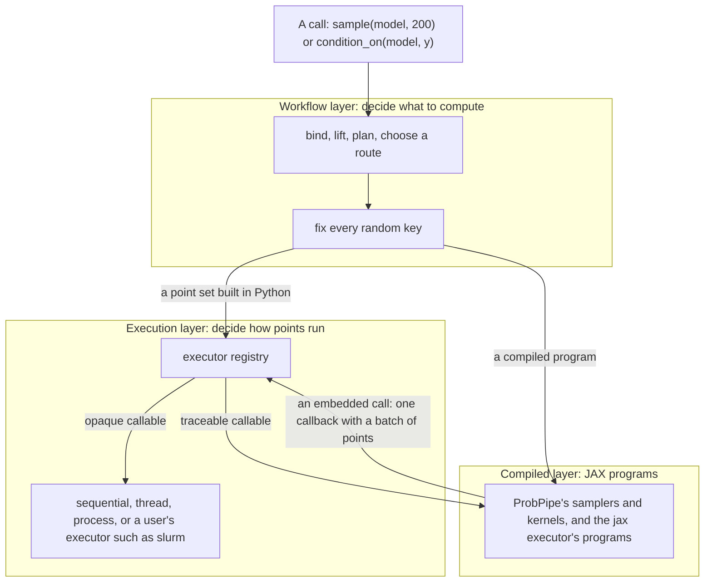

# Running computations in ProbPipe: the execution layer

> **Status: imported source, under revision.**
> This file is the execution-layer design for [#580](https://github.com/TARPS-group/prob-pipe/issues/580), moved from a gitignored local draft (it matches the Claude Doc "Running computations in ProbPipe: the execution layer", revision 63, 2026-10-16).
> From now on this file, not the Doc, is the copy that changes, and Appendix D keeps its revision log.
> [`gaps-and-conflicts.md`](gaps-and-conflicts.md) lists the places where it is out of date or disagrees with the other plans.
> The verification scripts that Appendix A cites stay outside the repository (item W4 of that file).

- **For:** issue #580, as a draft for maintainer review. Not posted.
- **Date:** 2026-10-15.
- **Code base:** `origin/dev/overhaul` at `023bfd01`, with JAX 0.10.1 and BlackJAX 1.5.
- **Verification:** every ✅ claim was checked by running code. The scripts are kept by the author outside the repository, and Appendix A lists them; each implementation step ports what it needs into `tests/` (`plans/gaps-and-conflicts.md` W4).
- **Review:** two rounds of independent adversarial review (accuracy, design, readability), then the maintainer's first review. Appendix C lists what the adversarial reviews changed, and Appendix D is the revision log.

---

## How to read this document

The document is written for a reader who knows what ProbPipe is for but not every module of it, and who knows basic JAX (`jit`, `vmap`, `grad`).
Section 3 explains the subtler JAX ideas the design depends on.

It has five parts:
1. **Sections 1 and 2:** the summary, and what ProbPipe does today, with reproduced failures.
2. **Sections 3 to 5:** the background, which covers a JAX primer, the principles, and the vocabulary.
3. **Section 6:** the design. It opens with one call traced end to end. Part A covers what a user writes, and part B how it works.
4. **Sections 7 and 8:** ten use cases worked through in code, and the risks that remain.
5. **Sections 9 to 14:** the questions for the maintainers, the relation to other open work, the design-text changes, the implementation guidelines, the order of work, and the tests.

Code labelled **Today** runs on `dev/overhaul`, and code labelled **Proposed** shows the target API.
Each subsection of section 6 ends with a **Today → Proposed** note.

> [!NOTE]
> This document says **executor** for what #580 calls a *backend*, because "backend" already has five meanings in ProbPipe (question Q1).
> Every `backend=` in #580 corresponds to `executor=` here.
> The maintainer questions are numbered **Q1 to Q18**, so they do not clash with the design principles D1 to D6 of `design/01-design-principles.md`.

### Design sections cited

| Section | Title | Section | Title |
|---|---|---|---|
| II.4 | Identity, type and metadata: `TrackedTerm`, `Provenance` | V.8 | Randomness: workflow scopes and structural keys |
| II.7 | Dispatch and registries | V.9 | Execution |
| III.3 | `Function` | V.10 | Return |
| IV.4 | Distributions from functions | V.11 | Differentiability claims |
| V.1 | The `Function` and its engine | VI.0 | The operation model |
| V.2 | Controls | VI.6 | `condition_on` |
| V.5 | Lifting | | |

### Abbreviations

ABC: approximate Bayesian computation. ESS: elliptical slice sampling, not effective sample size. JVP and VJP: Jacobian-vector and vector-Jacobian products (6.2). LOO: leave-one-out cross-validation. KSD: kernel Stein discrepancy. NUTS: the No-U-Turn sampler. RWMH: random-walk Metropolis-Hastings. SBC: simulation-based calibration. SMC: sequential Monte Carlo. XLA: the compiler JAX uses. ulp: unit in the last place, the gap between adjacent floating-point numbers.

---

## Contents

1. [Summary](#1-summary)
2. [Where ProbPipe stands today](#2-where-probpipe-stands-today)
3. [A short JAX primer for this design](#3-a-short-jax-primer-for-this-design)
4. [Principles](#4-principles)
5. [Vocabulary](#5-vocabulary)
6. [The design](#6-the-design)
7. [Use cases, worked through](#7-use-cases-worked-through)
8. [Risks and open questions](#8-risks-and-open-questions)
9. [Questions for the maintainers](#9-questions-for-the-maintainers)
10. [Relation to other open work](#10-relation-to-other-open-work)
11. [Changes to the design text](#11-changes-to-the-design-text)
12. [Implementation guidelines](#12-implementation-guidelines)
13. [Order of work](#13-order-of-work)
14. [Acceptance tests](#14-acceptance-tests)
15. [Appendix A: verification log](#appendix-a-verification-log)
16. [Appendix B: corrections to the text of #580](#appendix-b-corrections-to-the-text-of-580)
17. [Appendix C: what the adversarial review changed](#appendix-c-what-the-adversarial-review-changed)
18. [Appendix D: revision log](#appendix-d-revision-log)

---

## 1. Summary

### The problem

ProbPipe is built on JAX, and it is fast when JAX can compile a user's code.
Much scientific code cannot be compiled by JAX.
A forward model may call a solver through `subprocess`, a Fortran library through SciPy, or a PyTorch network.
Today such code is refused in some places and runs more often than needed in others, and ProbPipe gives a user no way to send it to a cluster of their own choosing.

The motivating case of #580 is an inverse problem.
A user has a forward model `G(θ)` that runs an expensive executable, and a likelihood `y ~ Normal(G(θ), σ)`.
They have three goals:
1. **Build the model** with the ordinary ProbPipe API.
2. **Choose where `G` runs per call:** locally for a serial algorithm, and on a cluster for an algorithm that evaluates `G` in batches, by changing one setting on the call.
3. **Keep gradients** for the parts of the model that are JAX code, such as an update of `σ` given `G(θ)`.

Today goal 1 already fails: building the likelihood traces `G` with JAX, and `G` cannot be traced (section 2).

### Five terms

- **Opaque callable:** code JAX cannot compile, such as a subprocess call. Its opposite is a **traceable** callable.
- **Point:** one evaluation of a callable at one set of arguments.
- **Point set:** a batch of points that one request asks for, such as 200 evaluations of `G` at 200 values of `θ`.
- **Executor:** a pluggable runner for point sets, such as "one at a time", "on 8 threads", or "as Slurm jobs". A user picks one by name, the way they pick an inference method.
- **Host callback:** JAX's way of calling ordinary Python from inside a compiled JAX program (section 3.6).

### The design in eight statements

1. **Meaning before execution.** ProbPipe settles what a call computes before anything runs, including every random key. The executor only decides how the computation runs, so changing the executor changes no result beyond the last bit of rounding (P3).
2. **Callables say what they allow.** A `Function` may state that it is traceable or opaque, that it accepts a whole batch at once, and how it is differentiated. ProbPipe reads these statements instead of guessing. When a callable states nothing, ProbPipe tests it once per input shape and remembers the answer.
3. **Many evaluations become one point set,** whether they come from a lifted call, a joint distribution, an inference method, or a validation loop.
4. **Executors are chosen like inference methods.** A user registers their own executor and selects it with `using(executor="slurm", executor_options={...})`, the way they select a method with `method=`.
5. **Opaque code can run inside compiled JAX code.** When an opaque `Function` is called inside a JAX program, ProbPipe makes the call a host callback. A batch of points then arrives at the host as one call, and the host sends it to the executor. This is what lets a joint's compiled sampler or a BlackJAX kernel use a user's cluster without being rewritten.
6. **Gradients need a derivative only where they cross opaque code.** A gradient in `σ` with `G(θ)` held fixed needs nothing from `G`. A gradient through `G` uses the user's derivative, or raises an error that names `G`.
7. **Failures are reported per point.** By default a failed point stops the call with an error that names it. Requesters that can use the remaining points, such as ABC, may opt in to dropping failed ones.
8. **Nothing changes silently.** Before a call, `check` reports how many points it will evaluate, which executor will run them and why, and whether the callable traces. Provenance records the same.

### The motivating case, before and after

**Today** (✅ reproduced, `t7_defect1.py`):

```python
@function
def forward(theta):
    np.savetxt("in.txt", np.asarray(theta))          # converts its input to NumPy
    subprocess.run(["./solver", "in.txt", "out.txt"], check=True)
    return np.loadtxt("out.txt")

@conditional_distribution(given_spec={"theta": NumericArraySpec((2,)), "sigma": NumericArraySpec(())})
def likelihood(theta, sigma):
    return Normal("y", forward(theta), sigma)
# TracerArrayConversionError while building the kernel, with or without event_spec
```

**Proposed.** The decorator states two new facts. The body changes in two small ways, so that it can run in parallel and returns the dtype it declares:

```python
@function(traceable=False,                                  # new: never trace this callable
          output_spec=NumericArraySpec((40,), "float32"))   # new: the output shape, which a callback needs
def forward(theta):
    with tempfile.TemporaryDirectory() as d:                # each point gets its own files
        np.savetxt(f"{d}/in.txt", np.asarray(theta))
        subprocess.run(["./solver", f"{d}/in.txt", f"{d}/out.txt"], check=True)
        return np.loadtxt(f"{d}/out.txt").astype(np.float32)   # the declared dtype

@conditional_distribution(given_spec={"theta": NumericArraySpec((2,)), "sigma": NumericArraySpec(())})
def likelihood(theta, sigma):
    return Normal("y", forward(theta), sigma)              # builds without running the solver

prior = Normal("theta", jnp.zeros(2), 1.0) & HalfNormal("sigma", 1.0)
model = likelihood & prior

with workflow_run(seed=1):
    local = sample(model, 200)                              # 200 solver runs, here

with workflow_run(seed=1):
    remote = sample.using(executor="slurm",
                          executor_options={"n_jobs": 50})(model, 200)   # the same 200 runs, on the cluster
# local and remote hold the same draws: same seed, same structure, same keys
```

With the fixed `in.txt` of the original, two points running at once, on threads or on cluster nodes that share a filesystem, would overwrite each other's input.

A standalone prototype runs this case end to end with a real subprocess solver (✅ `proto/demo.py`):
- **Building the model:** the construction check ran the solver **0** times.
- **Switching executors:** one compiled log density ran under four executors with **one** trace, and gave bitwise-identical results. The executors were sequential, threads, processes, and a stand-in cluster.
- **An unchanged sampler:** BlackJAX random-walk Metropolis with 4 chains sent **one batch of 4 points per step** to the executor, and its chains were identical under the local and the cluster executor.
- **Gradients:** `∂/∂σ` ran the solver **once** and needed no derivative of it. `∂/∂θ` with no derivative supplied raised an error naming `forward`. With a supplied VJP it agreed with central finite differences to within 0.002.
- **Failures:** two failing points out of eight were reported by index.

### What changes for users

| Kind | Change |
|---|---|
| New `@function` arguments | `traceable`, `vectorized`, `vjp`, `jacobian`, `jvp`, `version`; `differentiable` stops raising `NotImplementedError` |
| New controls | `executor`, `executor_options`, `memo` |
| Removed | the controls `dispatch` and `max_workers`; BayesFlow's `sim_backend`; Prefect's automatic choice of Ray or Dask |
| New public names | `executor_registry`, `PointExecutor`, `PointSet`, `PointChunk`, `PointOutcomes`, `PointFailure`, `PointEvaluationError`, `numpy_generator`, `DiskMemo`, `count_compilations`, `jacobian`, `InferenceTarget`, `make_posterior`, `probpipe.testing.check_executor` |
| New warnings | an inherited executor that falls back |
| Behaviour | a warm lifted call compiles and traces nothing; a failed point makes the call raise an error naming it, and a compiled program stops at once |

### What the maintainers need to decide

Section 9 asks eighteen questions, each explained from scratch with a recommendation. Q1 (the name `executor`) and Q17 (one run per point inside a call) are decided.
The four open ones with the largest effect:
- **Q4, the boundary:** host callbacks now, and deterministic fields of a joint in a separate issue soon after.
- **Q5, where the code goes:** the point-set and executor types in `core/`, so that the distributions package can use them.
- **Q7, failures:** a failure makes the call raise by default, and only point sets built in Python may drop failed points.
- **Q14, gradients:** whether a traceable model is gradient-ready without an explicit claim, as it is today.

---

## 2. Where ProbPipe stands today

### 2.1 Reproduced behaviour

| # | Behaviour | Evidence |
|---|---|---|
| 1 | A kernel whose function calls non-JAX code is refused while it is built. Declaring `event_spec` does not help, and neither does wrapping the code in a `Function`. | ✅ `t7_defect1.py`, all three forms |
| 2 | With `dispatch="auto"`, every lifted call tests the body with a JAX trace. The test runs the user's Python up to the first use of an input. | ✅ `t6_defects.py`: 5 draws ran the body 6 times, and two calls ran it 12 times |
| 3 | That test's outcome is never stored. | `functions/_function.py:788-883` |
| 4 | A traceable lifted body is traced twice per call, once to test it and once by an eager `jax.vmap`. The lifted path is never compiled as one program. | ✅ `t9_lift_traces.py`: 2 body runs per call; 5 compilations on the first call and 0 later; no `jax.jit` in `functions/` |
| 5 | Lifting over an empirical law with more atoms than the sample count samples the law instead of enumerating it, with no warning. | ✅ `t6_defects.py` and `t7_defect1.py`: 300 atoms gave 256, and no warning; `functions/_plan.py:393-407` |
| 6 | `Function(differentiable=...)` raises `NotImplementedError`. | ✅ `t6_defects.py`; `values/_function_base.py:1077-1080` |
| 7 | One failing point stops the call and discards the other results. | ✅ `t6_defects.py`, under `sequential` and `thread` |
| 8 | A law built from functions inside a kernel re-tests its density with a JAX trace each time the kernel is applied. | ✅ `t15_reprobe.py`: 3 applications made 3 more traces |
| 9 | Gradient methods are chosen because a density traces, not because it claims gradients. | `inference/_inference_utils.py:191-205` |

### 2.2 Who evaluates callables today

Fourteen places evaluate a callable at many points, and each decides on its own whether to vectorize or loop.
#580 names eight of them under G3 and one under G1. The survey found five more, marked †.
None of the fourteen goes through the `Function` engine.

| Site | What it evaluates | How it decides | Fallback |
|---|---|---|---|
| Joint factor, `_factored.py:790-847` | a kernel's draw or density per given | whether the given's spec is numeric | a plain `jax.vmap`, which fails the same way |
| Laws from functions, `_from_functions.py:89-131` | a user sampler and density | `jax.eval_shape` when the law is built | a Python loop |
| Empirical expectation, `_empirical.py:760-787` | a user integrand per atom | always `jax.vmap` for numeric events | none |
| † Discrete expectations, `families/_discrete.py:85,92` | a user integrand over the support | always `jax.vmap` | none |
| † Transformed laws, `families/_transformed.py:131` | a bijector | always `jax.vmap` | none |
| Empirical reweighting, `_empirical_reweighting.py:176-183` | the likelihood per atom | `is_jax_traceable` | a list comprehension |
| RWMH, `_blackjax_rwmh.py:506-562` | the flat density | `is_jax_traceable` | Python steps, with the chains run one after another |
| † Minibatch, `inference/_minibatch.py:541` | the density per minibatch | always `jax.vmap` | none |
| LOO, `diagnostics/_loo.py:615-636` | the density per observation | a `try` around a lazy `vmap`, which never fails, and a `try` per chain | nested Python loops, retried per chain |
| Predictive check, `_predictive_check.py:316-335` | a user statistic | `try jax.vmap` | a loop |
| † Joint draws in the predictive check, `_predictive_check.py:311` | the joint's raw draw | as for joint factors | as for joint factors |
| † KSD, `validation/_comparison.py:363` | a user score | always `jax.vmap` | none |
| BayesFlow, `_bayesflow_common.py:300-308` | the simulator | the user's `sim_backend` argument | none |
| pyabc, `_pyabc.py:172-196, 401-412` | the prior and the simulator | `jax.jit` on the first call, per closure | eager, recorded before it runs |

Simulation-based calibration (`_calibration.py:504-521`) also runs `condition_on` once per simulation in a Python loop.

### 2.3 Facts #580 does not mention

1. **A closed execution contract exists.** `functions/_execution_contract.py` versions pairs of an *evaluator* (`rowwise`, `jax_vmap`) and a *transport* (`local_inline`, `local_thread`, `prefect_task`, `prefect_flow`), and accepts only a fixed set of pairs. Replay records `requested_dispatch` (`functions/_replay.py:305`). A pluggable executor must replace this closed set (6.8).
2. **`compiled_or_eager` swallows run-time errors.** `core/_compilation.py:22-71` catches any exception from the compiled program and runs the eager form instead. #580 §8 says a program that compiles and then fails while running must raise, so the two disagree (6.10).
3. **Copies made by `using` do not share compiled programs.** `Function.using` makes a shallow copy (`values/_function_base.py:1235`), and #556 stores programs in a memo that a copy does not share. A program store on the `Function` would therefore recompile on every `f.using(...)(x)` (6.10).
4. **A kernel's construction test reads more than its event declaration.** `conditional_distribution` also reads which conditional capabilities the kernel has and their **guards**, the conditions under which sampling or scoring is valid (`_conditional.py:1347-1351`, IV.4). Skipping the test when `event_spec` is given, as #580 §1 proposes, would leave the capabilities unknown. Section 6.9 keeps the test and makes it work for opaque code.
5. **RWMH derives keys differently on its two paths.** The compiled and the eager path split keys differently (`_blackjax_rwmh.py:274-275, 323, 375`; `_inference_utils.py:1213`), so one target gives different chains depending on whether it traces.
6. **`parallel_chain_map` depends on the device count.** It runs one chain unmapped, uses `pmap` when there are as many devices as chains, and an uncompiled `vmap` otherwise (`_inference_utils.py:1223-1259`). The keys are the same in every branch. ✅ `t14_pmap.py` shows `pmap` and `vmap` differ by 2.4e-7 from the first step, and `pmap` equals a per-key `jit` bitwise. MCMC's accept and reject decisions can amplify such differences into different draws.

---

## 3. A short JAX primer for this design

The design rests on nine facts about JAX.
Each subsection states one fact, shows it in a few lines, and says why it matters for ProbPipe.
All snippets ran on JAX 0.10.1 (✅ scripts `t1` to `t5`, `t8`, `t10`, `t11`, `t13`, `t14`, `t16`).

### 3.1 JAX runs your Python once to record it

`jax.jit(f)` does not read the source of `f`.
On the first call it runs `f` with **tracers**: stand-in values that carry only a shape and a dtype, and that record every `jax.numpy` operation applied to them.
Two words describe what follows:
- **Tracing** is that first run, which records a program.
- **Compiling** is XLA turning the recorded program into machine code.

Later calls with the same input shapes reuse the compiled program and skip both steps.

```python
calls = []
@jax.jit
def side(x):
    calls.append("ran")      # a Python side effect, such as writing a file
    return x + 1

side(1.0); side(2.0); side(3.0)
len(calls)                    # 1: the Python body ran once, while tracing
```

**Why it matters.** A side effect inside a traced function happens once per trace, not once per call.
A **probe** is a trace made only to find out whether a function traces, with `jax.eval_shape(f, ...)` or `jax.make_jaxpr(f)(...)`.
A probe runs the user's Python up to the first operation that fails on a tracer.
In ✅ `t1` a function that logged a line before converting its input to NumPy logged once in each of two failed probes.

### 3.2 Three things a traced function cannot do

A tracer has no value, so three kinds of code fail under tracing:

```python
np.asarray(theta)            # convert to NumPy       -> TracerArrayConversionError
if x > 0: ...                # branch on a value      -> TracerBoolConversionError
jnp.zeros(n)                 # shape from a value     -> TypeError (shapes must be known)
```

A subprocess call, a SciPy solver, and a PyTorch model all need concrete values, so they all fail in the first way.
This document calls a callable **traceable** when none of the three happens for its input shapes, and **opaque** otherwise.

One trap goes the other way. NumPy's random generator does not fail on a tracer:

```python
def noisy(t): return t + np.random.normal(size=3)   # traces without error
```

The noise is drawn once, while tracing, and becomes a constant of the program, so every later call adds the same noise.

### 3.3 A compiled program is reused only when it is the same program

JAX keeps the compiled programs of each jitted function, keyed by the shapes and dtypes of its arguments.
A program is reused only when the same jitted function object is called again with the same shapes:

```python
@jax.jit
def f(x, y): return jnp.sin(x) * y
f(jnp.ones(3), 2.0); f(jnp.zeros(3), 5.0)    # one compilation: new values, same shapes
f(jnp.ones(4), 2.0)                           # a second compilation: a new shape

for t in [1.0, 2.0, 3.0]:
    jax.jit(lambda x: x * t)(jnp.ones(3))     # three compilations: a new function each time

def scale(t, x): return x * t
@jax.jit
def apply(fn, x): return fn(x)
for t in [1.0, 2.0, 3.0]:
    apply(jax.tree_util.Partial(scale, t), jnp.ones(3))   # one compilation

@jax.jit
def draw(key): return jax.random.normal(key, (3,))
for i in range(5): draw(jax.random.key(i))    # one compilation: a key is an ordinary argument

g = jax.jit(lambda x, n: x * n, static_argnums=1)
for n in range(4): g(jnp.ones(2), n)          # four compilations: a static argument is part of the program
```

`jax.tree_util.Partial` works because it splits a function into a fixed part, `scale`, which identifies the program, and data, `t`, which JAX passes as an argument.
A value captured by a closure is different: it is baked into the program as a constant, so each new closure is a new program.

**Why it matters.** This is rule J2: a program needs a **stable identity**, and every value that changes from call to call must enter it as an argument.
ProbPipe broke this rule in #531, where closures built per call recompiled on every `sample`.
The first prototype of this design broke it too. It read a per-call setting while tracing, the setting became a constant, and later calls sent their points to the first call's settings, which no longer existed (✅ `proto/demo.py`, step 2b).

### 3.4 `vmap` turns one point into many

`jax.vmap(f)` takes a function of one point and returns a function of many points stacked on a leading axis.
It does not loop. It rewrites the program so each operation acts on the whole batch.
Each point of the batch is called a **lane**.

```python
keys = jax.random.split(jax.random.key(0), 8)
thetas = jnp.arange(8.0)[:, None]
def point(theta, key): return theta + jax.random.normal(key, (3,))

v = jax.vmap(point)(thetas, keys)
l = jnp.stack([point(thetas[i], keys[i]) for i in range(8)])
bool((v == l).all())          # True: the same keys give the same draws, lane by lane
```

Two compiled forms of the same computation can still round differently in the last bit.
XLA may merge operations or change the order of a sum, and floating-point addition is not associative.
`jax.lax.map(lambda a: point(*a), (thetas, keys), batch_size=3)` differed from the `vmap` above by at most one ulp, 4.8e-7 absolute at these magnitudes (✅ `t4`).

**Why it matters.** When each point's key is fixed in advance, every way of running the points gives the same numbers, up to the last bit.
This is principle P3, and it is what lets a user switch executors without changing results.

### 3.5 `grad` needs a derivative rule for every operation on the path

`jax.grad(f)` differentiates the program that tracing recorded.
Every operation between the differentiated input and the output must have a derivative rule.
`jnp.sin` has one, its derivative `cos`. A call into ordinary Python has none, because JAX cannot see inside it.
An operation off that path needs no rule. Section 3.7 shows both cases.

### 3.6 A host callback lets a JAX program call ordinary Python

`jax.pure_callback(fn, result_shape, *args)` puts a call to an ordinary Python function inside a traced program.
The **host** is the Python process. When the compiled program runs, it pauses, converts the arguments to NumPy arrays, calls `fn` on the host, and continues with the result.
The result's shape and dtype must be declared in advance, because the program is compiled before `fn` ever runs.

```python
def solver(theta):                         # ordinary NumPy code: an opaque callable
    return (np.asarray(theta) ** 2).astype(np.float32)

def G(theta):
    return jax.pure_callback(solver, jax.ShapeDtypeStruct(theta.shape, jnp.float32),
                             theta, vmap_method="expand_dims")

jax.jit(jax.vmap(G))(jnp.ones((4, 3)))     # the host function runs ONCE, on shape (4, 3)
```

The `vmap_method` argument says what happens when the callback is batched:

| `vmap_method` | Host calls for 4 lanes | What the host receives |
|---|---|---|
| `"sequential"` | 4 | one lane at a time |
| `"expand_dims"` | 1 | the batch; an argument that is not batched gets a size-1 axis |
| `"broadcast_all"` | 1 | the batch, with every argument broadcast to it |

For example, `vmap(lambda x: H(x, w), in_axes=0)` over 4 lanes, with `x` of shape `(3,)` and `w` fixed, gives the host `x` of shape `(4, 3)` and `w` of shape `(1, 3)` under `"expand_dims"`.

Six more facts about callbacks (✅ `t2`, `t3`, `t8`, `t13`):
1. **Abstract evaluation never runs the host function.** `jax.eval_shape` and `jax.make_jaxpr` record the callback without calling it.
2. **An unused callback may never run.** JAX deletes computations whose results are unused, and it treats `pure_callback` as such a computation.
3. **A callback may run more than once for one value.** Two identical callbacks in one program ran twice. A callback inside `jax.checkpoint` ran twice under `grad`, because the backward pass recomputes the forward pass to save memory.
4. **An input that is not batched is evaluated once.** In `jit(vmap(grad(logp), in_axes=(0, None)))`, a callback on the unbatched input ran once for all lanes.
5. **A host exception loses its type.** An exception raised by the host function arrives at the caller as a `JaxRuntimeError`, whose message contains the original text.
6. **A batched loop runs every lane until the slowest finishes.** Under `vmap`, a `while_loop` cannot stop one lane early, so it keeps computing finished lanes with their last values and discards the results. A callback inside it is called for those lanes too. Lanes needing 1, 2, 6, and 10 iterations sent 40 points to the host where 19 were needed (✅ `t13`). The same holds for `lax.cond` under `vmap`, which computes both branches for every lane.

`io_callback(..., ordered=True)` guarantees each call runs once and in order, but it cannot be batched (`Cannot vmap ordered IO callback`).
ProbPipe therefore uses `pure_callback`, which requires the callable to be pure (rule J5).

**Why it matters.** The callback is how opaque code can run inside a compiled JAX program.
With `expand_dims`, a batch of N points arrives at the host as one call, which is the unit an executor runs.
Facts 2, 3, and 6 are harmless only for pure callables, and they are cheap only with a memo (6.5).
Fact 5 means a callback must record its own errors before it raises (6.4).

### 3.7 Custom derivatives

A **VJP**, a vector-Jacobian product, answers the question "given how the loss changes with the output, how does it change with the input?". Reverse-mode `grad` is built from VJPs.
A **JVP**, a Jacobian-vector product, answers "if the input moves in this direction, how does the output move?". Forward mode is built from JVPs.

`pure_callback` has no derivative rule, so `grad` through it raises `Pure callbacks do not support JVP`.
`jax.custom_vjp` attaches a rule written by the user, which may itself call the host, for example an adjoint solver:

```python
def solver_call(theta):
    return jax.pure_callback(solver, jax.ShapeDtypeStruct(theta.shape, jnp.float32),
                             theta, vmap_method="expand_dims")

@jax.custom_vjp
def G_diff(theta): return solver_call(theta)

def G_fwd(theta):                     # the forward pass: the value, and what the backward pass needs
    return solver_call(theta), theta
def G_bwd(theta, ybar):               # the backward pass: the user's adjoint, called on the host
    return (jax.pure_callback(adjoint, jax.ShapeDtypeStruct(theta.shape, jnp.float32),
                              theta, ybar, vmap_method="expand_dims"),)
G_diff.defvjp(G_fwd, G_bwd)

jax.grad(lambda t: G_diff(t).sum())(jnp.array([1.0, 2.0, 3.0]))   # works, and under vmap too
```

A gradient that does not pass through the callback needs no rule at all:

```python
y = jnp.array([1.0, 2.0, 3.0])
def logp(sigma, theta):
    mu = solver_call(theta)           # opaque, with no derivative rule
    return jnp.sum(-0.5 * ((y - mu) / sigma) ** 2 - jnp.log(sigma))

jax.grad(logp)(1.5, jnp.ones(3))                  # works: only sigma is differentiated
jax.grad(logp, argnums=1)(1.5, jnp.ones(3))       # raises: the gradient must cross solver_call
```

JAX computes reverse mode by **transposing** forward mode: it runs the linear map of the JVP backwards.
It can transpose a JAX operation such as a matrix product `J @ t`, but not a host callback, which is a black box.
So a user-supplied JVP that computes the tangent on the host serves forward mode only. A user-supplied Jacobian matrix, applied by ProbPipe as `J @ t` in JAX, serves both modes (✅ `t11`).

**Why it matters.** Goal 3 of the motivating case, a gradient update of `σ` given `G(θ)`, needs no derivative of the solver.

### 3.8 Which thread runs a callback

On CPU, with one device and plain `jit`, the host function ran on the thread that called the compiled program, and a `contextvars` value set on that thread was visible to it (✅ `t2`, `t3`).
Under `pmap` across 4 CPU devices, the host function ran on four of XLA's own threads at once, and the context variable was not visible (✅ `t14`).
JAX documents no guarantee either way.

**Why it matters.** ProbPipe cannot rely on thread-local state to tell a callback which executor to use.
It passes a small integer, the **call token**, into the program as an argument, and the host looks the call's settings up by token (✅ `t5`: one trace, three calls with different executors, each seen correctly).
The host's lookup table must be safe to read from several threads at once.

### 3.9 Processes and serialization

A process pool started by `fork` copies a parent that may hold JAX's internal threads, which can deadlock (#329).
The `spawn` start method starts a fresh interpreter instead.
A closure does not pickle with the standard `pickle`, and `cloudpickle` serializes it by value (✅ `t5`).

A typed JAX key is not a plain array, so it crosses a process or a callback as its raw data.
`jax.random.key_data(key)` gives that data, a `uint32` array of shape `(2,)` for the default generator, and `jax.random.wrap_key_data` restores the key with identical draws (✅ `t10`).
A spawned interpreter starts with JAX's default configuration, not the parent's.
With `jax_enable_x64` set in the parent, the same key data gave a `float64` draw of -0.206 in the parent and a `float32` draw of 1.623 in a spawned worker (✅ `t16`).

**Why it matters.** A chunk of work sent to another process must carry the parent's JAX configuration and the key's generator, or the worker computes different numbers (6.7).

### 3.10 Each transformation asks for something different

"Traceable" is not a JAX term. Each JAX transformation requires something of a function, and a function can pass one transformation and fail another (✅ `t18`):

| Function | eager | `jit` | `vmap` | `jvp` (forward mode) | `grad` (reverse mode) |
|---|---|---|---|---|---|
| `np.asarray(v)`: converts to NumPy | works | fails | fails | fails | fails |
| `v[v > 0].sum()`: a shape that depends on values | works | fails | fails | works | works |
| a `lax.while_loop` | works | works | works | works | fails |
| `jnp.round(3 * v).sum()` | works | works | works | gives zero, no error | gives zero, no error |
| `pure_callback` with no `vmap_method` | works | works | fails | fails | fails |

Three lessons follow:
1. **`jit` and `vmap` ask for the same thing:** every shape must be known from the input shapes, and no value may be read as a Python or NumPy value. A function that passes one passes the other, except for operations that have no batching rule, such as a callback without a `vmap_method`.
2. **Differentiation asks for something else:** a derivative rule for every operation on the path. `grad` without `jit` can even run code that `jit` refuses, because it traces with concrete values underneath.
3. **Passing a transformation does not make its answer useful.** `jnp.round` differentiates to zero without an error.

**Why it matters.** This design defines **traceable** as "`jit` and `vmap` both succeed for these input shapes", which is the first lesson. It defines differentiability separately, as V.11's claim, because of the second and third lessons. Traceable does not imply differentiable (Q14).

---

## 4. Principles

### 4.1 The execution principles

These rules hold for every part of ProbPipe that runs a computation.
Each is stated in plain words, followed by what it requires in practice.

**P1. Meaning is settled before execution.**
Before an evaluation runs, ProbPipe has fixed which callable it calls, at which points, with which arguments and which random keys.
An adaptive algorithm, such as ABC, fixes one batch, runs it, and may build the next batch from the results.
*In practice:* an executor receives a finished request and changes nothing in it.

**P2. An executor decides only how points run:** where, in what order, how many at once, and whether compiled.
*In practice:* an executor never reads a point's arguments or derives a key. The built-in `jax` executor is the one exception, because it compiles the arguments into a program.

**P3. Results do not depend on the executor.**
Every executor gives each point the same value, up to the last bit of rounding (3.4).
*In practice:* an algorithm whose accept and reject decisions can amplify one ulp, such as MCMC, reproduces its draws bitwise only under the same program and device configuration, which provenance records.

**P4. A callable states what it allows, and ProbPipe reads the statement.**
Statements are fixed when the `Function` is built. A callable that states nothing is probed at most once per input structure, and the outcome is stored.
*In practice:* `check` runs the same probe a call would run, so `check` and the call always agree.

**P5. The JAX contract is opt-in, per callable.**
A traceable callable is compiled, vectorized, and differentiated. An opaque callable runs on concrete values through the same API and gives the same results, more slowly.
*In practice:* a user never rewrites working NumPy code to use ProbPipe.

**P6. Every point set goes through one registry of executors,** whether it is built in Python or arrives from inside a compiled program through a callback.
*In practice:* an executor a user registers serves lifting, joints, inference, validation, and diagnostics without a change to any of them. A traceable `Function` called inside a JAX program, such as one a kernel calls while a joint compiles the kernel, becomes part of that program, as a call to `jnp.sin` does. Its operations are compiled and run together with the rest of the program, so no executor ever sees it as a batch of evaluations of its own. Only a call on a batch made in Python, such as `growth(prior)`, gives a traceable callable a point set, which the `jax` executor compiles.

**P7. Opaque code joins JAX code at one boundary.**
Its outputs enter JAX programs as data, and a gradient crosses it only through a derivative the callable supplies.
*In practice:* the host callback of 6.9 is the only place where opaque code and JAX code meet.

**P8. Choosing an executor works like every other choice in ProbPipe:** a registry with priorities, feasibility checks, opt-in entries, and selection by name through `using`.
*In practice:* a user who knows `method=` knows `executor=`.

**P9. A failure is reported per point.**
An executor reports every point's outcome, and the code that asked for the points decides what a failure means.
*In practice:* no executor drops a point or replaces its value.

**P10. Nothing changes silently.**
The number of points, any subsampling, the executor, any fallback, and whether a program compiled are reported by `check` and recorded in provenance.
*In practice:* a fallback that `check` cannot foresee warns when it happens.

**P11. Per-call values are data at every boundary.**
Keys, call tokens, and parameters enter compiled programs, callbacks, and worker processes as arguments, never as captured constants or thread-local state.
*In practice:* this is #554's key rule and J2, stated once for every boundary.

### 4.2 The compiled-layer rules

ProbPipe's own numerical methods, such as a family's sampler and an MCMC kernel, are JAX code.
Nine rules from #535 govern them, and this design writes them into the design text.

| | Rule | Plain meaning |
|---|---|---|
| **J1** | Python orchestrates and XLA computes. Compiled programs start at the raw methods, after ProbPipe has derived every key. | Workflow decisions, labels, and provenance never enter a trace. |
| **J2** | Every compiled program has a stable identity, and per-call values enter it as arguments. | Programs are module-level or owned by a long-lived object, and never a closure built per call (3.3). |
| **J3** | Eager and compiled execution follow one algorithm. | A branch on whether a value is traced may skip a check, and never change the algorithm. The mixture sampler breaks this today: it draws by a different algorithm when its input is concrete. |
| **J4** | Compilation is an optimization with an eager fallback, decided once per owner and input structure, **while tracing**. | A failure while tracing selects the eager route. A failure while a compiled program runs is a real error. |
| **J5** | Every callable a user passes to ProbPipe is pure: its result depends only on its arguments and its key. | ProbPipe may trace it once and reuse the trace, call it again, or skip a call whose result is unused (3.6). |
| **J6** | Importing ProbPipe changes no global JAX setting. | The persistent compilation cache is opt-in. |
| **J7** | Caches are owned and bounded, and none is keyed by `id()`. | Python reuses an `id()` after an object is freed, so an `id()` key can return another object's entry. |
| **J8** | A seeded result is bitwise reproducible for a fixed program, ProbPipe version, JAX version, device type, and device count. | Different program forms, such as `vmap`, `lax.map`, and `pmap`, may differ by a few ulp, and tests use measured tolerances. |
| **J9** | Tests measure compilation by counting compilations. | A count does not depend on the load of the machine. |

---

## 5. Vocabulary

Each term below is a proposal for `design/glossary.md`.

| Term | Meaning |
|---|---|
| **traceable**, **opaque** | whether JAX can trace a callable for its input shapes (3.2) |
| **probe** | a trace made only to learn whether a callable traces (3.1) |
| **input structure** | the tree structure, shapes, and dtypes of a call's arguments, plus the values of its non-numeric hashable arguments |
| **probe result** | the stored outcome of a probe, per `Function` and input structure |
| **point** | one evaluation of a callable at concrete arguments, with its key when the callable draws. An *atom* of an empirical law is a point of its support, which is another sense. |
| **point set** | the points one request evaluates: the callable, the arguments every point shares, the arguments that vary by point, one key per point, and each point's identity |
| **point identity** | a point's unique name within its call, used in reports and errors |
| **chunk** | a contiguous slice of a point set that an executor runs as one unit, such as one cluster job. A chunk can be pickled. |
| **outcome** | a point's result: its output, or a failure that says why it has none |
| **executor** | an entry of the executor registry: a named way to run a point set, such as `sequential`, `thread`, or a user's `slurm` |
| **executor registry** | the dispatch registry of executors (II.7), listed in the registry catalog |
| **automatic selection** | the registry trying its executors from the highest priority down, skipping opt-in ones, and running the first that can run the point set (6.3) |
| **execution claim** | a statement a callable makes when built about how it may be run: `traceable`, `vectorized`, or `differentiable` with a derivative. A claim is a declaration, not a control. |
| **complete output declaration** | an `output_spec` that gives every output a known shape and dtype (6.2) |
| **embeddable**, **host-only** | an opaque `Function` with, or without, a complete output declaration (6.2) |
| **embedded call** | a call of an opaque `Function` from inside a JAX program, which ProbPipe turns into a host callback (6.9) |
| **call token** | a small integer that names one operation call, passed into compiled programs as an argument (3.8) |
| **requester** | the code that asked for a point set, such as a lift, a joint, or an inference method. (*Consumer* means a term that declares what it consumes, as `plans/declarations.md` defines it.) |
| **program store** | the compiled programs a `Function` or another owner keeps, keyed by input structure |
| **evaluation memo** | an opt-in store of a callable's outputs, keyed by the content of its arguments and its key (6.5) |
| **result cache** | the call-level cache of V.8, keyed by the structure of a whole call |
| **compiled layer** | ProbPipe's own JAX methods, governed by J1 to J9 |

**Words this design avoids.**
- **backend** already means an array backend (II.3), a family's library (`families/_backend.py`), an inference library (method names `{backend}_{algorithm}`, STYLE_GUIDE §1.7), a program handle (VI.6), and JAX itself (V.11).
- **dispatch** keeps only its II.7 meaning, because the dispatch mode of V.9 is removed.
- **evaluator** and **transport** name today's execution contract (`functions/_execution_contract.py`), which this design retires. Sending a chunk to another process is called **shipping** here.
- **cache** alone is ambiguous: JAX's compilation cache, the program store, Prefect's task cache, and V.8's result cache are four different things.
- **event** means the event of a distribution, as in `event_spec`. V.8 derives each random key from the identity of a "random event", and this design does not name that identity: it says "the point's random key". V.8 and #554 use "random event" throughout, and whether to rename it there is part of Q16.
- **key** here means a random key, as in V.8. A mapping's keys are the other sense, a collision Python's dictionaries make natural, so where the two could be confused this design writes *random key* (decided 2026-10-16).
- **record** means ProbPipe's `Record`. This design says *probe result* for the stored outcome of a probe, and uses "record" only as a verb.

---

## 6. The design

### 6.1 One call, end to end

This subsection follows one call of the motivating case through the design, before the parts are defined one by one.

```python
with workflow_run(seed=1):
    draws = sample.using(executor="slurm", executor_options={"n_jobs": 50})(model, 200)
```

1. **Meaning.** `sample` resolves its route and derives every random key from the seed and the call's structure (V.8). Nothing has run yet.
2. **The prior.** The joint draws 200 values of `(θ, σ)` from the prior in one compiled program.
3. **The likelihood, compiled.** The joint maps the likelihood kernel over the 200 drawn values in a second compiled program, as it does today. The engine passes that program the call's **token** as an argument.
4. **The embedded call.** Inside that program, `forward(theta)` is an opaque `Function` called on traced values, so ProbPipe stages it as a host callback. Under the `vmap` over 200 draws, the callback runs once and receives all 200 values of `θ`.
5. **The executor.** The host side looks the call up by its token and finds `executor="slurm"`. It builds a point set of 200 points and hands it to the Slurm executor, which runs 50 jobs of 4 points each and returns 200 outcomes in order.
6. **Back in JAX.** The program continues with the 200 outputs as data and draws `y`.
7. **The result.** The engine wraps the draws and records in provenance that 200 points ran on `slurm` with `n_jobs=50`.

Changing `executor="slurm"` to nothing changes step 5 alone: automatic selection picks `sequential`, which runs the 200 points one after another. The draws are identical.

The layers involved are these:



A point set arrives at the registry by one of two entries:
1. **From Python.** A requester that runs in Python builds a point set and hands it to the registry. A lifted call, pyabc's simulation loop, and SBC's loop of inference runs do this.
2. **From inside a compiled program.** An opaque `Function` called on traced values becomes a host callback, whose host side builds the point set (step 4 above). A joint's compiled sampler and a BlackJAX kernel use the registry this way, with no change to their code.

One helper, `map_points(fn, args, claims)`, replaces the fourteen "vectorize or loop" decisions of section 2.2.
With traced arguments, it calls `fn` inline, which turns an opaque `Function` into an embedded call.
With concrete arguments, it builds a point set and hands it to the registry.

---

### Part A: what a user writes

### 6.2 Execution claims

#### The claims

A `Function` states its execution claims when it is built, and they are fixed for its life:

```python
@function(traceable=True)                      # JAX can trace it: compile, vectorize, differentiate
def ricker(r, K, n0): ...

@function(traceable=False,                     # never trace or probe it
          output_spec=NumericArraySpec((40,), "float32"))
def forward(theta): ...

@function(traceable=False, vectorized=True,    # one call takes a stack of points
          output_spec=NumericArraySpec((40,), "float32"))
def forward_batch(thetas): ...                 # thetas has shape (n, 2)

@function(traceable=False,                     # differentiable through a derivative it supplies
          output_spec=NumericArraySpec((40,), "float32"),
          differentiable=NumericSpec(theta=NumericArraySpec((2,))),
          vjp=forward_adjoint)
def forward(theta): ...
```

1. **`traceable`** takes three values:
   - `True` states that JAX can trace the callable: `jax.jit` and `jax.vmap` both succeed for its input shapes (3.10). It is pure (J5), and it acts on array inputs only through `jax.numpy` and `lax`. It never converts an input to Python or NumPy, never branches in Python on an input's value, and its output shapes depend only on its input shapes. It says nothing about gradients, which `differentiable` states.
   - `False` states the opposite. ProbPipe never traces the callable and never probes it.
   - `None`, the default, states nothing (P4).
2. **`vectorized=True`** states that the callable accepts every array argument with an extra leading axis of points, and returns its outputs stacked on that axis. Output row `i` must depend only on input row `i`. An executor may then evaluate a chunk of points in one call. A callable that takes a key (#554) receives a stacked array of keys.
3. **`differentiable`** is V.11's claim: a `NumericSpec` that names the inputs gradients flow through. JAX differentiates a traceable callable itself. An opaque callable is differentiable only through a derivative it supplies, in one of three forms:

```python
def vjp(*args, cotangent) -> tuple:     # one cotangent per input the claim names, in signature order;
                                        # serves reverse mode, which gradient methods use
def jacobian(*args) -> tuple:           # one Jacobian matrix per input the claim names;
                                        # serves both modes, because ProbPipe applies it with J @ t in JAX
def jvp(args, tangents) -> Array:       # the output's tangent; serves forward mode only (3.7)
```

   A `vectorized` callable's derivative receives stacked rows too.
   An opaque callable that claims `differentiable` without one of the three raises `TypeError` when it is built.
   A traceable callable may supply one as well, to replace JAX's own rule, for example for numerical stability.
4. **`version`** names what a fingerprint of the Python code cannot see, such as the solver binary the callable runs: `version="solver-2.3"`. The memo uses it (6.5).

A key parameter follows #554: a callable that takes randomness declares a parameter named `key`, or names another one with `random_key="rng"`.

#### How ProbPipe learns whether a callable traces

ProbPipe keeps one **probe result** per `Function` and input structure:

| Claim | First call, or first `check`, for a new input structure | Later |
|---|---|---|
| `True` | no probe. If tracing fails, ProbPipe raises an error naming the callable, because the claim is false (below). | no probe |
| `False` | no probe | no probe |
| `None` | one probe with `jax.make_jaxpr` on stand-ins for the inputs, and the outcome is stored | the stored outcome |

A false `True` claim is caught where the `Function` is called, even inside a larger trace. ProbPipe catches JAX's tracing errors (`ConcretizationTypeError` and its kin, `TracerArrayConversionError`, `NonConcreteBooleanIndexError`) and raises its own error, chained to JAX's (✅ `t19`):

```text
'forward' claims traceable=True, but tracing it failed: it converts a traced value to NumPy
(TracerArrayConversionError). Remove the claim, or claim traceable=False
```

A false claim that traces without an error, such as a callable that reads a global or draws from NumPy's generator, cannot be caught this way (3.2).

Four probe rules keep the probe result sound:
1. **Python numbers.** A Python `float` argument is treated as a weakly typed array, so a sweep over `n0=10.0, 11.0, ...` reuses one probe result and one program. A Python `int` is treated the same way when the probe succeeds with it as data. When it fails, because the callable uses the `int` as a loop count or a shape, the probe runs again with the `int` static, and the probe result says which. A static `int`, a string, or another hashable non-number is part of the input structure.
2. **NumPy's global generator is caught.** The probe compares the global states of NumPy's and Python's random generators before and after. If the callable drew from either, it is recorded as opaque, and ProbPipe warns that its noise would otherwise be frozen into the program (3.2). A NumPy `Generator` the callable creates or holds is not caught, so the documentation tells such a callable to claim `traceable=False`.
3. **Copies share the probe result.** The probe result belongs to the wrapped callable and its construction bindings, so the copies `using` makes share it (6.10). For a law built from functions inside a kernel, such as `distribution(log_prob=lambda y: score(y, mu))`, the kernel makes a new closure for every given value. Its probe result is therefore keyed by the closure's code and the structure of the values it captures, not by those values, so one probe serves every application (2.1, row 8).
4. **`check` probes too.** `f.check(...)` runs the same probe the call would run and stores its outcome, so `check` and the call always choose the same executor and method. A probe runs the user's Python up to the first operation that fails on a tracer (3.1), so a callable with side effects should claim `traceable=False`.

#### Three states

Claims and the output declaration put every `Function` in one of three states:

| State | Condition | Called inside a JAX program | Called in Python on a batch |
|---|---|---|---|
| **traceable** | claimed, or recorded by a probe | traced inline | the `jax` executor compiles a `vmap` of it |
| **embeddable** | opaque, with a complete output declaration | a host callback (6.9) | any executor except `jax` |
| **host-only** | opaque, without one | refused, with an error naming the missing declaration | any executor except `jax` |

An output declaration is **complete** when every output gets a known shape and dtype once the call's inputs are known:
- `NumericArraySpec((40,), "float32")` is complete.
- `NumericArraySpec(("n",), "float32")` is complete when an input's shape fixes `n`.
- No `output_spec`, or one with an undetermined part, is incomplete.

Under #571 this is the declaration's `term_spec`. A record-valued output is complete when each of its fields is.

#### How claims combine

Claims combine as V.11's claim does:
- a view of one field of a law keeps only that field's claims;
- a joint, a kernel, or a law built from functions traces when each of its JAX parts traces and each opaque `Function` inside it is embeddable;
- a value is differentiable through a chain of steps when every step on its path is differentiable, and an opaque step is differentiable only through a supplied derivative.

Whether a traceable step counts as differentiable without an explicit claim is question Q14.

> **Today → Proposed.** Five separate probes (`_jax_traceability_error`, `is_jax_traceable`, the two in `_from_functions.py`, and the kernel probe) become one probe that stores its outcome. `differentiable=` stops raising `NotImplementedError`: #522 implements it for traceable callables, and this design adds supplied derivatives (Q11). The `jax` executor also reads #506's rule that a body asking for a host type, such as a `pd.Series`, receives untraced values, so it cannot be traced.

### 6.3 Choosing an executor

#### The built-in executors

| Executor | Priority | Can run | Options |
|---|---|---|---|
| `jax` | 20 | traceable callables | `batch_size`: map in chunks with `lax.map` to bound memory |
| `sequential` | 0, the default for opaque callables | everything | `chunk_size` for a vectorized callable |
| `thread` | opt-in | everything | `max_workers`, `chunk_size` |
| `process` | opt-in | point sets whose chunks can be shipped | `max_workers`, `chunk_size`, `start_method` (default `"spawn"`) |
| `futures` | opt-in | point sets whose chunks can be shipped | `pool`: any `concurrent.futures.Executor` |
| `prefect` | opt-in | point sets whose chunks can be shipped, with Prefect installed | `task_runner`, `retries` |

**Automatic selection** tries the executors from the highest priority down, skips opt-in ones, and runs the first that can run the point set.
A traceable callable therefore gets `jax`, and an opaque one gets `sequential`.
`thread` is opt-in because user code may not be thread-safe, and the motivating case's original `forward` is not, since it writes a fixed `in.txt`.
`futures` adapts any pool with the standard interface, which covers `loky`, `mpi4py.futures`, and Dask through `client.get_executor()`.

#### The controls

Two controls choose an executor and its settings, as `method` and `method_options` choose a route and its budgets:

```python
# Today
forward.using(dispatch="thread", max_workers=8)(prior)

# Proposed
forward.using(executor="thread", executor_options={"max_workers": 8})(prior)
forward.using(executor="slurm", executor_options={"n_jobs": 50, "partition": "short"})(prior)
forward.using(executor_options={"chunk_size": 1000})(prior)    # options for the automatically selected executor
```

1. **Options travel with their executor.** `executor_options` belong to the executor they were named with, and that executor validates them, raising on an entry it does not read, as an inference method validates `method_options`. On a `Function`'s own call, options given without `executor` go to the executor automatic selection picks for that call. On an operation, `executor_options` require `executor`.
2. **Common options.** Every executor accepts `retries`, `retry_errors` (6.4), and `bisect` (6.7), as well as its own options in the table above.
3. **Layering.** Each control is resolved from the default, then the decorator, then `using`, as V.2 states for every control. `using(executor=None)` resets the control to its default, which is no explicit choice.
4. **Provenance.** Both controls are recorded, as every resolved control is.

#### An executor named on an operation

An executor named on an operation, such as `condition_on`, applies inside that call:

```python
with workflow_run(seed=1):
    # random-walk Metropolis, one chain: one point per step, run here
    post_rw = condition_on.using(method="blackjax_rwmh")(model, observed)
    # SMC-ABC: many particles per generation, sent to the cluster
    post_abc = condition_on.using(method="pyabc_smcabc",
                                  executor="slurm", executor_options={"n_jobs": 50})(model, observed)
```

The operation rules have six parts:
1. **What it covers.** The executor, with its options, applies to every point set of an **opaque** user callable made during the call: in the calling thread, in the engine's worker threads, and in embedded calls through the call token.
2. **The operation's own point set.** A requester that builds a point set of its own, such as SBC's point set of inference runs (7.8), runs it on the executor named on the requester's call. Its points state `traceable=False`, so `jax` never claims them.
3. **What it leaves alone.** Traceable callables keep automatic selection, which compiles them, and they receive none of the inherited options. Naming a cluster executor on `condition_on` therefore never moves the compiled parts of a model off the compiled path. ProbPipe's own numerical methods, such as a family's sampler, are unaffected.
4. **The innermost explicit choice wins.** An executor set on a `Function` itself, by its decorator or its own `using`, wins over one inherited from an enclosing call, and it takes only its own options. A cheap opaque summary statistic can therefore stay local with `@function(executor="sequential")` while the expensive simulator goes to the cluster. This departs from VI.0, where a callable's decorator does not override a value passed down. Here it does, because the decorator is where a user states that a callable must not leave the machine.
5. **It stops at a point.** A ProbPipe call made inside a point uses automatic selection unless it names an executor itself, so a cluster job does not submit cluster jobs (Q8).
6. **Refusals.** An executor named on the call itself that cannot run a point set raises `ResolutionError`, naming the executor and the reason. An inherited executor that cannot run a point set, for example because a closure cannot be pickled, leaves the point set to automatic selection without the inherited options, and warns once per call. An executor named on an operation that ran no point set at all also warns, because the name was probably meant for something else.

#### How the settings travel from a call to a callable

`sample.using(executor="slurm")(model, 200)` names an executor on `sample`, but the evaluations it governs happen deep inside: in a kernel the joint maps, inside a compiled program. The settings get there in four steps:
1. **Resolve.** `sample` resolves its controls, as V.2 states for every control.
2. **Open a call context.** When the call starts, the engine opens a **call context**: the resolved execution settings, the list of failures, and a fresh call token. It sets the context in a context variable for the calling thread, which the engine's worker threads inherit as `_INHERITED_CONTROLS` does today, and it enters the context in the table of active calls under the token.
3. **Find it.** A point set built in Python reads the context variable. An embedded call inside a compiled program reads the token its program passes and looks the context up (6.9).
4. **Choose.** The point set's callable is checked in order: an executor set on the `Function` itself wins (operation rule 4); a traceable callable keeps automatic selection (operation rule 3); otherwise the call context's executor and options apply.

When the call ends, its context and token are removed. A later call gets a new token, so a cached program never finds stale settings.

For the motivating model, inside `sample.using(executor="slurm", executor_options={"n_jobs": 50})`:

```text
sample's call context: executor=slurm, n_jobs=50, token 7
├─ the prior draws: ProbPipe's own compiled family sampler, not a user callable, so no point set
├─ the likelihood kernel, mapped over 200 givens: one compiled program, with token 7 as an argument
│    └─ forward(theta): opaque, so an embedded call; the host reads token 7 → slurm, 200 points
└─ summary(y), declared with @function(executor="sequential"): its own choice wins → sequential
```

> [!IMPORTANT]
> Today a control set on one call is passed to nested calls only by derived operations, and only for `exact_only` and the sample count (VI.0, "Controls inside an identity").
> `condition_on` is not a derived operation, so the design text needs a new rule: **execution controls apply to everything a call does, not only to what its identity derives.**
> The context variable that carries inherited controls today, `_INHERITED_CONTROLS` in `values/_function_base.py:712-805`, already crosses into worker threads and can carry them.

> **Today → Proposed.** The dispatch modes `auto`, `jax`, `sequential`, and `thread` become the executors `jax`, `sequential`, and `thread`, and automatic selection replaces `auto`. The controls `dispatch` and `max_workers` are removed (Q2). Prefect no longer picks Ray or Dask on its own (`config.prefect`, after #587), because that changes how a call runs without the user asking. The auto-detection stays unchanged until the post-workshop `prefect` executor replaces it (`plans/gaps-and-conflicts.md` D7).

### 6.4 When a point fails

#### What is reported

```python
@dataclass(frozen=True)
class PointFailure:
    index: int                                            # the point's position in its point set
    identity: tuple                                       # the point's identity (6.7)
    kind: Literal["error", "invalid", "lost", "timeout"]  # user code raised; output failed validation;
                                                          # the infrastructure lost it; it ran out of time
    error_type: str                                       # the exception's qualified name, which survives shipping
    message: str
    error: Exception | None                               # None when the exception could not be shipped back

@dataclass(frozen=True)
class PointOutcomes:
    start: int                                            # the index of the first point these outcomes cover
    outputs: tuple[Any, ...]                              # in point order; None where a point failed
    failures: Mapping[int, PointFailure]                  # by index within the point set

    @classmethod
    def lost(cls, chunk: PointChunk, reason: str) -> PointOutcomes: ...       # every point of the chunk lost
    @classmethod
    def merge(cls, parts: Iterable[PointOutcomes]) -> PointOutcomes: ...      # sorted by start: point order

class PointEvaluationError(RuntimeError):
    failures: tuple[PointFailure, ...]
    outputs: tuple[Any, ...]                              # the outputs that succeeded, kept for diagnosis
```

#### What a failure means

1. **By default, a failure makes the call raise.** The unit is the point set: its executor runs every point, so the outputs that succeeded are kept, and then the call raises `PointEvaluationError` naming every failed point. The executor option `cancel_on_failure=True` cancels the points not yet started instead. The message follows STYLE_GUIDE §9.3: `evaluation of 'forward' failed at draw 17: CalledProcessError: solver exited with status 3`.
2. **Inside a compiled program, the failure stops the program.** The callback's point set completes, then the callback records its failures on the call's context, which it finds by token, and raises. That stops the program at once, so none of its later steps run. The engine catches JAX's untyped `JaxRuntimeError` and raises the recorded `PointEvaluationError` in its place. ✅ `proto/abort.py`: a failure at step 4 of a compiled 10-step chain stopped the program after 4 solver runs, and the error named the failed point.
3. **Only point sets built in Python can drop failed points.** A requester that builds a point set in Python, such as ABC over an opaque simulator, empirical reweighting over an opaque likelihood, or SBC over its runs, sees that point set's `PointOutcomes` and can drop failed points. A user opts in through `method_options={"on_failure": "drop"}`. When the failing callable is instead embedded in a compiled program, such as `forward` inside the kernel of the motivating model, its failure stops the program (rule 2), so `check` refuses `on_failure="drop"` and names the embedded callable. Section 8 lists the work that would lift this limit. Dropping changes the target to the region where the callable succeeds, so `check` reports it and provenance records every dropped point.
4. **Dropping applies to user-code errors only.** A `lost` or `timeout` point is retried by the executor or raises, because otherwise a flaky cluster node would change the target and break P3. An error the environment causes in user code, such as running out of memory or a missing licence, can still make results depend on where they ran.
5. **Retries.** The common option `retries=2` retries `lost` and `timeout` points with the same key, so a retry computes the same value. `retry_errors=True` also retries points whose code raised.
6. **Interrupts.** A chunk catches `Exception`, never `KeyboardInterrupt`. An interrupt cancels the points that have not started, stops a compiled program through its callback, and is raised again as `KeyboardInterrupt`.
7. **Outputs are checked per point.** `PointChunk.run` checks each output against the output declaration, its tree structure, shape, and dtype, before the outcome leaves the chunk. A memo stores only checked outputs. A mismatch is an `invalid` failure of that point, not a crash of the whole program. A host `float64` output under a `float32` declaration is cast and warns once, because it loses precision.

Two cases need care:
- **Points the algorithm discards still count.** Under `vmap`, both branches of a `lax.cond` and every finished lane of a `while_loop` are evaluated (3.6, fact 6). The host cannot tell a used lane from a discarded one, so a failure at a discarded lane still stops the call. This is conservative: no failure goes unreported.
- **A program the user opens** carries no call token. A failure inside it raises at once from the callback, so it never becomes a silent `NaN` (✅ `proto/abort.py`).

Tolerating failures inside compiled MCMC, by rejecting a proposal whose point failed, is not part of this design. It needs a per-lane success flag that crosses the boundary next to each output, and it is listed in section 8.

> **Today → Proposed.** Every mode stops at the first error and keeps nothing (2.1, row 7). Proposed, the error names the point and keeps the outputs that succeeded, a compiled program stops early, and requesters in Python can opt in to dropping failed points.

### 6.5 Reusing evaluations

Three mechanisms store results, and this design keeps them apart:

| Mechanism | What it stores | Keyed by | Scope | Status |
|---|---|---|---|---|
| **evaluation memo** | one point of one callable | the callable, its `version`, the content of the point's arguments, its key, and the environment | a `Function`, opt-in | new here |
| **result cache** | one whole call | the call's structure, controls, and the identities of its random draws (V.8) | `workflow_run(cache=...)`, opt-in | V.8's open point |
| **program store** | one compiled program | the input structure and the static options | a `Function` or another owner, always on | 6.10 |

#### The evaluation memo

```python
@function(traceable=False, output_spec=..., version="solver-2.3", memo=True)   # across calls, in memory, bounded
def forward(theta): ...

forward_on_disk = forward.using(memo=DiskMemo("~/.cache/forward"))            # survives the session
```

1. **The key** hashes the callable's code fingerprint (#504), its `version`, the bytes, shape, and dtype of each argument, the key's data, and an environment salt of the ProbPipe and JAX versions and whether 64-bit floats are on (#352). Arguments every point shares are hashed once per point set.
2. **Bounds.** `memo=True` keeps a store bounded by size, which drops the least recently used entries (J7). The bound is a setting.
3. **What a fingerprint cannot see.** A code fingerprint covers Python code, not an executable it runs or a data file it reads, and it may not cover values bound by `functools.partial` or held in a closure. A `DiskMemo` therefore requires either `version` or a content fingerprint of the whole callable (#504), so two differently configured solvers cannot share entries. A `DiskMemo` keyed by `version` does not wait for #504.
4. **Failures are not stored,** so running a call again computes only the points that failed.
5. **No workflow events.** A memoized callable must not draw workflow-owned randomness inside its body, because a memo hit would skip those draws and replay could not account for them. A point that tries raises.
6. **Scope.** The memo belongs to a `Function`. It is bound into a staged call from the `Function` being called, so it is a static option of the program (6.10), and an operation's `using` does not pass it on.

The memo acts on the host side of both entries, so it serves embedded calls too:
- **Repeated callbacks.** A callback inside `jax.checkpoint` ran the solver twice under `grad` without the memo and once with it (✅ `proto/ck.py`).
- **Finished lanes.** The repeated last values of finished `while_loop` lanes become lookups (3.6, fact 6).
- **Gibbs blocks.** A block that updates `σ` calls `G(θ)` at an unchanged `θ`, which is a lookup.
- **Retries after a failure** recompute only the failed points.
- **Repeated values across calls.** Two calls of a log density at the same 8 values of `θ` and different `σ` ran the solver 8 times, not 16 (✅ `proto/demo.py`, step 6).

A lookup needs bitwise-equal arguments.
A posterior predictive check that evaluates `G` at the sampler's own stored states finds them.
A value recomputed by a different program, such as a constrained parameter transformed again, can differ in its last bit (3.4) and then misses.
A deterministic field of a joint, which would store `G(θ)` next to `θ`, avoids that problem, and question Q4 recommends it as a follow-up issue.

#### Within one call

JAX may call a callback more than once for one value (3.6, facts 3 and 6), and a joint, a while loop, or a checkpointed gradient can each cause it. For a callable that runs an expensive subprocess, every repeat is a wasted run. So, inside one call, an opaque `Function` runs at most once for each distinct point:
1. **The table.** The call context keeps a table of the points it has run, keyed as the memo is, and bounded as the memo is.
2. **Its lifetime.** The table is dropped when the call ends, so it can never serve a stale result in a later call.
3. **The default.** It is on for every opaque `Function`, because a repeat is never wanted and the table cannot go stale. `memo=False` turns it off, for example for a callable whose arguments are so large that hashing them costs more than running it again.
4. **The report.** Provenance records both the number of points and the number of runs, so a user can see that 200 points cost 200 runs.

This is Q17, decided, and the cross-call memo above stays opt-in.

#### The result cache

V.8's result cache serves a whole call from a recorded result, and it is a separate design item.
This design fixes only its relation to the memo: the two are independent, both are off by default, and neither changes a result.

> **Today → Proposed.** Nothing is reused today (#580, gap G6). Proposed, a user opts one expensive callable into a bounded memo, or a persistent one with a `version`.

### 6.6 What ProbPipe reports

#### Before the call

`check` adds an execution report to the `CallReport` of V.1:

```python
@dataclass(frozen=True)
class PointSetReport:                        # one per callable whose points the call evaluates
    callable: str
    points: int | None                       # the number of evaluations; None when the requester is adaptive
    traceable: bool
    traceability_source: Literal["claimed", "probed"]
    executor: MethodInfo                     # the executor chosen, and why each higher one could not run
    failure_rule: Literal["raise", "drop"]

@dataclass(frozen=True)
class ExecutionReport:
    point_sets: tuple[PointSetReport, ...]   # a condition_on may send one callable to jax and another to slurm
```

Whether a lift over an empirical law evaluates every atom or a sample of them is a question of what the call computes, not of how it runs, so this report does not carry it. Q12 explains where it belongs, and #585 tracks it.

```pycon
>>> forward.check(prior)
CallReport(route='sampling_lift', ..., execution=ExecutionReport(
    point_sets=(PointSetReport(callable='forward', points=256, traceable=False,
                               traceability_source='claimed',
                               executor=MethodInfo('sequential', feasible=True, ...),
                               failure_rule='raise'),)))
```

#### During and after the call

1. **Fallbacks warn,** as 6.3 states.
2. **Provenance records** the executor and its options, the number of points, the failed or dropped points, the memo hits, and whether each program compiled or fell back.
3. **Diagnostics:** `count_compilations()` in `probpipe.diagnostics` counts XLA compilations in a block, and an execution log lists each point set an executor ran.

> **Today → Proposed.** Today `check` says nothing about how a call will run. Proposed, the user sees, per callable, the number of points, the executor and why it was chosen, and whether the callable traces.

---

### Part B: how it works

### 6.7 Point sets and chunks

#### What becomes a point set

| Where the evaluations come from | Points |
|---|---|
| a lift over a law, sampled (V.5) | one per draw: `max_evaluations` of them |
| a lift over empirical laws, enumerated | one per combination of atoms |
| a sweep over a batch | one per cell |
| a sweep of lifts | one per cell and draw |
| an embedded call under `vmap` | one per lane |
| an inference method's batch | one per particle, chain, or proposal |

Each point has an identity and a random key:
1. **Its point identity** names it uniquely in its call. For `forward(prior)` with 256 draws, point 17 is "draw 17 of the first call of `forward` in this run". Errors and reports use it.
2. **Its random key** is derived from its position in the workflow, as V.8 states, so different points usually have different keys. Under #554's `share_keys_across`, two coupled cells of a sweep share one random key, while their point identities stay distinct.

A point set describes its points without building each one, so a sweep of a million cells builds no per-point data until a chunk runs (#510).

#### What an executor sees

```python
class PointSet:
    origin: str                          # the Function or site, for messages and reports
    claims: ExecutionClaims              # traceable, vectorized, differentiable
    output: TermSpec | None              # each point's declared output, when complete

    def __len__(self) -> int: ...
    def chunks(self, *, size: int | None = None, n: int | None = None) -> list[PointChunk]: ...
    def shared(self) -> SharedPayload: ...           # the arguments every point shares, shipped once per worker
    def shipping_check(self) -> Feasibility: ...     # whether chunks and the payload can be pickled; cached per call

class PointChunk:                        # can be pickled, so it can run in another process or machine
    start: int
    stop: int
    def run(self, shared: SharedPayload) -> PointOutcomes: ...   # every point of the chunk, in point order
```

The varying arguments, the keys, and the identities are private to the point set, so an executor cannot change them (P2).
The arguments every point shares travel separately, once per worker for each point set, so 200 chunks of a model with a 100 MB data set do not ship the data 200 times. A compiled MCMC run whose every step sends a point set to a cluster ships the shared data at every step. An executor may keep it on its workers between point sets, keyed by its content.
An executor that runs chunks in the same process passes the shared payload without copying it.
The built-in `jax` executor is the one executor that reads the stacked arguments, because it compiles them into a program.

#### What running a chunk does

`PointChunk.run()` does the same thing wherever it runs:
1. **Configuration.** In another process, it first applies the parent's JAX configuration, carried in the chunk: every `jax.config` value that differs from its default, such as 64-bit floats, the random generator's implementation, and `jax_threefry_partitionable`. Without this, a spawned worker draws different numbers from the same key (3.9).
2. **Inherited controls.** It applies the controls a point inherits from its call, `exact_only` and the sample count of VI.0, from values carried in the chunk. The host side of an embedded call reads them from the call's context. Every executor therefore gives a nested call inside a point the same controls, whatever thread or machine runs it.
3. **Scope.** For a point built in Python, it enters the point's workflow scope, so a ProbPipe call made inside the callable derives its keys from that point (V.8). In another process, the scope travels inside the chunk. A point of an embedded call has no such scope (6.9).
4. **Arguments.** It presents each argument in the form the callable's parameter asks for, as #506 specifies, and passes the point's own key when the callable takes one.
5. **Calls.** It calls the callable once per point, or once for the chunk when the callable claims `vectorized`. When a vectorized call raises, every point of the chunk fails with that error, and the executor option `bisect=True` splits the chunk to find the failing points.
6. **Outcomes.** It catches each point's `Exception` and records it as that point's failure, checks each output against the declaration (6.4, rule 7), and continues with the next point.

Shipping a chunk to a worker is a transfer for execution, and the chunk is never stored.
#374's rule that stored executables use versioned codecs therefore does not apply to it.
#374's other rule, a check before anything is sent, does: an executor that ships chunks calls `shipping_check()` before it runs anything.

> **Today → Proposed.** Lifts and sweeps build a list of points, one per row, before the first call, and each mode ships them its own way. Proposed, they build one lazy point set, and the workflow scope registers its points as an index range (#510).

### 6.8 Executors and their contract

#### The interface

An executor is a dispatch method (II.7) of the **executor registry**:

```python
class PointExecutor(DispatchMethod):       # one argument under #451
    name: str
    exact = True                           # in II.7, an exact method returns the requested result itself;
                                           # an executor always does, because it changes nothing (P3)
    priority: int | None = None            # None is opt-in only (II.7)
    description: str                       # one line, for the registry catalog

    def supported_types(self): return ((PointSet,),)
    def check(self, points: PointSet, /, **options) -> Feasibility: ...
    def execute(self, points: PointSet, /, **options) -> PointOutcomes: ...

executor_registry.register(SlurmExecutor())
```

1. **`check`** reads the point set's claims and the environment, and runs no point. The `jax` executor requires a traceable callable, and an executor that ships chunks requires `shipping_check()` to pass. Feasibility is cached per call, so an MCMC step does not repeat it.
2. **`execute`** runs the chunks and returns one outcome per point, in point order.
3. **Options** arrive as keywords, and an executor rejects one it does not read.

Every point set has the type `PointSet`, so II.7's selection by argument type does nothing here, and `check` and priority alone decide.
The registry still reuses II.7, because its priorities, opt-in entries, selection by name, `ResolutionError`, and catalog are the selection model ProbPipe users already know (P8).
The class is named `PointExecutor` so it does not clash with `concurrent.futures.Executor` in user code.

#### A user's executor

ProbPipe ships no cluster executor. Clusters differ in partitions, accounts, modules, file systems, containers, and job limits, so a built-in Slurm executor would break on many of them. ProbPipe ships three things instead:
1. **The `futures` executor,** which runs chunks on any standard pool. With Dask, `dask_jobqueue.SLURMCluster` and `client.get_executor()` give such a pool on Slurm, with no executor class at all. `Client.get_executor` exists in the installed `dask.distributed` (✅), and `dask_jobqueue` was not installed here to test.
2. **The `check_executor` test kit,** so a user can check their own executor.
3. **A recipe in the documentation,** the sketch below, which a user adapts to their cluster.

A cluster executor is a short class.
This sketch uses `submitit`, whose `map_array` submits one Slurm array job per chunk:

```python
import submitit

def run_chunk(chunk, shared):
    return chunk.run(shared)

class SlurmExecutor(PointExecutor):
    name = "slurm"
    priority = None                                         # never selected automatically
    description = "Run chunks of points as Slurm array jobs."

    def check(self, points, /, *, n_jobs=1, partition="short", retries=0):
        return points.shipping_check()

    def execute(self, points, /, *, n_jobs=1, partition="short", retries=0):
        pool = submitit.AutoExecutor(folder="slurm_logs")
        pool.update_parameters(slurm_partition=partition)
        pending, done = points.chunks(n=n_jobs), []          # done: PointOutcomes, each with its start
        for attempt in range(retries + 1):
            jobs = pool.map_array(run_chunk, pending, [points.shared()] * len(pending))
            failed = []
            for chunk, job in zip(pending, jobs):
                try:
                    done.append(job.result())                # user-code errors are inside the outcomes
                except Exception as lost:                    # the job itself died: infrastructure
                    failed.append((chunk, lost))
            pending = [chunk for chunk, _ in failed]
            if not pending:
                break
        done += [PointOutcomes.lost(chunk, reason=str(err)) for chunk, err in failed]
        return PointOutcomes.merge(done)                     # sorts by start, so point order holds

executor_registry.register(SlurmExecutor())
```

The executor never reads an argument or a key, so it cannot change a result.
`chunk.run` catches user-code errors itself, so `job.result()` raises only when the job did not finish, which the executor retries and then reports as `lost`.

#### Prefect

V.9 says orchestration records a call and never changes how it runs.
Prefect does both today: it records flows and tasks, and it runs work on Ray or Dask runners that it detects on its own.
This design separates the two (Q9):
- **Running** is the `prefect` executor, which runs chunks as Prefect tasks on the task runner the user names.
- **Recording** stays orchestration, set by `workflow_kind`, and it records whichever executor runs.

#### The contract

An executor that follows these rules cannot change a result (P3):
1. **Order.** `execute` returns one outcome per point, in point order, whatever order the points finished in.
2. **Keys.** An executor passes each point its key unchanged and creates no randomness of its own. A pyabc sampler that forks with one shared key breaks this rule (#329).
3. **Retries.** An executor may run a point again after an infrastructure failure. The point's key and identity are fixed, so a retry computes the same value.
4. **Blocking.** `execute` returns when every point has an outcome. It may submit and poll internally. Returning results as they complete is a later extension.
5. **Interrupts.** An interrupt cancels the points that have not started, and `execute` raises it again.
6. **Outputs.** An executor returns the outcomes its chunks produced, whose outputs `PointChunk.run` has already checked against the declaration. The workflow layer then wraps and validates the assembled result as V.10 states.
7. **Nesting.** A chunk that calls ProbPipe uses automatic selection inside (6.3, operation rule 5).
8. **Configuration.** A chunk run in another process runs under the parent's JAX configuration and the point's inherited controls (6.7).
9. **Conformance.** `probpipe.testing.check_executor(executor)` checks rules 1 to 8 on fixed point sets, including failing points, a vectorized callable, a nested call that reads inherited controls, and a parent with 64-bit floats and a non-default `jax_threefry_partitionable`. Every built-in executor passes it in CI.

#### Replay and the execution contract

Today's `WorkflowRngExecutionContract` versions a fixed set of evaluator and transport pairs, and replay checks them.
Under this design the executor is open-ended, and P3 makes it irrelevant to the result.
1. **The contract** keeps what affects draws: the version of the key derivation, the key format, and the version of each sampling algorithm (#554 §6). It drops the evaluator and the transport, and #524's move of it into `functions/_execution.py` should come first.
2. **Replay** records the executor and its options with the environment, like the JAX version (J8), and replays under any executor that passes `check_executor`.
3. **The replay record's** `requested_dispatch` becomes `executor`.

> **Today → Proposed.** Today's four modes are a closed set checked by the execution contract. Proposed, executors are registry entries, and the contract versions only what changes draws.

### 6.9 The boundary between JAX code and opaque code

The mechanism in this subsection is what lets opaque code run inside JAX programs, and so what makes the motivating model work.

#### The embedded call

When a `Function` that is not traceable is called and at least one argument is a JAX tracer, ProbPipe makes an **embedded call**.
In pseudocode:

```python
# What ProbPipe stages for `forward(theta)` inside a traced program (pseudocode)
def staged_forward(token, theta):
    host = partial(host_side, ranks=(1,))            # the per-point rank of each argument, fixed at staging
    return pure_callback(host, ShapeDtypeStruct((40,), float32),    # from forward's output declaration
                         token, theta, vmap_method="expand_dims")   # a batch arrives as ONE host call

def host_side(token, theta, *, ranks):
    call = active_calls.get(int(token))              # the call's executor, options, controls, and failures
    points = point_set(forward, theta, ranks)        # flatten the batch axes into points; forward's own memo
                                                     # serves the points it already holds
    outcomes = select(call).execute(points)          # the executor runs them
    if outcomes.failures:
        call.record(outcomes.failures)
        raise PointsFailed                           # stops the program; the engine raises the typed error
    return stack(outcomes.outputs)                   # reshape to the batch
```

It works in five steps:
1. **Requirement.** The `Function` must be embeddable: its output declaration must be complete (6.2). A host-only `Function` raises while tracing, and the error names the missing declaration.
2. **Staging.** ProbPipe stages `jax.pure_callback` with the declared output shape and `vmap_method="expand_dims"`, so under `vmap` over N points the host receives all N at once. Nested `vmap`s add several leading axes, and the host flattens them, using each argument's per-point rank, which is bound into the staged callback with `partial`. The rank is never stored on the `Function`, because one `Function` can be staged at several ranks (✅ `proto/nested.py`).
3. **The call token.** Every program ProbPipe opens takes the call token as an argument. While tracing, a context variable holds the *traced* token, so an embedded call knows which argument carries it. It never holds the token's value. A program ProbPipe opens inside another program's trace passes that enclosing traced token on, so it is never baked in as a constant. A cached program therefore serves every call, and each call's token arrives at the host (P11).
4. **The host side.** The host finds the call by its token, looks each point up in the memo when there is one (6.5), and hands the rest to the chosen executor as one point set. It then checks the outputs (6.4, rule 7) and returns them stacked. The table of active calls is safe for several threads, because under `pmap` the host runs on several XLA threads at once and receives one point set per device (3.8).
5. **Failures** stop the program at once, as 6.4 states.

Two properties follow from JAX's treatment of callbacks (3.6):
- **Purity.** JAX may skip an unused callback or call it twice for one value. Both are correct because the callable is pure (J5), and the memo makes a repeat free.
- **Discarded lanes.** In a batched `while_loop` or `lax.cond`, lanes whose results JAX discards are evaluated too. In NUTS tree building or an elliptical-slice loop over several chains, finished chains repeat their last arguments. The memo turns each repeat into a lookup, so `check` recommends `memo=True` for an expensive callable under such a method.

✅ `proto/demo.py`, step 2: one compiled, vmapped log density over 8 points ran under four executors with **one trace**. Each executor received the 8 points, and the four results were bitwise identical.
✅ `proto/nested.py`: a program opened inside another program's trace sent its points to the executor named on each call.

#### What an embedded point may not do

An embedded call can run more than once per value, or not at all, and the number of runs depends on how JAX compiled the program.
A random event inside it would therefore have no stable identity, and replay could not reproduce it.
So:
1. **It is untracked.** An embedded call is a raw evaluation, like `apply` (III.3). Its record (the executor, the points, the failures, the memo hits) is attached to the enclosing call through the token, never while tracing.
2. **No workflow randomness.** A ProbPipe call inside an embedded point that draws workflow-owned randomness raises, as #554 §4 requires inside any JAX transformation a user opens. Randomness inside an opaque callable comes from the key it receives (6.11).
3. **Guards change.** Today's guards against managed submission during JAX execution (`_guard_managed_submission`, `_JAX_RUNTIME_GUARD` in `functions/_context.py`) must allow an embedded call's host side to hand points to an executor, and must keep refusing workflow events there.

#### A program the user opens

A user may put ProbPipe code inside their own `jax.jit`, including a `draw` that #554's `sampler(d)` returns.
That program passes no token, so its embedded calls use automatic selection, and a failure raises at once from the callback (6.4).
To choose an executor for opaque code, a user runs it through a ProbPipe call, such as an operation or a lifted call, which opens its own programs and passes its token.

#### Building a kernel now succeeds

`conditional_distribution` evaluates its function abstractly while the kernel is built, to read the event declaration, the conditional capabilities, and their guards (2.3, fact 4).
Abstract evaluation never runs a callback (3.6, fact 1).
An embedded call inside the kernel's function is therefore recorded and not run.
Construction reads everything it needs without running the solver and without skipping the test, which resolves #580's defect 1 and the problem with its proposed fix.
✅ `proto/demo.py`, step 1: abstract evaluation of the log density ran the solver 0 times.

A kernel whose function calls opaque code directly, without wrapping it in a `Function`, still fails, and the error names the fix:

```text
the function of 'likelihood' converts a traced given to NumPy, so it cannot be traced.
Wrap the code that is not JAX in @function(traceable=False, output_spec=...)
```

#### Gradients across the boundary

ProbPipe always stages an opaque call inside one `jax.custom_jvp` or `jax.custom_vjp` wrapper.
JAX invokes the wrapper's rule only when a gradient flows into the call.

| What is differentiated | What happens |
|---|---|
| a value whose path avoids the opaque call | works. The rule is never invoked. |
| a value through an opaque call that supplies no derivative | raises `gradients cannot pass through 'forward', which is not traceable and supplies no derivative` |
| a value through an opaque call with `vjp` | works in reverse mode, under `vmap` too |
| a value through an opaque call with `jacobian` | works in both modes |
| a value through an opaque call with only `jvp` | works in forward mode. Reverse mode raises (3.7). |
| an input outside the callable's `differentiable` claim, through a call with a derivative | raises, naming the input |

✅ Evidence: `∂/∂σ` ran the solver once and needed no derivative (`proto/demo.py`, step 4). The error in row 2 is the prototype's (step 4). The VJP agreed with central finite differences, `[-5.969, 6.912]` against `[-5.969, 6.914]` (step 5). The Jacobian and JVP rows are from `t11`, and the last row from `t17`.

The last row closes a hole the review found.
A `custom_vjp` backward pass returns no cotangent for an input outside the claim, and JAX treats that as a zero gradient, which is wrong when the input is a sampled variable.
ProbPipe registers the rule with `symbolic_zeros=True`, sees which inputs carry a gradient, and raises when one outside the claim does.

A gradient method checks the claims before it traces, as V.11 states, so `check` reports the second and last rows before any work runs.
A callable with only a `jvp` and a few inputs could also serve reverse mode, through one JVP per input, run as one point set. This is listed in section 8.

#### Finite differences and the `jacobian` operation

ProbPipe gains `jacobian` as an operation with registered routes, as V.11's open point and #109 anticipate for `grad`:
1. **Automatic differentiation,** for a callable that claims gradients.
2. **A supplied derivative,** read from the claim.
3. **Finite differences,** approximate and opt-in. Its 2d perturbed points, for an input of dimension d, form one point set, so a cluster runs them in parallel.

`grad` is the special case of `jacobian` for a scalar output (Q11).

#### Staged execution and deterministic fields

#580 also proposes **staged execution**: a joint that stores `G(θ)` as a deterministic field of its event, so sampling runs in stages: draw `θ`, evaluate `G` as a point set, then draw `y` given `G(θ)`.
The embedded call already gives the same evaluations.
A deterministic field still adds three things:
- posterior draws carry `G(θ)` for checks and plots;
- reuse does not depend on bitwise-equal arguments (6.5);
- a host-only callable, whose output shape depends on its values, can take part in a joint.

It changes what a joint's event holds, which belongs to the distributions part of the design, so Q4 recommends a separate issue for it.

> **Today → Proposed.** Today any opaque code inside a JAX program fails, while the kernel is built or while it samples. Proposed, an opaque `Function` with a complete output declaration runs inside any JAX program, sends its batch to the executor, and takes part in gradients through a derivative it supplies.

### 6.10 The compiled layer

The `jax` executor and ProbPipe's own methods follow J1 to J9.
The work #535 planned and #556 did not finish continues here.

1. **Lifted calls compile.** The `jax` executor builds `jax.jit(jax.vmap(point))` once per input structure and keeps it in the `Function`'s program store. Today the lifted path runs an eager `vmap` that traces the body twice per call (2.1, row 4).
2. **Copies share programs when it is safe.** A program's key is the input structure plus the **static options**: the options that change the compiled program, such as the `jax` executor's `batch_size`. Options that only travel through the token, such as the executor of an embedded call, its options, and the failure rule, are run-time options and do not enter the key. The memo is static, because it is bound from the `Function` when the call is staged. Copies made by `using` share the store, and a copy that changes a static option compiles its own program. A copy with another callable or other bindings has its own store, as #556 requires for kernels with different given values.
3. **One fallback rule.** `compiled_or_eager` separates tracing from running. It traces with `jax.jit(f).lower(...)` and records the eager route when tracing fails, and it lets a compiled program's run-time error propagate. ✅ `t10`: `lower()` raised for a body that does not trace, and a traced program's run-time failure raised only when run. `inference/_pyabc._compiled` is replaced by it.
4. **Inference runners** are module-level and take their target as `jax.tree_util.Partial(density, observed=...)`, with the chain count, the draw counts, and the algorithm static. This removes the 7 compilations a warm `condition_on` makes today (#556).
5. **One key derivation per algorithm.** RWMH's compiled and eager paths derive keys the same way (2.3, fact 5).
6. **No silent device dependence.** `parallel_chain_map` always uses `vmap`. A user who wants one chain per device asks for it with a method option, `method_options={"chain_map": "pmap"}`, so the device count never changes the draws unasked (P10).
7. **The mixture sampler** uses one algorithm for direct and mapped calls, after #554 gives each sampling algorithm its own version, so a replay of an old mixture draw refuses instead of silently changing.
8. **The persistent compilation cache** is opt-in: `compilation_config.enable_persistent_cache(directory=None)` (J6). Whether XLA caches programs that contain host callbacks is untested (section 8).
9. **`count_compilations`** becomes public in `probpipe.diagnostics` (J9).

> **Today → Proposed.** Today a warm lifted call traces twice, a warm `condition_on` compiles 7 programs, and a run-time error of a compiled program is hidden by an eager retry. Proposed, warm calls compile and trace nothing, and only tracing failures fall back.

### 6.11 Randomness at every boundary

This design and #554 rest on one statement: the workflow layer fixes each key, and execution passes it on unchanged (P1, P11).
Every boundary carries a key as data:

| Boundary | How a point's key crosses it |
|---|---|
| the `jax` executor's program | an array of keys, one per point, mapped by `vmap` (3.4) |
| an executor in the same process | the chunk carries each point's key data, and `run()` restores the key before the call |
| a process or a cluster job | the same, inside the shipped chunk, with the generator's name and the parent's JAX configuration (3.9) |
| an embedded call | the key's data is an argument of the callback, restored on the host. ✅ `t8` shows an opaque random simulator gave identical draws mapped and looped, and distinct draws per lane. That test used `vmap_method="sequential"`. |
| a `vectorized` callable | a stacked array of keys |

Five rules agree with #554:
1. **Whose key.** A point set's keys are the callable's own keys (#554 §3). A ProbPipe call made inside a point built in Python draws from the point's workflow scope, not from the point set.
2. **The parameter.** `run()` passes the key under the name `random_key` sets, `key` by default.
3. **Coupled cells.** Under `share_keys_across`, coupled points share one random key and keep distinct point identities (6.7).
4. **Inside a JAX program.** A workflow call of a `Function` that takes a key raises when its arguments are traced, as #554 §4 requires. An opaque random simulator enters a model as the sampler of a law, `distribution(sample=simulate)`. The law's raw sampler receives its key from the enclosing program, and the raw call `simulate.apply(...)` takes that key as an ordinary argument and makes the embedded call with it.
5. **Executors are not versioned.** An executor changes no draw (P3), so it is not part of an algorithm's version (#554 §6). Provenance records it with the environment (J8).

An opaque callable that wants a NumPy generator derives one from its key.
ProbPipe offers `numpy_generator(key)`, which returns `np.random.default_rng(np.asarray(jax.random.key_data(key)))`, so users do not write it themselves.

### 6.12 Inference methods

#### Feasibility from claims

A method's `check` reads claims and the probe result instead of tracing on its own:

| Kind of method | What it requires of the target | Examples |
|---|---|---|
| gradient-based | traceable or embeddable, with a derivative for every opaque step on the gradient's path (Q14) | `blackjax_nuts`, `blackjax_hmc`, SG-MCMC, VI |
| JAX, gradient-free | traceable or embeddable; RWMH also accepts a host-only target through its eager path | `blackjax_rwmh`, `blackjax_elliptical_slice` |
| loop in Python | nothing beyond its interface | `pyabc_smcabc`, `empirical_reweighting` |
| external program | its own program | `cmdstan_nuts`, `pymc_nuts`, `nutpie_nuts` |

`is_jax_traceable` is removed.
Today one `condition_on` can trace the user's code in each gradient method's `check` (NUTS, ESS) and again in RWMH's execution. Reading the stored record removes those repeats.

#### How evaluations get to the executor

1. **Methods written in JAX** use embedded calls, with no change to the method. ✅ `proto/demo.py`, step 7: BlackJAX random-walk Metropolis with 4 chains and 6 steps made 7 host calls of 4 points each, one per step plus one at initialization, and 28 solver runs. It did so under both the local and the stand-in cluster executor, and the chains were identical.
2. **pyabc** needs more than wrapping its simulator. pyabc's own sampler draws proposals from NumPy's global generator inside a closure that takes no arguments, so a key cannot be passed to it. Today `_ProcessKeys` gives each worker process its own salt, which avoids shared keys but cannot be reproduced. A reproducible, executor-backed pyabc therefore needs ProbPipe to draw each generation's proposals in the parent from keyed generators, and to ship only the simulations as points, with keys from the generation, the batch, and the particle index through `fold_in`. `fold_in` derives a new key from a key and an integer. This replaces pyabc's sampler loop, so it is a substantial piece of work, tracked with #329.
3. **Validation loops** such as SBC build a point set whose points are whole inference runs. A cluster executor runs them in parallel, and operation rule 5 of 6.3 keeps each run's inner work on its own node.
4. **BayesFlow's `sim_backend`** is removed. Its simulator is a point set, and the user chooses the executor.

#### A public target interface

#580's defect 2: an inference method written outside ProbPipe needs private names today.
The interface that methods read becomes public and documented in `docs/api/extending.md`:

```python
class InferenceTarget(Protocol):              # what condition_on hands to a method
    joint: Distribution                       # the model
    given: Record                             # the observed values
    def log_density(self) -> Function: ...    # the unnormalized posterior density, with its claims
    def factors(self) -> ModelFactors: ...    # the prior, the likelihood, and the observed values
    def simulator(self) -> Function: ...      # draws of the observed part given the parameters

def make_posterior(target, draws, *, method, diagnostics=None) -> Distribution: ...
```

A method receives its run key through its own `key` parameter (#554 §8), so the private `run_seed` is not needed either.

#### Blocked updates

The motivating case wants a Gibbs scheme:
1. update `θ` with a gradient-free method whose batches go to the cluster;
2. update `σ` given `G(θ)` with a gradient method.

Step 2 already works: its density traces, and `∂/∂σ` needs no derivative of `G` (6.9).
A blocked method would choose each block's method from the claims of that block's conditional density.
Q10 recommends a separate issue for the Gibbs method itself.

### 6.13 Frameworks other than JAX

A callable written with NumPy, SciPy, PyTorch, or an external program is opaque, and everything above applies to it.
This answers V.9's open point on other array frameworks and gives #216 a way to use PyTorch:

```python
import torch

def torch_vjp(x, cotangent):                             # x: (n, 3), the stacked points
    xt = torch.as_tensor(np.asarray(x)).requires_grad_()
    net(xt).backward(torch.as_tensor(np.asarray(cotangent)))
    return (xt.grad.numpy(),)

@function(traceable=False, vectorized=True,
          output_spec=NumericArraySpec((10,), "float32"),
          differentiable=NumericSpec(x=NumericArraySpec((3,))),
          vjp=torch_vjp)
def surrogate(x):
    with torch.no_grad():
        return net(torch.as_tensor(np.asarray(x))).numpy()
```

This example is illustrative, because PyTorch is not installed in the verification environment.
Converting arrays without copying, through DLPack, is a later improvement.

### 6.14 Where the code goes

`distributions/` comes before `functions/` in the import order (STYLE_GUIDE §6), and joints, laws from functions, and expectations must use the registry.
The design therefore places the code by what it depends on:

| Module | Contents | Why there |
|---|---|---|
| `core/_points.py` | `PointSet`, `PointChunk`, `PointOutcomes`, `PointFailure`, `PointEvaluationError`, `map_points` | every package builds point sets |
| `core/_executors.py` | the executor registry and the built-in executors | every package chooses through it |
| `core/_compilation.py` | `compiled_or_eager` with the tracing rule, and the program store | as today |
| `functions/_boundary.py` | embedded calls, call tokens, and the derivative wrappers | needs the `Function` engine |
| `functions/_point_keys.py` | how a draw made inside a point gets its key: the point's segment of the occurrence path, the draws it claims and their order, and coordination with the parent call; `PointChunk.run` enters it, and it is installed into `core` at import | needs the workflow scope. #524 merges `_managed.py` and the key broker `_broker.py` into this module (Q16) |
| `testing/` | `check_executor` | a public test kit |

`core` defines what running a point does, and `functions` installs the workflow scope into it at import, as `install_call_engine` installs the engine today (III.3).
This follows II.7's rule that registration goes upward, so no new import goes the wrong way (Q5).

One consequence needs stating in the design text.
Today the raw methods, such as a law's `_sample` and `_expectation`, behave the same whatever workflow they run in.
Once they call `map_points`, the executor and the failure rule of the enclosing call affect how they run, though not what they compute.
The boundary principle "B2 – Representations only inside" of Part I says the representation layer never needs to depend on the workflow layer, so this is a stated exception to it, limited to how points run.

### 6.15 JAX's global settings

JAX keeps process-wide settings that change results: `jax_enable_x64` (64-bit floats), the random generator's implementation, `jax_threefry_partitionable`, and the default matrix-multiply precision. ProbPipe and the libraries it calls run in one process, so they share them. Today ProbPipe never sets them, and it reads `jax_enable_x64` when it creates arrays (`probpipe/_dtype.py`). Among the installed libraries, none sets them when imported, but optax's `x64_precision` context manager flips `jax_enable_x64` for a block (`optax/_src/utils.py:221-226`), and NumPyro, which #572 brings in, offers `numpyro.enable_x64()`. A flip affects every thread, not only the code that made it.

The contract has five rules:
1. **The settings belong to the user.** ProbPipe never changes one, at import or during a call (J6).
2. **A call holds them fixed.** The call context stores the values when the call starts, and provenance records them with the JAX version and the device count (J8).
3. **A change during a call raises.** When a call ends, and when an embedded call's host side runs, ProbPipe compares the settings with the stored ones. A change, for example by a library an inference method called, raises an error naming the setting and its two values, because the call's programs were compiled under the old value (Q18).
4. **Declarations are checked against them.** A `float64` output declaration with 64-bit floats off is refused when the call is staged, with an error that tells the user to set `jax_enable_x64`, never silently cast.
5. **Work elsewhere gets the same settings.** A chunk carries every setting that differs from its default (6.7), and the program store's key includes the settings that change a compiled program.

> **Today → Proposed.** Today a setting changed mid-call goes unnoticed, and a spawned worker silently computes under the defaults (✅ `t16`). Proposed, provenance records the settings, a change during a call raises, and workers get the parent's settings.

---

## 7. Use cases, worked through

ProbPipe serves models that are all JAX, models with expensive opaque simulators, and everything between.
This section runs ten such cases through the design.
Section 6.1 already traced the motivating `sample` call, so it is not repeated.

### 7.1 A model that is all JAX

```python
@function
def growth(r, K, n0):                         # jax.numpy only; no claim needed
    return K / (1 + (K / n0 - 1) * jnp.exp(-r * t))

model = likelihood & prior                    # built-in families and a kernel written in JAX
with workflow_run(seed=0):
    curves = growth(r=prior["r"], K=prior["K"], n0=10.0)
    posterior = condition_on(model, observed)
```

1. `growth` states nothing, so its first lifted call probes it once, records it as traceable, and the `jax` executor compiles one `vmap` program. Later calls reuse both, and `n0=10.0` is data, so a new `n0` compiles nothing (6.2, probe rule 1).
2. `condition_on` selects `blackjax_nuts`, because the target traces and has no opaque step (Q14).
3. Nothing in this case uses a callback, a host executor, or the memo.

> **Today → Proposed.** A warm lifted call traces its body twice today. Proposed, it compiles and traces nothing.

### 7.2 A gradient step that avoids the simulator

```python
def sigma_log_density(log_sigma, theta):
    mu = forward(theta)                       # opaque, with no derivative
    return Normal("y", mu, jnp.exp(log_sigma)).log_prob(observed)

step = jax.grad(sigma_log_density)            # differentiates log_sigma only
```

`forward(theta)` is an embedded call on an input that is not differentiated, so `grad` needs no rule for it (3.7).
Over a batch of chains that share one `θ`, the solver runs once per step (3.6, fact 4). With the memo, it runs once per distinct `θ` across steps.
✅ `proto/demo.py`, step 4: `∂/∂σ` ran the solver once.

### 7.3 An adjoint solver for full gradients

```python
@function(traceable=False, output_spec=NumericArraySpec((40,), "float32"),
          differentiable=NumericSpec(theta=NumericArraySpec((2,))),
          vjp=adjoint_solve)                  # adjoint_solve(theta, cotangent) -> (theta_bar,)
def forward(theta): ...

posterior = condition_on.using(method="blackjax_nuts")(model, observed)
```

1. `check` finds the target differentiable in `θ`, because its one opaque step supplies a VJP.
2. Each leapfrog step evaluates `forward` and `adjoint_solve` once each, both as embedded calls. The backward pass is staged when the gradient is traced, so the forward pass saves the call token as a residual and the backward callback passes it on, and the adjoint's points go to the same executor. The prototype verified the gradient values (`proto/demo.py`, step 5), and its backward callback did not yet use the executor.
3. With one chain, each step sends one point. With 8 chains under `vmap`, each step sends 8, which a cluster executor can run in parallel. NUTS builds trees of different depths per chain, so finished chains repeat their last points, and `memo=True` makes those repeats free (6.9).

### 7.4 A vectorized NumPy simulator

```python
@function(traceable=False, vectorized=True,
          output_spec=NumericArraySpec((100,), "float32"))
def epidemic(params):                         # params: (n, 3); one NumPy call simulates n epidemics
    return simulate_many(np.asarray(params))

with workflow_run(seed=2):
    curves = epidemic.using(max_evaluations=10_000,
                            executor_options={"chunk_size": 1000})(prior)
```

The `sequential` executor sends chunks of 1000 points, so 10,000 draws cost 10 calls instead of 10,000.
A `process` executor would send the same chunks to worker processes.

### 7.5 ABC where some simulations fail

```python
@function(traceable=False, output_spec=NumericArraySpec((50,), "float32"), random_key="rng")
def simulate(theta, rng):                     # crashes for some theta
    gen = numpy_generator(rng)
    ...

posterior = condition_on.using(
    method="pyabc_smcabc",
    method_options={"population_size": 1000, "on_failure": "drop"},
    executor="slurm", executor_options={"n_jobs": 100, "retries": 1},
)(model, observed)
```

`simulate` is the sampler of the model's likelihood, built with `distribution(sample=...)` as 6.11, rule 4 describes.
1. Each generation's proposals are drawn in the parent from keyed generators, and their simulations run as point sets on the cluster (6.12).
2. A lost job is retried once with the same keys, so it computes the same values.
3. A simulation that raises is dropped, because the user opted in with `on_failure="drop"`. Dropped points are never passed to pyabc's distance function, so they cannot distort its adaptive scales. Provenance lists every dropped point, and `check` reports the rule.

Dropping works here because `simulate` is the opaque sampler itself, so its simulations form a point set built in Python. If the same model instead embedded an opaque `Function` inside a traceable kernel, as the motivating model does, `check` would refuse `on_failure="drop"` (6.4, rule 3).
This case depends on the pyabc work of 6.12, which is the largest single item in the order of work.

### 7.6 A large parameter sweep, recorded by Prefect

```python
grid = NumericArrayBatch(thetas, level_names=("theta",), label="grid")   # 100,000 parameter sets

with workflow_run(seed=3):
    losses = loss.using(executor="process",
                        executor_options={"max_workers": 16, "chunk_size": 500},
                        workflow_kind="flow")(grid)
```

1. The sweep is one lazy point set of 100,000 cells, and no row is built before its chunk runs (#510).
2. The `process` executor ships 200 chunks to 16 spawned workers, with the shared arguments sent once per worker.
3. `workflow_kind="flow"` makes Prefect record the call as a flow. Recording wraps the executor and does not choose it.

### 7.7 Minibatch SGD with explicit keys (#554)

```python
@function                                         # traceable; takes randomness through `key`
def update(theta, *, key):
    value, gradient = value_and_grad(theta, key=key)
    return theta - 0.1 * gradient

with workflow_run(seed=42):
    for _ in range(100):
        theta = update(theta)                     # one random event per step; each key is an argument
```

Each call is one point with one key.
The compiled `value_and_grad` takes the key as an argument, so a new key compiles nothing (3.3).
A lifted `update` over a batch of starting points runs on the `jax` executor with one key per lane, and gives the same values as `sequential` (3.4).

### 7.8 Simulation-based calibration on a cluster

```python
report = simulation_based_calibration(
    model, observed="y", num_simulations=200, num_posterior_draws=100,
    method="blackjax_nuts",
    executor="slurm", executor_options={"n_jobs": 200},   # proposed: taken beside method, as method is today
)
```

1. The 200 simulated data sets and their inference runs form one point set of 200 points, each point a whole `condition_on`.
2. Each job runs its `condition_on` with automatic selection inside, so NUTS compiles on its node and submits no further jobs (6.3, operation rule 5).

### 7.9 A sequential design loop with an expensive simulator

A loop that adds simulator runs where an emulator is uncertain, as in sequential adaptive Bayesian inference:

```python
# forward was built with @function(..., version="solver-2.3"), naming the solver binary it runs
forward = forward.using(memo=DiskMemo("runs/forward"))

for step in range(20):
    design = acquisition(emulator, candidates)                   # a batch of 32 parameter sets
    with workflow_run(seed=step):
        y = forward.using(executor="slurm")(design)              # one point set of 32 points
    emulator = refit(emulator, design, y)
```

`design` is a `NumericArrayBatch`, so the call sweeps it.
1. Each step is one point set of 32 points on the cluster.
2. If two jobs fail, the call raises `PointEvaluationError` naming them, and the other 30 results are already in the memo.
3. Running the step again computes only the 2 failed points.
4. If the solver binary changes, a new `version` keeps old results from being reused.

### 7.10 A PyTorch surrogate

Section 6.13 shows a PyTorch network as a vectorized opaque `Function` with a VJP from PyTorch's autograd.
Inside `condition_on.using(method="blackjax_nuts")`, each leapfrog step makes one embedded call for the value and one for the VJP, with the token passed to the VJP as in 7.3, and with 8 chains each call carries 8 points.

---

### 7.11 A kernel applied to a batch of givens

A batch of 50 values of `θ` is passed to the likelihood kernel, for example when a sweep samples `y` at each value. The kernel does no batching of its own. The batching happens in the kernel's function, and the executor applies to the opaque `Function` inside it:

```text
50 givens θ₁ … θ₅₀
→ the kernel's function is mapped over them in one compiled program (vmap)
→ forward(θ) inside it is an embedded call: one callback, one point set of 50 points
→ the executor runs the 50 points: forward's own executor, else the one the call inherited
→ the 50 laws Normal(G(θᵢ), σ) are built in JAX and sampled
```

If the kernel's function had no JAX part at all, its 50 applications would form a point set built in Python, one point per given, and the same choice of executor would apply.

### 7.12 Different executors for different parts of one model

A Gaussian prior is cheap and compiles well, and `forward` is expensive. The rules of 6.3 already send each to the right place:

```python
# On the call: the prior compiles, and only the opaque forward goes to the cluster
with workflow_run(seed=1):
    draws = sample.using(executor="slurm", executor_options={"n_jobs": 50})(model, 200)

# On the callable: forward goes to the cluster in every call, whoever makes it
@function(traceable=False, output_spec=NumericArraySpec((40,), "float32"),
          executor="slurm", executor_options={"n_jobs": 50})
def forward(theta): ...
```

In the first form, the prior's draws come from ProbPipe's compiled family sampler, which no executor affects (operation rule 3), and the kernel's opaque `forward` inherits `slurm`. In the second form, the executor is set where `forward` is defined, before the kernel is built from it. `forward.using(executor="slurm")` would make a copy that the kernel does not use, because the kernel holds the original.

---

## 8. Risks and open questions

The verification ran on CPU only, and the following questions remain open.

| Risk or question | Why it matters | What would settle it |
|---|---|---|
| **Accelerators.** On a GPU or TPU, callbacks run on runtime threads, and calling back into JAX from a callback may block. | An embedded point that uses JAX, or a nested ProbPipe call, could hang. | A test on an accelerator. On CPU, re-entry worked: a callback ran a jitted program, a program with its own callback, and a thread pool (✅ `t12`). |
| **Overhead per step.** A one-chain method that evaluates one point per step pays a callback and a registry lookup per step. | Negligible for an expensive callable, perhaps not for a cheap opaque one. | A benchmark, which sets when `check` should warn. |
| **Compiled MCMC that tolerates failures.** Rejecting a proposal whose point failed needs a success flag per lane that crosses the boundary next to each output. | Without it, an MCMC run over a simulator that sometimes fails must stop at the first failure. | A design for the flag, collected at the boundary of `InferenceTarget.log_density`. |
| **Reverse mode from a JVP.** A callable with only `jvp` and a low-dimensional input could serve `grad` through one JVP per input, run as one point set. | It would make more opaque callables usable by NUTS. | A small extension of the derivative wrapper. |
| **Residuals of an adjoint solver.** `vjp(*args, cotangent)` makes an adjoint solver recompute its forward state. | The cost doubles for some solvers. | Letting `vjp` receive a handle to state saved by the forward call. |
| **Persistent compilation cache with callbacks.** XLA may refuse to cache programs that contain host callbacks. | Opt-in persistence may not help programs with opaque code. | A test. |
| **Streaming results.** `execute` blocks until every point has an outcome. | An adaptive requester, such as ABC stopping early, could use results as they complete. | An extension that returns outcomes as they complete while keeping point order in the result. |
| **Offloading an expensive traceable callable.** A traceable callable is compiled inline, so an inherited executor never sends it to a cluster. | A user with a slow JAX model may want that. | Claiming `traceable=False`, which sends it through the callback. Naming an executor on a traceable `Function` has no effect when it is compiled inline, so ProbPipe warns in that case. |
| **Thread safety of user code inside the user's own threads.** The `thread` executor is opt-in, but an embedded call inside the user's own threaded code is not protected. | A data race in user code. | Documentation. |

---

## 9. Questions for the maintainers

Each question is explained from scratch, lists its options, and gives a recommendation.

| | Question | Recommendation |
|---|---|---|
| Q1 | What to call the selected thing | **Decided:** `executor`, `executor_options` |
| Q2 | When `dispatch` and `max_workers` go | before 0.2.0, if the core steps of the order of work make it |
| Q3 | Which callables an executor named on an operation applies to | opaque ones; the innermost explicit choice wins; a mapping by label later |
| Q4 | Host callbacks, staged execution, or both | callbacks now; deterministic fields of a joint in a separate issue soon after |
| Q5 | Where the code goes | `core/`, with the workflow scope installed from `functions/` |
| Q6 | How evaluations are reused | a bounded memo per `Function`, separate from V.8's result cache |
| Q7 | What a failure means | raise after the point set; only point sets built in Python may drop failed points, and only for user-code errors |
| Q8 | What a ProbPipe call inside a point uses | automatic selection |
| Q9 | Prefect | a `prefect` executor; recording stays orchestration |
| Q10 | A Gibbs method | a separate issue |
| Q11 | Who owns the differentiability claim, and the operation's name | #522 owns the claim; one `jacobian` operation, with `grad` as its scalar case |
| Q12 | An exact result lost to a budget | a general rule of route resolution, tracked in #585 |
| Q13 | Callables that state nothing | probe once per input structure, in `check` too, and catch NumPy randomness |
| Q14 | Whether a traceable model may use gradient methods without a claim | yes, as today; claims only narrow it |
| Q15 | The class name | `PointExecutor` |
| Q16 | Names that collide with ProbPipe's vocabulary | **Decided:** *probe result*, `functions/_point_keys.py`, "point" in place of V.8's "managed work item", and "the point's random key" with no separate name; V.8's "random event" left for a separate decision |
| Q17 | Repeated runs of an opaque callable inside one call | **Decided:** at most one run per distinct point, by default |
| Q18 | A JAX setting changed during a call | raise |

### Q1. What to call the selected thing

**Context.** #580 calls it a *backend*.
ProbPipe already uses "backend" for array backends (II.3), a family's library (`families/_backend.py`), inference libraries (method names `{backend}_{algorithm}`, STYLE_GUIDE §1.7), program handles (VI.6), and JAX (V.11).
#572 will make NumPyro a family backend.

```python
sample.using(backend="slurm")(model, 200)     # A: reads as if it might choose NumPyro or TFP
sample.using(executor="slurm")(model, 200)    # B: reads as "run it on slurm"
```

**Options.** A: `backend` and `backend_options`. B: `executor` and `executor_options`, the word `concurrent.futures`, Dask, and `submitit` use for an object that runs calls. C: keep `dispatch` and add `dispatch_options`.

**Decision: B** (maintainer review, 2026-10-16).

### Q2. When `dispatch` and `max_workers` go

**Context.** #448's rule for 0.2.0 is breaking changes with no compatibility shims, and PR #549 prepares 0.2.0.

**Options.** A: merge the control change before 0.2.0 and remove the old controls outright. B: merge it after 0.2.0, with one release of warnings.

**Recommendation: A,** if the controls and the executor registry (the core steps of section 13) can merge before #549 does. The rest can follow in 0.3.

### Q3. Which callables an executor named on an operation applies to

**Context.** `condition_on.using(executor="slurm")` must send the simulator to the cluster without the user rebuilding the model.
A model may also contain a cheap opaque statistic that should stay local.

```python
# A, with operation rule 4 of 6.3: the statistic opts out where it is defined
@function(traceable=False, executor="sequential")
def summary(y): ...

# C: a mapping on the call
condition_on.using(executor={"forward": "slurm"})(model, observed)
```

**Options.** A: every opaque callable inside the call, with the innermost explicit choice winning. B: only an executor set on the `Function` itself. C: a mapping from a `Function`'s label to an executor.

**Recommendation: A now, and C later if users need it.** A keeps workflow code unchanged and gives an opt-out. C can be added later without changing what A means.

### Q4. Host callbacks, staged execution, or both

**Context.** #580 proposes both: host callbacks, and staged execution through deterministic fields of a joint.
Callbacks cover every evaluation (6.9).
Deterministic fields add posterior draws that carry `G(θ)`, reuse that does not depend on bitwise-equal arguments, and joints with host-only callables (6.9).
They also change what a joint's event holds, which belongs to the distributions part of the design (Part IV).

**Options.** A: staged only. B: callbacks only. C: both, in this issue.

**Recommendation: B in this issue, and a separate issue for deterministic fields, scheduled soon after.**

### Q5. Where the code goes

**Context.** The import order places `distributions/` before `functions/`, and joints must use the registry.
`design/package-structure.md` notes that the engine's steps "change together", so they are kept in one package.

**Options.** A: the types and the registry in `core/`, with the workflow scope installed from `functions/` at import (6.14). B: everything in `functions/`, with a new import from `distributions/` into `functions/`. C: a new package, `execution/`, between `core/` and `values/`.

**Recommendation: A.** It follows II.7's rule that registration goes upward and adds no import against the order. The engine's steps stay together in `functions/`.

### Q6. How evaluations are reused

**Context.** #580 asks whether caching is set per `Function`, per `workflow_run`, or both.
These are two mechanisms with different keys: a memo of single points, keyed by the content of the arguments, and V.8's result cache of whole calls, keyed by structure (6.5).

**Options.** A: a bounded memo per `Function` now, with V.8's result cache as its own item. B: one cache, set on `workflow_run`. C: one mechanism for both levels.

**Recommendation: A.** The memo is what the motivating case needs. A `DiskMemo` keyed by `version` can ship with it, and one keyed by a content fingerprint follows #504.

### Q7. What a failure means

**Context.** Today a failure stops the call and keeps nothing.
A host-side record cannot tell a point JAX will use from one it will discard (6.4), and a `NaN` placeholder can be turned into a finite, wrong value by user code.

**Options.**
- **A.** A failure makes the call raise once its point set completes, and a compiled program stops at once. A point set built in Python, such as ABC's simulations of an opaque sampler, may opt in to dropping failed points, for user-code errors only. A failure of an opaque callable embedded in a compiled program always raises, and `check` refuses `on_failure="drop"` for it.
- **B.** As A, and compiled MCMC may also reject failed proposals through `NaN` placeholders.
- **C.** ABC drops failures by default.

**Recommendation: A.** Option B is unsound with `NaN` placeholders, and a sound version needs the success flag of section 8. Dropping changes the target, so a user should choose it.

### Q8. What a ProbPipe call inside a point uses

**Options.** A: automatic selection, unless the call names an executor. B: the outer executor.

**Recommendation: A.** Under B, a cluster job would submit cluster jobs.

### Q9. Prefect

**Context.** V.9 says orchestration records a call and never changes how it runs. Today Prefect also runs the work, on Ray or Dask runners it detects on its own (`config.prefect`, after #587).

**Options.** A: Prefect's task runners become the `prefect` executor, and Prefect's recording stays orchestration through `workflow_kind`. Prefect's task cache (#352, #364) is retired in favour of the memo and the result cache. B: keep Prefect as the thing that overrides the dispatch mode.

**Recommendation: A.** It makes the code match V.9 and leaves one cache per level.

### Q10. A Gibbs method

**Options.** A: add a blocked method in this issue. B: a separate issue, with this design fixing the per-block choice by claims that it relies on.

**Recommendation: B.**

### Q11. Who owns the differentiability claim, and the operation's name

**Context.** #522 implements `differentiable=` and `is_differentiable` for `LinOp` and traceable callables.
This design adds supplied derivatives and a `jacobian` operation. #109 asks for a `grad` operation with the same three routes.

**Recommendation.** #522 owns the claim and `is_differentiable` and merges first. This design adds `vjp`, `jacobian`, and `jvp` on top of it. One operation, `jacobian`, serves #109, with `grad` as its special case for a scalar output.

### Q12. An exact result lost to a budget

**Context.** #580 found that a lift over an empirical law with 300 atoms and the default 256 draws samples the law instead of evaluating every atom, with no warning (2.1, row 5). The decision is made while the call is planned (`functions/_plan.py:393-407`), from the sample count, before routes are resolved. `check` therefore never shows it: with 300 atoms it lists only the sampling route, and the exact enumeration route does not appear at all (✅ `t20`). The same pattern can occur wherever a budget control decides whether an exact method is used, such as a conversion's `num_samples`, so a fix for empirical laws alone would patch one case of a general problem. The problem is in route resolution (V.7), not in execution.

**Options.**
- **A.** Make it a route choice, with one rule for every operation. The exact route stays a candidate and is reported infeasible when a budget, and nothing else, rules it out: `empirical_enumeration: infeasible, 300 atoms exceed max_evaluations=256`. A call that falls from an exact route to an approximate one for that reason warns once.
- **B.** Warn for empirical lifts alone.
- **C.** Leave it to provenance, which records the route and its exactness today.

**Recommendation: A, tracked in #585,** a change to route resolution (V.7). It is outside the execution layer, and this design no longer reports it.

### Q13. Callables that state nothing

**Context.** Tutorial code states no claims. A probe runs the user's Python up to its first failure (3.1), and NumPy randomness passes a probe silently (3.2). ProbPipe can detect a draw from the global generators of NumPy and Python, but not from a NumPy `Generator` the callable creates or holds.

**Options.** A: probe once per input structure, in `check` as well as in the call, and record a callable that draws from NumPy's global generator as opaque, with a warning. B: compile only callables that claim `traceable=True`.

**Recommendation: A.** It keeps tutorial code fast, and `check` and the call always agree. The documentation tells a user with side effects to claim `traceable=False`.

### Q14. Whether a traceable model may use gradient methods without a claim

**Context.** V.11 says a differentiability claim is never inferred.
A kernel built from `conditional_distribution(lambda mu, tau: Normal("y", mu, tau))` claims nothing, and #522 does not say how it would.
Under a strict reading, removing `is_jax_traceable` would make NUTS unavailable for every tutorial model.
A trace that succeeds also does not prove gradients are useful: `jnp.round`, `stop_gradient`, or an integer cast give zero gradients without error.

**Options.**
- **A.** A traceable composite is differentiable by derivation, which must be stated as an exception to V.11.
- **B.** Gradient methods stay available for traceable targets, as today. Claims narrow this: an opaque step needs a supplied derivative, and an explicit `differentiable` template restricts which inputs gradients use.
- **C.** Strict V.11: every kernel and `Function` on the path must claim gradients.

**Recommendation: B.** It keeps every current model working and adds the opaque case. Option C would break the tutorials. A check of the traced program for operations whose gradients are zero is possible later, for both A and B.

### Q15. The class name

**Context.** A user's code often imports `concurrent.futures.Executor` or `submitit.AutoExecutor`, and the `futures` executor takes one as an option.

**Recommendation:** `PointExecutor` for the class, with `executor` for the control.

### Q16. Names that collide with ProbPipe's vocabulary

**Context.** In ProbPipe an *event* is the value a distribution draws, as in `event_spec`, and a *record* is a `Record`. The first draft used "event identity", and then "key identity", for what fixes a point's random key, "traceability record" for a stored probe outcome, and the module name `_broker.py`, which #524 plans and which says little about its contents.

**Recommendation.**
- no name for the identity a random key is derived from: the design says "the point's random key", which is unambiguous next to a mapping's keys;
- *probe result* for a stored probe outcome;
- `functions/_point_keys.py` for the module that `_managed.py` and `_broker.py` merge into, since it decides how a draw made inside a point gets its key;
- *point* in place of V.8's *managed work item*, everywhere, since every managed work item is a point once executors run point sets.

**Decision** (2026-10-17): as recommended, with the module named `_point_keys.py`.

V.8 and #554 say "random event" throughout, with the same collision. Renaming it, for example to *random draw*, changes both and is a separate decision.

### Q17. Repeated runs of an opaque callable inside one call

**Context.** JAX may run a callback more than once for one value (3.6), and an expensive subprocess should not run twice for the same point.

**Options.** A: inside one call, an opaque `Function` runs at most once per distinct point, by default, with a table dropped at the end of the call (6.5). B: only when the user turns on the memo.

**Decision: A** (maintainer review, 2026-10-16), in the core work. A repeat is never wanted, the table cannot go stale, and the cost is hashing each point's arguments.

### Q18. A JAX setting changed during a call

**Options.** A: raise, naming the setting and both values. B: warn and continue. C: restore the stored value.

**Recommendation: A.** The call's programs were compiled under the old value, so continuing gives results from two configurations, and restoring would undo a change the user or a library made on purpose.

---

## 10. Relation to other open work

### Must merge first, or together

| Item | What it does | How it meets this design |
|---|---|---|
| **#554** explicit-key randomness | `key` parameters, random events and their subdivision, `share_keys_across`, versions per sampling algorithm, `sampler(d)` | Shares P1 and P11. Point sets carry its keys, and coupled cells share random keys and keep distinct point identities (6.11). Write both design texts in one docs PR. |
| **#522** `LinOp` and the differentiability claim | `differentiable=` and `is_differentiable` | Owns the claim (Q11). `LinOp` claims `traceable=True`. |
| **#524** finishing the function engine | module moves and controls | Moves `_execution_contract.py` into `_execution.py` and `_managed.py` into `_broker.py`, which Q16 names `_point_keys.py`. These should merge first, so this work does not rewrite moved files. |
| **#451** n-ary dispatch registry | one registry class with an arity | The executor registry has arity 1. |
| **#474** registry catalog | lists every registry | The executor registry registers with `kind="dispatch"`. |

### Should merge alongside

| Item | How it meets this design |
|---|---|
| **#506** what a function body receives | `PointChunk.run` presents arguments by its rules, and the `jax` executor reads its rule for host types (6.2). |
| **#575** `raw` as a property | Point sets carry raw values. `Distribution.raw` returns a new object on each access, so no program is keyed on it (J7). |
| **#571** declarations | An embeddable `Function` needs a complete `term_spec` (6.2). If `*` becomes `&`, the examples change. |
| **#573** field paths | Claims that name parts of an input, such as a partial `differentiable`, use its one reader. |
| **#509**, **#510** sweeps | A sweep is a lazy point set registered as an index range, and the `jax` executor vectorizes paired batches. |
| **#520** randomness audit | Feasibility checks stop tracing at fixed keys, because they read the probe result. pyabc's global NumPy seeding is replaced (6.12). |

### Superseded or answered

| Item | Status |
|---|---|
| **#535** compiled-execution plan (closed) | J1 to J9 go into the design text (4.2), and its remaining items are 6.10. |
| **#531** recompilation | The two causes it reported were fixed by #556. What remains, `condition_on` compiling 7 programs per warm call, is 6.10, item 4. |
| **#329** pyabc multicore | The pyabc work of 6.12. |
| **#352**, **#364** Prefect task caching | Superseded by Q9 and the memo. |
| **#216** PyTorch | Answered by 6.13. |
| **#109** differentiability | `jacobian`, with `grad` as its scalar case (Q11). |

### Follow later

| Item | How it meets this design |
|---|---|
| **#504** fingerprints | The memo's key uses its code fingerprint, and a content-fingerprinted `DiskMemo` waits for it (Q6). Execution claims and executors stay out of fingerprints (P3). |
| **#492**, **#374** identity, replay, persistence | This design uses #492's random-event identity and cache equivalence, and adds a point identity. Shipping a chunk is a transfer, not persistence (6.7). |
| **#572** NumPyro families | Its compiled family programs follow J2 and J7, and every family's algorithm version changes (#554 §6). |
| **#523** finishing the operations | `jacobian` is a capability route of the same kind as `inverse`. `given=` passes execution controls on (6.3). |
| **#354** Prefect benchmark | Its grid becomes a grid over executors, and it can set the overhead threshold of section 8. |
| **#548**, **#549** tutorials, release | Tutorial 1 is acceptance example 2. #549's timing decides Q2. |
| **#448** workstreams | This design is part of #448's workstreams B2 (controls), B3 (lifting), B5 (differentiability), B6 (evaluation rules), and B8 (module layout), which are unrelated to the boundary principles B1 to B4. |
| **#585** an exact result lost to a budget | A general rule of route resolution: an exact route that only a budget rules out is reported, and the call warns (Q12). |
| New issues | deterministic fields of a joint (Q4) and a Gibbs method (Q10). |

---

## 11. Changes to the design text

| Section | Change |
|---|---|
| Part I | State P1 to P11 next to C2 and C3, and the JAX settings contract of 6.15. Extend C2's purity to every user callable (J5). State the exception to the boundary principle B2 of 6.14. |
| II.7 | Add the executor registry to the catalog's examples. `PointEvaluationError` changes the rule that a numerical failure propagates unchanged: a failed point is reported as a failure of that point. |
| III.3 | Add `traceable`, `vectorized`, `vjp`, `jacobian`, `jvp`, and `version` to the construction parameters, and `executor`, `executor_options`, and `memo` to the controls. |
| IV.4 | Building a kernel evaluates its function abstractly, so an embeddable `Function` inside it is recorded and not run. |
| V.1 | `check` runs the probe of a callable that states nothing, and never evaluates the body on values. |
| V.2 | Replace `dispatch` and `max_workers` with `executor` and `executor_options`. |
| V.8 | The evaluation memo and its relation to the result cache. Keys as data at every boundary. Replay no longer requires the same "execution capability", because executors do not change draws. |
| V.9 | Rewrite around point sets, executors, the executor contract, failures, and the separation of orchestration. Replace the open point on other frameworks with 6.13. |
| V.11 | Supplied derivatives, the answer to Q14, and the `jacobian` operation, which resolves its open point. |
| New V.13 | Execution claims and the boundary: claims, the three states, embedded calls, call tokens, what an embedded point may not do, and gradients across the boundary. |
| VI.0 | Execution controls apply to everything a call does, not only to what its identity derives (6.3). |
| VI.6 | Inference feasibility from claims, and the public target interface. |
| Glossary | the terms of section 5. |
| `docs/api/extending.md` | A new executor, and a new inference method on the public target interface. |
| `design/package-structure.md` | `core/_points.py`, `core/_executors.py`, `functions/_boundary.py`, and `testing/`. |

---

## 12. Implementation guidelines

This design guides the implementation, and each PR is judged on two things: whether it delivers the behaviour, and the quality of its code and its description. These guidelines add to `CONTRACTS.md` and `STYLE_GUIDE.md`.

### The code

1. **Clean and well organized.** A module reads from the top: its main public interface first, then the helpers it uses. The most important public code is never placed in the middle of a file.
2. **Useful names.** Every function, class, and variable, including private helpers, has a name that says what it is or does.
3. **Docstrings for users.** A public API's docstring is written for the person who calls it: what it does, its arguments, what it returns, and what it raises, with an example where one helps. It carries no design reasoning, no references to design documents or issues, no technical terms the user does not need, and no filler.
4. **Comments that earn their place.** An inline comment must add something the code does not already say, such as a reason that is not obvious, an invariant, or a constraint JAX imposes.
5. **One implementation per decision.** No duplicated helpers or logic. Before writing a helper, search for one that already does the job, and reviewers check for duplicates. This design replaces fourteen copies of one decision with `map_points`, and no new code may bring back its own copy.
6. **Tests assert the contract,** as `CONTRACTS.md` requires: shapes, orderings, and error cases, beyond the happy path. Section 14 lists the tests this design needs.
7. **Plenty of tests and demonstrations, with every PR.** They are part of the work, not a later step, so the behaviour is checked as it is built. Each PR adds the tests of section 14 that cover its part and shows the behaviour it adds working:
    - a short runnable demonstration in its description, with its output;
    - for a user-facing feature, an example in the docstring or the user guide, following `CONTRIBUTING.md` § Documentation;
    - for opaque code, a small real stand-in, such as the prototype's subprocess solver, which counts its runs so a test can assert them.

### The pull requests

1. **A plain title,** no more technical than it needs to be.
2. **A body a person can read:** the context, the problem, what changed, and specific examples, such as code before and after.
3. **The parts of this design it implements,** named by section.
4. **Every departure from the design, stated.** A PR that finds a gap in the design, or must depart from it, says so in its body and updates the design in the same PR, with an entry in the revision log (Appendix D).

### The design itself

This document is kept in the repository, so git tracks its changes, and Appendix D records each revision and its reason. Its sections move into `design/` as section 11 lists, and from then on `design/` is the reference.

---

## 13. Order of work

The core comes first, for a workshop in about two weeks. It must show executor dispatch working for both traceable and opaque functions, and the public target interface. The rest follows the workshop. Each step is one PR against `dev/overhaul`, with its tests and demonstrations (section 12, guideline 7).

### Before the workshop: the core

1. **Design text for the core:** V.9 rewritten around point sets and executors, the new V.13 on claims and the boundary, the controls in V.2 and VI.0, and the glossary. The other design-text changes of section 11 follow with their steps.
2. **Claims and the probe result:** `traceable` and `vectorized`, one probe stored per callable and input structure, shared by `using` copies and run by `check`, and the error for a false claim.
3. **Point sets and the executor registry:** the executors `jax`, `sequential`, `thread`, and `process` replace the dispatch modes in `_broadcast.py`, `_sweep.py`, and `_execution.py`. The controls `executor` and `executor_options`, with the rules of 6.3. The execution contract drops its closed set (6.8).
4. **The boundary:** embedded calls and call tokens in every program ProbPipe opens, including programs opened inside others, and the error for a host-only `Function` inside a trace. A failure raises `PointEvaluationError` naming the point and stops a compiled program. Dropping, retries, and cancellation come later.
5. **`map_points` where the workshop needs it:** lifting and sweeps, joint factors, laws built from functions, and expectations.
6. **The public target interface:** `InferenceTarget` and `make_posterior`, with the run key delivered as #554 §8 states.
7. **One run per distinct point inside a call** (Q17), which protects an expensive subprocess under NUTS and `vmap`.
8. **The JAX settings contract of 6.15:** settings recorded, a change during a call raises, workers get the parent's settings.

Compiled lifting (6.10, items 1 to 3) makes warm calls compile nothing, and it can join the core if time allows.

### After the workshop

1. **`map_points` at the remaining sites:** LOO, predictive checks, KSD, minibatching, empirical reweighting, and SBC.
2. **Failure options:** dropping failed points, retries, `cancel_on_failure`, per-point output checks, and interrupts.
3. **The memo across calls,** and `DiskMemo` keyed by `version`. A content-fingerprinted `DiskMemo` follows #504.
4. **Supplied derivatives** (`vjp`, `jacobian`, `jvp`) after #522, and the `jacobian` operation with `grad`.
5. **Opt-in executors:** `futures`, unless the demonstration needs it sooner, and `prefect` (Q9).
6. **The rest of the compiled work of 6.10:** inference runners, the mixture sampler after #554's versions, the persistent cache, and public `count_compilations`.
7. **pyabc and BayesFlow, reimplemented** on point sets and executors. Both implementations are stale, so a clean reimplementation replaces adapting them (6.12).
8. **Tests on a GPU or TPU** (section 8).
9. **The remaining design text** of section 11, and a user-guide notebook on opaque code, executors, failures, and the memo.

---

## 14. Acceptance tests

### Acceptance examples

1. **The motivating case, end to end:** a forward model that runs an executable through `subprocess`; a test executor registered with `priority=None`; a `σ` update that compiles; and an executable that counts its runs.
2. **Tutorial 1, unchanged:** a warm `sample` and a warm lifted call compile nothing and trace nothing.
3. **A vectorized NumPy simulator:** one call per chunk.

### Tests

| Area | Test |
|---|---|
| Claims | A `traceable=False` callable runs once per point under every executor, with no probe. A callable that states nothing is probed once per input structure, across calls, `using` copies, and `check`. A callable that draws from NumPy's global generator is recorded as opaque and warns. Python floats do not create new records, and an `int` used as a loop count is retried static. A law built from functions inside a kernel is probed once, not once per kernel application. |
| Agreement | `jax`, `sequential`, `thread`, `process`, and a test executor give the same results at one seed, within J8's tolerance. A spawned worker under a parent with 64-bit floats and a non-default `jax_threefry_partitionable` gives the parent's numbers. A nested call inside a point sees the same inherited controls under every executor. |
| Selection | An opt-in executor is never selected automatically. A refusing executor named on the call raises `ResolutionError`. An inherited one falls back and warns. An executor set on a `Function` wins over an inherited one, and takes only its own options. Inherited options are never passed to a fallback or a traceable callable. An unknown `executor_options` entry raises. An executor named on SBC runs its point set of runs. |
| Failures | A failing point raises `PointEvaluationError` naming it, keeping the outputs that succeeded. A failure inside a compiled program stops it early. A program the user opens raises on failure instead of returning `NaN`. A retry reuses the key. `on_failure="drop"` drops user-code errors only, and `check` refuses it when the failing callable is embedded in a compiled program. A wrong output shape fails its point only. `KeyboardInterrupt` is raised as itself. |
| Nesting | A point built in Python that calls a `Function` draws the same values under every executor and uses automatic selection inside. A workflow draw inside an embedded point raises. |
| Construction | `conditional_distribution` over an embeddable opaque `Function` builds without running it and has the right capabilities. A kernel calling NumPy on a given raises the error of 6.9. |
| Joints | A joint with an embeddable opaque factor samples and scores under any executor. |
| Boundary | An embedded call under `vmap` sends one point set of N points. One compiled program serves calls with different executors. A program opened inside another program sends its points to the right call. A gradient through an opaque call without a derivative raises an error naming it. With a VJP or a Jacobian it matches finite differences. A gradient through an input outside the claim raises. |
| Inference | A target with an opaque step and no derivative is refused by NUTS, and `check` names the step. RWMH gives the same chains whether its target traces or not. |
| Reuse | With the memo, a repeated call runs the callable zero times, and a `jax.checkpoint` gradient runs it once per value. A failed point is not stored. A memoized callable that draws workflow randomness raises. The store stays within its bound. Two `using` copies with different memos compile separate programs. |
| Reporting | `check` reports, per callable, the number of points, the executor, and whether it traces. A traceable `Function` that names an executor and is compiled inline warns. |
| Settings | A call records the JAX settings in provenance. Changing `jax_enable_x64` during a call raises an error naming it. A `float64` declaration with 64-bit floats off is refused when staged. |
| Repeats | Inside one call, an opaque `Function` runs once per distinct point under `jax.checkpoint`, under a `vmap`ped `while_loop`, and for two identical callbacks, and provenance reports points and runs. |
| False claims | A `Function` that claims `traceable=True` and converts its input to NumPy raises ProbPipe's error naming the claim, chained to JAX's, whether called alone or inside a larger trace. |
| Compilation | The warm-call counts of #535 §4.2. |
| Conformance | Every built-in executor passes `check_executor`. |

---

## Appendix A: verification log

The scripts are kept by the author outside the repository (`plans/gaps-and-conflicts.md` W4). Each ran with the repository's `.venv` Python.
The ones marked † import ProbPipe, so they need an extracted copy of `origin/dev/overhaul` on `PYTHONPATH`, and they must run without `-I`, which ignores `PYTHONPATH`:

```bash
mkdir -p /tmp/overhaul && git archive origin/dev/overhaul | tar -x -C /tmp/overhaul
```

```bash
PYTHONPATH=/tmp/overhaul .venv/bin/python .claude/plans/580-verification/t9_lift_traces.py /tmp/overhaul
```

`t9_lift_traces.py` also takes the copy's path as its argument, to import the test suite's compilation counter.

| Script | What it checks | Result |
|---|---|---|
| `t1_compile.py` | compilation by structure, closures, `Partial`, keys as arguments, static arguments, side effects while tracing, probes running Python, tracing failures | as in 3.1 to 3.3 |
| `t2_callback.py` | `vmap_method`, `grad` through a callback, `custom_vjp` with a host adjoint, dropped and repeated callbacks, the callback thread, host exceptions, wrong declared shapes | as in 3.6 to 3.8 |
| `t3_threads_keys.py` | the callback thread from a worker thread, `io_callback` under `vmap`, keys under `vmap` and a loop, `lax.map` | as in 3.4, 3.6, 3.8 |
| `t4_laxmap.py` | `lax.map(batch_size=...)` against `vmap` | at most one ulp apart |
| `t5_token_process.py` | a call token as an argument; `spawn` with `cloudpickle` | one trace, three executors seen; closures run in spawned workers |
| `t6_defects.py` † | the `auto` probe's extra runs, subsampling, `differentiable=`, failures | 2.1, rows 2, 5, 6, 7 |
| `t7_defect1.py` † | building a kernel over opaque code; no subsampling warning | 2.1, rows 1, 5 |
| `t8_more_jax.py` | abstract evaluation, nested `vmap`, gradients off the callback's path, `jax.checkpoint`, keys through a callback | as in 3.6, 3.7, 6.11 |
| `t9_lift_traces.py` † | traces and compilations per lifted call | 2 body runs per call; 5 compilations, then 0 |
| `t10_misc.py` | `lower()` separates tracing from running; key data round trip; BlackJAX rejects `NaN` densities | as in 3.9, 6.10 |
| `t11_jvp.py` | reverse mode through a supplied JVP and a supplied Jacobian | the Jacobian works; a host JVP is forward mode only |
| `t12_reentrant.py` | a callback that runs a jitted program, a nested callback, and a thread pool | works on CPU |
| `t13_while_vmap.py` | a callback in a `vmap`ped `while_loop` | 40 points evaluated where 19 were needed |
| `t14_pmap.py` | `pmap` against `vmap` for an MCMC chain; the callback thread under `pmap` | 2.4e-7 apart; `pmap` equals per-key `jit`; four XLA threads, context variable not visible |
| `t15_reprobe.py` † | probes of a law from functions inside a kernel | one more trace per kernel application |
| `t16_spawn_config.py` | JAX configuration in a spawned worker | the parent's x64 setting is lost, and the draw differs |
| `t17_partial_claim.py` | a gradient through an input outside a VJP's claim | silently zero without the guard; raises with `symbolic_zeros` |
| `t18_transform_reqs.py` | what `jit`, `vmap`, `jvp`, and `grad` each require | the table of 3.10 |
| `t19_false_claim.py` | catching a false `traceable=True` claim, alone and inside a larger trace | re-raised with the claim named, chained to JAX's error |
| `t20_route_report.py` † | what `check` reports for a lift over an empirical law of 10 and of 300 atoms | 300 atoms: only the sampling route is listed; enumeration never appears |
| `proto/demo.py` | the design on the motivating case, with a real subprocess solver | steps 1 to 7, quoted in sections 1, 6.4, 6.5, 6.9, 6.12 |
| `proto/ck.py` | the memo against `jax.checkpoint` | 2 runs without the memo, 1 with it |
| `proto/nested.py` | a program opened inside another; one `Function` staged at two ranks | the right executor each time; the first program still runs |
| `proto/abort.py` | stopping early on failure; a failure with no call | stopped after 4 of 10 runs, with a typed error; raised instead of returning `NaN` |

`proto/execlayer.py` is a miniature of the design of about 330 lines: claims, point sets, four executors, call tokens, embedded calls with `custom_jvp` and `custom_vjp`, per-point failures that stop the program, and the memo.
It tests the design, and it is not proposed as ProbPipe code.

---

## Appendix B: corrections to the text of #580

The survey checked each reference in #580 against `023bfd01`.
Most were right. These differ:

| #580 says | The code shows |
|---|---|
| Defect 2: built-in methods that read the factor structure import `_UnnormalizedConditional` | It is defined in `operations/_condition.py:481`, and `empirical_reweighting` does not import it. The private `run_seed` is also needed. |
| Defect 6: the probe runs the solver one extra time per call | The probe runs the body up to its first use of a traced input. In #580's own `forward`, `np.asarray(theta)` comes first, so the probe stops before `subprocess.run`. A side effect earlier in the body does run once more per call (✅ `t6`). |
| G1: the empirical expectation has no fallback | It has none for numeric events, and loops for others (`_empirical.py:786`). |
| G3: a joint's factors decide by tracing at `_factored.py:650-664` | That range is `_each_value`. The decision is whether the given's spec is numeric, and the fallback is a plain `vmap`. |
| G3: lists BayesFlow among the sites that decide by tracing | `sim_backend` is a user argument with no automatic choice, as #580 itself notes. |
| G3: eight sites | Fourteen, listed in section 2.2. |
| G10: `pmap` and `vmap` give different draws | The keys are identical in both branches. The draws differ through rounding, which accept and reject decisions can amplify (✅ `t14`). |
| §1: no probe when `event_spec` is given | The probe also gives the kernel's capabilities and guards (IV.4). Section 6.9 keeps the probe instead. |
| §8: a trace that succeeds and then fails at run time propagates | `compiled_or_eager` catches it today. Section 6.10 changes the helper. |
| §4: controls pass down "through the mechanism that passes `exact_only` down" | That mechanism carries only `exact_only` and the sample count, and only through derived operations. `condition_on` is not one (6.3). |
| Background: the mixture's branch is at `_mixture.py:134-135` | It is at `133-134`. |

How this design's principles differ from #580's P1 to P10:
- **P1** is stated per point set, so adaptive requesters fit it.
- **P3** says where bitwise reproduction stops.
- **P4** adds that `check` runs the same probe as the call.
- **P6** names two entries, so sites written in JAX need no rewrite.
- **P11** is new.
- **J4** says the fallback is decided while tracing, which resolves the conflict with `compiled_or_eager`.

---

## Appendix C: what the adversarial review changed

Three independent reviewers read the first draft: one checked facts against the code and JAX, one attacked the design, and one read it as a newcomer.
Their main findings, and what changed:

| Finding | Change |
|---|---|
| A program opened inside another program's trace baked its call token in, so a named executor was ignored (reproduced). | The traced token is passed on (6.9, step 3). The prototype was fixed and tested (`proto/nested.py`). |
| `NaN` placeholders let a failed point become a finite, wrong density, and the default rule ran a whole compiled program before failing. | Failures stop a compiled program at once with a typed error (6.4). Dropping failed points is limited to requesters in Python. Tolerant compiled MCMC moved to section 8. |
| A program opened by the user turned failures into silent `NaN`s (reproduced). | It raises (6.4). The thread-based fallback was removed, because under `pmap` callbacks run on XLA threads (✅ `t14`). |
| Workflow randomness inside an embedded point had no stable identity, because JAX may call a callback any number of times. | Embedded points are untracked, and workflow draws inside them raise (6.9). |
| Removing `is_jax_traceable` under a strict V.11 would take NUTS away from every tutorial model. | New question Q14, with a recommendation that keeps today's behaviour. |
| A partial `differentiable` claim gave silent zero gradients (reproduced). | Guarded with `symbolic_zeros` (6.9, ✅ `t17`). |
| A spawned worker loses the parent's JAX configuration and draws different numbers (reproduced). | Chunks carry the configuration (6.7, ✅ `t16`). |
| Sharing programs across `using` copies conflicted with options that change the program, and the prototype stored staging data on the `Function`. | Options are static or run-time, and only static ones enter a program's key (6.10). Ranks are bound per staging. |
| The memo was unbounded, missed what a code fingerprint cannot see, and its reuse claims assumed bitwise equality. | Bounded, salted with the environment, `DiskMemo` requires `version` or a content fingerprint, and the reuse claims are qualified (6.5). |
| pyabc draws proposals from NumPy's global generator inside a closure, so wrapping its simulator cannot make it reproducible. | 6.12 now describes the real work, and the order of work has a separate pyabc step. |
| `check` never probing would leave method selection unresolved. | `check` runs the same probe (6.2). |
| NumPy randomness passes a probe, and Python numbers created a new record per value. | Both handled (6.2). |
| Interrupts and wrong output shapes from the host crashed whole programs. | `Exception` only, per-point output checks (6.4). |
| Precedence between an inherited executor and one set on a `Function` was unstated, and fallbacks were silent. | The innermost explicit choice wins, and fallbacks warn (6.3). |
| Shared arguments were copied per point and per chunk. | Shared data ships once per worker (6.7). |
| The two `sample` calls in one `workflow_run` were claimed to give the same draws; they are separate events with different keys. | Two separate runs (section 1). |
| The decision labels D1 to D13 clashed with the design principles D1 to D6. | Questions Q1 to Q15. |
| Several terms, acronyms, and design-section numbers were used without explanation, and section 6 was hard to navigate. | Key terms, abbreviations, and design sections are explained up front; section 6 opens with one call end to end and is split into what a user writes and how it works. |
| About 30 factual details: counts, line numbers, the futures interface, a Slurm example that could not retry, the sample count in an example, module names after #524, and the `pmap` option's placement. | Corrected throughout. |

A second adversarial round read the rewritten draft and found these, all now addressed:

| Finding | Change |
|---|---|
| `on_failure="drop"` could never apply to the motivating model, whose `forward` is embedded in a compiled kernel. | Dropping is limited to point sets built in Python, and `check` refuses it otherwise (6.4, rule 3; 7.5; Q7). |
| Inherited `executor_options` had no routing rule, so a `Function`'s own executor or a fallback would receive options it rejects. | Options travel with the executor they were named with (6.3). |
| Treating Python `int`s as data made loop counts and shapes untraceable. | Floats are data. An `int` is retried static when the probe fails with it as data (6.2). |
| Row 8 of 2.1, the probe per kernel application, was reproduced but not addressed. | The probe result for laws built from functions is keyed by code and capture structure (6.2). |
| Controls inherited by a nested call differed between executors in the same process and in other processes. | Chunks and the embedded host side carry them (6.7). |
| "The first failure stops the call" contradicted the executor contract and the memo example. | The unit is the point set, with an opt-in `cancel_on_failure` (6.4). |
| The Slurm sketch lost point order, and `PointOutcomes` had no offset or helpers. | `PointOutcomes.start`, `lost`, and `merge` (6.4, 6.8). |
| SBC's point set of runs was not covered by the rules for operations. | An executor named on a requester runs the requester's own point set (6.3). |
| The headline example raced on `in.txt` under the executor it demonstrated, and returned `float64`. | The example uses a temporary directory and returns `float32` (section 1). |
| The memo's scope was inconsistent, and `DiskMemo` was tied to #504 unnecessarily. | The memo is a static option bound from the `Function`, and a `version`-keyed `DiskMemo` ships first (6.5, 6.10). |
| The spawned-worker configuration list missed `jax_threefry_partitionable`. | Every non-default `jax.config` value is carried (6.7). |
| `ExecutionReport` could not describe a call that sends callables to different executors. | One `PointSetReport` per callable, with whether it traces (6.6). |
| The VJP's backward callback had no route to the executor in the prototype. | The token is saved as a residual, and the claim is qualified (7.3). |
| The Mermaid node id `call` collides with Mermaid's `call` keyword. | Renamed. |
| Ambiguous rule references, the B2 label clash, and design-section titles. | Fixed. |

---

## Appendix D: revision log

| Date | Revision | Reason |
|---|---|---|
| 2026-10-15 | First draft, then two rounds of adversarial review (Appendix C) | — |
| 2026-10-16 | The name `executor` decided (Q1). Renamed *key identity*, *probe result*, and `functions/_work_scope.py` (Q16). Added: what each JAX transformation requires (3.10), the error for a false traceable claim (6.2), how settings travel from a call to a callable (6.3), one run per distinct point inside a call (6.5, Q17), the empirical-operand report moved to the route (6.6), ProbPipe ships no cluster executor (6.8), the JAX settings contract (6.15, Q18), a kernel over a batch of givens (7.11), different executors for parts of one model (7.12), implementation guidelines (12), and the order of work split at the workshop (13). | Maintainer's first review |
| 2026-10-16 | No name for the identity a random key is derived from: the design says "the point's random key" (6.7, Q16). The enumeration report removed from the execution design, and an exact route lost to a budget proposed as a general rule of route resolution in a separate issue (6.6, Q12). One run per distinct point inside a call decided, in the core (Q17). A guideline for tests and demonstrations with every PR (12), and the workshop demonstration removed from the order of work (13). | Maintainer's second review |
| 2026-10-16 | Q12 opened as #585 and cited (6.6, Q12, section 10). | Maintainer's request |
| 2026-10-17 | Moved into `plans/`. Q2 settled by the push's clean-break rule. Q3, Q4, Q5, Q7, Q8, Q13, Q14, Q15, and Q18 accepted as recommended. Q16 decided: the module is `functions/_point_keys.py`, and "point" replaces V.8's "managed work item". | Maintainer, while settling `plans/gaps-and-conflicts.md` D5 and D6 |
| 2026-10-17 | "Requester" replaces "consumer" for the code that asks for a point set, since #571 uses "consumer" for a term that declares what it consumes. Composition written with `&`; `n_broadcast_samples` replaced by `max_evaluations` (#586); Prefect's auto-detection cited at `config.prefect` (#587) and kept until the `prefect` executor; the question count corrected to 18; the reason for "random key" restated; the verification scripts marked as kept outside the repository. | `plans/gaps-and-conflicts.md` T1, T2, W4 |
