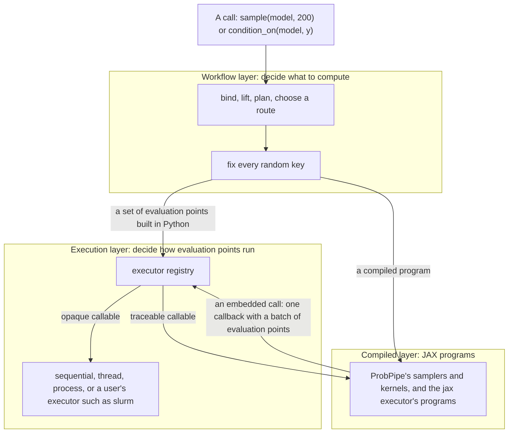

# Running computations in ProbPipe: the execution layer

> **Status: imported source, under revision.**
> This file is the execution-layer design for [#580](https://github.com/TARPS-group/prob-pipe/issues/580), moved from a gitignored local draft (it matches the Claude Doc "Running computations in ProbPipe: the execution layer", revision 63, 2026-10-16).
> From now on this file, not the Doc, is the copy that changes, and Appendix D keeps its revision log.
> The verification scripts that Appendix A cites stay outside the repository (decided 2026-10-17, `decisions.md`).
> A citation "gaps" and an item, such as "gaps D8", names an item of `gaps-and-conflicts.md`, which listed where this file disagreed with the other plans; every item was settled on 2026-10-18, and the file is in git history at commit `dac760cf`.
> The call context, the call token, and the carrying of settings are specified in § 6.16, into which the call-context design was folded after the maintainer approved it on 2026-10-18.

- **For:** issue #580, as a draft for maintainer review. Not posted.
- **Date:** first draft 2026-10-15; last revised 2026-10-18 (Appendix D).
- **Code base:** first surveyed at `origin/dev/overhaul` `023bfd01`, and rechecked for the call context and the reviews of 2026-10-18 at `553bfa4f` and PR #587 at `5ef1c6b2`, with JAX 0.10.1 and BlackJAX 1.5.
- **Verification:** every ✅ claim was checked by running code. The scripts are kept by the author outside the repository, and Appendix A lists them; each implementation step ports what it needs into `tests/` (gaps W4).
- **Review:** two rounds of independent adversarial review (accuracy, design, readability), then the maintainer's first review. Appendix C lists what the adversarial reviews changed, and Appendix D is the revision log.

---

## How to read this document

The document is written for a reader who knows what ProbPipe is for but not every module of it, and who knows basic JAX (`jit`, `vmap`, `grad`).
Section 3 explains the subtler JAX ideas the design depends on.

It has five parts:
1. **Sections 1 and 2:** the summary, and what ProbPipe does today, with reproduced failures.
2. **Sections 3 to 5:** the background, which covers a JAX primer, the principles, and the vocabulary.
3. **Section 6:** the design. It opens with one call traced end to end. Part A covers what a user writes, and part B how it works, ending with the call context of 6.16, which carries a call's settings to every place its code runs.
4. **Sections 7 and 8:** ten use cases worked through in code, and the risks that remain.
5. **Sections 9 to 14:** the questions for the maintainers, the relation to other open work, the design-text changes, the implementation guidelines, the order of work, and the tests.

Code labelled **Today** runs on `dev/overhaul`, and code labelled **Proposed** shows the target API.
Each subsection of section 6 ends with a **Today → Proposed** note.

> [!NOTE]
> This document says **executor** for what #580 calls a *backend*, because "backend" already has five meanings in ProbPipe (question Q1).
> Every `backend=` in #580 corresponds to `executor=` here.
> The maintainer questions are numbered **Q1 to Q18**, so they do not clash with the design principles D1 to D6 of `design/01-design-principles.md`.

### Design sections cited

| Section | Title | Section | Title |
|---|---|---|---|
| II.4 | Identity, type and metadata: `TrackedTerm`, `Provenance` | V.8 | Randomness: workflow scopes and structural keys |
| II.7 | Dispatch and registries | V.9 | Execution |
| III.3 | `Function` | V.10 | Return |
| IV.4 | Distributions from functions | V.11 | Differentiability claims |
| V.1 | The `Function` and its engine | VI.0 | The operation model |
| V.2 | Controls | VI.6 | `condition_on` |
| V.5 | Lifting | | |

### Abbreviations

ABC: approximate Bayesian computation. ESS: elliptical slice sampling, not effective sample size. JVP and VJP: Jacobian-vector and vector-Jacobian products (6.2). LOO: leave-one-out cross-validation. KSD: kernel Stein discrepancy. NUTS: the No-U-Turn sampler. RWMH: random-walk Metropolis-Hastings. SBC: simulation-based calibration. SMC: sequential Monte Carlo. XLA: the compiler JAX uses. ulp: unit in the last place, the gap between adjacent floating-point numbers.

---

## Contents

1. [Summary](#1-summary)
2. [Where ProbPipe stands today](#2-where-probpipe-stands-today)
3. [A short JAX primer for this design](#3-a-short-jax-primer-for-this-design)
4. [Principles](#4-principles)
5. [Vocabulary](#5-vocabulary)
6. [The design](#6-the-design)
7. [Use cases, worked through](#7-use-cases-worked-through)
8. [Risks and open questions](#8-risks-and-open-questions)
9. [Questions for the maintainers](#9-questions-for-the-maintainers)
10. [Relation to other open work](#10-relation-to-other-open-work)
11. [Changes to the design text](#11-changes-to-the-design-text)
12. [Implementation guidelines](#12-implementation-guidelines)
13. [Order of work](#13-order-of-work)
14. [Acceptance tests](#14-acceptance-tests)
15. [Appendix A: verification log](#appendix-a-verification-log)
16. [Appendix B: corrections to the text of #580](#appendix-b-corrections-to-the-text-of-580)
17. [Appendix C: what the adversarial review changed](#appendix-c-what-the-adversarial-review-changed)
18. [Appendix D: revision log](#appendix-d-revision-log)

---

## 1. Summary

### The problem

ProbPipe is built on JAX, and it is fast when JAX can compile a user's code.
Much scientific code cannot be compiled by JAX.
A forward model may call a solver through `subprocess`, a Fortran library through SciPy, or a PyTorch network.
Today such code is refused in some places and runs more often than needed in others, and ProbPipe gives a user no way to send it to a cluster of their own choosing.

The motivating case of #580 is an inverse problem.
A user has a forward model `G(θ)` that runs an expensive executable, and a likelihood `y ~ Normal(G(θ), σ)`.
They have three goals:
1. **Build the model** with the ordinary ProbPipe API.
2. **Choose where `G` runs per call:** locally for a serial algorithm, and on a cluster for an algorithm that evaluates `G` in batches, by changing one setting on the call.
3. **Keep gradients** for the parts of the model that are JAX code, such as an update of `σ` given `G(θ)`.

Today goal 1 already fails: building the likelihood traces `G` with JAX, and `G` cannot be traced (section 2).

### Five terms

- **Opaque callable:** code JAX cannot compile, such as a subprocess call. Its opposite is a **traceable** callable.
- **Evaluation point:** one evaluation of a callable at one set of arguments.
- **Set of evaluation points:** the evaluation points of one callable that one request asks for, such as 200 evaluations of `G` at 200 values of `θ`, as one collection, which the class `EvaluationPoints` implements. "Evaluation points" without "set of" is an ordinary plural.
- **Executor:** a pluggable runner for sets of evaluation points, such as "one at a time", "on 8 threads", or "as Slurm jobs". A user picks one by name, the way they pick an inference method.
- **Host callback:** JAX's way of calling ordinary Python from inside a compiled JAX program (section 3.6).

### The design in eight statements

1. **Meaning before execution.** ProbPipe settles what a call computes before anything runs, including every random key. The executor only decides how the computation runs, so changing the executor changes no result beyond the last bit of rounding (P3).
2. **Callables say what they allow.** A `Function` may state that it is traceable or opaque, that it accepts a whole batch at once, and how it is differentiated. ProbPipe reads these statements instead of guessing. When a callable states nothing, ProbPipe tests it once per input shape and remembers the answer.
3. **Many evaluations become one set of evaluation points,** whether they come from a lifted call, a joint distribution, an inference method, or a validation loop.
4. **Executors are chosen like inference methods.** A user registers their own executor and selects it with `using(executor="slurm", executor_options={...})`, the way they select a method with `method=`.
5. **Opaque code can run inside compiled JAX code.** When an opaque `Function` is called inside a JAX program, ProbPipe makes the call a host callback. A batch of evaluation points then arrives at the host as one call, and the host sends it to the executor. This is what lets a joint's compiled sampler or a BlackJAX kernel use a user's cluster without being rewritten.
6. **Gradients need a derivative only where they cross opaque code.** A gradient in `σ` with `G(θ)` held fixed needs nothing from `G`. A gradient through `G` uses the user's derivative, or raises an error that names `G`.
7. **Failures are reported per evaluation point.** By default a failed evaluation point stops the call with an error that names it. Requesters that can use the remaining evaluation points, such as ABC, may opt in to dropping failed ones.
8. **Nothing changes silently.** Before a call, `check` reports how many evaluation points it will evaluate, which executor will run them and why, and whether the callable traces. Provenance records the same.

### The motivating case, before and after

**Today** (✅ reproduced, `t7_defect1.py`):

```python
@function
def forward(theta):
    np.savetxt("in.txt", np.asarray(theta))          # converts its input to NumPy
    subprocess.run(["./solver", "in.txt", "out.txt"], check=True)
    return np.loadtxt("out.txt")

@conditional_distribution(given_spec={"theta": NumericArraySpec((2,)), "sigma": NumericArraySpec(())})
def likelihood(theta, sigma):
    return Normal("y", forward(theta), sigma)
# TracerArrayConversionError while building the kernel, with or without event_spec
```

**Proposed.** The decorator states two new facts. The body changes in two small ways, so that it can run in parallel and returns the dtype it declares:

```python
@function(traceable=False,                                  # new: never trace this callable
          output_spec=NumericArraySpec((40,), "float32"))   # new: the output shape, which a callback needs
def forward(theta):
    with tempfile.TemporaryDirectory() as run_dir:          # each evaluation point gets its own files
        np.savetxt(f"{run_dir}/in.txt", np.asarray(theta))
        subprocess.run(["./solver", f"{run_dir}/in.txt", f"{run_dir}/out.txt"], check=True)
        return np.loadtxt(f"{run_dir}/out.txt").astype(np.float32)   # the declared dtype

@conditional_distribution(given_spec={"theta": NumericArraySpec((2,)), "sigma": NumericArraySpec(())})
def likelihood(theta, sigma):
    return Normal("y", forward(theta), sigma)              # builds without running the solver

prior = Normal("theta", jnp.zeros(2), 1.0) & HalfNormal("sigma", 1.0)
model = likelihood & prior

with workflow_run(seed=1):
    local = sample(model, 200)                              # 200 solver runs, here

with workflow_run(seed=1):
    remote = sample.using(executor="slurm",
                          executor_options={"n_jobs": 50})(model, 200)   # the same 200 runs, on the cluster
# local and remote hold the same draws: same seed, same structure, same keys
```

With the fixed `in.txt` of the original, two evaluation points running at once, on threads or on cluster nodes that share a filesystem, would overwrite each other's input.

A standalone prototype runs this case end to end with a real subprocess solver (✅ `proto/demo.py`):
- **Building the model:** the construction check ran the solver **0** times.
- **Switching executors:** one compiled log density ran under four executors with **one** trace, and gave bitwise-identical results. The executors were sequential, threads, processes, and a stand-in cluster.
- **An unchanged sampler:** BlackJAX random-walk Metropolis with 4 chains sent **one batch of 4 evaluation points per step** to the executor, and its chains were identical under the local and the cluster executor.
- **Gradients:** `∂/∂σ` ran the solver **once** and needed no derivative of it. `∂/∂θ` with no derivative supplied raised an error naming `forward`. With a supplied VJP it agreed with central finite differences to within 0.002.
- **Failures:** two failing evaluation points out of eight were reported by index.

### What changes for users

The step column names the step of section 13 that makes each change; "after" marks work planned for after the workshop, which documentation and the CHANGELOG must not announce at the freeze. Section 13.1 lists the breaking changes.

| Kind | Change | Step |
|---|---|---|
| New `@function` arguments | `traceable`, `vectorized` | E2 |
| | `vjp`, `jacobian`, `jvp`; `differentiable` stops raising `NotImplementedError` | after (#522) |
| | `version` | after, with the memo |
| New controls | `executor`, `executor_options` | E3a |
| | `memo` | after |
| Removed | the controls `dispatch` and `max_workers` | E3b |
| | `is_jax_traceable` (a breaking change only if a public module exports it) | E2 |
| | BayesFlow's `sim_backend`; Prefect's automatic choice of Ray or Dask | after |
| New public names | `executor_registry`, `EvaluationExecutor`, `EvaluationPoints`, `EvaluationChunk`, `EvaluationOutcomes`, `EvaluationFailure`, `EvaluationError`, `EvaluationReport`, `ExecutionReport`, `UnshippableSettingError`, `probpipe.testing.check_executor` | E3a |
| | `InferenceTarget`, `ModelFactors`, and `make_posterior` made public with a new signature | E6 |
| | `numpy_generator` | after #554 |
| | `DiskMemo`, `count_compilations`, `jacobian` | after |
| New warnings | a probe that finds NumPy's or Python's global generator | E2 |
| | an inherited executor that falls back; an executor named on a call that ran nothing | E3a |
| | an embedded call staged inside a staging trace ProbPipe did not open while an executor is named | E4 |
| Behaviour | `check` probes a callable that states nothing, so it may run the callable's Python once | E2 |
| | a failed evaluation point makes the call raise `EvaluationError` naming it, chained to its exception | E3a |
| | a failure inside a compiled JAX program stops it at once | E4 |
| | a warm lifted call compiles and traces nothing | after, unless compiled lifting joins the core |

### What the maintainers need to decide

Section 9 asks eighteen questions, each explained from scratch with a recommendation. Q1 (the name `executor`) and Q17 (one run per evaluation point inside a call) are decided.
The four open ones with the largest effect:
- **Q4, the boundary:** host callbacks now, and deterministic fields of a joint in a separate issue soon after.
- **Q5, where the code goes:** the evaluation-point and executor types in `core/`, so that the distributions package can use them.
- **Q7, failures:** a failure makes the call raise by default, and only sets of evaluation points built in Python may drop failed ones.
- **Q14, gradients:** whether a traceable model is gradient-ready without an explicit claim, as it is today.

---

## 2. Where ProbPipe stands today

### 2.1 Reproduced behaviour

| # | Behaviour | Evidence |
|---|---|---|
| 1 | A kernel whose function calls non-JAX code is refused while it is built. Declaring `event_spec` does not help, and neither does wrapping the code in a `Function`. | ✅ `t7_defect1.py`, all three forms |
| 2 | With `dispatch="auto"`, every lifted call tests the body with a JAX trace. The test runs the user's Python up to the first use of an input. | ✅ `t6_defects.py`: 5 draws ran the body 6 times, and two calls ran it 12 times |
| 3 | That test's outcome is never stored. | `functions/_function.py:788-883` |
| 4 | A traceable lifted body is traced twice per call, once to test it and once by an eager `jax.vmap`. The lifted path is never compiled as one JAX program. | ✅ `t9_lift_traces.py`: 2 body runs per call; 5 compilations on the first call and 0 later; no `jax.jit` in `functions/` |
| 5 | Lifting over an empirical law with more atoms than the sample count samples the law instead of enumerating it, with no warning. | ✅ `t6_defects.py` and `t7_defect1.py`: 300 atoms gave 256, and no warning; `functions/_plan.py:393-407` |
| 6 | `Function(differentiable=...)` raises `NotImplementedError`. | ✅ `t6_defects.py`; `values/_function_base.py:1077-1080` |
| 7 | One failing evaluation point stops the call and discards the other results. | ✅ `t6_defects.py`, under `sequential` and `thread` |
| 8 | A law built from functions inside a kernel re-tests its density with a JAX trace each time the kernel is applied. | ✅ `t15_reprobe.py`: 3 applications made 3 more traces |
| 9 | Gradient methods are chosen because a density traces, not because it claims gradients. | `inference/_inference_utils.py:191-205` |

### 2.2 Who evaluates callables today

Fourteen places evaluate a callable at many evaluation points, and each decides on its own whether to vectorize or loop.
#580 names eight of them under G3 and one under G1. The survey found five more, marked †.
None of the fourteen goes through the `Function` engine.

| Site | What it evaluates | How it decides | Fallback |
|---|---|---|---|
| Joint factor, `_factored.py:790-847` | a kernel's draw or density per given | whether the given's spec is numeric | a plain `jax.vmap`, which fails the same way |
| Laws from functions, `_from_functions.py:89-131` | a user sampler and density | `jax.eval_shape` when the law is built | a Python loop |
| Empirical expectation, `_empirical.py:760-787` | a user integrand per atom | always `jax.vmap` for numeric events | none |
| † Discrete expectations, `families/_discrete.py:85,92` | a user integrand over the support | always `jax.vmap` | none |
| † Transformed laws, `families/_transformed.py:131` | a bijector | always `jax.vmap` | none |
| Empirical reweighting, `_empirical_reweighting.py:176-183` | the likelihood per atom | `is_jax_traceable` | a list comprehension |
| RWMH, `_blackjax_rwmh.py:506-562` | the flat density | `is_jax_traceable` | Python steps, with the chains run one after another |
| † Minibatch, `inference/_minibatch.py:541` | the density per minibatch | always `jax.vmap` | none |
| LOO, `diagnostics/_loo.py:615-636` | the density per observation | a `try` around a lazy `vmap`, which never fails, and a `try` per chain | nested Python loops, retried per chain |
| Predictive check, `_predictive_check.py:316-335` | a user statistic | `try jax.vmap` | a loop |
| † Joint draws in the predictive check, `_predictive_check.py:311` | the joint's raw draw | as for joint factors | as for joint factors |
| † KSD, `validation/_comparison.py:363` | a user score | always `jax.vmap` | none |
| BayesFlow, `_bayesflow_common.py:300-308` | the simulator | the user's `sim_backend` argument | none |
| pyabc, `_pyabc.py:172-196, 401-412` | the prior and the simulator | `jax.jit` on the first call, per closure | eager, recorded before it runs |

Simulation-based calibration (`_calibration.py:504-521`) also runs `condition_on` once per simulation in a Python loop.

### 2.3 Facts #580 does not mention

1. **A closed execution contract exists.** `functions/_execution_contract.py` versions pairs of an *evaluator* (`rowwise`, `jax_vmap`) and a *transport* (`local_inline`, `local_thread`, `prefect_task`, `prefect_flow`), and accepts only a fixed set of pairs. Replay records `requested_dispatch` (`functions/_replay.py:305`). A pluggable executor must replace this closed set (6.8).
2. **`compiled_or_eager` swallows run-time errors.** `core/_compilation.py:22-71` catches any exception from the compiled JAX program and runs the eager form instead. #580 §8 says a JAX program that compiles and then fails while running must raise, so the two disagree (6.10).
3. **Copies made by `using` do not share compiled JAX programs.** `Function.using` makes a shallow copy (`values/_function_base.py:1235`), and #556 stores JAX programs in a memo that a copy does not share. A program store on the `Function` would therefore recompile on every `f.using(...)(x)` (6.10).
4. **A kernel's construction test reads more than its event spec.** `conditional_distribution` also reads which conditional capabilities the kernel has and their **guards**, the conditions under which sampling or scoring is valid (`_conditional.py:1347-1351`, IV.4). Skipping the test when `event_spec` is given, as #580 §1 proposes, would leave the capabilities unknown. Section 6.9 keeps the test and makes it work for opaque code.
5. **RWMH derives keys differently on its two paths.** The compiled and the eager path split keys differently (`_blackjax_rwmh.py:274-275, 323, 375`; `_inference_utils.py:1213`), so one target gives different chains depending on whether it traces.
6. **`parallel_chain_map` depends on the device count.** It runs one chain unmapped, uses `pmap` when there are as many devices as chains, and an uncompiled `vmap` otherwise (`_inference_utils.py:1223-1259`). The keys are the same in every branch. ✅ `t14_pmap.py` shows `pmap` and `vmap` differ by 2.4e-7 from the first step, and `pmap` equals a per-key `jit` bitwise. MCMC's accept and reject decisions can amplify such differences into different draws.

---

## 3. A short JAX primer for this design

The design rests on nine facts about JAX.
Each subsection states one fact, shows it in a few lines, and says why it matters for ProbPipe.
All snippets ran on JAX 0.10.1 (✅ scripts `t1` to `t5`, `t8`, `t10`, `t11`, `t13`, `t14`, `t16`).

### 3.1 JAX runs your Python once to record it

`jax.jit(f)` does not read the source of `f`.
On the first call it runs `f` with **tracers**: stand-in values that carry only a shape and a dtype, and that record every `jax.numpy` operation applied to them.
Two words describe what follows:
- **Tracing** is that first run, which records a JAX program.
- **Compiling** is XLA turning the recorded JAX program into machine code.

Later calls with the same input shapes reuse the compiled JAX program and skip both steps.

```python
python_runs = []
@jax.jit
def increment(x):
    python_runs.append("ran")   # a Python side effect, such as writing a file
    return x + 1

increment(1.0); increment(2.0); increment(3.0)
len(python_runs)                # 1: the Python body ran once, while tracing
```

**Why it matters.** A side effect inside a traced function happens once per trace, not once per call.
A **probe** is a trace made only to find out whether a function traces, with `jax.eval_shape(f, ...)` or `jax.make_jaxpr(f)(...)`.
A probe runs the user's Python up to the first operation that fails on a tracer.
In ✅ `t1` a function that logged a line before converting its input to NumPy logged once in each of two failed probes.

### 3.2 Three things a traced function cannot do

A tracer has no value, so three kinds of code fail under tracing:

```python
np.asarray(theta)            # convert to NumPy       -> TracerArrayConversionError
if x > 0: ...                # branch on a value      -> TracerBoolConversionError
jnp.zeros(n)                 # shape from a value     -> TypeError (shapes must be known)
```

A subprocess call, a SciPy solver, and a PyTorch model all need concrete values, so they all fail in the first way.
This document calls a callable **traceable** when none of the three happens for its input shapes, and **opaque** otherwise.

One trap goes the other way. NumPy's random generator does not fail on a tracer:

```python
def noisy(t): return t + np.random.normal(size=3)   # traces without error
```

The noise is drawn once, while tracing, and becomes a constant of the JAX program, so every later call adds the same noise.

### 3.3 A compiled JAX program is reused only when it is the same JAX program

JAX keeps the compiled JAX programs of each jitted function, keyed by the shapes and dtypes of its arguments.
A JAX program is reused only when the same jitted function object is called again with the same shapes:

```python
@jax.jit
def f(x, y): return jnp.sin(x) * y
f(jnp.ones(3), 2.0); f(jnp.zeros(3), 5.0)    # one compilation: new values, same shapes
f(jnp.ones(4), 2.0)                           # a second compilation: a new shape

for t in [1.0, 2.0, 3.0]:
    jax.jit(lambda x: x * t)(jnp.ones(3))     # three compilations: a new function each time

def scale(t, x): return x * t
@jax.jit
def call_scaling(scaling, x): return scaling(x)
for t in [1.0, 2.0, 3.0]:
    call_scaling(jax.tree_util.Partial(scale, t), jnp.ones(3))   # one compilation

@jax.jit
def draw(key): return jax.random.normal(key, (3,))
for i in range(5): draw(jax.random.key(i))    # one compilation: a key is an ordinary argument

scale_static = jax.jit(lambda x, n: x * n, static_argnums=1)
for n in range(4): scale_static(jnp.ones(2), n)   # four compilations: a static argument is part of the JAX program
```

`jax.tree_util.Partial` works because it splits a function into a fixed part, `scale`, which identifies the JAX program, and data, `t`, which JAX passes as an argument.
A value captured by a closure is different: it is baked into the JAX program as a constant, so each new closure is a new JAX program.

**Why it matters.** This is rule J2: a JAX program needs a **stable identity**, and every value that changes from call to call must enter it as an argument.
ProbPipe broke this rule in #531, where closures built per call recompiled on every `sample`.
The first prototype of this design broke it too. It read a per-call setting while tracing, the setting became a constant, and later calls sent their evaluation points to the first call's settings, which no longer existed (✅ `proto/demo.py`, step 2b).

### 3.4 `vmap` turns one evaluation point into many

`jax.vmap(f)` takes a function of one evaluation point and returns a function of many evaluation points stacked on a leading axis.
It does not loop. It rewrites the JAX program so each operation acts on the whole batch.
Each evaluation point of the batch is called a **lane**.

```python
keys = jax.random.split(jax.random.key(0), 8)
thetas = jnp.arange(8.0)[:, None]
def perturb(theta, key): return theta + jax.random.normal(key, (3,))

vectorized = jax.vmap(perturb)(thetas, keys)
looped = jnp.stack([perturb(thetas[i], keys[i]) for i in range(8)])
bool((vectorized == looped).all())   # True: the same keys give the same draws, lane by lane
```

Two compiled forms of the same computation can still round differently in the last bit.
XLA may merge operations or change the order of a sum, and floating-point addition is not associative.
`jax.lax.map(lambda args: perturb(*args), (thetas, keys), batch_size=3)` differed from the `vmap` above by at most one ulp, 4.8e-7 absolute at these magnitudes (✅ `t4`).

**Why it matters.** When each evaluation point's key is fixed in advance, every way of running the evaluation points gives the same numbers, up to the last bit.
This is principle P3, and it is what lets a user switch executors without changing results.

### 3.5 `grad` needs a derivative rule for every operation on the path

`jax.grad(f)` differentiates the JAX program that tracing recorded.
Every operation between the differentiated input and the output must have a derivative rule.
`jnp.sin` has one, its derivative `cos`. A call into ordinary Python has none, because JAX cannot see inside it.
An operation off that path needs no rule. Section 3.7 shows both cases.

### 3.6 A host callback lets a JAX program call ordinary Python

`jax.pure_callback(fn, result_shape, *args)` puts a call to an ordinary Python function inside a traced JAX program.
The **host** is the Python process. When the compiled JAX program runs, it pauses, converts the arguments to NumPy arrays, calls `fn` on the host, and continues with the result.
The result's shape and dtype must be declared in advance, because the JAX program is compiled before `fn` ever runs.

```python
def solver(theta):                         # ordinary NumPy code: an opaque callable
    return (np.asarray(theta) ** 2).astype(np.float32)

def G(theta):
    return jax.pure_callback(solver, jax.ShapeDtypeStruct(theta.shape, jnp.float32),
                             theta, vmap_method="expand_dims")

jax.jit(jax.vmap(G))(jnp.ones((4, 3)))     # the host function runs ONCE, on shape (4, 3)
```

The `vmap_method` argument says what happens when the callback is batched:

| `vmap_method` | Host calls for 4 lanes | What the host receives |
|---|---|---|
| `"sequential"` | 4 | one lane at a time |
| `"expand_dims"` | 1 | the batch; an argument that is not batched gets a size-1 axis |
| `"broadcast_all"` | 1 | the batch, with every argument broadcast to it |

For example, `vmap(lambda x: H(x, w), in_axes=0)` over 4 lanes, with `x` of shape `(3,)` and `w` fixed, gives the host `x` of shape `(4, 3)` and `w` of shape `(1, 3)` under `"expand_dims"`.

Six more facts about callbacks (✅ `t2`, `t3`, `t8`, `t13`):
1. **Abstract evaluation never runs the host function.** `jax.eval_shape` and `jax.make_jaxpr` record the callback without calling it.
2. **An unused callback may never run.** JAX deletes computations whose results are unused, and it treats `pure_callback` as such a computation.
3. **A callback may run more than once for one value.** Two identical callbacks in one JAX program ran twice. A callback inside `jax.checkpoint` ran twice under `grad`, because the backward pass recomputes the forward pass to save memory.
4. **An input that is not batched is evaluated once.** In `jit(vmap(grad(logp), in_axes=(0, None)))`, a callback on the unbatched input ran once for all lanes.
5. **A host exception loses its type.** An exception raised by the host function arrives at the caller as a `JaxRuntimeError`, or in some JAX programs as a `ValueError` whose message begins `INTERNAL: CpuCallback error`; either way only the message carries the original text.
6. **A batched loop runs every lane until the slowest finishes.** Under `vmap`, a `while_loop` cannot stop one lane early, so it keeps computing finished lanes with their last values and discards the results. A callback inside it is called for those lanes too. Lanes needing 1, 2, 6, and 10 iterations sent 40 evaluation points to the host where 19 were needed (✅ `t13`). The same holds for `lax.cond` under `vmap`, which computes both branches for every lane.

`io_callback(..., ordered=True)` guarantees each call runs once and in order, but it cannot be batched (`Cannot vmap ordered IO callback`).
ProbPipe therefore uses `pure_callback`, which requires the callable to be pure (rule J5).

**Why it matters.** The callback is how opaque code can run inside a compiled JAX program.
With `expand_dims`, a batch of N evaluation points arrives at the host as one call, which is the unit an executor runs.
Facts 2, 3, and 6 are harmless only for pure callables, and they are cheap only with a memo (6.5).
Fact 5 means a callback must record its own errors before it raises (6.4).

### 3.7 Custom derivatives

A **VJP**, a vector-Jacobian product, answers the question "given how the loss changes with the output, how does it change with the input?". Reverse-mode `grad` is built from VJPs.
A **JVP**, a Jacobian-vector product, answers "if the input moves in this direction, how does the output move?". Forward mode is built from JVPs.

`pure_callback` has no derivative rule, so `grad` through it raises `Pure callbacks do not support JVP`.
`jax.custom_vjp` attaches a rule written by the user, which may itself call the host, for example an adjoint solver:

```python
def solver_call(theta):
    return jax.pure_callback(solver, jax.ShapeDtypeStruct(theta.shape, jnp.float32),
                             theta, vmap_method="expand_dims")

@jax.custom_vjp
def G_diff(theta): return solver_call(theta)

def G_fwd(theta):                     # the forward pass: the value, and what the backward pass needs
    return solver_call(theta), theta
def G_bwd(theta, ybar):               # the backward pass: the user's adjoint, called on the host
    return (jax.pure_callback(adjoint, jax.ShapeDtypeStruct(theta.shape, jnp.float32),
                              theta, ybar, vmap_method="expand_dims"),)
G_diff.defvjp(G_fwd, G_bwd)

jax.grad(lambda t: G_diff(t).sum())(jnp.array([1.0, 2.0, 3.0]))   # works, and under vmap too
```

A gradient that does not pass through the callback needs no rule at all:

```python
y = jnp.array([1.0, 2.0, 3.0])
def logp(sigma, theta):
    mu = solver_call(theta)           # opaque, with no derivative rule
    return jnp.sum(-0.5 * ((y - mu) / sigma) ** 2 - jnp.log(sigma))

jax.grad(logp)(1.5, jnp.ones(3))                  # works: only sigma is differentiated
jax.grad(logp, argnums=1)(1.5, jnp.ones(3))       # raises: the gradient must cross solver_call
```

JAX computes reverse mode by **transposing** forward mode: it runs the linear map of the JVP backwards.
It can transpose a JAX operation such as a matrix product `J @ t`, but not a host callback, which is a black box.
So a user-supplied JVP that computes the tangent on the host serves forward mode only. A user-supplied Jacobian matrix, applied by ProbPipe as `J @ t` in JAX, serves both modes (✅ `t11`).

**Why it matters.** Goal 3 of the motivating case, a gradient update of `σ` given `G(θ)`, needs no derivative of the solver.

### 3.8 Which thread runs a callback

On CPU, with one device and plain `jit`, the host function ran on the thread that called the compiled JAX program, and a `contextvars` value set on that thread was visible to it (✅ `t2`, `t3`).
Under `pmap` across 4 CPU devices, the host function ran on four of XLA's own threads at once, and the context variable was not visible (✅ `t14`).
JAX documents no guarantee either way.

**Why it matters.** ProbPipe cannot rely on thread-local state to tell a callback which executor to use.
It passes a `uint32`, the **call token**, into the JAX program as an argument, and the host looks the call's settings up by token (✅ `t5`: one trace, three calls with different executors, each seen correctly). A Python `int` of 2^31 or more overflows a jitted argument when 64-bit types are off, hence the fixed type.
The host's lookup table must be safe to read from several threads at once.

### 3.9 Processes and serialization

A process pool started by `fork` copies a parent that may hold JAX's internal threads, which can deadlock (#329).
The `spawn` start method starts a fresh interpreter instead.
A closure does not pickle with the standard `pickle`, and `cloudpickle` serializes it by value (✅ `t5`).

A typed JAX key is not a plain array, so it crosses a process or a callback as its raw data.
`jax.random.key_data(key)` gives that data, a `uint32` array of shape `(2,)` for the default generator, and `jax.random.wrap_key_data` restores the key with identical draws (✅ `t10`).
A spawned interpreter starts with JAX's default configuration, not the parent's.
With `jax_enable_x64` set in the parent, the same key data gave a `float64` draw of -0.206 in the parent and a `float32` draw of 1.623 in a spawned worker (✅ `t16`).

**Why it matters.** A chunk of work sent to another process must carry the parent's JAX configuration and the key's generator, or the worker computes different numbers (6.7).

### 3.10 Each transformation asks for something different

"Traceable" is not a JAX term. Each JAX transformation requires something of a function, and a function can pass one transformation and fail another (✅ `t18`):

| Function | eager | `jit` | `vmap` | `jvp` (forward mode) | `grad` (reverse mode) |
|---|---|---|---|---|---|
| `np.asarray(v)`: converts to NumPy | works | fails | fails | fails | fails |
| `v[v > 0].sum()`: a shape that depends on values | works | fails | fails | works | works |
| a `lax.while_loop` | works | works | works | works | fails |
| `jnp.round(3 * v).sum()` | works | works | works | gives zero, no error | gives zero, no error |
| `pure_callback` with no `vmap_method` | works | works | fails | fails | fails |

Three lessons follow:
1. **`jit` and `vmap` ask for the same thing:** every shape must be known from the input shapes, and no value may be read as a Python or NumPy value. A function that passes one passes the other, except for operations that have no batching rule, such as a callback without a `vmap_method`.
2. **Differentiation asks for something else:** a derivative rule for every operation on the path. `grad` without `jit` can even run code that `jit` refuses, because it traces with concrete values underneath.
3. **Passing a transformation does not make its answer useful.** `jnp.round` differentiates to zero without an error.

**Why it matters.** This design defines **traceable** as "`jit` and `vmap` both succeed for these input shapes", which is the first lesson. It defines differentiability separately, as V.11's claim, because of the second and third lessons. Traceable does not imply differentiable (Q14).

---

## 4. Principles

### 4.1 The execution principles

These rules hold for every part of ProbPipe that runs a computation.
Each is stated in plain words, followed by what it requires in practice.

**P1. Meaning is settled before execution.**
Before an evaluation runs, ProbPipe has fixed which callable it calls, at which evaluation points, with which arguments and which random keys.
An adaptive algorithm, such as ABC, fixes one batch, runs it, and may build the next batch from the results.
*In practice:* an executor receives a finished request and changes nothing in it.

**P2. An executor decides only how evaluation points run:** where, in what order, how many at once, and whether compiled.
*In practice:* an executor never reads an evaluation point's arguments or derives a key. The built-in `jax` executor is the one exception, because it compiles the arguments into a JAX program.

**P3. Results do not depend on the executor.**
Every executor gives each evaluation point the same value, up to the last bit of rounding (3.4).
*In practice:* an algorithm whose accept and reject decisions can amplify one ulp, such as MCMC, reproduces its draws bitwise only under the same JAX program and device configuration, which provenance records.

**P4. A callable states what it allows, and ProbPipe reads the statement.**
Statements are fixed when the `Function` is built. A callable that states nothing is probed at most once per input structure, and the outcome is stored.
*In practice:* `check` runs the same probe a call would run, so `check` and the call always agree.

**P5. The JAX contract is opt-in, per callable.**
A traceable callable is compiled, vectorized, and differentiated. An opaque callable runs on concrete values through the same API and gives the same results, more slowly.
*In practice:* a user never rewrites working NumPy code to use ProbPipe.

**P6. Every set of evaluation points goes through one registry of executors,** whether it is built in Python or arrives from inside a compiled JAX program through a callback.
*In practice:* an executor a user registers serves lifting, joints, inference, validation, and diagnostics without a change to any of them. A traceable `Function` called inside a JAX program, such as one a kernel calls while a joint compiles the kernel, becomes part of that JAX program, as a call to `jnp.sin` does. Its operations are compiled and run together with the rest of the JAX program, so no executor ever sees it as a batch of evaluations of its own. Only a call on a batch made in Python, such as `growth(prior)`, gives a traceable callable a set of evaluation points, which the `jax` executor compiles.

**P7. Opaque code joins JAX code at one boundary.**
Its outputs enter JAX programs as data, and a gradient crosses it only through a derivative the callable supplies.
*In practice:* the host callback of 6.9 is the only place where opaque code and JAX code meet.

**P8. Choosing an executor works like every other choice in ProbPipe:** a registry with priorities, feasibility checks, opt-in entries, and selection by name through `using`.
*In practice:* a user who knows `method=` knows `executor=`.

**P9. A failure is reported per evaluation point.**
An executor reports every evaluation point's outcome, and the code that asked for the evaluation points decides what a failure means.
*In practice:* no executor drops an evaluation point or replaces its value.

**P10. Nothing changes silently.**
The number of evaluation points, any subsampling, the executor, any fallback, and whether a JAX program compiled are reported by `check` and recorded in provenance.
*In practice:* a fallback that `check` cannot foresee warns when it happens.

**P11. Per-call values are data at every boundary.**
Keys, call tokens, and parameters enter compiled JAX programs, callbacks, and worker processes as arguments, never as captured constants or thread-local state.
*In practice:* this is #554's key rule and J2, stated once for every boundary.

### 4.2 The compiled-layer rules

ProbPipe's own numerical methods, such as a family's sampler and an MCMC kernel, are JAX code.
Nine rules from #535 govern them, and this design writes them into the design text.

| | Rule | Plain meaning |
|---|---|---|
| **J1** | Python orchestrates and XLA computes. Compiled JAX programs start at the raw methods, after ProbPipe has derived every key. | Workflow decisions, labels, and provenance never enter a trace. |
| **J2** | Every compiled JAX program has a stable identity, and per-call values enter it as arguments. | JAX programs are module-level or owned by a long-lived object, and never a closure built per call (3.3). |
| **J3** | Eager and compiled execution follow one algorithm. | A branch on whether a value is traced may skip a check, and never change the algorithm. The mixture sampler breaks this today: it draws by a different algorithm when its input is concrete. |
| **J4** | Compilation is an optimization with an eager fallback, decided once per owner and input structure, **while tracing**. | A failure while tracing selects the eager route. A failure while a compiled JAX program runs is a real error. |
| **J5** | Every callable a user passes to ProbPipe is pure: its result depends only on its arguments and its key. | ProbPipe may trace it once and reuse the trace, call it again, or skip a call whose result is unused (3.6). |
| **J6** | Importing ProbPipe changes no global JAX setting. | The persistent compilation cache is opt-in. |
| **J7** | Caches are owned and bounded, and none is keyed by `id()`. | Python reuses an `id()` after an object is freed, so an `id()` key can return another object's entry. |
| **J8** | A seeded result is bitwise reproducible for a fixed JAX program, ProbPipe version, JAX version, device type, and device count. | Different JAX program forms, such as `vmap`, `lax.map`, and `pmap`, may differ by a few ulp, and tests use measured tolerances. |
| **J9** | Tests measure compilation by counting compilations. | A count does not depend on the load of the machine. |

---

## 5. Vocabulary

Each term below is a proposal for `design/glossary.md`.
The call context's terms, such as *call context*, *evaluation context*, *call token*, and *JAX program*, are defined once, in 6.16, "Definitions"; the rows below that name them point there.

| Term | Meaning |
|---|---|
| **traceable**, **opaque** | whether JAX can trace a callable for its input shapes (3.2) |
| **probe** | a trace made only to learn whether a callable traces (3.1) |
| **input structure** | the tree definition that ProbPipe's canonical flatten gives for a call's arguments, with their shapes and dtypes, plus the values of its non-numeric hashable arguments. The canonical flatten is JAX's tree flatten of the arguments, whose static data for ProbPipe terms is name-free from step S4b (`declarations-and-addressing.md` § 18.3): it leaves out a batch's base-element names, so those names never enter the cache key of a probe result or of a JAX program. A requester restores names on the results: from S4b it attaches its output spec when it assembles the result, since a cached JAX program rebuilds outputs from the first call's static data (`declarations-and-addressing.md` O4) |
| **probe result** | the stored outcome of a probe, per `Function` and input structure |
| **evaluation point** | one evaluation of a callable at concrete arguments, with its key when the callable draws. An empirical law's atom is a point of its support, which is not an evaluation point. |
| **set of evaluation points** | the evaluation points of one callable that one request evaluates, as one collection (the class `EvaluationPoints`): the callable, the arguments every evaluation point shares, the arguments that vary by evaluation point, one key per evaluation point, and each one's point index. "Evaluation points" alone is an ordinary plural |
| **point index** | an evaluation point's position within its set of evaluation points |
| **evaluation point identity** | an evaluation point's unique name within its call: the callable, the ordinal of its set of evaluation points among those the call requested, and its point index; used in reports and errors |
| **evaluation context** | defined in 6.16, "Definitions" |
| **chunk** | a contiguous slice of evaluation points that an executor runs as one unit, such as one cluster job. A chunk can be pickled. |
| **outcome** | an evaluation point's result: its output, or a failure that says why it has none |
| **executor** | an entry of the executor registry: a named way to run a set of evaluation points, such as `sequential`, `thread`, or a user's `slurm` |
| **executor registry** | the dispatch registry of executors (II.7), listed in the registry catalog |
| **automatic selection** | the registry trying its executors from the highest priority down, skipping opt-in ones, and running the first that can run the set of evaluation points (6.3) |
| **execution claim** | a statement a callable makes when built about how it may be run: `traceable`, `vectorized`, or `differentiable` with a derivative. A claim is a declaration, not a control. |
| **embeddable**, **host-only** | an opaque `Function` whose output spec describes a value a host callback can return, or one whose output spec does not (6.2) |
| **embedded call** | a call of an opaque `Function` from inside a JAX program, which ProbPipe turns into a host callback (6.9) |
| **call token** | defined in 6.16, "Definitions" (3.8) |
| **call context** | defined in 6.16, "Definitions" |
| **JAX program with embedded calls** | defined in 6.16, "Definitions" |
| **requester** | the code that asked for a set of evaluation points, such as a lift, a joint, or an inference method |
| **program store** | the compiled JAX programs a `Function` or another owner keeps, keyed by input structure |
| **evaluation memo** | an opt-in store of a callable's outputs, keyed by the content of its arguments and its key (6.5) |
| **result cache** | the call-level cache of V.8, keyed by the structure of a whole call |
| **compiled layer** | ProbPipe's own JAX methods, governed by J1 to J9 |

**Words this design avoids.**
- **backend** already means an array backend (II.3), a family's library (`families/_backend.py`), an inference library (method names `{backend}_{algorithm}`, STYLE_GUIDE §1.7), a JAX program handle (VI.6), and JAX itself (V.11).
- **dispatch** keeps only its II.7 meaning, because the dispatch mode of V.9 is removed.
- **evaluator** and **transport** name today's execution contract (`functions/_execution_contract.py`), which this design retires. Sending a chunk to another process is called **shipping** here.
- **cache** alone is ambiguous: JAX's compilation cache, the program store, Prefect's task cache, and V.8's result cache are four different things.
- **event** means the event of a distribution, as in `event_spec`. V.8 derives each random key from the identity of a "random event", and this design does not name that identity: it says "the evaluation point's random key". V.8 and #554 use "random event" throughout, and whether to rename it there is part of Q16.
- **key** here means a random key, as in V.8. A mapping's keys are the other sense, a collision Python's dictionaries make natural, so where the two could be confused this design writes *random key* (decided 2026-10-16).
- **record** means ProbPipe's `Record`. This design says *probe result* for the stored outcome of a probe, and uses "record" only as a verb.

---

## 6. The design

### 6.1 One call, end to end

This subsection follows one call of the motivating case through the design, before the parts are defined one by one.

```python
with workflow_run(seed=1):
    draws = sample.using(executor="slurm", executor_options={"n_jobs": 50})(model, 200)
```

1. **Meaning.** `sample` resolves its route and derives every random key from the seed and the call's structure (V.8). Nothing has run yet.
2. **The prior.** The joint draws 200 values of `(θ, σ)` from the prior in one compiled JAX program.
3. **The likelihood, compiled.** The joint maps the likelihood kernel over the 200 drawn values in a second compiled JAX program, as it does today. The engine passes that JAX program the call's **token** as an argument.
4. **The embedded call.** Inside that JAX program, `forward(theta)` is an opaque `Function` called on traced values, so ProbPipe stages it as a host callback. Under the `vmap` over 200 draws, the callback runs once and receives all 200 values of `θ`.
5. **The executor.** The host side looks the call up by its token and finds `executor="slurm"`. It builds a set of 200 evaluation points and hands it to the Slurm executor, which runs 50 jobs of 4 evaluation points each and returns 200 outcomes in order.
6. **Back in JAX.** The JAX program continues with the 200 outputs as data and draws `y`.
7. **The result.** The engine waits for the JAX program, since it holds a token, releases the token, and wraps the draws. `sample`'s `evaluation_log` records that 200 evaluation points ran on `slurm` with `n_jobs=50`, and its provenance reports it.

Changing `executor="slurm"` to nothing changes step 5 alone: automatic selection picks `sequential`, which runs the 200 evaluation points one after another. The draws are identical.

The layers involved are these:



A set of evaluation points arrives at the registry by one of two entries:
1. **From Python.** A requester that runs in Python builds a set of evaluation points and hands it to the registry. A lifted call, pyabc's simulation loop, and SBC's loop of inference runs do this.
2. **From inside a compiled JAX program.** An opaque `Function` called on traced values becomes a host callback, whose host side builds the set of evaluation points (step 4 above). A joint's compiled sampler and a BlackJAX kernel use the registry this way, with no change to their code.

One helper, `evaluate_at_points`, replaces the fourteen "vectorize or loop" decisions of section 2.2; 6.7, "The helper for requesters", gives its signature.
With traced arguments, it calls the callable inline, which turns an opaque `Function` into an embedded call.
With concrete arguments, it builds a set of evaluation points and hands it to the registry.

---

### Part A: what a user writes

### 6.2 Execution claims

#### The claims

A `Function` states its execution claims when it is built, and they are fixed for its life:

```python
@function(traceable=True)                      # JAX can trace it: compile, vectorize, differentiate
def ricker(r, K, n0): ...

@function(traceable=False,                     # never trace or probe it
          output_spec=NumericArraySpec((40,), "float32"))
def forward(theta): ...

@function(traceable=False, vectorized=True,    # one call takes a stack of evaluation points
          output_spec=NumericArraySpec((40,), "float32"))
def forward_batch(thetas): ...                 # thetas has shape (n, 2)

@function(traceable=False,                     # differentiable through a derivative it supplies
          output_spec=NumericArraySpec((40,), "float32"),
          differentiable=NumericRecordSpec(theta=NumericArraySpec((2,))),
          vjp=forward_adjoint)
def forward(theta): ...
```

1. **`traceable`** takes three values:
   - `True` states that JAX can trace the callable: `jax.jit` and `jax.vmap` both succeed for its input shapes (3.10). It is pure (J5), and it acts on array inputs only through `jax.numpy` and `lax`. It never converts an input to Python or NumPy, never branches in Python on an input's value, and its output shapes depend only on its input shapes. It says nothing about gradients, which `differentiable` states.
   - `False` states the opposite. ProbPipe never traces the callable and never probes it.
   - `None`, the default, states nothing (P4).
2. **`vectorized=True`** states that the callable accepts every array argument with an extra leading axis of evaluation points, and returns its outputs stacked on that axis. Output row `i` must depend only on input row `i`. An executor may then evaluate a chunk of evaluation points in one call. A callable that takes a key (after #554) receives a stacked array of keys. Whether an argument that every evaluation point shares is stacked too, and how a record argument is stacked, is pending the maintainer's decision N24 in `decisions.md`.
3. **`differentiable`** is V.11's claim: a `NumericRecordSpec` that names the inputs gradients flow through. Its field names are input names, checked against the `Function`'s `input_spec`; a claim on a part of an input uses the path reader of `declarations-and-addressing.md` § 12.1. JAX differentiates a traceable callable itself. An opaque callable is differentiable only through a derivative it supplies, in one of three forms:

```python
def vjp(*args, cotangent) -> tuple:     # one cotangent per input the claim names, in signature order;
                                        # serves reverse mode, which gradient methods use
def jacobian(*args) -> tuple:           # one Jacobian matrix per input the claim names;
                                        # serves both modes, because ProbPipe applies it with J @ t in JAX
def jvp(args, tangents) -> Array:       # the output's tangent; serves forward mode only (3.7)
```

   A `vectorized` callable's derivative receives stacked rows too.
   An opaque callable that claims `differentiable` without one of the three raises `TypeError` when it is built.
   A traceable callable may supply one as well, to replace JAX's own rule, for example for numerical stability.
4. **`version`** names what a fingerprint of the Python code cannot see, such as the solver binary the callable runs: `version="solver-2.3"`. The memo uses it (6.5).

**After #554.** A key parameter follows #554: a callable that takes randomness declares a parameter named `key`, or names another one, as `random_key="sim_key"` does. #554's key parameters come after the workshop (`deferred.md`), so before then no callable receives a key argument, and a draw inside an evaluation point takes its key from the point's workflow scope (6.7).

#### How ProbPipe learns whether a callable traces

ProbPipe keeps one **probe result** per `Function` and input structure:

| Claim | First call, or first `check`, for a new input structure | Later |
|---|---|---|
| `True` | no probe. If tracing fails, ProbPipe raises an error naming the callable, because the claim is false (below). | no probe |
| `False` | no probe | no probe |
| `None` | one probe with `jax.make_jaxpr` on stand-ins for the inputs, and the outcome is stored | the stored outcome |

A false `True` claim is caught where the `Function` is called, even inside a larger trace. ProbPipe catches JAX's tracing errors (`ConcretizationTypeError` and its kin, `TracerArrayConversionError`, `NonConcreteBooleanIndexError`) and raises its own error, chained to JAX's (✅ `t19`):

```text
'forward' claims traceable=True, but tracing it failed: it converts a traced value to NumPy
(TracerArrayConversionError). Remove the claim, or claim traceable=False
```

A false claim that traces without an error, such as a callable that reads a global or draws from NumPy's generator, cannot be caught this way (3.2).

Four probe rules keep the probe result sound:
1. **Python numbers.** A Python `float` argument is treated as a weakly typed array, so a sweep over `n0=10.0, 11.0, ...` reuses one probe result and one JAX program. A Python `int` is treated the same way when the probe succeeds with it as data. When it fails, because the callable uses an `int` as a loop count or a shape, the probe runs once more with every `int` argument static at once, and the probe result says which form traced. Both attempts are one probe, so a callable is still probed at most once per input structure (P4). A static `int`, a string, or another hashable non-number is part of the input structure. A lookup tries the input structure with `int`s as data first, then the one with `int`s static.
2. **NumPy's global generator is caught.** The probe compares the global states of NumPy's and Python's random generators before and after. If the callable drew from either, it is recorded as opaque, and ProbPipe warns that its noise would otherwise be frozen into the JAX program (3.2). A NumPy `Generator` the callable creates or holds is not caught, so the documentation tells such a callable to claim `traceable=False`.
3. **Copies share the probe result.** The probe result belongs to the wrapped callable and its construction bindings, so the copies `using` makes share it (6.10). For a law built from functions inside a kernel, such as `distribution(log_prob=lambda y: score(y, mu))`, the kernel makes a new closure for every given value. Its probe result is therefore keyed by the closure's code and the structure of the values it captures, not by those values, so one probe serves every application (2.1, row 8). The structure of a captured value is read as follows: an array by its shape and dtype; a hashable value that is not an array by its value, a captured spec in its name-free canonical form; a captured `Function` by its identity and its claims; and any other value, a captured plain callable included, prevents sharing, so the closure is probed for itself.
4. **`check` probes too.** `f.check(...)` runs the same probe the call would run and stores its outcome, so `check` and the call always choose the same executor and method. A probe runs the user's Python up to the first operation that fails on a tracer (3.1), so a callable with side effects should claim `traceable=False`. The documentation of `check` says that it may run the callable's Python once.

#### Three states

Claims and the output spec put every `Function` in one of three states:

| State | Condition | Called inside a JAX program | Called in Python on a batch |
|---|---|---|---|
| **traceable** | claimed, or recorded by a probe | traced inline | the `jax` executor compiles a `vmap` of it |
| **embeddable** | opaque, whose output spec describes a value a host callback can return (below) | a host callback (6.9) | any executor except `jax` |
| **host-only** | opaque, with any other output spec or none | refused, with an error naming the rule its output spec fails | any executor except `jax` |

A host callback can return the value an output spec describes when the output spec states its type, and its `term_spec` is a `NumericArraySpec`, or a `RecordSpec` whose every leaf is a `NumericArraySpec`, each with a dtype set and each dimension an integer or a name that the `Function`'s declared `input_spec` binds when the dimension scope (II.1; `declarations-and-addressing.md` § 2.1) is applied to the shapes of the traced arguments:
- `NumericArraySpec((40,), "float32")` qualifies.
- `NumericArraySpec(("n",), "float32")` qualifies when the `Function` declares an `input_spec` whose shapes name `n`; without a declared `input_spec`, no input binds `n`, and it does not qualify.
- No `output_spec`, an output spec whose type is unspecified, such as `OutputSpec(y=None)`, a `dtype=None` leaf such as `NumericArraySpec((40,))`, an `OpaqueSpec`, and a term spec of a law, a kernel, a function, or a batch (`DistributionSpec`, `ConditionalDistributionSpec`, `FunctionSpec`, `BatchSpec`) anywhere in the term spec do not qualify, so a callable that returns one is host-only. A function that returns a law offers no outputs (`declarations-and-addressing.md` § 3.2), so "every output has a shape" would hold vacuously for it; the rule reads the term spec, not the outputs, for that reason.

The error of 6.9, step 1, names the rule that failed, for example `'forward' cannot run inside a JAX program: its output spec sets no dtype; give NumericArraySpec((40,), "float32")`.
The property has no name of its own (decided 2026-10-20): the plans, the design text, and the glossary state it in these words wherever they need it.

#### How claims combine

Claims combine as V.11's claim does:
- a view of one field of a law keeps only that field's claims;
- a joint, a kernel, or a law built from functions traces when each of its JAX parts traces and each opaque `Function` inside it is embeddable;
- a value is differentiable through a chain of steps when every step on its path is differentiable, and an opaque step is differentiable only through a supplied derivative.

Whether a traceable step counts as differentiable without an explicit claim is question Q14.
*How these rules become an algorithm for targets that are not `Function`s, such as the plain closures inference probes today, is pending the maintainer's decision N26 in `decisions.md`.*

> **Today → Proposed.** Five separate probes (`_jax_traceability_error`, `is_jax_traceable`, the two in `_from_functions.py`, and the kernel probe) become one probe that stores its outcome; the kernel's construction-time abstract evaluation (6.9) stays, pending N26. `differentiable=` stops raising `NotImplementedError` after the workshop: #522 implements it for traceable callables, and this design adds supplied derivatives (Q11). The `jax` executor also reads #506's rule that a body asking for a host type, such as a `pd.Series`, receives host values, so it cannot be traced.

### 6.3 Choosing an executor

#### The built-in executors

| Executor | Priority | Can run | Options |
|---|---|---|---|
| `jax` | 20 | traceable callables | `batch_size`: map in chunks with `lax.map` to bound memory |
| `sequential` | 0, the default for opaque callables | everything | `chunk_size` for a vectorized callable |
| `thread` | opt-in | everything | `max_workers`, `chunk_size` |
| `process` | opt-in | sets of evaluation points whose chunks can be shipped | `max_workers`, `chunk_size`, `start_method` (default `"spawn"`) |
| `futures` | opt-in | sets of evaluation points whose chunks can be shipped | `pool`: any `concurrent.futures.Executor` |
| `prefect` | opt-in | sets of evaluation points whose chunks can be shipped, with Prefect installed | `task_runner`, `retries` |

`futures` and `prefect` come after the workshop (section 13).
*Before compiled lifting, whether the `jax` executor runs an eager `jax.vmap` or a stored JAX program, and whether `batch_size` is offered before the workshop, is pending the maintainer's decision N27 in `decisions.md`.*

**Automatic selection** tries the executors from the highest priority down, skips opt-in ones, and runs the first that can run the set of evaluation points.
A traceable callable therefore gets `jax`, and an opaque one gets `sequential`.
`thread` is opt-in because user code may not be thread-safe, and the motivating case's original `forward` is not, since it writes a fixed `in.txt`.
`futures` adapts any pool with the standard interface, which covers `loky`, `mpi4py.futures`, and Dask through `client.get_executor()`.

#### The controls

Two controls choose an executor and its settings, as `method` and `method_options` choose a route and its budgets:

```python
# Today
forward.using(dispatch="thread", max_workers=8)(prior)

# Proposed
forward.using(executor="thread", executor_options={"max_workers": 8})(prior)
forward.using(executor="slurm", executor_options={"n_jobs": 50, "partition": "short"})(prior)
forward.using(executor_options={"chunk_size": 1000})(prior)    # options for the automatically selected executor
```

1. **Options travel with their executor.** `executor_options` belong to the executor they were named with, and that executor validates them, raising on an entry it does not read, as an inference method validates `method_options`. On a `Function`'s own call, options given without `executor` go to the executor automatic selection picks for that call. On an operation, `executor_options` require `executor`, since an operation's work fans out to many callables and has no single automatically selected executor; `_resolve_execution_choice` raises `ValueError` for an operation given options alone: `condition_on was given executor_options without an executor; an operation's options belong to the executor named with them, so add executor='thread' (or another registered executor)`.
   Options given without an executor are the `Function`'s own choice, so they also block inheritance (decision M17). For example, inside `condition_on.using(executor="slurm")(model, observed)`, a kernel that calls `epidemic.using(executor_options={"chunk_size": 1000})` runs `epidemic` on the executor automatic selection picks, `sequential`, with chunks of 1000, not on `slurm`.
2. **Common options.** Every executor will accept `retries`, `retry_errors` (6.4), and `bisect` (6.7), as well as its own options in the table above. These three come after the workshop; until then they are unknown options, which rule 1 refuses.
3. **Layering.** `executor` and `executor_options` resolve together, as one unit, from the default, then the decorator, then `using`, as V.2 states for every control, so options never pair with an executor named in another layer. `using(executor=None)` removes the call's own choice, which restores inheritance from an enclosing call; to opt out of an inherited executor, a call names one, such as `executor="sequential"`.
4. **Provenance.** Both controls are recorded, as every resolved control is.

#### An executor named on an operation

An executor named on an operation, such as `condition_on`, applies inside that call:

```python
with workflow_run(seed=1):
    # random-walk Metropolis, one chain: one evaluation point per step, run here
    post_rw = condition_on.using(method="blackjax_rwmh")(model, observed)
    # SMC-ABC: many particles per generation, sent to the cluster
    post_abc = condition_on.using(method="pyabc_smcabc",
                                  executor="slurm", executor_options={"n_jobs": 50})(model, observed)
```

The operation rules have six parts:
1. **What it covers.** The executor, with its options, applies to every set of evaluation points of an **opaque** user callable made during the call, the call's own callable included when it is opaque: in the calling thread, in the engine's worker threads, and in embedded calls through the call token.
2. **The operation's own evaluation points.** A requester that builds a set of evaluation points of its own, such as SBC's inference runs (7.8), runs it on the executor named on the requester's call. These evaluation points state `traceable=False`, so `jax` never claims them.
3. **What it leaves alone.** A traceable callable is always compiled by `jax`, whatever executor is named, and receives none of the named options; naming an executor on a traceable `Function` warns when the executor then runs nothing. The `jax` executor's JAX program runs under the call's own context, so the opaque callables it calls take the call's executor (rule 5). Naming a cluster executor on `condition_on` therefore never moves the compiled parts of a model off the compiled path. ProbPipe's own numerical methods, such as a family's sampler, are unaffected.
4. **The innermost explicit choice wins.** An executor set on a `Function` itself, by its decorator or its own `using`, wins over one inherited from an enclosing call, and it takes only its own options. A cheap opaque summary statistic can therefore stay local with `@function(executor="sequential")` while the expensive simulator goes to the cluster. This agrees with how a count passed down by a derived route is taken today: `Function._inheriting` reads the `Function`'s own controls, which hold its decorator's as well as its `using` view's, so a decorator's count also wins over a passed one. VI.0's text, which says only a view's own setting wins, is corrected to say so (section 11).
5. **It stops at an evaluation point.** A ProbPipe call made inside an evaluation point uses automatic selection unless it names an executor itself, so a cluster job does not submit cluster jobs (Q8). This rule covers ProbPipe calls that an evaluation point makes in Python. An embedded call inside a JAX program the `jax` executor compiles belongs to the call that runs the JAX program and uses its executor (6.16, decision OD7).
6. **Refusals.** An executor named for the callable whose evaluation points it cannot run, on that callable's own `Function` or as the executor of the call whose own callable it is, raises `ResolutionError`, naming the executor and the reason, whether the evaluation points arrive from Python or through a token. An inherited executor that cannot run a set of evaluation points, for example because a closure cannot be pickled, leaves those evaluation points to automatic selection without the inherited options, and warns once per call. An executor named on an operation that ran no set of evaluation points at all also warns, because the name was probably meant for something else.

The messages follow STYLE_GUIDE §9.3, one template each:
- an unknown executor name raises `ResolutionError`, with the same type and wording as an unknown `method=`: `unknown executor 'threads'; the registered executors are jax, process, sequential, thread`;
- an unknown `executor_options` entry raises `ValueError`, from the executor that rejects it: `executor 'thread' does not read the option 'n_jobs'; its options are chunk_size, max_workers`;
- a refusing executor named for the callable (rule 6) raises `ResolutionError`: `executor 'process' cannot run the evaluation points of 'forward': its closure cannot be pickled (PicklingError: ...); name another executor, or define forward at module level`;
- an inherited executor that falls back warns once per call: `executor 'slurm', inherited from condition_on, cannot run the evaluation points of 'summary' (its closure cannot be pickled); they run on 'sequential' instead`;
- an executor that ran nothing warns: `condition_on named executor='thread', but every callable in the call is traceable and was compiled by jax, so 'thread' ran nothing`;
- a probe that finds a global generator warns (6.2, probe rule 2): `'simulate' draws from NumPy's global random generator, so it is treated as opaque; its noise would otherwise be fixed into the compiled JAX program. Draw from a key instead, or claim traceable=False`.

#### How the settings travel from a call to a callable

`sample.using(executor="slurm")(model, 200)` names an executor on `sample`, but the evaluations it governs happen deep inside: in a kernel the joint maps, inside a compiled JAX program.
The call context of 6.16 carries the settings there. In brief:
1. **Open.** When `sample` starts, it opens a child call context that holds its resolved controls, its executor choice, and the active `config` blocks (6.16, "Lifecycle" and "Precedence").
2. **Carry.** A context variable holds the context within the calling thread, worker threads and processes receive the evaluation context as data, and a compiled JAX program receives a call token, which the call registers only before it runs a JAX program with embedded calls (6.16, "Transport").
3. **Choose.** The callable of the evaluation points is checked in order: a traceable callable is compiled by `jax` (operation rule 3); otherwise an executor set on the `Function` itself wins (operation rule 4); otherwise the choice bound into the staged callback, made by a call opened within the same trace (6.16, "Lifecycle"); otherwise the call context's executor and options apply.

When the call ends, it closes its context as 6.16, "Lifecycle" states, so a cached JAX program never finds stale settings.

For the motivating model, inside `sample.using(executor="slurm", executor_options={"n_jobs": 50})`:

```text
sample's call context: executor=slurm, n_jobs=50, token 7
├─ the prior draws: ProbPipe's own compiled family sampler, not a user callable, so no set of evaluation points
├─ the likelihood kernel, mapped over 200 givens: one compiled JAX program, with token 7 as an argument
│    └─ forward(theta): opaque, so an embedded call; the host reads token 7 → slurm, 200 evaluation points
└─ summary(y), declared with @function(executor="sequential"): its own choice wins → sequential
```

> [!IMPORTANT]
> Before this design, a control set on one call is passed to nested calls only by derived operations, and only for `exact_only` and the sample count (VI.0, "Controls inside a derived route").
> `condition_on` is not a derived operation, so the design text needs a new rule: **execution controls apply to everything a call does, not only to the calls its formula makes.**
> `_INHERITED_CONTROLS` (`values/_function_base.py:713-805`) carries inherited controls into worker threads, and PR #587 adds two more context variables. The call context replaces all three (6.16, "The problem").

> **Today → Proposed.** The dispatch modes `auto`, `jax`, `sequential`, and `thread` become the executors `jax`, `sequential`, and `thread`, and automatic selection replaces `auto`. The controls `dispatch` and `max_workers` are removed (Q2). Once the post-workshop `prefect` executor exists, Prefect no longer picks Ray or Dask on its own (`config.prefect`, after #587), because that changes how a call runs without the user asking. Until then the auto-detection stays unchanged (gaps D7).

### 6.4 When an evaluation point fails

#### What is reported

```python
@dataclass(frozen=True)
class EvaluationFailure:
    point_index: int                                      # its position within its evaluation points (6.7)
    point_identity: tuple                                 # the evaluation point identity, unique within the call (6.7)
    kind: Literal["error", "invalid", "lost", "timeout"]  # user code raised; output failed validation;
                                                          # the infrastructure lost it; it ran out of time
    error_type: str                                       # the exception's qualified name, which survives shipping
    message: str
    error: Exception | None                               # None when the exception could not be shipped back

@dataclass(frozen=True)
class EvaluationOutcomes:
    start: int                                            # the point index of the first evaluation point these outcomes cover
    outputs: tuple[Any, ...]                              # in the order of the evaluation points; None where one failed
    failures: Mapping[int, EvaluationFailure]             # by point index

    @classmethod
    def lost(cls, chunk: EvaluationChunk, reason: str) -> EvaluationOutcomes: ...  # every evaluation point of the chunk lost
    @classmethod
    def merge(cls, chunk_outcomes: Iterable[EvaluationOutcomes]) -> EvaluationOutcomes: ...  # sorted by start, in the order of the evaluation points

class EvaluationError(RuntimeError):
    failures: tuple[EvaluationFailure, ...]
    outputs: tuple[Any, ...]                              # the outputs that succeeded, kept for diagnosis
```

#### What a failure means

1. **By default, a failure makes the call raise.** The unit is the set of evaluation points: its executor runs every evaluation point, so the outputs that succeeded are kept, and then the call raises `EvaluationError` naming every failed evaluation point. After the workshop, the executor option `cancel_on_failure=True` cancels the evaluation points not yet started instead. The call raises `EvaluationError`, chained (`raise ... from`) to the first failure's exception when that exception is available in this process, so a bug in the user's own function keeps the traceback that points into it. Its message follows STYLE_GUIDE §9.3: it names the callable, the number of failed evaluation points out of the total, and up to five of them as `<noun> <index>: <error_type>: <message>`, where the noun is the requester's word, such as "draw", "grid point", or "evaluation point": `evaluation of 'forward' failed at 1 of 200 evaluation points: draw 17: CalledProcessError: solver exited with status 3`. `EvaluationError` subclasses `RuntimeError`, so code that caught the user's own exception type around a lifted call, such as `except ValueError:`, now catches `EvaluationError` and reads `error.failures` (section 13.1).
2. **Inside a compiled JAX program, the failure stops the JAX program.** The callback's set of evaluation points completes, then the callback records its failures on the call's context, which it finds by token, and raises. That stops the JAX program at once, so none of its later steps run. When a JAX program raises and the call's context holds recorded failures, the engine raises `EvaluationError` with them, chained to whatever JAX raised; it decides by the recorded failures, never by the exception's type (3.6, fact 5). The host side notes on `_EmbeddedCallState` every exception it raises, not only evaluation failures: a `ResolutionError` for a refusing executor named for the callable (6.3, rule 6), the error for a captured token, an unknown token, the settings-change error of E8, or an executor's own bug, each noted as itself. The engine re-raises a noted exception that is not an evaluation failure, chained to JAX's, in preference to `EvaluationError`, so such an error reaches the user with its own type and never as a bare `JaxRuntimeError`. ✅ `proto/abort.py`: a failure at step 4 of a compiled 10-step chain stopped the JAX program after 4 solver runs, and the error named the failed evaluation point.
3. **Only sets of evaluation points built in Python can drop failed ones.** A requester that builds a set of evaluation points in Python, such as ABC over an opaque simulator, empirical reweighting over an opaque likelihood, or SBC over its runs, sees the `EvaluationOutcomes` of those evaluation points and can drop failed ones. A user opts in through `method_options={"on_failure": "drop"}`. When the failing callable is instead embedded in a compiled JAX program, such as `forward` inside the kernel of the motivating model, its failure stops the JAX program (rule 2), so `check` refuses `on_failure="drop"` and names the embedded callable. Section 8 lists the work that would lift this limit. Dropping changes the target to the region where the callable succeeds, so `check` reports it and provenance records every dropped evaluation point.
4. **Dropping applies to user-code errors only.** A `lost` or `timeout` evaluation point is retried by the executor or raises, because otherwise a flaky cluster node would change the target and break P3. An error the environment causes in user code, such as running out of memory or a missing licence, can still make results depend on where they ran.
5. **Retries.** The common option `retries=2` retries `lost` and `timeout` evaluation points with the same key, so a retry computes the same value. `retry_errors=True` also retries evaluation points whose code raised.
6. **Interrupts.** A chunk catches `Exception`, never `KeyboardInterrupt`. An interrupt cancels the evaluation points that have not started, stops a compiled JAX program through its callback, and is raised again as `KeyboardInterrupt`.
7. **Outputs are checked per evaluation point.** `EvaluationChunk.run` checks each output against the output spec, its tree structure, shape, and dtype, before the outcome leaves the chunk. A memo stores only checked outputs. A mismatch is an `invalid` failure of that evaluation point, not a crash of the whole JAX program. A host `float64` output under a `float32` declaration is cast and warns once, because it loses precision. JAX itself casts such an output silently, so the warning is ProbPipe's own check. The check is the same for both entries, so it is built with the chunk in E3a, and E4 applies it on the host side of an embedded call. *What an opaque body returns for a record-valued output, and whether the check is `declarations-and-addressing.md`'s relation "conforms" (§ 2.1), is pending the maintainer's decision N25 in `decisions.md`; for a callable whose output declaration is not complete, such as one that returns a law, see N29.*

Two cases need care:
- **Evaluation points the algorithm discards still count.** Under `vmap`, both branches of a `lax.cond` and every finished lane of a `while_loop` are evaluated (3.6, fact 6). The host cannot tell a used lane from a discarded one, so a failure at a discarded lane still stops the call. This is conservative: no failure goes unreported.
- **A JAX program the user opens** carries no call token. A failure inside it raises at once from the callback, so it never becomes a silent `NaN` (✅ `proto/abort.py`).

Tolerating failures inside compiled MCMC, by rejecting a proposal whose evaluation point failed, is not part of this design. It needs a per-lane success flag that crosses the boundary next to each output, and it is listed in section 8.

Before the workshop, rules 1, 2, and 7 hold; rules 3 to 6 (dropping, the failure options, and interrupts) come after it (section 13), and until then `method_options={"on_failure": ...}` is an unknown method option, and `retries`, `retry_errors`, `bisect`, and `cancel_on_failure` are unknown executor options that 6.3, rule 1 refuses.

> **Today → Proposed.** Every mode stops at the first error and keeps nothing (2.1, row 7). Proposed, the error names the evaluation point and keeps the outputs that succeeded, a compiled JAX program stops early, and requesters in Python can opt in to dropping failed evaluation points.

### 6.5 Reusing evaluations

Three mechanisms store results, and this design keeps them apart:

| Mechanism | What it stores | Keyed by | Scope | Status |
|---|---|---|---|---|
| **evaluation memo** | one evaluation point of one callable | the callable, its `version`, the content of the evaluation point's arguments, its key, and the environment | a `Function`, opt-in | new here |
| **result cache** | one whole call | the call's structure, controls, and the identities of its random draws (V.8) | `workflow_run(cache=...)`, opt-in | V.8's open point |
| **program store** | one compiled JAX program | the input structure and the static options | a `Function` or another owner, always on | 6.10 |

#### The evaluation memo

```python
@function(traceable=False, output_spec=..., version="solver-2.3", memo=True)   # across calls, in memory, bounded
def forward(theta): ...

forward_on_disk = forward.using(memo=DiskMemo("~/.cache/forward"))            # survives the session
```

1. **The memo's index** hashes the callable's code fingerprint (#504), its `version`, the bytes, shape, and dtype of each argument, the random key's data, and an environment salt of the ProbPipe and JAX versions and whether 64-bit floats are on (#352). Arguments every evaluation point shares are hashed once per set of evaluation points.
2. **Bounds.** `memo=True` keeps a store bounded by size, which drops the least recently used entries (J7). The bound is a setting.
3. **What a fingerprint cannot see.** A code fingerprint covers Python code, not an executable it runs or a data file it reads, and it may not cover values bound by `functools.partial` or held in a closure. A `DiskMemo` therefore requires either `version` or a content fingerprint of the whole callable (#504), so two differently configured solvers cannot share entries. A `DiskMemo` keyed by `version` does not wait for #504.
4. **Failures are not stored,** so running a call again computes only the evaluation points that failed.
5. **No workflow-owned draws.** A memoized callable must not draw workflow-owned randomness inside its body, because a memo hit would skip those draws and replay could not account for them. An evaluation point that tries raises.
6. **Scope.** The memo belongs to a `Function`. It is bound into the staged callback from the `Function` being called, like that `Function`'s own executor, so it is part of the traced code and never enters a cache key (6.10, item 2), and an operation's `using` does not pass it on.

The memo acts on the host side of both entries, so it serves embedded calls too:
- **Repeated callbacks.** A callback inside `jax.checkpoint` ran the solver twice under `grad` without the memo and once with it (✅ `proto/ck.py`).
- **Finished lanes.** The repeated last values of finished `while_loop` lanes become lookups (3.6, fact 6).
- **Gibbs blocks.** A block that updates `σ` calls `G(θ)` at an unchanged `θ`, which is a lookup.
- **Retries after a failure** recompute only the failed evaluation points.
- **Repeated values across calls.** Two calls of a log density at the same 8 values of `θ` and different `σ` ran the solver 8 times, not 16 (✅ `proto/demo.py`, step 6).

A lookup needs bitwise-equal arguments.
A posterior predictive check that evaluates `G` at the sampler's own stored states finds them.
A value recomputed by a different JAX program, such as a constrained parameter transformed again, can differ in its last bit (3.4) and then misses.
A deterministic field of a joint, which would store `G(θ)` next to `θ`, avoids that problem, and question Q4 recommends it as a follow-up issue.

#### Within one call

JAX may call a callback more than once for one value (3.6, facts 3 and 6), and a joint, a while loop, or a checkpointed gradient can each cause it. For a callable that runs an expensive subprocess, every repeat is a wasted run. So, inside one call, an opaque `Function` runs at most once for each distinct evaluation point:
1. **The table.** The call context keeps a table of the evaluation points it has run, its `evaluation_run_table` (6.16). It holds the `Function` strongly for the call's lifetime and keys each evaluation point by that `Function`, the bytes, shape, and dtype of its arguments, and its random key's data, so it needs neither #504's fingerprint nor an `id()` key (J7). Its bound is fixed, because no `config` section holds execution settings: 65,536 entries or 1 GiB of stored outputs per call, whichever comes first, beyond which the least recently used entry is evicted. The arguments every evaluation point shares are hashed once per set of evaluation points, as memo rule 1 states. A call that runs more distinct evaluation points than that may run an evicted one again, which costs a run and never changes a result, and provenance counts the extra runs.
2. **In flight.** Under `pmap` several XLA threads can ask for the same evaluation point at once. The first miss marks the entry as running, and the others wait for its outcome instead of running it too, so "at most once" holds across threads; a failed run releases the waiters with the same failure.
3. **Its lifetime.** The table is dropped when the call ends, so it can never serve a stale result in a later call.
4. **The default.** It is on for every opaque `Function`, because a repeat is never wanted and the table cannot go stale. Before the workshop it has no opt-out; `memo=False` turns it off once the memo control is added, for example for a callable whose arguments are so large that hashing them costs more than running it again.
5. **The report.** Provenance records both the number of evaluation points and the number of runs, so a user can see that 200 evaluation points cost 200 runs.

This is Q17, decided, and the cross-call memo above stays opt-in.

#### The result cache

V.8's result cache serves a whole call from a recorded result, and it is a separate design item.
This design fixes only its relation to the memo: the two are independent, both are off by default, and neither changes a result.

> **Today → Proposed.** Nothing is reused today (#580, gap G6). Proposed, a user opts one expensive callable into a bounded memo, or a persistent one with a `version`.

### 6.6 What ProbPipe reports

#### Before the call

`check` adds an execution report to the `CallReport` of V.1:

```python
@dataclass(frozen=True)
class EvaluationReport:                       # one per callable whose evaluation points the call evaluates
    callable_name: str
    num_evaluation_points: int | None          # None when the requester is adaptive
    traceable: bool
    traceability_source: Literal["claimed", "probed"]
    executor: MethodInfo                       # the executor chosen
    rejected: tuple[MethodInfo, ...]           # each higher-priority executor that could not run, with its reason
    failure_rule: Literal["raise", "drop"]

@dataclass(frozen=True)
class ExecutionReport:
    evaluations: tuple[EvaluationReport, ...]  # a condition_on may send one callable to jax and another to slurm
```

**How `check` finds the callables it reports.** For a set of evaluation points built in Python, `check` reports the callable the requester will hand to the registry. For a route that opens a JAX program, `check` traces it through the program store, with the same `.trace()` and search of the jaxpr as the call (6.16, "Lifecycle", registration rule 1) and never a run, and reports each embedded `Function` it finds, with `num_evaluation_points=None` and the executor its host side would choose. This is also how `check` names an embedded callable when it refuses `on_failure="drop"` (6.4, rule 3).

`CallReport`'s repr shows the execution part only when a callable is opaque or an executor other than `jax` was chosen, so a beginner's `mean.check(model)` over an all-JAX model prints no more than today; the attribute `execution` is always present.

Whether a lift over an empirical law evaluates every atom or a sample of them is a question of what the call computes, not of how it runs, so this report does not carry it. Q12 explains where it belongs, and #585 tracks it.

```pycon
>>> forward.check(prior)
CallReport(route='sampling_lift', ..., execution=ExecutionReport(
    evaluations=(EvaluationReport(callable_name='forward', num_evaluation_points=256, traceable=False,
                                  traceability_source='claimed',
                                  executor=MethodInfo(feasible=True, method_name='sequential', exact=True, ...),
                                  rejected=(MethodInfo(feasible=False, method_name='jax', ...),),
                                  failure_rule='raise'),)))
```

#### During and after the call

1. **Fallbacks warn,** as 6.3 states.
2. **Provenance records** the executor and its options, the number of evaluation points, the failed or dropped evaluation points, the memo hits, and whether each JAX program compiled or fell back.
3. **Diagnostics:** an execution log lists each set of evaluation points an executor ran. After the workshop, `count_compilations()` in `probpipe.diagnostics` counts XLA compilations in a block.

> **Today → Proposed.** Today `check` says nothing about how a call will run. Proposed, the user sees, per callable, the number of evaluation points, the executor and why it was chosen, and whether the callable traces.

---

### Part B: how it works

### 6.7 Evaluation points and chunks

#### What becomes a set of evaluation points

| Where the evaluations come from | Evaluation points |
|---|---|
| a lift over a law, sampled (V.5) | one per draw: `max_evaluations` of them |
| a lift over empirical laws, enumerated | one per combination of atoms |
| a sweep over a batch | one per cell |
| a sweep of lifts | one per cell and draw |
| an embedded call under `vmap` | one per lane |
| an inference method's batch | one per particle, chain, or proposal |

Each evaluation point has a point index, an identity, and a random key:
1. **Its point index** is its position within its set of evaluation points. For `forward(prior)` with 256 draws, evaluation point 17 has point index 17.
2. **Its evaluation point identity** names it uniquely in its call: the callable, which of the call's sets of evaluation points it belongs to, and its point index, as "draw 17 of the first set of evaluation points of `forward` in this call". Errors and reports use it, so two sets of evaluation points in one call stay apart. The ordinal of a set of evaluation points is counted by the call's `evaluation_log`, under its lock. For an embedded call it counts callback invocations, which JAX may repeat (3.6), so it identifies a set of evaluation points within one run and is not a stable name across compilations.
3. **Its random key** is derived from its position in the workflow, as V.8 states, so different evaluation points usually have different keys. After #554, under its `share_keys_across`, two coupled cells of a sweep share one random key, while their point indices stay distinct.

A set of evaluation points describes its members without building each one, so a sweep of a million cells builds no data per evaluation point until a chunk runs (#510).

#### What an executor sees

```python
class EvaluationPoints:
    origin: str                          # the Function or site, for messages and reports
    claims: ExecutionClaims              # traceable, vectorized, differentiable
    output_spec: OutputSpec | None       # the callable's output spec, when a host callback can return its value (6.2); executors read its term_spec

    def __len__(self) -> int: ...
    def chunks(self, *, chunk_size: int | None = None, num_chunks: int | None = None) -> list[EvaluationChunk]: ...
    def shared_payload(self) -> SharedPayload: ...   # the arguments every evaluation point shares, shipped once per worker
    def shipping_check(self) -> Feasibility: ...     # whether chunks and the payload can be pickled; cached per call

class EvaluationChunk:                   # can be pickled, so it can run in another process or machine
    start: int
    stop: int
    def run(self, shared_payload: SharedPayload) -> EvaluationOutcomes: ...   # every evaluation point of the chunk, in order
```

The varying arguments, the keys, and the point indices are private to the set of evaluation points, so an executor cannot change them (P2).
The arguments every evaluation point shares travel separately, once per worker for each set of evaluation points, so 200 chunks of a model with a 100 MB data set do not ship the data 200 times. A compiled MCMC run whose every step sends a set of evaluation points to a cluster ships the shared data at every step. An executor may keep it on its workers between sets of evaluation points, keyed by its content.
An executor that runs chunks in the same process passes the shared payload without copying it.
The built-in `jax` executor is the one executor that reads the stacked arguments, because it compiles them into a JAX program.

#### What running a chunk does

`EvaluationChunk.run()` does the same thing wherever it runs:
1. **Configuration.** In another process, the pool's worker initializer has already applied the parent's JAX settings, before the worker unpickled anything: `jax_enable_x64`, `jax_default_prng_impl`, `jax_threefry_partitionable`, and `jax_default_matmul_precision`. Without them a spawned worker draws different numbers from the same key (3.9), and settings applied after unpickling come too late, because a float64 array in the payload is already float32.
2. **The evaluation context.** It installs the evaluation context carried in the chunk, which holds the call's `config` blocks, the session values in effect when the root call opened, and the passed `exact_only` (6.16, "Transport"); the passed counts apply only to the calls a formula makes directly, so an evaluation point never receives them. The host side of an embedded call reads the same context by token. Every executor therefore gives a nested call inside an evaluation point the same controls, whatever thread or machine runs it.
3. **Scope.** For an evaluation point built in Python, it enters the point's workflow scope, so a ProbPipe call made inside the callable derives its keys from that point (V.8). In another process, the point's workflow scope and the key broker's remote-claim protocol travel inside the chunk, and the claims the worker makes return with the outcomes, as `_REMOTE_REPLAY_CLAIMS` does under Prefect today; so a nested draw in a `process` worker gets the same key as under `sequential`, and a replay reproduces it. An evaluation point of an embedded call has no such scope (6.9).
4. **Arguments.** It presents each argument as its raw value (decided 2026-10-17, gaps D8). Presenting the form a parameter asks for, as #506 specifies, comes with #506 after the workshop. Before #554, an evaluation point's randomness is today's: a ProbPipe draw inside it derives its key from the point's workflow scope (step 3), and no callable receives a key argument; after #554, it passes the evaluation point's own key when the callable takes one.
5. **Calls.** It calls the callable once per evaluation point, or once for the chunk when the callable claims `vectorized`. When a vectorized call raises, every evaluation point of the chunk fails with that error; after the workshop, the executor option `bisect=True` splits the chunk to find the failing evaluation points.
6. **Outcomes.** It catches each evaluation point's `Exception` and records it as that evaluation point's failure, checks each output against the callable's output spec (6.4, rule 7), and continues with the next evaluation point.

Shipping a chunk to a worker is a transfer for execution, and the chunk is never stored.
#374's rule that stored executables use versioned codecs therefore does not apply to it.
#374's other rule, a check before anything is sent, does: an executor that ships chunks calls `shipping_check()` before it runs anything.

#### The helper for requesters

A requester asks for evaluations through one helper in `core/_evaluation_points.py`:

```python
def evaluate_at_points(fn, /, *, varying: Mapping[str, Any], shared: Mapping[str, Any],
                       origin: str, output_spec: OutputSpec | None) -> tuple[Any, ...]:
    """Each evaluation point's output, in point order.

    varying maps each argument that differs between evaluation points to its values stacked
    on a leading axis; shared maps each argument every evaluation point receives unchanged.
    With traced arguments, calls fn inline, so an opaque Function becomes an embedded call.
    Otherwise builds one EvaluationPoints, whose keys come from each evaluation point's workflow scope
    (step 3), and runs it through the executor registry under the current call context.
    Raises EvaluationError naming every failed evaluation point (6.4, rule 1)."""
```

`origin` names the requester's callable or site for messages and reports, and `output_spec` is the callable's output spec, which the chunk checks each output against (6.4, rule 7). A second form, `evaluate_at_points_outcomes(...) -> EvaluationOutcomes`, with the same parameters, serves a requester that may drop failed evaluation points; it comes after the workshop with dropping (6.4, rule 3). After #554, a `random_keys` parameter carries one key per evaluation point.
*Which step defines the helper and moves lifting and sweeps onto it, E3b or E5, is pending the maintainer's decision N8 in `decisions.md`.*

> **Today → Proposed.** Lifts and sweeps build a list of evaluation points, one per row, before the first call, and each mode ships them its own way. Proposed, they build one lazy set of evaluation points, and the workflow scope registers its evaluation points as an index range (#510).

### 6.8 Executors and their contract

#### The interface

An executor is a dispatch method (II.7) of the **executor registry**:

```python
class EvaluationExecutor(UnaryDispatchMethod):  # core/_dispatch.py; #451 is not a dependency
    name: str
    exact = True                           # in II.7, an exact method returns the requested result itself;
                                           # an executor always does, because it changes nothing (P3)
    priority: int | None = None            # None is opt-in only (II.7)
    description: str                       # one line, for the registry catalog

    def supported_types(self): return ((EvaluationPoints,),)
    def check(self, evaluation_points: EvaluationPoints, /, **executor_options) -> Feasibility: ...
    def execute(self, evaluation_points: EvaluationPoints, /, **executor_options) -> EvaluationOutcomes: ...

executor_registry.register(SlurmExecutor())
```

1. **`check`** reads the claims of the evaluation points and the environment, and runs none of them. The `jax` executor requires a traceable callable, and an executor that ships chunks requires `shipping_check()` to pass. Feasibility is cached per call, so an MCMC step does not repeat it.
2. **`execute`** runs the chunks and returns one outcome per evaluation point, in the order of the evaluation points.
3. **Options** arrive as keywords, and an executor rejects one it does not read.

Every set of evaluation points has the type `EvaluationPoints`, so II.7's selection by argument type does nothing here, and `check` and priority alone decide.
The registry still reuses II.7, because its priorities, opt-in entries, selection by name, `ResolutionError`, and catalog are the selection model ProbPipe users already know (P8).
The class is named `EvaluationExecutor` so it does not clash with `concurrent.futures.Executor` in user code.

#### A user's executor

ProbPipe ships no cluster executor. Clusters differ in partitions, accounts, modules, file systems, containers, and job limits, so a built-in Slurm executor would break on many of them. ProbPipe ships three things instead:
1. **The `futures` executor,** which runs chunks on any standard pool. With Dask, `dask_jobqueue.SLURMCluster` and `client.get_executor()` give such a pool on Slurm, with no executor class at all. `Client.get_executor` exists in the installed `dask.distributed` (✅), and `dask_jobqueue` was not installed here to test.
2. **The `check_executor` test kit,** so a user can check their own executor.
3. **A recipe in the documentation,** the sketch below, which a user adapts to their cluster.

A cluster executor is a short class.
This sketch uses `submitit`, whose `map_array` submits one Slurm array job per chunk:

```python
import submitit

def run_chunk(chunk, shared_payload):
    return chunk.run(shared_payload)

class SlurmExecutor(EvaluationExecutor):
    name = "slurm"
    priority = None                                         # never selected automatically
    description = "Run chunks of evaluation points as Slurm array jobs."

    def check(self, evaluation_points, /, *, n_jobs=1, partition="short", retries=0):
        return evaluation_points.shipping_check()

    def execute(self, evaluation_points, /, *, n_jobs=1, partition="short", retries=0):
        submitit_executor = submitit.AutoExecutor(folder="slurm_logs")
        submitit_executor.update_parameters(slurm_partition=partition)
        shared_payload = evaluation_points.shared_payload()
        pending_chunks = evaluation_points.chunks(num_chunks=n_jobs)
        chunk_outcomes = []                                  # EvaluationOutcomes, each with its start
        for attempt in range(retries + 1):
            jobs = submitit_executor.map_array(run_chunk, pending_chunks, [shared_payload] * len(pending_chunks))
            failed_chunks = []
            for chunk, job in zip(pending_chunks, jobs):
                try:
                    chunk_outcomes.append(job.result())      # user-code errors are inside the outcomes
                except Exception as job_error:               # the job itself died: infrastructure
                    failed_chunks.append((chunk, job_error))
            pending_chunks = [chunk for chunk, _ in failed_chunks]
            if not pending_chunks:
                break
        chunk_outcomes += [EvaluationOutcomes.lost(chunk, reason=str(job_error))
                           for chunk, job_error in failed_chunks]
        return EvaluationOutcomes.merge(chunk_outcomes)      # sorts by start, so the order of the evaluation points holds

executor_registry.register(SlurmExecutor())
```

The executor never reads an argument or a key, so it cannot change a result.
`chunk.run` catches user-code errors itself, so `job.result()` raises only when the job did not finish, which the executor retries and then reports as `lost`.

#### Prefect

V.9 says orchestration records a call and never changes how it runs.
Prefect does both today: it records flows and tasks, and it runs work on Ray or Dask runners that it detects on its own.
This design separates the two (Q9):
- **Running** is the `prefect` executor, which runs chunks as Prefect tasks on the task runner the user names.
- **Recording** stays orchestration, set by `workflow_kind`, and it records whichever executor runs.

#### The contract

An executor that follows these rules cannot change a result (P3):
1. **Order.** `execute` returns one outcome per evaluation point, in the order of the evaluation points, whatever order they finished in.
2. **Keys.** An executor passes each evaluation point its key unchanged and creates no randomness of its own. A pyabc sampler that forks with one shared key breaks this rule (#329).
3. **Retries.** An executor may run an evaluation point again after an infrastructure failure. Its key and identity are fixed, so a retry computes the same value.
4. **Blocking.** `execute` returns when every evaluation point has an outcome. It may submit and poll internally. Returning results as they complete is a later extension.
5. **Interrupts.** An interrupt cancels the evaluation points that have not started, and `execute` raises it again.
6. **Outputs.** An executor returns the outcomes its chunks produced, whose outputs `EvaluationChunk.run` has already checked against the callable's output spec. The workflow layer then wraps and validates the assembled result as V.10 states.
7. **Nesting.** A chunk that calls ProbPipe uses automatic selection inside (6.3, operation rule 5).
8. **Configuration.** A chunk run in another process runs under the parent's JAX configuration and the evaluation point's inherited controls (6.7).
9. **Conformance.** `probpipe.testing.check_executor(executor)` checks rules 1 to 8 on fixed sets of evaluation points, including failing evaluation points, a vectorized callable, a nested call that reads inherited controls, and a parent with 64-bit floats and a non-default `jax_threefry_partitionable`. Every built-in executor passes it in CI.

#### Replay and the execution contract

Today's `WorkflowRngExecutionContract` versions a fixed set of evaluator and transport pairs, and replay checks them.
Under this design the executor is open-ended, and P3 makes it irrelevant to the result.
1. **The contract** keeps what affects draws: the version of the key derivation, the key format, and the version of each sampling algorithm (#554 §6). It drops the evaluator and the transport; step E0 first moves it into `functions/_execution.py`.
2. **Replay** records the executor and its options with the environment, like the JAX version (J8), and replays under any executor that passes `check_executor`.
3. **The replay recipe's** `requested_dispatch` becomes `executor`. Dropping the evaluator and the transport changes the contract's version, so replay refuses a recipe recorded before this change, with a message that says it was recorded under the old execution contract and must be recorded again; this is a clean break with no reader for the old field (section 13.1).

> **Today → Proposed.** Today's four modes are a closed set checked by the execution contract. Proposed, executors are registry entries, and the contract versions only what changes draws.

### 6.9 The boundary between JAX code and opaque code

The mechanism in this subsection is what lets opaque code run inside JAX programs, and so what makes the motivating model work.

#### The embedded call

When a `Function` that is not traceable is called and at least one argument is a JAX tracer, ProbPipe makes an **embedded call**.
In pseudocode:

```python
# What ProbPipe stages for `forward(theta)` inside a traced JAX program (pseudocode)
def staged_forward(call_token, theta):
    host_callback = partial(
        host_side,
        argument_ranks=(1,),                                 # each argument leaf's rank per evaluation point,
                                                             # read from the input's term spec
        expects_token=probpipe_is_tracing(),                 # fixed at staging (6.16, "Lifecycle")
        staged_choice=current_call_context().execution_choice,   # a choice made within the trace, or automatic
    )
    return pure_callback(host_callback, ShapeDtypeStruct((40,), float32),   # from forward's output spec
                         call_token, theta, vmap_method="expand_dims")      # a batch arrives as ONE host call

def host_side(call_token, theta, *, argument_ranks, expects_token, staged_choice):
    call_token = call_token.reshape(-1)[0]                   # under vmap the token has shape (1,) or (1, 1)
    if expects_token and call_token == 0:
        raise_captured_token_error(forward)                  # an inner jax.jit captured the token
    call_context = _ACTIVE_CALLS.lookup(call_token)          # token 0 gives the default context
    evaluation_points = flatten_to_evaluation_points(forward, theta, argument_ranks)
                                                     # flatten the batch axes into evaluation points; forward's own memo
                                                     # serves the evaluation points it already holds
    evaluation_outcomes = select_executor(forward, staged_choice, call_context).execute(evaluation_points)
    if evaluation_outcomes.failures:
        if call_context.embedded_calls is None:              # the default context: no call to note the failures on
            raise EvaluationError(evaluation_outcomes.failures)  # raises at once from the callback (6.4)
        call_context.embedded_calls.note_failures(evaluation_outcomes.failures)
        raise _EmbeddedEvaluationFailureSignal()     # stops the JAX program; the engine raises EvaluationError
    return stack(evaluation_outcomes.outputs)        # reshape to the batch
```

It works in five steps:
1. **Requirement.** The `Function` must be embeddable: its output spec must describe a value a host callback can return (6.2). A host-only `Function` raises while tracing, and the error names the rule of 6.2 that its output spec fails.
2. **Staging.** ProbPipe stages `jax.pure_callback` with the declared output shape and `vmap_method="expand_dims"`, so under `vmap` over N evaluation points the host receives all N at once. Nested `vmap`s add several leading axes, and the host flattens them, using each argument leaf's rank per evaluation point, read from the input's term spec, so an input whose spec is a `RecordSpec` has one rank per field, which is bound into the staged callback with `partial`. The rank is never stored on the `Function`, because one `Function` can be staged at several ranks (✅ `proto/nested.py`).
3. **The call token.** Every JAX program ProbPipe opens that runs user or route code takes the call token as its first argument, the inference runners included, and an embedded call passes the *traced* token to its callback, so a cached JAX program serves every call and each call's token arrives at the host (P11). 6.16, "Lifecycle", gives the rules: when a call registers a token, how a search of the jaxpr finds the embedded calls and refuses a token that a `jax.jit` in between captured, and what an inner call does while ProbPipe traces (registration rule 4: its body runs inline, and its embedded calls pass the traced token).
4. **The host side.** The host finds the call by its token, looks each evaluation point up in the memo when there is one (6.5), and in the run table from E7, and hands the rest to the chosen executor as one set of evaluation points. The remaining evaluation points keep their original point indices and identities, so failures and reports name the evaluation point the requester asked for. It then checks the outputs (6.4, rule 7) and returns them stacked. The table of active calls is safe for several threads, because under `pmap` the host runs on several XLA threads at once and receives one set of evaluation points per device (3.8).
5. **Failures** stop the JAX program at once, as 6.4 states. The host side notes them on the call's `_EmbeddedCallState`, the one mutable part of the context that holds failures, together with any other exception it raises (6.4, rule 2), and raises the private `_EmbeddedEvaluationFailureSignal`, named after the existing `_StochasticProbeSignal`, whose only purpose is to stop the JAX program; the engine never lets it propagate, and raises `EvaluationError` with the noted failures in its place.

Two properties follow from JAX's treatment of callbacks (3.6):
- **Purity.** JAX may skip an unused callback or call it twice for one value. Both are correct because the callable is pure (J5), and the memo makes a repeat free.
- **Discarded lanes.** In a batched `while_loop` or `lax.cond`, lanes whose results JAX discards are evaluated too. In NUTS tree building or an elliptical-slice loop over several chains, finished chains repeat their last arguments. The memo turns each repeat into a lookup, so `check` recommends `memo=True` for an expensive callable under such a method.

✅ `proto/demo.py`, step 2: one compiled, vmapped log density over 8 evaluation points ran under four executors with **one trace**. Each executor received the 8 evaluation points, and the four results were bitwise identical.
✅ `proto/nested.py`: a JAX program opened inside another JAX program's trace sent its evaluation points to the executor named on each call.

#### What an embedded evaluation point may not do

An embedded call can run more than once per value, or not at all, and the number of runs depends on how JAX compiled the JAX program.
A random event inside it would therefore have no stable identity, and replay could not reproduce it.
So:
1. **It is untracked.** An embedded call is a raw evaluation, like `apply` (III.3). What it ran (the executor, the evaluation points, the failures, the memo hits) is attached to the enclosing call through the token, never while tracing.
2. **No workflow randomness.** A ProbPipe call inside an embedded evaluation point that draws workflow-owned randomness raises the existing `JAX_KEYLESS_DRAW_MESSAGE`, on whatever thread runs it. Today's refusal comes from the context variable `_JAX_RUNTIME_GUARD`, which an XLA thread under `pmap` and a fresh `thread`-executor worker do not see, so there such a draw would silently take the ephemeral-scope path with an unreproducible key. The refusal therefore travels with the work: E4 adds the field `forbids_workflow_randomness: bool = False` to `_CallContext`, the host side installs the evaluation context with it set to `True` for every embedded evaluation point, on whatever thread runs it, `thread`- and `process`-executor workers included (through the chunk), and `_guard_automatic_key_request` and the admission of a workflow frame read it. Randomness inside an opaque callable comes from the key it receives, after #554 (6.11).
3. **Guards change.** Today's guards against managed submission during JAX execution (`_guard_managed_submission`, `_JAX_RUNTIME_GUARD` in `functions/_context.py`) must allow an embedded call's host side to hand evaluation points to an executor; the refusal of workflow draws there is item 2's field. A Prefect-orchestrated call opened inside a staging trace no longer meets the guard: today the guard makes the engine's probe fail, so `dispatch="auto"` falls back to eager evaluation and `dispatch="jax"` raises `JAX_SUBMISSION_MESSAGE`; from E4 the call runs inline as part of the traced JAX program, with no recording and no warning, since inline is what a call inside a JAX program means (6.16, "Tracing").

#### A JAX program the user opens

A user may put ProbPipe code inside their own `jax.jit`, including a `draw` that #554's `sampler(d)` returns.
That JAX program passes no token, so its embedded calls run under the default context: the session's settings, not those of an enclosing `config` block, automatic selection, and a failure that raises at once from the callback (6.4; 6.16, decision OD3). So a `with config.sampling.using(...)` around a user's own `jax.jit` that calls an opaque `Function` does not apply on that `Function`'s host side; V.13 and the user guide's page on opaque code say so.
To choose an executor for opaque code, a user runs it through a ProbPipe call, such as an operation or a lifted call, which opens its own JAX programs and passes its token.

#### Building a kernel now succeeds

`conditional_distribution` evaluates its function abstractly while the kernel is built, to read the event spec, the conditional capabilities, and their guards (2.3, fact 4).
Abstract evaluation never runs a callback (3.6, fact 1).
An embedded call inside the kernel's function is therefore recorded and not run.
Construction reads everything it needs without running the solver and without skipping the test, which resolves #580's defect 1 and the problem with its proposed fix.
✅ `proto/demo.py`, step 1: abstract evaluation of the log density ran the solver 0 times.

A kernel whose function calls opaque code directly, without wrapping it in a `Function`, still fails, and the error names the fix:

```text
the function of 'likelihood' converts a traced given to NumPy, so it cannot be traced.
Wrap the code that is not JAX in @function(traceable=False, output_spec=...)
```

#### Gradients across the boundary

ProbPipe always stages an opaque call inside one `jax.custom_jvp` or `jax.custom_vjp` wrapper.
JAX invokes the wrapper's rule only when a gradient flows into the call.

| What is differentiated | What happens |
|---|---|
| a value whose path avoids the opaque call | works. The rule is never invoked. |
| a value through an opaque call that supplies no derivative | raises `gradients cannot pass through 'forward', which is not traceable and supplies no derivative` |
| a value through an opaque call with `vjp` | works in reverse mode, under `vmap` too |
| a value through an opaque call with `jacobian` | works in both modes |
| a value through an opaque call with only `jvp` | works in forward mode. Reverse mode raises (3.7). |
| an input outside the callable's `differentiable` claim, through a call with a derivative | raises, naming the input |

✅ Evidence: `∂/∂σ` ran the solver once and needed no derivative (`proto/demo.py`, step 4). The error in row 2 is the prototype's (step 4). The VJP agreed with central finite differences, `[-5.969, 6.912]` against `[-5.969, 6.914]` (step 5). The Jacobian and JVP rows are from `t11`, and the last row from `t17`.

The last row closes a hole the review found.
A `custom_vjp` backward pass returns no cotangent for an input outside the claim, and JAX treats that as a zero gradient, which is wrong when the input is a sampled variable.
ProbPipe registers the rule with `symbolic_zeros=True`, sees which inputs carry a gradient, and raises when one outside the claim does.

A gradient method checks the claims before it traces, as V.11 states, so `check` reports the second and last rows before any work runs.
A callable with only a `jvp` and a few inputs could also serve reverse mode, through one JVP per input, run as one set of evaluation points. This is listed in section 8.

#### Finite differences and the `jacobian` operation

ProbPipe gains `jacobian` as an operation with registered routes, as V.11's open point and #109 anticipate for `grad`:
1. **Automatic differentiation,** for a callable that claims gradients.
2. **A supplied derivative,** read from the claim.
3. **Finite differences,** approximate and opt-in. Its 2d evaluations at perturbed inputs, for an input of dimension d, form one set of evaluation points, so a cluster runs them in parallel.

`grad` is the special case of `jacobian` for a scalar output (Q11).

#### Staged execution and deterministic fields

#580 also proposes **staged execution**: a joint that stores `G(θ)` as a deterministic field of its event, so sampling runs in stages: draw `θ`, evaluate `G` as a set of evaluation points, then draw `y` given `G(θ)`.
The embedded call already gives the same evaluations.
A deterministic field still adds three things:
- posterior draws carry `G(θ)` for checks and plots;
- reuse does not depend on bitwise-equal arguments (6.5);
- a host-only callable, whose output shape depends on its values, can take part in a joint.

It changes what a joint's event holds, which belongs to the distributions part of the design, so Q4 recommends a separate issue for it.

> **Today → Proposed.** Today any opaque code inside a JAX program fails, while the kernel is built or while it samples. Proposed, an opaque `Function` whose output spec describes a value a host callback can return runs inside any JAX program, sends its batch to the executor, and takes part in gradients through a derivative it supplies.

### 6.10 The compiled layer

The `jax` executor and ProbPipe's own methods follow J1 to J9.
The work #535 planned and #556 did not finish continues here.

1. **Lifted calls compile.** The `jax` executor builds `jax.jit(jax.vmap(user_callable))` once per input structure and keeps it in the `Function`'s program store. Today the lifted path runs an eager `vmap` that traces the body twice per call (2.1, row 4).
2. **Copies share JAX programs when it is safe.** A JAX program's cache key is the input structure plus the **static options**: the options that change the compiled JAX program, such as the `jax` executor's `batch_size`, plus the static settings, which 6.16, "Tracing" defines: the running call's resolved `num_samples` and `max_evaluations`, the passed controls, and the values in effect of the `config` settings declared static. The store passes the static settings to the body as a static argument of the `jax.jit` object, which installs them while it traces, so JAX's own trace cache is keyed by them too and a trace JAX starts on its own sees the same values. The executor of an embedded call, its options, and the failure rule travel through the token, as run-time options of class (c) of 6.16, "Tracing", and do not enter the cache key. A `Function`'s own executor, and a choice made by a call opened within the same trace, travel in the staged callback instead, as static Python objects that are part of the traced code, and stay out of the cache key too, since an executor's options need not be hashable. The store holds `jax.jit` objects of the body under its static settings, which JAX itself keys by its global settings (6.16, decision OD8). The memo travels the same way as a `Function`'s own executor: it is bound into the staged callback from the called `Function`, part of the traced code, and never in a cache key. Copies made by `using` share the store, and a copy that changes a static option compiles its own JAX program. A copy with another callable or other bindings has its own store, as #556 requires for kernels with different given values.
3. **One fallback rule.** `compiled_or_eager` separates tracing from running. It traces with `jax.jit(f).trace(...)`, whose jaxpr the search for embedded calls reads (6.16, "Lifecycle"), then lowers the traced JAX program; it records the eager route when tracing fails, and it lets a compiled JAX program's run-time error propagate. ✅ `t10`: `lower()` raised for a body that does not trace, and a traced JAX program's run-time failure raised only when run. `inference/_pyabc._compiled` is replaced by it.
4. **Inference runners** are module-level, take the call token, and take their target as `jax.tree_util.Partial(density, observed=...)`, with the chain count, the draw counts, and the algorithm static. This removes the 7 compilations a warm `condition_on` makes today (#556), and it is what lets an embedded call inside a runner find its call. Section 14's **Performance** row measures the result against BlackJAX run directly. Step E4 delivers items 4 and 5.
5. **One key derivation per algorithm.** RWMH's compiled and eager paths derive keys the same way (2.3, fact 5).
6. **No silent device dependence.** `parallel_chain_map` always uses `vmap`. A user who wants one chain per device asks for it with a method option, `method_options={"chain_map": "pmap"}`, so the device count never changes the draws unasked (P10). *Whether this joins E4 or waits until after the workshop is pending the maintainer's decision N28 in `decisions.md`; until it is decided, no step delivers it, and `parallel_chain_map` keeps today's behaviour.*
7. **The mixture sampler** uses one algorithm for direct and mapped calls, after #554 gives each sampling algorithm its own version, so a replay of an old mixture draw refuses instead of silently changing.
8. **The persistent compilation cache** is opt-in: `compilation_config.enable_persistent_cache(directory=None)` (J6). Whether XLA caches JAX programs that contain host callbacks is untested (section 8).
9. **`count_compilations`** becomes public in `probpipe.diagnostics` (J9).

> **Today → Proposed.** Today a warm lifted call traces twice, a warm `condition_on` compiles 7 JAX programs, and a run-time error of a compiled JAX program is hidden by an eager retry. Proposed, warm calls compile and trace nothing, and only tracing failures fall back.

### 6.11 Randomness at every boundary

This design and #554 rest on one statement: the workflow layer fixes each key, and execution passes it on unchanged (P1, P11).
Every boundary carries a key as data:

| Boundary | How an evaluation point's key crosses it |
|---|---|
| the `jax` executor's JAX program | an array of keys, one per evaluation point, mapped by `vmap` (3.4) |
| an executor in the same process | the chunk carries each evaluation point's key data, and `run()` restores the key before the call |
| a process or a cluster job | the same, inside the shipped chunk, with the generator's name and the parent's JAX configuration (3.9) |
| an embedded call | the key's data is an argument of the callback, restored on the host. ✅ `t8` shows an opaque random simulator gave identical draws mapped and looped, and distinct draws per lane. That test used `vmap_method="sequential"`. |
| a `vectorized` callable | a stacked array of keys |

Five rules agree with #554. Rules 2 to 4 and `numpy_generator` come after #554, after the workshop (`deferred.md`); before then an evaluation point's randomness is today's (6.7, step 4).
1. **Whose key.** The keys of a set of evaluation points are the callable's own keys (#554 §3). A ProbPipe call made inside an evaluation point built in Python draws from the evaluation point's workflow scope, not from the set of evaluation points.
2. **The parameter** (after #554). `run()` passes the key under the name `random_key` sets, `key` by default.
3. **Coupled cells** (after #554). Under `share_keys_across`, coupled evaluation points share one random key and keep distinct point indices (6.7).
4. **Inside a JAX program** (after #554). A workflow call of a `Function` that takes a key raises when its arguments are traced, as #554 §4 requires; the refusal of workflow draws inside an embedded evaluation point holds before #554 (6.9, item 2). An opaque random simulator enters a model as the sampler of a law, `distribution(sample=simulate)`. The law's raw sampler receives its key from the enclosing JAX program, and the raw call `simulate.apply(...)` takes that key as an ordinary argument and makes the embedded call with it.
5. **Executors are not versioned.** An executor changes no draw (P3), so it is not part of an algorithm's version (#554 §6). Provenance records it with the environment (J8).

An opaque callable that wants a NumPy generator derives one from its key.
After #554, ProbPipe offers `numpy_generator(key)`, which returns `np.random.default_rng(np.asarray(jax.random.key_data(key)))`, so users do not write it themselves.

### 6.12 Inference methods

#### Feasibility from claims

A method's `check` reads claims and the probe result instead of tracing on its own:

| Kind of method | What it requires of the target | Examples |
|---|---|---|
| gradient-based | traceable or embeddable, with a derivative for every opaque step on the gradient's path (Q14) | `blackjax_nuts`, `blackjax_hmc`, `tfp_nuts`, SG-MCMC, VI |
| JAX, gradient-free | traceable or embeddable; RWMH also accepts a host-only target through its eager path | `blackjax_rwmh`, `blackjax_elliptical_slice` |
| loop in Python | nothing beyond its interface | `pyabc_smcabc`, `empirical_reweighting` |
| external program | its own program | `cmdstan_nuts`, `pymc_nuts`, `nutpie_nuts` |

`is_jax_traceable` is removed (step E2), with its uses in `blackjax_nuts`, `blackjax_elliptical_slice`, `blackjax_rwmh`, `tfp_nuts`, and `empirical_reweighting`.
Today one `condition_on` can trace the user's code in each gradient method's `check` (NUTS, ESS) and again in RWMH's execution. Reading the stored probe result removes those repeats.

#### How evaluations get to the executor

1. **Methods written in JAX** use embedded calls, with no change to the method's algorithm; its runner takes the call token (6.10, item 4). ✅ `proto/demo.py`, step 7: BlackJAX random-walk Metropolis with 4 chains and 6 steps made 7 host calls of 4 evaluation points each, one per step plus one at initialization, and 28 solver runs. It did so under both the local and the stand-in cluster executor, and the chains were identical.
2. **pyabc** needs more than wrapping its simulator. pyabc's own sampler draws proposals from NumPy's global generator inside a closure that takes no arguments, so a key cannot be passed to it. Today `_ProcessKeys` gives each worker process its own salt, which avoids shared keys but cannot be reproduced. A reproducible, executor-backed pyabc therefore needs ProbPipe to draw each generation's proposals in the parent from keyed generators, and to ship only the simulations as evaluation points, with keys from the generation, the batch, and the particle index through `fold_in`. `fold_in` derives a new key from a key and an integer. This replaces pyabc's sampler loop, so it is a substantial piece of work, tracked with #329.
3. **Validation loops** such as SBC build a set of evaluation points, each of them a whole inference run. A cluster executor runs them in parallel, and operation rule 5 of 6.3 keeps each run's inner work on its own node.
4. **BayesFlow's `sim_backend`** is removed after the workshop, with BayesFlow's reimplementation. Its simulator is a set of evaluation points, and the user chooses the executor.

#### A public target interface

#580's defect 2: an inference method written outside ProbPipe needs private names today.
The interface that methods read becomes public and documented in `docs/api/extending.md` (decided 2026-10-20, N23 option (a)):

```python
class InferenceTarget(Protocol):              # what condition_on hands to a method
    joint: Distribution                       # the model
    given: Record                             # the observed values
    def log_density(self, position: Array) -> Array: ...   # the unnormalized posterior log density
                                              # at a position in the flat layout
    def unflatten(self, position: Array) -> Record: ...    # a flat position as a record of the parameters
    def factors(self) -> ModelFactors: ...    # the prior, the likelihood, and the observed values
    def simulator(self) -> Function: ...      # draws of the observed part given the parameters

class InferenceMethod:
    def execute(self, target: InferenceTarget, /, *, key: Array, **options) -> Distribution: ...
```

1. **The target.** `_UnnormalizedConditional`, the object `condition_on` hands to a method today, implements `InferenceTarget`; methods receive it typed as the protocol. `ModelFactors` becomes public, with its fields `prior`, `likelihood`, and `observed`.
2. **The layout.** `log_density` takes one position in the flat layout, the parameters' leaves concatenated in the prior's event order, and returns a scalar; `unflatten` maps such a position back to a `Record` of the parameters. The flat layout is the one today's runners use (`chains` of shape `(num_draws, *flat)`).
3. **The key.** A method receives its run key through the keyword-only `key` parameter of `execute` (#554 §8), so the private `run_seed` goes. No other callable gains a `key` parameter before the workshop: lifted callables and `Supports*` methods keep today's key delivery.
4. **The builder.** The existing `make_posterior` becomes the public builder of a method's result, with its parameters read from the target where the target holds them:

> **Today → Proposed.**
>
> | Parameter | Today | Proposed |
> |---|---|---|
> | the target | `parents: tuple[Distribution, ...]`, usually the target alone | `target: InferenceTarget`, first; the provenance's parents are the target |
> | the draws | `chains: list[Array]`, first, in the flat layout | `chains: list[Array]`, second, in the flat layout, unflattened through `target.unflatten` |
> | the method | `method: str`, positional | `method: str`, keyword-only |
> | the event spec | `event_spec: OutputSpec \| TermSpec \| None`, usually the prior's | removed: read from the target's prior |
> | the field order | `field_order: list[str] \| None` | removed: the flat layout's order, read from the target |
> | the annotations, weights, label, and metadata | `annotations`, `weights`, `label="posterior"`, `**meta` | unchanged |
>
> `make_posterior(chains, (target,), "my_method", event_spec=prior.event_spec, field_order=names)` becomes `make_posterior(target, chains, method="my_method")`, and its 28 uses change with it.

How the target's claims are read for feasibility, since `log_density` now returns an array rather than a `Function` with claims, is pending the maintainer's decision N26 in `decisions.md`.

#### Blocked updates

The motivating case wants a Gibbs scheme:
1. update `θ` with a gradient-free method whose batches go to the cluster;
2. update `σ` given `G(θ)` with a gradient method.

Step 2 already works: its density traces, and `∂/∂σ` needs no derivative of `G` (6.9).
A blocked method would choose each block's method from the claims of that block's conditional density.
Q10 recommends a separate issue for the Gibbs method itself.

### 6.13 Frameworks other than JAX

A callable written with NumPy, SciPy, PyTorch, or an external program is opaque, and everything above applies to it.
This answers V.9's open point on other array frameworks and gives #216 a way to use PyTorch:

```python
import torch

def torch_vjp(x, cotangent):                             # x: (n, 3), the stacked evaluation points
    x_tensor = torch.as_tensor(np.asarray(x)).requires_grad_()
    net(x_tensor).backward(torch.as_tensor(np.asarray(cotangent)))
    return (x_tensor.grad.numpy(),)

@function(traceable=False, vectorized=True,
          output_spec=NumericArraySpec((10,), "float32"),
          differentiable=NumericRecordSpec(x=NumericArraySpec((3,))),
          vjp=torch_vjp)
def surrogate(x):
    with torch.no_grad():
        return net(torch.as_tensor(np.asarray(x))).numpy()
```

This example is illustrative, because PyTorch is not installed in the verification environment.
Converting arrays without copying, through DLPack, is a later improvement.

### 6.14 Where the code goes

`distributions/` comes before `functions/` in the import order (STYLE_GUIDE §6), and joints, laws from functions, and expectations must use the registry.
The design therefore places the code by what it depends on:

| Module | Contents | Why there |
|---|---|---|
| `core/_call_context.py` | `_CallContext`, its carrier `_ContextBoundFunction`, `_NumSamplesUsed`, `_ExecutionChoice`, the table of active calls `_ActiveCalls`, `_TRACED_CALL_TOKEN`, and `_jax_tracing_active()`; 6.16, "Where the code goes", lists its contents by step and the other modules the call context changes | `core/config.py` and `core/_evaluation_points.py` read it, and it imports nothing outside `core/` |
| `core/_evaluation_points.py` | `EvaluationPoints`, `EvaluationChunk`, `EvaluationOutcomes`, `EvaluationFailure`, `EvaluationError`, `evaluate_at_points` | every package builds sets of evaluation points |
| `core/_executors.py` | the executor registry and the built-in executors | every package chooses through it |
| `core/_compilation.py` | `compiled_or_eager` with the tracing rule, and the program store | as today |
| `functions/_boundary.py` | the staging of embedded calls, their host side, and the derivative wrappers | needs the `Function` engine |
| `functions/_evaluation_keys.py` | how a draw made inside an evaluation point gets its key: the evaluation point's segment of the occurrence path, the draws it claims and their order, and coordination with the parent call; `EvaluationChunk.run` enters it, and it is installed into `core` at import | needs the workflow scope. Step E0 merges `_managed.py` and the key broker `_broker.py` into this module (#524, Q16) |
| `testing/` | `check_executor` | a public test kit |

`core` defines what running an evaluation point does, and `functions` installs the workflow scope into it at import, as `install_call_engine` installs the engine today (III.3).
This follows II.7's rule that registration goes upward, so no new import goes the wrong way (Q5).

One consequence needs stating in the design text.
Today the raw methods, such as a law's `_sample` and `_expectation`, behave the same whatever workflow they run in.
Once they call `evaluate_at_points`, the executor and the failure rule of the enclosing call affect how they run, though not what they compute.
The boundary principle "B2 – Representations only inside" of Part I says the representation layer never needs to depend on the workflow layer, so this is a stated exception to it, limited to how evaluation points run.

### 6.15 JAX's global settings

JAX keeps process-wide settings that change results: `jax_enable_x64` (64-bit floats), the random generator's implementation, `jax_threefry_partitionable`, and the default matrix-multiply precision. ProbPipe and the libraries it calls run in one process, so they share them. Today ProbPipe never sets them, and it reads `jax_enable_x64` when it creates arrays (`probpipe/_dtype.py`). Among the installed libraries, none sets them when imported, but optax's `x64_precision` context manager flips `jax_enable_x64` for a block (`optax/_src/utils.py:221-226`), and NumPyro, which #572 brings in, offers `numpyro.enable_x64()`. A flip affects every thread, not only the code that made it.

The contract has five rules:
1. **The settings belong to the user.** ProbPipe never changes one, at import or during a call (J6).
2. **A call holds them fixed.** The root call's context takes a snapshot of them when it opens, and its children inherit it, in the `jax_settings` field of the call context (6.16). Provenance records the snapshot (J8; 6.16, "Provenance and replay", item 4).
3. **A change during a call raises.** When the root call ends (6.16, "Lifecycle", closing step 4), and when an embedded call's host side runs, ProbPipe compares the settings with the stored ones. A change, for example by a library an inference method called, raises an error naming the setting and its two values, because the call's JAX programs were compiled under the old value (Q18).
4. **Output specs are checked against them.** A `float64` output spec with 64-bit floats off is refused when the call opens, for both entries (a set of evaluation points built in Python would otherwise turn its outputs into `float32` when it wraps them), with an error that tells the user to set `jax_enable_x64`, never silently cast.
5. **Work elsewhere gets the same settings.** A `process` worker's initializer applies four settings, `jax_enable_x64`, `jax_default_prng_impl`, `jax_threefry_partitionable`, and `jax_default_matmul_precision`, before it unpickles anything (6.7; 6.16, "Transport"); JAX has no public list of every setting's default, and some settings, such as `jax_num_cpu_devices`, cannot change in a running process. The program store needs no cache key for these settings, because JAX's own `jit` cache traces again when one changes (6.10, item 2).

> **Today → Proposed.** Today a setting changed mid-call goes unnoticed, and a spawned worker silently computes under the defaults (✅ `t16`). Proposed, provenance records the settings, a change during a call raises, and workers get the parent's settings.

### 6.16 The call context

A ProbPipe call runs code in many places:
- the calling thread;
- the engine's worker threads and Prefect tasks;
- spawned processes;
- host callbacks inside compiled JAX programs.

That code must read the same per-call state wherever it runs, such as an active `config.using` block or the executor named on the call.
This subsection specifies the one value that carries that state, the **call context**, and how it crosses each boundary.
Sections 6.3, 6.4, 6.9, 6.10, and 6.15 rely on it and point here.
The maintainer approved the design on 2026-10-18, with each of its decisions taken as recommended.
Two adversarial reviews then revised it; the decisions those reviews added and the maintainer has not yet confirmed are listed at the end of "Decisions".

Code labelled **#587** runs on PR #587 at `5ef1c6b2`, and code labelled **Proposed** is the target.
The sketches use the names that hold after step E0, which renames a derived operation's "identity" to its "formula" and "derived route"; P0b merges before E0, so its code and docstrings say "identity", and E0 renames them (section 13).
A ✅ cites a call-context script of Appendix A; "review test R1" to "R4" cite the tests of the first adversarial review, and "e01" to "e08" the scripts of the second.
The subsection has four parts: the background, the contract, the code and its steps, and two sets of examples.

The design in eleven statements:
1. **One value.** One frozen `_CallContext` in one context variable carries every piece of per-call state that crosses a boundary. Each piece has one field as its home.
2. **Who opens one.** Every call of a `Function`, operations included, opens a child call context when it starts and closes it when it ends. A `config.using` block and a derived route's scope derive a changed copy of the current context, and open no call.
3. **What a child takes.** A child keeps its parent's `config` blocks and only the passed `exact_only`, so the counts a derived route passes apply to the calls its formula makes directly. It resolves its own controls and starts its own `num_samples_used`.
4. **Precedence.** An explicit choice on the call wins, then a choice an enclosing call passes down, then the innermost `config.using` block, then the session's value, then the framework's default. `exact_only` accumulates.
5. **Evaluation points.** An evaluation point runs under its call's *evaluation context*, which drops the executor choice, so a call made inside an evaluation point uses automatic selection (Q8).
6. **Transport.** Within a thread the context variable carries the context. Across a thread, a Prefect task, or a process, the work function carries the evaluation context as plain data. Into a compiled JAX program, an integer call token carries it: the host side looks the context up in a thread-safe table of active calls.
7. **Tracing.** ProbPipe resolves settings in Python, when a call opens. Code that ProbPipe traces may read the settings declared static, which the program store passes to the traced body as a static argument, so they are part of the JAX program's cache key, and the settings declared inert, which cannot change a computed value. Reading a setting that declares neither kind while ProbPipe traces raises. A value that only steers the host side travels by token, and every other value stays in Python.
8. **Errors.** A call context closes in a `finally` clause: it waits for the JAX programs with embedded calls it ran and releases its token if it registered one, on success and on error alike, merges its `num_samples_used` and `evaluation_log` only on success, and restores the context variable. The engine raises a callback's recorded failures in place of whatever exception JAX raises.
9. **Tokens only where embedded calls are.** A call registers a token only before it runs a JAX program that stages an embedded call, or when an embedded call's callback runs at once under an eager transformation, and only a call that holds a token waits for its JAX programs before it closes. Every other call registers nothing and keeps JAX's asynchronous dispatch.
10. **Names.** `_CallContext` in a new module `core/_call_context.py`. #587's `record` becomes `num_samples_used`, `_MonteCarloRecord` becomes `_NumSamplesUsed`, and `_CarriedContext` becomes `_ContextBoundFunction`. The token table is `_ActiveCalls`.
11. **Order.** Step P0b creates the one context in #587, with the fields #587 needs, before #587 merges. PV fixes the provenance mode for a run, raising when a block changes it inside the run, and adds `session_config_values` for every section but `prefect`, which evaluation points read. E3a adds the executor choice, its reset where each evaluation point starts, `evaluation_log`, the JAX settings and session values shipped to process workers, and the program store with the static settings in its cache key; E3b moves the carrier into `EvaluationChunk`; E4 adds the embedded-call state (the token and the failures) and the refusal of workflow draws inside embedded evaluation points; E7 the evaluation run table; and E8 the check of the JAX settings, each as a field or a rule of the same type.

#### The problem

Before this design, three context variables carry per-call state, each with its own capture and install code:
1. **`_INHERITED_CONTROLS`** (#547, `values/_function_base.py:713-805` on `dev/overhaul`) holds the controls a derived route passes to the calls its formula makes (VI.0, "Controls inside a derived route"), and the wrapper `_CarriedControls` carries them into the engine's worker threads.
2. **`_MONTE_CARLO`** (#586) holds a `_MonteCarloRecord`: the draws the running call's Monte Carlo estimates take, which its provenance reports as `num_samples`.
3. **`_TEMPORARY`** (#587) holds the active `config.using` blocks.

#587 carries all three into workers with one wrapper:

```python
# #587 (values/_function_base.py)
class _CarriedContext:
    def __init__(self, func, inherited, record, settings): ...
    def __call__(self, /, *args, **kwargs):
        inherited = None if self.inherited is None else MappingProxyType(self.inherited)
        token = _INHERITED_CONTROLS.set(inherited)
        record_token = _MONTE_CARLO.set(self.record)
        try:
            with _applying_settings(self.settings):      # installs the carried blocks
                return self.func(*args, **kwargs)
        finally:
            _MONTE_CARLO.reset(record_token)
            _INHERITED_CONTROLS.reset(token)
```

This plan needs a fourth structure: a call token, which names the call in a table of active calls and which a host callback inside a compiled JAX program reads (6.9).
The token is needed for two reasons:
1. Under `pmap`, a host callback runs on XLA's own threads, and a context variable set by the caller is not visible there (✅ `v02`).
2. A value read while tracing becomes a constant of the compiled JAX program, so a cached JAX program serves a later call with the first call's value (✅ `v03`: two calls with different settings both saw the first).

The four overlap or conflict in seven places:

| # | Overlap or conflict | Evidence |
|---|---|---|
| 1 | Three context variables (`_TEMPORARY`, `_INHERITED_CONTROLS`, `_MONTE_CARLO`) and this plan's call token all carry per-call state, each with its own capture and install code. | #587 code; 6.3 |
| 2 | A callback on an XLA thread finds the call by token, but not #587's blocks or record, so it would read the session's values and note its draws nowhere. | ✅ `v02`; gaps D7 item 1 |
| 3 | #587 lets a setting read while tracing keep its trace-time value. A program store that reuses one compiled JAX program across calls then leaks one call's setting into the next. | ✅ `v03`; ✅ `v09` item 4 |
| 4 | The call's resolved `num_samples` has two homes: the `Function`'s options and `_MonteCarloRecord.num_samples`. | #586 code |
| 5 | The provenance mode has two homes: the workflow frame copies it when a `workflow_run` opens, and #587's block sets it. Inside an open `workflow_run`, a `config.provenance.using(mode=OFF)` block reads OFF but provenance is still recorded. | ✅ `v09` item 1 |
| 6 | The requested execution (`requested_dispatch`, `requested_workflow_kind`) is kept on the key broker, which owns randomness, and replay reads it from there. | `functions/_broker.py:1216-1246` |
| 7 | #587's text says a plain `contextvars.copy_context` would not carry the blocks into a Prefect task. Prefect's thread runner does copy the submitting context. The real reasons to carry explicitly are process runners, which need pickling, and the workflow frame, which a copy would also carry. | ✅ `v10`, ✅ `v12` |

The call context replaces the three variables and the plan's separate token structure with one value.

#### Principles

These rules hold for every piece of per-call state.
They are numbered CC1 to CC8, so they do not clash with the design principles C1 to C5 or the execution principles P1 to P11.

**CC1. One home per piece of state that crosses a boundary.**
Each piece of per-call state that code in another thread, process, or callback must read is one field of one value, and no other variable holds a copy that code reads.
A copy made to cross a boundary, such as a pickled context, is a transport copy and is installed before anything reads it.
Per-call state that never crosses a boundary, such as whether a `check` is probing, may keep its own variable ("State outside the call context").

**CC2. One capture, one install.**
One function captures what crosses a boundary, and one function, `_under_call_context`, installs it on the other side.
Threads, Prefect, processes, and callbacks differ only in how the captured value travels.

**CC3. Per-call values are data at every boundary.**
This is P11 applied to settings: a per-call value enters a compiled JAX program, a callback, or a worker as an argument or as carried data, never as a captured constant or as thread-local state the receiver cannot see.

**CC4. Settings are read in Python, and traced code reads only settings that cannot change a computed value or are part of the cache key.**
A call resolves its controls once, when it opens, and the code the call runs reads the resolved values from its context.
Each `config` setting declares one of two kinds, static or inert, which "Tracing" below defines.

**CC5. An explicit choice beats an ambient one.**
A value set on a call beats a value passed down by an enclosing call, which beats a `config.using` block, which beats the session's value.

**CC6. Inheritance stops at a scope's edge.**
A count a derived route passes applies to the calls its formula makes directly, and an executor choice applies up to the nearest evaluation point.

**CC7. A value never captures a call's settings.**
A term built inside a call keeps no reference to the call's context.
A `Function` keeps only its own explicit controls, so later work on a term runs under the settings of the later call.

**CC8. Closing always restores, and only what it installed.**
A call context, a block, and an installed evaluation context each restore the previous context on exit, an error included, on every thread.
On exit, `_under_call_context` checks that the current value is the one it installed. When it is not, it first restores the call context, that of the innermost scope still open below it, and then raises an error naming both scopes, so a scope that exits out of order, such as a block held open by a generator and closed inside a call, fails loudly instead of discarding the call's context (e08).

#### Definitions

Section 5 defines *evaluation point*, *executor*, *embedded call*, and *requester*. The call context adds these terms:
- **Call:** one invocation of a `Function` through `__call__`, `apply`, or `check`. An operation is a `Function`, so an operation's invocation is a call.
- **Root call:** a call opened while no call is open in the context it derives from. A context derived from a `config` block outside every call is not the default context, so the root is marked explicitly: `child_for_call` sets `call_depth` to its parent's plus one, and `is_root_call()` is true when it is 1.
- **JAX program:** a function that JAX traces and compiles, through `jax.jit` alone or with `vmap` or `pmap` inside it. Not every ProbPipe call produces one, so this plan always writes "JAX program", never "program" alone, for a compiled JAX program.
- **JAX program ProbPipe opens:** a compiled JAX program that ProbPipe's code builds and runs and that runs user code or route code, such as the `jax` executor's lifted JAX program, a joint's compiled sampler, or an inference method's chain runner. Its first argument is the call token, and its last, static, argument is the static settings ("Tracing"). A family's own sampler, which runs no user code, takes neither (decision OD6).
- **JAX program the user opens:** a compiled JAX program that the user's code builds, such as their own `jax.jit` around ProbPipe code. It takes no token.
- **Call context:** the `_CallContext` value that holds the per-call state of "What the call context holds" below. The **current call context** is the value of the context variable `_CALL_CONTEXT` in the running thread. Outside every call and block, it is the default context.
- **Default context:** the `_CallContext` with every field at its default: no blocks, no passed controls, no call, automatic selection.
- **`config` block:** the temporary values that `config.<section>.using(...)` or `config.using(...)` sets for the extent of a `with` statement (#587).
- **Passed controls:** the `exact_only`, `max_evaluations`, and `num_samples` that a derived route passes to the calls its formula makes (VI.0). Before this design they are the value of `_INHERITED_CONTROLS`.
- **Evaluation context:** the call context that an evaluation point of a call runs under, which `_CallContext.evaluation_context()` returns. It is the call's context without the executor choice, the embedded-call state, and the evaluation run table, marked `in_evaluation_point`. The code that runs each evaluation point installs it with a new `num_samples_used` and `evaluation_log` of the evaluation point's own, which merge into the call's when the evaluation point succeeds ("Lifecycle").
- **Call token:** a `numpy.uint32` that names one open call context in the table of active calls. Token 0 names no call.
- **Table of active calls:** the thread-safe map `_ACTIVE_CALLS` from call token to call context.
- **JAX program with embedded calls:** a JAX program ProbPipe opens whose trace staged at least one embedded call. The program store finds this by searching the JAX program's jaxpr before the JAX program first runs ("Lifecycle" below).
- **ProbPipe is tracing:** `_TRACED_CALL_TOKEN` is set, which holds while the body of a JAX program ProbPipe opens is being traced.
- **A JAX staging trace is active:** JAX is staging a JAX program, whether ProbPipe opened it or the user did: under `jax.jit`, `jax.make_jaxpr`, `jax.eval_shape`, `.trace()`, or lowering, and inside the body of a control-flow primitive or transformation that stages its body even when called outside any `jit`, such as `lax.map`, `lax.scan`, `lax.cond`, `lax.switch`, `lax.while_loop`, `lax.fori_loop`, or `jax.checkpoint` (g03). An eager `jax.vmap`, `jax.grad`, or `jax.jvp` called outside any `jit` is not a staging trace: under it an embedded call's callback runs at once, on the calling thread (e07). JAX exposes no public test for a staging trace, so one helper, `_jax_tracing_active()`, inspects JAX's trace stack and reports whether a staging trace is on it ("Where the code goes" names the private JAX names it uses).
- **Traced token:** while ProbPipe traces a JAX program it opens, the tracer that stands for that JAX program's token argument. An embedded call staged during the trace passes it to its callback.
- **Static setting:** a `config` setting whose value can change what a compiled JAX program computes, because code that JAX traces uses it to build the JAX program: as an array shape, a constant, or a Python decision about which operations to stage. Its value is therefore a compile-time constant of the JAX program, so it must be hashable and is part of the JAX program's cache key, as an argument named in JAX's `static_argnames` is. Today: `sampling.num_samples` and `sampling.max_evaluations`.
- **Inert setting:** a `config` setting whose value can change no value that any JAX program computes. Code may read it while JAX traces, but only ProbPipe's Python bookkeeping uses it, such as formatting a label or deciding whether to record provenance, and never an operation on traced data. Its value therefore never enters a jaxpr, two calls that differ only in it compile to the same XLA program, and it is never part of a cache key. Today: every setting of `notation`, `provenance`, and `prefect`.
- **The test that classifies a setting:** if any path lets the setting's value flow into an operation on traced data or into the choice of which operations are staged, it is static; otherwise it is inert. A setting is declared with its kind where its section defines it, and its docstring states the kind.
- **Static settings:** a `_StaticSettings`, a frozen and hashable value of three parts: the running call's own resolved static controls (`num_samples` and `max_evaluations`), the passed controls, and the values in effect of the `config` settings declared static. The program store passes it to the body of a JAX program ProbPipe opens as the static keyword argument `static_settings`.
- **`num_samples` used:** the number of draws each Monte Carlo estimate of a call actually took, held in `num_samples_used`; the call's provenance reports it as `num_samples` (#586). It differs from the `num_samples` control, which says how many draws an estimate should take: a call that ran no Monte Carlo estimate reports none, and the calls a derived route's formula makes may use their own counts. An MCMC method's draw counts in `method_options` are a different thing.

#### What the call context holds

`_CallContext` is a frozen dataclass.
Its mutable parts are separate objects that it references, each with its own lock, so that copying a context never copies an accumulator by accident.

**Proposed** (`core/_call_context.py`):

```python
@dataclass(frozen=True)
class _CallContext:
    """The per-call state that every piece of code a call runs reads, wherever it runs.

    One value of this class is current in each thread, held by the context variable
    `_CALL_CONTEXT`; `current_call_context()` returns it. Outside every call and
    `config` block it is the default context, with every field at its default.

    Every piece of per-call state that crosses a boundary has exactly one field here
    as its home, and no other variable keeps a copy that code reads.

    Lifecycle:

    - Every call of a `Function` (`__call__`, `apply`, `check`) derives a child with
      `child_for_call`, and `_open_call_context` installs it for the extent of the
      call and restores the previous context when the call ends, an error included.
    - A `config` block derives a changed copy with `with_config_block`, and a
      derived route's scope with `with_passed_controls`; neither opens a call.
    - An evaluation point runs under `evaluation_context()`: the call's context
      without its executor choice, its embedded-call state, and its run table, so a
      ProbPipe call made inside the evaluation point uses automatic selection. The
      code that runs the evaluation point gives it new accumulators of its own,
      merged into the call's when the evaluation point succeeds.

    Transport:

    - Within a thread, the context variable carries it.
    - Into worker threads, Prefect tasks, and spawned processes, the work carries
      `evaluation_context()` as data and installs it before running. The value
      pickles: its read-only mappings travel as plain dicts, its accumulators as
      new empty ones, the `prefect` section not at all, and any other value that
      cannot be pickled as a placeholder that raises only if a worker reads it.
    - Into a compiled JAX program, the call token in `embedded_calls` carries it: a
      host callback looks the context up in `_ACTIVE_CALLS`.

    Reading settings while JAX traces: code may read a `config` setting declared
    static, which the program store passes to the traced body as a static
    argument, so it is part of the JAX program's cache key, or one declared inert,
    which cannot change a computed value. Reading a setting that declares neither kind while ProbPipe traces one of
    its JAX programs raises.

    The dataclass is frozen. Its mutable parts (`num_samples_used`, `evaluation_log`,
    `embedded_calls`, `evaluation_run_table`) are separate objects that it
    references, each guarding its own contents with its own lock, so copying a
    context never copies an accumulator.

    Attributes
    ----------
    config_blocks : Mapping[str, Mapping[str, Any]]
        The active `config.using` blocks, by section and then setting, the
        innermost value winning.
    passed_controls : Mapping[str, Any] or None
        The controls an enclosing derived route passes to the calls its formula
        makes directly: `exact_only`, `max_evaluations`, and `num_samples`. A
        child keeps only `exact_only`.
    call_depth : int
        The number of calls open in this context; 0 outside every call, and 1 in a
        root call.
    function_label : str or None
        The running call's `Function` label, for messages.
    resolved_controls : Mapping[str, Any]
        The running call's resolved controls, without `executor` and
        `executor_options`, whose home is `execution_choice`. Code inside a call
        reads its controls here, never from the `Function`.
    num_samples_used : _NumSamplesUsed or None
        The numbers of Monte Carlo draws the call's routes take, which its
        provenance reports as `num_samples`. `None` for `check`. Merged into the
        parent's on success when the parent collects calls.
    execution_choice : _ExecutionChoice
        The executor, its options, and whether the choice is the call's own,
        inherited, or automatic. The only place code reads the executor choice.
    evaluation_log : _EvaluationLog or None
        What the call ran itself: each set of evaluation points, its executor, and
        its failures, for provenance and replay. Merged into the parent's on
        success when the parent collects calls.
    jax_settings : Mapping[str, Any]
        The four JAX settings shipped to worker processes (`jax_enable_x64`,
        `jax_default_prng_impl`, `jax_threefry_partitionable`,
        `jax_default_matmul_precision`), as they were when the root call opened.
    session_config_values : Mapping[str, Mapping[str, Any]]
        Every section's session values except `prefect`'s, as they were when the
        root call opened, which code inside an evaluation point reads in place of
        the session's current values, in a worker process as in the calling one.
        For `prefect`, an evaluation point in the calling process reads the
        carried blocks and the session's current values, and nothing of `prefect`
        is shipped to a worker process.
    in_evaluation_point : bool
        Whether this context is an evaluation context or derives from one, so
        that `_value_in_effect` reads `session_config_values`.
    embedded_calls : _EmbeddedCallState or None
        The call's base context and its call token, registered only when the call
        first needs one; the failures that host callbacks record; and the outputs
        the call waits for before it releases its token. `None` for `check` and
        for a call opened while a JAX staging trace is active.
    evaluation_run_table : _EvaluationRunTable or None
        The evaluation points the call has run, so an opaque `Function` runs at
        most once per distinct evaluation point within the call. `None` for
        `check` and for a call opened while a JAX staging trace is active.
    forbids_workflow_randomness : bool
        Whether this is the evaluation context of an embedded evaluation point,
        or derives from one, so that a workflow-owned draw raises on whatever
        thread runs it.
    """

    # --- from #587 (step P0b) ---------------------------------------------------------------
    config_blocks: Mapping[str, Mapping[str, Any]] = _NO_BLOCKS
    passed_controls: Mapping[str, Any] | None = None
    call_depth: int = 0
    function_label: str | None = None
    resolved_controls: Mapping[str, Any] = _NO_CONTROLS
    num_samples_used: _NumSamplesUsed | None = None
    # --- added by PV; shipped to process workers by E3a ---------------------------------------
    session_config_values: Mapping[str, Mapping[str, Any]] = _NO_SESSION_VALUES
    in_evaluation_point: bool = False
    # --- added by E3a ---------------------------------------------------------------------
    execution_choice: _ExecutionChoice = _AUTOMATIC_SELECTION
    evaluation_log: _EvaluationLog | None = None
    jax_settings: Mapping[str, Any] = _NO_JAX_SETTINGS
    # --- added by E4 ----------------------------------------------------------------------
    embedded_calls: _EmbeddedCallState | None = None
    forbids_workflow_randomness: bool = False
    # --- added by E7 ----------------------------------------------------------------------
    evaluation_run_table: _EvaluationRunTable | None = None

    def with_config_block(self, config_values: Mapping[str, Mapping[str, Any]]) -> _CallContext: ...
    def with_passed_controls(self, passed_controls: Mapping[str, Any] | None) -> _CallContext: ...
    def with_fresh_num_samples_used(self) -> _CallContext: ...
    def with_static_settings(self, static_settings: _StaticSettings) -> _CallContext: ...
    def child_for_call(
        self,
        *,
        entry_method_name: Literal["__call__", "apply", "check"],
        function_label: str,
        resolved_controls: Mapping[str, Any],
        execution_choice: _ExecutionChoice,
        jax_settings: Mapping[str, Any] | None = None,             # given only for a root call
        session_config_values: Mapping[str, Mapping[str, Any]] | None = None,   # likewise
    ) -> _CallContext: ...
    def evaluation_context(self) -> _CallContext: ...
    def is_root_call(self) -> bool: ...
    def is_default(self) -> bool: ...
```

Field by field, where P0b is the step that makes the change in #587 before it merges (`plans/README.md` § Steps):

| Field | Type | Written by | Read by | Step | Home before this design | Change |
|---|---|---|---|---|---|---|
| `config_blocks` | mapping of section to setting to value | `config.<section>.using` and `config.using`, through `with_config_block` | `_Section._value_in_effect` in `core/config.py` | P0b | `_TEMPORARY` (#587) | **Change:** the variable goes; its value is a field |
| `passed_controls` | mapping or `None` | `_passing_controls_to_formula_calls` in a derived route's scope; `child_for_call`, which clears the counts and keeps `exact_only` (#587's `_EXACT_ONLY_BELOW`) | `child_for_call` through `Function._inheriting` | P0b | `_INHERITED_CONTROLS` (#547, #586) | **Change:** the variable goes; its value is a field |
| `call_depth` | `int` | `child_for_call` | `is_root_call()`: the snapshots of `jax_settings` and `session_config_values`, and the check at close | P0b | none | new |
| `function_label` | `str` or `None` | `child_for_call` | messages and warnings | P0b | none | new |
| `resolved_controls` | mapping | `child_for_call`: the view's `options` after `_inheriting`, without `executor` and `executor_options`, whose one home is `execution_choice` | the engine inside a call (`_run_call` and the routes), `_num_samples_in_effect`, executors (E3a), requesters that read `method_options["on_failure"]` | P0b | `_MonteCarloRecord.num_samples` and `Function.options` | **Change:** the engine reads it in place of `function.options`; `_MonteCarloRecord.num_samples` goes |
| `num_samples_used` | `_NumSamplesUsed`, its own lock | routes, through `_note_num_samples_used`; created and merged only by `_collecting_num_samples_used` (from E3a `_collecting_call_accumulators`), through `with_fresh_num_samples_used` ("Lifecycle") | the call's provenance; the parent's on success, when the parent collects calls | P0b | `_MONTE_CARLO` (#586) | **Change:** renamed; the variable goes |
| `execution_choice` | `_ExecutionChoice(executor, executor_options, source, applies_only_to)`; the one home of the executor choice | `child_for_call`, from `_resolve_execution_choice`; `evaluation_context` resets it | the executor dispatcher; the host side through the token | E3a | the controls `dispatch` and `max_workers` | new |
| `evaluation_log` | `_EvaluationLog`, its own lock | the executor dispatcher and the host side, for the call that owns the work | provenance; replay's `executor`; the parent's on success, when the parent collects calls | E3a | the key broker's `requested_dispatch` | **Change:** moves off the broker |
| `jax_settings` | mapping of the shipped settings: `jax_enable_x64`, `jax_default_prng_impl`, `jax_threefry_partitionable`, `jax_default_matmul_precision` | `child_for_call` at a root call, from the snapshot `_in_child_call_context` takes; inherited by children | the worker initializer of the `process` executor (E3a); the check at close and on the host side, and provenance (E8) | E3a | none | new |
| `session_config_values` | mapping of section to setting to value, without `prefect` | `child_for_call` at a root call, from the snapshot `_in_child_call_context` takes; inherited by children | `_value_in_effect` inside an evaluation point, under every executor, in place of the session's current values | PV; E3a ships it to process workers | the `workflow_run` frame's copy of the provenance mode | new |
| `in_evaluation_point` | `bool` | `evaluation_context()`; inherited by children | `_value_in_effect` | PV | none | new |
| `embedded_calls` | `_EmbeddedCallState`, its own lock: the call's base context, the call token (`None` until registered), the failure list, and the outputs of the JAX programs with embedded calls the call ran | `_open_call_context` creates it, empty, for a `__call__` or an `apply` opened while no JAX staging trace is active; the engine registers the token; the host side writes failures | JAX programs with embedded calls; `_ACTIVE_CALLS`; the engine at close | E4 | none | new |
| `evaluation_run_table` | `_EvaluationRunTable`, its own lock | the host side and the dispatcher | the same, before running an evaluation point | E7 | none | new |
| `forbids_workflow_randomness` | `bool` | the host side, in the evaluation context of each embedded evaluation point; inherited by children | `_guard_automatic_key_request` and the admission of a workflow frame, on every thread (6.9, item 2) | E4 | `_JAX_RUNTIME_GUARD`, for this case | new |

Three pieces of per-call state have their home elsewhere, so they are not fields:
1. **The failure rule** is a requester's `method_options={"on_failure": "drop"}`, so it is in `resolved_controls`. An embedded call always raises (Q7).
2. **The traced token** exists only while a JAX program is being traced and never crosses a boundary, so it has its own context variable, `_TRACED_CALL_TOKEN` ("Where the code goes").
3. **The workflow frame and the key broker** carry randomness, which "State outside the call context" below keeps out of the call context.

`_ExecutionChoice.source` is `"own"` when the choice was named for this callable, on this call or by the `Function`'s decorator, `"inherited"` when it came from an enclosing call, and `"automatic"` when nobody named one.
Options given without an executor form `_ExecutionChoice(None, executor_options, "own")`, and go to the executor that automatic selection picks (6.3, rule 1).
`_ExecutionChoice.applies_only_to` holds the `Function` the choice was named for: the `Function` whose decorator or call named it, or `None` when the choice was named on an operation's call and covers every opaque callable of the call. The host side treats a choice it finds by token as `"own"` only for that callable, and as inherited for every other.
Operation rule 6 of 6.3 reads `source` and `applies_only_to`: a refusing executor named for this callable raises, and an inherited one falls back with a warning, whichever way the evaluation points arrive, from Python or through a token. So `condition_on.using(executor="slurm")` whose `slurm` refuses `forward`'s evaluation points falls back for them with a warning.

#### Lifecycle

**Opening.** Every call of a `Function` opens a child call context before anything else runs.
The decorator that wraps `check`, `apply`, and `__call__` before this design, `_inheriting_controls`, becomes the one place that opens it.

**Proposed** (`values/_function_base.py`):

```python
def _in_child_call_context(entry_method_name):
    """A decorator that runs the Function method *entry_method_name* in a call context of its own."""
    def decorate(entry_function):
        @wraps(entry_function)
        def run_in_child_call_context(self, /, *args, **kwargs):
            parent_context = current_call_context()
            function_view = (
                self if parent_context.passed_controls is None
                else self._inheriting(parent_context.passed_controls)
            )
            is_root = parent_context.call_depth == 0
            child_context = parent_context.child_for_call(
                entry_method_name=entry_method_name,
                function_label=function_view.label,
                resolved_controls=function_view.options,   # explicit, then passed, then block, then session
                execution_choice=_resolve_execution_choice(function_view, parent_context),   # E3a
                jax_settings=_jax_settings_snapshot() if is_root else None,                  # E3a
                session_config_values=config._session_values_snapshot() if is_root else None,   # PV
            )
            with _open_call_context(child_context, entry_method_name=entry_method_name):   # installs through _under_call_context
                return entry_function(function_view, *args, **kwargs)
        return run_in_child_call_context
    return decorate

class Function:
    @_in_child_call_context("__call__")
    def __call__(self, *args, **kwargs): ...
```

The decorator `_in_child_call_context` marks an entry method, and the context manager `_open_call_context` runs one call; the names differ so that neither reads as the other.

`_resolve_execution_choice(function_view, parent_context)` is a private function of `values/_function_base.py`, added by E3a, which applies the rules of 6.3 and returns an `_ExecutionChoice`: the view's own `executor` and `executor_options`, taken as one unit, when it names either; otherwise the parent's choice, marked `"inherited"`, when the parent has one that names an executor; otherwise automatic selection. Options given without an executor are never inherited: a child call of a call that gave only `executor_options` uses automatic selection with no options. It needs no special case for tracing. The body of the outermost JAX program ProbPipe opens installs a context with an automatic choice ("Tracing"), so a call opened while ProbPipe traces inherits only from the calls opened within the same trace, such as `growth.using(executor="slurm")` called inside a kernel, and never from the call that runs the JAX program, which decides at run time through the token. While ProbPipe traces, an inner call's body runs inline in the outer trace rather than in a JAX program of its own ("Tracing", "Inner calls while tracing"), so the inner call's context, its executor choice included, is the one in effect when its embedded calls are staged. The staged callback of an embedded call binds the choice in effect when it is staged, if that choice is not automatic, as a static Python object; this is safe because the choice is part of the traced code, and its host side prefers that choice to the one it finds by token. Before E3a, P0b passes `_AUTOMATIC_SELECTION`.

`child_for_call` derives the child; it opens nothing, and installs nothing:
1. **`config_blocks`:** the parent's mapping, the same object.
2. **`passed_controls`:** the parent's passed `exact_only` alone, or `None`, as `_EXACT_ONLY_BELOW` does in #587. The passed counts therefore apply only to the calls a derived route's formula makes directly.
3. **`call_depth`:** the parent's plus one.
4. **`function_label`, `resolved_controls`, `execution_choice`:** as resolved above.
5. **`num_samples_used` and `evaluation_log`:** `child_for_call` never creates an accumulator. An `"apply"` and a `"__call__"` copy the parent's; a `"check"` sets `None`, since it draws and runs nothing. `_open_call_context` then gives a `"__call__"` new ones of its own, as "Deriving without a call" below describes, so the draws an `apply` makes count toward the enclosing call, as in #587, where only `__call__` starts its own (`functions/_function.py:313`).
6. **`jax_settings` and `session_config_values`:** the parent's snapshots, or, for a root call, the snapshots `_in_child_call_context` takes and passes in. `core/_call_context.py` may not import `core/config.py`, so the snapshots are taken in `values/_function_base.py`, which may (`_jax_settings_snapshot` from E3a, `config._session_values_snapshot` from PV).

`_open_call_context(child_context, *, entry_method_name)` is the context manager that runs a call: for a `"__call__"` it enters `_collecting_num_samples_used("when_parent_collects")` (from E3a `_collecting_call_accumulators`), which gives the call new accumulators; it creates the child's `embedded_calls` and `evaluation_run_table`, empty, when *entry_method_name* is `"__call__"` or `"apply"` and no JAX staging trace is active (E4, E7); it installs the child through `_under_call_context`, the one install function of CC2; and on exit it closes the context in the order "Closing" states. Creating the embedded-call state registers nothing. A call opened while a staging trace is active gets neither part, because its JAX programs become part of the traced JAX program and run later under that JAX program's token. A `"check"` gets neither, since it runs no JAX program.

`_EmbeddedCallState` holds the call's **base context**, the child context `_open_call_context` installed. Registration always registers that base context, never the current context at the moment of registration, so a context derived from it, by a derived route's scope or by `_ByComponent` for one block, never captures the token, and a callback finds the call's own controls.

**Registering a token.** A token is registered when a callback can look the call up, and only then:
1. **Detection.** The program store lowers a JAX program before its first run (6.10, item 3, which step E3a builds). It traces the JAX program with `jitted_body.trace(...)`, searches the resulting jaxpr and its sub-jaxprs, and only then lowers it, because a `Lowered` object carries no jaxpr. The search looks for ProbPipe's own embedded-call callback, matched by the host-side function object, so `jax.debug.print` and a user's own callbacks do not count. A Python flag set while staging is not enough, because a nested `jax.jit` that is already cached does not run its Python again when a second outer JAX program traces it (review test R1). The search found the callback through a nested `jit`, `custom_vjp` and `custom_jvp`, `checkpoint`, `scan`, `while_loop`, `cond`, `pmap`, and `shard_map`, and under `grad` of a `custom_vjp` (review test R1; e02). It uses two private JAX names, `jax._src.core.jaxprs_in_params` to find sub-jaxprs and `_FlatCallback.callback_func` to match the host side, and a test pins both.
2. **Validity.** The search refuses an embedded call whose token operand is a `Literal`: a constant token means a `jax.jit` between the JAX program and the embedded call was traced while ProbPipe was not tracing, such as a user's jitted helper around an opaque `Function` (review test R2; e02). The program store raises an error that names the inner `jax.jit`, by the name JAX records on its equation, and says to remove the inner `jit` or to call the opaque code through a ProbPipe call. A token operand that is a variable is accepted, since under `vmap` it is a broadcast of the token argument and in a sub-jaxpr it is that sub-jaxpr's own input (e02). A callback staged while ProbPipe is tracing binds `expects_token=True` into its host side, which raises on token 0 with the same advice, so a helper cached under one trace and reused without a token fails loudly too.
3. **Registration.** Before the engine runs a JAX program with embedded calls, it registers the call's base context in `_ACTIVE_CALLS`, if the call holds no token yet, and passes the token. Every other JAX program receives token 0, which it never reads.
4. **Inside a staging trace.** While ProbPipe is tracing, the program store opens no JAX program for an inner call: the inner body runs inline in the outer trace, and its embedded calls pass `_TRACED_CALL_TOKEN` ("Tracing", "Inner calls while tracing"). While a staging trace that ProbPipe did not open is active, the program store opens no stored JAX program, the engine registers nothing and waits for nothing, and embedded calls stage token 0 (rule 6). Without this rule a token would be staged into the outer JAX program as a literal, and the cached outer JAX program would later send a released token to the host (review test R3).
5. **Under an eager transformation.** When no staging trace is active but an eager transformation is, such as `jax.vmap` or `jax.grad` called outside any `jit`, an embedded call's callback runs at once, on the calling thread, while the call is open (e07). The embedded call then registers the call's base context, if it holds no token yet, and passes the token as a concrete value.
6. **Inside a staging trace ProbPipe did not open.** Primitives such as `lax.map`, `lax.scan`, `lax.cond`, `lax.switch`, `lax.while_loop`, `lax.fori_loop`, `jax.checkpoint`, and `jax.eval_shape` stage their body even outside `jit` (g03), so an opaque `Function` called inside one of them while ProbPipe is not tracing stages token 0 and cannot find its call. From E4, ProbPipe's own code stages user code only through the program store: E4 moves every site of its inventory (section 13, E4) behind the store, so this case arises only in user code. Until then, the inference runners that run a user density under an eager `lax.scan`, `pmap`, or their own `jit` stage token 0 there. When an embedded call is staged inside a staging trace ProbPipe did not open while the current context holds a named executor, ProbPipe warns once per call, naming the executor and saying that the opaque code runs under the default context because the user's own JAX transformation stages it.
7. **A backward pass after its call closed.** Under an eager `jax.grad` or `jax.vjp` through a `custom_vjp`, the backward rule runs after the call that made the forward pass has closed (g03). A backward rule that runs after its call closed runs under the default context, and the forward pass never keeps its token among its residuals, since that token may be released or reused. Under a staging trace the backward rule is traced inside the same JAX program and passes the traced token like any embedded call. Supplied derivatives come after the workshop, and their design revisits this rule.

An inner call's embedded calls, staged inline, make the outermost JAX program one with embedded calls.

**Deriving without a call.** Two scopes change the current context without opening a call:
- **A `config` block** derives `current_context.with_config_block(config_values)`: the enclosing blocks merged with the new values, an inner value winning.
- **A derived route's scope** derives `current_context.with_passed_controls(passed_controls)` for the extent of the derived route's check and run.

Each installs the derived context with `_under_call_context`, which resets the variable on exit after the check of CC8.
**The accumulators.** `_collecting_num_samples_used(merge_rule)` derives `current_context.with_fresh_num_samples_used()` the same way. It is the one place a `_NumSamplesUsed` is created and the one place one is merged, when its scope ends without an error. From E3a it creates and merges `evaluation_log` too, so the two accumulators have one implementation, and it is renamed `_collecting_call_accumulators` (README directive 5, rule 5). Its two merge rules:
- `"when_parent_collects"`, for a call: the counts pass to the enclosing ones only if the enclosing call collects calls, the first merge rule of "Provenance and replay". `_open_call_context` enters it for a `"__call__"`.
- `"always"`, for a scope inside a call: the counts pass to the call's unconditionally, the second merge rule. The code that runs an evaluation point enters it, and so does each block `_ByComponent._run_block` runs. For a block this is what #587 does by noting each block's counts again (`operations/_moments.py:889-892`), since `_ByComponent` does not collect calls (`operations/_operation.py:944-950`).

A scope inside a call takes its call's `collects_calls` when it opens: the new `_NumSamplesUsed` of an `"always"` scope copies the flag of the enclosing one (decided 2026-10-20, N10 (b)). A call made directly within the scope, such as a call of a derived route's formula that runs in a worker, then merges into the scope exactly when it would merge into the call, and the scope passes the counts on. Without the rule those counts stop at the scope, and the provenance of `standard_deviation` and the other derived operations loses the draws of the constituents that run in workers. The rule reuses the one merge path: a worker's counts never merge into the call's parent directly.

No other code creates an accumulator.

**Evaluation points.** An evaluation point opens no call.
Wherever it runs, it runs under its call's `call_context.evaluation_context()`, installed by `_under_call_context`.
The code that runs each evaluation point, `_ContextBoundFunction.__call__` from P0b and `EvaluationChunk.run` from E3b, installs the evaluation context and enters `_collecting_num_samples_used("always")` (from E3a `_collecting_call_accumulators`) for that evaluation point alone, so the evaluation point takes its call's `collects_calls` ("The accumulators"). When the evaluation point succeeds, its accumulators merge into the call's; when it fails or is retried, they are dropped, so it leaves no counts behind. #587 wraps a request's work function once (`functions/_execution.py:129`) and calls it once per work item, so P0b's wrapper enters the scope on each call, never once per request.
Inside an evaluation point, under every executor, `_value_in_effect` reads a setting that no block sets from `session_config_values`, the snapshot taken when the root call opened, rather than from the session's current values, so a session assignment made while the call runs changes no evaluation point, and `thread` and `process` agree. In #587 a worker thread reads the session's current values, so this is a behaviour change, made by step PV.
A ProbPipe call the evaluation point makes then opens a child of the evaluation context.
The `jax` executor is the exception: it compiles the evaluation points into one JAX program of the call's, which runs under the call's own context, and registration takes that context explicitly, so the embedded calls inside it belong to the call (decision OD7).

**Notes made while tracing.** Code that ProbPipe traces can note things on the running call, such as `_note_num_samples_used` from a Monte Carlo route inside a kernel, or a fallback warning given once per call. Such code runs only while the JAX program is traced, which happens on a cold call and whenever JAX traces again on its own. So:
1. **Capture.** While ProbPipe traces a body, every note goes into a capture buffer that the body installs, never into the running call.
2. **Union.** Every trace of a store entry, the store's own and each one JAX starts, adds its captured notes to the entry's notes, as a union.
3. **Apply.** After each run of the JAX program, the engine applies the entry's notes to the running call once, as a union, so a cold call and a warm call report the same provenance.
4. **What a note may hold.** A note must be a function of the entry's cache key, since every call that the entry serves receives it. ProbPipe enforces this: when a later trace of the same store entry, the store's own or one JAX starts, captures a note that differs from the entry's notes in anything but the order, ProbPipe raises an internal error naming the note and the two values, rather than letting the union hide the difference. A warning that names `function_label` may do so only when the labelled `Function` is part of the traced code; a label of the running call itself is not in the key, so the engine adds it when it applies the note.

5. **Contract.** For any input structure and static settings, every run that reuses a store entry, cold or warm, reports exactly the notes the entry's traces captured, applied once, after the run, under the running call's label. A run that raises applies no notes. Tests: cold and warm calls report the same `num_samples`; a weak-type retrace adds no duplicate; a deliberately varying note raises; a failed run applies none (section 14, row **Call context**, E3a).

**Closing.** `_open_call_context` closes the context in this order:
1. **Wait for JAX programs with embedded calls**, in the `finally` clause, on success and on error. When the call holds a token, the engine blocks on the outputs of every JAX program with embedded calls it ran (`jax.block_until_ready`) before the call returns or its error propagates, and an exception from the wait is chained to the original error, never raised in its place. Without the wait on the error path, a call that raised in Python after dispatching such a JAX program would release its token while the JAX program still runs, and the token, reused by a new call, would route the old callback to that call. JAX dispatches a JAX program asynchronously, so without the wait a callback could look up a released token. On CPU a JAX program with a callback returned only after the callback ran, and a JAX program without one returned before its result was ready (✅ `v04`). The design relies on neither. Off CPU, the wait can raise a callback's error; the close then follows the error path. A call that holds no token waits for nothing, so its JAX programs keep running asynchronously after it returns.
2. **Release the token** (E4), if the call registered one, in a `finally` clause.
3. **Merge on success.** `num_samples_used` and `evaluation_log` merge into the parent's when the call succeeds and the parent collects calls, which is true of a derived route's call (P0b for the counts, E3a for the log). This is the first of the two merge rules of "Provenance and replay"; the second, an evaluation point into its call, happens where the point runs.
4. **Check the JAX settings** at a root call (E8; 6.15, rule 3). A change raises on success. On error, a note naming the change is added to the original exception, so the original error is not hidden.
5. **Restore the context variable**, in the same `finally` clause, after the check of CC8.

**On error.** An exception raised during the call propagates after steps 1, 2, and 5.
Nothing is merged.
When the call's `embedded_calls` holds an exception noted by a host side that is not an evaluation failure, the engine raises it, chained to the exception JAX raised; otherwise, when it holds failures recorded by a callback, the engine raises `EvaluationError` with them, chained the same way, as 6.4, rule 2 states.
It decides by the recorded failures, not by the exception's type, because a failing callback raised `JaxRuntimeError` in one JAX program and `ValueError("INTERNAL: CpuCallback error ...")` in another (✅ `v07`, `v07b`).

#### Precedence

For each control of a call, `child_for_call` takes the first of these sources that gives a value:
1. **The call's own explicit setting:** the `Function`'s own controls, from its `using` view or its decorator or constructor.
2. **A value an enclosing call passes down:**
   - the counts that an enclosing derived route passes to the calls its formula makes directly (VI.0);
   - the executor choice of the enclosing call, by the rules of 6.3, which this section does not restate.
3. **The innermost `config.using` block** that sets the control's default.
4. **The session's value** in `config`.
5. **The framework's default**, which is the session's initial value.

`exact_only` is the one exception.
It restricts route selection, so it is true when the call sets it or an enclosing derived route passes it, whatever the call's own view says.

**Embedded calls inside a compiled set of evaluation points.** Q8 applies to a ProbPipe call that an evaluation point makes in Python, which opens a child of the evaluation context and so uses automatic selection. An embedded call inside a JAX program the `jax` executor compiles is not such a call: it is part of the call's own JAX program, and its host side finds the call's context by token, executor choice included (decision OD7):

```python
@function
def growth(r, K):                       # traceable
    return forward(r * K)               # forward is opaque

growth.using(executor="slurm")(prior)   # jax compiles growth; forward's evaluation points go to slurm
```

`growth` is traceable, so `jax` compiles it whatever executor the call names (6.3, operation rule 3), and the named executor applies to the opaque callables its JAX program calls. The call warns only when the named executor ran nothing, as section 8 states for an executor named on a traceable `Function` that is compiled inline. The same holds when `growth.using(executor="slurm")` is called inside a kernel that ProbPipe compiles: the choice is made within the trace, `growth`'s body runs inline in the kernel's trace rather than in a stored JAX program of its own ("Tracing", "Inner calls while tracing"), the staged callback of `forward` binds the choice, and `forward`'s evaluation points go to `slurm` whichever call runs the kernel.

This one order contains each of the rules it reconciles:

| Source | Its rule | How it follows from the order above |
|---|---|---|
| #587 | "a view's control from `f.using` wins over a block, which wins over the session" | sources 1, 3, and 4 |
| 6.3, operation rule 4 | "the innermost explicit choice wins": an executor set on the `Function` wins over an inherited one | source 1 before source 2 |
| Q8 | "a call inside an evaluation point uses automatic selection" | source 2 stops at an evaluation point, because `evaluation_context()` drops the executor choice, and no `config` section holds an executor default, so source 5 applies |
| VI.0 | an inherited count applies "unless that call's view sets its own" | source 1 before source 2; `Function._inheriting` reads the `Function`'s own controls, which hold its decorator's as well as its `using` view's |

A count passed by a derived route also beats a `config` block opened inside the derived route's scope, because the passed count is an explicit choice on the derived call.
A formula can be user code, since `@operation` is public, so a block that a user's formula opens around the calls it makes directly does not change the counts those calls take; a block opened inside one of those calls applies to that call's own inner calls as usual.

A setting that is not a control, such as `config.notation.max_depth`, resolves from sources 3 to 5 at the moment it is read.

#### Transport

Each boundary has one mechanism, and every mechanism installs with the same function, `_under_call_context`.

| Boundary | Mechanism | What crosses | Evidence |
|---|---|---|---|
| A nested call in the same thread | the context variable; the child derives from the current context | everything; the child computes its own controls, `num_samples_used`, and token | ✅ `v01` |
| The engine's worker threads (`dispatch="thread"` until E3b; then the `thread` executor) | the work function carries `current_context.evaluation_context()`: `_ContextBoundFunction(work_function, call_context)` from P0b, the `EvaluationChunk` from E3b | the evaluation context, with its own accumulators, which merge into the call's on success | ✅ `v01`, `v09` item 2, `v12` |
| Prefect tasks and flows (`workflow_kind` `TASK` or `FLOW`) | the same wrapper, inside Prefect's payload; from E3b, one `EvaluationChunk` per task | the evaluation context; under a process runner, its accumulators come back with the result | ✅ `v10` |
| Spawned worker processes (E3a's `process` executor) | the pool's worker initializer applies `jax_settings` before the worker unpickles any chunk; the `EvaluationChunk` pickles the evaluation context, `session_config_values` included | the evaluation context; `num_samples_used` and the log entries come back with the outcomes (decision OD4) | ✅ `v05` |
| Host callbacks in JAX programs ProbPipe opens, under `jit`, `vmap`, and `pmap` | the call token, an argument of the JAX program; the host side calls `_ACTIVE_CALLS.lookup(call_token)` | the whole context to the host side, which runs each evaluation point under its `evaluation_context()` | ✅ `v02`, `v03`, `v06`, `v13` |
| An inner call while ProbPipe traces | inline in the outer trace; its embedded calls pass the traced token | as above | ✅ `v06`; h01 |
| An embedded call under an eager `vmap` or `grad` | the call's token, registered when the callback runs and passed as a concrete value | as above | e07 |
| A JAX program the user opens with their own `jax.jit` | no token: an embedded call stages token 0, and the host side runs under the default context | nothing | ✅ `v06`; decision OD3 |

Four facts decide these mechanisms:
1. **A worker thread sees nothing unless something carries it.** A thread of `ThreadPoolExecutor` starts with Python's empty `contextvars` context, so the call context reads as the default context. `copy_context().run` gives it a copy, but one copied `Context` cannot be entered by two threads at once (✅ `v01`).
2. **Copying the whole context is wrong.** A copy also carries the workflow frame, which belongs to the thread that opened it, so a draw in the worker raises `UnmanagedConcurrentWorkflowEntryError` (✅ `v12`). Carrying only the call context is what CC1 asks for anyway.
3. **The context must pickle.** Neither `pickle` nor `cloudpickle` pickles a lock, and `pickle` refuses a `MappingProxyType` even nested in a dict (✅ `v05`; e05). So:
   - the context converts its mappings to plain dicts deeply, nested values included, such as `resolved_controls["conversions"]` and `resolved_controls["method_options"]`, and restores the read-only views when it is unpickled;
   - `_NumSamplesUsed` and `_EvaluationLog` define `__reduce__` to arrive as new, empty objects with new locks, and what the receiver notes in them comes back with its results;
   - the `prefect` section is never shipped, neither its blocks nor its session values: a nested call in a worker process runs without Prefect orchestration, as a call inside a staging trace does, so a started task runner, which does not pickle (e05), never travels;
   - any other value that cannot be pickled travels as a placeholder, which raises `UnshippableSettingError` only if the worker reads it. This is a new subclass of `RuntimeError` in `core/config.py`, exported beside `config`, since no existing ProbPipe error fits: `UnmanagedConcurrentWorkflowEntryError` and the replay errors concern randomness. Its message follows STYLE_GUIDE §9.3, for example `config.notation.max_depth holds a Formatter that could not be sent to this worker process (TypeError: cannot pickle '_thread.lock' object); set it inside the work the worker runs, or use an executor that runs in the calling process`.
4. **The token arrives with extra axes.** An unbatched token arrives at the host with shape `(1,)` under `vmap` with `vmap_method="expand_dims"`, and with shape `(1, 1)` under two `vmap`s (✅ `v14`). The host reads the token as the one value of that array. Under `pmap` the host runs on several XLA threads at once, so `_ACTIVE_CALLS` takes a lock for each lookup, and never holds it while user code runs (✅ `v06`).

A spawned worker starts with JAX's default settings and with ProbPipe's import-time session values. The pool's initializer applies the carried JAX settings: without them the worker computed in float32 with 64-bit types off, and with them in float64 (✅ `v05`). Inside an evaluation point the carried `session_config_values` take the place of the session values, under every executor ("Lifecycle", "Evaluation points"), so a session assignment such as `config.sampling.num_samples = 4096` made before the call applies under `process` as it does under `thread`.
A `process` executor keeps one pool for each distinct `jax_settings` snapshot and reuses it across calls with an equal snapshot, since a running worker cannot change some JAX settings.

**The token table.**

```python
class _ActiveCalls:
    """The open call contexts that compiled JAX programs may call back into, by call token."""
    def register(self, call_context: _CallContext) -> numpy.uint32: ...   # a token no open context holds, never 0
    def lookup(self, call_token: int) -> _CallContext: ...                # 0 gives the default context; an unknown token raises
    def release(self, call_token: int) -> None: ...

_ACTIVE_CALLS = _ActiveCalls()
```

A token is a `numpy.uint32`, because a Python `int` of `2**31` or more overflows a jitted argument when 64-bit types are off (✅ `v03`).
Tokens count up and wrap, skipping 0 and every open token.
A token that is not open raises an error that names it, which can happen only if a JAX program outlived its call, and the wait of "Lifecycle" rules that out.

#### Tracing

#587's sentence in V.2, "A setting read while JAX traces a function is its value at trace time", is replaced, in two steps (section 11): P0b states that a call resolves its settings when it opens, and E3a and E4 add the kinds and the error below.

**Three classes.**
Every setting a call uses falls into one of three classes:
- **(a) Python only.** The value steers ProbPipe's orchestration and no compiled JAX program computes with it. The call reads it from its context, in Python.
- **(b) Static for a compiled JAX program.** The value changes what a JAX program ProbPipe opens computes. It enters the JAX program as a static argument, so it is part of the cache key of the program store and of JAX's own trace cache (6.10, item 2).
- **(c) Run-time data by token.** The value only steers what the host side does when a JAX program calls back. The host side reads it from the context it finds by token, and the JAX program never contains it.

A per-call value that the device computation itself uses, such as a random key or a parameter, is an ordinary array argument of the JAX program (P11), so it is none of the three.

**Two kinds of `config` setting.**
Each `config` setting declares one of two kinds (CC4):
1. **Static** ("Definitions"): it can change what a compiled JAX program computes. Today these are `sampling.max_evaluations` and `sampling.num_samples`. While ProbPipe traces a JAX program it opens, code may read it, and its value is part of the static settings. Its value must be hashable, which its section's check enforces.
2. **Inert** ("Definitions"): it cannot change a computed value. Today these are every setting of `notation`, `provenance`, and `prefect`: presentation, provenance, and orchestration. Code may read it at any time, since a value baked into a JAX program cannot change a computed result, and it never enters a cache key. Labelled terms built inside traced kernel and route code read `notation.max_depth` (`TrackedTerm._store_expression`), and `_run_call` reads `config.prefect.workflow_kind` on every call (e06), so nested calls made while tracing keep working.

Reading a setting that declares neither kind while ProbPipe traces one of its JAX programs raises an error that names the setting, so a new setting must declare one.
A call opened while a JAX staging trace is active resolves no Prefect orchestration: it is part of the traced JAX program, and it runs inline.
Step E3a adds the declarations, with the program store; step E4 adds the error.

**How the program store passes the static settings.** JAX keys its own trace cache on the function and the types of its arguments, not on context variables, so a value read from the context while tracing goes stale: one jitted function served the first trace's value under a later setting, both across store entries and when JAX traced again on its own (e01). So the program store jits a wrapper whose static keyword argument is the static settings, and the wrapper installs them at the top of the body:

```python
# Proposed (core/_compilation.py), sketch
@dataclass(frozen=True)
class _StaticSettings:                            # hashable, so it can be a static argument
    resolved_controls: tuple[tuple[str, Any], ...]    # the running call's num_samples and max_evaluations
    passed_controls: tuple[tuple[str, Any], ...] | None
    config_values: tuple[tuple[str, tuple[tuple[str, Any], ...]], ...]   # the static config settings in effect

def _wrap_body_in_static_settings(body):
    def run_body_in_static_settings(call_token, *args, static_settings):
        with _installing_static_settings_and_token(call_token, static_settings):
            return body(*args)
    return run_body_in_static_settings

jitted_body = jax.jit(_wrap_body_in_static_settings(body), static_argnames=("static_settings",))
jitted_body(call_token, *args, static_settings=current_static_settings)   # always by keyword
```

`_installing_static_settings_and_token` sets `_TRACED_CALL_TOKEN` to the traced token and installs `current_context.with_static_settings(static_settings)`, which derives an ordinary context:
- `with_config_block(static_settings.config_values)`, so the static `config` values are the innermost block, and a block that the traced code opens later stacks on top of them as any block does (g05);
- `with_passed_controls(static_settings.passed_controls)`;
- `resolved_controls` with the running call's static controls replaced by those of `static_settings`;
- an automatic `execution_choice`, no `embedded_calls`, and no `evaluation_run_table`, since the call that runs the JAX program decides those at run time;
- the store entry's capture buffer in place of `num_samples_used` and `evaluation_log`, so a note made while tracing never goes into the running call ("Lifecycle", "Notes made while tracing").

`_value_in_effect` therefore has no special case for tracing: it reads blocks and then the session, as always, and the traced values are among the blocks.
The engine computes `static_settings` from the current call context when it runs the JAX program. It includes the running call's own resolved `num_samples` and `max_evaluations`, because route code reads them through `_num_samples_in_effect` (for example `families/_converters.py:169` in #587): without them, `X.using(num_samples=500)` and then `X.using(num_samples=2000)` would share one store entry and the second would compute with 500.
JAX's own cache key then equals the store's: the input structure and the static settings. A trace that JAX starts on its own, for a weak type or a new dtype, runs the wrapper again, which installs the token and the settings again, so it is correct too (e03: one store entry, the right token on every call, and a second cache entry for the new type).

**Inner calls while tracing.** While ProbPipe is already tracing a JAX program it opens, the program store opens no separate jitted JAX program for an inner call, such as `growth`'s lifted call inside a kernel that a joint compiles: it runs the inner body inline in the outer trace, under the inner call's own context. The inner call's choices, its executor choice included, are therefore staged into the outer JAX program, and only the outermost JAX program is stored and keyed by its static settings. The cost is that an inner JAX program is compiled as part of the outer one, and is never reused on its own while inside a trace. Opening a stored inner JAX program instead would stage the inner embedded calls under the inner body's automatic choice and lose the inner call's executor (h01, part 3); keeping that choice in the inner body would leave the inner store's cache key stale (h01, part 3b).

**The test an implementer applies to a new setting.**
Ask whether two calls that differ only in this setting may share one compiled JAX program.
- If they may, and no compiled code reads the value, the setting is class (a), and a `config` setting declares itself inert.
- If they may, and the host side reads the value, it is class (c): add it to the call context and read it there.
- If they may not, it is class (b): pass it as a static argument of the JAX program, and a `config` setting declares itself static.

**Every setting today, classified.**

| Setting | Where it is read | Class |
|---|---|---|
| `config.sampling.max_evaluations` and `num_samples`, and the running call's resolved controls of those names | planning a lift; the size of a Monte Carlo estimate, which route code reads through `_num_samples_in_effect` | (a) in Python; (b) inside a JAX program ProbPipe opens, where both the `config` values in effect and the running call's resolved values are part of the static settings, and as part of the input structure of a JAX program whose shapes they set |
| `config.notation.max_depth` | rendering a label | (a); declared inert, so readable while tracing |
| `config.provenance.mode` | building provenance, fixed when the outermost `workflow_run` opens (step PV) | (a); declared inert |
| `config.prefect.workflow_kind` and `task_runner` | choosing Prefect's transport, on every call | (a); declared inert; a call opened while a JAX staging trace is active runs inline |
| `exact_only`, `method`, `method_options`, `conversions`, `include_inputs`, `raw`, the `workflow_kind` control | route selection and planning | (a) |
| the failure rule, `method_options["on_failure"]` | a requester in Python | (a) |
| `executor` and `executor_options` for a set of evaluation points built in Python | the dispatcher | (a) |
| the executor and options an embedded call inherits from the call that runs the JAX program | the host side | (c) |
| an executor set on the `Function` itself, or named on a call that opens while a JAX staging trace is active | the host side, from the `Function` that the staged callback holds | (c): an executor's options can hold objects with no hash, such as a pool, so they never enter a cache key |
| the `jax` executor's `batch_size` | compiling a lifted JAX program | (b) |
| `memo` (after the workshop) | the host side, from the `Function` that the staged callback holds | like an executor set on the `Function` itself: bound into the staged callback, part of the traced code, never in a cache key (6.10, item 2) |
| the failures in `embedded_calls` and the evaluation run table | the host side | (c) |
| the passed controls, as ProbPipe code traced inside a JAX program ProbPipe opens reads them | the trace | (b): part of the static settings, beside the running call's resolved static controls (decision OD6) |
| JAX's global settings: `jax_enable_x64`, `jax_default_prng_impl`, `jax_threefry_partitionable`, `jax_default_matmul_precision` | tracing and XLA | (b), through `jax.jit`'s own cache (decision OD8), and checked on the host side as (c) |

Three consequences follow.
1. **A call that opens while tracing.** A `Function` called inside a kernel that a joint compiles opens its context during the trace. Its explicit executor choice travels with the `Function` that the staged callback holds, and the host side reads it from there. It inherits no executor from its parent: its embedded calls pass the traced token, so the call that runs the JAX program decides at run time.
2. **JAX's settings and the program store.** JAX's own `jit` cache traces again after `jax_enable_x64`, `jax_threefry_partitionable`, or the default matmul precision changes (✅ `v08`). A program store that keeps jitted functions inherits that keying. A store that keeps compiled executables, as `jax.jit(f).lower(...).compile()` returns, does not: a stored executable ran with float32 after 64-bit types were turned on (✅ `v08`). This is why the program store holds `jax.jit` objects (6.10, item 2; decision OD8). Lowering and then calling a `jax.jit` object compiles once (review test R1).
3. **A JAX program the user opens.** ProbPipe code inside the user's own `jax.jit` runs its Python while JAX traces it, under the context of the thread that traces it. Its decisions, such as a route chosen under `exact_only`, become part of the user's JAX program, which JAX caches by input shapes: a `config` value read inside a user's `jit` kept its first value inside a later block (✅ `v09` item 4). V.2 states this, and ProbPipe makes no per-call promise for such a JAX program (section 11).

#### Provenance and replay

Provenance reports each setting once, at the call whose work used it, under the setting's own name.
Two merge rules decide which call reports what, for `num_samples_used` and `evaluation_log` alike:
- **A call into its parent, gated.** When a call succeeds, its accumulators merge into its parent's only if the parent collects calls, which only a derived route's call does; so each call reports what it ran itself, and a derived route's call also reports what its formula's calls ran ("Lifecycle", closing step 3).
- **An evaluation point into its call, unconditional.** When an evaluation point succeeds, the accumulators it noted into merge into its call's, under every executor; a failed or retried evaluation point's are dropped ("Lifecycle", "Evaluation points").
1. **Route metadata.** A Monte Carlo route reports `num_samples` from `num_samples_used.provenance_num_samples`, and a lift reports `max_evaluations`, as #586 does. A derived operation's call reports the draws of its formula's calls, because its counts collect theirs.
2. **Execution** (E3a, E4, E7). A call reports, from `evaluation_log`, each set of evaluation points it ran: the executor, its options, the number of evaluation points and of runs, and the failed or dropped evaluation points. An embedded call's sets of evaluation points are reported by the call that owns the token, never by a call that opened while tracing.
3. **No block as such.** A `config` block is never recorded. Its effect is recorded through the resolved values that change a result, which items 1 and 2 already report. A setting that changes no result, such as `config.notation.max_depth`, is not recorded.
4. **JAX's settings** (E8). A call that records a replay recipe records the root's `jax_settings` snapshot with the JAX version and the device count. It reads the snapshot from its context and never reads `jax.config` again, so the recorded values are the ones the call ran under.
5. **Replay.** The recipe's `executor`, which replaces `requested_dispatch` (6.8, "Replay and the execution contract"), is read from the context's `execution_choice`. **Change:** the key broker's `set_requested_execution` and its `requested_dispatch` and `requested_workflow_kind` fields go, so the broker keeps only randomness.

A warm call reports what a cold call reports, because the program store re-applies the notes made while tracing ("Lifecycle", "Notes made while tracing").

#### State outside the call context

| State | Home | Why it stays |
|---|---|---|
| The workflow frame (`_ACTIVE_WORKFLOW_FRAME`) | `functions/_context.py` | Randomness (V.8). An evaluation point gets a new child frame, not a copy, and its admission rules differ from the call context's. The code that runs an evaluation point enters both. |
| The key broker and the managed attempt | `functions/_evaluation_keys.py` (decided Q16) | Randomness, with its own coordination protocol across Prefect. |
| The probe guard and the JAX runtime guard (`_STOCHASTIC_PROBE_STATE`, `_JAX_RUNTIME_GUARD`) | `functions/_context.py` | The probe guard marks a probe in progress and never crosses a boundary. The JAX runtime guard keeps guarding jax-mode lifts in the calling thread; the refusal of workflow draws inside an embedded evaluation point, which must cross to XLA and executor threads, is the call context's field `forbids_workflow_randomness` (6.9, item 2). |
| Whether a `check` is probing (`_call._CHECKING`) | `functions/_call.py` | Per call, but it never crosses a boundary, so CC1 does not require a field. |
| The traced token | `core/_call_context.py` | Trace-time only. |
| Replay state (`_ACTIVE_REPLAY_STATE`, `_REPLAY_FUNCTION_DEPTH`, `_REMOTE_REPLAY_CLAIMS`) | `functions/_replay.py` | Replay of randomness, which the key broker's coordination protocol carries across boundaries, like the frame. |
| Whether a family keeps its backend's batch axes as separate laws (`_BATCHED_INIT_BYPASS`) | `families/_backend.py` | A construction-local flag for the extent of one `with` block inside a family's code; no call's code reads it across a boundary. |

The code that runs an evaluation point, `_execute_evaluation_point` (E0's name for `_execute_work_item`) until E3b and `EvaluationChunk.run` from E3b, is the one place that enters both the point's workflow scope and its evaluation context, so an evaluation point needs one entry, not two.

#### Names

Each name says what the thing is, and none uses "record" for anything but `Record` (decided 2026-10-17).

| #586 and #587 | Proposed | Reason |
|---|---|---|
| (three context variables) | `_CallContext`, held in `_CALL_CONTEXT` | "call context" is this plan's term and is free in the glossary |
| `_CarriedContext` | `_ContextBoundFunction(work_function, call_context)` | a function bound to the call context it runs under |
| `_CarriedContext.record` | `_CallContext.num_samples_used` | it holds the `num_samples` each Monte Carlo estimate used |
| `_CarriedContext.inherited` | `_CallContext.passed_controls` | VI.0 says a derived route *passes* controls to the calls its formula makes |
| `_CarriedContext.settings` | `_CallContext.config_blocks` | it holds the active `config.using` blocks, not every setting |
| `Function.options` read inside a call | `_CallContext.resolved_controls` | the controls the call resolved when it opened |
| (none) | `_CallContext.function_label` | the label of the running call's `Function` |
| `_MonteCarloRecord` | `_NumSamplesUsed` | |
| `_MonteCarloRecord.num_samples` | removed; `_CallContext.resolved_controls["num_samples"]` | a second home of the resolved control |
| `_MonteCarloRecord.counts` | `_NumSamplesUsed.num_samples_values` | the `num_samples` values the call's estimates used |
| `_MonteCarloRecord.recorded` | `_NumSamplesUsed.provenance_num_samples` | the `num_samples` value the call's provenance reports |
| `_MonteCarloRecord.collects_calls` | unchanged | it matches the route attribute of the same name |
| `_recording_monte_carlo` | `_collecting_num_samples_used` | the scope that a call and each of `_ByComponent`'s blocks open |
| `_note_monte_carlo` | `_note_num_samples_used` | |
| `_MONTE_CARLO`, `_INHERITED_CONTROLS`, `_TEMPORARY` | removed | their values are fields |
| `_temporary_settings`, `_applying` | removed | carrying the context replaces them |
| `_temporarily` | `_CallContext.with_config_block` and `_under_call_context` | |
| `_inheriting_controls` | `_in_child_call_context(entry_method_name)` | it opens the call's context, and inheriting is one part of that |
| the wrapper `entered` | `run_in_child_call_context` | named for what it does |
| `_carrying_call_context` | unchanged | it says what it does |
| `_Section._current` | `_Section._value_in_effect(setting_name)` | "current" alone does not say what it returns (README directive 5) |
| `_current_num_samples` (#586) | `_num_samples_in_effect` | the same rule |
| the local `record_token`, and `record` in `_run_call` and `_ByComponent` | `num_samples_used`, and `block_metadata` for `_ByComponent`'s per-block metadata | |
| (this plan) the derivation for a call | `child_for_call` | it derives a child context; it opens nothing |
| (this plan) the scope that runs a call | `_open_call_context` | it installs the child and closes it |
| (this plan) table of active calls | `_ActiveCalls`, instance `_ACTIVE_CALLS` | |
| (this plan) traced token variable | `_TRACED_CALL_TOKEN` | |
| (this plan) resolved execution settings | `_ExecutionChoice`, default `_AUTOMATIC_SELECTION` | the executor, its options, and where the choice came from |
| `_caller_jax_trace_active` (`functions/_context.py:353`) | `_jax_transformation_active` (E4), kept beside `_jax_tracing_active` | it is true under any JAX transformation, eager `vmap` and `grad` included, which is what `_guard_caller_jax_trace` asks; `_jax_tracing_active` is true only under a staging trace, which is what token registration and inline Prefect ask |

Names introduced by later steps follow the same pattern: `_EvaluationLog` (E3a), `_EmbeddedCallState` (E4), and `_EvaluationRunTable` (E7).
"Call context" is a new glossary term, which P0b adds to `design/glossary.md`; E3a adds "evaluation context" with the code that builds it (README directive 11; section 11).

#### Where the code goes

The layering of `design/package-structure.md` and the decided Q5 place the code by what it depends on:

| Module | Contents | Why there |
|---|---|---|
| `core/_call_context.py` (new) | `_CallContext`, `_CALL_CONTEXT`, `current_call_context`, `_under_call_context`, `_NumSamplesUsed`, `_collecting_num_samples_used`, `_note_num_samples_used`, `_ContextBoundFunction`, `_carrying_call_context`; later `_ExecutionChoice` and the snapshots (E3a), and `_ActiveCalls`, `_TRACED_CALL_TOKEN`, and `_jax_tracing_active()` (E4) | `core/config.py` reads `config_blocks`, `core/_compilation.py` reads `_TRACED_CALL_TOKEN` and `_jax_tracing_active()`, and `core/_evaluation_points.py` carries the context, so it must be in `core/`. It imports nothing outside `core/`, and not `core/config.py`. `_jax_tracing_active()` uses three private JAX names, `jax._src.core.trace_ctx.trace`, its `parent_trace`, and `jax._src.interpreters.partial_eval.DynamicJaxprTrace`, and the test `test_jax_tracing_active_reports_staging_traces_only` in `tests/core/test_call_context.py` pins them on the cases of g03. |
| `core/config.py` | the sections read `current_call_context().config_blocks`; `using` derives a context; the kinds of the settings (E3a); `_num_samples_in_effect`, which reads `current_call_context().resolved_controls` inside a call and the `sampling` section outside every call | it imports `core/_call_context.py`, never the reverse, so `_num_samples_in_effect` creates no import cycle |
| `values/_function_base.py` | `_in_child_call_context`, which decorates `check`, `apply`, and `__call__`; `_resolve_execution_choice` (E3a); `_passing_controls_to_formula_calls` | the call's entry, as `_inheriting_controls` is before this design |
| `operations/_operation.py` | `_derived_route_scope` calls `_passing_controls_to_formula_calls` | as before, with the new name |
| `functions/_execution.py` | `execute_many` wraps with `_carrying_call_context` until E3b replaces it with `EvaluationChunk` | as before |
| `core/_evaluation_points.py`, `core/_executors.py` (E3a) | `EvaluationChunk` carries `evaluation_context()`; the dispatcher reads `execution_choice` | 6.14 |
| `core/_compilation.py` (E3a) | the program store and `_wrap_body_in_static_settings`; the record and replay of the notes made while tracing | 6.14 |
| `functions/_boundary.py` (E4) | the staging of embedded calls and the host side | needs the `Function` engine |

`_ContextBoundFunction` and `_carrying_call_context` move from `values/_function_base.py` to `core/_call_context.py`, because `EvaluationChunk` in `core/` uses them and `core/` cannot import `values/`.

#### What #587 changes before it merges (step P0b)

#587 is the PR that creates the one context, so that no later step rewrites its code (decision OD5).
The changes, in the order a reviewer reads them:

1. **The module.** Add `core/_call_context.py` with `_CallContext` holding the six #587 fields of "What the call context holds", the context variable, `current_call_context`, and `_under_call_context` with its check of CC8. These move into it from `values/_function_base.py`: `_NumSamplesUsed`, `_collecting_num_samples_used`, `_note_num_samples_used`, `_ContextBoundFunction`, and `_carrying_call_context`.
2. **`config` blocks.** `_Section._current` becomes `_Section._value_in_effect`, which reads `current_call_context().config_blocks`. `_Section.using` and `Config.using` install `current_context.with_config_block(checked_config_values)`. `_TEMPORARY`, `_temporarily`, `_temporary_settings`, and `_applying` are removed.

   ```python
   # #587
   def _current(self, setting):
       block = _TEMPORARY.get().get(self._name)
       ...

   # Proposed: renamed, since "current" alone does not say what it returns (README directive 5)
   def _value_in_effect(self, setting_name):
       section_block = current_call_context().config_blocks.get(self._name)
       ...
   ```

3. **Passed controls.** `_passing_down` becomes `_passing_controls_to_formula_calls` and installs `current_context.with_passed_controls(...)`. `_INHERITED_CONTROLS` is removed, and `_inheriting_controls` becomes `_in_child_call_context(entry_method_name)` ("Lifecycle").
4. **Resolved controls.** Inside a call, every read of the running call's own controls reads `current_call_context().resolved_controls`, never `function.options`: in `_run_call`, in `_plan_route_inputs`, and in the routes they run, `check`'s path included, since `check` opens a call context too. That covers about 30 reads of `function.options[...]` in `functions/_function.py`, among them `controls = function.options`, `function.options["max_evaluations"]`, and `function.options["conversions"]` in `_run_call`, and the reads in `functions/_rules.py:370` and `operations/_pushforward.py:455`. `function.options["dispatch"]` goes with E3b. Code that opens a call, such as `Function._inheriting`, still reads a `Function`'s own controls, since that is how they are resolved.
5. **`num_samples` used.** `_recording_monte_carlo` becomes `_collecting_num_samples_used`, which installs `current_context.with_fresh_num_samples_used()`. `_in_child_call_context` uses it for a `"__call__"`, so `_call_function_in_context` no longer starts a `num_samples_used` of its own. `_ByComponent._run_block` uses it for each block with the rule `"always"`, in place of noting each count again ("Lifecycle"). `_current_num_samples` becomes `_num_samples_in_effect` in `core/config.py`. `_MONTE_CARLO` is removed.
6. **The carrier.** `_carrying_call_context(work_function)` returns `_ContextBoundFunction(work_function, current_call_context().evaluation_context())`, or `work_function` itself when the current context is the default context. In #587 `evaluation_context()` drops nothing yet, because the fields it drops arrive with E3a and E4, but it marks `in_evaluation_point` once PV adds it. Each call of the wrapper runs one evaluation point: `_ContextBoundFunction.__call__` installs the evaluation context with a new `num_samples_used` for that point and merges it into the call's on success ("Lifecycle", "Evaluation points"), so it is applied to each work item's call, never as one buffer shared by the request.

   ```python
   # #587
   return _CarriedContext(func, inherited, record, settings)

   # Proposed
   current_context = current_call_context()
   if current_context.is_default():
       return work_function
   return _ContextBoundFunction(work_function, current_context.evaluation_context())
   ```

7. **Pickling.** `_CallContext` converts its mappings to plain dicts deeply, and `_NumSamplesUsed` defines `__reduce__` to arrive new and empty ("Transport", fact 3). A value that cannot be pickled raises when a carrier is pickled, as on #587: the placeholder that raises only if read, and the exclusion of the `prefect` section from what a worker process receives, arrive with E3a's `process` executor, which adds `UnshippableSettingError` (decided 2026-10-20, N10 (a)). No process worker exists before E3a, so the placeholder would have no reader until then, and today the only value that cannot be pickled is a Prefect task runner, which the exclusion keeps out.
8. **Renames.** The names of "Names" above, in #586 if it has not merged, otherwise in #587, with every docstring that says "the call's record". README directive 5, rule 5 also renames the vague names already in the code P0b changes:

   | Name in #587 | Where | Proposed |
   |---|---|---|
   | `values` | `_temporarily` and `Config.using` in `core/config.py` | `config_values` |
   | `values` | `_plan_point` and `_run_call` | `argument_values` |
   | `_plan_point`, and its local `point` | `Function`, `functions/_resolution.py`, `functions/_function.py`, `operations/_operation.py`, `operations/_moments.py` | `_plan_route_inputs`, `route_inputs`; "point" collides with "evaluation point" |
   | `result` | `_plan_point` and `_run_call` | `result_declaration` |
   | `passed` | `_result_identity` and its helpers in `functions/_function.py` | `explicit_parameter_names` |
   | `drawn` | `functions/_function.py` | `drawn_argument_indices` |
   | `drawn` | `_ByComponent._run_block`, `operations/_moments.py:880` | `block_num_samples_used` |
   | `value` | `_run_call`, the settled route's value | `route_value` |
   | `inherited` | `Function._inheriting` and the carrier | `passed_controls` |
   | `revisions` | `Function._inheriting` | `control_revisions` |
   | `view` | `Function._inheriting` | `inheriting_view` |
   | `_checked`, and its local `checked` | `_Section` | `_checked_block_values`, `checked_block_values` |
   | `_COUNTS` | `values/_function_base.py` | `_PASSED_COUNT_CONTROLS` |
   | `count` | `Function._inheriting` | `passed_count` |
   | `_MonteCarloRecord.counts` | `values/_function_base.py` | `_NumSamplesUsed.num_samples_values` |
   | `_passing_down` | `values/_function_base.py`, `operations/_operation.py` | `_passing_controls_to_formula_calls` |

   P0b writes "identity", the term current on `dev/overhaul`, in the docstrings it rewrites; E0 renames it with every other occurrence.
9. **Design text.** V.2's sentence "A setting read while JAX traces a function is its value at trace time" becomes "A call resolves its settings when it opens; ProbPipe code inside a user's own `jax.jit` keeps the values in effect while JAX traced it", and the public `Config` docstring in `core/config.py`, which says the same, changes with it. The glossary gains "call context". The kinds of setting and the error for reading one of neither kind arrive with E3a and E4 (section 11).
10. **PR text.** #587's body says a plain `contextvars.copy_context` would not carry the blocks into a Prefect task. The accurate reason is that Prefect's process runners need pickled data and that a copy would carry the workflow frame ("The problem", row 7).
11. **Tests.** #587's tests of blocks in threads and Prefect pass with their imports changed, since `tests/core/test_config.py` imports the moved names. Its test `test_a_carried_work_function_pickles_and_applies_the_block` changes to check a carried context with a non-default `method_options` and a `num_samples_used` that arrives empty. Three tests are added: a block opened inside one evaluation point of a thread sweep applies to that evaluation point alone, which ✅ `v09` item 3 shows #587 already does; a scope that exits out of order raises (e08); and `apply` and `check` read their own resolved `num_samples`.

**P0b is done when** #587's suite passes; `_TEMPORARY`, `_INHERITED_CONTROLS`, `_MONTE_CARLO`, `_CarriedContext`, `_MonteCarloRecord`, `_passing_down`, and `_recording_monte_carlo` no longer exist; `_CallContext` has exactly the six fields of "What the call context holds" marked P0b; no read of the running call's own controls inside a call goes through `function.options` (item 4); the renames of item 8 are applied; and the P0b tests of section 14, row **Call context**, pass.

**What changes in behaviour.** Before P0b, a route run by `apply` or `check` reads the `num_samples` of the enclosing call's record, or the session's, because only `__call__` starts a record; after P0b each reads its own resolved controls. A scope that exits out of order now raises instead of silently resetting. Everything else stays as #587 has it:
- the sections, their checks, and their environment variables;
- `config.reset()` and the signature of `Config.using`;
- the precedence;
- `config.prefect`, with its auto-detection.

#### What the later steps add

Each step adds fields and behaviour to the same type and the same functions, and none adds a second carrier.
Section 13 gives each step's done-condition.

| Step | Adds | Uses from P0b |
|---|---|---|
| E0 | "identity" renamed "formula" and "derived route" throughout, P0b's text included | — |
| PV | `session_config_values` for every section but `prefect`, snapshotted at a root call, and `in_evaluation_point`; inside an evaluation point, `_value_in_effect` reads `session_config_values` in place of the session's current values, which changes #587's behaviour for worker threads; the raise of a `config.provenance.using` block that changes the mode inside an open run, and the removal of the Prefect payload's copy of the mode | `_under_call_context`, `evaluation_context`, `child_for_call` |
| E3a | `execution_choice`, `_ExecutionChoice`, and `_resolve_execution_choice`; `evaluation_context()` drops `execution_choice`; `evaluation_log`, created and merged with `num_samples_used` by one scope, renamed `_collecting_call_accumulators`; `jax_settings`, and the shipping of `jax_settings` and `session_config_values` to process workers, with pools keyed by the `jax_settings` snapshot; the exclusion of the `prefect` section from what a worker process receives, and the placeholder that raises `UnshippableSettingError` when a worker reads a value that could not be pickled ("Transport", fact 3; N10 (a)); `EvaluationChunk` returns its `num_samples_used` and log entries with its outcomes (decision OD4); the program store, holding `jax.jit` objects of the body under static settings, tracing and lowering each JAX program before its first run (6.10, item 3), with the static settings in its cache key, the record and replay of notes made while tracing, and the declaration of each `config` setting's kind (decision OD6, CC4); replay reads `executor` from `execution_choice`; the broker's requested-execution fields go | `_under_call_context`, `evaluation_context`, `_collecting_num_samples_used` |
| E3b | `EvaluationChunk` replaces `_ContextBoundFunction` as the carrier, with the rewrite of `functions/_execution.py`, and its scope takes the call's `collects_calls` as the carrier's does ("Lifecycle", "The accumulators"; N10 (b)); the Prefect transport submits one `EvaluationChunk` per task; `_ContextBoundFunction` and `_carrying_call_context` are deleted | the same |
| E4 | `embedded_calls` and `_EmbeddedCallState` with the base context, `_ActiveCalls`; `evaluation_context()` drops `embedded_calls`; `_TRACED_CALL_TOKEN` and `_jax_tracing_active()`; detection and validity by a search of the jaxpr; registration, the rules inside a staging trace and under an eager transformation, and the wait before release; raising recorded failures; the token threaded through every JAX program ProbPipe opens that runs user or route code, the inference runners included (6.10, item 4); the output check per evaluation point and its cast warning; the error for reading a setting of neither kind while ProbPipe traces; the warning for an embedded call staged in a staging trace ProbPipe did not open while an executor is named; the default context for a backward rule that runs after its call closed; `forbids_workflow_randomness`, set in the evaluation context of every embedded evaluation point (6.9, item 2); every exception a host side raises noted on `_EmbeddedCallState` and re-raised with its own type (6.4, rule 2); `_jax_tracing_active()` beside today's `_caller_jax_trace_active()`, renamed `_jax_transformation_active()`, each used for the question it answers ("Names"); a Prefect-orchestrated call opened inside a staging trace runs inline, with no recording and no warning, and the raise of `_guard_managed_submission` for that case goes | the same |
| E7 | `evaluation_run_table`; `evaluation_context()` drops it | the same |
| E8 | the check of the JAX settings at close and on the host side; their provenance | the same |

#### Prefect until the `prefect` executor

`config.prefect.resolve_task_runner()` keeps auto-detecting Ray and then Dask, unchanged, until the `prefect` executor replaces it after the workshop (Q9).
Before then, `workflow_kind=TASK` or `FLOW` keeps selecting the Prefect transport of `functions/_execution.py`, as it does before this design.
E3a's executor registry holds no Prefect entry and no adapter for one.
The call context crosses into Prefect tasks through the same carrier as into threads: `_ContextBoundFunction` until E3b, and one `EvaluationChunk` per task from E3b.
When a call names an executor and `workflow_kind` selects Prefect, Prefect runs the work and the call warns, as the warning about `dispatch` and `max_workers` does before E3b, with the new control names.
None of this is bridging code: it is the existing behaviour, unchanged, with the existing carrier renamed.

#### The provenance mode, fixed for a run (step PV)

Step PV, a small PR after P0b and before E3a, applies decision N9 (2026-10-20), jhuggins's rule, which replaced OD2's per-call mode: the provenance mode is fixed when the outermost `workflow_run` opens, so a result's ancestry never stops at a call with no sign of the gap. The silent conflict OD2 removed, a block that reads OFF while provenance is still recorded, is removed by the raise.
1. **The raise.** Inside an open `workflow_run`, entering a `config.provenance.using` block that sets a mode other than the run's raises, and the message names the run's mode and says to set the mode before the run opens. A block that sets the run's own mode is accepted. Outside any run, a block works as before, and the outermost `workflow_run` takes the mode in effect when it opens.
2. **One home.** The `workflow_run` frame keeps the run's mode, and the Prefect payload stops carrying a copy of it. A Prefect process worker reads the mode from the carried context: a block's value from `config_blocks`, and otherwise the session's value from `session_config_values`; the raise keeps a block's value equal to the run's mode.
3. **The session snapshot.** PV adds `session_config_values` holding every section but `prefect`, snapshotted when the root call opens, and `in_evaluation_point`. Inside an evaluation point, `_value_in_effect` reads a setting that no block sets from the snapshot, for every section at once, so no section is migrated before another (README directive 7). This is decision M20's behaviour change for worker threads. E3a then only ships the snapshot to process workers.
4. **Documentation.** `workflow_run`'s docstring and V.8 keep the rule that "a top-level workflow takes the mode in effect when it is entered", and add that a block changing it inside the run raises.

PV is done when, inside an open `workflow_run` under mode FULL, entering `config.provenance.using(mode=OFF)` raises with a message naming FULL while `config.provenance.using(mode=FULL)` is accepted; the Prefect payload holds no copy of the mode, and a Prefect process worker runs under the run's mode; and a session assignment made while a call runs changes no evaluation point of that call under `dispatch="thread"`.

#### Decisions

The maintainer took each of these as recommended on 2026-10-18.

| | Decision | Reason |
|---|---|---|
| **OD1** | The `config` blocks are the `config_blocks` field of the one call context; a block derives a new context, and registering the call context registers the blocks. | A variable of their own would give the blocks a second home in the token table's entry, which CC1 forbids, and a second capture function. |
| **OD2** | The provenance mode is a setting read when a call opens, like every other; the `workflow_run` frame and the Prefect payload stop carrying a copy. This is step PV. *Replaced on 2026-10-20 by N9: the mode is fixed when the outermost `workflow_run` opens, and a block that changes it inside the run raises ("The provenance mode, fixed for a run").* | Inside an open `workflow_run`, a `config.provenance.using(mode=OFF)` block reads OFF while provenance is still recorded (✅ `v09` item 1), a silent conflict that P10 rules out; the change removes a home and a transported field. |
| **OD3** | A JAX program the user opens passes token 0, and the host side runs under the default context on every thread: session values, automatic selection, and a failure that raises at once. | Under the thread's own context, the same code would read a block under `jit` and the session's value under `pmap` (✅ `v02`), so the device count would change what runs. |
| **OD4** | From E3a, an `EvaluationChunk` returns the `num_samples_used` and the log entries its evaluation points noted with its outcomes, and the executor's merge adds them to the call's. | Otherwise a worker process notes into copies the call never receives, as #586's docstring says of the counts; E3a builds the chunk anyway. |
| **OD5** | #587 creates `_CallContext` and removes its three variables before it merges (step P0b), as agreed with jhuggins. | A follow-up PR would rewrite `_CarriedContext`, `_TEMPORARY`, and their helpers soon after they merge; the change costs #587 about a day and leaves its tests passing, with the behaviour changes "What #587 changes" lists. |
| **OD6** | Option A′: each `config` setting declares its kind ("Tracing"). The cache key of every JAX program ProbPipe opens includes the static settings, which are the running call's resolved static controls, the passed controls, and the values in effect of the static `config` settings, passed to the body as a static keyword argument so JAX's own key is the same; inert settings never enter it. Only JAX programs that run user or route code take the token and the static settings, so a sweep over `num_samples` does not recompile a family's own sampler. | Every block in the cache key would break on an unhashable value, such as a Prefect task runner, and recompile for changes that cannot affect a JAX program; a list per owner fails silently on a missed read; tracing under the default context would stop `exact_only` from restricting routes chosen inside a kernel. |
| **OD7** | An embedded call inside a compiled set of evaluation points belongs to the call that runs the JAX program and uses its executor ("Precedence"); Q8 applies to ProbPipe calls that an evaluation point makes in Python. | Otherwise the executor of nested work would depend on whether the outer callable traces, and `growth.using(executor="slurm")` could never send `forward` to the cluster. |
| **OD8** | The program store holds `jax.jit` objects of the body under static settings, not compiled executables. | JAX keys a `jax.jit` object by its global settings (✅ `v08`) and by its static arguments, lowering and then calling it compiles once (review test R1), and `.trace()` gives the jaxpr that detection searches. |

Settled elsewhere: there is no `config.execution` section for now (gaps D7, option 1), and Prefect's auto-detection stays until the `prefect` executor ("Prefect until the `prefect` executor").

**Decisions from the reviews of 2026-10-18.** The adversarial reviews of 2026-10-18 led to these choices; each was first proposed provisionally and the maintainer decided it on 2026-10-18 (M13–M22 in `decisions.md`). The alternative column records what was weighed.

| Decision | Where | Alternative |
|---|---|---|
| **Decided 2026-10-18.** Two kinds of `config` setting, **static** (a compile-time constant of the JAX program, part of its cache key, as JAX's `static_argnames` are) and **inert** (cannot change any computed value, never part of a cache key); `notation`, `provenance`, and `prefect` are inert; a call opened inside a staging trace resolves no Prefect orchestration. "Traced" was dropped because JAX calls runtime data traced. | "Tracing" | Keep "traced" and "presentation", and exempt `prefect` by name. |
| **Decided 2026-10-18.** Notes made while tracing are captured with the program store entry and applied once per run, cold or warm; a later trace that captures a different note raises ("Lifecycle", "Notes made while tracing") | "Lifecycle" | Forbid notes while ProbPipe traces, raising, so a traced route reports nothing. |
| **Decided 2026-10-18.** A shipped evaluation context carries the session values in effect when the root call opened, applied in a worker process | "Transport" | Ship only the blocks, and document that a worker process reads its import-time session values. |
| **Decided 2026-10-18.** Two merge rules: a call into its parent only when the parent is a derived route's call; an evaluation point into its call always, from its own buffer, on success. One rule for `num_samples_used` and `evaluation_log`: each call reports what it ran, a derived route's call also collects its formula's calls, and each evaluation point notes into its own buffer, merged on success | "Provenance and replay" | Merge logs into every parent call, and keep sharing the counts by reference within a process. |
| **Decided 2026-10-18.** `executor` and `executor_options` resolve as one unit; `using(executor=None)` restores inheritance, and a call opts out by naming `"sequential"`; a named executor covers the call's own callable when opaque; a traceable callable is always compiled by `jax`; the `jax` executor's JAX program runs under the call's context | "Precedence"; 6.3 | `using(executor=None)` opts out of inheritance into automatic selection, as the first draft said. |
| **Decided 2026-10-18,** with the requirement that it is documented clearly: the `vjp`, `jacobian`, and `jvp` parameters' docstrings, V.13, and the user guide's page on opaque code state that a backward pass run after its call closed uses the default context, with an example and how to run it inside a ProbPipe call instead. A backward rule that runs after its call closed, under an eager `grad` or `vjp`, runs under the default context, and a forward pass never keeps its token among its residuals | "Lifecycle", registration rule 7 | Bind the call's base context into the backward rule's closure, which keeps a call's settings in a value and conflicts with CC7. |
| **Decided 2026-10-18.** A refusing executor raises when it was named for the callable, on its own `Function` or as the call's own callable, and falls back with a warning when it was inherited, whether the evaluation points arrive from Python or through a token | 6.3, operation rule 6 | Raise only for an executor named on the operation's call itself, and fall back for every executor whose evaluation points arrive through a token. |
| **Decided 2026-10-18.** Inside an evaluation point, under every executor, a setting no block sets reads the session snapshot taken when the root call opened, not the session's current values | "Lifecycle", "Evaluation points" | Keep #587's behaviour, where a worker thread reads the session's current values, and accept that `thread` and `process` can disagree after a session change during a call. |
| **Decided 2026-10-18,** with `UnshippableSettingError` accepted as a public name. The `prefect` section is never shipped to a worker process, so a nested call there runs without Prefect orchestration; any other unshippable value travels as a placeholder that raises `UnshippableSettingError` on read | "Transport", fact 3 | Ship `prefect` like the other sections, with an unpicklable task runner as a placeholder that raises when a nested call in the worker reads it. |
| **Decided 2026-10-18.** While ProbPipe is already tracing, the program store runs an inner call's body inline in the outer trace instead of opening a stored JAX program for it, so the inner call's executor choice is staged into the outer JAX program, and only the outermost JAX program is stored and keyed | "Tracing", "Inner calls while tracing" | Open the stored inner JAX program, and put a hashable identity of a non-automatic choice made within the trace into its static settings. |

#### Worked examples

##### A `config` block around `condition_on`, with an opaque simulator inside a compiled sampler under `pmap`

```python
@function(traceable=False, output_spec=NumericArraySpec((40,), "float32"))
def forward(theta): ...                                     # runs a solver through subprocess

model = likelihood & prior                                  # likelihood's function calls forward(theta)

with workflow_run(seed=1), config.sampling.using(num_samples=4096):
    posterior = condition_on.using(
        method="blackjax_rwmh",
        method_options={"num_chains": 4, "chain_map": "pmap"},
        executor="slurm", executor_options={"n_jobs": 4},
    )(model, observed)
```

The method option `chain_map` belongs to 6.10, item 6, which is pending the maintainer's decision N28 in `decisions.md`; without it, the four chains run under today's `parallel_chain_map`, which uses `pmap` when there are four devices.

What happens, step by step:
1. **The block.** `config.sampling.using` installs a context whose `config_blocks` is `{"sampling": {"num_samples": 4096}}`. No call is open.
2. **The call opens.** `condition_on`'s context takes the blocks and resolves its controls: its own `method`, `executor`, and `executor_options`, and `num_samples` 4096 from the block. It gets `execution_choice = _ExecutionChoice("slurm", {"n_jobs": 4}, "own")`, is a root call, and registers no token yet.
3. **The sampler compiles once.** The method opens a compiled JAX program whose first argument is the call token and whose static argument is the static settings, which hold `num_samples` 4096 (decision OD6). When the store traces it, the body sets `_TRACED_CALL_TOKEN` to the traced token. The kernel's function calls `forward(theta)` on traced values, so `forward` becomes an embedded call staged with the traced token, and the store records a JAX program with embedded calls. Before running it, the engine registers `condition_on`'s base context and gets token 7.
4. **Four XLA threads.** Under `pmap`, each chain's callback runs on its own XLA thread and sees no context variable (✅ `v02`). Each host side looks up token 7 and finds `slurm`, its options, and the blocks. It runs its evaluation points under the evaluation context, so code inside an evaluation point reads `num_samples` 4096.
5. **A call inside an evaluation point.** If the solver's Python makes a ProbPipe call, that call opens a child of the evaluation context, which has no executor choice, so it uses automatic selection (Q8).
6. **The end.** The call holds a token, so the engine blocks on the sampler's outputs and releases token 7. Provenance records the executor, its options, and the evaluation points that ran, and does not record the block.
7. **A second call.** A later `condition_on` outside the block, with no executor, gets a new token when it runs the sampler. Its static settings differ, so the sampler compiles once more for it. A later call inside an equal block reuses the first JAX program, and its callbacks find their own call through its token.

✅ `v13` runs this case in miniature, with a JAX program keyed by shapes alone, so it shows the run-time half of the design: four XLA threads each saw `slurm` and 4096 for the first call, a call inside an evaluation point saw no executor and 4096, and the second call's callbacks saw `sequential` and 1024 through the same compiled sampler.

##### A sweep on a thread executor

```python
@function
def loss(theta):
    return mean.using(method="monte_carlo")(model_at(theta))   # a Monte Carlo summary inside the body

grid = NumericArrayBatch(thetas, level_names=("theta",), label="grid")

with workflow_run(seed=3), config.sampling.using(num_samples=4096):
    losses = loss.using(executor="thread", executor_options={"max_workers": 8})(grid)
```

**#587**, with `dispatch="thread"` in place of the executor: the wrapper carries the inherited controls, the record, and the blocks, so each worker reads 4096 (✅ `v09` item 2).

**Proposed:**
1. `loss`'s call opens a context with the block, `execution_choice = ("thread", {"max_workers": 8}, "own")`, and its own `num_samples_used`.
2. Each cell is an evaluation point. The thread executor gives each worker `_ContextBoundFunction(evaluate_cell, call_context.evaluation_context())`, from E3b an `EvaluationChunk` holding the same evaluation context. One copied `Context` cannot serve two threads (✅ `v01`), and copying the whole context would carry the workflow frame (✅ `v12`), so carrying the named value is the mechanism.
3. In a worker, `mean`'s call opens a child of the evaluation context. It inherits the block (4096) and no executor, so a Monte Carlo summary runs where the cell runs. Its `num_samples_used` is its own, and `loss`'s provenance does not collect it, because `loss` is not a derived operation.
4. A `config.using` block that the body opens in one cell applies to that cell alone: evaluation point 0 read 7, and the other evaluation points and the caller read 1024 (✅ `v09` item 3).

##### A spawned process executor

```python
jax.config.update("jax_enable_x64", True)
config.sampling.num_samples = 1024                        # a session value

with workflow_run(seed=4), config.sampling.using(num_samples=2048):
    y = forward.using(executor="process", executor_options={"max_workers": 4})(design)
```

1. `forward`'s call is a root call, so it takes a `jax_settings` snapshot, here with `jax_enable_x64` true, and a `session_config_values` snapshot, which holds `num_samples` 1024 (E3a).
2. The `process` executor checks that the chunks can be shipped, then ships each `EvaluationChunk` with the evaluation context pickled inside it. It reuses the pool it keeps for this `jax_settings` snapshot, or starts one.
3. The pool starts each worker with an initializer that applies the shipped JAX settings before the worker unpickles anything. `EvaluationChunk.run` then installs the evaluation context, enters each evaluation point's workflow scope, and runs the evaluation points. Without the settings the worker draws in float32 (✅ `v05`), and settings applied after unpickling are too late: a float64 array in the payload had already become float32 (review test R4). `jax_num_cpu_devices` cannot be changed in a running process, so it is not shipped.
4. A ProbPipe call inside an evaluation point opens a child of the evaluation context, so it sees the block's 2048, falls back to the shipped session values for any setting the block does not set, and uses automatic selection.
5. The chunk's outcomes carry the `num_samples_used` and the log entries its evaluation points noted, and the parent merges them into the call's (decision OD4). Before this design a process worker notes into a copy that the call never receives (#586's docstring).

#### Trying to break the design

Each case was tried against the contract as a skeptical reviewer would.

1. **Nested calls.** `standard_deviation.using(num_samples=500)(y)` opens a context whose derived route's scope derives `passed_controls = {exact_only: False, num_samples: 500, ...}`. `variance` opens a child, takes 500 unless its own controls set a count, and clears the passed counts for its own inner calls. Its `num_samples_used` merges into `standard_deviation`'s on success, because the derived route collects calls. This is the behaviour before this design, with one variable in place of two.
2. **Threads inside a callback.** A host side that runs the `thread` executor gives each worker the evaluation context of the token's call. The worker's ProbPipe calls open their own contexts and tokens. ✅ `v06` ran a thread pool inside a callback, under `jit` and under `pmap`.
3. **An exception mid-call.** The `finally` clause waits for any JAX program with embedded calls, releases the token, and restores the variable, and nothing is merged: afterwards the variable and the table were empty (✅ `v07`). An exception inside a worker evaluation point restores that worker's variable through `_under_call_context`, so a reused pool thread starts clean, and the failed evaluation point's own accumulators are dropped.
4. **Two concurrent calls on different threads.** Each thread has its own context variable, each call its own token, and the compiled JAX program is shared. ✅ `v07`: two threads made five calls each through one compiled JAX program, and every callback found its own call.
5. **Re-entrant calls.** An evaluation point run by a host side opens a ProbPipe call, which opens its own JAX program with its own token while the outer JAX program waits. ✅ `v06`: under `jit` and under `pmap`, each inner call found its own context with no executor, and the table was empty at the end. The lock of `_ACTIVE_CALLS` is held only for the lookup, so re-entry cannot deadlock on it.
6. **A `config.using` block opened inside an evaluation point.** It derives from the evaluation context and is reset on exit. ✅ `v09` item 3 for evaluation points on threads, and ✅ `v11` for embedded evaluation points on XLA threads: inside the block an evaluation point read 7, and after it 1024. In `v11` JAX started new XLA threads for each `pmap` call, so a leak across calls did not appear. JAX documents no such rule, so the reset on exit is required, not optional.
7. **A JAX program that outlives its call.** JAX dispatches asynchronously, so a call could return while its JAX program still runs. A JAX program with embedded calls is waited for before its token is released ("Lifecycle"), so no callback finds a released token (✅ `v04`). A JAX program without callbacks may outlive its call, which is harmless because it never looks a token up.
8. **A call that opens while tracing.** A `Function` called inside a traced kernel opens a context with no embedded-call state, so it never registers a token. Its embedded calls pass the traced token, so the call that runs the JAX program decides the executor at run time (✅ `v06`, nested JAX programs). Its explicit choice, if any, is static, which is correct because it is part of the traced code.
9. **A JAX program the user opens.** It passes token 0, so its callbacks run under the default context on every thread. Under plain `jit` the callback runs on the calling thread and could see that thread's context, while under `pmap` it could not (✅ `v02`). Using the default context makes the two agree (decision OD3).
10. **A term used after its call.** A law returned by one call holds no context (CC7). A later `sample` of it runs under the later call's settings, which is #587's stated rule that "a setting governs the functions constructed before it".
11. **`check` against the call.** `check` opens a context with the same resolution, so it reports what the call would do (P4). It registers no token, because it runs no JAX program.
12. **A block holding an object that does not pickle.** A `config.prefect.using(task_runner=...)` block is never shipped to a worker process, since the `prefect` section stays behind and a nested call in the worker runs without Prefect orchestration; a started task runner, which does not pickle (e05), therefore never travels. Any other value that does not pickle travels as a placeholder, which raises `UnshippableSettingError` only if a worker reads it.
13. **The provenance mode inside a `workflow_run`.** Before this design the block is ignored for provenance while `config.provenance.mode` reads the block's value (✅ `v09` item 1). Step PV makes the block raise, naming the run's mode, so the conflict cannot arise silently (N9).
14. **A scope that exits out of order.** A generator holds a `config` block open and is closed inside a call. With a plain reset, the block's exit discarded the call's context, and the closed block applied again after the call (e08). The check of CC8 raises at the block's exit instead.
15. **The same JAX program under a later setting.** A store entry traced under `num_samples` 4096 and a later call under 1024 are two entries, because the static settings are a static argument; a trace that JAX starts on its own for a new input type installs the settings again (e01, e03).
16. **An embedded call under an eager `vmap`.** No staging trace is active, so the callback runs at once on the calling thread; the embedded call registers the call's base context and passes its token, so a named executor applies (e07).

> **Today → Proposed.** Today three context variables carry per-call state, each with its own carrier, and a host callback on an XLA thread sees none of them. Proposed, one `_CallContext` carries it, with one capture and one install, across threads, Prefect, processes, and compiled JAX programs.

---

## 7. Use cases, worked through

ProbPipe serves models that are all JAX, models with expensive opaque simulators, and everything between.
This section runs ten such cases through the design.
Section 6.1 already traced the motivating `sample` call, so it is not repeated.

### 7.1 A model that is all JAX

```python
@function
def growth(r, K, n0):                         # jax.numpy only; no claim needed
    return K / (1 + (K / n0 - 1) * jnp.exp(-r * t))

model = likelihood & prior                    # built-in families and a kernel written in JAX
with workflow_run(seed=0):
    curves = growth(r=prior["r"], K=prior["K"], n0=10.0)
    posterior = condition_on(model, observed)
```

1. `growth` states nothing, so its first lifted call probes it once, records it as traceable, and the `jax` executor compiles one `vmap` JAX program. Later calls reuse both, and `n0=10.0` is data, so a new `n0` compiles nothing (6.2, probe rule 1).
2. `condition_on` selects `blackjax_nuts`, because the target traces and has no opaque step (Q14).
3. Nothing in this case uses a callback, a host executor, or the memo.

> **Today → Proposed.** A warm lifted call traces its body twice today. Proposed, it compiles and traces nothing.

### 7.2 A gradient step that avoids the simulator

```python
def sigma_log_density(log_sigma, theta):
    mu = forward(theta)                       # opaque, with no derivative
    return Normal("y", mu, jnp.exp(log_sigma)).log_prob(observed)

step = jax.grad(sigma_log_density)            # differentiates log_sigma only
```

`forward(theta)` is an embedded call on an input that is not differentiated, so `grad` needs no rule for it (3.7).
Over a batch of chains that share one `θ`, the solver runs once per step (3.6, fact 4). With the memo, it runs once per distinct `θ` across steps.
✅ `proto/demo.py`, step 4: `∂/∂σ` ran the solver once.

### 7.3 An adjoint solver for full gradients

```python
@function(traceable=False, output_spec=NumericArraySpec((40,), "float32"),
          differentiable=NumericRecordSpec(theta=NumericArraySpec((2,))),
          vjp=adjoint_solve)                  # adjoint_solve(theta, cotangent) -> (theta_bar,)
def forward(theta): ...

posterior = condition_on.using(method="blackjax_nuts")(model, observed)
```

1. `check` finds the target differentiable in `θ`, because its one opaque step supplies a VJP.
2. Each leapfrog step evaluates `forward` and `adjoint_solve` once each, both as embedded calls. The backward pass is traced inside the same JAX program as the forward pass, so its callback passes the traced token like any embedded call, and the adjoint's evaluation points go to the same executor; the forward pass never keeps the token among its residuals (6.16, "Lifecycle", registration rule 7). The prototype verified the gradient values (`proto/demo.py`, step 5), and its backward callback did not yet use the executor.
3. With one chain, each step sends one evaluation point. With 8 chains under `vmap`, each step sends 8, which a cluster executor can run in parallel. NUTS builds trees of different depths per chain, so finished chains repeat their last evaluation points, and `memo=True` makes those repeats free (6.9).

### 7.4 A vectorized NumPy simulator

```python
@function(traceable=False, vectorized=True,
          output_spec=NumericArraySpec((100,), "float32"))
def epidemic(params):                         # params: (n, 3); one NumPy call simulates n epidemics
    return simulate_many(np.asarray(params))

with workflow_run(seed=2):
    curves = epidemic.using(max_evaluations=10_000,
                            executor_options={"chunk_size": 1000})(prior)
```

The `sequential` executor sends chunks of 1000 evaluation points, so 10,000 draws cost 10 calls instead of 10,000.
A `process` executor would send the same chunks to worker processes.

### 7.5 ABC where some simulations fail

This case comes after the workshop: it uses #554's `random_key` and `numpy_generator`, dropping failed evaluation points, and the `retries` option.

```python
@function(traceable=False, output_spec=NumericArraySpec((50,), "float32"), random_key="sim_key")
def simulate(theta, sim_key):                 # crashes for some theta
    numpy_rng = numpy_generator(sim_key)
    ...

posterior = condition_on.using(
    method="pyabc_smcabc",
    method_options={"population_size": 1000, "on_failure": "drop"},
    executor="slurm", executor_options={"n_jobs": 100, "retries": 1},
)(model, observed)
```

`simulate` is the sampler of the model's likelihood, built with `distribution(sample=...)` as 6.11, rule 4 describes.
1. Each generation's proposals are drawn in the parent from keyed generators, and their simulations run as sets of evaluation points on the cluster (6.12).
2. A lost job is retried once with the same keys, so it computes the same values.
3. A simulation that raises is dropped, because the user opted in with `on_failure="drop"`. Dropped evaluation points are never passed to pyabc's distance function, so they cannot distort its adaptive scales. Provenance lists every dropped evaluation point, and `check` reports the rule.

Dropping works here because `simulate` is the opaque sampler itself, so its simulations form a set of evaluation points built in Python. If the same model instead embedded an opaque `Function` inside a traceable kernel, as the motivating model does, `check` would refuse `on_failure="drop"` (6.4, rule 3).
This case depends on the pyabc work of 6.12, which is the largest single item in the order of work.

### 7.6 A large parameter sweep, recorded by Prefect

```python
grid = NumericArrayBatch(thetas, level_names=("theta",), label="grid")   # 100,000 parameter sets

with workflow_run(seed=3):
    losses = loss.using(executor="process",
                        executor_options={"max_workers": 16, "chunk_size": 500},
                        workflow_kind="flow")(grid)
```

1. The sweep is one lazy set of 100,000 evaluation points, one per cell, and no row is built before its chunk runs (#510).
2. The `process` executor ships 200 chunks to 16 spawned workers, with the shared arguments sent once per worker.
3. `workflow_kind="flow"` makes Prefect record the call as a flow. Recording wraps the executor and does not choose it.

### 7.7 Minibatch SGD with explicit keys (#554)

This case comes after #554, after the workshop.

```python
@function                                         # traceable; takes randomness through `key`
def update(theta, *, key):
    loss_value, gradient = value_and_grad(theta, key=key)
    return theta - 0.1 * gradient

with workflow_run(seed=42):
    for _ in range(100):
        theta = update(theta)                     # one random event per step; each key is an argument
```

Each call is one evaluation point with one key.
The compiled `value_and_grad` takes the key as an argument, so a new key compiles nothing (3.3).
A lifted `update` over a batch of starting points runs on the `jax` executor with one key per lane, and gives the same values as `sequential` (3.4).

### 7.8 Simulation-based calibration on a cluster

```python
report = simulation_based_calibration(
    model, observed="y", num_simulations=200, num_posterior_draws=100,
    method="blackjax_nuts",
    executor="slurm", executor_options={"n_jobs": 200},   # proposed: taken beside method, as method is today
)
```

1. The 200 simulated data sets and their inference runs form one set of 200 evaluation points, each one a whole `condition_on`.
2. Each job runs its `condition_on` with automatic selection inside, so NUTS compiles on its node and submits no further jobs (6.3, operation rule 5).

### 7.9 A sequential design loop with an expensive simulator

A loop that adds simulator runs where an emulator is uncertain, as in sequential adaptive Bayesian inference:

```python
# forward was built with @function(..., version="solver-2.3"), naming the solver binary it runs
forward = forward.using(memo=DiskMemo("runs/forward"))

for step in range(20):
    design = acquisition(emulator, candidates)                   # a batch of 32 parameter sets
    with workflow_run(seed=step):
        y = forward.using(executor="slurm")(design)              # one set of 32 evaluation points
    emulator = refit(emulator, design, y)
```

`design` is a `NumericArrayBatch`, so the call sweeps it.
1. Each step is one set of 32 evaluation points on the cluster.
2. If two jobs fail, the call raises `EvaluationError` naming them, and the other 30 results are already in the memo.
3. Running the step again computes only the 2 failed evaluation points.
4. If the solver binary changes, a new `version` keeps old results from being reused.

### 7.10 A PyTorch surrogate

Section 6.13 shows a PyTorch network as a vectorized opaque `Function` with a VJP from PyTorch's autograd.
Inside `condition_on.using(method="blackjax_nuts")`, each leapfrog step makes one embedded call for the value and one for the VJP, with the VJP's callback taking the traced token as in 7.3, and with 8 chains each call carries 8 evaluation points.

---

### 7.11 A kernel applied to a batch of givens

A batch of 50 values of `θ` is passed to the likelihood kernel, for example when a sweep samples `y` at each value. The kernel does no batching of its own. The batching happens in the kernel's function, and the executor applies to the opaque `Function` inside it:

```text
50 givens θ₁ … θ₅₀
→ the kernel's function is mapped over them in one compiled program (vmap)
→ forward(θ) inside it is an embedded call: one callback, one set of 50 evaluation points
→ the executor runs the 50 evaluation points: forward's own executor, else the one the call inherited
→ the 50 laws Normal(G(θᵢ), σ) are built in JAX and sampled
```

If the kernel's function had no JAX part at all, its 50 applications would form a set of evaluation points built in Python, one evaluation point per given, and the same choice of executor would apply.

### 7.12 Different executors for different parts of one model

A Gaussian prior is cheap and compiles well, and `forward` is expensive. The rules of 6.3 already send each to the right place:

```python
# On the call: the prior compiles, and only the opaque forward goes to the cluster
with workflow_run(seed=1):
    draws = sample.using(executor="slurm", executor_options={"n_jobs": 50})(model, 200)

# On the callable: forward goes to the cluster in every call, whoever makes it
@function(traceable=False, output_spec=NumericArraySpec((40,), "float32"),
          executor="slurm", executor_options={"n_jobs": 50})
def forward(theta): ...
```

In the first form, the prior's draws come from ProbPipe's compiled family sampler, which no executor affects (operation rule 3), and the kernel's opaque `forward` inherits `slurm`. In the second form, the executor is set where `forward` is defined, before the kernel is built from it. `forward.using(executor="slurm")` would make a copy that the kernel does not use, because the kernel holds the original.

---

## 8. Risks and open questions

The verification ran on CPU only, and the following questions remain open.

| Risk or question | Why it matters | What would settle it |
|---|---|---|
| **Accelerators.** On a GPU or TPU, callbacks run on runtime threads, and calling back into JAX from a callback may block. | An embedded evaluation point that uses JAX, or a nested ProbPipe call, could hang. | A test on an accelerator. On CPU, re-entry worked: a callback ran a jitted JAX program, a JAX program with its own callback, and a thread pool (✅ `t12`). |
| **Overhead per step.** A one-chain method that runs one evaluation point per step pays a callback and a registry lookup per step. | Negligible for an expensive callable, perhaps not for a cheap opaque one. | A benchmark, which sets when `check` should warn. |
| **Compiled MCMC that tolerates failures.** Rejecting a proposal whose evaluation point failed needs a success flag per lane that crosses the boundary next to each output. | Without it, an MCMC run over a simulator that sometimes fails must stop at the first failure. | A design for the flag, collected at the boundary of `InferenceTarget.log_density`. |
| **Reverse mode from a JVP.** A callable with only `jvp` and a low-dimensional input could serve `grad` through one JVP per input, run as one set of evaluation points. | It would make more opaque callables usable by NUTS. | A small extension of the derivative wrapper. |
| **Residuals of an adjoint solver.** `vjp(*args, cotangent)` makes an adjoint solver recompute its forward state. | The cost doubles for some solvers. | Letting `vjp` receive a handle to state saved by the forward call. |
| **Persistent compilation cache with callbacks.** XLA may refuse to cache JAX programs that contain host callbacks. | Opt-in persistence may not help JAX programs with opaque code. | A test. |
| **Streaming results.** `execute` blocks until every evaluation point has an outcome. | An adaptive requester, such as ABC stopping early, could use results as they complete. | An extension that returns outcomes as they complete while keeping the order of the evaluation points in the result. |
| **Offloading an expensive traceable callable.** A traceable callable is compiled inline, so an inherited executor never sends it to a cluster. | A user with a slow JAX model may want that. | Claiming `traceable=False`, which sends it through the callback. Naming an executor on a traceable `Function` has no effect when it is compiled inline, so ProbPipe warns in that case. |
| **Thread safety of user code inside the user's own threads.** The `thread` executor is opt-in, but an embedded call inside the user's own threaded code is not protected. | A data race in user code. | Documentation. |

---

## 9. Questions for the maintainers

Each question is explained from scratch, lists its options, and gives a recommendation.

| | Question | Recommendation |
|---|---|---|
| Q1 | What to call the selected thing | **Decided:** `executor`, `executor_options` |
| Q2 | When `dispatch` and `max_workers` go | **Decided:** removed outright, and 0.2.0 waits for the push (gaps D5) |
| Q3 | Which callables an executor named on an operation applies to | opaque ones; the innermost explicit choice wins; a mapping by label later |
| Q4 | Host callbacks, staged execution, or both | callbacks now; deterministic fields of a joint in a separate issue soon after |
| Q5 | Where the code goes | `core/`, with the workflow scope installed from `functions/` |
| Q6 | How evaluations are reused | a bounded memo per `Function`, separate from V.8's result cache |
| Q7 | What a failure means | raise after the set of evaluation points; only sets of evaluation points built in Python may drop failed ones, and only for user-code errors |
| Q8 | What a ProbPipe call inside an evaluation point uses | automatic selection |
| Q9 | Prefect | a `prefect` executor; recording stays orchestration |
| Q10 | A Gibbs method | a separate issue |
| Q11 | Who owns the differentiability claim, and the operation's name | #522 owns the claim; one `jacobian` operation, with `grad` as its scalar case |
| Q12 | An exact result lost to a budget | a general rule of route resolution, tracked in #585 |
| Q13 | Callables that state nothing | probe once per input structure, in `check` too, and catch NumPy randomness |
| Q14 | Whether a traceable model may use gradient methods without a claim | yes, as today; claims only narrow it |
| Q15 | The class name | `EvaluationExecutor` |
| Q16 | Names that collide with ProbPipe's vocabulary | **Decided:** *probe result*, `functions/_evaluation_keys.py`, "evaluation point" in place of V.8's "managed work item", and "the evaluation point's random key" with no separate name; V.8's "random event" left for a separate decision |
| Q17 | Repeated runs of an opaque callable inside one call | **Decided:** at most one run per distinct evaluation point, by default |
| Q18 | A JAX setting changed during a call | raise |

### Q1. What to call the selected thing

**Context.** #580 calls it a *backend*.
ProbPipe already uses "backend" for array backends (II.3), a family's library (`families/_backend.py`), inference libraries (method names `{backend}_{algorithm}`, STYLE_GUIDE §1.7), JAX program handles (VI.6), and JAX (V.11).
#572 will make NumPyro a family backend.

```python
sample.using(backend="slurm")(model, 200)     # A: reads as if it might choose NumPyro or TFP
sample.using(executor="slurm")(model, 200)    # B: reads as "run it on slurm"
```

**Options.** A: `backend` and `backend_options`. B: `executor` and `executor_options`, the word `concurrent.futures`, Dask, and `submitit` use for an object that runs calls. C: keep `dispatch` and add `dispatch_options`.

**Decision: B** (maintainer review, 2026-10-16).

### Q2. When `dispatch` and `max_workers` go

**Context.** #448's rule for 0.2.0 is breaking changes with no compatibility shims, and PR #549 prepares 0.2.0.

**Options.** A: merge the control change before 0.2.0 and remove the old controls outright. B: merge it after 0.2.0, with one release of warnings.

**Recommendation: A,** if the controls and the executor registry (the core steps of section 13) can merge before #549 does. The rest can follow in 0.3.

### Q3. Which callables an executor named on an operation applies to

**Context.** `condition_on.using(executor="slurm")` must send the simulator to the cluster without the user rebuilding the model.
A model may also contain a cheap opaque statistic that should stay local.

```python
# A, with operation rule 4 of 6.3: the statistic opts out where it is defined
@function(traceable=False, executor="sequential")
def summary(y): ...

# C: a mapping on the call
condition_on.using(executor={"forward": "slurm"})(model, observed)
```

**Options.** A: every opaque callable inside the call, with the innermost explicit choice winning. B: only an executor set on the `Function` itself. C: a mapping from a `Function`'s label to an executor.

**Recommendation: A now, and C later if users need it.** A keeps workflow code unchanged and gives an opt-out. C can be added later without changing what A means.

### Q4. Host callbacks, staged execution, or both

**Context.** #580 proposes both: host callbacks, and staged execution through deterministic fields of a joint.
Callbacks cover every evaluation (6.9).
Deterministic fields add posterior draws that carry `G(θ)`, reuse that does not depend on bitwise-equal arguments, and joints with host-only callables (6.9).
They also change what a joint's event holds, which belongs to the distributions part of the design (Part IV).

**Options.** A: staged only. B: callbacks only. C: both, in this issue.

**Recommendation: B in this issue, and a separate issue for deterministic fields, scheduled soon after.**

### Q5. Where the code goes

**Context.** The import order places `distributions/` before `functions/`, and joints must use the registry.
`design/package-structure.md` notes that the engine's steps "change together", so they are kept in one package.

**Options.** A: the types and the registry in `core/`, with the workflow scope installed from `functions/` at import (6.14). B: everything in `functions/`, with a new import from `distributions/` into `functions/`. C: a new package, `execution/`, between `core/` and `values/`.

**Recommendation: A.** It follows II.7's rule that registration goes upward and adds no import against the order. The engine's steps stay together in `functions/`.

### Q6. How evaluations are reused

**Context.** #580 asks whether caching is set per `Function`, per `workflow_run`, or both.
These are two mechanisms with different keys: a memo of single evaluation points, keyed by the content of the arguments, and V.8's result cache of whole calls, keyed by structure (6.5).

**Options.** A: a bounded memo per `Function` now, with V.8's result cache as its own item. B: one cache, set on `workflow_run`. C: one mechanism for both levels.

**Recommendation: A.** The memo is what the motivating case needs. A `DiskMemo` keyed by `version` can ship with it, and one keyed by a content fingerprint follows #504.

### Q7. What a failure means

**Context.** Today a failure stops the call and keeps nothing.
A host-side record cannot tell an evaluation point JAX will use from one it will discard (6.4), and a `NaN` placeholder can be turned into a finite, wrong value by user code.

**Options.**
- **A.** A failure makes the call raise once its set of evaluation points completes, and a compiled JAX program stops at once. A set of evaluation points built in Python, such as ABC's simulations of an opaque sampler, may opt in to dropping failed evaluation points, for user-code errors only. A failure of an opaque callable embedded in a compiled JAX program always raises, and `check` refuses `on_failure="drop"` for it.
- **B.** As A, and compiled MCMC may also reject failed proposals through `NaN` placeholders.
- **C.** ABC drops failures by default.

**Recommendation: A.** Option B is unsound with `NaN` placeholders, and a sound version needs the success flag of section 8. Dropping changes the target, so a user should choose it.

### Q8. What a ProbPipe call inside an evaluation point uses

**Options.** A: automatic selection, unless the call names an executor. B: the outer executor.

**Recommendation: A.** Under B, a cluster job would submit cluster jobs. The rule covers ProbPipe calls that an evaluation point makes in Python. An embedded call inside a JAX program the `jax` executor compiles belongs to the call that runs the JAX program, and uses its executor (6.16, decision OD7).

### Q9. Prefect

**Context.** V.9 says orchestration records a call and never changes how it runs. Today Prefect also runs the work, on Ray or Dask runners it detects on its own (`config.prefect`, after #587).

**Options.** A: Prefect's task runners become the `prefect` executor, and Prefect's recording stays orchestration through `workflow_kind`. Prefect's task cache (#352, #364) is retired in favour of the memo and the result cache. B: keep Prefect as the thing that overrides the dispatch mode.

**Recommendation: A.** It makes the code match V.9 and leaves one cache per level.

### Q10. A Gibbs method

**Options.** A: add a blocked method in this issue. B: a separate issue, with this design fixing the per-block choice by claims that it relies on.

**Recommendation: B.**

### Q11. Who owns the differentiability claim, and the operation's name

**Context.** #522 implements `differentiable=` and `is_differentiable` for `LinOp` and traceable callables.
This design adds supplied derivatives and a `jacobian` operation. #109 asks for a `grad` operation with the same three routes.

**Recommendation.** #522 owns the claim and `is_differentiable` and merges first. This design adds `vjp`, `jacobian`, and `jvp` on top of it. One operation, `jacobian`, serves #109, with `grad` as its special case for a scalar output.

### Q12. An exact result lost to a budget

**Context.** #580 found that a lift over an empirical law with 300 atoms and the default 256 draws samples the law instead of evaluating every atom, with no warning (2.1, row 5). The decision is made while the call is planned (`functions/_plan.py:393-407`), from the sample count, before routes are resolved. `check` therefore never shows it: with 300 atoms it lists only the sampling route, and the exact enumeration route does not appear at all (✅ `t20`). The same pattern can occur wherever a budget control decides whether an exact method is used, such as a conversion's `num_samples`, so a fix for empirical laws alone would patch one case of a general problem. The problem is in route resolution (V.7), not in execution.

**Options.**
- **A.** Make it a route choice, with one rule for every operation. The exact route stays a candidate and is reported infeasible when a budget, and nothing else, rules it out: `empirical_enumeration: infeasible, 300 atoms exceed max_evaluations=256`. A call that falls from an exact route to an approximate one for that reason warns once.
- **B.** Warn for empirical lifts alone.
- **C.** Leave it to provenance, which records the route and its exactness today.

**Recommendation: A, tracked in #585,** a change to route resolution (V.7). It is outside the execution layer, and this design no longer reports it.

### Q13. Callables that state nothing

**Context.** Tutorial code states no claims. A probe runs the user's Python up to its first failure (3.1), and NumPy randomness passes a probe silently (3.2). ProbPipe can detect a draw from the global generators of NumPy and Python, but not from a NumPy `Generator` the callable creates or holds.

**Options.** A: probe once per input structure, in `check` as well as in the call, and record a callable that draws from NumPy's global generator as opaque, with a warning. B: compile only callables that claim `traceable=True`.

**Recommendation: A.** It keeps tutorial code fast, and `check` and the call always agree. The documentation tells a user with side effects to claim `traceable=False`.

### Q14. Whether a traceable model may use gradient methods without a claim

**Context.** V.11 says a differentiability claim is never inferred.
A kernel built from `conditional_distribution(lambda mu, tau: Normal("y", mu, tau))` claims nothing, and #522 does not say how it would.
Under a strict reading, removing `is_jax_traceable` would make NUTS unavailable for every tutorial model.
A trace that succeeds also does not prove gradients are useful: `jnp.round`, `stop_gradient`, or an integer cast give zero gradients without error.

**Options.**
- **A.** A traceable composite is differentiable by derivation, which must be stated as an exception to V.11.
- **B.** Gradient methods stay available for traceable targets, as today. Claims narrow this: an opaque step needs a supplied derivative, and an explicit `differentiable` template restricts which inputs gradients use.
- **C.** Strict V.11: every kernel and `Function` on the path must claim gradients.

**Recommendation: B.** It keeps every current model working and adds the opaque case. Option C would break the tutorials. A check of the traced JAX program for operations whose gradients are zero is possible later, for both A and B.

### Q15. The class name

**Context.** A user's code often imports `concurrent.futures.Executor` or `submitit.AutoExecutor`, and the `futures` executor takes one as an option.

**Recommendation:** `EvaluationExecutor` for the class, with `executor` for the control.

### Q16. Names that collide with ProbPipe's vocabulary

**Context.** In ProbPipe an *event* is the value a distribution draws, as in `event_spec`, and a *record* is a `Record`. The first draft used "event identity", and then "key identity", for what fixes an evaluation point's random key, "traceability record" for a stored probe outcome, and the module name `_broker.py`, which #524 plans and which says little about its contents.

**Recommendation.**
- no name for the identity a random key is derived from: the design says "the evaluation point's random key", which is unambiguous next to a mapping's keys;
- *probe result* for a stored probe outcome;
- `functions/_evaluation_keys.py` for the module that `_managed.py` and `_broker.py` merge into, since it decides how a draw made inside an evaluation point gets its key;
- *evaluation point* in place of V.8's *managed work item*, everywhere, since every managed work item is an evaluation point once executors run sets of evaluation points.

**Decision** (2026-10-17): as recommended, with the module named `_point_keys.py`. On 2026-10-18 the maintainer and jhuggins renamed *point* to *evaluation point*, because *point* alone is too generic. The module became `_evaluation_keys.py`.

V.8 and #554 say "random event" throughout, with the same collision. Renaming it, for example to *random draw*, changes both and is a separate decision.

### Q17. Repeated runs of an opaque callable inside one call

**Context.** JAX may run a callback more than once for one value (3.6), and an expensive subprocess should not run twice for the same evaluation point.

**Options.** A: inside one call, an opaque `Function` runs at most once per distinct evaluation point, by default, with a table dropped at the end of the call (6.5). B: only when the user turns on the memo.

**Decision: A** (maintainer review, 2026-10-16), in the core work. A repeat is never wanted, the table cannot go stale, and the cost is hashing each evaluation point's arguments.

### Q18. A JAX setting changed during a call

**Options.** A: raise, naming the setting and both values. B: warn and continue. C: restore the stored value.

**Recommendation: A.** The call's JAX programs were compiled under the old value, so continuing gives results from two configurations, and restoring would undo a change the user or a library made on purpose.

---

## 10. Relation to other open work

### Must merge first, or together

| Item | What it does | How it meets this design |
|---|---|---|
| **#586**, **#587** `num_samples` in provenance, and `config` sections with `using` blocks | the draws a call's Monte Carlo estimates take; temporary `config` blocks | #587 creates the call context of 6.16 before it merges (step P0b), with #586's names changed as 6.16, "Names" lists. |
| **#522** `LinOp` and the differentiability claim | `differentiable=` and `is_differentiable` | Owns the claim (Q11). `LinOp` claims `traceable=True`. |
| **#524** finishing the function engine | module moves and controls | Step E0 makes its two moves first (README § Steps): `_execution_contract.py` into `_execution.py`, and `_managed.py` with `_broker.py` into `_evaluation_keys.py` (Q16), so later steps do not rewrite moved files. The rest of #524 follows the workshop. |
| **#451** n-ary dispatch registry | one registry class with an arity | The executor registry has arity 1. |
| **#474** registry catalog (merged 2026-10-17) | lists every registry | The executor registry registers with `kind="dispatch"`. |

### Should merge alongside

| Item | How it meets this design |
|---|---|
| **#554** explicit-key randomness | Its § 8 only, in step E6: an inference method receives its run key through its `key` parameter. The rest (`key` parameters on callables, random events and their subdivision, `share_keys_across`, versions per sampling algorithm, `sampler(d)`) follows the workshop (`deferred.md`), and the text marks what waits for it: 6.2's key parameter, 6.7's keys passed to a callable, 6.11's rules 2 to 4 and `numpy_generator`, and examples 7.5 and 7.7. It shares P1 and P11. Sets of evaluation points will carry its keys, and coupled cells share random keys and keep distinct point indices (6.11). |
| **#506** what a function body receives | `EvaluationChunk.run` presents arguments by its rules, and the `jax` executor reads its rule for host types (6.2). |
| **#575** `raw` as a property | Sets of evaluation points carry raw values. `Distribution.raw` returns a new object on each access, so no JAX program is keyed on it (J7). |
| **#571** declarations | An embeddable `Function` needs an output spec that describes a value a host callback can return, a rule on its `term_spec` (6.2). `&` replaces `*` for merging laws and kernels (decided 2026-10-17), and is called a merge (decided 2026-10-18), and the examples use it. |
| **#573** field paths | Claims that name parts of an input, such as a partial `differentiable`, use its one reader. |
| **#509**, **#510** sweeps | A sweep is a lazy set of evaluation points registered as an index range, and the `jax` executor vectorizes paired batches. |
| **#520** randomness audit | Feasibility checks stop tracing at fixed keys, because they read the probe result. pyabc's global NumPy seeding is replaced (6.12). |

### Superseded or answered

| Item | Status |
|---|---|
| **#535** compiled-execution plan (closed) | J1 to J9 go into the design text (4.2), and its remaining items are 6.10. |
| **#531** recompilation | The two causes it reported were fixed by #556. What remains, `condition_on` compiling 7 JAX programs per warm call, is 6.10, item 4. |
| **#329** pyabc multicore | The pyabc work of 6.12. |
| **#352**, **#364** Prefect task caching | Superseded by Q9 and the memo. |
| **#216** PyTorch | Answered by 6.13. |
| **#109** differentiability | `jacobian`, with `grad` as its scalar case (Q11). |

### Follow later

| Item | How it meets this design |
|---|---|
| **#504** fingerprints | The memo's key uses its code fingerprint, and a content-fingerprinted `DiskMemo` waits for it (Q6). Execution claims and executors stay out of fingerprints (P3). |
| **#492**, **#374** identity, replay, persistence | This design uses #492's random-event identity and cache equivalence, and adds an evaluation point identity. Shipping a chunk is a transfer, not persistence (6.7). |
| **#572** NumPyro families | Its compiled family JAX programs follow J2 and J7, and every family's algorithm version changes (#554 §6). |
| **#523** finishing the operations | `jacobian` is a capability route of the same kind as `inverse`. `given=` passes execution controls on (6.3). |
| **#354** Prefect benchmark | Its grid becomes a grid over executors, and it can set the overhead threshold of section 8. |
| **#548**, **#549** tutorials, release | The tutorials are out of scope for the push; 0.2.0 follows the push (gaps D5). |
| **#448** workstreams | This design is part of #448's workstreams B2 (controls), B3 (lifting), B5 (differentiability), B6 (evaluation rules), and B8 (module layout), which are unrelated to the boundary principles B1 to B4. |
| **#585** an exact result lost to a budget | A general rule of route resolution: an exact route that only a budget rules out is reported, and the call warns (Q12). |
| New issues | deterministic fields of a joint (Q4) and a Gibbs method (Q10). |

---

## 11. Changes to the design text

Each row names the step that writes it. E1 writes the design text the execution core rests on in one PR (#596), including the removal of "dispatch mode" and "managed work item" from every section, a single vocabulary change (README directive 11); the other rows follow with the code that realizes them.

| Section | Change | Step |
|---|---|---|
| Part I | State P1 to P11 next to C2 and C3, and the JAX settings contract of 6.15. Extend C2's purity to every user callable (J5). State the exception to the boundary principle B2 of 6.14. | E1 |
| II.7 | Add the executor registry to the catalog's examples. `EvaluationError` changes the rule that a numerical failure propagates unchanged: a failed evaluation point is reported as a failure of that evaluation point. | E1 |
| III.3 | Add `traceable` and `vectorized` to the construction parameters, and `executor` and `executor_options` to the controls. `vjp`, `jacobian`, `jvp`, `version`, and `memo` follow after the workshop. | E2, E3a |
| IV.4 | Building a kernel evaluates its function abstractly, so an embeddable `Function` inside it is recorded and not run. | E4 |
| V.1 | `check` runs the probe of a callable that states nothing, and never evaluates the body on values. | E2 |
| V.2 | Replace `dispatch` and `max_workers` with `executor` and `executor_options` (E1). Replace #587's sentence "A setting read while JAX traces a function is its value at trace time" in two steps: P0b writes "A call resolves its settings when it opens; ProbPipe code inside a user's own `jax.jit` keeps the values in effect while JAX traced it", and fixes the same sentence in the public `Config` docstring; E3a adds the two kinds of setting of 6.16, "Tracing", and E4 the error for reading a setting of neither kind while ProbPipe traces. State the precedence of 6.16, "Precedence", for the controls #587 covers. State side by side, in one table, the three ways to set a control: on one call (`mean.using(num_samples=500)`, which returns a configured copy), as a block over many calls (`with config.sampling.using(num_samples=500):`), and as the session value; an executor has no block form, so it is named per call (E1). | P0b, E1, E3a, E4 |
| V.8 | Replace "managed work item" with "evaluation point" (E0, with the code). Keys as data at every boundary. Replay no longer requires the same "execution capability", because executors do not change draws (E3a). The evaluation memo and its relation to the result cache come after the workshop. | E0, E3a |
| V.9 | Rewrite around sets of evaluation points, executors, the executor contract, failures, and the separation of orchestration. Replace the open point on other frameworks with 6.13. | E1 |
| V.11 | Supplied derivatives, the answer to Q14, and the `jacobian` operation, which resolves its open point. | after |
| New V.13 | Execution claims and the boundary: claims, the three states, embedded calls, call tokens, what an embedded evaluation point may not do, gradients across the boundary, and that a user's own `jax.jit` runs its opaque calls under the session's settings, not an enclosing block's. | E1 |
| VI.0 | Execution controls apply to everything a call does, not only to the calls its formula makes (6.3). The sentence "The scope covers the calls made in the calling thread and in the workers the engine dispatches to" names the call context as the carrier (6.16; step P0b). The rule that an inherited count applies "unless that call's view sets its own" says the called `Function`'s own controls, from its decorator or its view, as `Function._inheriting` reads them (6.3, operation rule 4). "Identity" becomes "formula" and "derived route" (E0). | E1, P0b, E0 |
| VI.6 | Inference feasibility from claims (E2), and the public target interface (E6). | E2, E6 |
| Glossary | *Call context* with the code that creates it (P0b). *Evaluation point*, *set of evaluation points*, *requester*, *executor*, *executor registry*, *automatic selection*, *execution claim*, *probe*, *probe result*, *input structure*, *traceable*, *opaque*, *embeddable*, *host-only*, *embedded call*, *call token*, and *JAX program with embedded calls* with the design text (E1). *Evaluation context*, *static setting*, and *inert setting* with the code that builds them (E3a). "Formula" replaces "identity" (E0). | P0b, E1, E3a, E0 |
| `docs/api/extending.md` | A new executor (E3a), and a new inference method on the public target interface (E6). | E3a, E6 |
| `design/package-structure.md` | `core/_call_context.py` (P0b); `core/_evaluation_points.py`, `core/_executors.py`, and `testing/` (E3a); `functions/_boundary.py` (E4); the rows for `_managed.py`, `_broker.py`, and `_execution_contract.py`, which become `_evaluation_keys.py` and `_execution.py` (E0). | P0b, E0, E3a, E4 |

---

## 12. Implementation guidelines

This design guides the implementation, and each PR is judged on two things: whether it delivers the behaviour, and the quality of its code and its description. These guidelines add to `CONTRACTS.md` and `STYLE_GUIDE.md`.

### The code

1. **Clean and well organized.** A module reads from the top: its main public interface first, then the helpers it uses. The most important public code is never placed in the middle of a file.
2. **Useful names.** Every function, class, and variable, including private helpers, has a name that says what it is or does.
3. **Docstrings for users.** A public API's docstring is written for the person who calls it: what it does, its arguments, what it returns, and what it raises, with an example where one helps. It carries no design reasoning, no references to design documents or issues, no technical terms the user does not need, and no filler.
4. **Comments that earn their place.** An inline comment must add something the code does not already say, such as a reason that is not obvious, an invariant, or a constraint JAX imposes.
5. **One implementation per decision.** No duplicated helpers or logic. Before writing a helper, search for one that already does the job, and reviewers check for duplicates. This design replaces fourteen copies of one decision with `evaluate_at_points`, and no new code may bring back its own copy.
6. **Tests assert the contract,** as `CONTRACTS.md` requires: shapes, orderings, and error cases, beyond the happy path. Section 14 lists the tests this design needs.
7. **Plenty of tests and demonstrations, with every PR.** They are part of the work, not a later step, so the behaviour is checked as it is built. Each PR adds the tests of section 14 that cover its part and shows the behaviour it adds working:
    - a short runnable demonstration in its description, with its output;
    - for a user-facing feature, an example in the docstring or the user guide, following `CONTRIBUTING.md` § Documentation;
    - for opaque code, a small real stand-in, such as the prototype's subprocess solver, which counts its runs so a test can assert them.

### The pull requests

1. **A plain title,** no more technical than it needs to be.
2. **A body a person can read:** the context, the problem, what changed, and specific examples, such as code before and after.
3. **The parts of this design it implements,** named by section.
4. **Every departure from the design, stated.** A PR that finds a gap in the design, or must depart from it, says so in its body and updates the design in the same PR; the checkpoint PR adds the entry in the revision log (Appendix D), so parallel PRs do not conflict on it (README § Ending a session).

### The design itself

This document is kept in the repository, so git tracks its changes, and Appendix D records each revision and its reason. Its sections move into `design/` as section 11 lists, and from then on `design/` is the reference.

---

## 13. Order of work

`plans/README.md` § Steps owns the order of these steps, their dependencies, and the cut order. This section states what each step delivers and when it is done. Each step is one PR against `dev/overhaul`, with its tests and demonstrations (section 12, guideline 7). The core must show executor dispatch working for both traceable and opaque functions, and the public target interface.

### Before the workshop: the core

Several rows are pending the maintainer's decisions in `decisions.md`: splitting E3a (N2) and E4 (N3), E4's **Performance** row (N4), E6's dependency (N6), and which step moves lifting and sweeps onto `evaluate_at_points` (N8). Until each is decided, the rows below stand as written.

| Step | What it delivers | Done when |
|---|---|---|
| **E0** | Announced and mechanical: #524's two module moves (`_execution_contract.py` into `_execution.py`; `_managed.py` and `_broker.py` into `functions/_evaluation_keys.py`), and "managed work item" renamed "evaluation point" in every code name, docstring, message, and test, and in V.8 (`design/05-functions.md`), `design/package-structure.md` (the rows for `_managed.py`, `_broker.py`, and `_execution_contract.py`), and the glossary. A derived operation's "identity" is renamed its "formula", and the identity route its "derived route" (`derived_route=`, `_DerivedRoute`, `is_derived`, `_derived_route_scope`, `formula_check`, `OperationSummary.formula`, `_formula_source`), in `operations/`, `values/`, `functions/`, VI.0, and the glossary, including the docstrings P0b wrote with "identity" (6.16, "What #587 changes", item 8). The names that keep "managed" for the evaluation-point concept are renamed too, such as `ManagedAttemptState`, `_ManagedAttemptContext`, and `_guard_managed_submission` (decided 2026-10-20, N30); the public `UnmanagedConcurrentWorkflowEntryError` keeps its name. The derived route is registered as `"derived"`, so `method="identity"` becomes `method="derived"` (decided 2026-10-20). The four frozen key strings, `"managed-unit"`, `"probpipe.managed_work_item/v1"`, `"probpipe.managed_child/v1"`, and `managed_child_policy`, are renamed for the evaluation point (decided 2026-10-20). Since they enter the derivation of every random key inside an evaluation point, every derived key changes once: seeded results of draws inside evaluation points change, and a replay record written before E0 cannot be replayed. Nothing else changes behaviour. | The full suite passes unchanged in count; no name, docstring, message, or design text in `probpipe/`, `tests/`, or `design/` says "managed work item", "work item", or "work-item"; the new names say "evaluation point", none of the four frozen key strings or the names N30 lists keeps "managed", and the module is `functions/_evaluation_keys.py`; a test that pins a seeded value of a draw inside an evaluation point is updated to the new value and listed in the PR; the old module paths no longer exist; and no name, docstring, or design text in `operations/`, `values/`, `functions/`, VI.0, or the glossary calls a derived operation's formula an "identity". |
| **E1** | Design text, in one PR (#596): V.9 rewritten around sets of evaluation points and executors; the new V.13 on claims and the boundary; the controls in V.2 and VI.0; the glossary terms section 11 assigns to E1; and the removal of "dispatch mode" and "managed work item" from every section of `design/`, Part I, II.7, V.1, V.7, V.8, and V.11 included, as one vocabulary change (README directive 11). It writes the declarations plan's final words, "input", "output", and "output spec", since S0 writes them in `design/` (`declarations-and-addressing.md` B.2), and states the property of an embeddable `Function` in the words of 6.2, with no term of its own. The other design-text changes of section 11 follow with their steps. E1 depends on P0b, since it edits the V.2 text and the glossary entry "call context" that P0b writes in #587. | `tests/docs/` and the four `test_design_conformance.py` files pass, with pending entries for signatures the code does not implement yet, and `scripts/design/prose.py` candidates are resolved. |
| **E2** | Claims and the probe result: `traceable` and `vectorized`, one probe stored per callable and input structure, shared by `using` copies and run by `check`, replacing the five probes of 6.2, `is_jax_traceable` and its uses in inference feasibility included (`blackjax_nuts`, `blackjax_elliptical_slice`, `blackjax_rwmh`, `tfp_nuts`, `empirical_reweighting`); the error for a false claim. | The **Claims** and **False claims** rows of section 14 pass, and `is_jax_traceable` no longer exists. |
| **E3a** | In `core/`: sets of evaluation points and chunks (6.7), the executor registry with `jax`, `sequential`, `thread`, and `process` (6.8), the call context's executor choice, evaluation context, evaluation log, and JAX settings snapshot (6.16, "What the later steps add"), the program store of `jax.jit` objects of the body under its static settings, which traces and lowers each JAX program before its first run (6.10, item 3), the four JAX settings and the session snapshot shipped to process workers (6.7), without the `prefect` section and with any other value that cannot be pickled sent as a placeholder that raises the new `UnshippableSettingError` when read (6.16, "Transport", fact 3; decided 2026-10-20, N10 (a)), the point's workflow scope and the key broker's remote-claim protocol shipped inside each chunk, with the claims returned with the outcomes (6.7, step 3), the output check per evaluation point and its cast warning (6.4, rule 7), the failure rule for sets of evaluation points built in Python (6.4, rule 1: raise `EvaluationError` naming every failed evaluation point, chained, keeping the outputs that succeeded), `compiled_or_eager`'s one fallback rule (6.10, item 3), the joint's mapped factor (`distributions/_factored.py:844`, with its own memo today) moved behind the program store, so the store-entry tests have a JAX program with route code, and the controls `executor` and `executor_options` with the rules and messages of 6.3. E3a depends on E2: automatic selection, `jax`'s `check`, and the **Reporting** row read the stored probe result. | Every built-in executor passes `check_executor`, failing evaluation points and output checks included; the **Selection**, **Agreement**, **Reporting**, and **Conformance** rows of section 14 pass, and so do the **Nesting** and **Failures** rows' tests for sets of evaluation points built in Python. The call context's part is done when: chunks return their `num_samples_used` and log entries (decision OD4); every `config` setting declares its kind, static or inert, and its docstring and `docs/api/config.md` state the kind and what it means; the static settings are a static argument of every stored `jax.jit` object and so part of its cache key; replay reads `executor` from `execution_choice`; the key broker's `set_requested_execution`, `requested_dispatch`, and `requested_workflow_kind` no longer exist; and the E3a tests of the **Call context** row pass. |
| **E3b** | The executors replace the dispatch modes in `_broadcast.py`, `_sweep.py`, and `_execution.py`; `dispatch` and `max_workers` are removed; the execution contract drops its closed set (6.8); `EvaluationChunk` replaces `_ContextBoundFunction` as the carrier of the evaluation context, with the rewrite of `_execution.py` (6.16), and its scope for each evaluation point takes the call's `collects_calls` (6.16, "The accumulators"; decided 2026-10-20, N10 (b)), and the Prefect transport submits one `EvaluationChunk` per task; `_ContextBoundFunction` and `_carrying_call_context` are deleted. | No `dispatch` or `max_workers` remains in `probpipe/`, `tests/`, or the User Guide; lifting and sweeps pass the **Agreement** row under every executor; #587's tests of blocks under `workflow_kind=TASK` pass unchanged; the tests of `standard_deviation`'s provenance pass unchanged; and `_ContextBoundFunction` no longer exists. |
| **E4** | The boundary: embedded calls and call tokens in every JAX program ProbPipe opens that runs user or route code (6.10, item 4), with an explicit inventory of the sites moved behind the program store: the inference run loop and its `jax.pmap` (`inference/_inference_utils.py:1214`, `:1258`), `_blackjax_rwmh.py` (`:276`, `:349`), `_blackjax_ess.py` (`:156`, `:165`), `_blackjax_mcmc.py`, `_blackjax_sgmcmc.py` (`:240`, `jax.jit(algorithm.step)`), `_pyabc.py:182`, `_tfp_mcmc.py`, the joint's mapped factor (`distributions/_factored.py:844`, moved behind the store by E3a; E4 threads the token through it), and any VI and minibatch runners; the module-level runners and one key derivation per algorithm (6.10, items 4 and 5); the search of the jaxpr for embedded calls and stray tokens; token registration, the rules inside a staging trace, under an eager transformation, inside a staging trace ProbPipe did not open (with its warning), and for a backward pass after its call closed (6.16, "Lifecycle"); `_jax_tracing_active()` beside `_jax_transformation_active()` ("Names"); the refusal of workflow draws inside embedded evaluation points on every thread (6.9, item 2); every host-side exception re-raised with its own type (6.4, rule 2); a Prefect-orchestrated call inside a staging trace runs inline (6.9); the error for a host-only `Function` inside a trace; a failure inside a compiled JAX program stops it (6.4, rule 2); the output check on the host side of an embedded call. | The **Boundary**, **Construction**, **Joints (E4)**, and **Inference (E4)** rows pass, and so do the **Failures** row's tests for stopping early and for host-side errors, the **Nesting** row's E4 tests, the **Settings** row's refused `float64` declaration, and the E4 tests of the **Call context** row. `condition_on.using(method="blackjax_rwmh", executor=...)` sends the embedded calls of its chains to the named executor. The **Performance** row passes: with the inference runners as module-level JAX programs that take the token, a warm `condition_on` stays within about 10% of BlackJAX run directly and compiles nothing new on its second call (pending N4). |
| **E5** | `evaluate_at_points` where the workshop needs it: lifting and sweeps, joint factors, laws built from functions, and expectations (pending N8). | Each of these sites builds sets of evaluation points through `evaluate_at_points`, no "vectorize or loop" decision of its own remains there, and the **Joints (E5)** row passes. If E5 is cut, the sites it names keep today's own vectorize-or-loop decision under E3b's executors, and the **Joints (E5)** test is marked as an expected failure. |
| **E6** | The public target interface of 6.12, "A public target interface": `InferenceTarget` and `make_posterior`, with the run key delivered through a method's `key` parameter, as #554's § 8 states, replacing the private `run_seed`: `InferenceMethod.execute(target, /, *, key, **options)`, `_UnnormalizedConditional` implementing `InferenceTarget`, `ModelFactors` public, `log_density` in the flat layout with `unflatten`, and `make_posterior` with the signature of 6.12's Today → Proposed block. | The `ImportanceSampling` example of `docs/api/extending.md`, rewritten against `InferenceTarget`, runs through `condition_on.using(method=...)` and gives the same draws at one seed under `workflow_run`; `run_seed` and the private import of `ModelFactors` no longer appear in `inference/`; the **Inference (E6)** row passes; and no other callable gains a `key` parameter: lifted callables and `Supports*` methods keep today's key delivery. |
| **E7** | At most one run per distinct evaluation point inside a call (6.5, "Within one call"; Q17), which protects an expensive subprocess under NUTS and `vmap`: the run table, its fixed bound of 65,536 entries or 1 GiB with least-recently-used eviction, and the de-duplication of concurrent misses on one evaluation point, so one runs and the others wait. | The **Repeats** row passes. |
| **E8** | The JAX settings contract of 6.15: settings recorded at the root call, and a change during a call raises. Shipping the settings to workers is part of E3a. | The **Settings** row passes. |

Compiled lifting (6.10, items 1 and 2) makes warm calls compile nothing, and it can join the core if time allows.

### 13.1 Breaking changes for the CHANGELOG

Each step records its breaking changes under `### Changed (breaking)`, each with a before-and-after line a user can copy (README § Ending a session). A change marked **silent** lets the same code run and return something else, so its PR body and its CHANGELOG entry show the same call before and after.

| Change | Before → after | Step | Silent? |
|---|---|---|---|
| The derived route is registered as `"derived"` | `method="identity"` → `method="derived"` | E0 | no |
| The key strings of evaluation points are renamed, so every random key derived inside an evaluation point changes once | a seeded draw inside an evaluation point gave one value → it gives another; a replay record written before the change cannot be replayed | E0 | silent |
| `apply` and `check` inside a call read their own resolved `num_samples`, not the enclosing call's | a route run by `f.apply(x)` inside `g.using(num_samples=7)` took 7 draws → it takes `f`'s own count | P0b | silent |
| A `config` scope that exits out of order raises `RuntimeError` | a generator holding a block open, closed inside a call, discarded the call's context → it raises, naming both scopes | P0b | no |
| A `config.provenance.using` block that changes the provenance mode inside an open `workflow_run` raises | `with workflow_run(): with config.provenance.using(mode=OFF): f(x)` recorded provenance while the block read OFF → it raises, naming the run's mode | PV | no |
| Inside an evaluation point, a setting no block sets reads the session snapshot taken when the root call opened, not the live session | a session assignment made during a threaded call reached later worker threads → it reaches no evaluation point of that call | PV | silent |
| `is_jax_traceable` is removed (breaking only if a public module exports it) | `is_jax_traceable(f, x)` → `f.check(x)` reports whether `f` traces | E2 | no |
| A failing evaluation point raises `EvaluationError(RuntimeError)`, chained to the user's exception | `except ValueError:` around a lifted call → `except EvaluationError as error:`, reading `error.failures` | E3a (sets built in Python), E4 (compiled JAX programs) | no, but an `except` of the user's own exception type stops catching |
| An output that does not match its output spec is an `invalid` failure of its evaluation point; a host `float64` output under a `float32` output spec is cast with a warning | a wrong shape failed later, or a precision loss went unnoticed → `EvaluationError` naming the evaluation point, or a warning | E3a | no |
| A replay recipe records `executor`; the broker's `requested_dispatch` and `requested_workflow_kind` go | an old recipe replayed → replay refuses it and asks for it to be recorded again | E3a | no |
| The controls `dispatch` and `max_workers` are removed | `f.using(dispatch="thread", max_workers=8)` → `f.using(executor="thread", executor_options={"max_workers": 8})` | E3b | no |
| A `float64` output spec with 64-bit floats off is refused when the call opens | outputs silently became `float32` → an error that says to set `jax_enable_x64` | E4 | no |
| `parallel_chain_map` always uses `vmap` (pending N28) | four chains on four devices ran under `pmap` → `vmap`, unless `method_options={"chain_map": "pmap"}` | E4, if adopted | silent |

### After the workshop

1. **`evaluate_at_points` at the remaining sites:** LOO, predictive checks, KSD, minibatching, empirical reweighting, and SBC.
2. **Failure options:** dropping failed evaluation points, retries, `cancel_on_failure`, and interrupts (6.4, rules 3 to 6).
3. **The memo across calls:** the `memo` control, with the opt-out `memo=False` of the run table, the `version` parameter, and `DiskMemo` keyed by `version`. A content-fingerprinted `DiskMemo` follows #504.
4. **Supplied derivatives** (`vjp`, `jacobian`, `jvp`) after #522, and the `jacobian` operation with `grad`.
5. **Opt-in executors:** `futures` and `prefect` (Q9).
6. **The rest of the compiled work of 6.10:** compiled lifting if it did not join the core, the mixture sampler after #554's versions, the persistent cache, and public `count_compilations`.
7. **pyabc and BayesFlow, reimplemented** on sets of evaluation points and executors. Both implementations are stale, so a clean reimplementation replaces adapting them (6.12).
8. **Tests on a GPU or TPU** (section 8).
9. **The remaining design text** of section 11, and a user-guide notebook on opaque code, executors, failures, and the memo.
10. **After #554:** key parameters on callables, `share_keys_across`, `numpy_generator`, and the examples 7.5 and 7.7 (6.11).

---

## 14. Acceptance tests

### Acceptance examples

1. **The motivating case, end to end:** a forward model that runs an executable through `subprocess`; a test executor registered with `priority=None`; a `σ` update that compiles; and an executable that counts its runs.
2. **A User Guide model, warm:** with compiled lifting, a warm `sample` and a warm lifted call compile nothing and trace nothing (after the workshop unless compiled lifting joins the core).
3. **A vectorized NumPy simulator:** one call per chunk.
4. **A warm inference call** (E4): a User Guide model whose density is all JAX, sampled with `condition_on.using(method="blackjax_nuts")` and with BlackJAX directly, so that the cost of ProbPipe's call is measured, as the **Performance** row states.

### Tests

Each row's step is in parentheses. A row marked *after* belongs to the post-workshop work of section 13.

| Area | Test |
|---|---|
| Claims (E2, E3a) | A `traceable=False` callable runs once per evaluation point, with no probe, under `sequential` and `thread` dispatch (E2), and under every executor (E3a). A callable that states nothing is probed once per input structure, across calls, `using` copies, and `check`. A callable that draws from NumPy's global generator is recorded as opaque and warns. Python floats do not create new probe results, and an `int` used as a loop count is retried static within the same probe. A law built from functions inside a kernel is probed once, not once per kernel application. |
| Agreement (E3a, E3b) | `sequential`, `thread`, `process`, and a test executor give bitwise-identical results at one seed, and `jax` agrees with them within the measured tolerance of `STYLE_GUIDE.md` §8.6 (J8). A spawned worker under a parent with 64-bit floats and a non-default `jax_threefry_partitionable` gives the parent's numbers. A nested call inside an evaluation point sees the same inherited controls under every executor. |
| Selection (E3a; the token path E4) | An opt-in executor is never selected automatically. A refusing executor named on the call raises `ResolutionError`. An inherited one falls back and warns. An executor set on a `Function` wins over an inherited one, and takes only its own options. Inherited options are never passed to a fallback or a traceable callable. An unknown executor name raises `ResolutionError` listing the registered executors, and an unknown `executor_options` entry raises `ValueError` naming the executor's options. On a `Function`'s own call, `executor_options` given without `executor` go to the automatically selected executor; an operation given `executor_options` without `executor` raises `ValueError` with the message of 6.3, rule 1. `using(executor=None)` restores an inherited executor, and `using(executor="sequential")` opts out of it. A refusing executor named on a `Function` raises when its evaluation points arrive from Python (E3a) and through a token (E4). A call that names an executor while `workflow_kind` selects Prefect warns (E3a). |
| Failures (E3a for sets built in Python; E4 for compiled JAX programs; the retry, drop, and interrupt tests after) | E3a: a failing evaluation point raises `EvaluationError` naming it, chained to its exception, with the count of failures and the requester's noun in the message, keeping the outputs that succeeded; the traceback of a lifted call whose body raises `ValueError` includes the body's line; a wrong output shape fails its evaluation point only; a compiled JAX program that traces and then fails while running raises its error and runs no eager retry. E4: a failure inside a compiled JAX program stops it early; a JAX program the user opens raises on failure instead of returning `NaN`; a refusing executor named on a `Function`, reached through a token, raises `ResolutionError`, not `JaxRuntimeError`. After: a retry reuses the key; `on_failure="drop"` drops user-code errors only, and `check` refuses it when the failing callable is embedded in a compiled JAX program; `KeyboardInterrupt` is raised as itself. |
| Nesting (E3a, E4) | E3a: an evaluation point built in Python that calls a `Function` draws the same values under every executor, `process` included, uses automatic selection inside, and a replay of that call under `sequential` reproduces the nested draws. E4: a workflow draw inside an embedded evaluation point raises under `jit`, under `pmap` with 4 CPU devices, and under the `thread` executor; `_guard_caller_jax_trace` keeps refusing a workflow draw under a user's eager `vmap` and `grad`. |
| Construction (E4) | `conditional_distribution` over an embeddable opaque `Function` builds without running it and has the right capabilities. A kernel calling NumPy on a given raises the error of 6.9. A host-only `Function` (opaque, with an output spec that does not describe a value a host callback can return) called inside a kernel raises while tracing, naming the rule of 6.2 that its output declaration fails. |
| Joints (E4) | A joint whose kernel calls an embeddable opaque `Function` samples and scores under any executor, through an embedded call. |
| Joints (E5) | The joint factor site builds its evaluation points through `evaluate_at_points`, with no "vectorize or loop" decision of its own. An expected failure if E5 is cut. |
| Boundary (E4; the VJP and Jacobian tests after) | An embedded call under `vmap` sends one set of N evaluation points. One compiled JAX program serves calls with different executors. An inner call while ProbPipe traces sends its evaluation points to the right call. A gradient through an opaque call without a derivative raises an error naming it. With a VJP or a Jacobian it matches finite differences. A gradient through an input outside the claim raises. |
| Inference (E4) | A target with an opaque step and no derivative is refused by NUTS, and `check` names the step. RWMH gives the same chains whether its target traces or not. |
| Inference (E6) | A method written outside ProbPipe against `docs/api/extending.md` runs through `condition_on` (the `ImportanceSampling` example of `docs/api/extending.md`, rewritten against `InferenceTarget`, gives the same draws at one seed under `workflow_run`). |
| Requesters' evaluation points (after) | An executor named on SBC runs its evaluation points, one per inference run. |
| Reuse (after) | With the memo, a repeated call runs the callable zero times, and a `jax.checkpoint` gradient runs it once per value. A failed evaluation point is not stored. A memoized callable that draws workflow randomness raises. The store stays within its bound. Two kernels whose functions call `forward` and `forward.using(memo=...)` keep separate memos. |
| Reporting (E3a; embedded callables E4) | E3a: `check` reports, per callable, the number of evaluation points, the executor and the executors it rejected, and whether it traces. A traceable `Function` that names an executor and is compiled inline warns. A call's provenance records the executor, its options, and the number of evaluation points and of runs. `CallReport`'s repr shows no execution part for an all-JAX model. E4: `condition_on.check` over the motivating model reports `forward` with `traceable=False`, executor `slurm` when named, and `num_evaluation_points=None`. |
| Settings (E8; the refused float64 output spec E4) | A call records the JAX settings in provenance. Changing `jax_enable_x64` during a call raises an error naming it. A `float64` output spec with 64-bit floats off is refused when the call opens, for both entries. |
| Repeats (E7) | Inside one call, an opaque `Function` runs once per distinct evaluation point under `jax.checkpoint`, under a `vmap`ped `while_loop`, for two identical callbacks, and for one evaluation point asked for at once from several `pmap` threads; provenance reports evaluation points and runs; past the bound, the least recently used entry is evicted. |
| False claims (E2) | A `Function` that claims `traceable=True` and converts its input to NumPy raises ProbPipe's error naming the claim, chained to JAX's, whether called alone or inside a larger trace. |
| Compilation (after, unless compiled lifting joins the core) | The warm-call counts of #535 §4.2. |
| Conformance (E3a) | Every built-in executor passes `check_executor`. |
| Call context (P0b, PV, E3a, E4) | P0b: a scope that exits out of order raises; a carried context with a non-default `method_options` round-trips through `pickle` and arrives with an empty `num_samples_used`; the variable is restored after an error; `apply` and `check` read their own resolved `num_samples`. PV: inside an open `workflow_run` under mode FULL, entering `config.provenance.using(mode=OFF)` raises, naming FULL; a session assignment made while a call runs changes no evaluation point of that call, under `dispatch="thread"`. E3a: a recipe recorded under `thread` holds `executor`, not `requested_dispatch`, and replays under `sequential`; notes made while tracing are captured and applied once per run, so a cold and a warm call report the same provenance; a session assignment applies in a `process` worker as in a `thread` worker; a nested call in a `process` worker runs without Prefect orchestration, and reading an unshippable setting there raises `UnshippableSettingError`; `X.using(num_samples=500)` and `X.using(num_samples=2000)` use two store entries and compute with their own counts; a `config` block opened inside traced code applies on top of the static settings; a trace that JAX starts on its own, for a new weak type, sees the same token and static settings (e03). E4: reading a setting of neither kind while ProbPipe traces raises, naming it; a token captured by an inner `jax.jit` is refused, naming it (review test R2); an inner call while ProbPipe traces runs inline, opens no stored JAX program, registers nothing, and its embedded calls pass the traced token (review test R3); a call that raises after dispatching a JAX program with embedded calls releases its token only after the JAX program finished; a call with `workflow_kind=TASK` opened inside a kernel that ProbPipe traces runs inline, records no Prefect task, and warns nothing; no `jax.jit`, `jax.pmap`, `lax.scan`, `lax.map`, or `lax.while_loop` outside `core/_compilation.py` receives a user callable (an allow-list test over `probpipe/`); an embedded call under an eager `vmap` or `grad` registers the call's token; the token arrives with shape `(1,)` and `(1, 1)` under one and two `vmap`s; the token is released and the variable restored after a failing callback; a `config` block is seen on the XLA threads of a `pmap`; a sweep over `num_samples` compiles a kernel's JAX program once per value and a family's sampler once; `growth.using(executor="slurm")` called inside a compiled kernel runs inline in the kernel's trace, opens no stored JAX program of its own, and sends `forward` to `slurm`; `condition_on.using(executor="slurm")` whose `slurm` refuses `forward`'s embedded evaluation points falls back with a warning; an opaque `Function` called inside an eager `lax.map` during a call that names an executor warns once, naming the executor and the trace; a failure in a callback under token 0 raises at once. |
| Performance (E4; pending N4) | On a User Guide model whose density is all JAX, a warm `condition_on.using(method="blackjax_nuts")` runs within about 10% of the wall-clock time of the same model sampled directly with BlackJAX, with the same numbers of chains and draws, and the second call compiles no new JAX program, counted with JAX's compilation counter (J9). |

---

## Appendix A: verification log

This appendix has two parts: the execution-layer scripts that sections 1 to 7 cite, and the call-context scripts that 6.16 cites.

### Execution-layer scripts

The scripts are kept by the author outside the repository (gaps W4). Each ran with the repository's `.venv` Python.
The ones marked † import ProbPipe, so they need an extracted copy of `origin/dev/overhaul` on `PYTHONPATH`, and they must run without `-I`, which ignores `PYTHONPATH`:

```bash
mkdir -p /tmp/overhaul && git archive origin/dev/overhaul | tar -x -C /tmp/overhaul
```

```bash
PYTHONPATH=/tmp/overhaul .venv/bin/python .claude/plans/580-verification/t9_lift_traces.py /tmp/overhaul
```

`t9_lift_traces.py` also takes the copy's path as its argument, to import the test suite's compilation counter.

| Script | What it checks | Result |
|---|---|---|
| `t1_compile.py` | compilation by structure, closures, `Partial`, keys as arguments, static arguments, side effects while tracing, probes running Python, tracing failures | as in 3.1 to 3.3 |
| `t2_callback.py` | `vmap_method`, `grad` through a callback, `custom_vjp` with a host adjoint, dropped and repeated callbacks, the callback thread, host exceptions, wrong declared shapes | as in 3.6 to 3.8 |
| `t3_threads_keys.py` | the callback thread from a worker thread, `io_callback` under `vmap`, keys under `vmap` and a loop, `lax.map` | as in 3.4, 3.6, 3.8 |
| `t4_laxmap.py` | `lax.map(batch_size=...)` against `vmap` | at most one ulp apart |
| `t5_token_process.py` | a call token as an argument; `spawn` with `cloudpickle` | one trace, three executors seen; closures run in spawned workers |
| `t6_defects.py` † | the `auto` probe's extra runs, subsampling, `differentiable=`, failures | 2.1, rows 2, 5, 6, 7 |
| `t7_defect1.py` † | building a kernel over opaque code; no subsampling warning | 2.1, rows 1, 5 |
| `t8_more_jax.py` | abstract evaluation, nested `vmap`, gradients off the callback's path, `jax.checkpoint`, keys through a callback | as in 3.6, 3.7, 6.11 |
| `t9_lift_traces.py` † | traces and compilations per lifted call | 2 body runs per call; 5 compilations, then 0 |
| `t10_misc.py` | `lower()` separates tracing from running; key data round trip; BlackJAX rejects `NaN` densities | as in 3.9, 6.10 |
| `t11_jvp.py` | reverse mode through a supplied JVP and a supplied Jacobian | the Jacobian works; a host JVP is forward mode only |
| `t12_reentrant.py` | a callback that runs a jitted JAX program, a nested callback, and a thread pool | works on CPU |
| `t13_while_vmap.py` | a callback in a `vmap`ped `while_loop` | 40 evaluation points evaluated where 19 were needed |
| `t14_pmap.py` | `pmap` against `vmap` for an MCMC chain; the callback thread under `pmap` | 2.4e-7 apart; `pmap` equals per-key `jit`; four XLA threads, context variable not visible |
| `t15_reprobe.py` † | probes of a law from functions inside a kernel | one more trace per kernel application |
| `t16_spawn_config.py` | JAX configuration in a spawned worker | the parent's x64 setting is lost, and the draw differs |
| `t17_partial_claim.py` | a gradient through an input outside a VJP's claim | silently zero without the guard; raises with `symbolic_zeros` |
| `t18_transform_reqs.py` | what `jit`, `vmap`, `jvp`, and `grad` each require | the table of 3.10 |
| `t19_false_claim.py` | catching a false `traceable=True` claim, alone and inside a larger trace | re-raised with the claim named, chained to JAX's error |
| `t20_route_report.py` † | what `check` reports for a lift over an empirical law of 10 and of 300 atoms | 300 atoms: only the sampling route is listed; enumeration never appears |
| `proto/demo.py` | the design on the motivating case, with a real subprocess solver | steps 1 to 7, quoted in sections 1, 6.4, 6.5, 6.9, 6.12 |
| `proto/ck.py` | the memo against `jax.checkpoint` | 2 runs without the memo, 1 with it |
| `proto/nested.py` | a JAX program opened inside another; one `Function` staged at two ranks | the right executor each time; the first JAX program still runs |
| `proto/abort.py` | stopping early on failure; a failure with no call | stopped after 4 of 10 runs, with a typed error; raised instead of returning `NaN` |

`proto/execlayer.py` is a miniature of the design of about 330 lines: claims, sets of evaluation points, four executors, call tokens, embedded calls with `custom_jvp` and `custom_vjp`, failures per evaluation point that stop the JAX program, and the memo.
It tests the design, and it is not proposed as ProbPipe code.

### Call-context scripts

The scripts that 6.16 cites as ✅ `v01` to `v14` are kept by the author outside the repository, beside the scripts above, in the gitignored `.claude/plans/call-context-verification/` of the main checkout (gaps W4).
Beside them, `ctxproto.py` is a miniature of the call context, which tests the design and is not proposed code.
They ran against `dev/overhaul` at `a703f15e` and PR #587 at `5ef1c6b2`, stacked on PR #586 at `a2f6e7fe`, with JAX 0.10.1, Python 3.13.9, and Prefect 3.7.4, on CPU, using the Python of #587's worktree (`uv sync --extra dev`).
Scripts marked † import #587's code and run from its worktree.
Scripts marked ‡ need `XLA_FLAGS=--xla_force_host_platform_device_count=4`.

| Script | What it checks | Result |
|---|---|---|
| `v01_threads_contextvar.py` | a context variable in `ThreadPoolExecutor` workers, with and without `copy_context`; one `Context` entered by two threads | not visible without a copy; visible with one; a set in the worker stays there; a shared object is shared; the second entry raises `RuntimeError` |
| `v02_callback_threads.py` ‡ | the thread and the context of a `pure_callback` under `jit`, `jit(vmap)`, `pmap`, and `jit` from a worker | the calling thread, with the variable visible, under `jit`; four XLA threads, with the variable not visible, under `pmap` |
| `v03_token_argument.py` ‡ | a token argument under `jit(vmap)` and `pmap`, one compiled JAX program serving two calls; a setting read while tracing; Python `int` tokens | one trace and two different settings seen, under both; the setting read while tracing gave the first call's value twice; an `int` of `2**31` overflowed |
| `v04_async_dispatch.py` | whether a JAX program can call back after the Python call returns | a JAX program with a callback returned after the callback; a JAX program without one returned before its result was ready |
| `v05_spawn_process.py` | pickling a carried context; a spawned worker with and without the parent's JAX settings | `MappingProxyType` does not pickle; the context with dicts pickles; the worker read the block; float32 without the settings, float64 with them |
| `v06_nested_reentrant.py` ‡ | a JAX program opened while another is traced; a user's `jit`; a callback that opens its own call and JAX program; a thread pool inside a callback; the same under `pmap` | the right call each time, one cache entry; token 0 for the user's `jit`; inner calls had no executor; the table was empty at the end |
| `v07_concurrent_and_errors.py` | two threads calling one compiled JAX program with different tokens; a failing callback; an exception mid-call | each call saw its own settings, one cache entry; the recorded failure was raised in place of JAX's `ValueError`; the variable and the table were restored |
| `v07b_error_type.py` | the type of the exception a failing callback raises, in a minimal JAX program | `JaxRuntimeError` |
| `v08_jax_settings_cache.py` | whether `jit` traces again after a JAX setting changes; a stored compiled executable after an x64 change | traced again for x64, the matmul precision, and `jax_threefry_partitionable`; the stored executable kept float32 |
| `v09_pr587_behaviour.py` † | #587: a provenance block inside `workflow_run`; a block in thread workers; a block inside one evaluation point; a setting read in a user's `jit` | provenance kept although the mode read OFF; workers read 4096; only the evaluation point that opened the block read 7; the user's `jit` kept 1024 inside a block of 10 |
| `v10_prefect_context.py` † | whether a Prefect task sees the submitting context; #587 under `workflow_kind=TASK` in a block | Prefect's thread runner copied the context; the tasks read 4096 |
| `v11_xla_thread_leak.py` ‡ | a variable set on an XLA thread without a reset; a block inside an embedded evaluation point | new threads for each `pmap` call, so no leak appeared; inside the block 7, after it 1024 |
| `v12_copy_context_frame.py` † | a ProbPipe draw in a worker that runs a copied context inside `workflow_run` | `UnmanagedConcurrentWorkflowEntryError` |
| `v13_worked_example_pmap.py` ‡ | the first worked example of 6.16 in miniature | as that example states |
| `v14_token_shape.py` | the shape of an unbatched token at the host under `jit`, `vmap`, and two `vmap`s | `()`, `(1,)`, `(1, 1)`, dtype `uint32` |

The review tests R1 to R4 that 6.16 cites were run by the adversarial review of the call-context design, and the scripts e01 to e08, g03, g05, and h01 by the later reviews of 2026-10-18; none of them is kept in that directory. Each claim they support is therefore re-verified by the test its step adds, as W4 asks:

| Script | What it checked | Re-verified by |
|---|---|---|
| R1 | lowering then calling a `jax.jit` object compiles once; the jaxpr search finds a callback through a cached nested `jit` | E3a's program store tests; E4's detection tests |
| R2 | a token captured by an inner `jax.jit` arrives as a `Literal` | E4, **Call context** row |
| R3 | a token staged into an outer trace as a literal reaches the host after release | E4, **Call context** row (inner calls inline) |
| R4 | settings applied after unpickling come too late in a spawned worker | E3a, **Agreement** row |
| e01, e03 | a value read from the context while tracing goes stale; static settings as a static argument retrace correctly, including a trace JAX starts on its own | E3a, **Call context** row |
| e02 | the jaxpr search through nested `jit`, `custom_vjp`, `custom_jvp`, `checkpoint`, `scan`, `while_loop`, `cond`, `pmap`, `shard_map`; `Literal` and variable tokens | E4's detection tests |
| e05 | a lock, a `MappingProxyType`, and a started Prefect task runner do not pickle | P0b's pickling test; E3a's `UnshippableSettingError` test |
| e06 | `_run_call` reads `config.prefect.workflow_kind` on every call, while tracing too | E3a, the kinds of setting |
| e07 | under an eager `vmap` or `grad`, a callback runs at once on the calling thread | E4, **Call context** row |
| e08 | a scope that exits out of order discards the call's context with a plain reset | P0b, **Call context** row |
| g03 | `_jax_tracing_active` classifies staging traces, eager `lax.map` and `lax.scan` included; a backward rule runs after its call closed under an eager `grad` | `test_jax_tracing_active_reports_staging_traces_only` (E4) |
| g05 | a block opened in traced code stacks on the static settings | E3a, **Call context** row |
| h01 | a stored inner JAX program loses the inner call's executor choice | E4, **Call context** row (`growth.using(executor="slurm")` inside a kernel) |

**Not verified:**
- Behaviour on a GPU or a TPU, where callbacks run on runtime threads and dispatch is asynchronous in more cases (section 8 lists this too).
- Ray and Dask task runners for Prefect, which are not installed. The design assumes they pickle the payload, as a process does.
- Why the failing callback of `v07` arrived as `ValueError` and the one of `v07b` as `JaxRuntimeError`. The design does not depend on the type.
- Free-threaded Python, where the set in `num_samples_used` needs its lock. The design gives it one.

---

## Appendix B: corrections to the text of #580

The survey checked each reference in #580 against `023bfd01`.
Most were right. These differ:

| #580 says | The code shows |
|---|---|
| Defect 2: built-in methods that read the factor structure import `_UnnormalizedConditional` | It is defined in `operations/_condition.py:481`, and `empirical_reweighting` does not import it. The private `run_seed` is also needed. |
| Defect 6: the probe runs the solver one extra time per call | The probe runs the body up to its first use of a traced input. In #580's own `forward`, `np.asarray(theta)` comes first, so the probe stops before `subprocess.run`. A side effect earlier in the body does run once more per call (✅ `t6`). |
| G1: the empirical expectation has no fallback | It has none for numeric events, and loops for others (`_empirical.py:786`). |
| G3: a joint's factors decide by tracing at `_factored.py:650-664` | That range is `_each_value`. The decision is whether the given's spec is numeric, and the fallback is a plain `vmap`. |
| G3: lists BayesFlow among the sites that decide by tracing | `sim_backend` is a user argument with no automatic choice, as #580 itself notes. |
| G3: eight sites | Fourteen, listed in section 2.2. |
| G10: `pmap` and `vmap` give different draws | The keys are identical in both branches. The draws differ through rounding, which accept and reject decisions can amplify (✅ `t14`). |
| §1: no probe when `event_spec` is given | The probe also gives the kernel's capabilities and guards (IV.4). Section 6.9 keeps the probe instead. |
| §8: a trace that succeeds and then fails at run time propagates | `compiled_or_eager` catches it today. Section 6.10 changes the helper. |
| §4: controls pass down "through the mechanism that passes `exact_only` down" | That mechanism carries only `exact_only` and the sample count, and only through derived operations. `condition_on` is not one (6.3). |
| Background: the mixture's branch is at `_mixture.py:134-135` | It is at `133-134`. |

How this design's principles differ from #580's P1 to P10:
- **P1** is stated per set of evaluation points, so adaptive requesters fit it.
- **P3** says where bitwise reproduction stops.
- **P4** adds that `check` runs the same probe as the call.
- **P6** names two entries, so sites written in JAX need no rewrite.
- **P11** is new.
- **J4** says the fallback is decided while tracing, which resolves the conflict with `compiled_or_eager`.

---

## Appendix C: what the adversarial review changed

Three independent reviewers read the first draft: one checked facts against the code and JAX, one attacked the design, and one read it as a newcomer.
Their main findings, and what changed:

| Finding | Change |
|---|---|
| A program opened inside another program's trace baked its call token in, so a named executor was ignored (reproduced). | The traced token is passed on (6.9, step 3). The prototype was fixed and tested (`proto/nested.py`). |
| `NaN` placeholders let a failed point become a finite, wrong density, and the default rule ran a whole compiled program before failing. | Failures stop a compiled program at once with a typed error (6.4). Dropping failed points is limited to requesters in Python. Tolerant compiled MCMC moved to section 8. |
| A program opened by the user turned failures into silent `NaN`s (reproduced). | It raises (6.4). The thread-based fallback was removed, because under `pmap` callbacks run on XLA threads (✅ `t14`). |
| Workflow randomness inside an embedded point had no stable identity, because JAX may call a callback any number of times. | Embedded points are untracked, and workflow draws inside them raise (6.9). |
| Removing `is_jax_traceable` under a strict V.11 would take NUTS away from every tutorial model. | New question Q14, with a recommendation that keeps today's behaviour. |
| A partial `differentiable` claim gave silent zero gradients (reproduced). | Guarded with `symbolic_zeros` (6.9, ✅ `t17`). |
| A spawned worker loses the parent's JAX configuration and draws different numbers (reproduced). | Chunks carry the configuration (6.7, ✅ `t16`). |
| Sharing programs across `using` copies conflicted with options that change the program, and the prototype stored staging data on the `Function`. | Options are static or run-time, and only static ones enter a program's key (6.10). Ranks are bound per staging. |
| The memo was unbounded, missed what a code fingerprint cannot see, and its reuse claims assumed bitwise equality. | Bounded, salted with the environment, `DiskMemo` requires `version` or a content fingerprint, and the reuse claims are qualified (6.5). |
| pyabc draws proposals from NumPy's global generator inside a closure, so wrapping its simulator cannot make it reproducible. | 6.12 now describes the real work, and the order of work has a separate pyabc step. |
| `check` never probing would leave method selection unresolved. | `check` runs the same probe (6.2). |
| NumPy randomness passes a probe, and Python numbers created a new record per value. | Both handled (6.2). |
| Interrupts and wrong output shapes from the host crashed whole programs. | `Exception` only, per-point output checks (6.4). |
| Precedence between an inherited executor and one set on a `Function` was unstated, and fallbacks were silent. | The innermost explicit choice wins, and fallbacks warn (6.3). |
| Shared arguments were copied per point and per chunk. | Shared data ships once per worker (6.7). |
| The two `sample` calls in one `workflow_run` were claimed to give the same draws; they are separate events with different keys. | Two separate runs (section 1). |
| The decision labels D1 to D13 clashed with the design principles D1 to D6. | Questions Q1 to Q15. |
| Several terms, acronyms, and design-section numbers were used without explanation, and section 6 was hard to navigate. | Key terms, abbreviations, and design sections are explained up front; section 6 opens with one call end to end and is split into what a user writes and how it works. |
| About 30 factual details: counts, line numbers, the futures interface, a Slurm example that could not retry, the sample count in an example, module names after #524, and the `pmap` option's placement. | Corrected throughout. |

A second adversarial round read the rewritten draft and found these, all now addressed:

| Finding | Change |
|---|---|
| `on_failure="drop"` could never apply to the motivating model, whose `forward` is embedded in a compiled kernel. | Dropping is limited to point sets built in Python, and `check` refuses it otherwise (6.4, rule 3; 7.5; Q7). |
| Inherited `executor_options` had no routing rule, so a `Function`'s own executor or a fallback would receive options it rejects. | Options travel with the executor they were named with (6.3). |
| Treating Python `int`s as data made loop counts and shapes untraceable. | Floats are data. An `int` is retried static when the probe fails with it as data (6.2). |
| Row 8 of 2.1, the probe per kernel application, was reproduced but not addressed. | The probe result for laws built from functions is keyed by code and capture structure (6.2). |
| Controls inherited by a nested call differed between executors in the same process and in other processes. | Chunks and the embedded host side carry them (6.7). |
| "The first failure stops the call" contradicted the executor contract and the memo example. | The unit is the point set, with an opt-in `cancel_on_failure` (6.4). |
| The Slurm sketch lost point order, and `PointOutcomes` had no offset or helpers. | `PointOutcomes.start`, `lost`, and `merge` (6.4, 6.8). |
| SBC's point set of runs was not covered by the rules for operations. | An executor named on a requester runs the requester's own point set (6.3). |
| The headline example raced on `in.txt` under the executor it demonstrated, and returned `float64`. | The example uses a temporary directory and returns `float32` (section 1). |
| The memo's scope was inconsistent, and `DiskMemo` was tied to #504 unnecessarily. | The memo is a static option bound from the `Function`, and a `version`-keyed `DiskMemo` ships first (6.5, 6.10). |
| The spawned-worker configuration list missed `jax_threefry_partitionable`. | Every non-default `jax.config` value is carried (6.7). |
| `ExecutionReport` could not describe a call that sends callables to different executors. | One `PointSetReport` per callable, with whether it traces (6.6). |
| The VJP's backward callback had no route to the executor in the prototype. | The token is saved as a residual, and the claim is qualified (7.3). *Superseded on 2026-10-18: 6.16, registration rule 7, keeps no token in residuals.* |
| The Mermaid node id `call` collides with Mermaid's `call` keyword. | Renamed. |
| Ambiguous rule references, the B2 label clash, and design-section titles. | Fixed. |

---

## Appendix D: revision log

| Date | Revision | Reason |
|---|---|---|
| 2026-10-15 | First draft, then two rounds of adversarial review (Appendix C) | — |
| 2026-10-16 | The name `executor` decided (Q1). Renamed *key identity*, *probe result*, and `functions/_work_scope.py` (Q16). Added: what each JAX transformation requires (3.10), the error for a false traceable claim (6.2), how settings travel from a call to a callable (6.3), one run per distinct point inside a call (6.5, Q17), the empirical-operand report moved to the route (6.6), ProbPipe ships no cluster executor (6.8), the JAX settings contract (6.15, Q18), a kernel over a batch of givens (7.11), different executors for parts of one model (7.12), implementation guidelines (12), and the order of work split at the workshop (13). | Maintainer's first review |
| 2026-10-16 | No name for the identity a random key is derived from: the design says "the point's random key" (6.7, Q16). The enumeration report removed from the execution design, and an exact route lost to a budget proposed as a general rule of route resolution in a separate issue (6.6, Q12). One run per distinct point inside a call decided, in the core (Q17). A guideline for tests and demonstrations with every PR (12), and the workshop demonstration removed from the order of work (13). | Maintainer's second review |
| 2026-10-16 | Q12 opened as #585 and cited (6.6, Q12, section 10). | Maintainer's request |
| 2026-10-17 | Moved into `plans/`. Q2 settled by the push's clean-break rule. Q3, Q4, Q5, Q7, Q8, Q13, Q14, Q15, and Q18 accepted as recommended. Q16 decided: the module is `functions/_point_keys.py`, and "point" replaces V.8's "managed work item". | Maintainer, while settling gaps D5 and D6 |
| 2026-10-17 | "Requester" replaces "consumer" for the code that asks for a point set, since #571 uses "consumer" for a term that declares what it consumes. Composition written with `&`; `n_broadcast_samples` replaced by `max_evaluations` (#586); Prefect's auto-detection cited at `config.prefect` (#587) and kept until the `prefect` executor; the question count corrected to 18; the reason for "random key" restated; the verification scripts marked as kept outside the repository. | gaps T1, T2, W4 |
| 2026-10-17 | Aligned with the call-context design, now 6.16, after an adversarial review: the call context and lazy token registration (6.3, 6.9), failures decided by recorded failures (6.4), `uint32` tokens (3.8), the program store of `jax.jit` objects with traced settings in its key (6.10), the token threaded through the inference runners (6.10 item 4, now in step E4), JAX settings shipped by the worker initializer (6.7, now in step E3), the probe key for captured values (6.2), the per-call run table keyed without `id()` (6.5), the per-point output check in E4 (6.4), and embedded calls in compiled point sets using the call's executor (6.3). | Adversarial review, round 1 |
| 2026-10-17 | Section 13 restated as steps E0–E8 with done-conditions, the order and cut owned by `plans/README.md`; E0 added for #524's moves and the rename to "point"; E3 split into E3a and E3b; the inference runners and per-point output checks removed from the post-workshop list; section 14 rows tagged by step; acceptance example 2 moved off the tutorials; 6.15 rule 5 uses the four-setting allowlist; Q8 limited per OD7. | Adversarial review, round 2 |
| 2026-10-17 | Input structure defined by ProbPipe's canonical flatten, so batch names never enter probe or program keys; detection traces with `.trace()` before lowering; 6.15 rule 5 no longer claims a store key for JAX settings; the common executor options and SBC's point set marked post-workshop; point sets present raw values until #506; E3a's and E4's done-conditions cover the Reporting, Nesting, and float64 tests. | Adversarial review, round 3 |
| 2026-10-18 | *Point* renamed *evaluation point* throughout: *point set* became *evaluation points*, *point context* became *evaluation context*, the position within a point set became the *point index*, beside the *evaluation point identity*, the point-run table became the run table, and the code names follow (`EvaluationPoints`, `EvaluationChunk`, `EvaluationOutcomes`, `EvaluationFailure`, `EvaluationError`, `EvaluationExecutor`, `evaluate_at_points`, `EvaluationReport`, `_CallContext.evaluation_context()`, `core/_evaluation_points.py`, `functions/_evaluation_keys.py`). Section 5 defines the new terms, and E0 renames "managed work item" to "evaluation point". | The maintainer and jhuggins found "point" too generic |
| 2026-10-18 | "JAX program" replaces "program" wherever a compiled JAX program is meant; *empty context* became *default context*; `_tracing_active()` became `_jax_tracing_active()`. | Maintainer's review of the call context |
| 2026-10-18 | A derived operation's "identity" is its **formula**, and the identity route is the **derived route**; the rename joins step E0. | Maintainer's review of the call context |
| 2026-10-18 | Vague names in proposed code replaced under README directive 5's naming rules. In the host side, `token`, `host`, `call`, `points`, `outcomes`, `ranks`, and `select` became `call_token`, `host_callback`, `call_context`, `evaluation_points`, `evaluation_outcomes`, `argument_ranks`, and `select_executor`. `EvaluationPoints.output` became `output_spec`, `shared()` became `shared_payload()`, and `chunks(size=, n=)` became `chunks(chunk_size=, num_chunks=)`; an executor's methods take `evaluation_points` and `**executor_options`; `EvaluationFailure.index` and `identity` became `point_index` and `point_identity`; `EvaluationReport.callable` and `evaluation_points` became `callable_name` and `num_evaluation_points`. The Slurm sketch's locals, the primer's `side`, `apply`, `point`, `v`, `l`, and `g`, and the examples' `d`, `xt`, `gen`, and `value` were renamed too. | Maintainer's review of the call context |
| 2026-10-18 | The call-context design folded in as 6.16 after the maintainer approved it: the problem, principles CC1 to CC8, the definitions, the contract that `_CallContext` follows, the names, the code and its steps, the decisions, the worked examples, and the attempts to break it; its scripts added to Appendix A. Decisions OD1 to OD8 taken as recommended, OD6 as option A′. Sections 5, 6.3, 6.9, 6.10, 6.14, 6.15, 11, and 13 point to 6.16 instead of restating it. The measured performance check added to section 14 and to E4's done-condition: a warm `condition_on` within about 10% of BlackJAX run directly, with no new compilation on the second call. | Maintainer's approval of the call context |
| 2026-10-18 | 6.16 revised after two adversarial reviews of the call context. The program store passes the traced settings to the body as a static argument, so JAX's trace cache is keyed by them (6.10, OD6, OD8); the setting kinds are traced and untraced, and `prefect` is untraced; `_jax_tracing_active()` means a staging trace, and an eager `vmap` or `grad` registers the token at once; token validity refuses a `Literal` token and checks `expects_token` on the host; notes made while tracing are replayed on warm calls; pickling resets accumulators, converts mappings deeply, and ships placeholders; session values travel to worker processes; one merge rule for `num_samples_used` and `evaluation_log`, with a buffer per evaluation point; `_under_call_context` raises on an out-of-order exit; `_TRACED_CALL_TOKEN` and `_jax_tracing_active()` move to `core/_call_context.py`; `opening_call` became `child_for_call` with an `entry_kind`, `_call_context_open` became `_open_call_context`, `controls` and `label` became `resolved_controls` and `function_label`, and `call_depth` marks a root call; registration takes the call's base context; executor resolution as one unit (6.3); the carrier moves to `EvaluationChunk` in E3b; P0b's design text narrowed, its vague names listed, and E0 widened to rename P0b's "identity"; PV's design added; the run table's bound and in-flight de-duplication (6.5, E7); a **Call context** row in section 14 and wider E3a and E4 done-conditions; five decisions marked provisional. | Adversarial review of the call context |
| 2026-10-18 | 6.16 revised after the second review of the call context. The traced settings include the running call's resolved `num_samples` and `max_evaluations` beside the passed controls and the traced `config` values, and the traced body installs them through `with_traced_settings`, as an ordinary block and passed controls, so a block opened in traced code stacks on top and `_value_in_effect` needs no tracing case (6.10 item 2, OD6). A call opened while ProbPipe traces inherits an executor only from calls opened in the same trace, and the staged callback binds that choice. Eager `lax.map`, `lax.scan`, `lax.cond`, `jax.checkpoint`, and `jax.eval_shape` count as staging traces; route code stages user code only through the program store, and an embedded call staged in a user's staging trace while an executor is named warns. A backward rule run after its call closed uses the default context, and no token is kept in residuals (7.3, 7.10). Executor resolution: options without an executor, the order of 6.3's choice, and the refusal rule. Notes made while tracing are captured and applied once per run. Two merge rules, with a buffer per evaluation point created by the wrapper. A Prefect-orchestrated call inside a trace runs inline, and `_jax_tracing_active()` replaces `_caller_jax_trace_active()`, with its private JAX names pinned by a test (6.9, E4). Renames: `entry_method`, `_in_child_call_context`, `_plan_route_inputs`, `_installing_traced_settings_and_token`, `_wrap_body_in_traced_settings`, `_EmbeddedEvaluationFailureSignal`. Evaluation points read the session snapshot; `prefect` is never shipped; `UnshippableSettingError` named. New tests in section 14; four more decisions marked provisional. | Second review of the call context |
| 2026-10-18 | 6.16 revised after the third review of the call context. While ProbPipe traces, an inner call's body runs inline in the outer trace, so its executor choice is staged and only the outermost JAX program is stored (h01); `_ExecutionChoice.named_for_callable` makes the token path's refusal rule match the Python path's; a block scope such as `_ByComponent`'s merges into its call unconditionally, through `_collecting_num_samples_used(merge_rule)`; 6.3's choice order includes the choice bound into the staged callback, and 6.10 item 2 says a `Function`'s own executor travels in the staged callback; `with_traced_settings` installs the capture buffer; options given without an executor are never inherited; the list of eager staging primitives widened; the decorator's parameter is `entry_method_name` throughout; the session-assignment test moved to E3a; Appendix C's residual-token entry marked superseded. | Third review of the call context |
| 2026-10-18 | The setting kinds are **static** and **inert** (M13): "traced" was dropped because JAX calls runtime data traced and compile-time constants static. `_TracedSettings`, `traced_settings`, and `with_traced_settings` became `_StaticSettings`, `static_settings`, and `with_static_settings`. | Maintainer's decision |
| 2026-10-18 | Static and inert settings defined precisely in 6.16, "Definitions", with the test that classifies a setting; each setting's docstring and `docs/api/config.md` state its kind (E3a); the glossary gains both terms. M14 decided: notes made while tracing are captured and applied once per run, and a later trace that captures a different note raises, with tests. | Maintainer's decisions |
| 2026-10-18 | M15–M20 decided (the session snapshot in shipped work and in evaluation points, two merge rules, the executor resolved as one unit, a late backward pass under the default context with clear documentation, refusal by whom the executor was named for); `named_for_callable` became `applies_only_to`. | Maintainer's decisions |
| 2026-10-18 | M21 and M22 decided; every provisional decision of the call-context reviews is now settled. | Maintainer's decisions |
| 2026-10-19 | Revised after the overnight adversarial review of the plans (reviews p1, p3, p4, and p5). The definition of a complete output declaration reads the term spec, with dtypes and dimensions bound by the declared inputs (6.2); E3a depends on E2; the refusal of workflow draws inside an embedded evaluation point travels with the evaluation context (`forbids_workflow_randomness`, 6.9); registration rule 4 and the transport table follow M22's inline inner calls; E4 lists the sites it moves behind the program store; `evaluate_at_points` has a signature (6.7); the failure rule for sets built in Python, the output check, and the broker's remote claims move into E3a; host-side exceptions keep their type; `check` traces to find embedded callables; #554's parts are marked after the workshop; one scope creates and merges the accumulators; snapshots are taken in `values/_function_base.py`; closing waits on both paths; `_jax_transformation_active` stays beside `_jax_tracing_active`; the Prefect carrier after E3b; PV snapshots every section; P0b has a done-condition; section 11 names each row's step; section 13.1 lists the breaking changes; section 14 splits the Joints and Inference rows and adds the missing tests; the message templates of 6.3; `EvaluationError` is chained; the review's verification scripts are listed. The questions the review raised wait in `decisions.md` (N1–N32). | Overnight review, 2026-10-18 |
| 2026-10-20 | The maintainer's decisions of 2026-10-20: the provenance mode is fixed when the outermost `workflow_run` opens, and step PV raises on a block that changes it inside the run (N9); the property of an embeddable `Function` is stated without a name, and "complete output declaration" goes (N22); E6's interface is written out, with its done-condition (N23); E0 renames the names that keep "managed", registers the derived route as `"derived"`, and renames the frozen key strings (N30); the plan says "output spec" and "event spec", the final words, which S2a gives the code before the workshop. | Maintainer |
| 2026-10-20 | The maintainer's later decisions of 2026-10-20 on P0b's draft PR #597 (N10): the placeholder for a setting that cannot be pickled and the exclusion of the `prefect` section from what a worker process receives move from P0b to E3a, with `UnshippableSettingError` (6.16, "What #587 changes", item 7; section 13, E3a); a scope inside a call takes its call's `collects_calls`, and E3b's `EvaluationChunk` follows the rule (6.16, "Lifecycle", "The accumulators"; section 13, E3b). | Maintainer |
